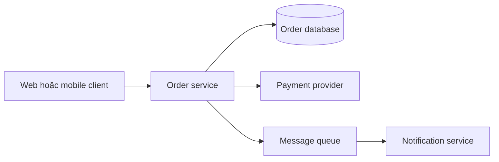
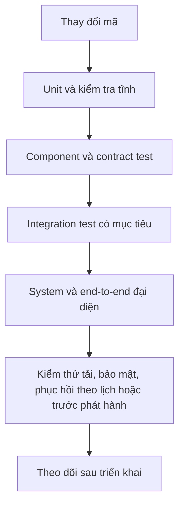

# Điều chỉnh mô hình theo kiến trúc thay vì áp tỷ lệ ca cố định

## Mục tiêu học tập

Sau bài học này, người học có thể:

- Giải thích vì sao mô hình phân bổ kiểm thử cần phản ánh kiến trúc, rủi ro và cách hệ thống được sử dụng.
- Phân biệt các cấp kiểm thử và lựa chọn cấp phù hợp với từng loại thuộc tính hoặc ranh giới kiến trúc.
- Phân bổ kiểm thử giữa unit, component, contract, integration, end-to-end và kiểm thử phi chức năng theo mục tiêu.
- Nhận diện kiểm thử trùng lặp, khoảng trống kiểm thử và các điểm phụ thuộc khiến phản hồi chậm hoặc không ổn định.
- Điều chỉnh danh mục kiểm thử khi kiến trúc, lưu lượng thay đổi, rủi ro hoặc cách triển khai thay đổi.
- Đánh giá hiệu quả phân bổ bằng độ bao phủ rủi ro, thời gian phản hồi, độ tin cậy và chi phí bảo trì.

## 1. Vì sao không nên áp một tỷ lệ ca kiểm thử cố định?

Trong phạm vi **VALIDATION_TESTING_STRATEGY**, phân bổ kiểm thử là quyết định về việc kiểm tra điều gì, ở cấp nào, bằng cách nào và với mức đầu tư bao nhiêu. Một mô hình kiểm thử hữu ích cần giúp nhóm phát hiện lỗi sớm, kiểm tra đúng các ranh giới có rủi ro và cung cấp bằng chứng đủ tin cậy để đưa ra quyết định.

Các tỷ lệ như “phần lớn là unit test, ít hơn là integration test, và chỉ một số ít là end-to-end” có thể được dùng như kinh nghiệm tham khảo. Tuy nhiên, nếu biến một tỷ lệ thành chỉ tiêu bắt buộc cho mọi hệ thống, nhóm dễ tối ưu số lượng thay vì tối ưu khả năng phát hiện lỗi. Một ứng dụng xử lý tính toán phức tạp trong một tiến trình có cấu trúc kiểm thử khác với một nền tảng gồm nhiều dịch vụ, hàng đợi, cơ sở dữ liệu và nhà cung cấp bên ngoài.

Ví dụ, một hệ thống có nhiều quy tắc tính giá cần nhiều kiểm thử ở mức hàm hoặc thành phần để kiểm tra nhanh các trường hợp biên. Một hệ thống microservices có thể cần đầu tư đáng kể vào contract test và integration test tại các ranh giới giữa dịch vụ. Một ứng dụng di động có nhiều khác biệt theo thiết bị, hệ điều hành và trạng thái mạng có thể cần kiểm thử trên thiết bị thật và kiểm thử hành trình người dùng. Áp cùng một tỷ lệ ca cho cả ba trường hợp không phản ánh được rủi ro của chúng.

Mô hình phân bổ nên được quyết định từ các câu hỏi:

- Kiến trúc gồm những thành phần, lớp, dịch vụ và ranh giới nào?
- Lỗi có thể xuất hiện ở đâu: trong logic, giao tiếp, cấu hình, dữ liệu, hạ tầng hay hành trình người dùng?
- Những thuộc tính nào quan trọng nhất: tính đúng đắn, bảo mật, độ trễ, khả năng sẵn sàng, khả năng phục hồi hay tương thích?
- Cấp kiểm thử nào phát hiện được loại lỗi đó với chi phí và thời gian phản hồi hợp lý?
- Có thể kiểm tra cùng một hành vi ở cấp thấp hơn, ổn định hơn và ít tốn kém hơn không?
- Những phần nào bắt buộc phải được xác minh trong môi trường gần với thực tế?

Tỷ lệ số lượng test có thể là một chỉ báo quan sát sau khi thiết kế danh mục, nhưng không phải mục tiêu thiết kế duy nhất.

## 2. Hiểu kiến trúc trước khi phân bổ kiểm thử

Kiến trúc quyết định cách các thành phần phối hợp và những nơi có thể phát sinh lỗi. Trước khi chọn cấp kiểm thử, nhóm cần có bức tranh đủ rõ về cấu trúc hệ thống và luồng dữ liệu.

### 2.1. Những yếu tố kiến trúc cần xem xét

| Yếu tố | Câu hỏi cho chiến lược kiểm thử | Hệ quả đối với phân bổ |
|---|---|---|
| Ranh giới module | Module có thể kiểm tra độc lập không? Hợp đồng giữa module có rõ không? | Tăng kiểm thử unit/component ở nơi logic được cô lập; thêm contract test tại giao diện. |
| Ranh giới dịch vụ | Các dịch vụ giao tiếp đồng bộ hay bất đồng bộ? | Cần kiểm tra hợp đồng, timeout, retry, thứ tự sự kiện và trạng thái giữa dịch vụ. |
| Lưu trữ dữ liệu | Có dùng chung database, nhiều database hay event store? | Kiểm tra schema, transaction, migration, tính nhất quán và quyền truy cập ở ranh giới dữ liệu. |
| Hạ tầng triển khai | Container, serverless, máy ảo hay thiết bị biên? | Cần kiểm tra cấu hình, khởi động, scaling, quyền, network và khả năng phục hồi phù hợp. |
| Giao diện người dùng | Web, mobile, desktop hay API client? | Bổ sung kiểm thử giao diện, trình duyệt, thiết bị, khả năng truy cập và hành trình quan trọng. |
| Phụ thuộc bên ngoài | Có nhà cung cấp hoặc nền tảng dùng chung nào? | Dùng contract test, sandbox hoặc mô phỏng; xác minh một số luồng tích hợp thật. |
| Cách phát hành | Triển khai đồng bộ, độc lập, canary hay feature flag? | Cần kiểm tra tương thích phiên bản, rollout, rollback và trạng thái giữa các phiên bản. |
| Mức độ quan trọng | Thành phần nào ảnh hưởng đến tiền, dữ liệu, an toàn hoặc hoạt động cốt lõi? | Tăng chiều sâu kiểm thử và bằng chứng ở các vùng rủi ro cao. |

### 2.2. Lập sơ đồ thành phần và luồng chính

Ví dụ một hệ thống đặt hàng đơn giản có thể gồm giao diện, dịch vụ đơn hàng, dịch vụ thanh toán, kho dữ liệu và hệ thống thông báo:

Từ sơ đồ này, nhóm có thể xác định các câu hỏi kiểm thử khác nhau:

- Quy tắc tính tổng tiền và chuyển trạng thái có thể kiểm tra ở cấp unit hoặc component.
- Cấu trúc request/response giữa Order service và Payment provider cần contract test.
- Cách Order service ghi dữ liệu và phát thông điệp cần integration test với database và queue phù hợp.
- Hành trình từ người mua xác nhận đến khi nhận mã đơn hàng cần một số end-to-end test.
- Hành vi khi payment provider chậm, queue bị đầy hoặc notification service tạm ngừng cần kiểm thử lỗi và khả năng phục hồi.

Không cần đưa mọi thành phần vào mọi ca kiểm thử. Mỗi phép kiểm tra nên tập trung vào câu hỏi cụ thể và ranh giới cần xác minh.

## 3. Các cấp kiểm thử và vai trò trong danh mục

Các cấp kiểm thử khác nhau về phạm vi, độ cô lập, tốc độ phản hồi và loại lỗi có thể phát hiện. Tên gọi có thể thay đổi giữa các tổ chức; điều quan trọng là định nghĩa rõ hệ thống nào được đưa vào phép kiểm tra và phụ thuộc nào được thay thế.

### 3.1. Unit test

Unit test kiểm tra đơn vị logic nhỏ trong điều kiện cô lập, chẳng hạn hàm, lớp hoặc module nhỏ. Phụ thuộc thường được thay bằng stub, mock hoặc fake.

Phù hợp để kiểm tra:

- Quy tắc nghiệp vụ, phép tính, chuyển đổi dữ liệu và điều kiện biên.
- Nhánh lỗi, giá trị null, dữ liệu sai định dạng và trường hợp ngoại lệ.
- Các bất biến hoặc quy tắc phân quyền ở phạm vi logic có thể kiểm tra độc lập.
- Hành vi retry, timeout hoặc chuyển trạng thái khi các điều kiện được mô phỏng.

Unit test thường chạy nhanh và dễ chẩn đoán. Tuy nhiên, nó không chứng minh được wiring, cấu hình, giao tiếp mạng, schema thực tế hoặc cách các thành phần phối hợp. Nếu mọi phụ thuộc đều được mô phỏng, nhóm có thể bỏ sót sai lệch giữa mô hình giả và hệ thống thật.

### 3.2. Component test

Component test kiểm tra một thành phần có ý nghĩa tương đối độc lập, có thể gồm nhiều lớp bên trong nhưng cô lập khỏi phần lớn hệ thống bên ngoài. Ví dụ: kiểm tra toàn bộ Order service với database kiểm thử riêng và payment provider được mô phỏng.

Phù hợp để kiểm tra:

- Logic xuyên qua nhiều lớp trong cùng một dịch vụ.
- Cách thành phần đọc, ghi và chuyển đổi dữ liệu.
- Cấu hình nội bộ, xử lý lỗi và giao tiếp với adapter.
- Các hành vi quan trọng mà unit test riêng lẻ không thể chứng minh.

Component test tạo được độ tin cậy cao hơn unit test đối với cấu hình và tích hợp nội bộ, nhưng vẫn cần xác định rõ phụ thuộc nào được mô phỏng và phần nào chưa được xác minh.

### 3.3. Contract test

Contract test kiểm tra hai bên giao tiếp có tuân theo hợp đồng đã thống nhất hay không. Hợp đồng có thể mô tả API đồng bộ, sự kiện, schema thông điệp hoặc giao thức trao đổi dữ liệu.

Phù hợp khi:

- Các dịch vụ được phát triển và triển khai độc lập.
- Nhiều consumer dùng chung một provider.
- Schema hoặc hành vi API có nguy cơ thay đổi theo phiên bản.
- Cần xác minh tương thích mà không phải khởi động toàn bộ hệ thống.

Contract test giúp phát hiện sớm thay đổi không tương thích, nhưng không thay thế kiểm thử tích hợp về mạng, xác thực, cấu hình, hiệu năng hoặc trạng thái runtime.

### 3.4. Integration test

Integration test kiểm tra sự phối hợp giữa hai hoặc nhiều thành phần thật, ví dụ ứng dụng với database, service với queue, hoặc hai dịch vụ qua API.

Phù hợp để kiểm tra:

- Kết nối, xác thực và cấu hình thực tế.
- Transaction, migration, serialization và truy vấn dữ liệu.
- Luồng sự kiện, callback, retry và trạng thái bất đồng bộ.
- Khả năng tương thích giữa các phiên bản thành phần.

Integration test có thể chậm và phụ thuộc môi trường. Cần giới hạn phạm vi vào các ranh giới có rủi ro, đồng thời chuẩn bị dữ liệu riêng và cách dọn dẹp đáng tin cậy.

### 3.5. System và end-to-end test

System test kiểm tra hệ thống tích hợp như một tổng thể theo yêu cầu. End-to-end test đi theo hành trình từ điểm bắt đầu đến kết quả cuối cùng, thường qua nhiều thành phần và giao diện.

Phù hợp để kiểm tra:

- Hành trình nghiệp vụ quan trọng mà người dùng thực sự thực hiện.
- Tương tác giữa nhiều lớp, dịch vụ và hạ tầng.
- Cấu hình triển khai và các phụ thuộc cần có trong luồng hoàn chỉnh.
- Những thuộc tính chỉ thể hiện được khi các thành phần phối hợp.

Các kiểm thử này có giá trị cao đối với hành vi xuyên suốt nhưng thường tốn thời gian, khó chẩn đoán và nhạy với dữ liệu hoặc môi trường. Vì vậy, nên chọn các hành trình đại diện và rủi ro cao, thay vì nhân bản mọi tổ hợp kiểm thử ở cấp end-to-end.

### 3.6. Kiểm thử phi chức năng và vận hành

Một danh mục đầy đủ còn có thể gồm kiểm thử hiệu năng, tải, bảo mật, khả năng truy cập, tương thích, khả năng phục hồi, backup/restore và kiểm thử vận hành. Những hoạt động này không nhất thiết nằm trên một tầng duy nhất của kim tự tháp kiểm thử. Chúng cần được đặt ở nơi có thể đo đúng thuộc tính cần chứng minh.

Ví dụ, kiểm tra quyền ở unit test có thể xác minh quy tắc quyết định; kiểm tra bảo mật tích hợp xác minh cấu hình và giao tiếp; kiểm thử xâm nhập hoặc đánh giá chuyên sâu xem xét rủi ro trên hệ thống triển khai. Một thuộc tính quan trọng có thể cần nhiều phương pháp bổ trợ.

## 4. Phân bổ theo ranh giới và loại rủi ro

Thay vì chọn một tỷ lệ số lượng test cho từng cấp, hãy lập bản đồ yêu cầu và rủi ro đến phép kiểm thử phù hợp. Mỗi phép kiểm tra nên có một mục đích rõ ràng, một ranh giới xác định và bằng chứng mong đợi.

| Loại rủi ro hoặc câu hỏi | Cấp kiểm thử ưu tiên | Bằng chứng cần tìm |
|---|---|---|
| Sai công thức, quy tắc hoặc điều kiện biên | Unit / component | Giá trị đầu vào, kết quả mong đợi, nhánh và trạng thái. |
| Module hiểu khác nhau về dữ liệu | Component / contract | Schema, kiểu dữ liệu, trường bắt buộc và quy tắc chuyển đổi. |
| API giữa hai dịch vụ không tương thích | Contract / integration | Kết quả kiểm tra hợp đồng và request/response thực tế. |
| Transaction hoặc migration sai | Integration | Trạng thái dữ liệu trước/sau, rollback và tính toàn vẹn. |
| Hành trình nghiệp vụ bị gián đoạn | System / end-to-end | Kết quả cuối, mã giao dịch và trạng thái xuyên suốt. |
| Lỗi khi phụ thuộc chậm hoặc ngừng hoạt động | Component / integration / resilience | Timeout, retry, circuit breaker, trạng thái cuối và khả năng phục hồi. |
| Chậm khi tải tăng | Load / stress / soak | Throughput thành công, p95/p99, tỷ lệ lỗi và tài nguyên. |
| Quyền truy cập sai | Unit / integration / security test | Quyết định truy cập, danh tính, vai trò, log và hành vi khi bị từ chối. |
| Lỗi chỉ xuất hiện trên thiết bị hoặc trình duyệt cụ thể | UI / compatibility / device test | Phiên bản nền tảng, thao tác, kết quả hiển thị và log thiết bị. |

Một yêu cầu có thể được kiểm tra ở nhiều cấp, nhưng mỗi cấp cần bổ sung một loại bằng chứng khác nhau. Ví dụ, unit test kiểm tra hàm tính tổng tiền; component test kiểm tra dữ liệu giá được đọc đúng; end-to-end test xác nhận người mua nhìn thấy tổng tiền phù hợp trong hành trình đặt hàng. Nếu ba kiểm thử chỉ lặp lại cùng một trường hợp với cùng dữ liệu và không kiểm tra thêm ranh giới nào, danh mục đang có sự trùng lặp.

## 5. Các yếu tố quyết định mức đầu tư cho từng cấp

Mức đầu tư nên phản ánh nhiều yếu tố, không chỉ số lượng thành phần hoặc số lượng yêu cầu.

### 5.1. Mức độ phức tạp và tính ổn định của kiến trúc

- Hệ thống có logic thuần, ít phụ thuộc thường có thể kiểm tra nhiều ở unit và component.
- Hệ thống phân tán cần kiểm tra nhiều ranh giới giao tiếp, trạng thái bất đồng bộ và tương thích phiên bản.
- Hệ thống dùng chung database cần kiểm tra transaction, quyền, migration và tác động chéo giữa các module.
- Hệ thống dùng nhiều nhà cung cấp cần contract test, sandbox và một số kiểm thử tích hợp thật có kiểm soát.
- Hệ thống có nhiều cấu hình triển khai cần kiểm tra cấu hình và tương thích theo các tổ hợp có rủi ro cao.

### 5.2. Tác động và khả năng xảy ra lỗi

Tăng chiều sâu kiểm thử đối với các chức năng có thể gây mất tiền, sai dữ liệu, lộ thông tin, vi phạm quyền hoặc làm gián đoạn hoạt động cốt lõi. Một lỗi giao diện ít ảnh hưởng có thể được kiểm tra bằng một số hành trình đại diện; một lỗi phân quyền hoặc tính tiền cần nhiều trường hợp ở các cấp khác nhau.

### 5.3. Khả năng phát hiện lỗi ở cấp thấp

Nếu một lỗi có thể được phát hiện chính xác bằng unit test, việc chỉ dựa vào end-to-end test sẽ khiến phản hồi chậm và khó xác định nguyên nhân. Nếu lỗi phụ thuộc vào cấu hình mạng hoặc hợp đồng giữa hai dịch vụ, unit test đơn lẻ không đủ. Hãy đặt phép kiểm thử ở cấp thấp nhất có thể chứng minh đúng điều cần kiểm tra, rồi bổ sung phép kiểm tra ở ranh giới cao hơn khi có rủi ro thực tế.

### 5.4. Chi phí thực thi và bảo trì

Chi phí bao gồm thời gian chạy, tài nguyên môi trường, công chuẩn bị dữ liệu, công xử lý lỗi không ổn định và công cập nhật khi giao diện hoặc kiến trúc thay đổi. Một kiểm thử có phạm vi lớn nhưng thường xuyên thất bại vì môi trường không ổn định có thể tiêu tốn nhiều nguồn lực mà không tạo ra bằng chứng đáng tin cậy.

Không nên loại bỏ kiểm thử chỉ vì nó chậm nếu nó bảo vệ một rủi ro nghiêm trọng. Thay vào đó, hãy tìm cách giảm thời gian, cô lập dữ liệu, chạy theo lịch phù hợp hoặc chọn một tập đại diện đủ tin cậy.

### 5.5. Tốc độ phản hồi cần thiết

Lỗi trong logic cơ bản nên được phát hiện ngay trong vòng phát triển. Lỗi tích hợp cần được phát hiện trước khi nhiều thay đổi tích lũy. Hành trình xuyên suốt có thể chạy ở pipeline sau khi build hoặc trước phát hành. Kiểm thử tải lớn, phục hồi và kiểm thử trên nhiều cấu hình có thể chạy theo lịch hoặc ở môi trường chuyên biệt nếu chi phí cao.

Phân bổ theo thời điểm giúp nhóm có phản hồi sớm mà vẫn giữ được các phép kiểm tra rộng cần thiết.

## 6. Điều chỉnh theo từng kiểu kiến trúc

Không có một mô hình phân bổ phù hợp cho mọi kiến trúc. Các ví dụ dưới đây minh họa cách thay đổi trọng tâm kiểm thử.

### 6.1. Ứng dụng nguyên khối (monolith)

Một ứng dụng nguyên khối thường có nhiều module cùng chạy trong một tiến trình và có thể chia sẻ cơ sở dữ liệu. Nhóm có thể tập trung vào:

- Unit test cho quy tắc nghiệp vụ, thuật toán và điều kiện biên.
- Component test cho từng module hoặc nhóm chức năng.
- Integration test cho database, transaction, migration và các adapter bên ngoài.
- Một số end-to-end test cho hành trình quan trọng và cấu hình triển khai.

Rủi ro đáng chú ý là coupling giữa module, thay đổi schema ảnh hưởng nhiều chức năng và tác động phụ trong cùng tiến trình. Cần kiểm tra tương tác giữa các module có chia sẻ trạng thái hoặc dữ liệu, không chỉ từng module độc lập.

### 6.2. Microservices

Với microservices, dịch vụ có thể được triển khai độc lập và giao tiếp qua API hoặc message. Nhóm nên đầu tư vào:

- Unit và component test cho logic bên trong mỗi dịch vụ.
- Contract test giữa consumer và provider để kiểm tra tương thích.
- Integration test tại các ranh giới có rủi ro về mạng, xác thực, dữ liệu và thông điệp.
- Một số end-to-end test cho hành trình xuyên nhiều dịch vụ.
- Resilience test cho timeout, retry, circuit breaker, queue, sự kiện trùng và thứ tự không bảo đảm.

Không nên tạo quá nhiều end-to-end test bao phủ mọi tổ hợp dịch vụ. Khi có nhiều dịch vụ, số tổ hợp có thể tăng rất nhanh và làm bộ kiểm thử dễ hỏng. Contract test cùng kiểm thử tích hợp có mục tiêu thường cung cấp phản hồi nhanh và định vị lỗi rõ hơn.

### 6.3. Hệ thống hướng sự kiện

Hệ thống hướng sự kiện cần quan tâm đến schema sự kiện, khả năng tương thích consumer, thứ tự, trùng lặp, retry và xử lý lại.

Phân bổ kiểm thử có thể gồm:

- Unit test cho logic xử lý sự kiện và chuyển trạng thái.
- Contract/schema test cho producer và consumer.
- Integration test với broker hoặc queue để kiểm tra ack, retry, partition và dead-letter queue.
- Kiểm thử end-to-end cho một số luồng sự kiện quan trọng.
- Kiểm thử khả năng phục hồi khi consumer dừng, khởi động lại hoặc xử lý lại thông điệp.

Kết quả cần được xác minh ở trạng thái cuối của nghiệp vụ, không chỉ ở việc producer gửi được thông điệp.

### 6.4. Ứng dụng web và di động

Ứng dụng web cần xem xét trình duyệt, kích thước màn hình, trạng thái phiên, khả năng truy cập và tương tác với API. Ứng dụng di động còn có khác biệt về thiết bị, hệ điều hành, quyền, mạng không ổn định, hoạt động nền và vòng đời ứng dụng.

Có thể phân bổ:

- Unit/component test cho logic giao diện, trạng thái và quy tắc ở phía client.
- API contract và integration test cho giao tiếp với backend.
- UI test cho thành phần và hành vi quan trọng.
- End-to-end test cho hành trình đăng nhập, thanh toán, gửi biểu mẫu hoặc thao tác cốt lõi.
- Kiểm thử tương thích trên một tập thiết bị và phiên bản nền tảng đại diện theo dữ liệu sử dụng.

Không cần chạy mọi ca trên mọi thiết bị. Hãy chọn ma trận thiết bị dựa trên mức sử dụng, rủi ro và khác biệt nền tảng; bổ sung kiểm tra trên thiết bị thật cho các hành vi phụ thuộc phần cứng hoặc hệ điều hành.

### 6.5. Nền tảng dữ liệu và pipeline xử lý

Với hệ thống dữ liệu, rủi ro có thể nằm ở schema, chất lượng dữ liệu, biến đổi, thứ tự xử lý, tính đầy đủ và độ mới của dữ liệu.

Phân bổ phù hợp có thể gồm:

- Unit test cho biểu thức, phép biến đổi và quy tắc làm sạch.
- Component test cho job hoặc pipeline trong môi trường cô lập.
- Contract/schema test giữa nguồn dữ liệu và consumer.
- Integration test cho storage, queue, scheduler và quyền truy cập.
- Kiểm thử dữ liệu đầu-cuối để đối chiếu số bản ghi, tổng hợp, tính duy nhất và độ mới.
- Kiểm thử khôi phục hoặc chạy lại để xác minh không mất hay nhân đôi dữ liệu.

### 6.6. Hệ thống cũ hoặc khó cô lập

Hệ thống cũ có thể thiếu hợp đồng rõ ràng, dữ liệu khó tạo và phụ thuộc vào môi trường không thể tái tạo. Trong trường hợp này, cần lập bộ kiểm thử đặc trưng hành vi (characterization tests) để ghi nhận hành vi hiện tại trước khi thay đổi. Có thể dùng test harness, adapter hoặc môi trường giả lập để cô lập một phần, nhưng phải giữ một số kiểm thử tích hợp đại diện để xác nhận hệ thống vẫn tương tác đúng.

## 7. Xây dựng danh mục kiểm thử từ yêu cầu và rủi ro

Một cách thực tế để phân bổ là bắt đầu từ hành trình hoặc yêu cầu quan trọng, xác định các ranh giới và loại lỗi có thể xảy ra, sau đó chọn phép kiểm thử ở cấp phù hợp.

Ví dụ với yêu cầu: “Một mã yêu cầu đặt hàng chỉ tạo tối đa một đơn hàng dù client gửi lại nhiều lần.”

| Câu hỏi cần chứng minh | Phép kiểm thử | Vì sao chọn cấp này |
|---|---|---|
| Hàm xử lý mã chống lặp có phân biệt mã mới và mã đã dùng không? | Unit test | Bao phủ nhanh các trường hợp logic và biên. |
| Order service có lưu khóa chống lặp và đơn hàng trong cùng quy trình nhất quán không? | Component test với database kiểm thử | Kiểm tra nhiều lớp nội bộ và trạng thái dữ liệu. |
| Hợp đồng API có yêu cầu và trả lại kết quả nhất quán khi gửi lặp không? | Contract test | Kiểm tra kỳ vọng giữa client và service. |
| Database có bảo đảm tính duy nhất khi hai request đến đồng thời không? | Integration test với database thật của môi trường kiểm thử | Kiểm tra ràng buộc và transaction thực tế. |
| Người mua có nhận cùng mã đơn hàng khi thao tác gửi lại trong hành trình hoàn chỉnh không? | Một end-to-end test đại diện | Xác nhận hành vi người dùng qua các thành phần cần thiết. |

Ví dụ này có nhiều phép kiểm thử vì mỗi phép kiểm tra một ranh giới hoặc rủi ro riêng. Nếu một test ở cấp thấp đã chứng minh đầy đủ một quy tắc, không cần lặp lại hàng chục lần ở cấp cao hơn trừ khi có lý do về tích hợp hoặc trải nghiệm người dùng.

### 7.1. Tránh kiểm thử trùng lặp

Hai kiểm thử có thể cùng kiểm tra một kết quả nhưng khác nhau về giá trị nếu chúng kiểm tra các đường đi hoặc ranh giới khác nhau. Ngược lại, hai test có thể trùng lặp nếu dùng cùng dữ liệu, cùng điều kiện, cùng logic và không bổ sung bằng chứng.

Khi rà soát trùng lặp, hãy hỏi:

- Hai test có phát hiện được các loại lỗi khác nhau không?
- Chúng chạy ở ranh giới khác nhau hay chỉ lặp lại cùng một đường đi?
- Một test có thể thay thế test kia mà không làm mất bằng chứng quan trọng không?
- Có thể chuyển phần kiểm tra logic xuống cấp thấp hơn và giữ một kiểm tra tích hợp đại diện không?
- Test có đang lặp lại vì thiếu contract test hoặc thiếu khả năng cô lập thành phần không?

### 7.2. Nhận diện khoảng trống kiểm thử

Khoảng trống thường xuất hiện ở các ranh giới: dữ liệu đi qua API, transaction giữa dịch vụ, cấu hình môi trường, callback bất đồng bộ, quyền truy cập hoặc thay đổi phiên bản. Một sơ đồ kiến trúc có đánh dấu các ranh giới đã được kiểm thử giúp phát hiện những vùng chưa có bằng chứng.

Không nên đánh giá độ bao phủ chỉ bằng số dòng code hoặc số lượng test. Cần xem xét yêu cầu quan trọng, rủi ro, kịch bản, ranh giới và điều kiện vận hành.

## 8. Tổ chức danh mục theo tốc độ phản hồi

Các bộ kiểm thử có thể được tổ chức thành nhiều vòng thực thi để cân bằng tốc độ và độ rộng kiểm tra. Ví dụ:

Đây là thứ tự tổ chức thường gặp, không phải quy tắc bắt buộc cho mọi pipeline. Một contract test có thể chạy sớm ngay khi thay đổi schema; một integration test chuyên biệt có thể chạy trong pipeline của dịch vụ; kiểm thử tải lớn có thể chạy ở môi trường riêng trước một mốc phát hành.

### 8.1. Vòng phản hồi nhanh

Vòng này nên gồm các kiểm thử nhanh, ổn định và dễ chẩn đoán như unit test, lint, static analysis và một phần component test. Mục tiêu là phát hiện lỗi logic và lỗi cấu trúc ngay khi thay đổi được tạo ra.

### 8.2. Vòng tích hợp

Vòng này kiểm tra contract, database, queue, adapter và các ranh giới có nguy cơ sai lệch. Nên sử dụng dữ liệu cô lập, môi trường ổn định và ghi lại phiên bản phụ thuộc để kết quả có thể tái hiện.

### 8.3. Vòng hệ thống và phát hành

Vòng này chạy các hành trình end-to-end quan trọng, kiểm thử phi chức năng và các kịch bản phục hồi cần môi trường gần production. Chỉ chọn các kịch bản có giá trị cao để tránh tạo bộ test quá chậm và dễ nhiễu.

### 8.4. Kiểm thử sau triển khai

Smoke test, synthetic monitoring, metric nghiệp vụ và theo dõi SLO cung cấp bằng chứng về hành vi trong môi trường thật. Chúng bổ sung cho kiểm thử trước phát hành, không thay thế kiểm thử cần thiết trước khi thay đổi được đưa đến người dùng.

## 9. Đo hiệu quả của mô hình phân bổ

Sau khi xây dựng danh mục, nhóm cần đánh giá nó có thực sự phát hiện rủi ro với chi phí hợp lý hay không. Các chỉ số có thể xem xét:

- **Thời gian phản hồi**: từ lúc thay đổi được tạo đến khi có kết quả kiểm thử hữu ích.
- **Thời gian chẩn đoán**: thời gian xác định được thành phần hoặc ranh giới gây lỗi.
- **Tỷ lệ lỗi được phát hiện trước phát hành**: phân loại theo cấp kiểm thử và loại rủi ro.
- **Tỷ lệ test không ổn định**: số lần kết quả thay đổi không do thay đổi sản phẩm hoặc điều kiện kiểm thử.
- **Chi phí thực thi và bảo trì**: thời gian pipeline, tài nguyên môi trường và công sửa test.
- **Độ bao phủ rủi ro quan trọng**: tỷ lệ rủi ro hoặc yêu cầu trọng yếu có phép kiểm chứng phù hợp và bằng chứng cập nhật.
- **Lỗi lọt ra môi trường sử dụng**: phân loại theo nguyên nhân để xác định khoảng trống của danh mục.

Không có chỉ số đơn lẻ nào chứng minh mô hình tốt. Tỷ lệ phát hiện lỗi trước phát hành cao có thể phản ánh chất lượng kiểm thử tốt, nhưng cũng có thể do sản phẩm thay đổi nhiều hoặc chất lượng phát triển chưa ổn định. Cần kết hợp nhiều chỉ số và xem xét xu hướng qua các phiên bản.

### 9.1. Đọc số liệu theo nguyên nhân

Nếu end-to-end test thường xuyên thất bại do dữ liệu dùng chung, vấn đề có thể nằm ở cô lập môi trường chứ không phải kiến trúc ứng dụng. Nếu contract test phát hiện nhiều thay đổi không tương thích, cần xem lại quy trình quản lý phiên bản API. Nếu nhiều lỗi chỉ được phát hiện ở production, hãy phân tích xem thiếu kiểm thử ở ranh giới nào, thiếu dữ liệu đại diện hay mục tiêu chất lượng chưa rõ.

Đừng tăng số lượng test một cách máy móc khi nguyên nhân là cấu hình, quan sát hoặc quy trình phát hành. Điều chỉnh đúng điểm yếu sẽ cải thiện độ tin cậy tốt hơn.

## 10. Điều chỉnh mô hình khi kiến trúc thay đổi

Mô hình phân bổ không nên được giữ nguyên khi hệ thống thay đổi đáng kể. Các sự kiện có thể kích hoạt rà soát gồm:

- Tách một module thành dịch vụ độc lập hoặc hợp nhất nhiều dịch vụ.
- Thay đổi giao thức, schema, cơ sở dữ liệu hoặc cơ chế đồng bộ.
- Thêm nhà cung cấp bên ngoài hoặc thay đổi phiên bản API.
- Chuyển từ triển khai cố định sang container, serverless hoặc nền tảng khác.
- Thay đổi hành trình người dùng, mức tải hoặc yêu cầu dịch vụ.
- Xuất hiện lỗi production cho thấy một ranh giới chưa được kiểm tra.
- Bộ kiểm thử trở nên chậm, không ổn định hoặc tốn kém vượt mức chấp nhận.

Khi rà soát, nhóm nên cập nhật sơ đồ kiến trúc, danh sách rủi ro, ma trận truy vết và danh mục kiểm thử. Mỗi phép kiểm thử cần được xem xét để xác định còn phù hợp, cần chuyển cấp, cần bổ sung hoặc có thể loại bỏ. Những test phụ thuộc vào hành vi cũ cần được đánh giá trước khi sửa hoặc xóa.

## 11. Ví dụ điều chỉnh mô hình khi tách dịch vụ

Giả sử ban đầu hệ thống đặt hàng là một ứng dụng nguyên khối. Các quy tắc tính tiền, tạo đơn và cập nhật tồn kho được kiểm tra chủ yếu bằng unit test, component test và một số end-to-end test.

Sau đó, nhóm tách thanh toán và tồn kho thành hai dịch vụ độc lập. Kiến trúc mới có thêm API, message queue và callback. Mô hình kiểm thử cần thay đổi:

| Vùng thay đổi | Rủi ro mới hoặc tăng lên | Điều chỉnh kiểm thử |
|---|---|---|
| Order service gọi Payment service | Sai schema, timeout, retry tạo giao dịch trùng | Contract test, integration test và mô phỏng timeout/retry. |
| Inventory service nhận sự kiện | Sự kiện lặp hoặc đến sai thứ tự làm sai tồn kho | Schema test, kiểm thử idempotency, thứ tự và xử lý lại thông điệp. |
| Dịch vụ triển khai độc lập | Phiên bản consumer và provider không tương thích | Kiểm tra tương thích ngược và chiến lược triển khai nhiều phiên bản. |
| Luồng đặt hàng qua nhiều dịch vụ | Trạng thái cuối không hội tụ hoặc lỗi giữa chừng | Một số end-to-end test và resilience test có mục tiêu. |
| Quan sát hệ thống phân tán | Khó truy vết nguyên nhân khi giao dịch thất bại | Kiểm tra correlation ID, log, metric và trace xuyên dịch vụ. |

Nhóm vẫn giữ unit test cho logic tính tiền và quy tắc nội bộ. Phần tăng thêm tập trung vào các ranh giới mới và rủi ro phát sinh từ việc triển khai độc lập. Không cần chuyển mọi phép kiểm thử cũ thành end-to-end test; cần giữ chúng ở cấp phù hợp và bổ sung bằng chứng cho kiến trúc mới.

## 12. Mẫu rà soát phân bổ kiểm thử

Khi lập kế hoạch hoặc rà soát danh mục, có thể dùng bảng sau:

| Trường | Nội dung cần ghi |
|---|---|
| Thành phần hoặc hành trình | Module, dịch vụ, API, luồng dữ liệu hoặc hành trình người dùng. |
| Ranh giới kiến trúc | Giao diện, database, queue, nhà cung cấp, thiết bị hoặc môi trường. |
| Yêu cầu và rủi ro | Điều cần chứng minh và hậu quả nếu lỗi. |
| Cấp kiểm thử | Unit, component, contract, integration, system, end-to-end hoặc phi chức năng. |
| Lý do chọn cấp | Vì sao cấp này có thể phát hiện lỗi với chi phí phù hợp. |
| Phụ thuộc và dữ liệu | Hệ thống thật hay mô phỏng, dữ liệu nào, cách cô lập và dọn dẹp. |
| Bằng chứng mong đợi | Kết quả, log, trace, metric, trạng thái dữ liệu hoặc báo cáo. |
| Tần suất và vị trí chạy | Mỗi commit, mỗi build, theo lịch, trước phát hành hoặc sau triển khai. |
| Chủ sở hữu | Nhóm duy trì test, môi trường và xử lý khi thất bại. |
| Giới hạn | Phần chưa kiểm tra, giả định hoặc điều kiện chưa đại diện. |

Một mục trong bảng chỉ được xem là có độ bao phủ khi có phép kiểm thử phù hợp và bằng chứng được cập nhật. Việc ghi tên một cấp kiểm thử vào kế hoạch không chứng minh rằng nó đã được triển khai hoặc chạy thành công.

## 13. Những sai lầm thường gặp

- **Áp tỷ lệ cố định cho mọi hệ thống**: mô hình không phản ánh kiến trúc và rủi ro thực tế. Hãy bắt đầu từ ranh giới và loại lỗi cần phát hiện.
- **Đồng nhất số lượng test với độ bao phủ**: nhiều ca có thể cùng kiểm tra một đường đi. Hãy đo theo yêu cầu, rủi ro, kịch bản và ranh giới.
- **Đưa mọi thứ lên end-to-end**: bộ test chậm, khó chẩn đoán và dễ phụ thuộc môi trường. Hãy chuyển logic có thể cô lập xuống cấp thấp hơn và giữ hành trình đại diện.
- **Chỉ dùng unit test**: test có thể bỏ sót cấu hình, hợp đồng, transaction và giao tiếp thật. Hãy bổ sung kiểm thử ở các ranh giới quan trọng.
- **Bỏ qua contract test trong kiến trúc dịch vụ**: thay đổi API có thể chỉ bị phát hiện khi chạy toàn bộ hệ thống. Hãy kiểm tra tương thích giữa consumer và provider sớm.
- **Mô phỏng mọi phụ thuộc**: test double có thể lệch hợp đồng thật. Hãy xác minh hợp đồng và duy trì kiểm thử tích hợp đại diện.
- **Lặp lại cùng kịch bản ở nhiều cấp mà không có mục đích**: chi phí tăng nhưng bằng chứng không tăng tương ứng. Hãy xác định câu hỏi riêng của từng test.
- **Không rà soát khi kiến trúc thay đổi**: danh mục cũ không bao phủ ranh giới mới. Hãy cập nhật sơ đồ, rủi ro và ma trận kiểm thử sau thay đổi lớn.
- **Chỉ tối ưu tốc độ pipeline**: cắt bỏ kiểm thử quan trọng có thể làm tăng lỗi lọt ra ngoài. Hãy cân bằng tốc độ với mức bảo vệ cần thiết.

## 14. Quy trình xây dựng và cập nhật mô hình phân bổ

Nhóm có thể áp dụng quy trình sau:

1. **Thu thập bối cảnh kiến trúc**: xác định thành phần, ranh giới, luồng dữ liệu, phụ thuộc và cách triển khai.
2. **Xác định hành trình và yêu cầu trọng yếu**: làm rõ kết quả nghiệp vụ và thuộc tính chất lượng cần bảo vệ.
3. **Phân tích rủi ro theo ranh giới**: xem xét lỗi logic, hợp đồng, dữ liệu, cấu hình, mạng, tải và phục hồi.
4. **Chọn cấp kiểm thử**: đặt mỗi câu hỏi kiểm thử ở cấp có thể chứng minh tốt nhất với chi phí phù hợp.
5. **Xác định bằng chứng và phụ thuộc**: ghi rõ dữ liệu, môi trường, test double, nguồn metric và giới hạn.
6. **Tổ chức các vòng phản hồi**: sắp xếp kiểm thử nhanh, kiểm thử tích hợp, kiểm thử hệ thống và kiểm thử chuyên biệt theo thời điểm phù hợp.
7. **Rà soát trùng lặp và khoảng trống**: bỏ phần không tạo thêm bằng chứng, bổ sung kiểm tra cho rủi ro chưa được bảo vệ.
8. **Đo hiệu quả**: theo dõi độ ổn định, thời gian phản hồi, chi phí, khả năng chẩn đoán và lỗi lọt.
9. **Cập nhật theo thay đổi**: xem lại danh mục khi kiến trúc, lưu lượng, phụ thuộc hoặc mức rủi ro thay đổi.

## 15. Tự kiểm tra

Trước khi chốt mô hình phân bổ kiểm thử, hãy tự hỏi:

- Mô hình có dựa trên kiến trúc và ranh giới thực tế của hệ thống không?
- Các rủi ro quan trọng có phép kiểm thử ở cấp phù hợp không?
- Logic có thể kiểm tra nhanh ở cấp thấp đã được kiểm tra ở đó chưa?
- Các hợp đồng, tích hợp, dữ liệu và cấu hình quan trọng đã có bằng chứng riêng chưa?
- End-to-end test có tập trung vào hành trình có giá trị cao không?
- Phụ thuộc được mô phỏng có được kiểm tra tương thích với hợp đồng thật không?
- Có test trùng lặp hoặc khoảng trống tại ranh giới mới không?
- Thời gian chạy, độ ổn định và chi phí bảo trì có phù hợp với giá trị kiểm thử không?
- Khi kiến trúc thay đổi, ai chịu trách nhiệm rà soát và cập nhật danh mục?

## Kết luận

Mô hình phân bổ kiểm thử cần phản ánh kiến trúc, rủi ro và cách hệ thống vận hành. Các tỷ lệ ca kiểm thử cố định chỉ có thể là kinh nghiệm tham khảo; chúng không thay thế việc xác định ranh giới, loại lỗi và bằng chứng cần có. Khi đặt mỗi phép kiểm thử ở cấp phù hợp, kết hợp kiểm tra logic với contract, integration, end-to-end và kiểm thử phi chức năng, nhóm có thể phát hiện lỗi sớm mà vẫn bảo vệ được những hành trình và thành phần quan trọng. Danh mục cần được đo lường và điều chỉnh mỗi khi kiến trúc hoặc rủi ro thay đổi.
