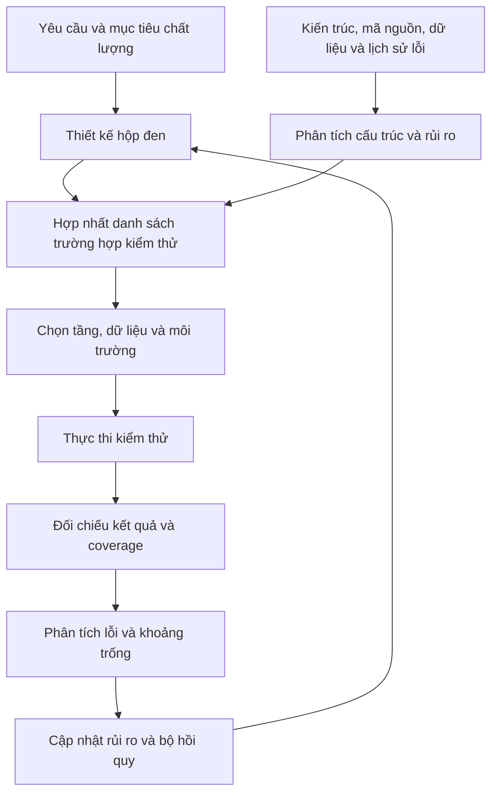

# Phối hợp kiểm tra hộp đen, hộp trắng và thông tin nội bộ bổ sung

Một chiến lược kiểm thử hiệu quả cần nhiều góc nhìn để phát hiện cả hành vi sai mà người dùng có thể quan sát lẫn lỗi ẩn bên trong cách hệ thống xử lý. Kiểm tra hộp đen tập trung vào đầu vào, đầu ra và hành vi được yêu cầu. Kiểm tra hộp trắng sử dụng hiểu biết về cấu trúc và luồng thực thi bên trong để thiết kế trường hợp kiểm thử có chủ đích. Thông tin nội bộ bổ sung như kiến trúc, hợp đồng API, mô hình dữ liệu, cấu hình, log và lịch sử lỗi giúp giải thích bối cảnh, tìm điểm rủi ro và chọn nơi kiểm tra phù hợp.

Ba nguồn này bổ sung cho nhau. Chỉ nhìn từ bên ngoài có thể bỏ sót nhánh xử lý hiếm hoặc đường đi dữ liệu nguy hiểm. Chỉ nhìn vào mã nguồn có thể tạo ra nhiều kiểm thử cho cấu trúc nội bộ nhưng không xác nhận đúng nhu cầu người dùng. Chỉ đọc tài liệu thiết kế mà không kiểm chứng hành vi thực tế có thể duy trì những giả định đã lỗi thời. Vì vậy, nhóm nên phối hợp các cách tiếp cận theo rủi ro, mục tiêu chất lượng và bằng chứng cần thu thập.

## 1. Ba góc nhìn kiểm thử và vai trò của chúng

### Kiểm tra hộp đen

Kiểm tra hộp đen (black-box testing) đánh giá hệ thống thông qua hành vi quan sát được mà không cần dựa vào cấu trúc cài đặt bên trong. Người kiểm thử cung cấp đầu vào, thực hiện thao tác hoặc gửi yêu cầu, sau đó so sánh kết quả thực tế với kết quả mong đợi theo yêu cầu, quy tắc nghiệp vụ hay hợp đồng giao tiếp.

Ví dụ, với API tạo đơn hàng, người kiểm thử có thể gửi một yêu cầu hợp lệ và xác nhận mã phản hồi, mã đơn hàng, tổng tiền và trạng thái được trả về. Họ cũng có thể gửi thiếu địa chỉ giao hàng, số lượng âm hoặc mã giảm giá hết hạn để xác nhận hệ thống từ chối đúng cách và đưa ra thông báo phù hợp.

Kiểm tra hộp đen hữu ích khi:

- Xác nhận yêu cầu chức năng và quy tắc nghiệp vụ từ góc nhìn người dùng hoặc bên gọi dịch vụ.
- Kiểm tra hợp đồng API, giao diện, luồng nghiệp vụ và khả năng tương thích.
- Xác nhận hệ thống xử lý đầu vào hợp lệ, không hợp lệ, biên và bất thường.
- Đánh giá các thuộc tính có thể quan sát như thời gian phản hồi, thông báo lỗi và tính sẵn sàng của chức năng.
- Kiểm thử độc lập với chi tiết cài đặt, đặc biệt khi cấu trúc bên trong có thể thay đổi nhưng hành vi bên ngoài phải được giữ.

Hộp đen không có nghĩa là người kiểm thử không được đọc tài liệu kỹ thuật. Họ có thể dựa vào đặc tả, yêu cầu, hợp đồng API, mô hình trạng thái hoặc quy tắc nghiệp vụ. Điểm phân biệt là thiết kế kiểm thử xuất phát từ hành vi và tiêu chí bên ngoài, không phụ thuộc vào việc phải biết từng nhánh mã được triển khai ra sao.

### Kiểm tra hộp trắng

Kiểm tra hộp trắng (white-box testing) sử dụng hiểu biết về cấu trúc nội bộ để thiết kế và đánh giá kiểm thử. Người kiểm thử có thể xem mã nguồn, luồng điều khiển, điều kiện rẽ nhánh, cấu trúc dữ liệu, xử lý ngoại lệ và luồng dữ liệu giữa các thành phần.

Ví dụ, khi xem hàm tính phí giao hàng, người kiểm thử nhận thấy mã có các nhánh theo khu vực, trọng lượng, giá trị đơn hàng và loại khách hàng. Họ có thể thiết kế đầu vào để thực thi từng nhánh, kiểm tra điều kiện kết hợp và xác nhận các trường hợp ngoại lệ được xử lý đúng.

Kiểm tra hộp trắng hữu ích khi:

- Xác định nhánh, điều kiện hoặc đường đi quan trọng chưa được thực thi.
- Kiểm tra xử lý lỗi, ngoại lệ, vòng lặp và các trường hợp khó suy ra từ đầu ra thông thường.
- Tìm lỗi luồng dữ liệu, trạng thái dùng chung, điều kiện tranh chấp và xử lý tài nguyên.
- Xác minh các đường kiểm soát bảo mật, chẳng hạn mọi nhánh truy cập dữ liệu đều áp dụng kiểm tra quyền.
- Hỗ trợ kiểm thử đơn vị, phân tích tĩnh, kiểm tra độ phủ và điều tra lỗi khó tái hiện.

Hộp trắng không chỉ là chạy công cụ đo coverage. Người kiểm thử cần hiểu điều kiện nào có ý nghĩa, bất biến nào phải được giữ và đầu ra nào chứng minh hành vi đúng. Một dòng mã được thực thi không có nghĩa kết quả của nó đã được xác nhận.

### Thông tin nội bộ bổ sung và cách tiếp cận hộp xám

Thông tin nội bộ bổ sung là dữ liệu kỹ thuật hoặc vận hành giúp người kiểm thử hiểu hệ thống và đưa ra giả thuyết kiểm thử tốt hơn. Ví dụ gồm sơ đồ kiến trúc, luồng dữ liệu, hợp đồng giữa dịch vụ, lược đồ cơ sở dữ liệu, cấu hình, feature flag, phân quyền, log, trace, metric, tài liệu quyết định kiến trúc và lịch sử lỗi.

Khi sử dụng một phần thông tin bên trong nhưng vẫn đánh giá hành vi thông qua giao diện hoặc API, cách tiếp cận thường được gọi là kiểm thử hộp xám (grey-box testing). Ví dụ, người kiểm thử biết hệ thống dùng hàng đợi và webhook, nên chủ động tạo tình huống webhook đến trễ hoặc trùng rồi kiểm tra kết quả đơn hàng qua API. Họ sử dụng hiểu biết nội bộ để chọn tình huống, nhưng vẫn xác nhận kết quả theo hành vi quan sát được.

Thông tin nội bộ có thể giúp:

- Nhận diện ranh giới tin cậy, điểm lỗi đơn, phụ thuộc bên ngoài và đường đi dữ liệu nhạy cảm.
- Chọn dữ liệu và trạng thái cần thiết để kích hoạt một tình huống khó xảy ra trong luồng bình thường.
- Liên kết lỗi đã xảy ra với thành phần, nhánh xử lý hoặc thay đổi có liên quan.
- Xác định nơi cần đặt kiểm thử và log, metric hoặc trace cần dùng để điều tra.
- Phân biệt lỗi sản phẩm, lỗi cấu hình, lỗi môi trường và lỗi của dịch vụ phụ thuộc.

Thông tin nội bộ cần được xem xét về độ mới và độ tin cậy. Một sơ đồ có thể không còn phản ánh hệ thống đang chạy; một log có thể thiếu trường quan trọng; một tài liệu API có thể chưa cập nhật phiên bản mới. Hãy xác minh nguồn thông tin trước khi dùng nó làm căn cứ cho tiêu chí kiểm thử.

| Góc nhìn | Cơ sở thiết kế kiểm thử | Câu hỏi chính | Giá trị nổi bật |
|---|---|---|---|
| Hộp đen | Yêu cầu, quy tắc, hợp đồng và hành vi quan sát được | Hệ thống có làm đúng điều đã cam kết không? | Xác nhận chức năng và trải nghiệm theo góc nhìn bên ngoài |
| Hộp trắng | Mã nguồn, luồng điều khiển, dữ liệu và cấu trúc nội bộ | Những nhánh và đường đi quan trọng đã được kiểm tra chưa? | Phát hiện khoảng trống cấu trúc và lỗi xử lý bên trong |
| Hộp xám / thông tin bổ sung | Một phần kiến trúc, dữ liệu, cấu hình và tín hiệu vận hành | Với hiểu biết về bên trong, tình huống nào có thể làm lộ rủi ro? | Tập trung kiểm thử vào các tương tác và điều kiện khó quan sát |

## 2. Kỹ thuật thiết kế kiểm thử hộp đen

Các kỹ thuật hộp đen giúp chọn đầu vào đại diện và tổ hợp điều kiện có khả năng làm lộ sai lệch. Không cần thử mọi giá trị có thể; hãy phân chia miền đầu vào, tìm điểm biên và xác định các quy tắc quyết định quan trọng.

### Phân vùng tương đương

Phân vùng tương đương (equivalence partitioning) chia đầu vào thành các nhóm mà hệ thống được kỳ vọng xử lý tương tự. Chọn một hoặc vài giá trị đại diện từ mỗi nhóm giúp giảm số lượng trường hợp mà vẫn kiểm tra được các hành vi khác nhau.

Ví dụ, số lượng sản phẩm được phép từ 1 đến 20:

| Phân vùng | Giá trị đại diện | Kết quả mong đợi |
|---|---:|---|
| Nhỏ hơn giới hạn tối thiểu | 0 | Từ chối |
| Trong miền hợp lệ | 5 | Chấp nhận |
| Lớn hơn giới hạn tối đa | 21 | Từ chối |
| Không có giá trị hoặc sai kiểu | null hoặc chuỗi | Từ chối theo hợp đồng đầu vào |

Phân vùng cần dựa trên quy tắc thực tế. Nếu giá trị 0 có ý nghĩa khác với số âm, chúng nên được xem là các nhóm riêng.

### Phân tích giá trị biên

Phân tích giá trị biên (boundary value analysis) tập trung vào các giá trị tại và xung quanh giới hạn, vì lỗi thường xuất hiện ở điều kiện so sánh, làm tròn hoặc chuyển trạng thái tại ranh giới.

Với số lượng hợp lệ từ 1 đến 20, hãy kiểm tra ít nhất 0, 1, 2, 19, 20 và 21. Với thời gian hiệu lực, cần xem xét thời điểm ngay trước, đúng tại và ngay sau mốc hết hạn. Với dung lượng tệp, kiểm tra kích thước nhỏ hơn, bằng và lớn hơn giới hạn cho phép.

### Bảng quyết định

Bảng quyết định (decision table testing) phù hợp khi kết quả phụ thuộc vào nhiều điều kiện kết hợp. Ví dụ, một khách hàng được miễn phí giao hàng nếu thuộc hạng thành viên cao cấp hoặc đơn hàng đạt ngưỡng giá trị, nhưng khu vực giao hàng vẫn phải được hỗ trợ.

| Điều kiện | Quy tắc 1 | Quy tắc 2 | Quy tắc 3 | Quy tắc 4 |
|---|---|---|---|---|
| Khu vực được hỗ trợ | Có | Có | Không | Có |
| Thành viên cao cấp | Có | Không | Có | Không |
| Đơn hàng đạt ngưỡng | Không | Có | Có | Không |
| Kết quả | Miễn phí | Miễn phí | Từ chối giao hàng | Tính phí thường |

Bảng cần bao phủ các tổ hợp có ý nghĩa theo chính sách. Nếu điều kiện có thể loại trừ lẫn nhau hoặc một điều kiện không được xét khi điều kiện khác thất bại, cần ghi rõ thứ tự và quy tắc ưu tiên.

### Kiểm thử chuyển trạng thái

Kiểm thử chuyển trạng thái (state transition testing) kiểm tra các trạng thái hợp lệ, sự kiện kích hoạt và hành động được phép. Kỹ thuật này hữu ích với đơn hàng, thanh toán, tài khoản, phê duyệt và quy trình có nhiều bước.

Ví dụ, một đơn hàng có thể chuyển từ `NEW` sang `PAID`, rồi `SHIPPED`, sau đó `DELIVERED`. Từ `NEW`, đơn có thể bị `CANCELLED` theo điều kiện nghiệp vụ; từ `DELIVERED`, việc hủy trực tiếp có thể không hợp lệ. Kiểm thử cần xác nhận cả chuyển trạng thái hợp lệ lẫn yêu cầu chuyển trạng thái bị từ chối.

### Kiểm thử theo ca sử dụng

Kiểm thử theo ca sử dụng (use-case testing) xác nhận luồng hoàn chỉnh từ mục tiêu người dùng đến kết quả. Ngoài luồng chính, hãy xem xét luồng thay thế, lỗi, hủy giữa chừng và khả năng tiếp tục. Ví dụ, trong quy trình thanh toán, người dùng có thể thanh toán thành công, bị từ chối, mất kết nối, quay lại trang trước hoặc đóng trình duyệt trong lúc giao dịch đang xử lý.

Các kỹ thuật này có thể kết hợp. Phân vùng tương đương giảm số lượng đầu vào; giá trị biên tập trung vào giới hạn; bảng quyết định bao phủ tổ hợp quy tắc; chuyển trạng thái và ca sử dụng xác nhận hành vi theo thời gian.

## 3. Kỹ thuật kiểm tra hộp trắng

Hộp trắng giúp xác định phần cấu trúc nào cần được thực thi và kiểm tra. Việc chọn tiêu chí phụ thuộc vào mức độ quan trọng của mã, rủi ro và chi phí. Độ phủ càng cao không tự động đồng nghĩa với chất lượng càng tốt; cần xem xét chất lượng assertion và các trường hợp đầu vào.

### Độ phủ câu lệnh

Độ phủ câu lệnh (statement coverage) đo tỷ lệ câu lệnh có thể thực thi đã được chạy ít nhất một lần trong bộ kiểm thử.

\[
Statement\ Coverage = \frac{\text{Số câu lệnh đã thực thi}}{\text{Tổng số câu lệnh có thể thực thi}} \times 100\%
\]

Chỉ số này giúp phát hiện đoạn mã chưa được chạy. Tuy nhiên, chạy qua một câu lệnh không chứng minh kết quả đúng. Một phép gán có thể được thực thi nhưng giá trị sai vẫn không bị phát hiện nếu kiểm thử không có assertion phù hợp.

### Độ phủ nhánh

Độ phủ nhánh (branch coverage) đo tỷ lệ kết quả của các nhánh điều khiển đã được thực thi. Với điều kiện `if`, thường cần kiểm tra cả nhánh đúng và nhánh sai. Độ phủ nhánh có thể phát hiện khoảng trống mà statement coverage bỏ sót.

Ví dụ:

```java
if (orderTotal >= freeShippingThreshold) {
    shippingFee = 0;
} else {
    shippingFee = standardShippingFee;
}
```

Một kiểm thử có tổng tiền lớn hơn ngưỡng chỉ thực thi nhánh miễn phí. Cần thêm trường hợp dưới ngưỡng để kiểm tra nhánh tính phí. Cũng cần xác nhận giá trị phí thực tế, thay vì chỉ chạy qua cả hai nhánh.

### Độ phủ điều kiện và điều kiện quyết định

Độ phủ điều kiện (condition coverage) xem từng điều kiện con nhận cả giá trị đúng và sai. Độ phủ điều kiện/quyết định (condition/decision coverage) kết hợp việc mỗi điều kiện con có cả hai kết quả với việc toàn bộ quyết định có cả kết quả đúng và sai.

Ví dụ:

```java
if (customer.isActive() && orderTotal >= minimumTotal) {
    approveDiscount();
}
```

Hai điều kiện là trạng thái khách hàng và tổng giá trị đơn hàng. Cần thiết kế trường hợp để mỗi điều kiện con lần lượt đúng và sai, đồng thời kiểm tra kết quả của toàn bộ quyết định. Với hệ thống có yêu cầu an toàn hoặc độ tin cậy cao, tiêu chí mạnh hơn như MC/DC có thể được áp dụng theo chuẩn và quy định của lĩnh vực.

### Độ phủ đường đi

Độ phủ đường đi (path coverage) xem xét các đường thực thi qua luồng điều khiển. Với chương trình có nhiều nhánh và vòng lặp, số đường đi có thể tăng rất nhanh hoặc không hữu hạn. Vì vậy, kiểm tra toàn bộ đường đi thường không khả thi. Nhóm cần chọn đường đi quan trọng, các tổ hợp điều kiện có rủi ro cao và giới hạn số lần lặp có ý nghĩa.

### Kiểm thử luồng dữ liệu

Kiểm thử luồng dữ liệu (data-flow testing) tập trung vào nơi biến được định nghĩa, sử dụng và thay đổi. Nó giúp phát hiện biến chưa được khởi tạo, giá trị bị ghi đè, dữ liệu cũ được sử dụng hoặc đường đi mà giá trị nhạy cảm không được kiểm tra đúng cách.

Ví dụ, một biến `discount` được gán theo loại khách hàng nhưng có thể không được cập nhật khi mã giảm giá hết hạn. Kiểm thử nên xác nhận giá trị được khởi tạo, tính toán và sử dụng đúng trong mọi nhánh liên quan.

### Kiểm thử vòng lặp và xử lý ngoại lệ

Với vòng lặp, hãy xem xét số lần lặp bằng 0, 1, nhiều lần, giá trị biên và điều kiện dừng. Với xử lý ngoại lệ, kiểm tra lỗi có thể phát sinh từ đầu vào, cơ sở dữ liệu, mạng và dịch vụ bên ngoài; xác nhận hệ thống giải phóng tài nguyên, giữ trạng thái nhất quán và trả lỗi theo hợp đồng.

### Độ phủ không phải bằng chứng duy nhất

Một bộ kiểm thử đạt 100% statement coverage vẫn có thể bỏ sót lỗi vì:

- Không có assertion kiểm tra kết quả nghiệp vụ.
- Chỉ thử dữ liệu bình thường, thiếu giá trị biên hoặc dữ liệu bất thường.
- Không kiểm tra các tổ hợp điều kiện hoặc thứ tự sự kiện.
- Mock thay thế một phụ thuộc quan trọng và che khuất lỗi tích hợp.
- Kiểm thử thực thi mã nhưng không kiểm tra tác dụng phụ, dữ liệu lưu hoặc quyền truy cập.

Hãy dùng coverage để tìm khoảng trống và định hướng bổ sung kiểm thử. Đừng tối ưu con số bằng cách viết kiểm thử chỉ để thực thi dòng mã hoặc loại bỏ các đoạn mã khó kiểm tra mà không hiểu lý do.

## 4. Thông tin nội bộ bổ sung nên thu thập

Thông tin nội bộ giúp kiểm thử phản ánh cấu trúc và điều kiện vận hành thực tế. Nhóm không cần thu thập mọi loại thông tin cho mọi bài kiểm thử; hãy chọn dữ liệu có liên quan đến rủi ro đang xem xét.

| Nguồn thông tin | Nội dung cần xem | Cách sử dụng trong kiểm thử |
|---|---|---|
| Kiến trúc và sơ đồ triển khai | Thành phần, phụ thuộc, điểm lỗi đơn, ranh giới tin cậy | Chọn kiểm thử tích hợp, chịu lỗi và luồng xuyên dịch vụ |
| Hợp đồng API và sự kiện | Schema, mã lỗi, timeout, retry, phiên bản | Thiết kế kiểm thử hợp đồng và tương thích |
| Mô hình dữ liệu | Quan hệ, ràng buộc, chỉ mục, giao dịch, migration | Chọn dữ liệu biên, kiểm thử đồng thời và tính toàn vẹn |
| Mã nguồn và cấu hình | Nhánh điều kiện, feature flag, giới hạn, quyền | Xác định nhánh và tổ hợp cần kiểm tra |
| Log, metric và trace | Lỗi, độ trễ, tương quan yêu cầu và luồng xử lý | Tái hiện tình huống, xác định điểm quan sát và chẩn đoán |
| Lịch sử lỗi và sự cố | Nguyên nhân, điều kiện kích hoạt, lỗi tái diễn | Bổ sung kiểm thử hồi quy và ưu tiên khu vực dễ lỗi |
| Quyết định kiến trúc và yêu cầu phi chức năng | Đánh đổi, giả định, ngưỡng chất lượng | Kiểm tra giả định và thiết kế kiểm thử hiệu năng, phục hồi |
| Ma trận quyền và vai trò | Quyền đọc, ghi, phê duyệt và phạm vi dữ liệu | Thiết kế kiểm thử phân quyền dương tính và âm tính |

### Xác minh tính cập nhật của thông tin

Trước khi dựa vào một nguồn nội bộ, hãy kiểm tra phiên bản, ngày cập nhật, chủ sở hữu và phạm vi áp dụng. Nếu tài liệu nói một API có thể trả về ba trạng thái nhưng mã hiện tại có thêm trạng thái thứ tư, nhóm cần làm rõ đó là thay đổi chưa cập nhật tài liệu hay lỗi triển khai. Không tự chọn một nguồn làm chuẩn khi có mâu thuẫn.

Với log và trace, cần xác định thời gian, mã tương quan, múi giờ và mức độ đầy đủ. Log thiếu correlation ID có thể khiến các bước của cùng một giao dịch khó ghép lại. Metric tổng hợp có thể che khuất lỗi chỉ xảy ra ở một khách hàng hoặc một vùng triển khai. Hãy dùng nhiều tín hiệu khi cần.

### Bảo vệ dữ liệu và quyền truy cập

Thông tin nội bộ có thể chứa bí mật, dữ liệu cá nhân, token, thông tin khách hàng hoặc chi tiết hạ tầng nhạy cảm. Chỉ truy cập những gì cần cho nhiệm vụ, dùng dữ liệu kiểm thử đã ẩn danh hoặc tổng hợp, giới hạn quyền xem log và không đưa bí mật vào tài liệu kiểm thử hoặc báo cáo không được bảo vệ. Khi cần tái hiện sự cố, tạo dữ liệu mô phỏng giữ được đặc tính kỹ thuật liên quan thay vì sao chép nguyên dữ liệu nhạy cảm.

## 5. Phối hợp ba góc nhìn trong một quy trình kiểm thử

Quy trình phối hợp có thể bắt đầu từ mục tiêu nghiệp vụ, sau đó dùng thông tin nội bộ để tìm điều kiện và thiết kế trường hợp kiểm thử. Cuối cùng, nhóm xác nhận hành vi bên ngoài và kiểm tra các đường thực thi liên quan.



Một cách thực hiện cụ thể:

1. **Xác định hành vi cần bảo vệ:** đọc yêu cầu, tiêu chí nghiệm thu, quy tắc nghiệp vụ và hợp đồng bên ngoài.
2. **Thiết kế hộp đen:** xác định phân vùng đầu vào, giá trị biên, bảng quyết định, trạng thái và luồng người dùng.
3. **Xem thông tin nội bộ:** đọc sơ đồ, hợp đồng, cấu trúc dữ liệu, mã nguồn liên quan và lịch sử lỗi để tìm nhánh, phụ thuộc hoặc điều kiện chưa được đề cập.
4. **Thiết kế hộp trắng:** bổ sung trường hợp cho nhánh, điều kiện, luồng dữ liệu, ngoại lệ và đường xử lý có rủi ro.
5. **Đối chiếu và loại bỏ trùng lặp:** bảo đảm mỗi trường hợp có mục tiêu, dữ liệu, kết quả mong đợi và lý do tồn tại.
6. **Chọn nơi thực thi:** đặt kiểm thử ở tầng phù hợp với tín hiệu cần có, chi phí và thời gian phản hồi.
7. **Đánh giá kết quả:** xem assertion, lỗi, coverage, log và trace; phân biệt lỗi sản phẩm với lỗi môi trường hoặc kiểm thử.
8. **Cập nhật:** bổ sung hồi quy, cập nhật hồ sơ rủi ro và ghi nhận thay đổi trong thông tin nội bộ.

Điểm quan trọng là các trường hợp kiểm thử phải cùng hướng đến mục tiêu chất lượng. Một bộ hộp đen và hộp trắng được tạo riêng rẽ mà không đối chiếu có thể lặp lại nhiều kiểm tra hoặc bỏ sót một quy tắc quan trọng.

## 6. Phân bổ kỹ thuật theo tầng kiểm thử

Hộp đen và hộp trắng không tương ứng một-một với tầng kiểm thử. Cả hai có thể được áp dụng ở unit, component, integration hoặc E2E. Ví dụ, một unit test có thể kiểm tra hộp đen bằng cách xác nhận đầu vào và đầu ra của hàm theo hợp đồng; cũng có thể được thiết kế theo hộp trắng để bao phủ nhánh bên trong. Một E2E test thường được thiết kế theo hành vi bên ngoài, nhưng người viết có thể dùng hiểu biết về kiến trúc và log để chọn tình huống.

| Tầng | Hộp đen có thể tập trung vào | Hộp trắng / thông tin nội bộ có thể bổ sung |
|---|---|---|
| Unit | Hợp đồng hàm, giá trị biên, quy tắc nghiệp vụ | Nhánh, điều kiện, luồng dữ liệu, ngoại lệ |
| Component | Hành vi thành phần, trạng thái và tương tác qua giao diện công khai | Cấu trúc thành phần, feature flag, trạng thái nội bộ cần kiểm chứng |
| Contract | Schema, mã phản hồi và quy tắc tương thích | Mapping, serialization, xử lý phiên bản và các nhánh lỗi |
| Integration | Hành vi phối hợp giữa dịch vụ, cơ sở dữ liệu và hàng đợi | Luồng dữ liệu, giao dịch, retry, xử lý đồng thời và log tương quan |
| E2E | Luồng người dùng hoàn chỉnh và kết quả nghiệp vụ | Sơ đồ phụ thuộc, trạng thái hệ thống, trace và cấu hình môi trường |
| Hiệu năng / phục hồi | Thời gian phản hồi, thông lượng và kết quả sau sự cố | Tài nguyên, hàng đợi, pool kết nối, điểm nghẽn và cơ chế failover |

### Ví dụ ở cấp unit

Một hàm tính phí có hợp đồng đầu vào là khu vực giao hàng, trọng lượng và tổng giá trị đơn hàng. Kiểm thử hộp đen chọn các phân vùng và biên theo chính sách. Khi đọc mã, nhóm thấy có nhánh riêng cho khu vực xa và một nhánh xử lý trọng lượng vượt giới hạn. Kiểm thử hộp trắng bổ sung đầu vào kích hoạt từng nhánh và xác nhận cả giá trị trả về lẫn lỗi mong đợi.

### Ví dụ ở cấp tích hợp

Một dịch vụ đơn hàng gửi sự kiện thanh toán đến hàng đợi. Hộp đen xác nhận đơn chuyển sang trạng thái phù hợp khi nhận kết quả thanh toán. Thông tin kiến trúc cho thấy hàng đợi có thể gửi lại thông điệp và worker có thể chạy đồng thời. Kiểm thử bổ sung gửi cùng thông điệp nhiều lần, đảo thứ tự sự kiện và mô phỏng worker khởi động lại để xác nhận không tạo tác dụng phụ trùng.

### Ví dụ ở cấp E2E

Người dùng hoàn tất một giao dịch và nhìn thấy trang xác nhận. Hộp đen kiểm tra toàn bộ luồng từ chọn sản phẩm đến trạng thái đơn hàng. Trace và log nội bộ giúp nhóm xác nhận yêu cầu đã đi qua dịch vụ giá, đơn hàng và thanh toán theo đúng correlation ID. Nếu luồng thất bại, các tín hiệu này giúp xác định bước gây lỗi mà không biến kiểm thử E2E thành kiểm tra chi tiết từng hàm nội bộ.

## 7. Ví dụ tổng hợp: kiểm thử chức năng áp dụng mã giảm giá

Giả sử hệ thống cho phép khách hàng áp dụng mã giảm giá vào giỏ hàng. Quy tắc quy định mã phải còn hiệu lực, khách hàng thuộc nhóm được phép, tổng đơn đạt ngưỡng tối thiểu và mỗi khách hàng chỉ được sử dụng mã trong giới hạn nhất định.

### Thiết kế hộp đen từ quy tắc

Nhóm lập bảng điều kiện và trường hợp đại diện:

| Trường hợp | Mã còn hiệu lực | Khách hàng đủ điều kiện | Đạt ngưỡng đơn | Còn lượt sử dụng | Kết quả mong đợi |
|---|---|---|---|---|---|
| TC-01 | Có | Có | Có | Có | Áp dụng giảm giá |
| TC-02 | Không | Có | Có | Có | Từ chối vì mã hết hạn |
| TC-03 | Có | Không | Có | Có | Từ chối vì khách hàng không đủ điều kiện |
| TC-04 | Có | Có | Không | Có | Từ chối vì chưa đạt ngưỡng |
| TC-05 | Có | Có | Có | Không | Từ chối vì hết lượt sử dụng |

Tiếp theo, nhóm kiểm tra biên: thời điểm ngay trước, đúng tại và sau khi mã hết hạn; tổng tiền thấp hơn, bằng và cao hơn ngưỡng; lượt sử dụng cuối cùng khi có hai yêu cầu đồng thời. Họ cũng kiểm tra trạng thái giỏ hàng sau khi mã bị từ chối để bảo đảm tổng tiền không bị thay đổi sai.

### Bổ sung từ thông tin nội bộ

Khi xem mô hình dữ liệu và mã nguồn, nhóm phát hiện số lượt sử dụng được cập nhật trong một giao dịch cơ sở dữ liệu, còn bộ nhớ đệm lưu thông tin mã giảm giá trong một khoảng thời gian. Lịch sử lỗi cho thấy từng có trường hợp hai yêu cầu đồng thời cùng đọc thấy lượt sử dụng cuối cùng.

Thông tin này dẫn đến các kiểm thử bổ sung:

- Gửi hai yêu cầu đồng thời khi chỉ còn một lượt sử dụng và xác nhận chỉ một yêu cầu thành công.
- Kiểm tra cập nhật cache sau khi lượt sử dụng cuối cùng được tiêu thụ.
- Mô phỏng lỗi giữa lúc ghi nhận lượt sử dụng và cập nhật giỏ hàng để xác nhận giao dịch nhất quán.
- Gửi lại yêu cầu sau timeout và xác nhận không trừ lượt sử dụng hai lần ngoài chính sách.

### Bổ sung từ hộp trắng

Đọc luồng điều khiển cho thấy mã có nhánh riêng cho loại khách hàng, trạng thái mã, thời gian hiệu lực và số lượt sử dụng. Nhóm dùng branch coverage để xác định nhánh chưa chạy, sau đó kiểm tra assertion cho từng kết quả. Nếu có điều kiện kết hợp, nhóm thiết kế dữ liệu để mỗi điều kiện con nhận cả giá trị đúng và sai. Nếu một nhánh không thể được thực thi do dữ liệu hoặc cấu hình, cần làm rõ đó là mã không cần thiết, cấu hình chưa đúng hay một trường hợp kiểm thử còn thiếu.

### Hợp nhất thành bộ kiểm thử

| Nhóm trường hợp | Nguồn thiết kế | Tầng phù hợp | Mục tiêu |
|---|---|---|---|
| Mã hợp lệ, hết hạn, không đủ điều kiện và không đạt ngưỡng | Hộp đen | Unit / API | Xác nhận quy tắc nghiệp vụ |
| Biên thời gian và ngưỡng giá trị | Hộp đen | Unit / API | Phát hiện lỗi so sánh và làm tròn |
| Nhánh xử lý loại khách hàng và trạng thái mã | Hộp trắng | Unit | Bao phủ luồng điều khiển và xác nhận kết quả |
| Hai yêu cầu tranh lượt cuối | Kiến trúc, lịch sử lỗi | Integration | Xác nhận tính nguyên tử và an toàn đồng thời |
| Cache cũ sau khi sử dụng mã | Thông tin nội bộ | Integration | Xác nhận tính nhất quán cache và dữ liệu gốc |
| Khách hàng áp dụng mã trong quy trình mua hàng | Hộp đen | E2E | Xác nhận trải nghiệm và tổng tiền cuối cùng |

Ví dụ cho thấy một bộ kiểm thử tốt không được hình thành từ một góc nhìn duy nhất. Quy tắc bên ngoài xác định hành vi cần bảo vệ; thông tin nội bộ gợi ý điều kiện và tương tác dễ gây lỗi; cấu trúc mã giúp tìm các nhánh chưa được kiểm tra.

## 8. Đánh giá chất lượng và tính đầy đủ của bộ kiểm thử

Sau khi kết hợp các góc nhìn, nhóm cần đánh giá bộ kiểm thử có bao phủ đúng mục tiêu hay không. Một số câu hỏi hữu ích:

- Mỗi yêu cầu hoặc quy tắc quan trọng có ít nhất một trường hợp kiểm thử và kết quả mong đợi rõ ràng không?
- Các phân vùng, giá trị biên, tổ hợp điều kiện và chuyển trạng thái quan trọng đã được xem xét chưa?
- Các nhánh và đường xử lý có rủi ro cao đã được thực thi và có assertion phù hợp chưa?
- Các tương tác, phụ thuộc, timeout, retry và lỗi môi trường đã được kiểm tra ở tầng phù hợp chưa?
- Lỗi nghiêm trọng trong lịch sử đã có kiểm thử hồi quy hoặc biện pháp kiểm soát tương ứng chưa?
- Các trường hợp kiểm thử có độc lập, ổn định, dễ tái hiện và dễ chẩn đoán không?
- Dữ liệu, cấu hình và môi trường có đại diện cho điều kiện cần kiểm chứng không?
- Có bằng chứng về kết quả, coverage và rủi ro còn lại để hỗ trợ quyết định phát hành không?

### Các chỉ số nên xem cùng nhau

Không nên đánh giá bộ kiểm thử chỉ bằng coverage hoặc số lượng test. Có thể kết hợp:

| Chỉ số hoặc bằng chứng | Điều cần hiểu |
|---|---|
| Requirement / risk coverage | Rủi ro và yêu cầu quan trọng nào đã có kiểm thử? |
| Statement / branch coverage | Phần cấu trúc nào đã được thực thi? |
| Mutation testing (nếu phù hợp) | Kiểm thử có phát hiện được những thay đổi nhỏ làm sai logic không? |
| Defect leakage và lỗi tái diễn | Lỗi nào vẫn lọt ra hoặc lặp lại dù đã có kiểm thử? |
| Flaky test rate | Tín hiệu kiểm thử có ổn định và đáng tin cậy không? |
| Thời gian phản hồi | Kết quả có đến đủ sớm để hỗ trợ quyết định không? |
| Khả năng chẩn đoán | Khi thất bại, nhóm có xác định được nguyên nhân và phạm vi ảnh hưởng không? |

Mutation testing có thể hỗ trợ đánh giá chất lượng assertion bằng cách thay đổi nhỏ mã nguồn, chẳng hạn đổi toán tử so sánh hoặc bỏ một điều kiện, rồi xem kiểm thử có phát hiện hay không. Nếu mutant vẫn sống, có thể kiểm thử chưa đủ nhạy hoặc thay đổi đó không ảnh hưởng đến hành vi cần bảo vệ. Kỹ thuật này có chi phí nên nên áp dụng có chọn lọc cho logic quan trọng.

## 9. Những sai lầm cần tránh khi phối hợp các góc nhìn

- **Coi hộp đen và hộp trắng là hai lựa chọn loại trừ nhau:** chúng trả lời các câu hỏi khác nhau và có thể áp dụng cho cùng một chức năng.
- **Đồng nhất hộp đen với kiểm thử thủ công:** kiểm thử hộp đen có thể được tự động hóa ở API, giao diện và E2E.
- **Đồng nhất hộp trắng với unit test:** hiểu biết về cấu trúc nội bộ cũng hữu ích trong integration, kiểm thử bảo mật và điều tra vận hành.
- **Chạy theo coverage:** coverage cao không chứng minh assertion đúng, dữ liệu đủ đa dạng hoặc yêu cầu được hiểu đúng.
- **Tin tài liệu nội bộ mà không xác minh:** kiến trúc, schema và hợp đồng có thể lỗi thời hoặc khác với môi trường đang chạy.
- **Để chi tiết cài đặt chi phối toàn bộ kiểm thử:** thay đổi cấu trúc bên trong không nên làm hỏng hàng loạt kiểm thử nếu hành vi công khai vẫn đúng.
- **Bỏ qua dữ liệu và môi trường:** một nhánh có thể được bao phủ trong môi trường đơn giản nhưng lỗi vẫn xuất hiện với dữ liệu lớn, quyền khác nhau hoặc dịch vụ chậm.
- **Lặp lại cùng một kiểm tra ở nhiều tầng:** chỉ nên giữ kiểm tra trùng khi mỗi tầng cung cấp bằng chứng riêng có giá trị.
- **Không xem xét lịch sử lỗi:** lỗi đã xảy ra là nguồn quan trọng để thiết kế hồi quy và điều chỉnh ưu tiên.
- **Không bảo vệ thông tin nội bộ:** log, cấu hình và dữ liệu có thể chứa bí mật cần được kiểm soát khi sử dụng cho kiểm thử.

## 10. Quy trình áp dụng trong một lần thay đổi

Với mỗi thay đổi tính năng hoặc kiến trúc, nhóm có thể dùng quy trình ngắn sau:

1. Xác định hành vi và rủi ro nghiệp vụ cần bảo vệ.
2. Thiết kế trường hợp hộp đen từ yêu cầu, hợp đồng và hành vi người dùng.
3. Xem sơ đồ, cấu trúc mã, dữ liệu, cấu hình và lịch sử lỗi để tìm điều kiện chưa được bao phủ.
4. Bổ sung trường hợp hộp trắng cho nhánh, luồng dữ liệu, ngoại lệ và trạng thái quan trọng.
5. Đối chiếu các trường hợp để loại trùng lặp và xác định khoảng trống.
6. Chọn tầng, môi trường, dữ liệu và thời điểm chạy dựa trên rủi ro và thời gian phản hồi.
7. Thực thi, xem assertion, coverage, log và trace; điều tra các kết quả bất thường.
8. Cập nhật kiểm thử hồi quy, hồ sơ rủi ro và tài liệu nội bộ khi có bằng chứng mới.

Khi một lỗi được phát hiện, nhóm nên xác định nó thuộc khoảng trống nào: yêu cầu chưa rõ, trường hợp hộp đen thiếu, nhánh nội bộ chưa được thực thi, tương tác kiến trúc chưa được mô phỏng, dữ liệu không đại diện hay tín hiệu vận hành chưa đủ. Cách phân tích này giúp cải thiện đúng phần của chiến lược kiểm thử.

## Kết luận

Kiểm tra hộp đen xác nhận hệ thống đáp ứng yêu cầu qua hành vi quan sát được; kiểm tra hộp trắng dùng hiểu biết về cấu trúc để kiểm tra nhánh, điều kiện và luồng dữ liệu; thông tin nội bộ bổ sung giúp nhận diện phụ thuộc, trạng thái và rủi ro khó thấy từ bên ngoài. Phối hợp ba góc nhìn theo mục tiêu và rủi ro giúp bộ kiểm thử vừa phản ánh kỳ vọng người dùng, vừa có chiều sâu kỹ thuật và tạo ra bằng chứng đáng tin cậy cho quyết định phát hành.
