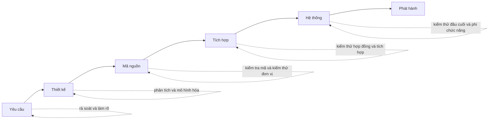
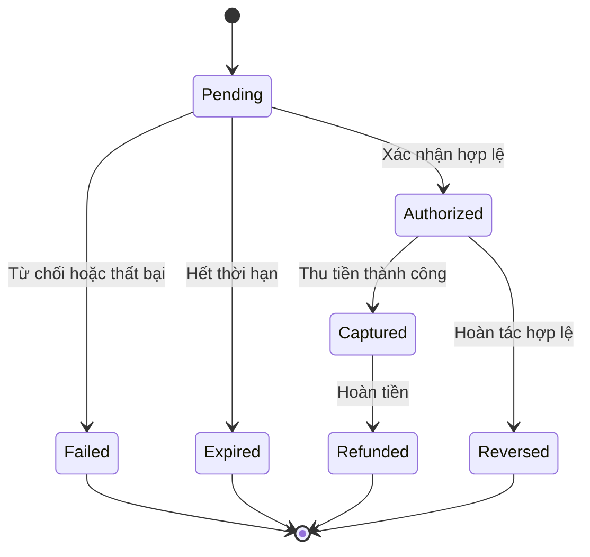
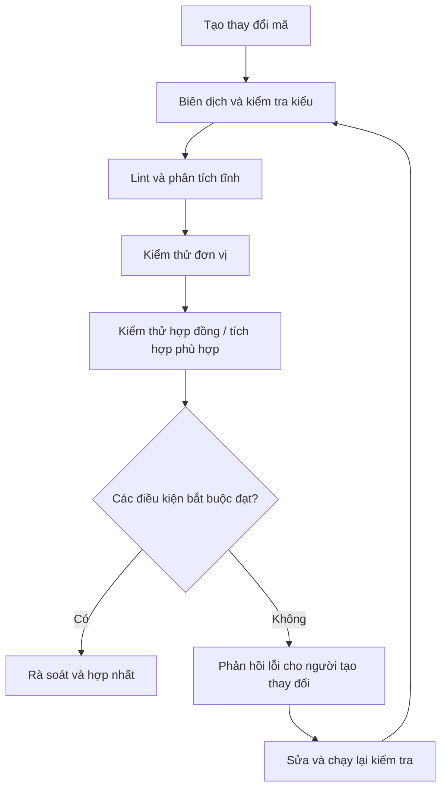

# Thực hiện kiểm tra sớm với yêu cầu, thiết kế và mã nguồn

**Chương:** Vòng đời phát triển  
**Phạm vi module:** `VALIDATION_TESTING_STRATEGY`

Lỗi được phát hiện càng muộn thường càng tốn công tìm nguyên nhân, sửa chữa và đánh giá ảnh hưởng. Một yêu cầu mơ hồ có thể dẫn đến thiết kế sai, mã nguồn sai, bộ kiểm thử sai và cuối cùng là sản phẩm không đáp ứng nhu cầu. Nếu nhóm chỉ bắt đầu kiểm tra khi phần mềm đã tích hợp hoặc gần phát hành, nhiều giả định sai đã lan qua nhiều thành phần.

Kiểm tra sớm nghĩa là đưa hoạt động xem xét và xác minh vào ngay từ khi yêu cầu, thiết kế và mã nguồn được hình thành. Nhóm có thể phát hiện vấn đề qua trao đổi với bên liên quan, rà soát tài liệu, phân tích kiến trúc, kiểm thử đơn vị, phân tích tĩnh và tích hợp liên tục. Mỗi hoạt động cung cấp một loại bằng chứng khác nhau; không một kỹ thuật riêng lẻ nào có thể thay thế toàn bộ các kỹ thuật còn lại.

Bài học này giải thích cách tổ chức kiểm tra sớm trong vòng đời phát triển phần mềm, từ yêu cầu đến mã nguồn, và cách chuyển phản hồi thành hành động có thể theo dõi.

Sau bài học, người học có thể:

- Giải thích lợi ích và giới hạn của việc kiểm tra sớm.
- Chọn hoạt động kiểm tra phù hợp với yêu cầu, thiết kế và mã nguồn.
- Viết tiêu chí có thể xác minh và chuẩn bị bằng chứng ngay từ đầu.
- Tổ chức rà soát, phân tích tĩnh, kiểm thử đơn vị và kiểm thử hợp đồng ở thời điểm phù hợp.
- Tích hợp kiểm tra vào quy trình phát triển và xử lý phản hồi nhanh.
- Đánh giá hiệu quả bằng chất lượng phát hiện, thời gian phản hồi và chi phí sửa lỗi.

## 1. Kiểm tra sớm trong vòng đời phát triển là gì?

Kiểm tra sớm (early testing) là việc thực hiện các hoạt động đánh giá chất lượng trước khi phần mềm hoàn thiện hoặc trước khi lỗi có cơ hội lan rộng. Các hoạt động có thể bắt đầu ngay khi nhóm nhận yêu cầu, tiếp tục trong thiết kế, lập trình, tích hợp và triển khai.

Khái niệm này thường được gọi là *shift-left testing*: đưa một phần hoạt động kiểm thử về sớm hơn trong dòng thời gian phát triển. Mục tiêu là nhận phản hồi sớm và giảm chi phí do phát hiện muộn. Điều đó không có nghĩa mọi kiểm thử hệ thống hoặc kiểm thử chấp nhận đều phải được thực hiện ở giai đoạn đầu. Mỗi giai đoạn vẫn cần loại kiểm tra phù hợp với đối tượng và rủi ro của nó.

Có thể hình dung dòng công việc như sau:



Các hoạt động kiểm tra không chỉ nằm ở cuối dòng. Khi yêu cầu được viết, nhóm đã có thể đánh giá tính rõ ràng và khả năng kiểm chứng. Khi thiết kế được đề xuất, nhóm có thể xem xét rủi ro kiến trúc và khả năng quan sát. Khi mã nguồn được tạo, nhóm có thể rà soát thay đổi và chạy kiểm thử tự động.

### 1.1. Kiểm tra sớm khác với chỉ chạy kiểm thử sớm

Chạy một bộ kiểm thử tự động sớm là hữu ích, nhưng kiểm tra sớm rộng hơn việc chạy test. Một yêu cầu không rõ nghĩa có thể được phát hiện bằng buổi làm rõ nghiệp vụ trước khi có mã. Một lỗ hổng kiến trúc có thể được phát hiện qua rà soát thiết kế. Một lỗi kiểu dữ liệu có thể được phát hiện bởi trình biên dịch hoặc phân tích tĩnh.

Những hoạt động này có chung mục đích là phát hiện sai lệch càng gần thời điểm tạo ra chúng càng tốt. Chúng khác nhau về đối tượng, cách thực hiện và loại bằng chứng:

| Đối tượng | Hoạt động kiểm tra sớm | Bằng chứng điển hình |
|---|---|---|
| Yêu cầu | Rà soát, phân tích tính nhất quán, viết ví dụ và tiêu chí chấp nhận | Biên bản quyết định, yêu cầu được làm rõ, tiêu chí có thể kiểm chứng |
| Thiết kế | Rà soát kiến trúc, mô hình dữ liệu, luồng tương tác và phân tích mối đe dọa | Sơ đồ, quyết định kiến trúc, danh sách rủi ro và vấn đề cần xử lý |
| Mã nguồn | Rà soát mã, kiểm tra kiểu, phân tích tĩnh, kiểm thử đơn vị | Kết quả review, báo cáo công cụ, log và kết quả test |
| Tích hợp | Kiểm thử hợp đồng, kiểm thử API và kiểm thử tích hợp sớm | Báo cáo tương thích, kết quả trao đổi giữa các thành phần |

### 1.2. Phát hiện sớm không thay thế kiểm thử ở giai đoạn sau

Rà soát yêu cầu có thể phát hiện một quy tắc nghiệp vụ mâu thuẫn, nhưng không chứng minh ứng dụng triển khai quy tắc đó đúng. Kiểm thử đơn vị có thể xác minh một hàm, nhưng không chứng minh toàn bộ hệ thống hoạt động đúng khi kết nối với dịch vụ thật. Vì vậy, cần nhiều lớp kiểm tra xuyên suốt vòng đời.

Kiểm tra sớm giúp giảm số lỗi đi tiếp sang giai đoạn sau và cung cấp đầu vào tốt hơn cho các hoạt động kiểm thử tiếp theo. Kiểm thử tích hợp, hệ thống, chấp nhận và kiểm thử phi chức năng vẫn cần thiết để đánh giá hành vi trong bối cảnh thực tế.

## 2. Vì sao phát hiện lỗi sớm có giá trị?

### 2.1. Giảm phạm vi điều tra và sửa chữa

Khi một lỗi được phát hiện ngay trong yêu cầu hoặc thiết kế, nhóm thường chỉ cần làm rõ một quyết định hoặc điều chỉnh một mô hình. Nếu lỗi đã được triển khai trong nhiều thành phần, nhóm có thể phải sửa mã, cập nhật dữ liệu, thay đổi API, điều chỉnh tài liệu, viết lại kiểm thử và đánh giá khả năng tương thích.

Ví dụ, yêu cầu quy định “đơn hàng được xác nhận sau khi thanh toán thành công” nhưng không định nghĩa thế nào là thành công. Nếu phát hiện sự mơ hồ trong buổi rà soát, nhóm có thể thống nhất rằng chỉ phản hồi đã được xác thực từ cổng thanh toán mới được dùng để cập nhật trạng thái. Nếu phát hiện sau khi phát hành, hệ thống có thể đã đánh dấu đơn hàng đã thanh toán dựa trên phản hồi không đáng tin cậy.

### 2.2. Ngăn sai lệch lan qua các thành phần

Một giả định sai ở giao diện có thể được sao chép vào API, cơ sở dữ liệu, dịch vụ báo cáo và bộ kiểm thử. Khi các thành phần cùng dựa trên giả định đó, lỗi có thể khó nhận ra vì chúng nhất quán với nhau nhưng không đúng với nhu cầu thực tế.

Rà soát sớm giúp các bên thống nhất thuật ngữ, dữ liệu, trạng thái và hợp đồng giữa các thành phần trước khi nhiều nhóm triển khai độc lập.

### 2.3. Cải thiện khả năng dự đoán và lập kế hoạch

Khi rủi ro được nhận diện từ đầu, nhóm có thể ước lượng công việc, chuẩn bị môi trường, bố trí chuyên gia và lựa chọn phương án kiến trúc phù hợp. Những phát hiện sớm cũng giúp kế hoạch kiểm thử phản ánh đúng mức độ quan trọng của từng yêu cầu.

### 2.4. Tạo phản hồi nhanh cho người phát triển

Một lỗi được phát hiện ngay sau khi lập trình thường dễ liên hệ với thay đổi vừa thực hiện. Nếu phản hồi đến sau nhiều ngày hoặc sau khi nhiều nhánh mã đã được tích hợp, người phát triển phải tốn thêm công sức tái dựng bối cảnh.

Tích hợp liên tục, kiểm thử tự động và rà soát thay đổi giúp rút ngắn khoảng thời gian giữa lúc tạo lỗi và lúc nhận biết lỗi.

### 2.5. Tăng khả năng kiểm chứng và truy vết

Khi tiêu chí kiểm thử được xây dựng cùng với yêu cầu, nhóm có thể liên kết mục tiêu, thay đổi mã, ca kiểm thử và kết quả. Điều này giúp trả lời câu hỏi: yêu cầu nào đã được kiểm tra, bằng cách nào, trên phiên bản nào và bằng chứng nằm ở đâu.

## 3. Kiểm tra sớm ở giai đoạn yêu cầu

Yêu cầu là đầu vào cho thiết kế, phát triển và kiểm thử. Một yêu cầu tốt cần thể hiện đúng nhu cầu, có phạm vi rõ ràng và có thể được xác minh. Nhóm kiểm thử nên tham gia khi yêu cầu còn có thể thay đổi với chi phí thấp.

### 3.1. Rà soát chất lượng của yêu cầu

Khi đọc một yêu cầu, hãy xem xét:

- **Rõ ràng:** người đọc có hiểu cùng một ý nghĩa không? Thuật ngữ có được định nghĩa không?
- **Đầy đủ:** điều kiện trước, luồng thay thế, lỗi và kết quả có được mô tả đủ không?
- **Nhất quán:** yêu cầu có mâu thuẫn với yêu cầu khác hoặc quy tắc hiện có không?
- **Khả thi:** công nghệ, dữ liệu, thời gian và nguồn lực có thể đáp ứng không?
- **Có thể kiểm chứng:** có thể quan sát hoặc đo lường để xác định đạt hay không đạt không?
- **Có thể truy vết:** yêu cầu có mã định danh và liên kết đến mục tiêu hoặc quy tắc nghiệp vụ không?
- **Có ưu tiên:** mức quan trọng và hậu quả nếu không đáp ứng đã rõ chưa?

Các tiêu chí này giúp phát hiện vấn đề trước khi yêu cầu trở thành công việc triển khai.

### 3.2. Chuyển câu mơ hồ thành tiêu chí có thể kiểm chứng

Ví dụ yêu cầu ban đầu:

> Hệ thống phải gửi email xác nhận đơn hàng nhanh chóng.

Yêu cầu này chưa xác định “nhanh chóng” là bao lâu, sự kiện nào kích hoạt gửi, hành vi khi dịch vụ email lỗi và cách tránh gửi trùng. Có thể làm rõ thành:

> Khi đơn hàng chuyển sang trạng thái đã xác nhận, hệ thống tạo một thông báo email cho địa chỉ đã được xác minh trong vòng 60 giây. Nếu dịch vụ gửi email tạm thời không khả dụng, thông báo được đưa vào hàng đợi để thử lại theo chính sách đã định; một đơn hàng không tạo nhiều thông báo xác nhận giống nhau.

Từ yêu cầu đã làm rõ, nhóm có thể xây dựng các tiêu chí chấp nhận:

1. Với đơn hàng được xác nhận hợp lệ, thông báo được tạo và gửi trong ngưỡng thời gian đã thống nhất.
2. Nếu dịch vụ email không khả dụng, thông báo được giữ để xử lý lại và trạng thái được ghi nhận.
3. Khi sự kiện xác nhận được xử lý lặp, hệ thống không gửi nhiều email xác nhận giống nhau.
4. Log có mã đơn hàng hoặc mã tương quan để điều tra mà không làm lộ thông tin nhạy cảm.

Các tiêu chí cần được bên nghiệp vụ và kỹ thuật thống nhất. Những con số trong ví dụ là giả định để minh họa, không phải ngưỡng chung cho mọi hệ thống.

### 3.3. Dùng ví dụ, bảng quyết định và mô hình trạng thái

Một đoạn văn có thể khó thể hiện hết các điều kiện. Nhóm có thể dùng ví dụ cụ thể, bảng quyết định hoặc mô hình trạng thái để làm rõ hành vi.

Ví dụ về quy tắc áp dụng mã giảm giá:

| Khách hàng | Mã còn hiệu lực | Giá trị đơn hàng đạt tối thiểu | Kết quả mong đợi |
|---|---|---|---|
| Đã đăng nhập | Có | Có | Áp dụng mã giảm giá |
| Đã đăng nhập | Có | Không | Từ chối và giải thích điều kiện tối thiểu |
| Đã đăng nhập | Không | Có | Từ chối vì mã hết hạn hoặc không hợp lệ |
| Chưa đăng nhập | Có | Có | Yêu cầu đăng nhập nếu chương trình chỉ dành cho thành viên |

Bảng này giúp người viết yêu cầu và người kiểm thử cùng nhìn thấy các tổ hợp điều kiện. Nó cũng cung cấp đầu vào trực tiếp để thiết kế ca kiểm thử sau đó.

### 3.4. Rà soát yêu cầu phi chức năng từ sớm

Yêu cầu hiệu năng, bảo mật, độ tin cậy, khả năng sử dụng và khả năng tương thích thường bị bỏ qua nếu chỉ tập trung vào luồng chức năng. Hãy xác định kịch bản và thước đo sớm:

- Hiệu năng: tải dự kiến, phân vị thời gian phản hồi, thông lượng và tỷ lệ lỗi.
- Bảo mật: dữ liệu nhạy cảm, vai trò, quyền truy cập, yêu cầu xác thực và mối đe dọa chính.
- Độ tin cậy: hành vi khi phụ thuộc lỗi, mục tiêu phục hồi và mức mất dữ liệu có thể chấp nhận.
- Khả năng sử dụng: nhiệm vụ người dùng cần hoàn thành, nhóm người dùng và cách đánh giá mức hoàn thành.
- Tương thích: hệ điều hành, trình duyệt, thiết bị, phiên bản hoặc giao thức được hỗ trợ.

Yêu cầu phi chức năng cần được xác định trong bối cảnh vận hành. Một chỉ tiêu hiệu năng không có mức tải và cách đo sẽ khó kiểm chứng.

### 3.5. Tổ chức buổi rà soát yêu cầu

Một buổi rà soát có thể gồm chủ sản phẩm, chuyên gia nghiệp vụ, kiến trúc sư, người phát triển, kiểm thử và vận hành. Người tham gia đọc trước tài liệu, ghi câu hỏi và tập trung vào những điểm có rủi ro hoặc ảnh hưởng lớn.

Đầu ra nên bao gồm:

- Các câu hỏi và điểm mơ hồ cần làm rõ.
- Mâu thuẫn hoặc phụ thuộc giữa các yêu cầu.
- Tiêu chí chấp nhận được thống nhất.
- Rủi ro và giả định cần xác minh.
- Người chịu trách nhiệm và thời hạn xử lý từng vấn đề.

Rà soát không nên kết thúc bằng nhận xét chung như “yêu cầu ổn”. Cần ghi quyết định hoặc việc cần làm tiếp theo để tránh cùng một câu hỏi được thảo luận lại nhiều lần.

## 4. Kiểm tra sớm ở giai đoạn thiết kế

Thiết kế quyết định cấu trúc hệ thống, ranh giới thành phần, luồng dữ liệu, cách xử lý lỗi và các cơ chế kiểm soát. Sai sót ở giai đoạn này có thể ảnh hưởng đến nhiều phần mã nguồn. Rà soát thiết kế giúp đánh giá các quyết định trước khi chúng trở nên khó thay đổi.

### 4.1. Rà soát kiến trúc và ranh giới thành phần

Nhóm có thể đặt các câu hỏi:

- Trách nhiệm của mỗi thành phần có rõ ràng không?
- Các thành phần trao đổi dữ liệu qua giao diện hoặc hợp đồng nào?
- Có phụ thuộc vòng hoặc phụ thuộc không cần thiết không?
- Khi một dịch vụ lỗi, hệ thống xử lý và phục hồi như thế nào?
- Có điểm nghẽn hoặc điểm lỗi đơn lẻ nào không?
- Cách mở rộng và triển khai có đáp ứng quy mô dự kiến không?
- Các quyết định có hỗ trợ mục tiêu chất lượng đã xác định không?

Rà soát kiến trúc nên tập trung vào rủi ro và các quyết định khó đảo ngược. Không cần tranh luận mọi chi tiết triển khai khi thiết kế chưa đủ chín.

### 4.2. Rà soát mô hình dữ liệu và trạng thái

Nhiều lỗi xuất phát từ cách biểu diễn trạng thái hoặc quan hệ dữ liệu không rõ. Với một luồng thanh toán, nhóm cần thống nhất:

- Những trạng thái giao dịch nào tồn tại và chuyển đổi giữa chúng ra sao?
- Sự kiện nào được phép cập nhật trạng thái?
- Hệ thống xử lý callback trùng hoặc đến sai thứ tự như thế nào?
- Có thể đối soát khi phản hồi bị mất hay không?
- Khóa định danh nào giúp liên kết đơn hàng, yêu cầu và giao dịch?
- Dữ liệu nhạy cảm nào được lưu, mã hóa, che giấu hoặc loại bỏ?

Mô hình trạng thái có thể giúp phát hiện chuyển đổi không hợp lệ trước khi viết mã:



Sơ đồ minh họa một phần vòng đời; trạng thái và chuyển đổi thực tế phải theo nghiệp vụ và hợp đồng tích hợp. Việc mô hình hóa giúp nhóm nhận diện trạng thái thiếu, chuyển đổi không hợp lệ và trường hợp cần kiểm thử.

### 4.3. Rà soát bảo mật và quyền riêng tư

Phân tích mối đe dọa (threat modeling) có thể được thực hiện khi kiến trúc và luồng dữ liệu đã đủ rõ. Nhóm xác định tài sản cần bảo vệ, ranh giới tin cậy, tác nhân, điểm vào, mối đe dọa và biện pháp kiểm soát.

Ví dụ với API thanh toán:

- Tài sản: thông tin tài khoản, mã giao dịch và dữ liệu thanh toán.
- Điểm vào: API tạo thanh toán, callback từ nhà cung cấp và giao diện quản trị.
- Ranh giới tin cậy: trình duyệt, dịch vụ cửa hàng, nhà cung cấp thanh toán và hệ thống lưu trữ.
- Mối đe dọa: truy cập giao dịch của người khác, giả mạo callback, phát lại yêu cầu hoặc ghi dữ liệu nhạy cảm vào log.
- Kiểm soát cần xem xét: xác thực chữ ký callback, phân quyền ở phía máy chủ, chống phát lại, quản lý bí mật và lọc dữ liệu log.

Phân tích này giúp đưa các tình huống bảo mật vào yêu cầu, thiết kế và kế hoạch kiểm thử từ sớm. Nó không thay thế đánh giá bảo mật chuyên sâu hoặc kiểm thử xâm nhập khi hệ thống và rủi ro yêu cầu.

### 4.4. Đánh giá khả năng kiểm thử của thiết kế

Một thiết kế dễ kiểm thử giúp nhóm quan sát trạng thái, cô lập thành phần và tạo điều kiện kiểm soát phụ thuộc. Khi rà soát thiết kế, hãy xem xét:

- Thành phần có giao diện rõ ràng và có thể kiểm tra độc lập không?
- Có thể thay thế dịch vụ bên ngoài bằng stub, fake hoặc sandbox trong kiểm thử không?
- Log và số liệu giám sát có đủ để hiểu hành vi mà không làm lộ dữ liệu nhạy cảm không?
- Có thể tạo dữ liệu kiểm thử và khôi phục trạng thái một cách an toàn không?
- Lỗi và timeout có được biểu diễn rõ để kiểm thử không?
- Có cách kiểm tra hợp đồng giữa các thành phần không?

Khả năng kiểm thử nên được xem là một yêu cầu thiết kế. Nếu hệ thống khó quan sát hoặc không thể tái tạo điều kiện lỗi, việc xác minh và điều tra sau này sẽ tốn kém hơn.

### 4.5. Ghi nhận quyết định kiến trúc

Với quyết định có ảnh hưởng lớn, hãy ghi bối cảnh, lựa chọn đã cân nhắc, quyết định, hệ quả và cách xác minh. Ví dụ, nếu nhóm chọn xử lý thanh toán bất đồng bộ để tăng khả năng chịu lỗi, cần ghi cách bảo đảm trạng thái nhất quán, cách thử lại, cách chống xử lý trùng và cách đối soát.

Quyết định kiến trúc có thể được kiểm chứng bằng mô hình, thử nghiệm nguyên mẫu, kiểm thử hiệu năng hoặc kiểm thử tích hợp nhỏ trước khi triển khai rộng.

## 5. Kiểm tra sớm ở giai đoạn mã nguồn

Khi mã nguồn được tạo hoặc thay đổi, nhóm có thể phát hiện lỗi qua nhiều cơ chế tự động và thủ công. Các cơ chế nên được đặt gần nơi tạo thay đổi để người phát triển nhận phản hồi kịp thời.

### 5.1. Rà soát mã nguồn (code review)

Code review là hoạt động một hoặc nhiều người xem xét thay đổi mã trước khi hợp nhất. Mục tiêu không chỉ là tìm lỗi cú pháp mà còn đánh giá tính đúng đắn, khả năng bảo trì, bảo mật, hiệu năng và mức phù hợp với thiết kế.

Người rà soát có thể xem xét:

- Thay đổi có đáp ứng yêu cầu và tiêu chí chấp nhận không?
- Có xử lý trường hợp biên, dữ liệu không hợp lệ và lỗi phụ thuộc không?
- Có vấn đề về phân quyền, xác thực, mã hóa hoặc xử lý dữ liệu nhạy cảm không?
- Mã có dễ hiểu, có trách nhiệm rõ và tránh lặp logic không cần thiết không?
- Kiểm thử mới có bao phủ hành vi quan trọng và có kết quả mong đợi rõ ràng không?
- Thay đổi có ảnh hưởng đến API, dữ liệu, cấu hình hoặc khả năng tương thích không?

Review nên tập trung vào thay đổi và rủi ro liên quan. Một thay đổi nhỏ nhưng nằm trong luồng thanh toán có thể cần rà soát kỹ hơn một thay đổi lớn ở thành phần ít quan trọng.

### 5.2. Phân tích tĩnh và kiểm tra tự động

Phân tích tĩnh kiểm tra mã mà không cần thực thi ứng dụng. Tùy công cụ và ngôn ngữ, nó có thể phát hiện lỗi kiểu, biến không dùng, đường đi có thể gây null, lỗi định dạng, vi phạm quy tắc mã, một số mẫu lỗ hổng bảo mật hoặc độ phức tạp bất thường.

Các công cụ phổ biến trong quy trình phát triển gồm:

- Trình biên dịch và kiểm tra kiểu.
- Linter và bộ định dạng mã.
- Static application security testing (SAST).
- Công cụ phân tích phụ thuộc và phát hiện gói có lỗ hổng đã biết.
- Kiểm tra bí mật vô tình bị đưa vào mã nguồn.
- Phân tích chất lượng và độ phức tạp mã.

Kết quả công cụ cần được diễn giải. Có thể có cảnh báo sai (false positive), vấn đề không được phát hiện (false negative) hoặc cảnh báo không liên quan đến phạm vi thay đổi. Nhóm cần có quy tắc phân loại, xử lý ngoại lệ và theo dõi cảnh báo quan trọng.

Phân tích tĩnh không chứng minh chương trình hoạt động đúng trong mọi tình huống. Nó bổ sung cho review và kiểm thử động.

### 5.3. Kiểm thử đơn vị

Kiểm thử đơn vị (unit testing) xác minh hành vi của một đơn vị mã nhỏ, thường là hàm, phương thức hoặc lớp trong phạm vi có thể cô lập. Kiểm thử đơn vị thường chạy nhanh và giúp phát hiện lỗi gần nơi thay đổi.

Một kiểm thử đơn vị tốt thường:

- Có mục tiêu rõ và tập trung vào một hành vi.
- Chuẩn bị đầu vào và trạng thái ban đầu xác định.
- Kiểm tra kết quả hoặc tác dụng phụ có ý nghĩa.
- Không phụ thuộc vào mạng, thời gian thực hoặc dịch vụ bên ngoài không ổn định.
- Có thể chạy lặp lại và cho kết quả nhất quán.
- Có tên mô tả hành vi được kiểm tra.

Ví dụ kiểm thử quy tắc tính chiết khấu:

```java
@Test
void appliesTenPercentDiscountWhenOrderMeetsThreshold() {
    Order order = new Order(1_000_000);

    Money total = pricing.calculateTotal(order, DiscountRate.of(10));

    assertEquals(Money.of(900_000), total);
}
```

Đoạn mã chỉ minh họa ý tưởng; kiểu dữ liệu và API phụ thuộc vào ứng dụng thực tế. Kiểm thử cần có thêm trường hợp dưới ngưỡng, đúng ngưỡng, giá trị biên và dữ liệu không hợp lệ theo quy tắc nghiệp vụ.

### 5.4. Kiểm thử dựa trên thuộc tính và kiểm thử dựa trên dữ liệu

Với một số quy tắc, nhóm có thể kiểm tra tính chất phải đúng trên nhiều đầu vào thay vì chỉ một ví dụ cụ thể. Ví dụ, tổng tiền sau giảm giá không được âm; sắp xếp danh sách không làm mất hoặc nhân đôi phần tử; chuẩn hóa một mã định danh hai lần phải cho cùng kết quả.

Property-based testing tạo nhiều dữ liệu đầu vào theo quy tắc sinh dữ liệu và kiểm tra thuộc tính chung. Kỹ thuật này có thể tìm ra trường hợp biên khó dự đoán bằng tay, nhưng cần định nghĩa thuộc tính chính xác và giới hạn miền dữ liệu hợp lý.

### 5.5. Kiểm thử hợp đồng và tích hợp sớm

Khi các thành phần được phát triển độc lập, thay đổi hợp đồng API có thể làm hỏng bên sử dụng. Kiểm thử hợp đồng (contract testing) xác minh các bên tuân thủ cấu trúc và quy tắc giao tiếp đã thống nhất.

Ví dụ, cửa hàng gửi yêu cầu thanh toán với mã đơn hàng, số tiền và đơn vị tiền tệ. Hợp đồng có thể quy định trường bắt buộc, kiểu dữ liệu, mã phản hồi và cách biểu diễn lỗi. Kiểm thử hợp đồng giúp phát hiện việc một bên đổi tên trường hoặc thay đổi kiểu dữ liệu trước khi tích hợp đầy đủ.

Kiểm thử tích hợp sớm xác minh các thành phần phối hợp đúng với nhau. Có thể dùng môi trường sandbox, stub hoặc fake để kiểm tra các tình huống cụ thể, nhưng cần bổ sung kiểm thử với dịch vụ thật hoặc môi trường gần thực tế khi điều đó cần thiết.

## 6. Đưa kiểm tra sớm vào quy trình phát triển

Các hoạt động kiểm tra sớm phát huy hiệu quả khi được gắn với luồng công việc thường ngày. Nhóm nên xác định kiểm tra nào chạy tự động, kiểm tra nào cần người xem xét và điều kiện nào cho phép hợp nhất thay đổi.

### 6.1. Tích hợp liên tục (CI)

Trong tích hợp liên tục, thay đổi mã được kiểm tra tự động khi tạo hoặc cập nhật nhánh, pull request hoặc commit theo quy ước của nhóm. Một pipeline cơ bản có thể gồm:



Không phải mọi pipeline đều cần chạy tất cả kiểm thử ở mọi lần commit. Có thể chia thành các lớp phản hồi nhanh và chậm hơn, nhưng các kiểm tra bắt buộc phải được thực hiện trước điểm quyết định tương ứng.

### 6.2. Phân tầng thời gian phản hồi

Một cách tổ chức thực tế:

| Thời điểm | Kiểm tra phù hợp | Mục tiêu |
|---|---|---|
| Khi lập trình cục bộ | Biên dịch, lint, kiểm thử đơn vị nhỏ | Phản hồi gần như tức thời |
| Khi tạo pull request | Kiểm tra kiểu, phân tích tĩnh, unit test, contract test và review | Ngăn thay đổi có vấn đề được hợp nhất |
| Sau khi hợp nhất | Kiểm thử tích hợp và kiểm thử trên môi trường dùng chung | Phát hiện lỗi phối hợp giữa thành phần |
| Theo lịch hoặc trước phát hành | Kiểm thử hồi quy rộng, hiệu năng, bảo mật và kiểm thử đầu cuối | Đánh giá hệ thống trong phạm vi và điều kiện gần thực tế |

Các mốc có thể thay đổi theo kiến trúc và mức rủi ro. Điều quan trọng là phản hồi đủ nhanh để người phát triển xử lý được lỗi, đồng thời không bỏ qua kiểm tra cần thiết.

### 6.3. Định nghĩa điều kiện chặn và ngoại lệ

Nhóm cần xác định kiểm tra nào bắt buộc đạt trước khi hợp nhất hoặc phát hành. Ví dụ, lỗi biên dịch, kiểm thử đơn vị quan trọng thất bại hoặc phát hiện bí mật có thể là điều kiện chặn. Một cảnh báo phân tích tĩnh ít nghiêm trọng có thể được ghi nhận và xử lý theo thời hạn.

Ngoại lệ phải có lý do, người chấp nhận, phạm vi và thời điểm xem xét lại. Không nên tắt toàn bộ kiểm tra chỉ vì một cảnh báo cụ thể gây nhiễu. Nếu cần miễn trừ, hãy giới hạn ngoại lệ và giữ khả năng truy vết.

### 6.4. Giữ pipeline đáng tin cậy

Kiểm tra tự động chỉ có giá trị khi kết quả đáng tin. Pipeline thường xuyên thất bại do môi trường hoặc dữ liệu không ổn định sẽ khiến người phát triển bỏ qua cảnh báo.

Để tăng độ tin cậy:

- Giữ kiểm thử đơn vị độc lập với dịch vụ bên ngoài.
- Chuẩn bị và dọn dẹp dữ liệu kiểm thử rõ ràng.
- Tránh phụ thuộc vào thứ tự chạy hoặc trạng thái dùng chung không được kiểm soát.
- Theo dõi flaky tests và xác định nguyên nhân.
- Phân biệt lỗi sản phẩm với lỗi hạ tầng kiểm thử.
- Ghi log đủ để tái hiện và điều tra thất bại.
- Đo thời gian pipeline và loại bỏ kiểm tra trùng lặp không tạo thêm giá trị.

## 7. Ví dụ xuyên suốt: kiểm tra sớm luồng thanh toán

Giả sử nhóm phát triển chức năng thanh toán cho cửa hàng trực tuyến. Mục tiêu là bảo đảm giao dịch được xử lý đúng, không tạo giao dịch trùng và có thể phục hồi khi dịch vụ bên ngoài gặp lỗi.

### 7.1. Ở giai đoạn yêu cầu

Nhóm làm rõ:

- Trạng thái nào được coi là thanh toán thành công?
- Cần xác minh phản hồi thanh toán bằng cách nào?
- Khi yêu cầu hết thời gian chờ, người dùng có thể thử lại không?
- Làm thế nào để tránh tạo giao dịch trùng khi thử lại?
- Đơn hàng được cập nhật khi nào và dựa trên sự kiện nào?
- Thời gian phản hồi và khả năng phục hồi cần đạt ngưỡng nào?

Đầu ra là các yêu cầu rõ, tiêu chí chấp nhận và rủi ro đã được thống nhất. Nhóm có thể tạo ví dụ cho thành công, thất bại, timeout, callback trùng và callback đến sai thứ tự.

### 7.2. Ở giai đoạn thiết kế

Nhóm xác định ranh giới giữa cửa hàng và cổng thanh toán, mô hình trạng thái giao dịch, cách xác thực callback, cơ chế idempotency, retry có giới hạn và đối soát. Các quyết định này được rà soát với người phát triển, kiểm thử và vận hành.

Nhóm cũng xác định cách quan sát luồng xử lý: mã tương quan, log trạng thái và số liệu về callback lỗi hoặc bị lặp. Thiết kế kiểm thử được xem xét để có thể mô phỏng phản hồi chậm, mất kết nối và sự kiện đến sai thứ tự.

### 7.3. Ở giai đoạn mã nguồn

- Kiểm thử đơn vị cho quy tắc chuyển trạng thái và tính idempotent.
- Phân tích tĩnh và review cho xác thực callback, xử lý bí mật và kiểm tra quyền.
- Kiểm thử hợp đồng cho cấu trúc yêu cầu và phản hồi.
- Kiểm thử tích hợp với sandbox cho thành công, thất bại, timeout và callback lặp.
- Kiểm thử hồi quy cho các luồng tạo đơn, hủy đơn và hoàn tiền có liên quan.

### 7.4. Trong CI và trước phát hành

Pipeline chạy các kiểm tra nhanh ở mỗi thay đổi. Sau khi hợp nhất, kiểm thử tích hợp được chạy trên môi trường phù hợp. Trước phát hành, nhóm chạy thêm kiểm thử tải, kiểm thử phục hồi và kiểm thử đầu cuối với các kịch bản ưu tiên cao.

Kết quả được liên kết với yêu cầu và phiên bản. Nếu có lỗi hoặc kiểm tra bị chặn, nhóm ghi rõ ảnh hưởng, người xử lý và quyết định tiếp tục hay dừng. Cách làm này tạo chuỗi bằng chứng từ nhu cầu ban đầu đến kết quả kiểm tra.

## 8. Phối hợp vai trò và trách nhiệm

Kiểm tra sớm là trách nhiệm chung. Người kiểm thử có chuyên môn về rủi ro và thiết kế kiểm thử, nhưng người phát triển, chủ sản phẩm, kiến trúc sư và vận hành cũng cần tham gia vào các hoạt động phù hợp.

| Vai trò | Đóng góp điển hình |
|---|---|
| Chủ sản phẩm / chuyên gia nghiệp vụ | Làm rõ mục tiêu, quy tắc và tiêu chí chấp nhận |
| Người kiểm thử | Phát hiện điểm mơ hồ, phân tích rủi ro, đề xuất kiểm tra và bằng chứng |
| Người phát triển | Thiết kế mã có thể kiểm thử, viết unit test, xử lý lỗi từ công cụ và review thay đổi |
| Kiến trúc sư | Rà soát cấu trúc, phụ thuộc, thuộc tính chất lượng và quyết định khó đảo ngược |
| Vận hành / nền tảng | Đánh giá khả năng triển khai, quan sát, phục hồi và môi trường kiểm thử |
| Bảo mật | Phân tích mối đe dọa, kiểm tra kiểm soát và hướng dẫn xử lý rủi ro bảo mật |

Vai trò cụ thể phụ thuộc tổ chức. Một người có thể đảm nhiệm nhiều vai trò, nhưng trách nhiệm và quyền quyết định cần rõ ràng, nhất là khi có ngoại lệ hoặc rủi ro còn lại.

## 9. Đo lường hiệu quả của kiểm tra sớm

Không nên đánh giá hiệu quả chỉ bằng số lượng test hoặc số lỗi tìm được. Nhiều lỗi được phát hiện có thể phản ánh hoạt động kiểm tra tốt, nhưng cũng có thể cho thấy chất lượng đầu vào hoặc mã nguồn đang kém. Cần xem kết quả trong bối cảnh.

Các chỉ số có thể theo dõi:

- **Thời gian phản hồi:** khoảng thời gian từ lúc thay đổi được tạo đến khi người thực hiện nhận kết quả kiểm tra.
- **Giai đoạn phát hiện lỗi:** tỷ lệ lỗi được phát hiện ở yêu cầu, thiết kế, mã nguồn, tích hợp và hệ thống.
- **Chi phí sửa lỗi tương đối:** thời gian điều tra, sửa, kiểm tra lại và đánh giá ảnh hưởng theo từng giai đoạn.
- **Tỷ lệ lỗi lọt qua:** số lỗi được phát hiện ở giai đoạn sau hoặc trong vận hành so với tổng số lỗi có liên quan.
- **Độ ổn định của kiểm thử:** tỷ lệ kiểm thử tự động thất bại do môi trường hoặc tính không ổn định.
- **Mức độ bao phủ rủi ro:** các rủi ro ưu tiên cao có được liên kết với hoạt động kiểm tra và bằng chứng không.
- **Tỷ lệ vấn đề yêu cầu được làm rõ trước triển khai:** giúp đánh giá chất lượng hoạt động rà soát đầu vào.

Các chỉ số cần được dùng để cải thiện hệ thống làm việc, không dùng riêng lẻ để đánh giá hiệu suất cá nhân. Ví dụ, tỷ lệ lỗi phát hiện sớm tăng có thể là dấu hiệu tốt nếu lỗi được tìm thấy trước khi lan rộng; nhưng cần xem thêm số lỗi nghiêm trọng lọt đến sản xuất.

### 9.1. Dùng dữ liệu để cải thiện điểm kiểm tra

Định kỳ xem xét lỗi phát hiện muộn và truy ngược về nơi có thể nhận biết sớm hơn. Nếu nhiều lỗi bắt nguồn từ yêu cầu không rõ, cải thiện mẫu yêu cầu và hoạt động rà soát. Nếu nhiều lỗi do hợp đồng API không nhất quán, bổ sung contract test. Nếu lỗi thường xuất hiện khi phụ thuộc gặp sự cố, cải thiện mô hình lỗi và kiểm thử chịu lỗi.

Không nên thêm checklist hoặc cổng kiểm soát cho mọi lỗi riêng lẻ mà không tìm nguyên nhân. Một điểm kiểm tra mới chỉ có giá trị khi nó giảm xác suất bỏ sót hoặc giúp phát hiện lỗi sớm hơn với chi phí hợp lý.

## 10. Những giới hạn và sai lầm thường gặp

### 10.1. Đồng nhất kiểm tra sớm với việc kiểm thử mọi thứ từ đầu

Không phải mọi kiểm thử đều có thể thực hiện trước khi hệ thống tồn tại. Kiểm thử hiệu năng, khả năng sử dụng hoặc tích hợp thực tế cần môi trường và thành phần phù hợp. Hãy đưa hoạt động phù hợp về sớm, đồng thời giữ kiểm thử ở giai đoạn cần thiết.

### 10.2. Chỉ kiểm tra mã nguồn mà bỏ qua yêu cầu và thiết kế

Một bộ kiểm thử đơn vị tốt vẫn có thể xác minh sai yêu cầu. Nếu tiêu chí chấp nhận sai hoặc thiếu, mã có thể vượt qua toàn bộ test mà vẫn không đáp ứng người dùng. Cần kiểm tra đầu vào trước khi kiểm tra đầu ra.

### 10.3. Quá phụ thuộc vào công cụ tự động

Trình biên dịch, linter và SAST phát hiện được một số lớp vấn đề. Chúng không hiểu đầy đủ mục tiêu nghiệp vụ, mọi rủi ro kiến trúc hoặc trải nghiệm người dùng. Review và trao đổi chuyên môn vẫn cần thiết.

### 10.4. Tạo quá nhiều kiểm tra làm chậm phản hồi

Nếu mọi kiểm tra chạy trong mỗi thay đổi đều quá chậm, người phát triển có thể trì hoãn hoặc bỏ qua. Hãy phân tầng kiểm tra theo thời gian phản hồi và rủi ro, đồng thời loại bỏ bước trùng lặp.

### 10.5. Chỉ đo độ bao phủ mã

Code coverage cho biết phần mã được thực thi trong các test, nhưng không chứng minh các kết quả mong đợi đã được kiểm tra đúng. Một dòng mã có thể được chạy mà không có assertion có ý nghĩa. Hãy đánh giá chất lượng kịch bản và assertion cùng với độ bao phủ.

### 10.6. Không xử lý cảnh báo và kiểm thử không ổn định

Cảnh báo tồn đọng và flaky tests làm giảm niềm tin vào pipeline. Cần phân loại, giao người xử lý, đặt thời hạn và theo dõi xu hướng. Ngoại lệ phải được ghi nhận thay vì âm thầm bỏ qua.

### 10.7. Không phản hồi lại yêu cầu và thiết kế

Khi kiểm thử phát hiện yêu cầu thiếu hoặc thiết kế có rủi ro, cần cập nhật nguồn quyết định. Nếu chỉ sửa mã để vượt qua test mà không xử lý nguyên nhân, vấn đề có thể xuất hiện ở thành phần khác.

## 11. Danh sách rà soát hoạt động kiểm tra sớm

Trước khi bắt đầu hoặc cải thiện quy trình kiểm tra sớm, hãy rà soát:

- [ ] Nhóm kiểm thử tham gia từ khi yêu cầu còn có thể làm rõ.
- [ ] Yêu cầu có phạm vi, thuật ngữ và tiêu chí chấp nhận có thể xác minh.
- [ ] Các yêu cầu phi chức năng và rủi ro quan trọng được xem xét.
- [ ] Thiết kế có ranh giới thành phần, mô hình trạng thái và cách xử lý lỗi rõ ràng.
- [ ] Rủi ro bảo mật, dữ liệu và khả năng quan sát được xem xét trong thiết kế.
- [ ] Mã nguồn có review và các kiểm tra tự động phù hợp.
- [ ] Kiểm thử đơn vị tập trung vào hành vi và trường hợp biên có ý nghĩa.
- [ ] Hợp đồng và tương tác giữa các thành phần được xác minh sớm.
- [ ] Pipeline có phản hồi đủ nhanh, kết quả đáng tin và quy tắc xử lý ngoại lệ.
- [ ] Kết quả kiểm tra liên kết được với yêu cầu, thay đổi và phiên bản.
- [ ] Lỗi phát hiện muộn được phân tích để cải thiện điểm kiểm tra ở giai đoạn trước.

## 12. Kết luận

Kiểm tra sớm đưa hoạt động đánh giá chất lượng vào ngay khi yêu cầu, thiết kế và mã nguồn được hình thành. Rà soát yêu cầu giúp làm rõ nhu cầu và tiêu chí chấp nhận; rà soát thiết kế giúp phát hiện rủi ro kiến trúc, dữ liệu và bảo mật; review mã, phân tích tĩnh, kiểm thử đơn vị và kiểm thử hợp đồng giúp phát hiện lỗi gần nơi thay đổi.

Để đạt hiệu quả, nhóm cần chọn kỹ thuật phù hợp với từng đối tượng, tạo phản hồi nhanh, lưu bằng chứng có thể truy vết và xử lý nguyên nhân thay vì chỉ sửa triệu chứng. Kiểm tra sớm bổ sung cho kiểm thử tích hợp, hệ thống và chấp nhận trong các giai đoạn sau, giúp chất lượng được xem xét liên tục trong toàn bộ vòng đời phát triển.
