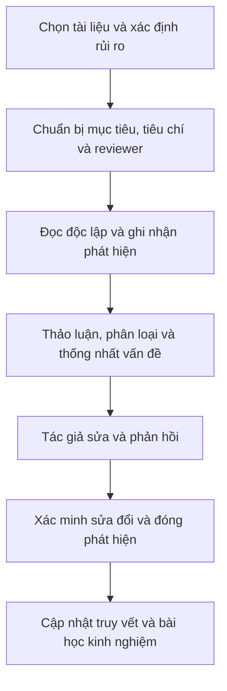

# Rà soát yêu cầu, tiêu chí chấp nhận và thiết kế theo rủi ro

## Mục tiêu học tập

Sau bài học này, người học có thể:

- Giải thích vai trò của kiểm thử tĩnh trong chiến lược kiểm thử và phân biệt nó với kiểm thử động.
- Rà soát yêu cầu để phát hiện sự mơ hồ, thiếu sót, mâu thuẫn, không nhất quán và khó kiểm chứng.
- Đánh giá tiêu chí chấp nhận theo điều kiện, hành động, kết quả quan sát được và các trường hợp ngoại lệ.
- Rà soát thiết kế ở mức phù hợp để phát hiện rủi ro về kiến trúc, dữ liệu, bảo mật, tích hợp và khả năng vận hành.
- Ưu tiên hoạt động rà soát dựa trên mức độ rủi ro thay vì áp dụng cùng một mức độ chi tiết cho mọi tài liệu.
- Ghi nhận phát hiện có bằng chứng, phân loại mức độ, theo dõi xử lý và xác nhận kết quả sau chỉnh sửa.

## 1. Kiểm thử tĩnh giúp phát hiện vấn đề trước khi chạy phần mềm

Trong phạm vi **VALIDATION_TESTING_STRATEGY**, kiểm thử tĩnh là hoạt động đánh giá sản phẩm công việc mà không cần thực thi phần mềm. Đối tượng có thể là yêu cầu, tiêu chí chấp nhận, mô hình nghiệp vụ, kiến trúc, thiết kế chi tiết, API contract, mã nguồn, cấu hình, kế hoạch kiểm thử hoặc tài liệu vận hành.

Rà soát sớm giúp phát hiện vấn đề ngay khi chi phí sửa còn thấp. Nếu yêu cầu “hệ thống phải nhanh” được đưa vào thiết kế mà không có ngưỡng đo, nhóm có thể xây dựng một giải pháp không đáp ứng mong đợi rồi mới phát hiện khi chạy tải. Nếu tiêu chí chấp nhận bỏ qua trường hợp gửi lặp, nhóm có thể viết test chỉ kiểm tra luồng thành công và bỏ sót lỗi tạo giao dịch trùng. Nếu thiết kế không mô tả quyền truy cập hoặc cách xử lý dữ liệu nhạy cảm, vấn đề có thể lan sang nhiều thành phần và khó khắc phục.

Kiểm thử tĩnh không chỉ là đọc tài liệu để tìm lỗi chính tả. Nó là một hoạt động có mục tiêu, tiêu chí, phạm vi và bằng chứng rõ ràng nhằm đánh giá chất lượng của sản phẩm công việc.

### 1.1. Phân biệt kiểm thử tĩnh và kiểm thử động

| Khía cạnh | Kiểm thử tĩnh (static testing) | Kiểm thử động (dynamic testing) |
|---|---|---|
| Cách thực hiện | Phân tích hoặc rà soát sản phẩm công việc mà không thực thi phần mềm. | Thực thi phần mềm với dữ liệu và điều kiện xác định. |
| Đối tượng | Yêu cầu, tiêu chí, thiết kế, mã nguồn, cấu hình, tài liệu. | Ứng dụng, dịch vụ, thành phần hoặc hệ thống đang chạy. |
| Vấn đề thường phát hiện | Mơ hồ, mâu thuẫn, thiếu yêu cầu, sai thiết kế, vi phạm quy ước, lỗi cấu trúc. | Sai kết quả, lỗi runtime, lỗi tích hợp, hiệu năng kém, hành vi không đúng trong điều kiện chạy. |
| Thời điểm | Có thể bắt đầu từ giai đoạn làm rõ nhu cầu và tiếp tục trong suốt vòng đời. | Khi có thành phần đủ khả năng thực thi trong môi trường phù hợp. |
| Bằng chứng | Nhận xét review, checklist, báo cáo phân tích, kết quả kiểm tra quy tắc. | Log chạy, kết quả test, metric, trace, ảnh chụp hoặc trạng thái dữ liệu. |

Hai cách tiếp cận bổ trợ cho nhau. Một thiết kế được rà soát tốt vẫn có thể chứa lỗi chỉ xuất hiện khi chạy; một bộ kiểm thử động đạt cũng không chứng minh yêu cầu ban đầu đầy đủ hoặc đúng với nhu cầu người dùng. Vì vậy, chiến lược kiểm thử nên sử dụng cả kiểm thử tĩnh và động tại những thời điểm phù hợp.

### 1.2. Các hình thức kiểm thử tĩnh

- **Review không chính thức (informal review)**: trao đổi nhanh để làm rõ nội dung, nhận diện vấn đề và chia sẻ hiểu biết.
- **Walkthrough**: tác giả dẫn người tham gia đi qua tài liệu hoặc thiết kế theo một luồng cụ thể để thu thập phản hồi.
- **Technical review**: nhóm chuyên môn đánh giá tính đúng đắn kỹ thuật, tính khả thi, kiến trúc, giao diện và rủi ro.
- **Inspection**: quy trình review có cấu trúc, vai trò và tiêu chí rõ, nhằm phát hiện và ghi nhận lỗi một cách có hệ thống.
- **Phân tích tĩnh tự động**: công cụ kiểm tra mã nguồn, cấu hình, schema hoặc tài liệu theo quy tắc đã định nghĩa mà không chạy ứng dụng.

Tên gọi và cách tổ chức có thể khác nhau giữa các nhóm. Điều quan trọng là chọn mức độ chính thức tương xứng với rủi ro, đồng thời xác định rõ ai rà soát, rà soát nội dung nào và cách xử lý phát hiện.

## 2. Vì sao cần rà soát yêu cầu, tiêu chí chấp nhận và thiết kế?

Ba loại sản phẩm công việc này tạo thành nền tảng cho việc xây dựng và kiểm chứng phần mềm:

1. **Yêu cầu** mô tả nhu cầu, quy tắc, hành vi hoặc thuộc tính mà hệ thống phải đáp ứng.
2. **Tiêu chí chấp nhận** cụ thể hóa điều kiện có thể quan sát để xác định một yêu cầu hoặc hành trình đã đạt.
3. **Thiết kế** mô tả cách các thành phần, dữ liệu và giao diện phối hợp để đáp ứng yêu cầu.

Nếu yêu cầu sai hoặc mơ hồ, tiêu chí chấp nhận có thể kiểm tra sai điều cần thiết. Nếu tiêu chí không đầy đủ, thiết kế và kiểm thử có thể bỏ qua trường hợp quan trọng. Nếu thiết kế không đáp ứng yêu cầu hoặc tạo ra rủi ro mới, việc triển khai đúng thiết kế vẫn có thể tạo ra sản phẩm không phù hợp.

Rà soát cần xem xét cả quan hệ giữa các sản phẩm công việc, không chỉ chất lượng riêng của từng tài liệu. Ví dụ, yêu cầu nói rằng người dùng chỉ được xem dữ liệu thuộc tổ chức của mình, nhưng thiết kế chỉ lọc dữ liệu ở giao diện và API không kiểm tra tenant. Mỗi tài liệu có thể trông hợp lý khi đọc riêng, nhưng mối liên hệ giữa chúng bộc lộ một lỗ hổng phân quyền.

## 3. Rà soát yêu cầu theo các đặc tính chất lượng

Một yêu cầu tốt cần đủ rõ để các bên hiểu nhất quán, đủ cụ thể để thiết kế và có thể kiểm chứng bằng phương pháp phù hợp. Các đặc tính dưới đây giúp người rà soát đặt câu hỏi có hệ thống.

### 3.1. Rõ ràng và đơn nghĩa

Tránh các từ mang tính chủ quan hoặc không có điều kiện đo như “nhanh”, “dễ dùng”, “an toàn”, “thân thiện”, “thường xuyên” hoặc “hợp lý” nếu chưa được định nghĩa. Một câu có nhiều cách hiểu sẽ khiến nhóm nghiệp vụ, phát triển và kiểm thử đưa ra kết quả mong đợi khác nhau.

Ví dụ:

| Yêu cầu chưa rõ | Câu hỏi cần làm rõ hoặc cách viết tốt hơn |
|---|---|
| Hệ thống phản hồi nhanh. | Đo thời gian từ điểm nào đến điểm nào? Phân vị nào và ngưỡng nào được yêu cầu? Ở mức tải và môi trường nào? |
| Người dùng có thể dễ dàng khôi phục mật khẩu. | Ai được phép yêu cầu khôi phục? Token có thời hạn bao lâu? Điều kiện sử dụng lại và giới hạn thử là gì? |
| Dữ liệu được đồng bộ thường xuyên. | Loại dữ liệu nào, độ trễ tối đa, điều kiện lỗi và cách xử lý khi đồng bộ thất bại là gì? |
| Hệ thống chỉ hiển thị thông tin phù hợp. | Phù hợp theo vai trò, tenant, trạng thái hay quy tắc nào? Có những trường hợp bị từ chối nào? |

### 3.2. Đầy đủ trong phạm vi cần thiết

Yêu cầu cần nêu đủ thông tin để hiểu hành vi mong đợi. Tùy chủ đề, cần xem xét:

- Tác nhân hoặc nhóm người dùng liên quan.
- Điều kiện trước khi thao tác và trạng thái ban đầu.
- Dữ liệu đầu vào, miền giá trị, đơn vị và quy tắc xác thực.
- Hành vi chính và kết quả quan sát được.
- Điều kiện lỗi, ngoại lệ, trường hợp biên và trạng thái không hợp lệ.
- Quyền truy cập, bảo mật, quyền riêng tư và lưu vết khi có liên quan.
- Giới hạn hiệu năng, tải, khả năng sẵn sàng và phục hồi nếu thuộc phạm vi.
- Quy tắc lưu trữ, thời hạn, tính toàn vẹn và xử lý dữ liệu.

Không phải yêu cầu nào cũng cần mô tả mọi khía cạnh. Người rà soát cần xác định những thông tin có ý nghĩa đối với hành vi hoặc rủi ro của yêu cầu đó và yêu cầu làm rõ phần còn thiếu.

### 3.3. Nhất quán và không mâu thuẫn

Kiểm tra yêu cầu có xung đột với yêu cầu khác, quy tắc nghiệp vụ, chính sách hoặc giao diện đã thống nhất không. Một ví dụ thường gặp là yêu cầu cho phép hủy đơn hàng ở mọi thời điểm trong khi quy trình vận hành quy định đơn đã bàn giao cho đơn vị vận chuyển không thể hủy trực tiếp.

Khi phát hiện mâu thuẫn, không tự chọn một cách hiểu rồi viết test theo cách đó. Hãy ghi rõ các phát biểu xung đột, phạm vi bị ảnh hưởng và người có trách nhiệm giải quyết.

### 3.4. Khả thi và có thể kiểm chứng

Yêu cầu cần phù hợp với kiến trúc, công nghệ, dữ liệu, nguồn lực và giới hạn pháp lý hoặc vận hành. Đồng thời, phải có cách xác định hệ thống đạt hay không đạt.

Ví dụ, yêu cầu “không bao giờ mất dữ liệu trong mọi tình huống” là tuyệt đối và khó chứng minh. Cần làm rõ loại sự cố thuộc phạm vi, mức độ bền vững, RPO, RTO và phương pháp kiểm tra. Một yêu cầu không có phương pháp xác minh cần được làm rõ trước khi xem là tiêu chí hoàn thành.

### 3.5. Có thể truy vết và ưu tiên

Mỗi yêu cầu quan trọng nên có định danh, nguồn gốc và liên kết đến nhu cầu hoặc quy định liên quan. Cần biết yêu cầu nào là bắt buộc, yêu cầu nào ưu tiên cao và ai chịu trách nhiệm xác nhận. Việc truy vết giúp đánh giá tác động khi yêu cầu thay đổi và xác định các kiểm thử cần cập nhật.

### 3.6. Ví dụ rà soát một yêu cầu

Yêu cầu ban đầu:

> Người dùng có thể tải báo cáo nhanh và chỉ xem dữ liệu của mình.

Người rà soát có thể nhận diện các điểm chưa rõ:

- “Người dùng” gồm vai trò nào? Có quản trị viên hoặc người dùng được ủy quyền không?
- “Dữ liệu của mình” được xác định theo tài khoản, nhóm, tổ chức hay quyền được cấp?
- Báo cáo có chứa dữ liệu cá nhân hoặc thông tin nhạy cảm không?
- Định dạng, kích thước tối đa và khoảng thời gian báo cáo là gì?
- “Nhanh” đo từ lúc gửi yêu cầu đến khi bắt đầu tải hay đến khi tệp sẵn sàng? Ngưỡng và tải đo là gì?
- Điều gì xảy ra nếu báo cáo quá lớn, dữ liệu không có hoặc tiến trình thất bại?
- Liên kết tải xuống có thời hạn và có thể được chia sẻ cho người khác không?

Sau khi làm rõ, yêu cầu có thể được tách thành các yêu cầu nhỏ: phân quyền theo tenant, lọc dữ liệu, tạo báo cáo, giới hạn thời gian xử lý, bảo vệ liên kết tải và xử lý lỗi. Việc phân rã giúp thiết kế tiêu chí chấp nhận và kiểm thử rủi ro cụ thể hơn.

## 4. Rà soát tiêu chí chấp nhận

Tiêu chí chấp nhận chuyển yêu cầu thành điều kiện quan sát được. Chúng cần đủ cụ thể để người viết test, người phát triển và người chấp nhận hiểu cùng một kết quả.

### 4.1. Kiểm tra cấu trúc điều kiện – hành động – kết quả

Cấu trúc Given–When–Then là một cách hữu ích:

- **Given**: bối cảnh, trạng thái ban đầu và điều kiện tiên quyết.
- **When**: hành động hoặc sự kiện kích hoạt.
- **Then**: kết quả quan sát được và trạng thái cần đạt.

Ví dụ:

```gherkin
Given người dùng đã đăng nhập và thuộc tổ chức A
And báo cáo yêu cầu chứa dữ liệu của tổ chức A
When người dùng yêu cầu tải báo cáo
Then báo cáo chỉ chứa bản ghi thuộc tổ chức A
And liên kết tải xuống chỉ có hiệu lực trong khoảng thời gian được quy định
```

Kịch bản này vẫn cần làm rõ quyền của từng vai trò, điều kiện hết hạn và cách xử lý khi người dùng tổ chức B cố truy cập liên kết. Nhưng cấu trúc đã giúp nhận diện điều kiện, hành động và kết quả cần kiểm tra.

### 4.2. Kết quả phải quan sát hoặc đo được

Tránh tiêu chí như “hệ thống xử lý hợp lý” hoặc “giao diện hiển thị đúng”. Hãy xác định kết quả cụ thể: mã trạng thái, trường dữ liệu, trạng thái bản ghi, thông báo, quyền truy cập, thời gian, số lượng hoặc sự kiện được phát ra.

Với thuộc tính phi chức năng, cần nêu:

- Chỉ số và đơn vị đo.
- Điểm bắt đầu và kết thúc phép đo.
- Ngưỡng hoặc khoảng cho phép.
- Điều kiện tải, môi trường, thiết bị và dữ liệu.
- Cửa sổ đo và cách tính kết quả.

### 4.3. Bao phủ luồng thành công, lỗi và biên

Tiêu chí chấp nhận không nên chỉ mô tả trường hợp lý tưởng. Người rà soát cần xem xét:

- Dữ liệu thiếu, sai định dạng hoặc vượt giới hạn.
- Giá trị tối thiểu, tối đa, rỗng và trường hợp sát ngưỡng.
- Người dùng không có quyền hoặc phiên đăng nhập hết hạn.
- Thao tác gửi lặp, thao tác đồng thời hoặc cập nhật xung đột.
- Dịch vụ phụ thuộc chậm, không sẵn sàng hoặc trả dữ liệu không hợp lệ.
- Trạng thái chuyển tiếp, hủy, hoàn tác và thử lại.
- Hành vi khi dữ liệu lớn, tải cao hoặc tài nguyên cạn.

Không cần tạo một tiêu chí riêng cho mọi tổ hợp có thể xảy ra. Hãy ưu tiên theo rủi ro và chọn các trường hợp đại diện đủ để làm rõ hành vi mong đợi.

### 4.4. Tiêu chí không được mâu thuẫn với yêu cầu

Một tiêu chí có thể rất cụ thể nhưng vẫn sai nếu diễn giải yêu cầu không chính xác. Hãy truy ngược từng tiêu chí đến yêu cầu và nhu cầu liên quan. Nếu tiêu chí bổ sung một quy tắc chưa có trong yêu cầu, cần xác nhận với chủ sở hữu nghiệp vụ trước khi dùng làm căn cứ kiểm thử.

### 4.5. Ví dụ rà soát tiêu chí chấp nhận

Yêu cầu: người dùng được tải báo cáo của tổ chức mình.

Tiêu chí ban đầu:

```gherkin
Given người dùng đăng nhập
When người dùng nhấn nút tải báo cáo
Then báo cáo được tải thành công
```

Tiêu chí này thiếu điều kiện tổ chức, quyền, nội dung báo cáo và trường hợp bị từ chối. Một bộ tiêu chí rõ hơn có thể gồm:

```gherkin
Given người dùng U thuộc tổ chức A và có quyền xem báo cáo
And dữ liệu kiểm thử có bản ghi thuộc tổ chức A và tổ chức B
When U yêu cầu báo cáo cho tổ chức A
Then báo cáo chỉ chứa dữ liệu được phép của tổ chức A

Given người dùng U thuộc tổ chức A
When U yêu cầu báo cáo cho tổ chức B mà không có quyền được cấp
Then hệ thống từ chối yêu cầu
And không tiết lộ dữ liệu của tổ chức B

Given liên kết tải xuống đã hết hạn
When người dùng truy cập liên kết
Then hệ thống từ chối truy cập
And không trả nội dung báo cáo
```

Nhóm cần bổ sung thời hạn liên kết, loại quyền, quy tắc quản trị viên và cách ghi nhận truy cập theo chính sách. Những chi tiết này phải được xác nhận theo nghiệp vụ thực tế, không tự suy ra từ ví dụ.

## 5. Rà soát thiết kế theo ranh giới và thuộc tính chất lượng

Rà soát thiết kế nhằm xác định giải pháp có đáp ứng yêu cầu, phù hợp kiến trúc và kiểm soát được rủi ro hay không. Mức độ chi tiết phụ thuộc vào loại thiết kế: sơ đồ kiến trúc, luồng dữ liệu, API, mô hình dữ liệu, giao diện, thiết kế bảo mật hoặc thiết kế triển khai.

### 5.1. Tính đúng đắn và khả năng đáp ứng yêu cầu

Kiểm tra từng yêu cầu quan trọng có thành phần hoặc cơ chế tương ứng trong thiết kế không. Tìm các yêu cầu chưa có giải pháp, giải pháp không đáp ứng điều kiện, hoặc một thành phần được dùng cho mục đích ngoài phạm vi thiết kế.

Ví dụ, yêu cầu xử lý yêu cầu gửi lặp nhưng thiết kế chỉ lưu trạng thái sau khi xử lý xong. Nếu hai yêu cầu đến đồng thời, cả hai có thể vượt qua bước kiểm tra trạng thái và cùng tạo giao dịch. Thiết kế cần làm rõ cơ chế khóa, ràng buộc duy nhất, idempotency key hoặc cách bảo đảm tính nguyên tử.

### 5.2. Ranh giới và hợp đồng giữa thành phần

Rà soát:

- Trách nhiệm của mỗi module hoặc dịch vụ có rõ không?
- API hoặc message schema có định nghĩa trường, kiểu, phiên bản và lỗi không?
- Có phân biệt lỗi tạm thời, lỗi nghiệp vụ và lỗi không thể thử lại không?
- Timeout, retry, idempotency và thứ tự sự kiện có được thiết kế không?
- Có nguy cơ phụ thuộc vòng hoặc coupling quá chặt không?
- Khi một dịch vụ không sẵn sàng, hệ thống có hành vi suy giảm hoặc từ chối an toàn phù hợp không?

### 5.3. Dữ liệu và tính toàn vẹn

Kiểm tra nguồn dữ liệu, chủ sở hữu, mô hình, ràng buộc, transaction, tính nhất quán, migration, backup và vòng đời dữ liệu. Cần làm rõ cách hệ thống xử lý dữ liệu trùng, dữ liệu thiếu, dữ liệu cũ và cập nhật đồng thời.

Với dữ liệu nhạy cảm, rà soát nơi dữ liệu được thu thập, truyền, lưu, log, xuất và xóa. Xác định ai có quyền truy cập và liệu có dữ liệu nào được chia sẻ vượt phạm vi cần thiết không.

### 5.4. Bảo mật và quyền riêng tư

Rà soát thiết kế theo các câu hỏi:

- Danh tính được xác minh ở đâu và quyền được kiểm tra tại ranh giới nào?
- Quyền có được kiểm tra phía máy chủ cho mọi thao tác nhạy cảm không?
- Dữ liệu được mã hóa khi truyền và khi lưu theo yêu cầu nào?
- Secret, token và khóa được quản lý, luân chuyển và thu hồi ra sao?
- Log có thể vô tình chứa thông tin cá nhân hoặc bí mật không?
- Hệ thống có giới hạn đầu vào, chống lạm dụng và kiểm soát truy cập phù hợp không?
- Có cơ chế audit đủ để điều tra hành động quan trọng không?

Rà soát tĩnh có thể phát hiện thiết kế thiếu kiểm soát hoặc đường đi dữ liệu đáng ngờ. Một số vấn đề vẫn cần kiểm thử bảo mật động, đánh giá chuyên sâu hoặc xác nhận của bộ phận chuyên môn.

### 5.5. Hiệu năng, khả năng mở rộng và độ tin cậy

Rà soát xem thiết kế có đáp ứng tải dự kiến và mục tiêu dịch vụ không. Xem xét các điểm nghẽn như truy vấn không giới hạn, gọi tuần tự nhiều dịch vụ, hàng đợi không có giới hạn, cache thiếu chính sách hết hạn, khóa tranh chấp hoặc thao tác đồng bộ kéo dài.

Về độ tin cậy, kiểm tra timeout, retry, circuit breaker, bulkhead, dự phòng, phục hồi, xử lý thông điệp trùng và khả năng khôi phục sau lỗi. Các cơ chế này cần được thiết kế phù hợp với ngữ nghĩa nghiệp vụ; retry một thao tác ghi mà không có idempotency có thể gây giao dịch trùng.

### 5.6. Khả năng kiểm thử và quan sát

Thiết kế tốt nên tạo điều kiện để xác minh hành vi. Người rà soát có thể hỏi:

- Thành phần có thể kiểm tra độc lập hoặc mô phỏng phụ thuộc không?
- Có thể tạo dữ liệu và trạng thái cần thiết một cách an toàn không?
- Có log, metric, trace hoặc correlation ID để điều tra không?
- Có thể quan sát trạng thái cuối của các luồng bất đồng bộ không?
- Có cơ chế cấu hình môi trường và feature flag rõ ràng không?
- Có cách kiểm tra migration, rollback và phục hồi không?

Nếu thiết kế không có điểm quan sát hoặc không thể cô lập những phụ thuộc quan trọng, chi phí kiểm thử và chẩn đoán có thể tăng đáng kể.

## 6. Ưu tiên rà soát theo rủi ro

Không phải mọi yêu cầu và thiết kế đều cần cùng một mức độ review. Rà soát theo rủi ro giúp tập trung thời gian của người có chuyên môn vào những phần có khả năng gây hậu quả lớn hoặc khó phát hiện khi chạy.

### 6.1. Xác định yếu tố rủi ro

Nhóm có thể xem xét:

- **Tác động** nếu nội dung sai: mất tiền, lộ dữ liệu, sai trạng thái nghiệp vụ, gián đoạn dịch vụ hoặc vi phạm nghĩa vụ.
- **Khả năng xảy ra**: độ phức tạp, mức thay đổi, lịch sử lỗi và số lượng phụ thuộc.
- **Độ khó phát hiện**: lỗi có dễ thấy trong kiểm thử thông thường không, hay chỉ xuất hiện dưới tải hoặc điều kiện hiếm?
- **Mức độ lan truyền**: một lỗi có thể ảnh hưởng đến nhiều module, tenant hoặc hệ thống không?
- **Mức độ bất định**: công nghệ mới, yêu cầu chưa rõ, phụ thuộc chưa ổn định hoặc thiết kế chưa được kiểm chứng.
- **Khả năng phục hồi**: lỗi có thể khắc phục nhanh hay gây hậu quả khó đảo ngược?

### 6.2. Chọn mức độ review

| Mức rủi ro | Cách tổ chức rà soát | Ví dụ |
|---|---|---|
| Thấp | Review đồng nghiệp hoặc checklist ngắn, tập trung vào tính rõ ràng và nhất quán. | Văn bản trợ giúp, thay đổi nhãn giao diện không ảnh hưởng quy tắc. |
| Trung bình | Review có cấu trúc với người hiểu nghiệp vụ và kỹ thuật; kiểm tra tiêu chí, luồng lỗi và truy vết. | Thay đổi quy tắc lọc báo cáo hoặc luồng cập nhật hồ sơ. |
| Cao | Review liên chức năng, có chuyên gia phù hợp, checklist rủi ro và ghi nhận quyết định. | Phân quyền, thanh toán, dữ liệu nhạy cảm, migration hoặc tích hợp cốt lõi. |
| Rất cao hoặc bắt buộc | Áp dụng quy trình phê duyệt, đánh giá độc lập hoặc kiểm tra chuyên môn theo chính sách. | Thay đổi ảnh hưởng an toàn, bảo mật nghiêm trọng hoặc nghĩa vụ tuân thủ. |

Đây là cách phân nhóm tham khảo. Tổ chức cần dùng ngưỡng và quy trình thực tế của mình. Rủi ro bảo mật, quyền riêng tư hoặc tuân thủ có thể yêu cầu người rà soát chuyên môn bất kể điểm tổng hợp.

### 6.3. Phân bổ người rà soát phù hợp

Người rà soát cần có kiến thức phù hợp với nội dung:

- Chủ sở hữu nghiệp vụ xác nhận quy tắc và kết quả mong đợi.
- Kiến trúc sư hoặc kỹ sư cấp cao xem xét ranh giới, khả năng mở rộng và tính khả thi.
- Chuyên gia bảo mật đánh giá xác thực, phân quyền, dữ liệu và mối đe dọa.
- Kỹ sư dữ liệu xem xét schema, chất lượng, luồng và vòng đời dữ liệu.
- Kỹ sư kiểm thử đánh giá khả năng kiểm chứng, tiêu chí chấp nhận và độ bao phủ rủi ro.
- Vận hành hoặc SRE xem xét giám sát, cảnh báo, triển khai và phục hồi.

Không nên mời quá nhiều người chỉ để tăng số lượng reviewer. Hãy xác định rõ góc nhìn cần có và giao phần review cụ thể cho từng người.

## 7. Quy trình một buổi review có cấu trúc

Một review hiệu quả cần được chuẩn bị và điều phối để người tham gia tập trung vào việc tìm vấn đề, không biến buổi review thành tranh luận không có kết luận.



### 7.1. Chuẩn bị

Trước buổi review, cần:

- Xác định mục đích, phạm vi, phiên bản tài liệu và nội dung nằm ngoài phạm vi.
- Xác định yêu cầu hoặc rủi ro liên quan để reviewer có ngữ cảnh.
- Chọn người tham gia phù hợp và phân vai trò.
- Gửi tài liệu đủ sớm để người tham gia đọc độc lập.
- Chuẩn bị checklist theo loại tài liệu và mức rủi ro.
- Xác định cách ghi nhận nhận xét, quyết định và hành động tiếp theo.

Tài liệu cần có trạng thái phiên bản rõ ràng. Nếu nội dung thay đổi đáng kể giữa lúc reviewer đọc và lúc họp, cần thông báo và xác định phần nào cần xem lại.

### 7.2. Đọc độc lập và ghi nhận phát hiện

Reviewer nên ghi lại vấn đề trước khi thảo luận để tránh bị ảnh hưởng bởi ý kiến đầu tiên. Mỗi phát hiện cần chỉ ra vị trí, mô tả vấn đề, lý do và tác động có thể có.

Hãy phân biệt:

- **Defect/finding**: nội dung sai, thiếu, mâu thuẫn hoặc tạo rủi ro có căn cứ.
- **Question**: điểm cần tác giả hoặc chủ sở hữu nghiệp vụ làm rõ.
- **Suggestion**: đề xuất cải thiện nhưng chưa chắc là lỗi hoặc yêu cầu bắt buộc.
- **Observation**: nhận xét về xu hướng hoặc điểm cần theo dõi.

Phân loại rõ giúp tránh biến mọi ý kiến cá nhân thành lỗi bắt buộc sửa.

### 7.3. Thảo luận và phân loại

Trong buổi review, điều phối viên giúp nhóm tập trung vào nội dung và bằng chứng. Tác giả có thể giải thích ý định hoặc cung cấp ngữ cảnh, nhưng phát hiện vẫn cần được đánh giá theo tiêu chí đã thống nhất.

Không nên tranh luận để tìm người có lỗi. Mục tiêu là cải thiện sản phẩm công việc và giảm rủi ro cho hệ thống.

### 7.4. Sửa và xác minh

Tác giả hoặc người được giao xử lý cập nhật tài liệu. Reviewer hoặc người có trách nhiệm kiểm tra lại để xác nhận phát hiện đã được giải quyết. Nếu thay đổi làm ảnh hưởng đến yêu cầu, thiết kế hoặc test case khác, cần cập nhật liên kết truy vết và thông báo các bên liên quan.

Không đóng phát hiện chỉ vì tác giả đã trả lời hoặc đánh dấu hoàn thành. Cần có bằng chứng hoặc xác nhận phù hợp với loại phát hiện.

## 8. Ghi nhận và quản lý phát hiện

Một bản ghi phát hiện hữu ích nên có các trường:

| Trường | Nội dung |
|---|---|
| ID | Mã định danh duy nhất. |
| Tài liệu và vị trí | Tên, phiên bản, mục hoặc đoạn chứa vấn đề. |
| Loại phát hiện | Defect, question, suggestion hoặc observation. |
| Mô tả | Điều gì chưa đúng, chưa rõ hoặc còn thiếu. |
| Tiêu chí liên quan | Quy tắc, yêu cầu hoặc checklist bị ảnh hưởng. |
| Tác động/rủi ro | Hậu quả nếu không xử lý. |
| Mức độ ưu tiên | Mức nghiêm trọng hoặc thời hạn xử lý theo quy trình. |
| Người phụ trách | Tác giả hoặc người chịu trách nhiệm giải quyết. |
| Trạng thái | Mới, đang xử lý, chờ làm rõ, đã sửa, đã xác minh hoặc được chấp nhận theo quy trình. |
| Bằng chứng đóng | Liên kết đến nội dung sửa, kết quả xác minh hoặc quyết định. |

### 8.1. Phân loại mức độ phát hiện

Mức độ cần phản ánh tác động nếu vấn đề không được sửa. Ví dụ:

- **Critical**: có thể gây vi phạm nghiêm trọng, lộ dữ liệu, mất dữ liệu trọng yếu hoặc làm sai kết quả tài chính.
- **High**: ảnh hưởng lớn đến chức năng cốt lõi, quyền truy cập hoặc nhiều người dùng.
- **Medium**: ảnh hưởng có giới hạn, có phương án khắc phục hoặc phạm vi sử dụng hẹp.
- **Low**: vấn đề nhỏ về tính rõ ràng, nhất quán hoặc khả năng bảo trì, ít tác động trực tiếp.

Tên mức độ và quy tắc xử lý cần theo chính sách của tổ chức. Không nên gán mức chỉ dựa trên cảm giác hoặc độ dài phần nhận xét. Một câu yêu cầu ngắn có thể chứa rủi ro rất cao nếu liên quan đến phân quyền hoặc giao dịch tài chính.

### 8.2. Phân biệt phát hiện và quyết định chấp nhận rủi ro

Một phát hiện có thể được sửa, xác nhận không phải lỗi, chuyển thành câu hỏi cần làm rõ hoặc được đưa vào quy trình quản lý rủi ro. Nếu rủi ro được chấp nhận, phải ghi nhận người có thẩm quyền, phạm vi, lý do và điều kiện theo quy trình. Trạng thái phát hiện không được tự động đổi thành “đã sửa” hoặc “Pass” chỉ vì có quyết định chấp nhận.

## 9. Checklist rà soát theo loại tài liệu

Checklist giúp reviewer không bỏ qua các câu hỏi quan trọng. Nó cần được điều chỉnh theo kiến trúc, nghiệp vụ và mức rủi ro của dự án.

### 9.1. Checklist yêu cầu

- Mục đích và người dùng hoặc bên liên quan đã rõ chưa?
- Yêu cầu có một cách hiểu nhất quán không?
- Điều kiện, đầu vào, kết quả và ngoại lệ quan trọng đã được mô tả chưa?
- Có từ mơ hồ hoặc ngưỡng chưa được định nghĩa không?
- Yêu cầu có khả thi và có cách xác minh không?
- Có mâu thuẫn với yêu cầu hoặc chính sách khác không?
- Đã xác định mức ưu tiên, nguồn gốc và chủ sở hữu chưa?
- Có tác động đến bảo mật, quyền riêng tư, hiệu năng, khả năng truy cập hoặc vận hành không?

### 9.2. Checklist tiêu chí chấp nhận

- Có điều kiện trước, hành động và kết quả quan sát được không?
- Kết quả có đo được hoặc xác nhận được không?
- Có bao gồm luồng thành công và các trường hợp lỗi quan trọng không?
- Có xem xét dữ liệu biên, gửi lặp, đồng thời và trạng thái chuyển tiếp không?
- Tiêu chí có truy vết đến yêu cầu và nhu cầu không?
- Có thêm quy tắc chưa được chủ sở hữu nghiệp vụ xác nhận không?
- Các tiêu chí có mâu thuẫn hoặc trùng lặp không?
- Có thể thiết kế test case từ tiêu chí mà không cần tự suy diễn không?

### 9.3. Checklist thiết kế

- Mỗi yêu cầu quan trọng có giải pháp tương ứng không?
- Trách nhiệm module và ranh giới dịch vụ có rõ không?
- Hợp đồng, schema, lỗi và tương thích phiên bản đã được xác định chưa?
- Dữ liệu, transaction, tính nhất quán và migration có được xử lý không?
- Xác thực, phân quyền, bảo vệ dữ liệu và audit có phù hợp không?
- Timeout, retry, idempotency và phục hồi có được thiết kế khi cần không?
- Mục tiêu hiệu năng và khả năng mở rộng có cơ sở không?
- Có khả năng kiểm thử, quan sát và chẩn đoán vấn đề không?
- Có rủi ro vận hành hoặc phụ thuộc chưa được xác định không?

## 10. Ví dụ xuyên suốt: rà soát chức năng đặt lại mật khẩu

Giả sử nhóm chuẩn bị xây dựng chức năng đặt lại mật khẩu bằng liên kết gửi qua email. Đây là chức năng liên quan đến quyền truy cập nên cần review theo rủi ro.

### 10.1. Rà soát yêu cầu

Yêu cầu ban đầu: “Người dùng có thể đặt lại mật khẩu qua email một cách an toàn.”

Các câu hỏi cần làm rõ:

- Hệ thống xác định tài khoản theo địa chỉ email như thế nào?
- Phản hồi có tiết lộ email đó có tồn tại trong hệ thống không?
- Token đặt lại được tạo, ký, lưu và hết hạn ra sao?
- Token có thể sử dụng bao nhiêu lần và có bị vô hiệu hóa sau khi đổi mật khẩu không?
- Có giới hạn số lần yêu cầu và biện pháp chống dò quét không?
- Khi mật khẩu được đổi, các phiên đăng nhập hiện tại được xử lý thế nào?
- Email gửi thất bại hoặc đến chậm được xử lý ra sao?

### 10.2. Rà soát tiêu chí chấp nhận

Tiêu chí cần mô tả ít nhất:

- Yêu cầu đặt lại không tiết lộ tài khoản có tồn tại hay không theo chính sách.
- Liên kết có token khó đoán, thời hạn xác định và chỉ sử dụng được một lần.
- Token hết hạn, đã dùng hoặc không hợp lệ bị từ chối.
- Sau khi đổi mật khẩu thành công, token cũ không còn hiệu lực.
- Hệ thống áp dụng giới hạn yêu cầu và ghi nhận sự kiện cần thiết.
- Hành vi với phiên đăng nhập cũ tuân theo chính sách bảo mật đã thống nhất.

Ví dụ tiêu chí:

```gherkin
Given người dùng yêu cầu đặt lại mật khẩu và nhận một liên kết hợp lệ
When người dùng mở liên kết trong thời hạn hiệu lực và đặt mật khẩu đáp ứng chính sách
Then mật khẩu mới được lưu theo cơ chế bảo vệ đã thiết kế
And token đặt lại được đánh dấu đã sử dụng
And token đó không thể dùng để đổi mật khẩu lần nữa
```

### 10.3. Rà soát thiết kế

Reviewer cần kiểm tra nơi tạo và xác minh token, cách lưu trạng thái sử dụng, giới hạn yêu cầu, bảo vệ endpoint, nội dung email, thời hạn token và việc vô hiệu hóa phiên. Cũng cần xem xét log có làm lộ token hoặc thông tin tài khoản không.

### 10.4. Ưu tiên theo rủi ro

Vì chức năng liên quan trực tiếp đến quyền truy cập, review nên có góc nhìn bảo mật và kiểm thử. Các phát hiện về token có thể đoán, tái sử dụng, thiếu giới hạn hoặc lộ thông tin cần được ưu tiên cao. Các đề xuất về cách trình bày email có thể có mức ưu tiên thấp hơn nếu không ảnh hưởng đến khả năng hiểu hoặc an toàn.

Ví dụ này cho thấy rà soát tĩnh có thể phát hiện thiếu sót trước khi viết mã. Sau khi thiết kế được cập nhật, nhóm vẫn cần kiểm thử động để xác minh token, endpoint, email và phiên đăng nhập hoạt động đúng trong môi trường thực thi.

## 11. Phân tích tĩnh tự động và giới hạn của công cụ

Một số quy tắc có thể được kiểm tra tự động, đặc biệt với mã nguồn, cấu hình, schema và tài liệu có cấu trúc.

Ví dụ:

- Linter kiểm tra định dạng, quy ước đặt tên và cấu trúc mã.
- Static analyzer tìm một số lỗi tiềm ẩn, đường đi dữ liệu nguy hiểm hoặc cách sử dụng API không an toàn.
- Type checker phát hiện một số sai lệch kiểu dữ liệu trước khi chạy.
- Công cụ kiểm tra dependency hoặc cấu hình phát hiện phiên bản dễ tổn thương, secret bị lộ hoặc cấu hình không phù hợp.
- Công cụ kiểm tra schema hoặc API contract xác minh cấu trúc và tương thích.
- Công cụ tài liệu có thể phát hiện liên kết hỏng, trường bắt buộc thiếu hoặc định dạng không hợp lệ.

Công cụ giúp kiểm tra lặp lại và phát hiện một số lỗi với chi phí thấp. Tuy nhiên, kết quả phụ thuộc vào quy tắc, cấu hình và khả năng phân tích của công cụ. Công cụ có thể tạo false positive, bỏ sót lỗi hoặc không hiểu ý nghĩa nghiệp vụ. Việc không có cảnh báo không đồng nghĩa tài liệu hoặc thiết kế đã đúng.

### 11.1. Quản lý false positive và false negative

- **False positive**: công cụ báo vấn đề nhưng sau khi xem xét, vấn đề không tồn tại hoặc không áp dụng trong bối cảnh cụ thể.
- **False negative**: vấn đề thực tế tồn tại nhưng công cụ không phát hiện.

Nhóm nên xem xét cảnh báo theo ngữ cảnh, ghi nhận lý do bỏ qua và điều chỉnh quy tắc nếu cần. Không nên tắt hàng loạt quy tắc chỉ vì có cảnh báo gây phiền; cũng không nên coi báo cáo sạch là bằng chứng đầy đủ về chất lượng.

### 11.2. Kết hợp tự động và thủ công

Tự động hóa phù hợp với quy tắc có thể biểu diễn rõ và kiểm tra lặp lại. Review của con người cần thiết khi phải đánh giá ý nghĩa, bối cảnh, trade-off, trải nghiệm người dùng, tác động nghiệp vụ hoặc rủi ro liên chức năng.

Ví dụ, một công cụ có thể xác nhận schema API hợp lệ nhưng không tự quyết định rằng hành vi khi thanh toán bị từ chối có phù hợp với quy trình nghiệp vụ hay không. Cần người hiểu nghiệp vụ và tích hợp cùng xem xét.

## 12. Đo hiệu quả của hoạt động review

Để cải thiện quy trình, nhóm có thể theo dõi:

- **Thời điểm phát hiện**: vấn đề được phát hiện ở giai đoạn yêu cầu, thiết kế, mã nguồn hay sau triển khai.
- **Số lượng và loại phát hiện**: phân loại theo tài liệu, mức độ và nguyên nhân.
- **Tỷ lệ phát hiện được xác nhận**: số phát hiện được xác nhận là vấn đề so với tổng số phát hiện đã xem xét.
- **Thời gian xử lý**: từ lúc ghi nhận đến khi sửa và xác minh.
- **Tỷ lệ phát hiện tái diễn**: vấn đề cùng nguyên nhân xuất hiện lại qua các vòng hoặc dự án.
- **Lỗi lọt qua review**: vấn đề chỉ được phát hiện ở kiểm thử động hoặc môi trường sử dụng nhưng có thể nhận diện sớm từ sản phẩm công việc.
- **Chi phí review**: thời gian chuẩn bị, đọc, họp, sửa và xác minh.

Không nên dùng số lượng lỗi tìm được làm chỉ tiêu duy nhất cho reviewer. Số lượng cao có thể do tài liệu kém chất lượng hoặc phạm vi phức tạp; số lượng thấp có thể do tài liệu tốt hoặc review chưa đủ sâu. Cần xem xét mức độ nghiêm trọng, thời điểm phát hiện, chất lượng phát hiện và xu hướng cải thiện.

## 13. Những sai lầm thường gặp khi rà soát tĩnh

- **Review quá muộn**: yêu cầu và thiết kế đã được triển khai rộng, khiến sửa đổi tốn kém. Hãy rà soát các quyết định quan trọng ngay khi có bản nháp đủ rõ.
- **Đọc mà không có tiêu chí**: mỗi người tập trung vào điều mình quan tâm và bỏ sót rủi ro khác. Hãy xác định mục tiêu và checklist theo loại tài liệu.
- **Chỉ sửa câu chữ**: nội dung trông rõ hơn nhưng vẫn thiếu hành vi, ngoại lệ hoặc cách xác minh. Hãy đánh giá ý nghĩa và khả năng kiểm chứng.
- **Chấp nhận tiêu chí mơ hồ**: người viết test phải tự suy diễn kết quả. Hãy yêu cầu chủ sở hữu nghiệp vụ làm rõ trước khi triển khai.
- **Review thiết kế tách rời yêu cầu**: thiết kế có vẻ hợp lý nhưng không đáp ứng nhu cầu hoặc bỏ sót quy tắc. Hãy truy vết hai chiều.
- **Không xem xét rủi ro**: mọi phần được rà soát với cùng độ sâu. Hãy ưu tiên dữ liệu, bảo mật, tiền, quyền và hành trình cốt lõi.
- **Để buổi review biến thành tranh luận cá nhân**: thời gian bị tiêu tốn mà phát hiện không rõ. Hãy tập trung vào tiêu chí, bằng chứng và tác động.
- **Không theo dõi sửa đổi**: vấn đề được nêu nhưng không có người phụ trách hoặc xác minh. Hãy ghi ID, trạng thái và bằng chứng đóng.
- **Tin tuyệt đối vào công cụ tự động**: không có cảnh báo bị hiểu là không có lỗi. Hãy kết hợp phân tích tự động với review theo ngữ cảnh.
- **Đánh đồng chấp nhận rủi ro với sửa lỗi**: phát hiện được coi như đã đóng dù vấn đề còn tồn tại. Hãy giữ riêng trạng thái phát hiện và quyết định quản trị.

## 14. Quy trình áp dụng trong một vòng phát triển

Nhóm có thể sử dụng trình tự sau:

1. **Xác định sản phẩm công việc**: chọn yêu cầu, tiêu chí chấp nhận hoặc thiết kế cần rà soát và xác định phiên bản.
2. **Xác định mục tiêu và rủi ro**: nêu điều cần chứng minh, tác động nếu sai và mức độ review cần thiết.
3. **Chọn reviewer và checklist**: mời đúng chuyên môn, phân vai trò và chuẩn bị tiêu chí phù hợp.
4. **Đọc độc lập**: ghi nhận defect, question, suggestion và observation kèm vị trí, bằng chứng.
5. **Thảo luận và phân loại**: thống nhất vấn đề, mức độ, người xử lý và thời hạn.
6. **Cập nhật sản phẩm công việc**: sửa yêu cầu, tiêu chí hoặc thiết kế và thông báo thay đổi ảnh hưởng.
7. **Xác minh phát hiện**: kiểm tra nội dung đã sửa, đóng hoặc chuyển cấp những vấn đề còn tồn tại.
8. **Cập nhật truy vết**: điều chỉnh liên kết yêu cầu, thiết kế, test case và rủi ro liên quan.
9. **Kết hợp kiểm thử động**: chuyển các tiêu chí đã rõ thành kiểm thử phù hợp và xác minh hành vi khi chạy.
10. **Rút kinh nghiệm**: xem xét nguyên nhân phát hiện muộn hoặc lặp lại để cải thiện checklist và quy trình.

## 15. Tự kiểm tra

Trước khi kết thúc một hoạt động review, hãy tự hỏi:

- Phạm vi và phiên bản tài liệu đã được xác định rõ chưa?
- Yêu cầu có rõ nghĩa, đầy đủ, nhất quán, khả thi và kiểm chứng được không?
- Tiêu chí chấp nhận có điều kiện, hành động và kết quả quan sát được không?
- Các trường hợp lỗi, biên và rủi ro quan trọng đã được xem xét chưa?
- Thiết kế có đáp ứng yêu cầu và kiểm soát các ranh giới quan trọng không?
- Mức độ review có tương xứng với tác động và khả năng xảy ra lỗi không?
- Người tham gia có đúng chuyên môn và trách nhiệm không?
- Mỗi phát hiện có vị trí, tác động, người xử lý và trạng thái rõ không?
- Việc sửa đổi đã được xác minh và liên kết truy vết được cập nhật chưa?
- Những vấn đề còn lại đã được chuyển đến quy trình quản lý rủi ro phù hợp chưa?

## Kết luận

Rà soát yêu cầu, tiêu chí chấp nhận và thiết kế là phần quan trọng của kiểm thử tĩnh trong chiến lược kiểm thử. Yêu cầu cần rõ ràng và có thể kiểm chứng; tiêu chí chấp nhận cần mô tả điều kiện và kết quả quan sát được; thiết kế cần đáp ứng yêu cầu và kiểm soát rủi ro tại các ranh giới quan trọng. Khi mức độ review được ưu tiên theo rủi ro, người tham gia có chuyên môn phù hợp và phát hiện được theo dõi đến khi xác minh, nhóm có thể ngăn nhiều vấn đề trước khi phần mềm được thực thi, đồng thời tạo nền tảng tốt hơn cho kiểm thử động.
