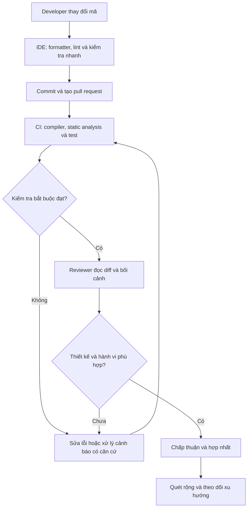

# Phối hợp rà soát mã với phân tích tĩnh tự động

Rà soát mã (code review) và phân tích tĩnh tự động (automated static analysis) đều giúp phát hiện vấn đề trước khi phần mềm được đưa vào vận hành. Tuy nhiên, hai hoạt động này quan sát mã nguồn theo những cách khác nhau. Công cụ phân tích tĩnh có thể kiểm tra nhất quán trên nhiều tệp, phát hiện một số mẫu lỗi và cảnh báo nhanh theo quy tắc đã cấu hình. Người rà soát có thể hiểu mục tiêu thay đổi, quy tắc nghiệp vụ, bối cảnh kiến trúc và những đánh đổi mà công cụ không thể tự suy ra.

Khi phối hợp tốt, công cụ xử lý các kiểm tra lặp lại và có thể tự động hóa; người rà soát dành thời gian cho tính đúng đắn của giải pháp, thiết kế, khả năng đọc hiểu và tác động của thay đổi. Kết quả là nhóm có thể phát hiện lỗi sớm, giảm tranh luận về vấn đề cơ học và duy trì chất lượng mã qua nhiều lần phát triển.

## 1. Hiểu vai trò của rà soát mã và phân tích tĩnh

### Rà soát mã là gì?

Rà soát mã là hoạt động một hoặc nhiều người đọc thay đổi mã nguồn trước khi chấp nhận hoặc hợp nhất thay đổi đó. Người rà soát xem xét liệu giải pháp có đáp ứng mục tiêu, giữ đúng quy tắc nghiệp vụ, phù hợp với kiến trúc và có thể duy trì hay không. Họ cũng có thể phát hiện lỗi logic, trường hợp biên bị bỏ sót, thay đổi không tương thích hoặc thiếu kiểm thử.

Rà soát mã hiệu quả thường xem xét:

- Thay đổi có giải quyết đúng vấn đề và nằm trong phạm vi đã thống nhất không?
- Hành vi mới có đúng với yêu cầu và quy tắc nghiệp vụ không?
- Các trường hợp biên, lỗi, quyền truy cập và dữ liệu bất thường đã được xử lý chưa?
- Thiết kế có phù hợp với ranh giới mô-đun, hợp đồng API và kiến trúc hiện tại không?
- Mã có dễ hiểu, dễ kiểm thử, dễ sửa đổi và có mức độ phức tạp hợp lý không?
- Kiểm thử có chứng minh được hành vi quan trọng và có thể tái hiện lỗi không?
- Thay đổi có ảnh hưởng đến hiệu năng, bảo mật, khả năng tương thích hoặc vận hành không?

Rà soát không nên chỉ là tìm lỗi cú pháp hoặc tranh luận về sở thích định dạng. Các vấn đề cơ học nên được xử lý bằng formatter, compiler hoặc công cụ tự động khi có thể; thời gian của con người cần tập trung vào những câu hỏi đòi hỏi hiểu biết về bối cảnh.

### Phân tích tĩnh tự động là gì?

Phân tích tĩnh tự động kiểm tra mã nguồn hoặc biểu diễn trung gian mà không cần thực thi chương trình theo luồng sử dụng thực tế. Công cụ có thể phân tích cú pháp, kiểu dữ liệu, luồng điều khiển, luồng dữ liệu, cách sử dụng API và các mẫu mã đã biết để phát hiện cảnh báo.

Các nhóm kiểm tra thường gặp:

- **Compiler và kiểm tra kiểu:** phát hiện lỗi cú pháp, kiểu không tương thích, biến hoặc biểu thức không hợp lệ theo ngôn ngữ.
- **Lint và quy tắc mã:** phát hiện mẫu mã đáng ngờ, quy ước không nhất quán, import thừa hoặc cấu trúc khó đọc.
- **Phân tích luồng điều khiển và dữ liệu:** tìm nhánh không thể tới, giá trị có thể null, tài nguyên không được giải phóng hoặc dữ liệu không được xác thực.
- **Phân tích bảo mật mã nguồn (SAST):** tìm các đường dữ liệu có thể dẫn đến SQL injection, cross-site scripting, lộ bí mật hoặc sử dụng API không an toàn.
- **Phân tích độ phức tạp và khả năng bảo trì:** cảnh báo hàm quá dài, lồng nhánh sâu, phụ thuộc vòng hoặc mã trùng lặp.
- **Quy tắc kiến trúc:** kiểm tra phụ thuộc giữa các lớp hoặc mô-đun có vi phạm ranh giới đã quy định hay không.

Phân tích tĩnh có giới hạn. Công cụ có thể bỏ sót lỗi phụ thuộc vào dữ liệu thực, cấu hình triển khai, thời điểm chạy, hành vi người dùng hoặc quy tắc nghiệp vụ chưa được mô tả thành quy tắc máy có thể kiểm tra. Nó cũng có thể báo cảnh báo không liên quan trong một ngữ cảnh cụ thể.

### Hai hoạt động bổ sung cho nhau

| Khía cạnh | Phân tích tĩnh tự động | Rà soát mã bởi con người |
|---|---|---|
| Phạm vi | Có thể quét nhất quán nhiều tệp và nhiều lần chạy | Tập trung vào thay đổi và bối cảnh có liên quan |
| Điểm mạnh | Tốc độ, tính lặp lại, quy tắc rõ và khả năng phát hiện mẫu phổ biến | Hiểu ý định, nghiệp vụ, thiết kế, đánh đổi và tác động rộng |
| Hạn chế | Phụ thuộc quy tắc, cấu hình và khả năng phân tích của công cụ | Tốn thời gian, có thể không nhất quán giữa người rà soát |
| Kết quả | Cảnh báo, vị trí mã, mức độ và gợi ý sửa | Nhận xét, câu hỏi, yêu cầu thay đổi hoặc chấp thuận |
| Phù hợp nhất | Lỗi mẫu, quy ước, luồng dữ liệu và kiểm tra cơ học | Tính đúng đắn theo bối cảnh, thiết kế và tính phù hợp với mục tiêu |

Không hoạt động nào thay thế hoàn toàn hoạt động kia. Một cảnh báo bảo mật tự động có thể chỉ ra đường dữ liệu đáng ngờ; người rà soát xác minh dữ liệu có thực sự được kiểm soát ở ranh giới phù hợp không. Ngược lại, người rà soát có thể phát hiện một quy tắc tính phí sai dù không có cảnh báo tĩnh nào được kích hoạt.

## 2. Đặt kiểm tra tự động đúng thời điểm trong quy trình

Phản hồi càng gần thời điểm viết mã thì người phát triển càng dễ hiểu và sửa vấn đề. Tuy vậy, không phải mọi phân tích đều cần chạy ở mọi lần lưu tệp. Nên tổ chức nhiều vòng kiểm tra với phạm vi và thời gian phù hợp.

| Thời điểm | Hoạt động tự động | Vai trò của người phát triển và reviewer |
|---|---|---|
| Trong IDE hoặc trước commit | Formatter, lint nhanh, compiler, một số quy tắc nhẹ | Sửa vấn đề ngay khi viết và kiểm tra ý định thay đổi |
| Khi tạo pull request | Phân tích tệp thay đổi, SAST, kiểm tra kiểu, quy tắc kiến trúc và unit test | Đọc diff, đánh giá nghiệp vụ, thiết kế, kiểm thử và các cảnh báo quan trọng |
| Trên nhánh tích hợp | Quét phạm vi rộng, kiểm tra phụ thuộc và các quy tắc toàn dự án | Xử lý vấn đề liên thành phần và xác nhận tương thích |
| Theo lịch hoặc trước phát hành | Phân tích sâu, quét toàn bộ mã và kiểm tra cấu hình bảo mật liên quan | Đánh giá xu hướng, rủi ro còn lại và các ngoại lệ đang tồn tại |

Một quy trình thường bắt đầu bằng các kiểm tra nhanh trên máy cá nhân để phát hiện lỗi đơn giản. Khi tạo pull request, hệ thống chạy các kiểm tra bắt buộc trên đúng commit được đề xuất. Reviewer xem kết quả, đọc thay đổi và thảo luận các vấn đề cần phán đoán. Sau khi hợp nhất, quét rộng hơn có thể tìm ra vấn đề liên quan đến những mô-đun khác hoặc thay đổi phụ thuộc.



### Chọn phạm vi quét

Quét phần mã thay đổi giúp phản hồi nhanh và giảm nhiễu khi dự án đã có lịch sử cảnh báo. Tuy nhiên, một thay đổi nhỏ có thể ảnh hưởng đến API dùng chung, cấu hình, thư viện hoặc mô-đun phụ thuộc. Vì vậy, nhóm nên kết hợp:

- Quét diff để phát hiện vấn đề mới trong pull request.
- Quét các mô-đun phụ thuộc khi thay đổi hợp đồng hoặc API dùng chung.
- Quét toàn dự án theo lịch hoặc ở mốc phát hành để tìm vấn đề ngoài diff.
- Quét các đường mã nhạy cảm khi thay đổi xác thực, phân quyền, xử lý dữ liệu hoặc ranh giới tin cậy.

Kết quả quét cần gắn với commit và phiên bản công cụ cụ thể. Nếu mã thay đổi sau khi quét, kết quả cũ không còn chứng minh trạng thái của commit mới; pipeline cần chạy lại những kiểm tra bắt buộc trên phiên bản cuối cùng.

## 3. Thiết lập công cụ phân tích tĩnh có hiệu quả

Một công cụ tốt không chỉ có nhiều quy tắc. Nó cần phù hợp với ngôn ngữ, framework, kiến trúc, mức độ rủi ro và quy trình phát triển. Cấu hình quá lỏng có thể bỏ sót vấn đề; cấu hình quá nghiêm hoặc nhiều cảnh báo không liên quan có thể khiến nhóm bỏ qua kết quả.

### Chọn công cụ theo nhu cầu

Trước khi lựa chọn, hãy xác định loại vấn đề muốn phát hiện và nơi công cụ sẽ chạy. Có thể cần nhiều công cụ chuyên biệt:

| Nhu cầu | Nhóm công cụ phù hợp | Ví dụ kết quả |
|---|---|---|
| Kiểm tra cú pháp và kiểu | Compiler, type checker | Lỗi kiểu, tham chiếu không hợp lệ |
| Giữ quy ước mã | Formatter, linter | Định dạng, import thừa, mẫu mã không thống nhất |
| Tìm lỗi tiềm ẩn | Static analyzer | Null dereference, tài nguyên không đóng, nhánh không tới |
| Tìm điểm yếu bảo mật trong mã | SAST | Luồng dữ liệu không an toàn, API nhạy cảm dùng sai |
| Kiểm soát ranh giới kiến trúc | Architecture rules hoặc dependency analyzer | Phụ thuộc vòng, mô-đun truy cập lớp bị cấm |
| Theo dõi khả năng bảo trì | Complexity và duplication analyzer | Hàm phức tạp, mã trùng lặp, cấu trúc khó sửa |

Phân tích thư viện phụ thuộc, quét image container và kiểm tra cấu hình hạ tầng cũng quan trọng trong bảo mật, nhưng chúng không đồng nhất với phân tích tĩnh mã nguồn. Nên đặt tên và diễn giải kết quả theo đúng loại kiểm tra để reviewer hiểu phạm vi mà công cụ đã đánh giá.

### Chuẩn hóa cấu hình

Cấu hình nên được quản lý cùng mã nguồn hoặc trong một nơi có kiểm soát phiên bản. Nhóm cần thống nhất:

- Phiên bản công cụ và bộ quy tắc được sử dụng.
- Quy tắc nào bật, tắt hoặc điều chỉnh mức độ.
- Thư mục mã sinh tự động, mã thử nghiệm và mã bên thứ ba được xử lý thế nào.
- Ngưỡng chất lượng và điều kiện làm pipeline thất bại.
- Cách xử lý cảnh báo cũ, cảnh báo mới và ngoại lệ.
- Ai được quyền thay đổi cấu hình và cách thông báo thay đổi.

Khi cập nhật phiên bản công cụ hoặc rule set, nên xem xét thay đổi về số lượng, loại và mức độ cảnh báo. Một bản cập nhật có thể bổ sung quy tắc mới hoặc thay đổi cách phân tích; nhóm cần biết vì sao pipeline đột nhiên có thêm lỗi và liệu chúng có phải vấn đề mới trong mã hay không.

### Bắt đầu từ bộ quy tắc có tín hiệu tốt

Nên ưu tiên các quy tắc có hậu quả rõ, ít cảnh báo sai và dễ sửa. Ví dụ, cảnh báo về dữ liệu nhạy cảm đi vào truy vấn SQL có thể quan trọng hơn một quy tắc định dạng nhỏ. Sau khi nhóm đã quen với quy trình xử lý cảnh báo, có thể mở rộng dần sang độ phức tạp, quy tắc kiến trúc và các vấn đề bảo trì.

Không nên bật hàng trăm quy tắc cùng lúc trên một hệ thống lâu năm mà không chuẩn bị cách xử lý. Số lượng cảnh báo quá lớn dễ làm mất tín hiệu của vấn đề nghiêm trọng. Có thể chạy thử ở chế độ chỉ báo cáo, phân loại kết quả, xử lý các vấn đề ưu tiên cao rồi mới bật chặn cho phạm vi phù hợp.

## 4. Đưa kết quả phân tích vào rà soát mã

Kết quả tự động nên xuất hiện ngay trong pull request hoặc giao diện mà reviewer đang sử dụng. Một cảnh báo hữu ích cần chỉ rõ vị trí, quy tắc, mức độ, lý do và bằng chứng đủ để người phát triển kiểm tra. Nếu công cụ chỉ đưa ra một báo cáo tổng hợp khó tìm kiếm, reviewer sẽ phải tốn thêm công sức để liên kết cảnh báo với diff.

### Quy trình xử lý một cảnh báo

1. **Đọc nội dung cảnh báo:** xác định quy tắc, tệp, dòng mã, mức độ và đường dẫn phân tích nếu có.
2. **Xác minh ngữ cảnh:** kiểm tra dữ liệu đầu vào, luồng gọi, cấu hình, điều kiện chạy và mã liên quan.
3. **Phân loại:** xác định đây là lỗi thật, rủi ro cần đánh giá, cảnh báo không áp dụng hay kết quả dương tính giả.
4. **Chọn hành động:** sửa mã, bổ sung kiểm thử, điều chỉnh thiết kế hoặc tạo ngoại lệ có lý do.
5. **Chạy lại:** xác nhận cảnh báo đã được xử lý và thay đổi không tạo lỗi mới.
6. **Ghi nhận:** cập nhật trạng thái, người phụ trách và lý do đối với những cảnh báo cần theo dõi.

Không nên sửa cảnh báo một cách máy móc nếu chưa hiểu tác động. Ví dụ, thêm kiểm tra null có thể làm mất lỗi hiển thị nhưng vẫn che giấu một trạng thái dữ liệu không hợp lệ. Cần xác định giá trị null có được phép theo hợp đồng không và hành vi phù hợp khi nó xuất hiện.

### Phân biệt mức độ nghiêm trọng và độ tin cậy

Mức độ nghiêm trọng mô tả hậu quả tiềm tàng nếu vấn đề là thật. Độ tin cậy mô tả mức chắc chắn rằng công cụ đã tìm đúng vấn đề. Hai khái niệm này không giống nhau.

| Mức độ | Độ tin cậy | Cách xử lý gợi ý |
|---|---|---|
| Cao | Cao | Ưu tiên xử lý; thường nên chặn hợp nhất cho đến khi được khắc phục hoặc có quyết định rủi ro rõ ràng |
| Cao | Thấp hoặc chưa rõ | Điều tra sớm, kiểm tra đường dữ liệu và xác nhận điều kiện kích hoạt |
| Thấp | Cao | Sửa khi chi phí hợp lý hoặc lên kế hoạch xử lý theo chuẩn chất lượng |
| Thấp | Thấp | Xác minh giá trị cảnh báo, điều chỉnh quy tắc nếu có căn cứ và theo dõi nhiễu |

Không nên bỏ qua một cảnh báo có tác động cao chỉ vì công cụ chưa chắc chắn. Cũng không nên coi mọi cảnh báo có độ tin cậy cao là lỗi nghiêm trọng. Chính sách phân loại cần tính đến loại tài sản, dữ liệu, bối cảnh triển khai và yêu cầu của tổ chức.

## 5. Xử lý cảnh báo sai và ngoại lệ một cách có kiểm soát

Cảnh báo sai (false positive) xảy ra khi công cụ báo một vấn đề nhưng điều tra cho thấy mã không có lỗi hoặc rủi ro được mô tả. Cảnh báo đúng nhưng không áp dụng (not applicable) là trường hợp quy tắc đúng nói chung nhưng không phù hợp với đoạn mã hoặc ngữ cảnh cụ thể. Cần phân biệt hai trường hợp này để cải thiện cấu hình mà không làm mất khả năng phát hiện.

### Khi nào nên tạo ngoại lệ?

Chỉ tạo ngoại lệ khi đã xác minh cảnh báo, hiểu lý do không áp dụng và có người chịu trách nhiệm. Một ngoại lệ nên có:

- Quy tắc và vị trí mã được miễn.
- Lý do kỹ thuật cụ thể, có bằng chứng hoặc tham chiếu.
- Người phê duyệt hoặc nhóm sở hữu.
- Phạm vi hẹp nhất có thể.
- Thời hạn hoặc điều kiện xem xét lại nếu ngoại lệ chỉ là tạm thời.

Tránh tắt cả một quy tắc toàn dự án chỉ vì một trường hợp cụ thể. Nếu cảnh báo phát sinh từ mã sinh tự động hoặc thư viện bên thứ ba, hãy cấu hình phạm vi loại trừ chính xác và vẫn quét phần mã do nhóm sở hữu.

### Quản lý cảnh báo tồn đọng

Với dự án đã có nhiều cảnh báo cũ, có thể thiết lập baseline để ghi nhận trạng thái ban đầu. Từ đó, pipeline tập trung chặn cảnh báo mới hoặc cảnh báo nghiêm trọng trong phạm vi thay đổi. Baseline cần được quản lý và giảm dần theo kế hoạch; nếu không, nó có thể trở thành nơi che giấu vấn đề lâu dài.

Một cách triển khai thực tế:

1. Chạy quét toàn bộ và lưu kết quả baseline.
2. Phân loại cảnh báo theo mức độ, độ tin cậy, thành phần và nguyên nhân.
3. Sửa trước các vấn đề nghiêm trọng và dễ khai thác.
4. Bật quality gate cho cảnh báo mới có mức độ phù hợp.
5. Tạo công việc xử lý cảnh báo cũ theo mức ưu tiên và rủi ro.
6. Định kỳ cập nhật baseline và xem lại ngoại lệ.

Không nên tạo baseline mới sau mỗi lần quét chỉ để làm biến mất cảnh báo. Baseline cần có lịch sử và chỉ được cập nhật khi có lý do rõ ràng, chẳng hạn đã sửa một nhóm lỗi hoặc thay đổi phạm vi mã được phân tích.

## 6. Thiết kế quality gate phù hợp

Quality gate là điều kiện kiểm tra tự động dùng để quyết định một thay đổi có đủ điều kiện đi tiếp trong quy trình hay không. Gate giúp thực thi chính sách nhất quán, nhưng nếu thiết kế quá chặt hoặc quá lỏng thì đều làm giảm giá trị.

Một số điều kiện có thể dùng:

- Không có lỗi compiler hoặc lỗi kiểu thuộc phạm vi bắt buộc.
- Không có cảnh báo bảo mật mới ở mức nghiêm trọng đã được xác nhận.
- Không tăng số cảnh báo mới vượt ngưỡng đã thống nhất.
- Các quy tắc kiến trúc bắt buộc không bị vi phạm.
- Kiểm thử bắt buộc liên quan đến thay đổi đã chạy và đạt.
- Ngoại lệ có đủ lý do, người chịu trách nhiệm và phê duyệt.

Gate nên tập trung vào vấn đề mới hoặc rủi ro cao có thể hành động. Với cảnh báo cũ, nhóm có thể theo dõi theo kế hoạch thay vì chặn mọi thay đổi mới nếu điều đó khiến dự án không thể phát triển. Tuy nhiên, các rủi ro nghiêm trọng đã biết vẫn cần chủ sở hữu và quyết định xử lý rõ ràng.

### Chọn ngưỡng theo rủi ro

Không có một ngưỡng chung phù hợp cho mọi dự án. Hệ thống xử lý dữ liệu tài chính, thông tin sức khỏe hoặc dữ liệu nhạy cảm có thể cần chính sách nghiêm hơn ở bảo mật và toàn vẹn dữ liệu. Một thư viện nội bộ ít rủi ro có thể tập trung vào compiler, quy tắc mã và kiến trúc.

Hãy bắt đầu với những điều kiện có thể giải thích và xác minh. Sau khi có dữ liệu vận hành, nhóm có thể điều chỉnh ngưỡng dựa trên tỷ lệ cảnh báo sai, thời gian xử lý, lỗi lọt và tác động đến tốc độ phát triển.

## 7. Reviewer nên tập trung vào điều gì sau khi có kết quả tự động?

Khi công cụ đã kiểm tra các quy tắc cơ học, reviewer nên đọc thay đổi với mục tiêu hiểu vấn đề và đánh giá các quyết định quan trọng. Một trình tự hữu ích:

1. Đọc mô tả pull request để hiểu vấn đề, hành vi mong đợi và phạm vi.
2. Xem diff ở mức tổng thể trước khi đọc từng dòng, xác định thành phần và hợp đồng bị ảnh hưởng.
3. Kiểm tra logic nghiệp vụ, điều kiện biên, trạng thái và hành vi khi thất bại.
4. Đối chiếu các cảnh báo tự động, tập trung vào vấn đề có mức độ hoặc rủi ro cao.
5. Đọc kiểm thử để xác nhận chúng chứng minh hành vi quan trọng, không chỉ thực thi mã.
6. Xem tác động đến hiệu năng, bảo mật, khả năng tương thích, quan sát và vận hành.
7. Đưa ra nhận xét cụ thể, có thể hành động và gắn với vị trí hoặc tình huống.

### Các câu hỏi reviewer cần tự đặt ra

**Về mục tiêu và phạm vi**

- Thay đổi có giải quyết đúng vấn đề được mô tả không?
- Có thay đổi ngoài phạm vi hoặc thiếu cập nhật tài liệu/hợp đồng không?
- Hành vi cũ nào cần tiếp tục được giữ?

**Về logic và dữ liệu**

- Trường hợp biên, dữ liệu null, rỗng, trùng hoặc sai kiểu được xử lý ra sao?
- Có thể xảy ra cập nhật đồng thời, retry hoặc xử lý sự kiện sai thứ tự không?
- Bất biến nghiệp vụ có được giữ qua các trạng thái và giao dịch không?

**Về thiết kế**

- Ranh giới mô-đun và trách nhiệm có rõ không?
- Có tạo phụ thuộc vòng, trùng lặp logic hoặc abstraction không cần thiết không?
- Lỗi được truyền, ghi nhận và phục hồi như thế nào?

**Về bảo mật và vận hành**

- Dữ liệu nhạy cảm có được bảo vệ và quyền truy cập có được kiểm tra ở đúng ranh giới không?
- Có lộ bí mật trong mã, log hoặc thông báo lỗi không?
- Thay đổi có ảnh hưởng đến cấu hình, migration, giám sát hoặc quy trình khôi phục không?

**Về kiểm thử**

- Kiểm thử có xác nhận đầu ra và tác dụng phụ quan trọng không?
- Có trường hợp âm tính, biên và lỗi phụ thuộc phù hợp không?
- Có kiểm thử hồi quy cho lỗi cũ hoặc khu vực rủi ro cao không?

## 8. Ví dụ: phối hợp SAST và code review cho truy vấn dữ liệu

Giả sử một thay đổi bổ sung chức năng tìm kiếm đơn hàng theo từ khóa. Người phát triển tạo truy vấn bằng cách ghép chuỗi SQL từ đầu vào của người dùng:

```java
String sql = "SELECT id, total FROM orders WHERE customer_name = '"
        + customerName + "'";
Statement statement = connection.createStatement();
ResultSet result = statement.executeQuery(sql);
```

Công cụ SAST có thể nhận diện luồng dữ liệu từ đầu vào đến câu truy vấn và cảnh báo nguy cơ SQL injection. Trong pull request, cảnh báo nên trỏ đến vị trí tạo truy vấn và mô tả vì sao dữ liệu không tin cậy được đưa vào câu lệnh.

Người phát triển có thể sửa bằng prepared statement:

```java
String sql = "SELECT id, total FROM orders WHERE customer_name = ?";
PreparedStatement statement = connection.prepareStatement(sql);
statement.setString(1, customerName);
ResultSet result = statement.executeQuery();
```

Sau đó, phân tích tĩnh chạy lại để xác nhận cảnh báo đã được xử lý. Reviewer vẫn cần kiểm tra thêm:

- `customerName` có được chuẩn hóa theo yêu cầu tìm kiếm hay không; prepared statement bảo vệ tham số nhưng không tự định nghĩa quy tắc nghiệp vụ.
- Truy vấn có giới hạn phạm vi theo khách hàng hoặc tổ chức hiện tại không; nếu thiếu điều kiện phân quyền, người dùng có thể xem dữ liệu không thuộc quyền của mình dù không có SQL injection.
- Kết quả có giới hạn số dòng và phân trang để tránh truy vấn quá lớn không?
- Kết nối và `ResultSet` có được đóng đúng cách, kể cả khi xảy ra ngoại lệ không?
- Có kiểm thử với chuỗi chứa dấu nháy, ký tự đặc biệt, từ khóa SQL và người dùng thuộc tổ chức khác không?

Ví dụ cho thấy công cụ phát hiện được một mẫu nguy hiểm cụ thể, nhưng reviewer cần đánh giá cả phân quyền, hiệu năng, quản lý tài nguyên và hành vi nghiệp vụ. Một cảnh báo đã biến mất không đồng nghĩa thay đổi đã an toàn hoàn toàn.

## 9. Ví dụ: cảnh báo null và ngữ nghĩa nghiệp vụ

Giả sử công cụ phân tích luồng dữ liệu cảnh báo một biến `shippingAddress` có thể null trước khi được sử dụng. Cách sửa nhanh có thể là thêm điều kiện:

```java
if (shippingAddress != null) {
    createShipment(shippingAddress);
}
```

Đoạn mã có thể loại bỏ nguy cơ dereference null, nhưng chưa chắc đúng nghiệp vụ. Nếu mọi đơn hàng đã xác nhận đều bắt buộc có địa chỉ giao hàng, việc bỏ qua tạo vận đơn có thể khiến đơn bị kẹt mà không có lỗi rõ ràng.

Reviewer cần xác minh hợp đồng dữ liệu:

- Nếu địa chỉ bắt buộc, nên từ chối hoặc chuyển đơn sang trạng thái cần bổ sung thông tin trước khi xác nhận.
- Nếu địa chỉ có thể thiếu trong một loại đơn hàng, cần xử lý nhánh đó theo quy trình được định nghĩa.
- Nếu dữ liệu null đến từ migration hoặc tích hợp cũ, cần xác định phạm vi dữ liệu và biện pháp khắc phục.

Phân tích tĩnh chỉ nêu khả năng có giá trị null. Quyết định đúng phụ thuộc vào quy tắc nghiệp vụ và trạng thái hệ thống.

## 10. Giao tiếp trong code review

Chất lượng rà soát phụ thuộc cả cách đưa ra nhận xét. Nhận xét nên tập trung vào vấn đề, tác động và hướng xác minh, tránh phán xét người viết hoặc chỉ nêu sở thích cá nhân.

Một nhận xét hữu ích thường có:

- **Vị trí hoặc tình huống:** đoạn mã hay trường hợp cụ thể.
- **Vấn đề:** điều gì có thể sai hoặc chưa rõ.
- **Tác động:** hậu quả đối với người dùng, dữ liệu, bảo mật hoặc khả năng duy trì.
- **Đề xuất hoặc câu hỏi:** cách sửa, kiểm thử hoặc thông tin cần làm rõ.
- **Mức độ:** chặn hợp nhất, cần xử lý sớm hoặc đề xuất cải thiện.

Ví dụ nhận xét rõ ràng: “Nếu webhook đến hai lần, nhánh này có thể ghi nhận thanh toán lần thứ hai vì chưa kiểm tra mã giao dịch đã xử lý. Bạn có thể bổ sung kiểm tra idempotency và một integration test gửi cùng sự kiện hai lần không?”

Tránh nhận xét mơ hồ như “đoạn này không tốt”, “hãy làm sạch” hoặc “cần viết lại”. Nếu chỉ là đề xuất phong cách, hãy nói rõ đó là gợi ý thay vì yêu cầu bắt buộc. Nếu có bất đồng về thiết kế, hãy quay lại yêu cầu, bằng chứng và đánh đổi thay vì tranh luận theo thẩm quyền.

### Phân loại nhận xét

| Loại | Ý nghĩa | Cách xử lý |
|---|---|---|
| Blocker | Có lỗi hoặc rủi ro nghiêm trọng cần giải quyết trước khi hợp nhất | Nêu bằng chứng và yêu cầu hành động rõ |
| Required change | Thiếu sót ảnh hưởng đến yêu cầu, khả năng duy trì hoặc kiểm thử | Thống nhất cách sửa và xác minh |
| Question | Cần làm rõ giả định hoặc hành vi | Trả lời bằng bối cảnh hoặc cập nhật mã/tài liệu |
| Suggestion | Cải thiện không bắt buộc | Người viết cân nhắc theo chi phí và giá trị |

Nhóm cần thống nhất ý nghĩa của các nhãn để tránh việc mỗi reviewer hiểu một cách. Không nên dùng nhãn nghiêm trọng cho vấn đề nhỏ vì điều đó làm giảm độ tin cậy của quy trình.

## 11. Đo lường hiệu quả mà không chạy theo số lượng cảnh báo

Một quy trình tốt nên giúp giảm lỗi lọt, phát hiện vấn đề sớm và giữ thời gian review hợp lý. Có thể theo dõi một số tín hiệu:

| Chỉ số | Điều cần quan sát | Giới hạn khi diễn giải |
|---|---|---|
| Tỷ lệ cảnh báo được xác nhận | Bao nhiêu cảnh báo thực sự có vấn đề? | Phụ thuộc cách phân loại và loại quy tắc |
| Thời gian xử lý cảnh báo nghiêm trọng | Từ khi phát hiện đến khi sửa hoặc có quyết định | Có thể phụ thuộc đội khác hoặc nhà cung cấp |
| Cảnh báo mới theo pull request | Thay đổi có đưa thêm vấn đề mới vào mã không? | Cần phân biệt cảnh báo trùng, mã sinh tự động và lỗi thật |
| Lỗi lọt sau phát hành | Vấn đề nào không được phát hiện trước đó? | Không phải mọi lỗi đều có thể phát hiện bằng phân tích tĩnh |
| Thời gian chờ và thời gian review | Quy trình có tạo nút thắt không? | Thời gian review phụ thuộc độ lớn và độ phức tạp của thay đổi |
| Ngoại lệ còn hiệu lực | Có bao nhiêu ngoại lệ, tuổi và chủ sở hữu của chúng? | Số lượng thấp không đồng nghĩa ngoại lệ đều hợp lý |
| Tỷ lệ lỗi tái diễn | Vấn đề đã sửa có quay lại không? | Cần nhóm lỗi theo nguyên nhân thay vì chỉ so chuỗi mô tả |

Không nên đặt mục tiêu “đạt càng nhiều cảnh báo càng tốt” hoặc “không có cảnh báo nào” mà không xét giá trị. Mục tiêu đó có thể khiến nhóm tắt quy tắc, tạo ngoại lệ rộng hoặc sửa mã để làm hài lòng công cụ mà không cải thiện hành vi. Hãy xem cảnh báo như tín hiệu để điều tra, kết hợp với kết quả kiểm thử, sự cố và đánh giá của reviewer.

## 12. Phân công trách nhiệm và duy trì quy trình

Để tránh cảnh báo bị bỏ quên hoặc code review phụ thuộc vào một vài cá nhân, nhóm nên xác định trách nhiệm:

- **Người phát triển:** hiểu cảnh báo trên thay đổi của mình, sửa vấn đề, bổ sung kiểm thử và giải thích ngoại lệ nếu có.
- **Reviewer:** xem kết quả tự động, xác minh các rủi ro quan trọng và đánh giá tính đúng đắn theo bối cảnh.
- **Người sở hữu công cụ hoặc nền tảng:** duy trì phiên bản, cấu hình, tích hợp CI, baseline và chất lượng tín hiệu.
- **Người sở hữu mô-đun:** xác định quy tắc kiến trúc, mức rủi ro và ngoại lệ liên quan đến miền phụ trách.
- **Nhóm bảo mật hoặc chuyên gia phù hợp:** hỗ trợ điều tra cảnh báo nhạy cảm và quyết định rủi ro vượt thẩm quyền của nhóm tính năng.

Nhóm cũng cần duy trì quy ước về kích thước pull request, thời gian phản hồi, người review phù hợp, cách xử lý khi CI lỗi và quy trình cập nhật quy tắc. Thay đổi công cụ hoặc quality gate cần được thông báo và có thời gian thích nghi khi ảnh hưởng rộng.

## 13. Những sai lầm thường gặp

- **Coi công cụ là người phê duyệt:** pipeline xanh chỉ cho biết các quy tắc đã cấu hình đạt; nó không chứng minh yêu cầu nghiệp vụ và thiết kế đúng.
- **Bắt reviewer đọc mọi cảnh báo mà không phân loại:** cảnh báo nhiễu làm giảm sự chú ý dành cho rủi ro nghiêm trọng.
- **Chỉ chạy phân tích sau khi hợp nhất:** vấn đề có thể lan sang nhánh chính trước khi được phát hiện; nên có vòng kiểm tra phù hợp trong pull request.
- **Bật toàn bộ quy tắc mà không có lộ trình:** dự án có thể bị ngập trong cảnh báo cũ và làm chậm phát triển.
- **Tắt quy tắc khi gặp cảnh báo sai:** nên xác minh và tạo ngoại lệ hẹp hoặc điều chỉnh cấu hình có căn cứ.
- **Không quản lý baseline:** cảnh báo cũ tiếp tục tích tụ và làm mất khả năng nhận diện vấn đề mới.
- **Sửa để hết cảnh báo nhưng không xem ngữ nghĩa:** cách sửa có thể che giấu lỗi hoặc làm sai quy tắc nghiệp vụ.
- **Review theo sở thích cá nhân:** yêu cầu thay đổi cần dựa trên tiêu chuẩn, mục tiêu hoặc tác động có thể giải thích.
- **Đo hiệu quả bằng số comment hoặc số cảnh báo:** số lượng không thể hiện trực tiếp chất lượng hay giá trị phát hiện.
- **Không xem lại ngoại lệ:** ngoại lệ tạm thời có thể tồn tại vô thời hạn và trở thành lỗ hổng kiểm soát.

## 14. Danh sách kiểm tra cho một pull request

Trước khi chấp thuận thay đổi, nhóm có thể dùng danh sách sau:

**Kiểm tra tự động**

- Compiler, kiểm tra kiểu, formatter và lint đã chạy trên commit mới nhất chưa?
- Phân tích tĩnh và kiểm tra bảo mật có hoàn tất không?
- Cảnh báo mới có được phân loại, xác minh và xử lý không?
- Ngoại lệ có phạm vi hẹp, lý do và người chịu trách nhiệm không?
- Các quality gate bắt buộc đã đạt chưa?

**Rà soát của con người**

- Mục tiêu và phạm vi thay đổi có rõ không?
- Logic, quy tắc nghiệp vụ, trạng thái và trường hợp biên có đúng không?
- Thiết kế có phù hợp với kiến trúc và hợp đồng hiện tại không?
- Dữ liệu, quyền truy cập, lỗi, tài nguyên và hiệu năng đã được xem xét chưa?
- Kiểm thử có xác nhận hành vi quan trọng và các trường hợp lỗi không?
- Tài liệu, cấu hình, migration và khả năng vận hành có cần cập nhật không?

**Quyết định**

- Các blocker và required change đã được giải quyết chưa?
- Những rủi ro còn lại có được ghi nhận và chấp nhận bởi đúng người có thẩm quyền không?
- Kết quả CI có thuộc về đúng commit sẽ được hợp nhất không?

## Kết luận

Phân tích tĩnh tự động giúp phát hiện nhất quán các mẫu lỗi và rủi ro có thể kiểm tra bằng quy tắc; rà soát mã bởi con người đánh giá ý định, nghiệp vụ, thiết kế và tác động của thay đổi. Tổ chức quy trình theo nhiều vòng phản hồi, đưa kết quả công cụ vào pull request, xử lý cảnh báo có căn cứ và duy trì quality gate phù hợp giúp hai hoạt động bổ sung cho nhau. Khi đó, nhóm vừa giảm công việc kiểm tra cơ học, vừa dành sự chú ý cho những quyết định cần hiểu biết và phán đoán của con người.
