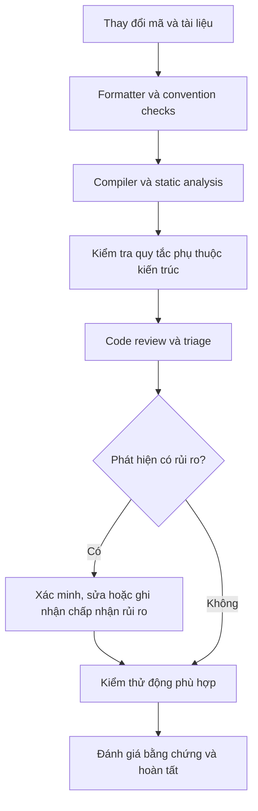

# Phân biệt kiểm tra quy ước, dấu hiệu lỗi và vấn đề kiến trúc

Trong module `VALIDATION_TESTING_STRATEGY`, kiểm thử tĩnh giúp phát hiện vấn đề bằng cách xem xét yêu cầu, thiết kế, mã nguồn, cấu hình và các tạo phẩm phát triển mà không cần thực thi phần mềm. Kết quả kiểm tra tĩnh có thể rất khác nhau: có kết quả chỉ phản ánh mã chưa tuân theo quy ước của nhóm; có kết quả là dấu hiệu cho thấy một lỗi có thể xảy ra; có kết quả chỉ ra vấn đề trong cấu trúc hoặc cách tổ chức toàn hệ thống.

Phân biệt ba loại này giúp nhóm đánh giá đúng ý nghĩa của phát hiện, chọn người xử lý phù hợp và tránh biến mọi cảnh báo của công cụ thành lỗi sản phẩm. **Kiểm tra quy ước** tập trung vào tính nhất quán và khả năng đọc hiểu. **Dấu hiệu lỗi** tập trung vào đường thực thi, dữ liệu hoặc điều kiện có thể làm hành vi sai. **Vấn đề kiến trúc** tập trung vào cấu trúc, ranh giới, phụ thuộc và các thuộc tính chất lượng ở phạm vi rộng.

Một cảnh báo có thể xuất hiện trong cùng một tệp mã nhưng cần cách xử lý khác nhau tùy bản chất. Ví dụ, một lớp quá dài có thể là vấn đề về khả năng bảo trì; một biến có thể null trước khi gọi phương thức là dấu hiệu lỗi; một dịch vụ phụ thuộc trực tiếp vào nhiều tầng bên trong của dịch vụ khác có thể phản ánh vấn đề kiến trúc. Bài học này trình bày cách phân loại, xác minh, ưu tiên và xử lý các phát hiện đó trong hoạt động kiểm thử tĩnh.

## 1. Kiểm thử tĩnh và phạm vi của các loại phát hiện

### 1.1. Kiểm thử tĩnh là gì?

Kiểm thử tĩnh (static testing) là hoạt động đánh giá tạo phẩm phần mềm mà không thực thi chương trình đang được kiểm tra. Tạo phẩm có thể gồm:

- Yêu cầu, tiêu chí chấp nhận và đặc tả.
- Mô hình nghiệp vụ, sơ đồ kiến trúc và thiết kế.
- Mã nguồn, script, truy vấn và cấu hình.
- Định nghĩa API, schema, hợp đồng tích hợp.
- Tài liệu triển khai, vận hành và hướng dẫn sử dụng.

Các phương pháp phổ biến gồm rà soát tài liệu, walkthrough, inspection, code review, phân tích tĩnh tự động, kiểm tra quy tắc phụ thuộc và rà soát kiến trúc.

Kiểm thử tĩnh có thể phát hiện lỗi trước khi chạy chương trình, khi chi phí sửa thường thấp hơn và thông tin về nguyên nhân còn dễ truy vết. Tuy nhiên, nó không quan sát trực tiếp hành vi trong môi trường thực thi. Một cảnh báo cần được diễn giải trong ngữ cảnh; một kết quả phân tích sạch cũng không chứng minh phần mềm không có lỗi.

### 1.2. Ba nhóm phát hiện

**Kiểm tra quy ước (convention checks)** xác nhận tạo phẩm tuân thủ quy tắc đã thống nhất về cách viết, tổ chức hoặc ghi nhận. Ví dụ: định dạng mã, quy tắc đặt tên, thứ tự import, cấu trúc thư mục, cách viết tài liệu và quy tắc lint.

**Dấu hiệu lỗi (defect indicators)** là đặc điểm trong tạo phẩm cho thấy có khả năng tồn tại lỗi chức năng, lỗi dữ liệu, lỗi bảo mật, lỗi xử lý tài nguyên hoặc hành vi không an toàn. Ví dụ: bỏ kiểm tra null, truy vấn không tham số hóa, tài nguyên không được đóng, nhánh điều kiện không bao phủ trường hợp quan trọng hoặc xử lý ngoại lệ bị bỏ qua.

**Vấn đề kiến trúc (architectural issues)** là điểm yếu trong cấu trúc tổng thể hoặc quan hệ giữa các thành phần có thể làm tăng rủi ro thay đổi, lỗi lan truyền, khó kiểm thử, khó mở rộng hoặc khó vận hành. Ví dụ: phụ thuộc vòng giữa các module, tầng giao diện truy cập trực tiếp cơ sở dữ liệu của module khác, dịch vụ dùng chung trạng thái toàn cục hoặc ranh giới bảo mật không rõ ràng.

### 1.3. So sánh theo mục tiêu và bằng chứng

| Khía cạnh | Kiểm tra quy ước | Dấu hiệu lỗi | Vấn đề kiến trúc |
|---|---|---|---|
| Mục tiêu | Duy trì tính nhất quán và khả năng đọc hiểu | Phát hiện hành vi sai hoặc điều kiện có thể gây lỗi | Đánh giá cấu trúc và quan hệ giữa các thành phần |
| Phạm vi thường gặp | Dòng mã, tệp, tài liệu hoặc quy tắc nhóm | Biểu thức, đường dữ liệu, hàm, luồng xử lý | Module, dịch vụ, hệ thống hoặc nhiều nhóm |
| Căn cứ | Quy ước, style guide, quy tắc lint | Ngữ nghĩa ngôn ngữ, luồng điều khiển, luồng dữ liệu, yêu cầu và bảo mật | Nguyên tắc kiến trúc, ranh giới miền, phụ thuộc và thuộc tính chất lượng |
| Kết quả điển hình | Vi phạm định dạng, tên gọi, cấu trúc | Có thể null, truy cập sai, rò rỉ tài nguyên, lỗi xác thực | Phụ thuộc vòng, ghép nối cao, ranh giới bị phá vỡ |
| Cách xác minh | Đối chiếu quy tắc đã thống nhất | Phân tích điều kiện kích hoạt và hậu quả; bổ sung kiểm thử khi cần | Rà soát thiết kế, đồ thị phụ thuộc, luồng dữ liệu và tác động liên thành phần |
| Người xử lý phù hợp | Tác giả mã, nhóm phát triển, người quản lý quy ước | Developer, QA, security hoặc chuyên gia miền liên quan | Tech lead, architect, chủ sở hữu module và các nhóm phụ thuộc |
| Cách khắc phục | Format, rename, chuẩn hóa hoặc cập nhật quy tắc | Sửa logic, thêm kiểm tra, xử lý lỗi và kiểm thử xác nhận | Điều chỉnh ranh giới, phụ thuộc, giao diện hoặc phân chia trách nhiệm |

Đây là cách phân loại theo mục đích chính. Một phát hiện có thể thuộc nhiều nhóm. Chẳng hạn, một quy tắc kiến trúc có thể được tự động hóa thành convention check; một vi phạm kiến trúc cũng có thể tạo ra dấu hiệu lỗi. Khi báo cáo, hãy nêu nhóm chính và các tác động liên quan.

## 2. Kiểm tra quy ước: bảo đảm tính nhất quán

### 2.1. Quy ước là gì?

Quy ước là các quy tắc được nhóm hoặc tổ chức thống nhất để tạo phẩm có cách trình bày và cấu trúc dễ hiểu, dễ rà soát, dễ bảo trì. Quy ước có thể đến từ tiêu chuẩn ngôn ngữ, hướng dẫn nội bộ, yêu cầu dự án hoặc công cụ tự động.

Ví dụ:

- Tên lớp dùng PascalCase, tên biến và phương thức theo quy tắc đặt tên đã thống nhất.
- Mã được định dạng bằng formatter chung.
- Import không sử dụng được loại bỏ.
- Các hằng số, cấu hình và tài liệu tuân theo cấu trúc quy định.
- Phương thức công khai có tài liệu hoặc annotation cần thiết.
- Không đưa mật khẩu hoặc khóa bí mật vào kho mã.
- Mỗi module đặt mã trong cấu trúc thư mục được quy định.

Quy ước giúp giảm tranh luận về phong cách trong code review và giúp người đọc tập trung vào logic. Tuy nhiên, một vi phạm quy ước không tự động đồng nghĩa với lỗi chức năng.

### 2.2. Các loại quy ước thường kiểm tra

| Nhóm | Ví dụ | Công cụ hoặc cách kiểm tra |
|---|---|---|
| Định dạng | Thụt lề, dấu ngoặc, xuống dòng, khoảng trắng | Formatter |
| Đặt tên | Tên lớp, biến, hằng số, package | Linter hoặc rule tùy chỉnh |
| Cấu trúc mã | Kích thước tệp, thứ tự thành phần, import | Linter, kiểm tra cấu trúc |
| Tài liệu | README, API docs, comment bắt buộc | Rà soát hoặc kiểm tra tự động |
| Quy tắc ngôn ngữ | Cú pháp lỗi thời, API bị đánh dấu deprecated | Compiler và static analyzer |
| Quy tắc repository | Tệp bắt buộc, vị trí cấu hình, metadata | Script kiểm tra hoặc CI |
| Quy tắc nhóm | Cách đặt log, xử lý TODO, quy ước review | Checklist và code review |

Một số quy tắc có thể mang ý nghĩa chất lượng sâu hơn. Ví dụ, cấm hard-code secret vừa là quy ước bảo mật vừa là kiểm soát phòng ngừa lỗi nghiêm trọng. Vì vậy, không nên chỉ nhìn tên rule; hãy hiểu mục đích và hậu quả nếu vi phạm.

### 2.3. Ví dụ vi phạm quy ước

Giả sử nhóm yêu cầu tên biến trong Java dùng lowerCamelCase:

```java
int TotalAmount = 0;
int totalAmount = 0;
```

Nếu quy tắc đặt tên chỉ nhằm giữ nhất quán, dòng đầu tiên là vi phạm quy ước. Bản thân tên biến đó không chứng minh phép tính sai. Một formatter hoặc linter có thể phát hiện và đề xuất sửa tự động.

Một ví dụ khác là import không dùng:

```java
import java.util.List;
import java.util.Map;

class OrderSummary {
    private List<String> itemNames;
}
```

Import `Map` không được sử dụng là vấn đề sạch mã. Nó thường có mức độ thấp và có thể được công cụ loại bỏ. Nhưng nếu một quy tắc import phản ánh ranh giới module hoặc ngăn phụ thuộc tầng không hợp lệ, vi phạm có thể cần phân loại như vấn đề kiến trúc.

### 2.4. Khi nào vi phạm quy ước cần được nâng mức?

Một quy tắc tưởng như phong cách có thể bảo vệ thuộc tính quan trọng. Ví dụ:

- Quy tắc cấm ghi log token truy cập bảo vệ dữ liệu xác thực.
- Quy tắc bắt buộc tham số hóa truy vấn giúp ngăn SQL injection.
- Quy tắc không bắt ngoại lệ rồi bỏ qua giúp tránh che giấu lỗi.
- Quy tắc không gọi trực tiếp module nội bộ khác bảo vệ ranh giới kiến trúc.

Hãy xem xét mục đích của quy tắc, phạm vi tác động và hậu quả nếu vi phạm. Nếu vi phạm có thể tạo đường khai thác, làm mất dữ liệu hoặc phá vỡ hợp đồng, cần xử lý theo mức rủi ro tương ứng, không xem là lỗi định dạng thông thường.

## 3. Dấu hiệu lỗi: nhận diện khả năng hành vi sai

### 3.1. Dấu hiệu lỗi không phải lúc nào cũng là lỗi đã được xác nhận

Dấu hiệu lỗi là bằng chứng ban đầu cho thấy một đoạn mã hoặc cấu hình có thể dẫn đến hành vi không mong muốn. Công cụ phân tích tĩnh thường phát hiện mẫu đáng ngờ dựa trên quy tắc, luồng dữ liệu hoặc mô hình ngữ nghĩa. Người rà soát cần xác minh:

- Đường mã có thể được thực thi trong điều kiện thực tế không?
- Dữ liệu có thể mang giá trị gây lỗi không?
- Có kiểm tra hoặc biện pháp bảo vệ ở nơi khác không?
- Hành vi có vi phạm yêu cầu, quy tắc nghiệp vụ hoặc thuộc tính bảo mật không?
- Hậu quả là gì và có thể quan sát bằng cách nào?

Một cảnh báo có thể là false positive nếu điều kiện kích hoạt không thể xảy ra hoặc công cụ không hiểu được biện pháp bảo vệ bên ngoài. Ngược lại, công cụ không cảnh báo không có nghĩa là không tồn tại lỗi; phân tích tĩnh có thể bỏ sót lỗi phụ thuộc môi trường, cấu hình, thời gian hoặc nghiệp vụ.

### 3.2. Các dấu hiệu thường gặp

| Dấu hiệu | Nguy cơ | Câu hỏi xác minh |
|---|---|---|
| Có thể dereference null | NullPointerException hoặc bỏ dở luồng | Giá trị có thể null trong mọi đường gọi không? Có kiểm tra trước đó không? |
| Bắt ngoại lệ rồi bỏ qua | Lỗi bị che giấu, trạng thái không nhất quán | Người gọi có biết thao tác thất bại không? Có log hoặc cơ chế phục hồi không? |
| Tài nguyên không được đóng | Rò rỉ file handle, connection hoặc bộ nhớ | Tài nguyên được đóng trong cả nhánh lỗi không? |
| Truy vấn ghép chuỗi từ đầu vào | SQL injection hoặc truy vấn sai | Đầu vào có được tham số hóa và kiểm soát không? |
| So sánh chuỗi hoặc số sai ngữ nghĩa | Nhánh logic chạy sai | Kiểu dữ liệu, locale và quy tắc so sánh có phù hợp không? |
| Điều kiện không thể đạt hoặc nhánh không được xử lý | Logic thiếu hoặc mã chết | Có trạng thái hợp lệ nào không được bao phủ không? |
| Dùng dữ liệu sau khi đã thay đổi trạng thái | Race condition hoặc dữ liệu lỗi thời | Có đồng thời, callback hoặc transaction liên quan không? |
| Ghi log dữ liệu nhạy cảm | Rò rỉ thông tin | Log có chứa token, mật khẩu hoặc dữ liệu cá nhân không cần thiết không? |
| Kiểm tra quyền ở giao diện nhưng thiếu ở API | Truy cập trái phép | Người dùng có thể gọi trực tiếp endpoint không? |
| Giá trị mặc định không an toàn | Sai cấu hình hoặc mở quyền ngoài ý muốn | Hành vi khi thiếu cấu hình có an toàn và đúng chính sách không? |

### 3.3. Ví dụ: truy cập đối tượng có thể null

```java
public String getCustomerName(Order order) {
    return order.getCustomer().getName();
}
```

Nếu `order` hoặc `order.getCustomer()` có thể null, lời gọi có thể gây lỗi tại thời điểm chạy. Phân tích tĩnh có thể cảnh báo đường truy cập không được bảo vệ.

Cần kiểm tra hợp đồng của phương thức: liệu `order` luôn hợp lệ không? Một đơn hàng có thể chưa gắn khách hàng không? Dữ liệu cũ hoặc đơn khách có thể tạo trạng thái này không? Nếu null là trạng thái hợp lệ, mã cần xử lý rõ ràng. Nếu null bị cấm theo bất biến, cần xác định nơi bảo đảm bất biến và bằng chứng cho bảo đảm đó.

### 3.4. Ví dụ: bắt ngoại lệ nhưng bỏ qua

```java
try {
    paymentService.capture(order);
} catch (PaymentException ignored) {
    // no action
}
markOrderAsPaid(order);
```

Đây là dấu hiệu lỗi nghiêm trọng hơn một vi phạm định dạng. Nếu thao tác thu tiền thất bại nhưng đơn vẫn được đánh dấu đã thanh toán, trạng thái nghiệp vụ không nhất quán. Cần kiểm tra hợp đồng của `capture`, các loại ngoại lệ, khả năng giao dịch đã được xử lý ở hệ thống ngoài và quy tắc đối soát.

Không nên sửa máy móc bằng cách chỉ ghi log. Cần xác định hành vi đúng khi kết quả thanh toán không rõ: giữ trạng thái chờ, truy vấn lại giao dịch, thử lại an toàn hay chuyển sang đối soát thủ công.

### 3.5. Ví dụ: dữ liệu đầu vào không được tham số hóa

```java
String sql = "SELECT * FROM account WHERE email = '" + email + "'";
```

Nếu `email` chịu ảnh hưởng từ đầu vào người dùng, ghép chuỗi trực tiếp có thể tạo lỗ hổng SQL injection. Đây là dấu hiệu bảo mật cần được xác minh theo luồng dữ liệu từ nguồn đầu vào đến điểm thực thi truy vấn.

Một cách xử lý phổ biến là dùng prepared statement:

```java
String sql = "SELECT * FROM account WHERE email = ?";
PreparedStatement statement = connection.prepareStatement(sql);
statement.setString(1, email);
```

Đoạn mã tham số hóa giảm nguy cơ injection cho giá trị này. Việc xác nhận hoàn chỉnh vẫn cần xem xét cách xây dựng truy vấn ở các vị trí khác, quyền cơ sở dữ liệu và kiểm thử bảo mật phù hợp.

### 3.6. Xác minh dấu hiệu trước khi kết luận

Một quy trình xác minh hợp lý:

1. Đọc cảnh báo, rule ID, vị trí và mức độ tin cậy của công cụ.
2. Xem ngữ cảnh mã và các hàm gọi liên quan.
3. Theo dõi nguồn dữ liệu, điều kiện và đường đi đến điểm có nguy cơ.
4. Kiểm tra các biện pháp bảo vệ hoặc bất biến đã được xác nhận.
5. Xác định hậu quả và yêu cầu bị vi phạm.
6. Nếu cần, thiết kế kiểm thử động hoặc kiểm thử bảo mật để xác nhận hành vi.
7. Ghi kết luận: lỗi đã xác nhận, cảnh báo hợp lệ nhưng cần kiểm soát khác, false positive có căn cứ hoặc chưa đủ thông tin.

Không nên loại bỏ cảnh báo chỉ vì chưa tái hiện được trong một lần chạy. Một đường lỗi hiếm hoặc phụ thuộc dữ liệu có thể khó tái hiện nhưng vẫn là rủi ro thật.

## 4. Vấn đề kiến trúc: nhận diện rủi ro ở cấp cấu trúc

### 4.1. Kiến trúc phần mềm là gì?

Kiến trúc mô tả cấu trúc chính của hệ thống, trách nhiệm của các thành phần, cách chúng tương tác, ranh giới dữ liệu và những quyết định ảnh hưởng lâu dài đến chất lượng. Vấn đề kiến trúc thường không nằm ở một dòng mã riêng lẻ mà thể hiện qua nhiều thành phần hoặc qua cách hệ thống phát triển theo thời gian.

Một vấn đề kiến trúc có thể không làm chương trình thất bại ngay hôm nay. Tuy nhiên, nó có thể làm thay đổi sau này trở nên nguy hiểm, kiểm thử khó hơn, sự cố lan rộng hoặc hệ thống không đáp ứng được yêu cầu về hiệu năng, bảo mật và khả năng mở rộng.

### 4.2. Các dạng vấn đề kiến trúc phổ biến

| Dạng vấn đề | Biểu hiện | Rủi ro lâu dài |
|---|---|---|
| Phụ thuộc vòng | Module A gọi B, B lại phụ thuộc A | Khó triển khai, kiểm thử và thay đổi độc lập |
| Ghép nối cao | Một module biết quá nhiều chi tiết nội bộ của module khác | Thay đổi nhỏ lan rộng qua nhiều thành phần |
| Ranh giới trách nhiệm mờ | Nhiều dịch vụ cùng thực hiện một quy tắc hoặc cùng sở hữu dữ liệu | Kết quả không nhất quán, khó xác định chủ sở hữu |
| Vi phạm phân tầng | Giao diện truy cập trực tiếp cơ sở dữ liệu hoặc logic nội bộ của module khác | Khó thay thế, kiểm soát và bảo trì |
| Phụ thuộc hạ tầng xuyên miền | Logic nghiệp vụ gắn chặt với framework hoặc nhà cung cấp | Khó chuyển đổi, thử nghiệm và cô lập |
| Trạng thái dùng chung không kiểm soát | Nhiều thành phần ghi cùng một trạng thái | Race condition, sai lệch dữ liệu |
| Ranh giới bảo mật yếu | Dịch vụ tin cậy dữ liệu hoặc quyền do thành phần khác gửi mà không xác minh | Leo thang quyền và truy cập trái phép |
| Xử lý lỗi lan truyền | Một dịch vụ lỗi khiến nhiều dịch vụ khác treo hoặc cạn tài nguyên | Sự cố diện rộng, khó phục hồi |
| Thiếu khả năng quan sát | Không có mã tương quan, log hoặc metric phù hợp | Khó phát hiện và chẩn đoán sự cố |
| Mở rộng không phù hợp | Thành phần có trạng thái cục bộ hoặc phụ thuộc tài nguyên đơn lẻ | Khó mở rộng tải và giảm tính sẵn sàng |

### 4.3. Ví dụ: vi phạm ranh giới module

Giả sử module `Order` cần thông tin giá từ module `Pricing`. Một cách thiết kế là gọi giao diện công khai của Pricing. Một cách khác là truy cập trực tiếp bảng dữ liệu hoặc lớp nội bộ của Pricing.

```text
Cách có ranh giới rõ:

Order Service
     |
     v
Pricing API
     |
     v
Pricing data


Cách phụ thuộc nội bộ:

Order Service
     |
     v
Pricing internal repository
     |
     v
Pricing database
```

Cách thứ hai có thể hoạt động trong ngắn hạn nhưng khiến Order phụ thuộc vào chi tiết triển khai của Pricing. Khi Pricing đổi schema hoặc cách tính giá, Order có thể bị ảnh hưởng dù hợp đồng nghiệp vụ không đổi.

Đây là vấn đề kiến trúc vì nó liên quan đến quyền sở hữu và ranh giới module. Nó có thể đồng thời tạo ra dấu hiệu lỗi nếu truy cập trực tiếp làm bỏ qua quy tắc kiểm tra giá, thuế hoặc quyền hạn.

### 4.4. Phân biệt vấn đề kiến trúc với vấn đề mã cục bộ

Một phương thức dài chưa chắc là vấn đề kiến trúc. Nó có thể là vấn đề khả năng đọc hoặc dấu hiệu logic phức tạp cần rà soát. Ngược lại, một dòng import duy nhất có thể vi phạm ranh giới module và phản ánh vấn đề kiến trúc.

Để phân biệt, hãy hỏi:

- Phát hiện có ảnh hưởng đến trách nhiệm hoặc ranh giới giữa các thành phần không?
- Có tạo ra phụ thuộc khó thay đổi hoặc khó kiểm thử độc lập không?
- Có ảnh hưởng đến nhiều luồng hoặc nhiều nhóm không?
- Có làm suy giảm thuộc tính chất lượng ở cấp hệ thống không?
- Có thể sửa cục bộ mà không cần thay đổi thiết kế hay không?

Nếu vấn đề nằm ở cách một thành phần được tổ chức nội bộ và có thể khắc phục trong phạm vi đó, có thể là vấn đề mã cục bộ. Nếu nó xuất phát từ quan hệ giữa thành phần hoặc quyết định cấu trúc dài hạn, cần xem xét ở cấp kiến trúc.

## 5. Các phương pháp phát hiện và kiểm tra

Không có một công cụ duy nhất phát hiện đầy đủ cả quy ước, dấu hiệu lỗi và vấn đề kiến trúc. Cần phối hợp công cụ tự động với rà soát của con người.

### 5.1. Kiểm tra quy ước

Công cụ phù hợp:

- Formatter để chuẩn hóa cách trình bày.
- Linter để phát hiện vi phạm quy tắc mã.
- Compiler hoặc kiểm tra kiểu để phát hiện cú pháp và kiểu không hợp lệ.
- Kiểm tra cấu trúc repository để xác nhận vị trí và tệp bắt buộc.
- Hook hoặc pipeline CI để ngăn vi phạm lặp lại.

Quy tắc nên được thống nhất, có tài liệu và áp dụng nhất quán. Với quy tắc có thể tự động sửa an toàn, nên dùng formatter hoặc quick fix. Tránh tạo quá nhiều quy tắc tùy ý khiến nhóm tập trung vào hình thức mà bỏ qua chất lượng thực.

### 5.2. Phân tích dấu hiệu lỗi

Công cụ phân tích tĩnh (static analysis) có thể kiểm tra:

- Luồng điều khiển và đường đi dữ liệu.
- Giá trị có thể null hoặc không được khởi tạo.
- Tài nguyên không được giải phóng.
- Mã chết và nhánh không thể đạt.
- API nguy hiểm hoặc đã lỗi thời.
- Lỗ hổng bảo mật theo mẫu đã biết.
- Độ phức tạp và cấu trúc dễ gây lỗi.

Một số công cụ phân tích luồng dữ liệu từ nguồn không tin cậy đến điểm nhạy cảm, chẳng hạn đầu vào người dùng đến truy vấn SQL hoặc lệnh hệ thống. Kết quả cần được triage vì độ chính xác phụ thuộc vào mô hình, cấu hình và hiểu biết của công cụ về framework.

### 5.3. Kiểm tra kiến trúc

Các cách tiếp cận thường dùng:

- Rà soát sơ đồ thành phần, luồng dữ liệu và ranh giới triển khai.
- Phân tích đồ thị phụ thuộc giữa package, module hoặc service.
- Kiểm tra quy tắc phân tầng và hướng phụ thuộc.
- Phát hiện chu trình trong đồ thị module.
- Rà soát hợp đồng API và quyền sở hữu dữ liệu.
- Đánh giá các quyết định kiến trúc (Architecture Decision Records, ADR).
- Dùng architecture fitness functions để kiểm tra các quy tắc cấu trúc lặp lại trong CI.

Ví dụ, một quy tắc có thể yêu cầu module giao diện không phụ thuộc trực tiếp vào repository của module dữ liệu. Một kiểm tra kiến trúc tự động có thể phát hiện import vi phạm. Tuy nhiên, công cụ không thể tự quyết định liệu ranh giới đó có đúng với mô hình nghiệp vụ hay không; cần rà soát thiết kế và người chịu trách nhiệm kiến trúc.

### 5.4. Vai trò của review thủ công

Review thủ công đặc biệt quan trọng khi đánh giá:

- Yêu cầu và tiêu chí chấp nhận có mâu thuẫn không.
- Tên và trách nhiệm thành phần có phản ánh đúng miền nghiệp vụ không.
- Một cảnh báo có hợp lệ trong ngữ cảnh cụ thể không.
- Thiết kế có xử lý đúng lỗi, phục hồi và tình huống hiếm không.
- Ranh giới module có phù hợp với quyền sở hữu dữ liệu và thay đổi không.
- Các đánh đổi kiến trúc có được ghi nhận và chấp nhận không.

Công cụ tự động tốt ở việc áp dụng quy tắc lặp lại và quét số lượng lớn tạo phẩm. Con người tốt hơn ở việc hiểu mục tiêu, bối cảnh và đánh đổi. Hai cách cần bổ trợ nhau.

## 6. Phân loại và ưu tiên phát hiện

Một danh sách cảnh báo dài không đồng nghĩa với hiểu biết rõ về rủi ro. Cần triage từng phát hiện theo bản chất, độ tin cậy, hậu quả và phạm vi.

### 6.1. Ghi nhận thông tin tối thiểu

Mỗi phát hiện nên có:

- ID hoặc mã cảnh báo.
- Loại chính: quy ước, dấu hiệu lỗi hoặc kiến trúc.
- Nguồn: công cụ, review, tài liệu hoặc quy tắc.
- Vị trí và phạm vi ảnh hưởng.
- Mô tả điều kiện hoặc quy tắc bị vi phạm.
- Mức độ tin cậy của phát hiện.
- Hậu quả nếu không xử lý.
- Đề xuất xác minh hoặc khắc phục.
- Người phụ trách và trạng thái xử lý.

Không chỉ ghi “lint fail” hoặc “architecture warning”. Cần nêu rule, lý do và điều gì có thể xảy ra nếu không xử lý.

### 6.2. Đánh giá mức độ nghiêm trọng và độ tin cậy

Hai khía cạnh cần tách riêng:

- **Mức độ nghiêm trọng (severity):** hậu quả nếu phát hiện là đúng.
- **Độ tin cậy (confidence):** mức chắc chắn rằng phát hiện phản ánh vấn đề thật trong bối cảnh hiện tại.

Ví dụ, cảnh báo có thể có hậu quả rất nghiêm trọng nhưng độ tin cậy thấp vì công cụ chưa hiểu một cơ chế bảo vệ. Cần ưu tiên xác minh nhanh, không tự động coi là lỗi đã xác nhận. Một vi phạm định dạng có độ tin cậy cao nhưng hậu quả thấp có thể được sửa tự động trong pipeline.

Có thể dùng ma trận định tính:

| Độ tin cậy | Hậu quả thấp | Hậu quả cao |
|---|---|---|
| Cao | Sửa theo quy trình thông thường hoặc tự động | Ưu tiên khắc phục và kiểm tra bằng chứng |
| Trung bình | Xem xét trong đợt dọn mã hoặc review | Xác minh sớm, đánh giá biện pháp kiểm soát |
| Thấp | Ghi nhận, tinh chỉnh rule hoặc đóng khi có căn cứ | Chuyển chuyên gia xác minh; không bỏ qua chỉ vì chưa chắc chắn |

### 6.3. Phân biệt false positive, accepted risk và defect

- **False positive:** cảnh báo không phản ánh vấn đề trong ngữ cảnh cụ thể; cần ghi căn cứ đóng hoặc điều chỉnh rule.
- **Defect đã xác nhận:** có bằng chứng rằng hành vi hoặc cấu trúc vi phạm yêu cầu, quy tắc hoặc thuộc tính chất lượng.
- **Accepted risk:** vấn đề hoặc rủi ro được nhận diện nhưng người có thẩm quyền chấp nhận tạm thời hoặc trong phạm vi nhất định, kèm lý do và điều kiện xem xét.
- **Needs investigation:** chưa đủ bằng chứng để kết luận; cần xác định người xử lý và mốc xác minh.

Không nên dùng trạng thái false positive để tránh xử lý một cảnh báo khó sửa. Nếu phát hiện có thật nhưng được chấp nhận, phải ghi là rủi ro được chấp nhận cùng người phê duyệt.

### 6.4. Ví dụ triage một nhóm kết quả

| Phát hiện | Phân loại chính | Đánh giá ban đầu | Hành động |
|---|---|---|---|
| Biến không theo quy tắc lowerCamelCase | Quy ước | Tin cậy cao, tác động thấp nếu chỉ là phong cách | Sửa hoặc formatter tự động |
| Có thể gọi phương thức trên giá trị null | Dấu hiệu lỗi | Cần kiểm tra đường dữ liệu và điều kiện | Xác minh nullability, bổ sung xử lý và kiểm thử |
| Truy vấn ghép trực tiếp đầu vào người dùng | Dấu hiệu lỗi bảo mật | Có thể nghiêm trọng; cần xác nhận nguồn dữ liệu và điểm thực thi | Ưu tiên rà soát và kiểm thử bảo mật |
| Module A import repository nội bộ của Module B | Kiến trúc | Phụ thuộc ranh giới đã thống nhất | Rà soát hợp đồng và hướng phụ thuộc |
| Một phương thức có nhiều nhánh điều kiện | Dấu hiệu cần xem xét | Có thể chỉ là logic phức tạp; chưa đủ kết luận lỗi | Rà soát yêu cầu, nhánh và khả năng kiểm thử |
| Một package không có README theo quy ước | Quy ước | Tác động phụ thuộc yêu cầu tài liệu | Bổ sung tài liệu hoặc cập nhật quy tắc nếu không cần |

## 7. Kết nối phát hiện tĩnh với kiểm thử động

Kiểm thử tĩnh và kiểm thử động cung cấp các loại bằng chứng khác nhau. Phát hiện tĩnh có thể chỉ ra đường mã nguy hiểm mà kiểm thử hiện tại chưa đi qua. Kiểm thử động có thể xác nhận hành vi trong điều kiện thực thi cụ thể nhưng không bao phủ mọi đường đi.

### 7.1. Khi nào cần bổ sung kiểm thử động?

Bổ sung kiểm thử khi cần xác nhận:

- Điều kiện kích hoạt cảnh báo có thể xảy ra với dữ liệu hợp lệ không.
- Hành vi sai có thể tái hiện trong môi trường thực thi không.
- Một thay đổi khắc phục đã xử lý đúng trường hợp lỗi và không gây hồi quy.
- Một rủi ro bảo mật có thể bị khai thác trong cấu hình thực tế không.
- Một vấn đề kiến trúc tạo ra tác động đo được đến hiệu năng, độ sẵn sàng hoặc phục hồi không.

Không phải mọi vi phạm quy ước đều cần kiểm thử động. Đổi tên biến hoặc chuẩn hóa định dạng thường chỉ cần xác nhận diff và chạy kiểm tra cơ bản. Nhưng thay đổi xử lý ngoại lệ, quyền hạn hoặc phụ thuộc cần kiểm thử phù hợp.

### 7.2. Ví dụ kết hợp tĩnh và động

Giả sử phân tích tĩnh phát hiện một nhánh xử lý thanh toán bắt `PaymentException` nhưng không cập nhật trạng thái đơn.

- Phân tích tĩnh chỉ ra đường mã có thể bỏ qua xử lý khi thanh toán thất bại.
- Rà soát yêu cầu xác định đơn phải ở trạng thái chờ hoặc thất bại, tùy kết quả đối soát.
- Kiểm thử tích hợp mô phỏng lỗi từ cổng thanh toán.
- Kiểm thử E2E xác nhận khách không nhận thông báo thanh toán thành công sai.
- Kiểm tra dữ liệu xác nhận không có đơn đã thanh toán khi giao dịch chưa thành công.

Bằng chứng từ các hoạt động này giúp xác nhận lỗi, kiểm tra cách sửa và đánh giá tác động đến hành trình.

### 7.3. Không dùng kiểm thử động để thay thế rà soát kiến trúc

Một hệ thống có thể vượt qua mọi kiểm thử chức năng hiện tại nhưng vẫn có phụ thuộc vòng, quyền sở hữu dữ liệu mơ hồ hoặc chi phí thay đổi rất cao. Những vấn đề này cần được đánh giá ở cấp cấu trúc, có thể kết hợp kiểm tra phụ thuộc tự động và review kiến trúc.

Ngược lại, một thiết kế kiến trúc tốt cũng không chứng minh logic từng phương thức không có lỗi. Cần giữ cả hai loại bằng chứng.

## 8. Đưa kiểm tra tĩnh vào quy trình phát triển

### 8.1. Kiểm tra sớm và thường xuyên

Nên chạy các kiểm tra nhanh tại máy phát triển hoặc pre-commit khi phù hợp, sau đó chạy bộ kiểm tra đầy đủ hơn trong CI. Điều này giúp tác giả nhận phản hồi gần thời điểm tạo lỗi.

Ví dụ một pipeline khái quát:



Thứ tự thực tế có thể thay đổi theo thời gian chạy và công cụ. Các kiểm tra rẻ, nhanh nên chạy sớm; phân tích sâu và review có thể chạy ở bước tiếp theo. Các phát hiện nghiêm trọng cần có quy tắc xử lý rõ ràng trước khi hợp nhất hoặc phát hành.

### 8.2. Quản lý baseline

Trong hệ thống cũ, có thể tồn tại nhiều cảnh báo trước khi áp dụng công cụ. Nếu bật một rule mới và yêu cầu xử lý toàn bộ ngay lập tức, nhóm có thể bị quá tải.

Baseline là tập kết quả đã biết tại một thời điểm để nhóm phân biệt cảnh báo cũ với cảnh báo mới. Cần:

- Ghi phiên bản công cụ và cấu hình rule.
- Lưu trạng thái baseline có thể truy vết.
- Ưu tiên không để phát sinh thêm vi phạm nghiêm trọng.
- Xử lý dần cảnh báo cũ theo rủi ro và kế hoạch.
- Rà soát lại baseline khi rule hoặc kiến trúc thay đổi.

Baseline không phải danh sách miễn trừ vĩnh viễn. Mỗi ngoại lệ cần có lý do, chủ sở hữu và thời hạn xem xét nếu rủi ro còn đáng kể.

### 8.3. Cấu hình rule phù hợp

Một bộ rule quá rộng có thể tạo nhiều cảnh báo nhiễu; bộ rule quá yếu có thể bỏ sót vấn đề. Nên:

- Chọn rule liên quan đến ngôn ngữ, framework và rủi ro của sản phẩm.
- Phân biệt rule bắt buộc và rule khuyến nghị.
- Thống nhất mức độ nghiêm trọng.
- Kiểm tra false positive và điều kiện loại trừ.
- Rà soát rule khi có thay đổi công nghệ hoặc sự cố mới.
- Ghi lý do cho ngoại lệ và tránh tắt rule ở phạm vi rộng khi chỉ có một trường hợp đặc biệt.

### 8.4. Đo lường hiệu quả thay vì chỉ đếm cảnh báo

Các chỉ số có thể hữu ích:

- Số phát hiện mới theo nhóm và mức độ nghiêm trọng.
- Tỷ lệ cảnh báo được xác nhận là lỗi.
- Thời gian từ phát hiện đến xác minh và khắc phục.
- Số lỗi nghiêm trọng lọt qua kiểm tra tĩnh.
- Số ngoại lệ hoặc rule bị vô hiệu hóa.
- Tỷ lệ module tuân thủ quy tắc kiến trúc.
- Xu hướng phụ thuộc vòng hoặc vi phạm ranh giới.
- Mức độ giảm lỗi lặp lại sau khi bổ sung rule.

Không nên dùng số lượng cảnh báo thấp làm mục tiêu duy nhất. Một nhóm có thể giảm cảnh báo bằng cách tắt rule, làm giảm khả năng phát hiện. Chỉ số cần phản ánh chất lượng và khả năng kiểm soát rủi ro.

## 9. Quy trình xử lý một phát hiện tĩnh

Một quy trình nhất quán giúp phát hiện được xử lý đến cùng:

1. **Thu nhận:** lưu rule, vị trí, mô tả, công cụ và phiên bản.
2. **Phân loại:** xác định quy ước, dấu hiệu lỗi hay vấn đề kiến trúc.
3. **Triage:** đánh giá độ tin cậy, hậu quả, phạm vi và mức ưu tiên.
4. **Xác minh:** đọc ngữ cảnh, kiểm tra yêu cầu, phụ thuộc và biện pháp bảo vệ.
5. **Quyết định:** sửa, tinh chỉnh rule, ghi nhận false positive có căn cứ, chấp nhận rủi ro hoặc chuyển cấp.
6. **Khắc phục:** thay đổi mã, cấu hình, tài liệu hoặc thiết kế theo quyết định.
7. **Kiểm tra lại:** chạy rule liên quan và kiểm thử động nếu cần.
8. **Đóng:** lưu bằng chứng, người xác nhận và trạng thái cuối.

Một phát hiện kiến trúc có thể cần một quyết định thiết kế và kế hoạch cải tiến dài hạn thay vì sửa ngay trong cùng pull request. Khi đó, cần ghi nhận rủi ro hiện tại, biện pháp tạm thời và công việc tiếp theo có chủ sở hữu.

## 10. Những sai lầm thường gặp

1. **Coi mọi cảnh báo là lỗi:** không phân biệt vi phạm phong cách với nguy cơ hành vi sai.
2. **Coi cảnh báo công cụ là kết luận cuối cùng:** không kiểm tra ngữ cảnh và điều kiện kích hoạt.
3. **Bỏ qua cảnh báo vì chưa tái hiện:** quên rằng một số đường lỗi phụ thuộc dữ liệu hoặc thời điểm hiếm.
4. **Chỉ tập trung vào dòng mã:** bỏ qua phụ thuộc, ranh giới và hậu quả ở cấp hệ thống.
5. **Nhầm độ phức tạp với lỗi kiến trúc:** một phương thức dài chưa đủ chứng minh cấu trúc toàn hệ thống có vấn đề.
6. **Tắt rule để giảm nhiễu:** làm mất khả năng phát hiện mà không giải quyết nguyên nhân.
7. **Không có baseline và quản lý ngoại lệ:** không phân biệt vấn đề mới với nợ kỹ thuật cũ.
8. **Chỉ chạy kiểm tra trước phát hành:** phát hiện muộn làm tăng chi phí sửa và khó xác định nguồn.
9. **Không kết hợp bằng chứng tĩnh và động:** kết luận vượt quá phạm vi mà mỗi phương pháp có thể chứng minh.
10. **Đếm cảnh báo thay cho quản lý rủi ro:** tạo động cơ đóng cảnh báo nhanh thay vì xác minh đúng.

## 11. Checklist phân loại phát hiện kiểm thử tĩnh

- [ ] Đã xác định tạo phẩm, phiên bản và nguồn phát hiện.
- [ ] Đã phân loại mục đích chính thành quy ước, dấu hiệu lỗi hoặc vấn đề kiến trúc.
- [ ] Đã xem xét liệu quy tắc có bảo vệ thuộc tính chất lượng hoặc bảo mật quan trọng không.
- [ ] Với dấu hiệu lỗi, đã kiểm tra điều kiện kích hoạt, luồng dữ liệu và biện pháp bảo vệ.
- [ ] Với vấn đề kiến trúc, đã đánh giá ranh giới, phụ thuộc và tác động liên thành phần.
- [ ] Đã tách mức độ nghiêm trọng khỏi độ tin cậy.
- [ ] Đã xác định false positive, lỗi đã xác nhận, rủi ro được chấp nhận hoặc mục cần điều tra.
- [ ] Đã chọn người xử lý phù hợp với phạm vi phát hiện.
- [ ] Đã xác định có cần kiểm thử động hoặc review chuyên sâu bổ sung không.
- [ ] Đã lưu bằng chứng, lý do xử lý và quyết định ngoại lệ.
- [ ] Đã kiểm tra lại sau khắc phục và cập nhật baseline nếu cần.
- [ ] Đã theo dõi xu hướng để ngăn vấn đề tương tự tái diễn.

Kiểm tra quy ước giữ cho tạo phẩm nhất quán và dễ làm việc; dấu hiệu lỗi giúp tìm những đường có thể dẫn đến hành vi sai; phân tích kiến trúc giúp nhận ra rủi ro trong cấu trúc và quan hệ giữa các thành phần. Khi phân biệt rõ ba nhóm và xác minh bằng chứng theo đúng phạm vi, hoạt động kiểm thử tĩnh sẽ hỗ trợ quyết định chất lượng chính xác hơn và giảm chi phí sửa lỗi về sau.
