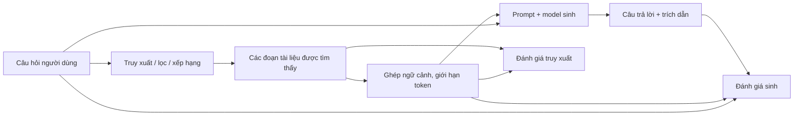

# Phân biệt chất lượng truy xuất và chất lượng sinh câu trả lời trong RAG

> **Chương:** Đánh giá RAG  
> **Phạm vi:** Spring AI Evaluation & Observability — đánh giá hệ thống truy xuất tăng cường sinh (Retrieval-Augmented Generation), theo dõi chất lượng qua các phiên bản prompt, model, dữ liệu và pipeline.

## Mục tiêu học tập

Sau bài này, bạn có thể:

1. Phân biệt **chất lượng truy xuất (retrieval quality)**, **chất lượng sinh câu trả lời (generation quality)** và **chất lượng đầu-cuối (end-to-end quality)**.
2. Chọn phép đo phù hợp cho từng tầng, chẳng hạn `Recall@K`, `Precision@K`, tính liên quan của câu trả lời, mức độ bám sát bằng chứng và độ đúng thực tế.
3. Thiết kế dữ liệu kiểm thử để xác định lỗi nằm ở truy xuất, ghép ngữ cảnh, prompt hay model sinh.
4. Gắn kết kết quả đánh giá với metrics, traces, token, chi phí và độ trễ khi vận hành ứng dụng Spring AI.

## 1. Hai tầng chất lượng trong một hệ thống RAG

RAG thường lấy dữ liệu từ kho tài liệu trước khi yêu cầu mô hình ngôn ngữ soạn câu trả lời. Một câu trả lời sai có thể xuất phát từ việc **không tìm thấy bằng chứng cần thiết** hoặc từ việc **đã tìm đúng bằng chứng nhưng sử dụng sai bằng chứng đó**. Nếu chỉ chấm điểm câu trả lời cuối, chúng ta khó biết cần sửa phần nào.



| Phạm vi | Câu hỏi cốt lõi | Đầu ra cần quan sát | Ví dụ lỗi |
| --- | --- | --- | --- |
| **Truy xuất** | Có lấy được đủ đoạn chứa bằng chứng liên quan không? | Danh sách `document/chunk ID` có thứ tự, điểm truy xuất, nội dung được chọn | Câu hỏi cần điều khoản A nhưng `topK` không có A |
| **Ghép ngữ cảnh** | Bằng chứng tìm được có thực sự được chuyển cho model không? | Ngữ cảnh *sau* lọc, rerank, nén và cắt theo token | A nằm trong `topK` nhưng bị cắt khỏi prompt |
| **Sinh câu trả lời** | Model có trả lời đúng câu hỏi, đủ ý, dựa trên chứng cứ được cấp không? | Văn bản trả lời, dẫn nguồn, đánh giá từng nhận định | Có A trong prompt nhưng model suy diễn sai |
| **Đầu-cuối** | Người dùng có nhận được câu trả lời đúng và đáng tin trong mức chi phí, độ trễ chấp nhận được không? | Câu trả lời cuối, kết quả tác vụ, phản hồi người dùng, latency/cost | Trả lời đúng nhưng vượt ngân sách độ trễ |

**Lưu ý:** Truy xuất tốt là điều kiện hỗ trợ sinh tốt, nhưng không bảo đảm sinh tốt. Ngược lại, model có thể trả lời đúng nhờ kiến thức đã học dù hệ thống không truy xuất được nguồn cần thiết; một câu trả lời như vậy có thể **đúng về nội dung nhưng không có căn cứ từ tài liệu được phép sử dụng**.

### Ba khái niệm dễ nhầm

- **Relevance của tài liệu:** Đoạn được tìm có phục vụ câu hỏi hay không; dùng để đánh giá retrieval.
- **Answer relevance:** Câu trả lời có giải quyết đúng điều người dùng hỏi hay không; dùng để đánh giá generation. Một câu trả lời rất dài nhưng lạc đề có điểm thấp.
- **Faithfulness / groundedness:** Các nhận định trong câu trả lời có được hỗ trợ bởi *ngữ cảnh thực tế đã cung cấp cho model* hay không. Điều này khác với độ đúng sự thật khi đối chiếu nguồn độc lập.

Trong module Spring AI Evaluation & Observability, các phép chấm `relevance`, `fact checking` và kiểm thử RAG cần được nhìn nhận theo đúng tầng; số liệu quan sát như token và latency giúp giải thích biến động nhưng **không tự chứng minh câu trả lời đúng**.

## 2. Chuẩn bị dữ liệu chuẩn để chấm điểm

Không thể tính độ đầy đủ của truy xuất nếu không biết tài liệu nào thực sự cần thiết. Với mỗi câu hỏi thử nghiệm, nên định nghĩa trước một **golden case** đã được người hiểu nghiệp vụ xác nhận.

| Trường | Mục đích |
| --- | --- |
| `id`, `question` | Định danh ổn định và câu hỏi kiểm thử |
| `relevant_doc_ids` | Tập ID tài liệu hoặc chunk thực sự chứa bằng chứng cần tìm |
| `required_facts` | Những ý bắt buộc phải có trong câu trả lời đúng |
| `reference_answer` | Câu trả lời tham chiếu để đối chiếu tính đầy đủ và đúng nghiệp vụ |
| `answerable` | Có đủ dữ liệu được phép để trả lời hay phải từ chối/đề nghị bổ sung? |
| `corpus_version` | Phiên bản tập tài liệu, giúp kiểm thử tái lập được |
| `tags` | Nhóm tình huống: nhiều bước, tài liệu nhiễu, phủ định, thiếu dữ liệu, xung đột phiên bản... |

Ví dụ giả định về chính sách công tác của một công ty:

```json
{
  "id": "travel-001",
  "question": "Nhân viên cần gửi yêu cầu công tác trước bao nhiêu ngày và ai duyệt?",
  "relevant_doc_ids": ["D01", "D02"],
  "required_facts": [
    "Gửi trước ít nhất 3 ngày làm việc",
    "Trưởng bộ phận phê duyệt"
  ],
  "reference_answer": "Gửi trước ít nhất 3 ngày làm việc; trưởng bộ phận phê duyệt.",
  "answerable": true,
  "corpus_version": "travel-policy-v3",
  "tags": ["multi-evidence", "policy"]
}
```

Giả sử `D01` ghi thời hạn **3 ngày làm việc**, `D02` ghi người duyệt là **trưởng bộ phận**, còn `D07` chỉ nói về hạn mức tiền ăn. Tập đúng của câu hỏi là `R = {D01, D02}`. Đây là dữ liệu **minh họa**, không phải chính sách có thật.

Khi kho tìm kiếm chia tài liệu thành nhiều chunk, phải chọn **cùng một đơn vị so sánh**: `chunk ID` với `chunk ID`, hoặc ánh xạ các chunk về `source document ID` nếu nhãn chuẩn ở cấp tài liệu. Một tài liệu xuất hiện qua ba chunk gần giống nhau không nên bị tính thành ba bằng chứng độc lập. Cần cố định phiên bản corpus, cách chunk và quyền truy cập trong lần so sánh.

## 3. Đánh giá chất lượng truy xuất

Giả sử retrieval trả về danh sách có thứ tự `L = [d1, d2, ..., dK]`, còn `R` là tập tài liệu liên quan đã gán nhãn. Các chỉ số phổ biến:

| Chỉ số | Ý nghĩa | Công thức / cách diễn giải | Dùng khi |
| --- | --- | --- | --- |
| **Hit@K** | Trong K kết quả đầu có *ít nhất một* tài liệu liên quan hay không? | `1` nếu `L[:K] ∩ R` khác rỗng; ngược lại `0` | Câu hỏi chỉ cần tìm được một bằng chứng |
| **Precision@K** | Bao nhiêu vị trí trong K kết quả đầu là liên quan? | `số tài liệu liên quan trong top K / K` | Muốn giảm nhiễu và token ngữ cảnh |
| **Recall@K** | Trong tất cả bằng chứng cần tìm, đã lấy được bao nhiêu? | Số tài liệu liên quan trong top K chia cho số phần tử của tập `R` | Câu hỏi cần tổng hợp đủ nhiều nguồn |
| **MRR@K** | Tài liệu liên quan đầu tiên nằm cao đến đâu? | Trung bình `1 / rank` của tài liệu liên quan đầu tiên; không có thì `0` | Muốn bằng chứng xuất hiện sớm |
| **nDCG@K** | Chất lượng thứ hạng khi tài liệu có nhiều mức liên quan | Điểm lợi ích giảm dần theo thứ hạng, chuẩn hóa theo thứ tự lý tưởng | Có nhãn liên quan phân mức |

Với ví dụ trên, retrieval trả `[D01, D07, D02]` cho `K = 3`:

- `Hit@3 = 1` vì thấy ít nhất một tài liệu liên quan.
- `Precision@3 = 2/3 ≈ 0,67` vì hai trong ba vị trí là bằng chứng cần thiết.
- `Recall@3 = 2/2 = 1,00` vì đã tìm thấy cả `D01` và `D02`.
- Reciprocal rank của truy vấn là `1/1 = 1` vì bằng chứng liên quan đầu tiên nằm ở vị trí số 1.

Một truy vấn có `Hit@3 = 1` vẫn có thể có `Recall@3` thấp: tìm được `D01` nhưng bỏ sót `D02` sẽ khiến model không có dữ liệu về người phê duyệt. Vì vậy, **không dùng Hit@K thay Recall@K** cho câu hỏi đòi nhiều mảnh bằng chứng.

Các chỉ số trên cần được tính trên **nhiều câu hỏi** rồi lấy trung bình hoặc phân tích theo nhóm. Nếu `R` rỗng (câu hỏi không thể trả lời từ corpus), `Recall@K` không được định nghĩa theo cách thông thường; hãy đánh giá riêng khả năng phát hiện *không có bằng chứng*, tránh gán máy móc điểm 100%.

Ngoài nhãn ID, nên chấm **độ liên quan của nội dung ngữ cảnh**: đoạn có thực sự chứa mệnh đề cần thiết không, có lỗi OCR/chunk gây mất điều kiện quan trọng không, có bị lấy nhầm phiên bản cũ không? Điểm vector similarity cao không đồng nghĩa với bằng chứng đúng.

### Đánh giá trước và sau khi tạo context

Một pipeline có thể dùng truy vấn viết lại, tìm kiếm kết hợp vector/từ khóa, reranker, metadata filter, rồi mới nén context. Khi chẩn đoán, hãy lưu hai danh sách:

1. **Candidates:** tài liệu retrieval đã tìm thấy trước bước rerank/lọc/cắt.
2. **Context thực gửi:** những đoạn và phiên bản nội dung có mặt trong prompt cuối.

Nếu `D02` có trong candidates nhưng không có trong context, lỗi nằm ở **rerank, filter, nén hoặc ngân sách token**, chưa thể kết luận vector search thất bại.

## 4. Đánh giá chất lượng sinh câu trả lời

Chấm generation bằng **câu hỏi + ngữ cảnh model thực sự nhận + câu trả lời được sinh**, và khi cần thì thêm câu trả lời chuẩn hoặc nguồn kiểm chứng độc lập. Có thể dùng reviewer con người, quy tắc xác định, hoặc LLM-as-a-judge kèm rubric rõ ràng.

| Tiêu chí | Câu hỏi khi chấm | Dấu hiệu lỗi |
| --- | --- | --- |
| **Answer relevance** | Có trả lời đúng vấn đề và phạm vi người dùng hỏi? | Nêu nhiều thông tin liên quan chủ đề nhưng không đưa kết luận cần tìm |
| **Groundedness / faithfulness** | Mỗi nhận định quan trọng có được ngữ cảnh *đã cấp* hỗ trợ? | Bịa thêm người duyệt, con số hoặc điều kiện không có trong context |
| **Factual correctness** | Nội dung có đúng so với đáp án chuẩn/nguồn đáng tin cậy? | Lấy nhầm quy định cũ và đưa thông tin sai thực tế |
| **Completeness** | Có đủ tất cả ý bắt buộc để giải quyết câu hỏi? | Đúng thời hạn nhưng bỏ sót người duyệt |
| **Citation accuracy** | Dẫn nguồn có thực sự chứng minh câu gắn với trích dẫn? | Gắn `[D07]` vào nhận định về thời hạn trong khi D07 chỉ nói về tiền ăn |
| **Abstention / uncertainty** | Có nói không đủ dữ liệu khi không thể kiểm chứng? | Tự suy đoán dù không tìm thấy bằng chứng |
| **Format / safety constraints** | Có tuân thủ cấu trúc đầu ra và ràng buộc tác vụ? | Trả JSON sai schema, tiết lộ thông tin bị giới hạn quyền |

Phân biệt hai câu hỏi thường bị nhập làm một:

- **“Có căn cứ trong context không?”** là đánh giá groundedness. Một tài liệu cũ sai nhưng model chép đúng theo tài liệu ấy vẫn có thể *grounded*.
- **“Có đúng thực tế/chính sách hiện hành không?”** là đánh giá factual correctness. Cần tham chiếu độc lập hoặc corpus đã được kiểm soát phiên bản.

Ví dụ, context nói “gửi trước **3 ngày làm việc**”, nhưng câu trả lời ghi “**2 ngày**”. Retrieval có thể đạt `Recall@3 = 1`, còn groundedness và factual correctness của câu trả lời đều kém. Ngược lại, nếu context chỉ có `D02` mà model vẫn đoán đúng “3 ngày” từ dữ liệu bên ngoài, câu trả lời có vẻ đúng nhưng **chưa được context cung cấp chứng cứ**.

### Rubric cho người chấm hoặc LLM-as-a-judge

Với một câu trả lời, có thể chấm riêng theo ba mức:

- `0` — **Sai/không có căn cứ:** bỏ qua câu hỏi, bịa thông tin trọng yếu hoặc mâu thuẫn bằng chứng.
- `1` — **Một phần:** đúng một số ý nhưng thiếu điều kiện quan trọng hoặc có nhận định chưa được hỗ trợ.
- `2` — **Đạt:** trả lời đúng các ý bắt buộc, không thêm nhận định thiếu chứng cứ, trích dẫn khớp.

Không gộp ngay các chiều thành một “điểm chất lượng” duy nhất. Cần lưu **nhận định nào sai, đoạn chứng cứ nào được dùng và lý do chấm** để có thể sửa lỗi. Khi dùng LLM-as-a-judge, cố định rubric và phiên bản judge, kiểm tra mức đồng thuận với người chấm trên tập mẫu, xem xét các trường hợp bất đồng. Judge cũng có thể thiên lệch và trả điểm khác nhau giữa các lần chạy.

## 5. Một câu hỏi, bốn loại kết quả

Tiếp tục sử dụng `D01` (3 ngày làm việc), `D02` (trưởng bộ phận), `D07` (hạn mức tiền ăn):

| Tình huống | Context thực gửi cho model | Câu trả lời | Chẩn đoán |
| --- | --- | --- | --- |
| **A** | `D01, D07, D02` | “Nộp trước **2 ngày**, **nhân sự** duyệt.” | **Retrieval đủ**, **generation sai**: model bỏ qua/diễn giải sai nguồn |
| **B** | `D07, D02` | “Nộp trước **3 ngày làm việc**, trưởng bộ phận duyệt.” | **Retrieval thiếu D01**; con số 3 ngày **không grounded** dù trùng đáp án chuẩn |
| **C** | `D01, D07, D02` | “Nộp trước **ít nhất 3 ngày làm việc [D01]**; **trưởng bộ phận duyệt [D02]**.” | Truy xuất và sinh đều đạt yêu cầu ví dụ |
| **D** | Candidates có `D01, D02`; prompt cuối chỉ còn `D01` | “Nộp trước 3 ngày; không xác định ai duyệt.” | Search tìm đúng; **context assembly** làm mất `D02` |

Ma trận gợi ý hành động:

| Retrieval/context | Generation | Hướng điều tra ưu tiên |
| --- | --- | --- |
| Đủ bằng chứng | Đúng, có căn cứ | Theo dõi độ ổn định, latency, cost |
| Đủ bằng chứng | Sai hoặc thiếu ý | Prompt, model, decoding, cách diễn giải nguồn, citation |
| Thiếu bằng chứng | Sai hoặc phải từ chối | Chunking, embedding, query rewrite, hybrid search, reranker, filter, `topK` |
| Thiếu bằng chứng | Trả lời có vẻ đúng | Kiểm tra groundedness và nguy cơ model tự bổ sung kiến thức ngoài corpus |

Không nên quy trách nhiệm cho model chỉ vì đầu ra sai, cũng không nên tăng `topK` vô hạn: quá nhiều đoạn nhiễu có thể tăng chi phí, độ trễ và làm câu trả lời kém chính xác.

## 6. Cách khoanh vùng lỗi bằng thí nghiệm có kiểm soát

### Thí nghiệm A — Chỉ đánh giá retrieval

Chạy cùng bộ câu hỏi trên các cấu hình retrieval, **chưa gọi LLM sinh**. So sánh `Recall@K`, `Precision@K`, `MRR@K` và tỉ lệ ngữ cảnh thực gửi còn đủ bằng chứng. Giữ cố định corpus và cách gán nhãn; ghi rõ phiên bản chunking, embedding, index, filter, reranker và `K`.

Nếu truy xuất cải thiện nhưng câu trả lời cuối không cải thiện, cần nhìn tiếp vào bước context assembly và generation. Tránh suy luận một điểm truy xuất cao sẽ kéo theo điểm sinh cao theo cùng tỉ lệ.

### Thí nghiệm B — Cố định context, chỉ thay generation

Dùng **cùng một bộ context** cho hai phiên bản prompt hoặc model, cùng rubric, cùng câu hỏi. So sánh completeness, groundedness, factual correctness, citation accuracy, khả năng từ chối, đồng thời ghi token và latency. Nếu cần tính ổn định, chạy nhiều lần vì đầu ra của model có thể biến thiên.

### Thí nghiệm C — Oracle context để phân biệt nguyên nhân

Với mỗi câu hỏi, chạy generation hai lần bằng cùng phiên bản prompt/model:

1. **Retrieved context:** Những đoạn hệ thống hiện tại thực sự cung cấp.
2. **Oracle context:** Những đoạn đã được xác nhận chứa đầy đủ bằng chứng (`D01 + D02`).

Nếu generation trả lời sai với retrieved context nhưng đúng với oracle context, hệ thống nhiều khả năng có vấn đề **lấy hoặc chuẩn bị bằng chứng**. Nếu cả hai đều sai, tập trung kiểm tra **khả năng đọc và lập luận trên bằng chứng của generation**. Đây là cách *khoanh vùng*, không phải bằng chứng nhân quả tuyệt đối; thứ tự, độ dài context và tính ngẫu nhiên cũng có thể tác động.

### Thí nghiệm D — Câu hỏi không thể trả lời

Thêm câu hỏi mà tập tài liệu **không chứa câu trả lời**, ví dụ “Chính sách này có hiệu lực tại chi nhánh chưa được đề cập không?”. Hệ thống đạt yêu cầu khi nhận biết thiếu căn cứ và hỏi thêm/từ chối kết luận theo yêu cầu nghiệp vụ. Đây là lớp test quan trọng vì một câu trả lời trôi chảy không đồng nghĩa với độ tin cậy.

## 7. Gắn vào ứng dụng Spring AI

Ứng dụng Spring AI thường dùng `VectorStore` để tìm `Document`, sau đó chuyển context vào lời gọi `ChatClient` hoặc qua advisor trong pipeline. Để đo riêng retrieval, cần lấy danh sách ID, thứ tự, nội dung và metadata của các đoạn được truy xuất **trước khi** đánh giá câu trả lời.

Đoạn Java dưới đây minh họa phép đo xác định trên tập nhãn đã biết:

```java
import java.util.List;
import java.util.Set;
import org.springframework.ai.document.Document;
import org.springframework.ai.vectorstore.SearchRequest;
import org.springframework.ai.vectorstore.VectorStore;

public final class RetrievalEvaluationExample {
    private RetrievalEvaluationExample() {}

    public record RetrievalScores(double precisionAtK, double recallAtK) {}

    public static RetrievalScores scoreRetrieval(
            Set<String> relevantIds, List<String> rankedIds, int k) {
        if (k <= 0 || relevantIds.isEmpty()) {
            throw new IllegalArgumentException(
                    "K phải dương và phải có tập tài liệu liên quan đã gán nhãn");
        }

        long matched = rankedIds.stream()
                .limit(k)
                .distinct()
                .filter(relevantIds::contains)
                .count();

        return new RetrievalScores(
                matched / (double) k,
                matched / (double) relevantIds.size());
    }

    public static RetrievalScores evaluate(
            VectorStore vectorStore, String question,
            Set<String> relevantIds, int k) {
        List<Document> hits = vectorStore.similaritySearch(
                SearchRequest.builder().query(question).topK(k).build());
        List<String> rankedIds = hits.stream()
                .map(Document::getId)
                .toList();
        return scoreRetrieval(relevantIds, rankedIds, k);
    }
}

// Cách gọi trong bài test có VectorStore đã được cấu hình:
// RetrievalEvaluationExample.evaluate(
//     vectorStore, "Ai duyệt yêu cầu công tác?", Set.of("D01", "D02"), 3);
```

**Điều kiện để ví dụ cho ra kết quả đúng:** `Document.getId()` phải tương ứng với hệ ID đã gán nhãn; trong hệ thống thật, thường cần lưu `source_id`/`chunk_id` ổn định trong metadata và ánh xạ về đúng cấp chấm. Mã minh họa giả định Java 17+ và API `SearchRequest.builder()` của phiên bản Spring AI tương thích. Nếu tài liệu được trả ít hơn K, công thức `Precision@K` trên vẫn lấy mẫu số K, coi vị trí thiếu là không tìm thấy; đây là quy ước cần ghi rõ.

Đối với generation, thu thập `question`, **context thực gửi**, `answer` và `citation IDs`, rồi đánh giá bằng rubric. Spring AI có những khái niệm evaluator như `RelevancyEvaluator` và `FactCheckingEvaluator` ở các phiên bản hỗ trợ; cần đối chiếu API của phiên bản đang dùng và cách truyền ngữ cảnh. **Không coi kết quả RelevancyEvaluator là Recall@K:** chấm câu trả lời có liên quan đến câu hỏi không thể thay thế việc đối chiếu danh sách tài liệu truy xuất với `relevant_doc_ids`.

Một cấu trúc lưu kết quả đánh giá có thể là:

```json
{
  "case_id": "travel-001",
  "run_id": "eval-2026-11-27-01",
  "corpus_version": "travel-policy-v3",
  "retrieval_config": "hybrid-k3-rerank-v2",
  "prompt_version": "answer-v4",
  "model_version": "model-a",
  "retrieved_ids": ["D01", "D07", "D02"],
  "context_ids": ["D01", "D02"],
  "precision_at_3": 0.667,
  "recall_at_3": 1.0,
  "answer_relevance": 2,
  "groundedness": 2,
  "completeness": 2,
  "judge_notes": "Có đủ hai ý và trích dẫn phù hợp"
}
```

Trong bộ dữ liệu này, các điểm `0–2` là **rubric tự định nghĩa cho ví dụ**, không phải thang điểm bắt buộc của Spring AI hoặc của một evaluator cụ thể.

### Nếu pipeline có gọi công cụ (tool calling)

Với hệ thống RAG kết hợp tools, hãy bổ sung phép kiểm:

- Tool có được gọi **đúng khi cần**, với tham số phù hợp và đúng phạm vi quyền hạn?
- Kết quả tool có được sử dụng chính xác hay model bỏ qua/diễn giải sai?
- Model có suy đoán đầu ra của tool khi tool lỗi, timeout hoặc trả dữ liệu rỗng?

Đây cũng là ranh giới giữa **chọn đúng nguồn dữ liệu** và **sử dụng đúng kết quả nguồn đó**. Nên lưu tool name, tham số đã được làm sạch, trạng thái, latency và bằng chứng trả về để phân tích nguyên nhân.

## 8. Ghép evaluation với observability

**Evaluation** trả lời “hệ thống có tốt không và sai ở đâu trên bộ test?”. **Observability** giúp thấy “phiên bản đang chạy đã làm gì ở từng bước?” qua metrics, traces và logs. Hai phần cần liên kết bằng `run_id`, `case_id` và `trace_id` khi có thể.

| Tầng | Dữ liệu nên theo dõi | Câu hỏi được giải đáp |
| --- | --- | --- |
| Retrieval | Query đã chuẩn hóa, `topK`, số tài liệu trả về, ID, rank, điểm similarity, index/corpus version, độ trễ | Có thay đổi tìm kiếm, lọc hoặc thứ tự bằng chứng không? |
| Context assembly | ID trước/sau rerank, token context, đoạn bị loại/cắt, phiên bản prompt | Có đánh mất bằng chứng dù retrieval tìm thấy không? |
| Generation | Model/prompt version, input/output tokens, latency, timeout, retry, citation IDs | Model nào chậm hoặc tốn token hơn? |
| Evaluation | Điểm retrieval và generation theo `case_id`, loại lỗi, judge/rubric version | Lỗi tập trung ở tầng nào và bắt đầu từ phiên bản nào? |
| Đầu-cuối | Thành công theo tác vụ, p50/p95 latency, cost/request, tỉ lệ từ chối hợp lý | Chất lượng tăng có đáng với chi phí và độ trễ không? |

Micrometer Observation/Tracing và các tích hợp observability tương ứng của Spring AI có thể giúp thu thập thời gian, token và các span của pipeline tùy phiên bản/cấu hình. Tên metric hoặc span cụ thể có thể thay đổi theo phiên bản; khi triển khai cần kiểm tra dữ liệu đo **thực tế** và tránh mặc định rằng mọi lời gọi đều có usage/cost đầy đủ. Chi phí thường được **ước tính** từ số token và bảng giá ứng với model, ngày áp dụng.

Ví dụ đọc kết quả sau khi đổi pipeline:

| Chỉ số trên cùng bộ test | Bản A | Bản B | Nhận xét |
| --- | ---: | ---: | --- |
| `Recall@5` | 0,82 | 0,92 | Lấy được nhiều bằng chứng chuẩn hơn |
| Groundedness đạt rubric `2` | 0,88 | 0,76 | Câu trả lời lại ít bám vào nguồn hơn |
| p95 latency (giây) | 2,1 | 3,4 | Chậm hơn ở nhóm yêu cầu dài |
| Token đầu vào trung bình | 1.200 | 2.300 | Context có thể bị phình to |

Các số trên hoàn toàn **giả định**. Chúng gợi ý cần kiểm tra prompt/context ở bản B và dấu hiệu nhiễu do thêm tài liệu; không thể khẳng định nguyên nhân chỉ từ bốn chỉ số tổng hợp.

**Quy tắc vận hành:** Không log bí mật, thông tin cá nhân, API key hoặc nội dung nhạy cảm tùy tiện vào traces. Dùng ID, metadata đã làm sạch, lấy mẫu có kiểm soát và phân quyền khi cần xem văn bản nguồn.

## 9. Thiết kế một quy trình regression evaluation

Một quy trình tối thiểu để đánh giá trước khi thay prompt, model, cách chunk hoặc retrieval:

1. **Chốt bộ test và corpus:** Tách dữ liệu thử nghiệm khỏi ví dụ dùng để tinh chỉnh. Có câu hỏi đơn nguồn, đa nguồn, nhiễu, không trả lời được, mâu thuẫn phiên bản, cách diễn đạt tiếng Việt khác nhau.
2. **Chạy retrieval độc lập:** Lưu `topK` và context thực gửi; tính các metric theo từng nhóm câu hỏi, đặc biệt `Recall@K` cho ca đa nguồn.
3. **Chạy generation có kiểm soát:** Cùng câu hỏi và rubric; đo relevance, groundedness, correctness, completeness, citation accuracy; dành các ca khó cho người duyệt.
4. **Chẩn đoán các trường hợp thất bại:** So sánh retrieved context với oracle context, truy dấu chỗ mất bằng chứng, đối chiếu prompt/model/index version.
5. **So sánh baseline và bản thử:** Xem độ thay đổi theo tầng, phân phối lỗi, p50/p95 latency, token/cost. Không tuyên bố cải thiện chỉ nhờ một vài ví dụ đẹp.
6. **Đặt ngưỡng theo yêu cầu nghiệp vụ:** Chẳng hạn một tác vụ tư vấn chính sách cần groundedness và citation cao hơn tác vụ gợi ý ý tưởng. Ngưỡng phải dựa trên tập test thực tế và mức rủi ro chấp nhận được, không có con số phổ quát.

Lấy trung bình tổng thể có thể che khuất nhóm lỗi quan trọng: hệ thống đạt `Recall@5` cao nhưng thất bại ở câu hỏi đa nguồn hoặc tài liệu vừa cập nhật. Với bộ test nhỏ, chênh lệch vài phần trăm có thể là nhiễu; nên báo số mẫu, kết quả theo nhóm, mức biến thiên và xem xét chạy lại hoặc kiểm định phù hợp trước khi quyết định.

### Checklist khi câu trả lời RAG sai

1. **Có tồn tại bằng chứng trong corpus đang được phép truy cập?** Nếu không, cần sửa dữ liệu hoặc cách từ chối trả lời.
2. **Retriever có tìm thấy đúng `document/chunk`?** Nếu không, kiểm tra query, chunking, embedding, hybrid search, filter, rerank và `K`.
3. **Bằng chứng có sống sót đến prompt cuối?** Nếu không, kiểm tra giới hạn token, nén, format và thứ tự context.
4. **Model có đọc đúng bằng chứng, đủ ý và dẫn nguồn đúng?** Nếu không, kiểm tra prompt, model, cách ràng buộc câu trả lời, chiến lược kiểm chứng.
5. **Có thể tái hiện bằng trace và version không?** Nếu không, bổ sung dữ liệu quan sát trước khi suy đoán.

## 10. Bài thực hành tự kiểm tra

Với `R = {D01, D02}`, chạy `K = 3`. Cho hai hệ thống:

| Hệ thống | Top 3 | Câu trả lời |
| --- | --- | --- |
| X | `[D01, D07, D02]` | “Gửi trước 2 ngày, phòng nhân sự duyệt.” |
| Y | `[D07, D02, D09]` | “Gửi trước ít nhất 3 ngày làm việc; trưởng bộ phận duyệt.” |

**Yêu cầu:**

1. Tính `Precision@3` và `Recall@3` cho X, Y.
2. Giải thích vì sao không thể xem câu trả lời của Y là grounded đầy đủ.
3. Đề xuất một thí nghiệm để xác định vấn đề của X nằm ở generation hay khâu tạo context.

### Đáp án gợi ý

- **X:** `Precision@3 = 2/3`, `Recall@3 = 2/2 = 1`. Retrieval đủ hai nguồn; câu trả lời sai cả thời hạn lẫn người duyệt, vì vậy cần kiểm tra context thực gửi và generation.
- **Y:** `Precision@3 = 1/3`, `Recall@3 = 1/2`. Thiếu `D01` nên tuy câu trả lời trùng đáp án chuẩn, mệnh đề “3 ngày làm việc” không có bằng chứng trong context.
- **Thí nghiệm:** Đối chiếu context thực của X với `D01, D02`; chạy cùng model/prompt một lần với context thực và một lần với oracle context. Nếu cả hai có đủ bằng chứng mà vẫn sai, tập trung vào generation; nếu context thực bị cắt mất nguồn, tập trung vào bước ghép context.

## Ghi nhớ

- **Retrieval quality:** *Tìm được đúng và đủ bằng chứng hay chưa?* Đo trên tài liệu/chunk truy xuất, điển hình bằng `Recall@K`, `Precision@K` và thứ hạng.
- **Generation quality:** *Câu trả lời có đúng câu hỏi, đúng thông tin, đủ ý và bám sát nguồn đã được cấp không?* Đo trên câu trả lời với rubric và đáp án/ngữ cảnh tham chiếu.
- **End-to-end quality:** *Toàn bộ trải nghiệm có đáp ứng chất lượng, độ trễ và chi phí không?* Đo cả kết quả tác vụ và vận hành.
- **Để sửa đúng lỗi:** lưu kết quả ở từng ranh giới pipeline, so sánh retrieved context với oracle context, và gắn kết evaluation với metrics/traces theo phiên bản.
