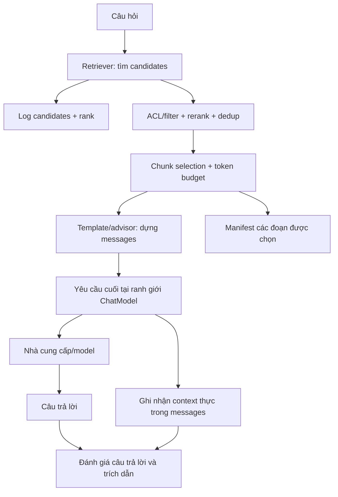

# Ghi lại đúng tài liệu đã đi vào yêu cầu mô hình trong RAG

> **Chương:** Đánh giá RAG  
> **Phạm vi module:** `SPRING_AI_EVALUATION_OBSERVABILITY` — đánh giá chất lượng ứng dụng Spring AI bằng bộ dữ liệu, tiêu chí relevance/fact checking, kiểm thử RAG và tool calling; kết hợp metrics, traces, token, chi phí và độ trễ để phát hiện suy giảm khi thay prompt, model hoặc pipeline.

## Mục tiêu học tập

Sau bài này, bạn có thể:

1. Phân biệt **tài liệu tìm được**, **tài liệu được chọn để dựng ngữ cảnh** và **nội dung thực sự có mặt trong yêu cầu gửi tới mô hình**.
2. Thiết kế một bản ghi **context manifest** có thể truy vết: tài liệu/chunk nào, thứ tự nào, phiên bản nào, nội dung nào đã được chèn vào từng lượt gọi model.
3. Xác định điểm ghi nhận phù hợp khi dùng Spring AI `VectorStore`, `ChatClient`, advisor, prompt template hoặc tool calling.
4. Phân biệt bằng chứng đã đưa vào prompt với bằng chứng được mô hình sử dụng đúng khi trả lời; dùng dữ liệu ghi nhận để đánh giá RAG và điều tra lỗi.
5. Liên kết evidence với `trace_id`, `request_id`, phiên bản prompt/model, token, độ trễ và chi phí mà vẫn kiểm soát thông tin nhạy cảm.

## 1. Vì sao phải ghi lại **đúng** tài liệu đã vào prompt?

Trong một ứng dụng Retrieval-Augmented Generation (RAG), có ít nhất ba danh sách dễ bị đánh đồng:

- **Retrieved candidates:** các kết quả công cụ tìm kiếm trả về, ví dụ 20 chunk từ vector database.
- **Selected/context candidates:** các chunk còn lại sau lọc quyền truy cập, loại trùng, reranking, giới hạn `topK`, nén hoặc cắt theo ngân sách token.
- **Final model context:** chính những đoạn văn bản thực sự xuất hiện trong *messages/prompt* được chuyển đến tầng gọi mô hình ở từng lần gọi.

Nếu hệ thống chỉ log các tài liệu trả về từ `VectorStore.similaritySearch(...)` thì chưa thể kết luận các tài liệu ấy đã đi vào lời gọi LLM. Một đoạn có thể bị loại khi rerank, bị rút gọn, bị cắt do hết token, hoặc được định dạng lại. Khi prompt có nhiều bước, model có thể nhận những context khác nhau ở các lượt gọi khác nhau.



**Nguyên tắc:** Sự kiện retrieval cho biết *hệ thống có cơ hội cung cấp thông tin nào*; bản ghi context tại ranh giới model cho biết *ứng dụng thực sự cung cấp bằng chứng nào*. Khi kiểm thử tính bám sát bằng chứng (groundedness/faithfulness), phải dùng **context ở ranh giới model** làm dữ liệu đối chiếu.

### Ví dụ về sai lệch khi chỉ log retrieval

Giả sử một công ty có ba tài liệu giả định:

| ID | Nội dung tài liệu |
| --- | --- |
| `D01#c2` | “Đơn công tác phải gửi trước **3 ngày làm việc**.” |
| `D02#c1` | “**Trưởng bộ phận** là người phê duyệt đơn.” |
| `D07#c4` | “Phụ cấp bữa trưa tối đa 150.000 đồng.” |

Người dùng hỏi: “Cần gửi đơn công tác trước bao lâu và ai phê duyệt?”

| Giai đoạn | Tài liệu/nội dung quan sát được |
| --- | --- |
| Search candidates | `[D01#c2, D07#c4, D02#c1]` |
| Sau lọc và giới hạn ngữ cảnh | `[D01#c2, D02#c1]` |
| Prompt thực gửi | Đoạn `D01#c2` đầy đủ; `D02#c1` bị cắt sau “Trưởng bộ phận…” |
| Câu trả lời | “Nộp trước 3 ngày làm việc; phòng nhân sự duyệt.” |

Ghi lại hai ID `D01` và `D02` đơn thuần có thể khiến người kiểm thử nghĩ mô hình đã nhận toàn bộ bằng chứng về người duyệt. Muốn biết model có đủ bằng chứng hay không, cần ghi **văn bản sau biến đổi**, **thứ tự**, **vị trí trong prompt** và **dấu hiệu bị cắt**. Khi không lưu được nguyên văn do chính sách bảo mật, phải có dấu vết kiểm chứng đáng tin, ví dụ digest của đoạn cuối, bản ghi phiên bản và kho evidence có phân quyền.

## 2. “Đi vào yêu cầu mô hình” nghĩa chính xác là gì?

Trong Spring AI, một pipeline có thể dùng `VectorStore` tìm `Document`, `ChatClient` hoặc `ChatModel` để gọi LLM, advisor để thêm context, memory để thêm lịch sử, và tool calling để gọi công cụ. Không có một vị trí log duy nhất đúng cho mọi kiến trúc.

Phải chỉ ra **ranh giới quan sát** của mỗi bản ghi:

| Điểm đo | Ghi được gì? | Không chứng minh được gì? |
| --- | --- | --- |
| **Sau retrieval** | Các hit, ID, rank, điểm tìm kiếm, metadata | Hit đã nằm trong prompt hay chưa |
| **Sau bước chọn/ngữ cảnh** | Các đoạn dự định chèn, thứ tự, độ dài, chunk bị cắt | Advisor hoặc template phía sau có sửa/loại nội dung không |
| **Ngay trước `ChatModel.call`** | `Prompt`/messages mà ứng dụng giao cho tầng model | Provider SDK có đổi cấu trúc hoặc server có xử lý nội bộ gì không |
| **Payload gửi từ provider adapter** (nếu có cơ chế ghi nhận được phép) | Các message/content thực sự được adapter gửi ra mạng | Nhà cung cấp đã xử lý/đưa toàn bộ token vào suy luận ra sao |
| **Response từ model** | Nội dung trả lời, usage, latency, lỗi | Model đã dựa trên nguồn nào trong quá trình suy luận |

Vì vậy, trong tài liệu vận hành cần nói rõ: “**đã xuất hiện trong prompt truyền cho `ChatModel`**” hoặc “**đã có trong payload gửi provider**” tùy nơi đặt instrumentation. Đừng diễn đạt “mô hình chắc chắn đã đọc và sử dụng tài liệu D01” chỉ dựa vào log prompt.

Một hệ thống có thể gọi model nhiều lần cho cùng câu hỏi, ví dụ: (1) viết lại câu truy vấn, (2) sinh câu trả lời, (3) kiểm chứng câu trả lời. **Mỗi model call phải có `call_id` riêng và danh sách context riêng.** Không dùng một tập tài liệu tổng hợp cho cả request vì sẽ che khuất bằng chứng mà từng call thực sự nhận.

## 3. Context manifest: thông tin nào phải ghi?

Manifest là bản ghi có cấu trúc mô tả nguồn gốc, thứ tự và trạng thái của những đoạn được chèn vào yêu cầu. Tối thiểu nên chứa:

| Trường | Ý nghĩa |
| --- | --- |
| `request_id`, `trace_id`, `call_id` | Liên kết câu hỏi người dùng, chuỗi xử lý và đúng lượt gọi model |
| `pipeline_version`, `prompt_version`, `model_id` | Tái hiện cấu hình khi đánh giá lại |
| `corpus_version`, `index_version` | Xác nhận nguồn dữ liệu và chỉ mục truy xuất |
| `source_document_id`, `chunk_id` | Định danh ổn định của tài liệu gốc và đoạn được dùng |
| `source_revision` | Phiên bản riêng của tài liệu, tránh nhầm bản cũ và bản mới |
| `position`, `message_role`, `citation_marker` | Thứ tự xuất hiện, message chứa bằng chứng, mã nguồn hiển thị trong prompt |
| `inserted_text_digest`, `inserted_char_count` | Dấu vân tay và độ dài của **đoạn cuối được chèn**, sau mọi phép cắt/sửa |
| `truncated`, `transformation` | Có bị cắt/tóm tắt/chuẩn hóa không và xử lý nào đã xảy ra |
| `prompt_digest`, `input_token_count` | Fingerprint của prompt logic và usage token, nếu được cung cấp |
| `recording_boundary`, `recording_state` | Vị trí instrument và trạng thái attempted/sent/completed/failed |

Điểm cần đặc biệt chú ý:

1. **ID không thay cho nội dung.** Cùng `chunk_id` nhưng corpus đã thay đổi, hoặc một bộ lọc cắt mất câu quan trọng, thì hai prompt thực chất khác nhau.
2. **Digest phải tính trên nội dung *sau* biến đổi.** Digest của nguyên bản `Document.getText()` không chứng minh đoạn đã chèn là nguyên bản đó.
3. **Thứ tự có ý nghĩa.** Hai prompt chứa cùng các tài liệu nhưng theo thứ tự khác nhau có thể cho kết quả khác nhau.
4. **Phải ghi nhận cả các đoạn không phải kết quả vector search.** Ví dụ ngữ cảnh từ SQL, tài liệu do tool trả về, lịch sử hội thoại hoặc dữ liệu được advisor thêm sau bước retrieval.
5. **Digest không thay thế snapshot khi cần kiểm toán nội dung.** Hash cho phép đối chiếu bình đẳng/khác biệt; để tái hiện nội dung cần snapshot được bảo vệ hoặc một kho dữ liệu bất biến có thể lấy đúng revision.

Ví dụ manifest cho một lần gọi sinh câu trả lời:

```json
{
  "request_id": "req-208",
  "trace_id": "trace-example-208",
  "call_id": "call-208-answer-1",
  "call_purpose": "answer_generation",
  "pipeline_version": "rag-v5",
  "prompt_version": "answer-v3",
  "model_id": "model-a",
  "corpus_version": "travel-policy-v3",
  "recording_boundary": "application_chatmodel_input",
  "recording_state": "attempted",
  "candidate_ids": ["D01#c2", "D07#c4", "D02#c1"],
  "included_context": [
    {
      "position": 1,
      "message_role": "user",
      "source_document_id": "D01",
      "chunk_id": "D01#c2",
      "source_revision": "3",
      "citation_marker": "1",
      "inserted_text_digest": "sha256:<hex-digest-of-final-block>",
      "inserted_char_count": 91,
      "truncated": false
    },
    {
      "position": 2,
      "message_role": "user",
      "source_document_id": "D02",
      "chunk_id": "D02#c1",
      "source_revision": "3",
      "citation_marker": "2",
      "inserted_text_digest": "sha256:<hex-digest-of-final-block>",
      "inserted_char_count": 56,
      "truncated": true
    }
  ],
  "prompt_digest": "sha256:<hex-digest-of-logical-prompt>"
}
```

Các ID, phiên bản, số ký tự và digest trong JSON trên **chỉ minh họa cấu trúc**. Trong chương trình thật, digest phải được tính từ bytes UTF-8 của đoạn/prompt cuối; không được lưu placeholder. `recording_state = attempted` chỉ có nghĩa là ứng dụng chuẩn bị gửi prompt, **không xác nhận provider đã tiếp nhận**.

## 4. Quy trình ghi nhận ở từng ranh giới pipeline

### Bước 1 — Tạo ID cho yêu cầu và từng lần gọi model

Ngay khi nhận câu hỏi, tạo `request_id` và giữ nó xuyên suốt truy xuất, ghép ngữ cảnh và sinh. Mỗi lần gọi model thêm `call_id` và `call_purpose`, chẳng hạn `rewrite_query`, `answer_generation` hoặc `answer_verification`. Khi có distributed tracing, gắn chúng với span/trace tương ứng.

### Bước 2 — Ghi candidates trước khi biến đổi

Ngay sau retrieval, ghi danh sách `chunk_id`, `source_document_id`, thứ hạng, metadata phiên bản, loại nguồn và số lượng kết quả. Điểm similarity chỉ có ý nghĩa trong bối cảnh phương pháp search và thang điểm tương ứng; không sử dụng điểm này như xác suất đúng.

Trong hệ thống có quyền truy cập theo người dùng hoặc tổ chức, áp dụng phân quyền trước khi gửi context đến model. Log/trace phải tuân thủ phân quyền riêng, không để metadata từ tài liệu chưa được phép truy cập xuất hiện trong hệ thống quan sát dùng chung.

### Bước 3 — Ghi các phép biến đổi

Với mỗi tác vụ như rerank, filter, dedup, merge chunks, compression, truncation, thêm một record cho biết đầu vào, đầu ra và lý do chọn/bỏ. Ví dụ:

```text
retrieval          D01#c2, D07#c4, D02#c1, D08#c1
access_filter      D01#c2, D07#c4, D02#c1
rerank             D01#c2, D02#c1, D07#c4
context_selection  D01#c2, D02#c1
token_budget       D01#c2(full), D02#c1(truncated)
prompt_insertion   [1]=D01#c2, [2]=D02#c1
```

Nếu nhiều chunks được trộn thành một đoạn tóm tắt, manifest phải ghi **nguồn gốc của đoạn tổng hợp**, cộng với digest của phần tóm tắt đã chèn. Không thể coi digest của tài liệu gốc là digest của văn bản tóm tắt.

### Bước 4 — Ghi *sau cùng* tại ranh giới model

Chỉ khi đã dựng xong **system/user/assistant/tool messages** (trong những pipeline có các loại message đó), mới xác nhận phần context thực sự được truyền vào call. Ghi:

- Nội dung bằng chứng cuối, thứ tự và vị trí (có thể là một snapshot được mã hóa/phân quyền).
- Digest của từng block và của toàn bộ prompt/messages theo một quy tắc serialize nhất quán.
- Phiên bản template, advisor và model; thời điểm ghi; danh sách tool messages nếu có.

Khi dùng `ChatClient` với các advisor tự bổ sung retrieval/context, việc log ở lớp gọi `prompt().user(...)` thường **quá sớm**. Phải instrument tại vị trí **sau advisor cuối và trước `ChatModel`**, hoặc ở provider adapter nếu thật sự cần biết payload mạng. Cách mở rộng, tên API và thứ tự advisor phụ thuộc phiên bản Spring AI.

### Bước 5 — Ghi trạng thái lời gọi và kết quả

Phân biệt:

| Trạng thái | Ý nghĩa |
| --- | --- |
| `attempted` | Ứng dụng đã dựng prompt và bắt đầu quy trình gửi |
| `sent` | Adapter xác nhận đã đưa yêu cầu đi (nếu instrument được) |
| `completed` | Có response thành công; log usage/latency nếu có |
| `failed` | Timeout, lỗi mạng, lỗi provider hoặc bị policy chặn |
| `retried` | Có thêm attempt: mỗi attempt cần ID hoặc số thứ tự riêng |

Nhờ vậy khi thấy manifest không rỗng nhưng không có câu trả lời, ta có thể phân biệt **lỗi gọi model** với **lỗi đánh giá chất lượng**. Với retry, đừng mặc định các attempt dùng đúng cùng payload, đặc biệt khi có timestamps hoặc dữ liệu tool được cập nhật.

## 5. Ví dụ Java với Spring AI: tự kiểm soát context đưa vào prompt

Một cách dễ hiểu để kiểm chứng là chủ động dựng prompt cuối và ghi manifest **từ chính các chuỗi sẽ được nối vào prompt**, thay vì log bản `Document` trước khi cắt. Ví dụ dưới đây sử dụng `VectorStore`, `ChatModel`, `SearchRequest`, `Prompt`, `SystemMessage` và `UserMessage` theo kiểu API Spring AI phổ biến. Các imports và constructor có thể cần điều chỉnh theo phiên bản thực tế.

```java
import java.nio.charset.StandardCharsets;
import java.security.MessageDigest;
import java.security.NoSuchAlgorithmException;
import java.util.ArrayList;
import java.util.HexFormat;
import java.util.List;
import java.util.function.Consumer;

import org.springframework.ai.chat.model.ChatModel;
import org.springframework.ai.chat.prompt.Prompt;
import org.springframework.ai.chat.messages.SystemMessage;
import org.springframework.ai.chat.messages.UserMessage;
import org.springframework.ai.document.Document;
import org.springframework.ai.vectorstore.SearchRequest;
import org.springframework.ai.vectorstore.VectorStore;

public final class AuditedRagService {
    public record Evidence(
            int position, String chunkId,
            String finalBlockSha256, int finalBlockChars, boolean truncated) {}

    public record PromptManifest(
            String requestId, String callId, String boundary,
            String logicalPromptSha256, List<Evidence> evidence) {}

    private final VectorStore vectorStore;
    private final ChatModel chatModel;
    private final Consumer<PromptManifest> auditSink;

    public AuditedRagService(
            VectorStore vectorStore,
            ChatModel chatModel,
            Consumer<PromptManifest> auditSink) {
        this.vectorStore = vectorStore;
        this.chatModel = chatModel;
        this.auditSink = auditSink;
    }

    public String answer(String requestId, String question) {
        List<Document> candidates = vectorStore.similaritySearch(
                SearchRequest.builder().query(question).topK(5).build());

        // Minh họa pipeline: chỉ giữ tối đa 3 đoạn, tối đa 800 ký tự mỗi đoạn.
        // Trong thực tế: phân quyền, rerank, dedup và token budget trước bước này.
        List<String> finalBlocks = new ArrayList<>();
        List<Evidence> included = new ArrayList<>();
        int position = 1;

        for (Document candidate : candidates) {
            if (position > 3) break;
            String original = candidate.getText();
            if (original == null || original.isBlank()) continue;

            String normalized = original.strip();
            boolean truncated = normalized.length() > 800;
            String inserted = truncated ? normalized.substring(0, 800) : normalized;
            String block = "[" + position + ": " + candidate.getId()
                    + "]\n" + inserted;

            finalBlocks.add(block);
            included.add(new Evidence(position, candidate.getId(),
                    sha256(block), block.length(), truncated));
            position++;
        }

        String system = "Chỉ trả lời dựa trên ngữ cảnh được cung cấp. "
                + "Thiếu bằng chứng thì nói rõ. Trích dẫn [số] khi nêu dữ kiện.";
        String user = "Ngữ cảnh:\n"
                + String.join("\n\n", finalBlocks)
                + "\n\nCâu hỏi:\n" + question;

        // Đúng hai message này được chuyển vào ChatModel ở ví dụ này.
        Prompt outgoingPrompt = new Prompt(List.of(
                new SystemMessage(system), new UserMessage(user)));

        // Fingerprint tính sau khi đã nối các block vào user message.
        // Đây là manifest của INPUT LOGIC tại ranh giới ChatModel,
        // không phải bằng chứng provider đã tiếp nhận.
        String logicalPrompt = "SYSTEM\n" + system + "\nUSER\n" + user;
        PromptManifest manifest = new PromptManifest(
                requestId, requestId + "-answer-1",
                "application_chatmodel_input",
                sha256(logicalPrompt), List.copyOf(included));
        auditSink.accept(manifest);

        return chatModel.call(outgoingPrompt)
                .getResult().getOutput().getText();
    }

    private static String sha256(String input) {
        try {
            byte[] digest = MessageDigest.getInstance("SHA-256")
                    .digest(input.getBytes(StandardCharsets.UTF_8));
            return HexFormat.of().formatHex(digest);
        } catch (NoSuchAlgorithmException e) {
            throw new IllegalStateException("Không có SHA-256", e);
        }
    }
}
```

**Giới hạn có chủ đích của ví dụ:**

- Đây là pipeline **trực tiếp** gọi `ChatModel`, chưa có advisor tự thêm nội dung sau bước dựng prompt. Nếu có advisor/agent khác biến đổi prompt, phải chuyển điểm ghi nhận đến **sau** biến đổi cuối.
- `substring(0, 800)` chỉ minh họa việc cắt; ứng dụng thực tế cần dùng bộ đếm token phù hợp với model, tránh cắt hỏng Unicode và giữ nguyên đơn vị bằng chứng quan trọng.
- `candidate.getId()` chỉ hữu ích nếu ánh xạ được sang `source_document_id`, `chunk_id` và revision ổn định; ID phát sinh mới mỗi lần index sẽ cản trở so sánh regression.
- `logicalPromptSha256` được tính bằng cách serialize logic hai message theo quy ước riêng. Nó **không phải digest byte-for-byte của JSON request gửi provider**.
- `auditSink` minh họa giao diện lưu bản ghi, chưa cung cấp cơ chế lưu bền vững, mã hóa, phân quyền, retry hay báo lỗi. Trong hệ thống bắt buộc audit, cần xác định rõ nếu ghi nhận thất bại thì có cho phép gửi model hay không.
- Bản ví dụ ghi `attempted` một cách ngầm định; cần theo dõi kết quả gửi/hoàn tất/lỗi quanh lời gọi `ChatModel` nếu xây hệ thống production.

### Nếu sử dụng advisor để làm RAG

Với các kiến trúc Spring AI dùng retrieval advisor (ví dụ advisor truy vấn vector store và chèn đoạn trích vào user message), chỉ việc chèn logging ngay sau `similaritySearch` bên ngoài advisor **không bao quát** dữ liệu mà advisor thực sự thêm. Cách triển khai theo khái niệm:

1. Thu thập danh sách tài liệu ở tầng retrieval nếu muốn đo retrieval.
2. Theo dõi các bước rút gọn/tổng hợp context bên trong pipeline.
3. Quan sát **đối tượng prompt/messages ngay trước lời gọi model** sau chuỗi advisor.
4. Ghi manifest bằng cách liên kết các đoạn đã đánh dấu nguồn vào nội dung cuối; kiểm tra thực tế xem các citation marker còn nằm trong message không.

Trên mỗi phiên bản Spring AI, cần kiểm tra API, thứ tự chạy và khả năng can thiệp của advisor/callback tương ứng. Không tự giả định một advisor logging bất kỳ luôn chạy cuối hoặc thấy payload giống provider request.

## 6. Ghép nguồn với từng nhận định trong câu trả lời

Mục tiêu của manifest không chỉ là tạo log. Nó cung cấp dữ liệu chuẩn cho hai loại chấm điểm khác nhau:

| Kiểm tra | Input sử dụng | Câu hỏi được trả lời |
| --- | --- | --- |
| **Retrieval recall/precision** | Golden relevant IDs + danh sách retrieval candidates | Retriever tìm đúng và đủ bằng chứng không? |
| **Context coverage** | Golden relevant IDs + ID/bằng chứng thực có trong prompt | Model được cấp đủ thông tin cần thiết chưa? |
| **Groundedness / faithfulness** | Nội dung context thực gửi + từng nhận định của câu trả lời | Có nhận định nào không được context hỗ trợ? |
| **Citation accuracy** | Ánh xạ citation marker → final context block + câu được trích | Trích dẫn có chứng minh đúng nhận định không? |
| **Factual correctness** | Câu trả lời + nguồn chuẩn độc lập/đáp án đã kiểm chứng | Nội dung có đúng thực tế/đúng revision được yêu cầu không? |

Ví dụ model trả lời:

> “Nhân viên nộp trước **3 ngày làm việc** [1]; **trưởng bộ phận** duyệt [2].”

Manifest cho biết `[1]` gắn với `D01#c2` và `[2]` gắn với `D02#c1`. Cần kiểm tra **đoạn thực tế đã chèn** trong từng block:

- Nếu block `[2]` còn nguyên câu về trưởng bộ phận: câu trả lời có căn cứ.
- Nếu block `[2]` bị cắt chỉ còn “Trưởng bộ phận…” mà thiếu động từ “phê duyệt”: trích dẫn đó **chưa đủ chứng minh** nhận định; không thể dựa vào ID bản gốc để chấm groundedness.
- Nếu trả lời dẫn `[3]` nhưng không có block `[3]` trong outgoing prompt: đó là citation sai, kể cả nội dung câu trả lời tình cờ đúng.

**Chú ý:** Context coverage và retrieval recall không nhất thiết trùng nhau. Retriever có thể tìm thấy đủ chứng cứ nhưng bước tạo prompt loại mất một phần, làm context coverage thấp hơn. Ngược lại, context có thể chứa dữ kiện từ SQL hoặc tool khác mà danh sách vector search không ghi nhận; khi đó cần khai báo nguồn và cách chấm rõ ràng.

### Một record nối giữa evidence và câu trả lời

```json
{
  "call_id": "call-208-answer-1",
  "answer_id": "answer-208",
  "claims": [
    {
      "text": "Gửi trước 3 ngày làm việc",
      "citation_markers": ["1"],
      "supported_by_final_context": true
    },
    {
      "text": "Trưởng bộ phận phê duyệt",
      "citation_markers": ["2"],
      "supported_by_final_context": false,
      "reason": "Đoạn [2] trong prompt đã bị cắt thiếu thông tin phê duyệt"
    }
  ]
}
```

Điểm `supported_by_final_context` là kết quả **đánh giá theo evidence cuối**, không phải một thuộc tính tự suy ra từ việc có citation marker.

## 7. Trường hợp phức tạp: hội thoại nhiều lượt và tool calling

Một ứng dụng Spring AI có memory và tools có thể đi qua chuỗi:

```text
call-1: Model nhận câu hỏi + lịch sử → quyết định gọi tool searchPolicies
tool-1: searchPolicies trả về D01, D02, D07
call-2: Model nhận tool result + lịch sử → soạn câu trả lời
tool-2: fetchPolicyRevision trả thêm revision mới của D02
call-3: Model nhận thêm tool result → cập nhật câu trả lời cuối
```

Mỗi call có một snapshot message khác nhau:

- `call-1` chưa thể được đánh giá là “đã nhìn thấy D02” nếu kết quả tìm kiếm chỉ xuất hiện ở `tool-1` **sau đó**.
- `call-2` có thể nhận nội dung của `tool-1` dưới dạng **tool message** thay vì context từ vector advisor; tool response cũng phải có provenance.
- `call-3` có thể dùng revision mới, nên hai lần gọi không được gộp thành một manifest chung.

Lưu `tool_name`, `tool_call_id`, trạng thái thành công/lỗi, dữ liệu nguồn trả về, những đoạn tool output còn thực sự nằm trong message và thứ tự của chúng. Nếu model gọi lại tool do timeout, một kết quả ghi nhận “tool đã trả dữ liệu” chưa chứng minh model đã nhận được kết quả ấy; phải xem outgoing prompt của **lượt gọi model kế tiếp**.

Với lịch sử hội thoại, nên ghi một reference cho nội dung memory được chèn vào từng call. Nếu dữ liệu cũ xuất hiện trong memory nhưng đã bị xóa khỏi corpus, hệ thống vẫn có thể phát sinh một câu trả lời theo thông tin lỗi thời; chỉ nhìn retrieval hiện tại sẽ bỏ sót nguồn sai lệch này.

## 8. Kết hợp manifest với metrics và traces

Manifest cho phép điều tra **đúng nội dung ngữ cảnh**, còn metrics/traces chỉ ra **quá trình diễn ra như thế nào**. Hai nhóm cần cùng correlation IDs.

Ví dụ cấu trúc trace:

```text
trace_id = trace-example-208
  request: POST /ask
    retrieval.search       (candidates=12, latency=85ms)
    retrieval.rerank       (selected=5, latency=39ms)
    context.assemble       (included=3, truncated=1)
    model.answer           (call_id=call-208-answer-1)
      prompt_manifest_ref  (audit://manifest/call-208-answer-1)
      usage                (input_tokens=1800, output_tokens=140)
      model_latency        (920ms)
    evaluation.answer      (groundedness=partial, citation_errors=1)
```

Các tên span và số liệu trên **chỉ là thiết kế minh họa**, không phải tên span mặc định cam kết của Spring AI. Spring AI có thể được tích hợp với Micrometer Observation/Tracing và hệ thống export như OpenTelemetry theo phiên bản/cấu hình; cần đối chiếu dữ liệu sinh ra thực tế.

Những tín hiệu hữu ích:

| Tín hiệu | Ý nghĩa khi kết hợp evidence |
| --- | --- |
| `retrieved_count` vs `included_count` | Bao nhiêu nguồn bị loại giữa search và prompt |
| `context_truncated_count` | Bao nhiêu nguồn có nguy cơ mất nội dung bắt buộc |
| `context_token_estimate` và `input_tokens` | Ngân sách context có tăng và gây bội chi/độ trễ không |
| `retrieval_latency_ms`, `model_latency_ms` | Bước nào khiến tổng thời gian tăng |
| `groundedness_rate`, `citation_error_rate` | Thêm nhiều context có thực sự cải thiện chất lượng không |
| `cost_per_request` | Đánh đổi chi phí khi đổi `topK`, prompt, model |

Khi so sánh hai phiên bản prompt/model/pipeline, hãy lưu **manifest cho cùng tập case**. Nhờ vậy có thể nói cụ thể “bản B mất `D02#c1` sau token trimming”, thay vì suy đoán từ tỷ lệ câu trả lời sai tăng lên.

Không nên gắn nguyên văn câu hỏi, tài liệu nội bộ hoặc API key vào **span attributes** có độ lan truyền rộng. Traces thường chỉ giữ IDs, count, trạng thái, fingerprint; nội dung đầy đủ, nếu được phép lưu, nên nằm ở kho audit riêng có quyền đọc phù hợp.

## 9. Rủi ro về dữ liệu và tính tái lập

Ghi raw prompt có thể cần thiết cho điều tra một số sự cố, nhưng có rủi ro lộ bí mật, thông tin cá nhân hoặc dữ liệu khách hàng. Một chiến lược thực tế gồm các mức:

| Mức ghi nhận | Dữ liệu lưu | Phù hợp |
| --- | --- | --- |
| **Metadata** | IDs, revision, thứ tự, số lượng, độ dài, có cắt hay không | Metrics/trace vận hành thông thường |
| **Fingerprint** | Metadata + digest/hash của từng đoạn và prompt | So sánh regression, phát hiện thay đổi nội dung |
| **Snapshot có kiểm soát** | Nội dung cuối được mã hóa, giới hạn quyền/retention, liên kết manifest | Điều tra chuyên sâu, xác nhận chính xác bằng chứng khi được phép |

Các lưu ý triển khai:

- **Hạn chế dữ liệu nhạy cảm:** giảm lưu nội dung thô; nếu bắt buộc, mã hóa, phân quyền, giới hạn lưu trữ và có cơ chế xóa theo chính sách. Hash dữ liệu ngắn/dễ đoán có thể bị dò ngược bằng từ điển; cân nhắc HMAC có khóa quản lý an toàn khi cần chống đối chiếu ngoài ý muốn.
- **Đảm bảo nguồn ổn định:** lưu `corpus_version`, `source_revision` và mapping chunk → tài liệu gốc. Nếu tài liệu sau đó bị sửa, log chỉ có ID hiện tại sẽ không thể tái hiện lời gọi cũ.
- **Ghi rõ thuật toán và cách serialize:** UTF-8, chuẩn xuống dòng, khoảng trắng, role và thứ tự message. Hai hệ thống băm chuỗi theo cách khác nhau sẽ cho fingerprint khác nhau dù ý nghĩa gần như giống nhau.
- **Xử lý race và async:** manifest phải gắn với đúng lượt gọi/attempt, không dựa vào biến mutable chia sẻ giữa các request. Nếu ghi audit bất đồng bộ, phải quản lý thứ tự, mất sự kiện và tương quan.
- **Minh bạch vùng không quan sát được:** provider có thể áp dụng xử lý nội bộ; ứng dụng không thể chứng minh model đã thực sự chú ý hay suy luận từ một nguồn chỉ bằng payload được ghi.

## 10. Kiểm thử tính đúng đắn của việc ghi nhận

Không nên chỉ kiểm thử “có log xuất hiện”. Một bài kiểm thử tốt cần đối chiếu log với **prompt thật được truyền vào ChatModel thử nghiệm** và kiểm tra các trường hợp thay đổi:

| Ca kiểm thử | Thiết lập | Kỳ vọng trong manifest |
| --- | --- | --- |
| Bỏ một hit sau rerank | Search ra `[D01,D07,D02]`, chọn `[D01,D02]` | Context cuối không chứa `D07` |
| Cắt đoạn thứ hai | `D02` vượt ngân sách token | `truncated=true`; digest khớp đoạn đã cắt, không phải nguyên bản |
| Thay thứ tự | Đảo `D01,D02` | `position` và prompt digest đổi |
| Thay tài liệu cùng ID | Cập nhật revision của `D01` | `source_revision`/digest đổi dù `chunk_id` có thể giống |
| Advisor thêm message | Thêm context sau bước retrieval | Manifest cuối phải có nguồn mới |
| Tool trả thêm evidence | Tool response chứa `D08` cho call tiếp theo | `D08` thuộc manifest của call tiếp theo, không thuộc call trước |
| Hết thời gian gửi model | Có input nhưng không có response | Record attempted/failed; không gán completed |
| Không có evidence | Retriever trả rỗng | Context list rỗng, model được hướng dẫn nêu thiếu căn cứ |

### Kiểm tra bằng test double cho model

Trong Java, có thể dựng một `ChatModel` giả (fake/spy) ghi `Prompt` nhận được rồi trả response mẫu. Test so sánh từng message trong prompt do fake nhận với manifest:

1. Tất cả chunk ID trong manifest phải xuất hiện trong phần context đã chỉ ra.
2. Mỗi `inserted_text_digest` phải khớp chính xác block thực có trong message.
3. Thứ tự và citation marker phải khớp; manifest không được ghi thêm retrieved candidates chưa chèn.
4. Manifest của hai lần gọi model trong một request phải tách biệt.

Nếu dùng advisor hoặc provider adapter, test phải đặt spy **sau đúng bước biến đổi được quan sát**, rồi nêu rõ ranh giới đã kiểm chứng. Một test chỉ kiểm tra output của helper dựng context sẽ không phát hiện advisor phía sau làm thay đổi prompt.

## 11. Bài thực hành: vì sao log ID thôi là chưa đủ?

Một pipeline có tập nguồn như sau:

- `D10#c1`: “Bảo hành 12 tháng kể từ ngày mua.”
- `D11#c2`: “Điều kiện: xuất trình hóa đơn hợp lệ.”
- `D12#c3`: “Thời gian phản hồi yêu cầu bảo hành là 48 giờ.”

Câu hỏi: **“Sản phẩm được bảo hành bao lâu và cần giấy tờ gì?”**

Retriever trả `[D10#c1, D12#c3, D11#c2]`. Reranker chọn `[D10#c1, D11#c2]`. Vì ngân sách context, nội dung `D11#c2` bị cắt còn “Điều kiện: xuất trình…”. LLM trả lời: “Bảo hành 12 tháng; không cần hóa đơn”.

**Yêu cầu:**

1. Cho biết vì sao `Recall@K` ở tầng retrieval có thể đạt 1, nhưng câu trả lời vẫn sai.
2. Nêu các trường tối thiểu để chứng minh tài liệu `D11#c2` **đã được chèn nhưng bị cắt**.
3. Giải thích liệu có thể khẳng định model “bịa câu trả lời” chỉ từ retrieved IDs hay không.
4. Đề xuất vị trí instrument nếu ứng dụng dùng advisor chèn thêm dữ liệu sau khi `ChatClient` nhận user prompt.

### Đáp án gợi ý

1. Retriever đã tìm đủ hai tài liệu chứa đáp án, nhưng context cuối thiếu phần “hóa đơn hợp lệ”. Sự cố có thể nằm ở **giới hạn context**, sau đó model sinh kết luận sai/không căn cứ. Cần kiểm tra cả hai bước.
2. Ghi `call_id`, `chunk_id`, `source_revision`, `position`, `message_role`, `truncated=true`, độ dài và digest của **block cuối**, cùng fingerprint của prompt; để tái hiện nguyên văn cần snapshot hoặc revision bất biến có thể dựng lại đúng.
3. Không thể từ retrieved IDs; danh sách retrieval chỉ cho biết các hit được tìm thấy. Muốn xác định nhận định “không cần hóa đơn” có căn cứ hay không, phải đối chiếu với context **thực được gửi**.
4. Instrument ở ranh giới **sau advisor cuối, trước `ChatModel`** hoặc ở adapter nếu mục tiêu là kiểm chứng payload gửi provider. Đồng thời giữ log retrieval riêng để đo chất lượng tìm kiếm.

## Ghi nhớ

- **Ghi retrieval khác ghi context cuối:** tìm được tài liệu không chứng minh đã chèn đủ nội dung vào prompt.
- **Ghi sau phép biến đổi cuối:** giữ ID/revision, thứ tự, marker, độ dài, cắt/ngắn và digest của **chính đoạn được chèn**, gắn với một `call_id` cụ thể.
- **Đặt tên đúng ranh giới:** prompt giao cho `ChatModel`, payload adapter gửi provider và dữ liệu model thực sự sử dụng là ba khẳng định khác nhau.
- **Đánh giá bằng context thực:** dùng manifest/snapshot để kiểm tra completeness, groundedness, citation accuracy; kết hợp retrieval metrics để tách nguồn lỗi.
- **Vận hành có kiểm soát:** liên kết với traces/metrics/chi phí/độ trễ, ghi theo revision và bảo vệ nội dung nhạy cảm.
