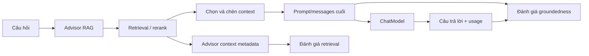
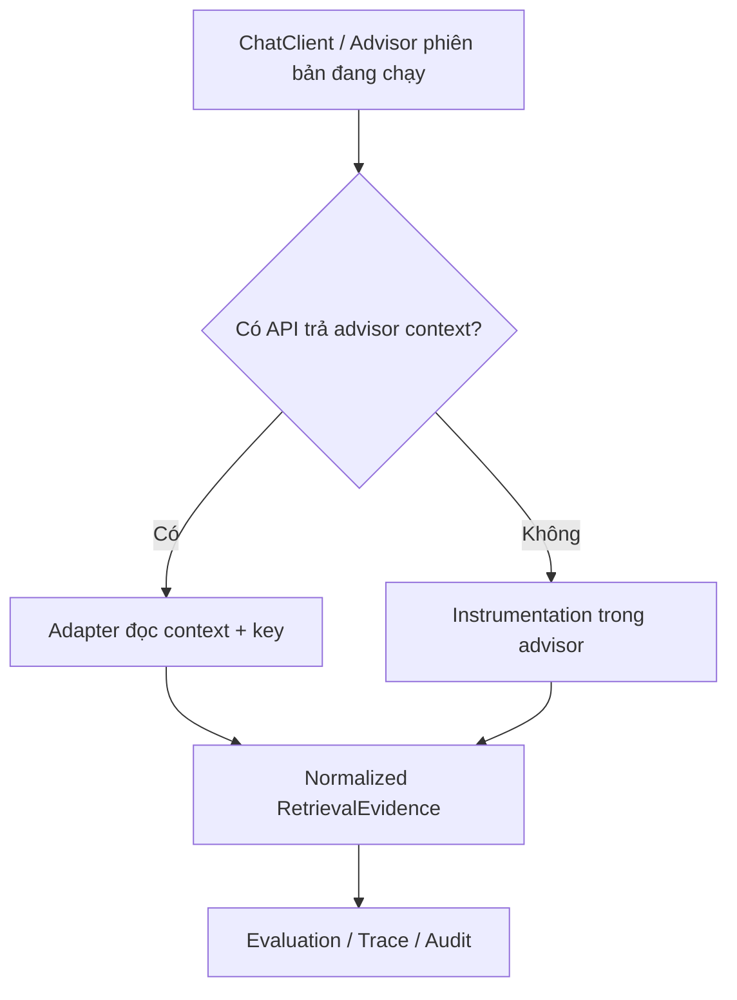

# Lấy ngữ cảnh từ metadata của advisor theo phiên bản Spring AI

> **Chương:** Đánh giá RAG  
> **Module:** `SPRING_AI_EVALUATION_OBSERVABILITY` — học đánh giá chất lượng ứng dụng Spring AI bằng tập dữ liệu, relevance, fact checking, kiểm thử RAG/tool calling; đồng thời dùng metrics, traces, token, chi phí và độ trễ để phân tích thay đổi chất lượng giữa các phiên bản prompt, model và pipeline.

## Mục tiêu học tập

Hoàn thành bài này, bạn có thể:

1. Giải thích **advisor context**, **metadata của tài liệu** và **metadata của phản hồi model** khác nhau như thế nào.
2. Lấy danh sách `Document` do một advisor RAG truy xuất từ ngữ cảnh được advisor chia sẻ, **khi API và advisor của phiên bản đang dùng hỗ trợ**.
3. Xây một lớp đọc metadata có kiểm tra kiểu, khóa và phiên bản thay vì phụ thuộc vào chuỗi khóa khó kiểm soát.
4. Phát hiện tình huống metadata đã có tài liệu nhưng prompt cuối đã loại, cắt hoặc thay đổi nội dung; phân biệt bằng chứng **được truy xuất** với bằng chứng **được model nhận**.
5. Đưa dữ liệu có nguồn gốc rõ ràng vào tập kiểm thử relevance, fact checking, đánh giá RAG và quan sát traces/metrics theo từng phiên bản.

## 1. Hiểu đúng ba loại metadata trong pipeline Spring AI

Khi cấu hình `ChatClient` với advisor, pipeline có thể chuyển thông tin giữa các giai đoạn thông qua một ngữ cảnh ở cấp lời gọi. Ngữ cảnh này thường chứa dữ liệu do advisor ghi vào để những thành phần khác đọc. Tuy nhiên, **không phải mọi advisor đều tự động cung cấp danh sách tài liệu**, và cấu trúc API có thể thay đổi theo phiên bản Spring AI.

| Loại thông tin | Ví dụ | Mục đích | Điều dễ nhầm |
| --- | --- | --- | --- |
| **Advisor context** | Map chứa tài liệu RAG được truy xuất, tham số request, dữ liệu trung gian | Chia sẻ dữ liệu giữa advisor và luồng gọi `ChatClient` | Không mặc định chứa nguyên văn prompt cuối |
| **`Document` metadata** | `source`, `title`, `page`, `tenant_id`, `revision` | Diễn tả xuất xứ của từng tài liệu/chunk | Không phải metadata của toàn bộ lượt gọi model |
| **Model response metadata** | Model ID, token usage, trạng thái hoàn tất (tùy provider) | Đo vận hành và chi phí của phản hồi | Không chứng minh model được cấp tài liệu nào |
| **Trace/span attributes** | `trace_id`, `advisor_name`, duration, count | Tương quan và đo hiệu năng pipeline | Thường chỉ có ID và số đếm, không phải evidence đầy đủ |

Hãy tưởng tượng câu hỏi “Quy trình công tác yêu cầu duyệt trước mấy ngày?” được gửi qua một advisor truy xuất. Advisor tìm được ba chunk, chọn hai chunk cho ngữ cảnh và model tạo câu trả lời. Để đánh giá lỗi, cần biết:

- **Advisor đã tìm được gì?** Đọc thông tin retrieval, có thể từ advisor context.
- **Đã chèn gì vào lời gọi model?** Kiểm tra prompt/messages sau khi advisor hoàn thành các phép biến đổi.
- **Model trả lời thế nào?** Đọc kết quả và metadata của model.

Ba câu hỏi này bổ sung cho nhau, không dùng lẫn nguồn dữ liệu.



Đặc biệt, **metadata có thể là bằng chứng rằng retrieval đã chạy**, nhưng chưa đủ để khẳng định các đoạn đã đi qua bước ghép ngữ cảnh và đến model nguyên vẹn.

## 2. “Theo phiên bản” là theo hợp đồng API thực sự

Các phiên bản Spring AI có thể khác nhau ở **kiểu đối tượng phản hồi**, **tên phương thức truy cập context**, **hệ thống advisor** và **khóa chứa retrieved documents**. Thậm chí trong cùng phiên bản, hai loại advisor khác nhau có thể ghi dữ liệu khác nhau.

Thay vì suy luận từ tên thư mục hoặc sao chép một đoạn code trên mạng, hãy xác nhận ba lớp:

1. **Phiên bản thư viện đang chạy:** phiên bản Spring AI thực tế được giải quyết trong dependency graph, cùng BOM và các starter liên quan.
2. **Loại advisor cụ thể:** ví dụ `QuestionAnswerAdvisor` hoặc `RetrievalAugmentationAdvisor`, hay advisor tự viết. Chúng không bắt buộc có cùng khóa metadata.
3. **Điểm thu thập trong lời gọi:** response của `ChatClient`, callback/advisor context, hay instrumentation ngay trước `ChatModel`.

### Bảng định hướng tương thích

| Kiểu API trong mã dự án | Cách đọc ngữ cảnh nên tìm | Điểm cần xác minh |
| --- | --- | --- |
| Spring AI có `ChatClientResponse` và lời gọi `.call().chatClientResponse()` | Kiểm tra `ChatClientResponse.context()` | Kiểu dữ liệu trả về, advisor có chèn document vào map hay không |
| Spring AI cũ sử dụng cơ chế advised request/response hoặc advisor callback khác | Đọc context được truyền cho advisor ở hook tương ứng | Chữ ký callback, vòng đời context và cách trả context ra ngoài |
| Advisor tùy biến tự thêm context vào prompt | Tự định nghĩa khóa/contract, ghi tài liệu đã dùng và expose bản ghi | Không gán nhãn là “metadata chuẩn Spring AI” nếu chỉ là khóa nội bộ |
| Streaming hoặc luồng tool/multi-call | Thu context trong instrumentation từng lượt gọi hoặc từng advisor | Có lấy lại đầy đủ context qua đối tượng final response hay không |

**Bảng trên mô tả các dạng API cần kiểm tra, không gán cứng tên phương thức cho mọi bản phát hành.** Trong thực tế có những bản ví dụ sử dụng `ChatClientResponse.context()` và khóa của `QuestionAnswerAdvisor`; khi copy code, phải kiểm tra class/method/key có tồn tại trong chính dependency hiện tại. Không nên mặc định tên API của một nhánh phát triển áp dụng cho nhánh khác.

### Checklist xác định hợp đồng phiên bản

Trước khi viết code:

- Xác định phiên bản `org.springframework.ai` thực tế sau khi resolve dependencies. Với Gradle có thể kiểm tra qua `dependencyInsight` hoặc `dependencies`; với Maven có thể xem dependency tree. Giữ các module của Spring AI tương thích với BOM đang dùng.
- Kiểm tra chữ ký `chatClient.prompt(...).call()` và terminal method lấy kết quả đầy đủ. Một phương thức chỉ lấy text, chẳng hạn `content()`, thường **không cung cấp** advisor context.
- Xác định khóa retrieval được chính advisor phiên bản đó công bố, nếu có. Ưu tiên **hằng số public** thay vì tự nhập một chuỗi bất biến giả định.
- Kiểm tra giá trị thực trong context: `List<Document>`, một wrapper, hay dữ liệu kiểu khác? Nếu không có, phải thể hiện trạng thái **không quan sát được**, không mặc định kết quả rỗng là “retriever không tìm được”.
- Kiểm tra thời điểm dữ liệu được ghi trong pipeline: trước hay sau lọc, nén, rerank hoặc cắt context.

Điểm cuối rất quan trọng. Ngay cả khi hai phiên bản cùng trả một `List<Document>`, ý nghĩa danh sách có thể thay đổi nếu advisor đổi thứ tự các phép xử lý.

## 3. Ví dụ: đọc metadata từ `ChatClientResponse` khi API hỗ trợ

Một số biến thể Spring AI hỗ trợ mẫu gọi `ChatClient` lấy đối tượng phản hồi đầy đủ:

```java
// Ví dụ có điều kiện: chỉ dùng nếu phiên bản Spring AI của dự án
// cung cấp .call().chatClientResponse() và ChatClientResponse.context().
var response = chatClient.prompt()
        .user("Đơn công tác cần gửi trước bao nhiêu ngày?")
        .call()
        .chatClientResponse();

if (response == null) {
    throw new IllegalStateException("Không có ChatClientResponse");
}

var advisorContext = response.context();
// advisorContext là ngữ cảnh do các advisor chia sẻ ở tầng ChatClient.
// Lấy value theo khóa mà advisor của đúng phiên bản công bố.
```

**Đọc đúng đối tượng:** `response.context()` trong mẫu này thể hiện advisor context. Ngược lại, `response.chatResponse()` (nếu API cung cấp) dẫn tới phản hồi của model và có thể có metadata về usage hoặc provider. Hai nguồn không thay thế nhau.

### Lấy khóa metadata từ đâu?

Giả sử adapter của phiên bản đang dùng có một khóa public cho retrieved documents. Một cách dùng có điều kiện là:

```java
// Chỉ biên dịch nếu QuestionAnswerAdvisor của dependency đang dùng
// thực sự công bố hằng số RETRIEVED_DOCUMENTS.
String key = QuestionAnswerAdvisor.RETRIEVED_DOCUMENTS;
Object rawDocuments = advisorContext.get(key);
```

Một số bản API đưa dữ liệu này vào context dưới khóa do `QuestionAnswerAdvisor` định nghĩa. **Không nên giả định** `RetrievalAugmentationAdvisor` hoặc advisor tự viết cũng dùng cùng hằng số. Nếu phiên bản không công bố hằng số trên, kiểm tra contract của advisor ấy và dùng một adapter riêng; không “thử mò” nhiều chuỗi khóa trong mã production.

Nếu ứng dụng dùng streaming, chỉ trả nội dung `content()`, hoặc API chưa có `ChatClientResponse.context()`, có thể cần thu thập dữ liệu ngay trong callback/advisor, hoặc tạo advisor có trách nhiệm ghi nguồn. Đừng ép kiểu đối tượng response thiếu ngữ cảnh hoặc coi việc API không tồn tại là lỗi retrieval.

## 4. Viết bộ đọc có kiểm tra kiểu dữ liệu và nguồn gốc

Với mục tiêu evaluation, dữ liệu phải ổn định và có cấu trúc. Ta có thể tách một hàm Java **độc lập với phiên bản `ChatClient`**: nhận map context đã trích ra và đúng key do adapter cung cấp, sau đó xác minh kiểu danh sách.

```java
import java.util.ArrayList;
import java.util.List;
import java.util.Map;
import java.util.Objects;
import org.springframework.ai.document.Document;

public final class AdvisorDocumentReader {
    private AdvisorDocumentReader() {}

    public enum ReadState {
        AVAILABLE, KEY_MISSING, WRONG_TYPE
    }

    public record DocumentRef(
            String documentId, String text, Map<String, Object> metadata) {}

    public record ReadResult(
            ReadState state, List<DocumentRef> documents, String reason) {}

    public static ReadResult read(
            Map<String, Object> context, String retrievedDocumentsKey) {

        Objects.requireNonNull(context, "advisor context không được null");
        Objects.requireNonNull(retrievedDocumentsKey, "key không được null");

        if (!context.containsKey(retrievedDocumentsKey)) {
            return new ReadResult(
                    ReadState.KEY_MISSING, List.of(),
                    "Advisor không xuất bản key này tại điểm quan sát");
        }

        Object raw = context.get(retrievedDocumentsKey);
        if (!(raw instanceof List<?> list)) {
            return new ReadResult(
                    ReadState.WRONG_TYPE, List.of(),
                    "Giá trị key không phải List<Document>");
        }

        List<DocumentRef> result = new ArrayList<>();
        for (Object item : list) {
            if (!(item instanceof Document document)) {
                return new ReadResult(
                        ReadState.WRONG_TYPE, List.of(),
                        "Danh sách chứa phần tử không phải Document");
            }
            result.add(new DocumentRef(
                    document.getId(),
                    document.getText(),
                    Map.copyOf(document.getMetadata())));
        }

        return new ReadResult(
                ReadState.AVAILABLE, List.copyOf(result), "Đã đọc thành công");
    }
}
```

Giả định của mã: Java 17+; `org.springframework.ai.document.Document` có các phương thức `getId()`, `getText()` và `getMetadata()` ở phiên bản sử dụng. `Map.copyOf(...)` đòi metadata không có key hoặc value `null`; nếu dữ liệu thực có `null`, cần chuẩn hóa hoặc tạo bản sao phù hợp trước khi lưu. Mã đọc context là ví dụ nghiệp vụ, chưa xử lý dữ liệu nhạy cảm và chưa ghi dữ liệu ra log.

Sử dụng trong tầng tích hợp cho phiên bản có `context()`:

```java
// Thay retrievedDocumentsKey bằng public constant (nếu có) hoặc
// khóa do advisor riêng của ứng dụng quy định và kiểm soát.
AdvisorDocumentReader.ReadResult retrieval =
        AdvisorDocumentReader.read(
                response.context(), retrievedDocumentsKey);

switch (retrieval.state()) {
    case AVAILABLE -> {
        // Có thể là danh sách rỗng nếu advisor chạy nhưng không có hit.
        // Liên kết IDs/metadata với request_id, call_id, trace_id.
    }
    case KEY_MISSING -> {
        // Chưa quan sát được output advisor ở khóa này:
        // kiểm tra cấu hình advisor hoặc sự khác biệt phiên bản.
    }
    case WRONG_TYPE -> {
        // Contract không khớp; báo lỗi instrumentation, tránh ép kiểu mù.
    }
}
```

### Vì sao phải phân biệt `KEY_MISSING` với danh sách rỗng?

- `KEY_MISSING`: adapter không thấy dữ liệu theo contract được kỳ vọng; có thể advisor không chạy, khác phiên bản, dùng key khác, hoặc context không được chuyển tới điểm đọc.
- `AVAILABLE` với `documents.isEmpty()`: adapter đã đọc được **danh sách có kiểu hợp lệ nhưng không chứa tài liệu**. Cần thêm thông tin để biết đây là do retriever trả rỗng hay bước lọc loại hết.
- `WRONG_TYPE`: API/contract có thể đã đổi, dữ liệu bị ghi đè, hoặc adapter được áp dụng sai loại advisor.

Không gom ba trường hợp thành một `List.of()` rồi báo “retriever không tìm ra tài liệu”. Việc làm đó gây sai lệch tỉ lệ retrieval success và đánh giá RAG.

## 5. Tạo adapter tương thích khi nâng cấp Spring AI

Giữ phần đánh giá **độc lập với phương thức truy cập context** bằng cách chuẩn hóa dữ liệu thành một hợp đồng nội bộ.



Ví dụ hợp đồng nội bộ:

```java
import java.util.List;

public record RetrievalEvidence(
        String requestId,
        String callId,
        String advisorName,
        String springAiVersion,
        String advisorContractVersion,
        String observationStage,
        boolean available,
        List<String> documentIds,
        String diagnostic) {}
```

`observationStage` có thể là `retrieved_candidates`, `post_filter_documents` hoặc `advisor_context_export`. Hãy ghi đúng ý nghĩa của stage theo hành vi **đã kiểm chứng** thay vì mặc định tất cả document metadata đều là “final prompt context”.

Khi nâng cấp Spring AI, chỉ cần điều chỉnh adapter đọc API và mapping key/kiểu dữ liệu. Các phép đánh giá như `Recall@K`, `Precision@K`, thống kê theo prompt/model version và hệ thống trace vẫn làm việc với `RetrievalEvidence` đã chuẩn hóa.

### Chiến lược nâng cấp theo bước

1. Ghi phiên bản Spring AI, tên advisor và key/kiểu dữ liệu ở bản đang chạy.
2. Tạo test chạy một câu hỏi cố định, quan sát retrieved IDs trong context.
3. Nâng dependencies; dùng compiler và test để phát hiện method/constant mất hoặc thay.
4. Điều chỉnh adapter theo API mới; xác minh có cùng định nghĩa về candidates và thời điểm truy xuất.
5. So sánh trên tập đánh giá đã cố định corpus, query, topK, prompt và model; lưu khác biệt nếu hành vi advisor thay đổi.

**Không nên sửa thẳng tên key tới khi compile được rồi xem như tương đương về mặt ngữ nghĩa**. Một thay đổi từ “hit trước lọc” sang “document sau lọc” có thể khiến điểm Recall@K không còn so sánh trực tiếp giữa hai phiên bản.

## 6. Metadata advisor không luôn bằng ngữ cảnh cuối của model

Giả sử bộ dữ liệu chuẩn cho câu hỏi công tác yêu cầu hai nguồn:

| ID | Nội dung chính |
| --- | --- |
| `D01#2` | Gửi đề nghị công tác trước **ít nhất 3 ngày làm việc** |
| `D02#1` | Người duyệt là **trưởng bộ phận** |
| `D07#4` | Quy định mức hỗ trợ tiền ăn |

Ở một lần chạy, ta ghi được:

```text
advisor_context["retrieved_documents"] = [D01#2, D07#4, D02#1]
rerank_output                          = [D01#2, D02#1, D07#4]
context_before_token_limit             = [D01#2, D02#1]
prompt_final                            = [D01#2, D02#1 truncated]
answer                                  = "Nộp trước 3 ngày; HR phê duyệt."
```

Khóa `retrieved_documents` ở đây là **tên biểu diễn minh họa trong log**, không phải khẳng định về một khóa public cụ thể của Spring AI.

Nếu chỉ đọc danh sách ở advisor context, hệ thống có vẻ đã có cả hai nguồn đáp án. Nhưng prompt cuối bị cắt mất một phần `D02#1` và model trả lời sai. Để kết luận nguyên nhân, phải xem:

- **Retrieval quality:** hệ thống có lấy đủ tài liệu đúng hay không; ở đây tìm thấy cả `D01` và `D02`.
- **Context assembly quality:** đoạn nào đã bị loại/cắt trước khi gọi model; ở đây `D02` bị cắt.
- **Generation quality:** mô hình có dựa đúng bằng chứng trong prompt cuối, có tự suy đoán “HR” hay không.

Không tính điểm groundedness bằng danh sách `Document` từ advisor nếu danh sách đó chưa phản ánh đầy đủ văn bản model thực tế nhận. Chấm dựa trên metadata trước cắt có thể **đánh giá oan hoặc bỏ lọt hallucination**.

### Ba loại trạng thái cần đặt tên rõ

| Tên trường gợi ý | Nói được điều gì? | Không bảo đảm điều gì? |
| --- | --- | --- |
| `retrieved_document_ids` | Advisor/retriever đã báo các ID này | Các ID đều được chọn chèn vào prompt |
| `selected_context_ids` | Pipeline dự định chèn các ID sau chọn/lọc | Nội dung vào prompt là nguyên vẹn |
| `final_prompt_evidence` | Đoạn được ghi nhận tại ranh giới đưa `Prompt` tới `ChatModel` | Model thật sự “đã chú ý” hoặc “đã suy luận từ” đoạn đó |

Với ứng dụng có nhiều advisor nối tiếp, hãy quan sát ngay trước lời gọi model hoặc ở provider adapter theo ranh giới cần kiểm chứng. Metadata của advisor tạo context có thể được ghi trước khi một advisor khác tiếp tục chỉnh sửa messages.

## 7. Chuẩn hóa provenance khi đọc `Document` từ context

Một `Document` thường gồm ID, text và metadata. Những trường metadata như `source`, `page`, `section` hoặc `revision` phụ thuộc nơi nạp dữ liệu; không có bảo đảm mọi VectorStore/reader đều tạo cùng cấu trúc.

Khi chuyển documents sang bản ghi evaluation, nên chuẩn hóa:

| Trường chuẩn | Nguồn khả dĩ | Cách xử lý |
| --- | --- | --- |
| `chunk_id` | `Document.getId()` hoặc metadata do ingestion tạo | Bảo đảm ổn định giữa các lần chạy |
| `source_document_id` | Metadata từ pipeline nạp dữ liệu | Ánh xạ chunk về tài liệu gốc |
| `source_revision` | Metadata version của nguồn | Không nhầm chính sách cũ với mới |
| `rank` | Vị trí trong danh sách sau stage được quan sát | Bắt đầu từ 1 và ghi rõ stage |
| `text_digest` | Băm text quan sát được | Đối chiếu khi tài liệu bị sửa |
| `text_length` | Độ dài text đã đọc | Hỗ trợ phát hiện cắt/nén |
| `access_scope` | Phân quyền của người dùng/tenant | Không lộ nguồn không được phép |
| `stage` | Điểm nhận documents | Phân biệt retrieval, rerank, context selection |

Lưu ý **cùng một source có thể xuất hiện qua nhiều chunk**. Nếu golden labels ở cấp tài liệu mà retrieval output ở cấp chunk, cần áp dụng quy tắc ánh xạ thống nhất; không được coi ba chunk của cùng tài liệu là ba bằng chứng độc lập nếu tiêu chí chỉ đòi một nguồn.

### Ví dụ bản ghi đã chuẩn hóa

```json
{
  "request_id": "req-73",
  "call_id": "call-73-answer",
  "spring_ai_version": "version-resolved-by-build",
  "advisor_name": "QuestionAnswerAdvisor",
  "advisor_contract_version": "adapter-v1",
  "observation_stage": "advisor_context_export",
  "availability": "AVAILABLE",
  "documents": [
    {
      "rank": 1,
      "chunk_id": "D01#2",
      "source_document_id": "D01",
      "source_revision": "policy-v3",
      "text_digest": "sha256:<calculated-at-runtime>"
    },
    {
      "rank": 2,
      "chunk_id": "D02#1",
      "source_document_id": "D02",
      "source_revision": "policy-v3",
      "text_digest": "sha256:<calculated-at-runtime>"
    }
  ]
}
```

Giá trị `spring_ai_version` và digest trong ví dụ là **placeholder để diễn đạt schema**; triển khai thật phải điền dữ liệu thực. `advisor_name` ở đây là nhãn ví dụ, không khẳng định cấu trúc output mặc định cho mọi bản `QuestionAnswerAdvisor`.

## 8. Liên hệ với các phép đánh giá RAG

Trong module Evaluation & Observability, danh sách documents ở advisor context hữu ích cho **đánh giá retrieval**, nhưng cần giữ rõ nguồn và giới hạn quan sát.

| Tiêu chí | Input tối thiểu | Có thể dùng advisor metadata? |
| --- | --- | --- |
| `Hit@K` | Golden relevant IDs + danh sách documents có thứ tự | Có, **nếu** metadata thật sự chứa hit ở stage cần đo |
| `Precision@K` | Golden relevant IDs + K vị trí đầu | Có, nếu đơn vị chunk/source nhất quán |
| `Recall@K` | Golden relevant IDs + danh sách kết quả | Có, nhưng cần biết tài liệu đã gán nhãn và định nghĩa stage |
| Context coverage | Golden facts + **final prompt evidence** | Chưa đủ nếu chỉ có retrieved documents |
| Answer relevance | Câu hỏi + câu trả lời | Không bắt buộc phải có advisor metadata |
| Groundedness | Các nhận định câu trả lời + **ngữ cảnh cuối** | Không thể lấy metadata candidates thay thế |
| Fact checking | Câu trả lời + nguồn chuẩn độc lập/corpus version | Metadata chỉ giúp xác định phiên bản nguồn, chưa đủ để xác minh |
| Citation accuracy | Câu được trích dẫn + marker → đoạn cuối | Phải có ánh xạ tới context thực gửi |

### Ví dụ tính chỉ số

Với `R = {D01, D02}`, advisor báo candidates `[D01, D07, D02]` ở `K = 3`:

- `Precision@3 = 2/3 ≈ 0,67`.
- `Recall@3 = 2/2 = 1,00`.
- `Hit@3 = 1` vì có ít nhất một tài liệu liên quan.

Nếu prompt cuối bỏ `D02`, **retrieval Recall@3 vẫn bằng 1** nhưng coverage của các nguồn cần thiết trong prompt chỉ còn `1/2`. Không được đổi tên chỉ số sau khi tính trên dữ liệu khác stage mà không giải thích; hãy công bố rõ “retrieval Recall@3” và “final-context evidence coverage”.

Với câu hỏi không thể trả lời bằng kho dữ liệu, tập `R` có thể rỗng: công thức Recall@K thông thường không còn định nghĩa. Hãy kiểm tra riêng hành vi nhận biết thiếu bằng chứng và yêu cầu model không suy diễn.

## 9. Kết hợp với traces, metrics, latency và chi phí

Advisor context không tự giải quyết mọi nhu cầu observability. Nó cung cấp **bằng chứng nguồn**, trong khi metrics/traces mô tả **quá trình vận hành**.

```text
trace_id=tr-73
  request_id=req-73
    advisor.question_answer
      metadata_read_state=AVAILABLE
      retrieved_count=3
      observed_stage=advisor_context_export
      retrieved_manifest_ref=audit://req-73/retrieval
    context_assembly
      final_evidence_count=2
      truncated_evidence_count=1
    model.call
      call_id=call-73-answer
      input_tokens=1630
      output_tokens=180
      model_latency_ms=940
      prompt_manifest_ref=audit://req-73/call-73-answer
    evaluation
      retrieval_recall_at_3=1.0
      final_context_coverage=0.5
```

Các tên span, thuộc tính và số liệu là **minh họa**. Cần đối chiếu phiên bản Spring AI và cấu hình Micrometer/Tracing đang chạy để xác định chúng được cung cấp mặc định hay phải instrument riêng. Một trace không có trường metadata chưa đủ để kết luận advisor không chạy; có thể do không bật instrumentation hoặc không export trường tương ứng.

Các nhãn nên đi kèm trong **bản ghi đánh giá**: `spring_ai_version`, `advisor_name`, `adapter_version`, `prompt_version`, `model_version`, `corpus_version`, `index_version`. Khi dùng time-series metrics, tránh đưa `question`, `chunk_id`, `request_id` hay `trace_id` thành các label có cardinality cao; giữ chúng ở traces/logs có kiểm soát hoặc kho audit riêng.

Đừng trộn lẫn **token usage** do provider trả với ước tính token từ tokenizer nội bộ; nếu phải ước tính chi phí, lưu model, bảng giá và thời điểm áp dụng để so sánh có ý nghĩa. Trong pipeline nhiều lời gọi model, tổng chi phí và độ trễ phải cộng/ghép đúng tất cả attempts, kể cả retry.

## 10. Trường hợp dùng advisor kết hợp với tool calling

Một yêu cầu có thể thực hiện nhiều lượt gọi:

```text
request req-90
  call-1: model quyết định gọi tool fetchPolicy
  tool-1: trả dữ liệu D01, D02
  call-2: advisor RAG tìm thêm D03
  call-2: model nhận tool message + context advisor để trả lời
```

Nếu chỉ xem advisor context của `call-2`, có thể thấy `D03` nhưng không thấy `D01`/`D02` vì chúng đến từ tool. Ngược lại, advisor context của `call-1` không chứng minh model đã nhận kết quả `tool-1`, do tool chạy sau đó.

Để đánh giá câu trả lời:

1. Lưu `call_id` cho mỗi lượt gọi và `tool_call_id` cho mỗi lần dùng công cụ.
2. Ghi metadata tài liệu từ advisor RAG **và** provenance từ tool response, nhớ nguồn và thời điểm.
3. Đối chiếu tất cả với **messages thực đưa vào đúng lượt gọi model**.
4. Khi đánh giá citation và groundedness, dùng evidence cuối; khi đo retrieval, chỉ tính phần thuộc retriever đang được đánh giá.

Nếu một advisor không công bố metadata nguồn nhưng tool có trả nguồn, không nên gán tool results thành “advisor retrieved documents”. Tách hai nguồn trong schema và chỉ hợp nhất ở lớp đánh giá final context.

## 11. Kiểm thử khả năng đọc metadata theo phiên bản

Test tốt phải kiểm tra cả kiểu dữ liệu và **ngữ nghĩa nguồn**. Bộ test gợi ý:

| Kịch bản | Thiết lập | Kết quả kỳ vọng |
| --- | --- | --- |
| Key hợp lệ, `List<Document>` có hai phần tử | Advisor xuất bản hai hit | `AVAILABLE`, hai document theo đúng thứ tự |
| Key hợp lệ, danh sách rỗng | Advisor xuất bản kết quả rỗng | `AVAILABLE` và danh sách rỗng; không tự kết luận vì sao |
| Không có key trong context | Advisor thiếu, bị vô hiệu hoặc API đổi | `KEY_MISSING`, có diagnostic; không mặc định Recall = 0 |
| Key có giá trị `String` | Contract không đúng | `WRONG_TYPE`, không ép kiểu |
| Key là danh sách hỗn hợp | `Document` và đối tượng khác | `WRONG_TYPE`, không loại im lặng phần tử sai |
| Một advisor khác ghi đè key | Context có dữ liệu không như mong đợi | Phát hiện sai kiểu hoặc bất nhất tên advisor/contract |
| Đổi Spring AI version | API/constant thay | Build/test adapter thất bại rõ ràng trước khi phát hành |
| Có tài liệu nhưng bị cắt khi ghép prompt | Context metadata còn `D02`, prompt mất dữ kiện | Retrieval và final-context coverage báo khác nhau |
| Có memory/tool result | Context model nhận thêm nguồn ngoài advisor | Final prompt manifest bổ sung nguồn, không ghi nhầm thành retrieval của advisor |
| Streaming | Không có terminal response chứa context | Thu qua điểm instrumentation phù hợp hoặc báo không có dữ liệu |

### Đoạn test đơn vị tối thiểu cho hàm đọc

```java
import java.util.List;
import java.util.Map;
import org.springframework.ai.document.Document;

// Giả sử dùng JUnit 5 và các assert static đã import.
String key = "evaluation.example.retrieved_documents";
Document doc = new Document("Ví dụ về chính sách công tác");

var available = AdvisorDocumentReader.read(
        Map.of(key, List.of(doc)), key);
assertEquals(AdvisorDocumentReader.ReadState.AVAILABLE,
        available.state());
assertEquals(1, available.documents().size());

var missing = AdvisorDocumentReader.read(Map.of(), key);
assertEquals(AdvisorDocumentReader.ReadState.KEY_MISSING,
        missing.state());

var wrongType = AdvisorDocumentReader.read(
        Map.of(key, "không phải List<Document>"), key);
assertEquals(AdvisorDocumentReader.ReadState.WRONG_TYPE,
        wrongType.state());
```

Đây là đoạn mã minh họa **phần thân test** (cần đặt trong phương thức JUnit và import `org.junit.jupiter.api.Assertions.assertEquals`). Key do test tự định nghĩa; nó **không phải key chuẩn của Spring AI**. Constructor `Document` và API liên quan cần đối chiếu với dependency cụ thể của dự án.

Test tích hợp cần dùng advisor thật hoặc fake advisor ở chính phiên bản đang chạy, gọi `ChatClient`, sau đó kiểm tra response context có chứa key đã khai báo và những ID nào. Muốn chứng minh tài liệu đã vào yêu cầu model, nên dùng fake/spy `ChatModel` để đối chiếu prompt nó nhận với log evidence; chỉ test `AdvisorDocumentReader` không đủ.

### Một lỗi phổ biến khi nâng cấp

Sau nâng cấp, app vẫn trả câu trả lời hợp lý nhưng dashboard báo “retrieval document count = 0”. Nếu adapter đang xử lý **key bị mất** như **danh sách tài liệu rỗng**, dashboard có thể báo sai rằng retriever suy giảm. Cách xử lý: phân biệt `KEY_MISSING`/`WRONG_TYPE` khỏi `AVAILABLE`, kiểm tra lại contract phiên bản, rồi mới kết luận về chất lượng retrieval.

## 12. Bảo vệ dữ liệu khi truy cập advisor context

Advisor context có thể chứa nội dung tài liệu nội bộ hoặc thông tin người dùng. Không serialize toàn bộ map thành log phổ thông chỉ để xem có key nào. Những biện pháp thực tế:

- **Log tối thiểu:** `advisor_name`, trạng thái đọc, count, ID đã được chuẩn hóa, revision và hash; không log tài liệu thô nếu không cần thiết.
- **Tôn trọng phân quyền:** metadata có thể chứa `tenant_id` hoặc đường dẫn nội bộ; phải kiểm soát người xem log/traces và không chia sẻ dữ liệu giữa tenant.
- **Lưu evidence riêng:** nếu cần snapshot để đánh giá groundedness, mã hóa và phân quyền trong kho audit, đặt retention phù hợp; gắn `manifest_ref` vào trace.
- **Hạn chế label cardinality:** không dùng toàn bộ text, câu hỏi, ID tài liệu hoặc ID người dùng làm metric labels.
- **Theo dõi trạng thái instrumentation:** nếu đọc metadata thất bại, ghi rõ nguồn lỗi; không tính dữ liệu thiếu thành điểm đánh giá chất lượng.

Trong những hệ thống có dữ liệu nhạy cảm, việc tạo digest thông thường cũng có thể làm lộ thông tin nếu văn bản ngắn và dễ đoán; cân nhắc dùng HMAC hoặc cơ chế kiểm soát tương ứng nếu cần đối chiếu mà không lộ chuỗi nguồn.

## 13. Bài thực hành

Giả sử team đang chuyển một ứng dụng RAG từ phiên bản Spring AI A sang B:

- Bản A: `response.context()` trả về một danh sách tài liệu dưới key mà advisor cung cấp.
- Bản B: ứng dụng vẫn sinh câu trả lời, nhưng key cũ không còn trong context.
- Cùng câu hỏi chuẩn có `R = {D01, D02}`.
- Ở bản A, danh sách retrieved IDs là `[D01, D07, D02]`, còn prompt cuối chỉ giữ `D01`.

**Hãy trả lời:**

1. Trong bản A, `Precision@3` và `Recall@3` của **retrieval** là bao nhiêu?
2. Vì sao không được dùng `Recall@3` ấy để chứng minh model đã nhận đủ cả hai nguồn?
3. Với bản B, vì sao cách viết `context.getOrDefault(oldKey, List.of())` có thể làm sai dashboard?
4. Bạn sẽ kiểm tra những thành phần nào để cập nhật adapter đúng phiên bản mà không thay đổi các phép đánh giá?
5. Bạn cần bổ sung dữ liệu gì để xác định bản B thực sự trả lời kém hơn do retriever, do context assembly hay do generation?

### Đáp án tham khảo

1. `Precision@3 = 2/3` và `Recall@3 = 2/2 = 1`, vì retrieved IDs chứa cả `D01` và `D02`.
2. Prompt cuối chỉ có `D01`, vì vậy **final-context coverage theo ID = 1/2**; model thiếu nguồn `D02` dù retriever đã tìm thấy.
3. `getOrDefault(...)` sẽ biến **key không còn được công bố** thành **danh sách rỗng**, làm tưởng rằng retrieval không tìm được hit. Cần trạng thái `KEY_MISSING` và thông báo instrumentation không tương thích.
4. Xác minh dependency version, advisor đang dùng, API trả response/context, tên key/kiểu giá trị, stage dữ liệu được ghi và test tích hợp với một câu hỏi cố định. Chỉ thay adapter chuẩn hóa provenance.
5. Cần log retrieval candidates, danh sách nguồn sau lọc và **prompt cuối** theo từng `call_id`; thêm kết quả evaluation của câu trả lời (answer relevance, groundedness, fact checking, citation accuracy), metrics/traces token, latency và phiên bản prompt/model/corpus.

## Ghi nhớ

- **Đọc đúng metadata:** advisor context khác metadata của `Document` và metadata usage của `ChatResponse`.
- **Kiểm tra phiên bản và loại advisor:** method, key và kiểu dữ liệu chỉ đáng tin khi đối chiếu với dependency/contract đang chạy.
- **Chuẩn hóa bằng adapter:** phân biệt `AVAILABLE`, `KEY_MISSING` và `WRONG_TYPE`; lưu tên advisor, version, stage và provenance.
- **Không đánh đồng retrieval với final prompt:** retrieved IDs dùng chấm retrieval; groundedness cần đúng những bằng chứng đã vào lời gọi model.
- **Quan sát có ngữ cảnh:** gắn ID, phiên bản, traces, metrics, token và chi phí để phân biệt lỗi dữ liệu, lỗi instrumentation, lỗi context assembly và lỗi generation.
