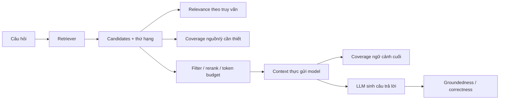

# Đánh giá độ liên quan và mức bao phủ của tài liệu truy xuất trong RAG

> **Chương:** Đánh giá RAG  
> **Module:** `SPRING_AI_EVALUATION_OBSERVABILITY` — đánh giá chất lượng ứng dụng Spring AI bằng tập dữ liệu, tiêu chí relevance, fact checking, kiểm thử RAG và tool calling; đồng thời theo dõi metrics, traces, chi phí và độ trễ để tìm nguyên nhân suy giảm chất lượng giữa các phiên bản prompt, model và pipeline.

## Mục tiêu học tập

Sau bài này, bạn có thể:

1. Xác định một tài liệu hoặc chunk **có liên quan** đến câu hỏi theo tiêu chí nào, phân biệt liên quan theo chủ đề với **có bằng chứng giải quyết câu hỏi**.
2. Phân biệt **mức bao phủ tài liệu truy xuất** với **mức bao phủ các ý bắt buộc**, và với lượng bằng chứng **thực sự được đưa vào prompt cuối**.
3. Tính và diễn giải `Precision@K`, `Recall@K`, `Hit@K`, `MRR@K` và `nDCG@K`; chọn thước đo theo loại câu hỏi thay vì sử dụng một chỉ số cho mọi mục tiêu.
4. Xây bộ dữ liệu đánh giá có nhãn, thiết kế kiểm thử hồi quy và phân tích tác động của chunking, reranking, filter và ngân sách ngữ cảnh.
5. Tổ chức phép đo trong ứng dụng Spring AI và liên hệ kết quả với traces, metrics, token, độ trễ, chi phí và chất lượng câu trả lời.

## 1. Độ liên quan và mức bao phủ giải quyết hai vấn đề khác nhau

Trong Retrieval-Augmented Generation (RAG), bộ truy xuất (retriever) nhận một câu hỏi và tìm những đoạn dữ liệu để mô hình ngôn ngữ sử dụng làm bằng chứng. Một hệ thống có thể tìm toàn các đoạn **đúng chủ đề** nhưng **thiếu điều kiện quan trọng**, hoặc tìm đủ bằng chứng nhưng lẫn quá nhiều đoạn không cần thiết.

- **Relevance (độ liên quan):** Kết quả truy xuất có thực sự giúp trả lời câu hỏi không? Có bằng chứng trực tiếp, có liên quan một phần, chỉ cùng chủ đề hay hoàn toàn không liên quan?
- **Coverage (mức bao phủ):** Trong **toàn bộ những nguồn hoặc sự kiện cần thiết**, retriever đã đưa ra được bao nhiêu? Có bỏ sót một vế của câu hỏi, một ngoại lệ hoặc một bước suy luận không?
- **Ranking quality (chất lượng thứ hạng):** Bằng chứng quan trọng có nằm đủ sớm trong `topK` để vượt qua giới hạn context và không bị nhiễu che khuất không?



**Không đánh đồng:** `Recall@K` cao ở tầng retrieval **không bảo đảm** đủ bằng chứng đến prompt cuối; prompt có đủ bằng chứng **không bảo đảm** model diễn giải đúng. Vì vậy, bài này tập trung trước tiên vào *đo lường tài liệu truy xuất*, rồi chỉ ra cách kiểm tra mức bao phủ sau khi dựng context.

### Ví dụ xuyên suốt

Giả sử một doanh nghiệp có chính sách công tác **giả định**:

| ID tài liệu | Nội dung chính | Vai trò với câu hỏi |
| --- | --- | --- |
| `D01` | Phải gửi đơn trước **ít nhất 3 ngày làm việc** | Bằng chứng về thời hạn |
| `D02` | **Trưởng bộ phận** phê duyệt đơn | Bằng chứng về người duyệt |
| `D03` | Nếu chi phí vượt hạn mức, cần thêm **phê duyệt của tài chính** | Bằng chứng về điều kiện ngoại lệ |
| `D07` | Phụ cấp ăn tối đa 150.000 đồng | Cùng chủ đề, không trả lời câu hỏi |
| `D08` | Cách đặt phòng khách sạn | Cùng chủ đề, không trả lời câu hỏi |

Câu hỏi cần trả lời:

> “Cần nộp đơn công tác trước bao lâu, ai phê duyệt, và khi nào cần duyệt bổ sung?”

Tập nguồn **đủ bằng chứng** là `R = {D01, D02, D03}`. Với `K = 5`, retriever trả về theo thứ tự:

```text
rank:          1      2      3      4      5
document:     D01    D07    D02    D08    D03
relevant?:     ✓      ✗      ✓      ✗      ✓
```

Hệ thống đã tìm thấy cả ba nguồn cần thiết trong năm kết quả, nhưng hai kết quả gây nhiễu làm chiếm vị trí và có thể tiêu tốn token. Nếu prompt chỉ lấy ba kết quả đầu, model sẽ thiếu `D03` để giải thích trường hợp cần duyệt bổ sung.

## 2. “Tài liệu liên quan” phải được định nghĩa trước khi chấm

Từ “relevant” có ít nhất ba cách hiểu. Để so sánh model, embedding hoặc pipeline, cần chọn một định nghĩa thống nhất:

| Mức | Tên gợi ý | Nhãn minh họa | Ví dụ |
| --- | --- | ---: | --- |
| Không liên quan | Irrelevant | 0 | Tài liệu kỹ thuật triển khai mạng khi hỏi về đơn công tác |
| Chỉ cùng chủ đề | Topical | 1 | `D07` nói về tiền ăn nhưng không chứng minh được thời hạn/người duyệt |
| Có bằng chứng hữu ích một phần | Partially answer-bearing | 2 | `D02` xác nhận người duyệt nhưng không nói về thời hạn |
| Trực tiếp và quan trọng | Highly answer-bearing | 3 | Đoạn cung cấp rõ chính xác thông tin đang được hỏi, kể cả điều kiện áp dụng |

Đây là **rubric minh họa**; mức 0–3 không phải thang chuẩn bắt buộc của Spring AI. Trong câu hỏi nhiều phần, `D01`, `D02` và `D03` đều có thể được đánh dấu **relevant ở mức nhị phân** vì mỗi tài liệu đóng góp một sự kiện bắt buộc; mức graded 1–3 còn tùy rubric nghiệp vụ.

Hai chiến lược gán nhãn:

- **Binary relevance:** `relevant=true/false`. Phù hợp với `Precision@K`, `Recall@K`, `Hit@K`, `MRR@K` và các bài kiểm thử pass/fail rõ ràng.
- **Graded relevance:** mức 0–3 hoặc một thang khác. Phù hợp với `nDCG@K`, khi muốn ưu tiên tài liệu trực tiếp trả lời hơn tài liệu chỉ hỗ trợ một phần.

Trong hệ thống RAG, nên dùng tiêu chí **answer-bearing** hơn là chỉ đánh giá độ giống ngữ nghĩa. Embedding có thể xếp `D07` rất cao vì cùng chủ đề “công tác”, trong khi `D03` chứa điều kiện chi phí thật sự cần để trả lời câu hỏi.

### Chú ý phủ định, điều kiện và phiên bản

Một chunk có câu “Trưởng bộ phận duyệt” chưa đủ nếu ngay phía sau là ngoại lệ “riêng trường hợp X do giám đốc phê duyệt”. Chia chunk khiến ngoại lệ rơi sang đoạn khác có thể biến câu trả lời thành sai lệch. Khi gán nhãn, cần xem **phạm vi áp dụng**, **thời điểm hiệu lực** và **quyền truy cập**.

Tài liệu đúng nội dung nhưng đã hết hiệu lực không nên được xem là bằng chứng đúng cho câu hỏi về quy định hiện hành. Nếu câu hỏi yêu cầu bản năm trước, ngược lại, bản cũ lại có thể là tài liệu liên quan. Nhãn phải phụ thuộc vào câu hỏi và bối cảnh.

## 3. Thiết kế bộ dữ liệu chuẩn (golden dataset)

Muốn tính `Recall@K`, cần biết có những tài liệu nào *được mong đợi tìm thấy*. Chỉ nhìn danh sách hệ thống trả về không thể tự suy ra recall đáng tin cậy.

Một test case có thể chứa:

```json
{
  "case_id": "travel-policy-001",
  "question": "Cần nộp đơn công tác trước bao lâu, ai duyệt và khi nào cần duyệt bổ sung?",
  "corpus_version": "travel-policy-v3",
  "relevant_document_ids": ["D01", "D02", "D03"],
  "required_facts": [
    {
      "fact_id": "F1",
      "description": "Nộp trước ít nhất 3 ngày làm việc",
      "supporting_document_ids": ["D01"]
    },
    {
      "fact_id": "F2",
      "description": "Trưởng bộ phận phê duyệt",
      "supporting_document_ids": ["D02"]
    },
    {
      "fact_id": "F3",
      "description": "Vượt hạn mức cần phê duyệt của tài chính",
      "supporting_document_ids": ["D03"]
    }
  ],
  "answerable": true,
  "tags": ["multi-part", "policy", "conditional-rule"]
}
```

### Các quyết định phải chốt khi tạo nhãn

1. **Đơn vị so sánh:** Gán nhãn ở cấp `source_document_id`, `chunk_id` hay `passage`? Nếu nhãn chuẩn là tài liệu gốc, cần ánh xạ tất cả chunk về nguồn gốc trước khi tính.
2. **Tài liệu thay thế tương đương:** Nếu cả `D03` và `D09` đều ghi cùng một quy định hợp lệ, có cần tìm đủ cả hai? Đối với coverage theo sự kiện, **một trong hai** có thể đã đủ; đối với kiểm toán nguồn, yêu cầu có thể khác.
3. **Nhiều nguồn hỗ trợ một sự kiện:** Khi một câu cần đối chiếu hai nguồn để kết luận, phải lưu `support_sets` hoặc quan hệ điều kiện, không chỉ một danh sách flat.
4. **Các câu không có đáp án:** `answerable=false` cần rubric đánh giá khả năng không suy đoán, thay vì cố tính recall với mẫu số bằng 0.
5. **Phiên bản corpus/index:** Tập tài liệu chuẩn phải tương ứng với dữ liệu và quyền truy cập khi test chạy. Nếu nhãn chỉ có cho một phần tài liệu, điểm “precision” có thể bị thấp giả tạo khi hit chưa gán nhãn bị xem là sai.
6. **Người duyệt:** Người hiểu nghiệp vụ nên duyệt ít nhất các case quan trọng và các trường hợp người gán nhãn bất đồng.

Tách bộ **train/tuning**, **validation** và **holdout test** nếu dùng dữ liệu này để tinh chỉnh prompt/retriever. Tránh chọn `topK` trên chính tập dùng để tuyên bố kết quả cuối cùng.

### Vấn đề nhãn chưa đầy đủ

Với kho dữ liệu lớn, người gán nhãn hiếm khi kiểm tra được mọi tài liệu. Một đoạn chưa được gán nhãn **không đồng nghĩa** với không liên quan. Có thể áp dụng phương pháp *pooling*: gom các kết quả đầu từ nhiều retriever, loại trùng, đưa cho người duyệt và bổ sung nhãn dần.

Khi báo cáo, nên ghi `judgment_coverage` (tỷ lệ kết quả được đánh giá), chính sách xử lý tài liệu *unjudged* và số case ảnh hưởng. Không so sánh precision giữa hai mô hình nếu một bên nhận nhiều kết quả chưa gán nhãn nhưng cả hai bị mặc định tính là sai.

## 4. Các metric đo độ liên quan của kết quả truy xuất

Cho một câu hỏi, ký hiệu:

- `R`: tập ID tài liệu *relevant* theo nhãn chuẩn; giả sử có ít nhất một phần tử.
- `L = [d₁, d₂, ..., dₘ]`: danh sách ID retriever trả về, đã xác định cách xử lý trùng lặp và giữ thứ tự.
- `TopK(L)`: tối đa `K` kết quả đầu, `K > 0`.
- `hits(K)`: số kết quả trong `TopK(L)` được coi là relevant, theo cùng đơn vị ID với `R`.

| Chỉ số | Công thức hoặc quy tắc | Cho biết | Giới hạn |
| --- | --- | --- | --- |
| **Precision@K** | `hits(K) / K` | Tỷ lệ vị trí đầu dành cho nguồn liên quan | Không cho biết còn thiếu bao nhiêu bằng chứng |
| **Recall@K** | `hits(K) / size(R)` | Tỷ lệ nguồn liên quan trong corpus đã tìm được | Cần nhãn `R` đủ tin cậy |
| **Hit@K** / Success@K | `1` nếu `hits(K) > 0`, ngược lại `0` | Có tìm thấy ít nhất một nguồn hữu ích không | Quá dễ với câu hỏi cần nhiều nguồn |
| **Reciprocal Rank@K** | `1/r` với `r` là vị trí nguồn relevant đầu tiên trong top K; không có thì `0` | Tài liệu đúng đầu tiên xuất hiện sớm đến mức nào | Bỏ qua nguồn đúng thứ hai, thứ ba... |
| **MRR@K** | Trung bình Reciprocal Rank@K trên tập câu hỏi | Tốc độ xuất hiện chứng cứ đầu tiên của cả bộ test | Không phản ánh độ đầy đủ nguồn |
| **nDCG@K** | `DCG@K / IDCG@K` với graded labels | Ưu tiên nguồn hữu ích hơn nằm ở vị trí cao | Phụ thuộc rubric graded và cách xử lý trường hợp lý tưởng bằng 0 |

> Trong bảng, ký hiệu `|R|` là **số phần tử của tập R**. Các công thức dùng quy ước mẫu số của `Precision@K` là K kể cả khi retriever trả ít hơn K kết quả; một số hệ thống dùng số kết quả thực tế làm mẫu số, cần công bố rõ trước khi so sánh.

Với graded relevance `relᵢ ≥ 0`, công thức phổ biến:

\[
DCG@K = \sum_{i=1}^{K}\frac{2^{rel_i}-1}{\log_2(i+1)}, \qquad
nDCG@K = \frac{DCG@K}{IDCG@K}.
\]

`IDCG@K` là `DCG@K` nếu các kết quả được sắp theo độ liên quan giảm dần. Nếu `IDCG@K = 0` thì nDCG không xác định theo công thức trên; hệ thống đánh giá phải nêu rõ có loại case ra hay quy ước giá trị riêng.

### Tính tay trên ví dụ công tác

Tập gold: `R = {D01, D02, D03}`; kết quả `[D01, D07, D02, D08, D03]`.

| Chỉ số | Top 3 | Top 5 |
| --- | ---: | ---: |
| Số nguồn relevant tìm được | 2 | 3 |
| `Precision@K` | `2/3 ≈ 0,667` | `3/5 = 0,60` |
| `Recall@K` | `2/3 ≈ 0,667` | `3/3 = 1,00` |
| `Hit@K` | `1` | `1` |
| `Reciprocal Rank@K` | `1/1 = 1` | `1/1 = 1` |

Nếu dùng **một thang graded riêng** với điểm `1` cho mỗi tài liệu answer-bearing và `0` cho `D07, D08`, các vị trí relevant ở `1, 3, 5` làm `nDCG@5 ≈ 0,885`; thứ tự lý tưởng là ba kết quả relevant đứng đầu. Đây là thang minh họa khác với rubric 0–3 ở phần 2, cần khai báo rõ nếu đưa vào bộ test thật.

**Cách đọc:** Tăng `K` từ 3 lên 5 giúp **Recall đạt 100%** nhưng làm **Precision giảm từ ~66,7% xuống 60%**, đồng thời có thể tăng token và độ trễ. Không có cấu hình `K` tốt nhất cho mọi hệ thống; cần đối chiếu chi phí và chất lượng câu trả lời.

### Precision không hoàn toàn là relevance của từng chunk

Một retriever có thể lấy cả năm đoạn về chủ đề công tác, nhưng chỉ ba đoạn đóng góp vào đáp án cụ thể. Nếu gán nhãn theo “cùng chủ đề”, hệ thống có thể nhận `Precision@5 = 1` và che khuất nhiễu. Hãy công bố rõ loại nhãn:

- **Topical precision:** kết quả nói về lĩnh vực người dùng hỏi.
- **Answer-bearing precision:** kết quả thực sự chứa dữ liệu/điều kiện cần để trả lời.

Khi mục tiêu là nâng chất lượng RAG, **answer-bearing precision** thường có giá trị chẩn đoán hơn.

## 5. Mức bao phủ tài liệu khác mức bao phủ sự kiện

`Recall@K` thường đo mức bao phủ **tập tài liệu có nhãn**. Tuy nhiên, RAG phải tạo câu trả lời dựa trên **sự kiện hoặc điều kiện**. Hai loại coverage có thể khác nhau.

### 5.1. Document coverage

`DocumentCoverage@K = |TopK(L) ∩ R| / |R|` với `R` là tập gold document IDs. Chỉ số này dễ hiểu, nhưng nhạy với cách chia chunk, trùng lặp và nhãn tài liệu.

Ví dụ, nếu một tài liệu `D01` chứa cả thời hạn và người duyệt, còn `D02` chỉ nhắc lại thời hạn, việc thiếu `D02` có thể làm document recall thấp dù các sự kiện cần thiết đều có trong `D01`.

### 5.2. Fact coverage / answer evidence coverage

Cho `F = {F1, F2, ..., Fn}` là tập sự kiện cần có trong câu trả lời. Một `Fi` được coi là **covered** nếu có bằng chứng đáng tin, còn hiệu lực và được phép sử dụng trong những đoạn đang xem xét. Khi đó:

\[
FactCoverage = \frac{\text{số sự kiện bắt buộc có đủ bằng chứng}}{\text{tổng số sự kiện bắt buộc}}.
\]

Với câu hỏi công tác:

| Sự kiện | Bằng chứng cần thiết | Có trong top 3? | Có trong top 5? |
| --- | --- | --- | --- |
| `F1`: thời hạn 3 ngày | `D01` | Có | Có |
| `F2`: trưởng bộ phận duyệt | `D02` | Có | Có |
| `F3`: vượt hạn mức cần duyệt tài chính | `D03` | Không | Có |
| **Fact coverage** | | **2/3** | **3/3** |

Ở ví dụ đơn giản này, document recall và fact coverage tình cờ bằng nhau vì mỗi nguồn tương ứng với một sự kiện. Trong thực tế, một nguồn có thể hỗ trợ nhiều sự kiện hoặc một sự kiện cần kết hợp nhiều nguồn, khiến hai chỉ số khác biệt.

### 5.3. Các sự kiện cần nhiều nguồn

Giả sử cần trả lời “Khoản chi X có được hoàn tiền không?” theo hai nguồn:

- `D10` nêu “Khoản X thuộc nhóm được hoàn”.
- `D11` nêu “Chỉ được hoàn nếu có hóa đơn”.

Sự kiện `F4` (“Được hoàn khi có hóa đơn”) cần **đồng thời `D10` và `D11`**. Nếu chỉ tìm được `D10`, hệ thống **không nên chấm F4 là covered**, dù đã tìm thấy một phần chứng cứ. Schema có thể biểu diễn:

```json
{
  "fact_id": "F4",
  "description": "Khoản X được hoàn khi có hóa đơn hợp lệ",
  "acceptable_support_sets": [
    ["D10", "D11"],
    ["D12"]
  ]
}
```

Ở đây `[D10,D11]` nghĩa là **phải có cả hai**, còn `[D12]` là một tài liệu khác được xác nhận chứa trọn quy tắc; một trong các support sets đầy đủ là đủ cho `F4`. Nếu nguồn có mâu thuẫn, cần bổ sung quy tắc độ ưu tiên theo version và quyền hạn, không đánh dấu covered đơn giản dựa vào sự xuất hiện của ID.

### 5.4. Context coverage tại prompt cuối

Một pipeline có thể truy xuất `D03` ở vị trí 5 nhưng chỉ đưa `D01, D07, D02` vào prompt vì `topK=3` hoặc ngân sách token. Ta nên theo dõi:

- **Retrieval fact coverage:** bao nhiêu sự kiện có bằng chứng trong kết quả retriever.
- **Selected-context fact coverage:** bao nhiêu sự kiện có bằng chứng trong những chunk sau lọc/rerank/selection.
- **Final-prompt fact coverage:** bao nhiêu sự kiện còn được hỗ trợ bởi **văn bản thật sự gửi đến `ChatModel`** sau mọi bước cắt, nén và dựng template.

Nếu `D03` xuất hiện trong danh sách chọn nhưng đoạn chứa ngoại lệ bị cắt khỏi prompt, **final-prompt coverage không được tính là đủ**. Metadata chỉ chứa `chunk_id` chưa chứng minh điều kiện cần đã đi vào model.

## 6. Những bẫy khi đánh giá relevance và coverage

### 6.1. Trùng lặp chunk hoặc nguồn

Nếu `D01` được chia thành nhiều chunk gần giống nhau, top 5 có thể gồm `[D01#1, D01#2, D01#3, D07, D02#1]`. Khi gold ở **cấp tài liệu gốc**, phải ánh xạ chunks sang `source_document_id` và xác định cách tính trùng lặp; không được đếm ba chunk của `D01` là ba nguồn độc lập.

Hai cách có ý nghĩa khác nhau:

1. **Chunk-level evaluation:** mỗi chunk là một item; nhãn gold cũng ở cấp chunk. Đo năng lực tìm đúng passage.
2. **Document-level evaluation:** ánh xạ tất cả chunk về source, loại trùng theo quy tắc thống nhất và đánh giá khả năng tìm đúng tài liệu gốc.

Hãy giữ cả bản ranking gốc để đo **lãng phí slot và token do kết quả trùng**, vì bước loại trùng để tính metric có thể che mất hiệu ứng vận hành thực tế.

### 6.2. Đoán độ bao phủ từ similarity score

Điểm cosine similarity hoặc điểm reranker **không phải xác suất chứng cứ đúng**. Một chunk đạt điểm tìm kiếm cao nhưng bỏ sót chữ “không” hoặc ngoại lệ có thể gây hậu quả lớn. Relevance nên được đánh giá bằng nội dung theo câu hỏi, có thể chấm thủ công hoặc dùng judge có rubric rõ ràng.

### 6.3. Nguồn không được phép hoặc đã lỗi thời

Khi người dùng thuộc tenant A, tài liệu chỉ dành cho tenant B phải bị loại dù cùng chủ đề và có đáp án. Tập `R` để chấm recall phải giới hạn ở **nguồn hợp lệ theo quyền của truy vấn**, không lấy toàn bộ corpus làm mẫu số.

Khi nhiều phiên bản chính sách mâu thuẫn, lưu `document_revision`, `effective_date` và version của index; trường hợp mục tiêu là chính sách hiện hành cần ưu tiên bằng chứng đang hiệu lực.

### 6.4. Câu hỏi không thể trả lời

Với `R = ∅`, công thức `Recall@K` có mẫu số bằng 0, nên **không định nghĩa** theo công thức thông thường. Không tự chấm 100% hoặc 0% rồi trộn vào trung bình recall. Nên tách thành bộ test **unanswerable/no-evidence**, đo khả năng phát hiện không có căn cứ và từ chối suy đoán.

### 6.5. LLM-as-a-judge có thể sai

LLM có thể chấm relevance, gán nhãn fact coverage hoặc giải thích sự kiện mà không cần thao tác tay toàn bộ. Nhưng judge có thể bỏ sót phủ định, điều khoản ngoại lệ, mâu thuẫn bản cũ hoặc chỉ đánh giá “cùng chủ đề”. Khi dùng judge:

- Cố định rubric, prompt và phiên bản judge; yêu cầu trích đoạn bằng chứng hỗ trợ từng nhãn.
- Hiệu chuẩn với bộ mẫu có người hiểu nghiệp vụ chấm, xem xét các ca bất đồng.
- Giữ trạng thái `unjudged` khi không đủ dữ kiện; không biến thiếu nhãn thành `irrelevant`.
- Ghi cách xử lý khi judge từ chối, lỗi hoặc không đạt độ tin cậy.

## 7. Cài đặt phép đo độc lập với Spring AI bằng Java

Việc tính metric nên dùng **ID đã chuẩn hóa** và danh sách có thứ tự, tách khỏi thư viện retriever để có thể áp dụng cho vector search, hybrid search hoặc reranker. Ví dụ Java 17+ sau tính `Precision@K`, `Recall@K`, `Hit@K` và Reciprocal Rank, xử lý riêng truy vấn không có gold relevant IDs:

```java
import java.util.List;
import java.util.Objects;
import java.util.OptionalDouble;
import java.util.Set;

public final class RetrievalMetrics {
    private RetrievalMetrics() {}

    public record Scores(
            double precisionAtK,
            OptionalDouble recallAtK,
            boolean hitAtK,
            double reciprocalRankAtK) {}

    public static Scores score(
            List<String> rankedIds, Set<String> relevantIds, int k) {
        Objects.requireNonNull(rankedIds, "rankedIds");
        Objects.requireNonNull(relevantIds, "relevantIds");
        if (k < 1) {
            throw new IllegalArgumentException("k phải >= 1");
        }

        // Quy ước: loại trùng ID trước khi lấy top K.
        // Khi cần đo vị trí lãng phí do chunk trùng, ghi riêng ranking gốc.
        List<String> topK = rankedIds.stream()
                .distinct()
                .limit(k)
                .toList();

        long hits = topK.stream().filter(relevantIds::contains).count();
        double precision = hits / (double) k;
        OptionalDouble recall = relevantIds.isEmpty()
                ? OptionalDouble.empty()
                : OptionalDouble.of(hits / (double) relevantIds.size());

        double rr = 0.0;
        for (int i = 0; i < topK.size(); i++) {
            if (relevantIds.contains(topK.get(i))) {
                rr = 1.0 / (i + 1);
                break;
            }
        }
        return new Scores(precision, recall, hits > 0, rr);
    }

    public static void main(String[] args) {
        List<String> ranked = List.of(
                "D01", "D07", "D02", "D08", "D03");
        Set<String> relevant = Set.of("D01", "D02", "D03");

        Scores at3 = score(ranked, relevant, 3);
        Scores at5 = score(ranked, relevant, 5);

        System.out.println("P@3 = " + at3.precisionAtK());
        System.out.println("R@3 = " + at3.recallAtK().orElseThrow());
        System.out.println("P@5 = " + at5.precisionAtK());
        System.out.println("R@5 = " + at5.recallAtK().orElseThrow());
    }
}
```

Kết quả:

```text
P@3 = 0.6666666666666666
R@3 = 0.6666666666666666
P@5 = 0.6
R@5 = 1.0
```

**Quy ước bắt buộc ghi rõ:** hàm `score` loại trùng ID trước khi lấy `K`; `Precision@K` dùng mẫu số K; `Recall@K` trả `OptionalDouble.empty()` nếu không có tài liệu gold. Nếu ứng dụng có nhiều chunk khác nhau của cùng một source, cần ánh xạ `chunk_id → source_document_id` trước khi gọi khi muốn đo document-level metrics.

### Kết nối retrieval Spring AI vào phép đo

Với phiên bản Spring AI cung cấp `VectorStore`, `SearchRequest.builder()` và `Document.getId()`:

```java
import java.util.List;
import java.util.Set;
import org.springframework.ai.document.Document;
import org.springframework.ai.vectorstore.SearchRequest;
import org.springframework.ai.vectorstore.VectorStore;

// Đoạn code minh họa bên trong một method khi đã có VectorStore.
String question = "Cần nộp đơn công tác khi nào và ai phê duyệt?";

List<Document> documents = vectorStore.similaritySearch(
        SearchRequest.builder()
                .query(question)
                .topK(5)
                .build());

// Chỉ đúng khi Document ID tương ứng với ID trong golden dataset.
// Nếu có chunking, chuyển về source ID hoặc chunk ID thống nhất.
List<String> ids = documents.stream()
        .map(Document::getId)
        .toList();

RetrievalMetrics.Scores scores = RetrievalMetrics.score(
        ids, Set.of("D01", "D02", "D03"), 5);
```

Đây là **đoạn tích hợp minh họa**, không phải file Java đầy đủ tự chạy: cần đặt trong method với một `VectorStore` đã cấu hình và có test fixtures tương ứng. Tên hàm/constructor và cách trả `Document` có thể khác giữa các phiên bản Spring AI; cần đối chiếu dependencies trước khi dùng.

Nếu RAG được thực hiện **bên trong advisor**, một lời gọi `VectorStore` độc lập có thể **không tái hiện** quá trình mà advisor đã chạy (query rewriting, filter, rerank, metadata, token budget). Để đánh giá pipeline thực tế, ghi danh sách ID tại đúng stage của advisor đang dùng và cung cấp chúng cho `RetrievalMetrics`; nhớ phân biệt retrieved IDs với final-prompt evidence.

### Kiểm thử kết quả tính toán

Nên xác nhận tối thiểu các trường hợp:

| Input | Kỳ vọng |
| --- | --- |
| `R={D01,D02,D03}`, `L=[D01,D07,D02,D08,D03]`, `K=3` | `P@3=2/3, R@3=2/3, Hit=1, RR=1` |
| Cùng R, L, `K=5` | `P@5=3/5, R@5=1, Hit=1, RR=1` |
| `R={D01}`, `L=[D09,D08]`, `K=2` | `P=0, R=0, Hit=0, RR=0` |
| `R=∅` | Recall **không xác định**, kiểm tra riêng unanswerable case |
| Có duplicate `[D01,D01,D02]` | Áp dụng quy tắc loại trùng hoặc chấm slot-level, **không thay quy tắc giữa các phiên bản** |

Không cần viết test chỉ lặp lại chính dòng tính toán; nên ưu tiên các ca ranh giới khiến kết luận thay đổi, đặc biệt ID mismatch, nhãn chưa đầy đủ, tài liệu trùng và context bị cắt.

## 8. Đo fact coverage có điều kiện bằng Java

Document recall không thể biểu diễn mọi quan hệ chứng cứ. Khi test case khai báo các bộ nguồn thay thế hợp lệ, có thể chấm fact coverage bằng cách kiểm tra mỗi sự kiện có **ít nhất một bộ nguồn hoàn chỉnh** hay không.

```java
import java.util.List;
import java.util.Set;

public final class FactCoverageMetrics {
    private FactCoverageMetrics() {}

    public record RequiredFact(
            String id,
            List<Set<String>> acceptableSupportSets) {}

    public static double coverage(
            List<RequiredFact> requiredFacts,
            Set<String> availableDocumentIds) {
        if (requiredFacts.isEmpty()) {
            throw new IllegalArgumentException(
                    "Không tính coverage khi không có required facts");
        }
        long covered = requiredFacts.stream()
                .filter(fact -> fact.acceptableSupportSets().stream()
                        .filter(sources -> !sources.isEmpty())
                        .anyMatch(availableDocumentIds::containsAll))
                .count();
        return covered / (double) requiredFacts.size();
    }
}
```

**Ý nghĩa:** một sự kiện có thể được hỗ trợ bởi `{D10,D11}` *hoặc* `{D12}`. Logic này đo **coverage ở cấp ID**, chưa phân tích nội dung bị cắt hoặc văn bản mâu thuẫn. Với final-prompt coverage, `availableDocumentIds` chỉ nên bao gồm các nguồn mà **đúng đoạn chứng minh sự kiện** vẫn có mặt trong outgoing prompt; trường hợp bị cắt cần kiểm tra text/claim thay vì chỉ dùng ID.

Đối với sự kiện có trọng số quan trọng khác nhau (ví dụ ngoại lệ pháp lý quan trọng hơn mô tả nền), có thể tính **weighted fact coverage** theo trọng số đã xác nhận với chuyên gia nghiệp vụ. Công thức, trọng số và ngưỡng phải được lưu cùng version của rubric.

## 9. Dùng số liệu để điều chỉnh retrieval pipeline

Một phép thử tốt chỉ thay một hoặc vài biến có kiểm soát để biết vì sao kết quả thay đổi:

| Biến thử nghiệm | Rủi ro/chuyển biến cần đo | Metric nên kiểm tra |
| --- | --- | --- |
| `topK` tăng | Recall có thể tăng, đồng thời thêm nhiễu và token | `Recall@K`, `Precision@K`, final-context coverage, latency |
| Kích thước/overlap chunk | Chunk quá nhỏ mất điều kiện; quá lớn giảm độ chính xác và tăng context | Passage relevance, fact coverage, token/context |
| Embedding hoặc index version | Thay đổi thứ hạng và các hit | `Recall@K`, `nDCG@K`, độ ổn định theo nhóm query |
| Hybrid search BM25 + vector | Có thể giúp truy vấn chứa mã, thuật ngữ chính xác | Recall theo nhóm lexical/entity; Precision |
| Reranker | Đẩy nguồn đúng lên trước nhưng có thể bỏ sót nguồn thứ yếu | `MRR`, `nDCG`, `Recall@K` sau rerank |
| Metadata/ACL filter | Bảo vệ quyền và lọc phiên bản; filter sai có thể loại nguồn cần | Recall trên corpus **được phép**, access correctness |
| Query rewrite | Giúp câu mơ hồ nhưng có nguy cơ đổi ý định | Fact coverage, query drift cases |
| Token budget / context compression | Tiết kiệm token nhưng có thể bỏ mất phủ định/ngoại lệ | Final-prompt fact coverage, groundedness, chi phí |

### Thí nghiệm A: chấm retriever độc lập

Cố định bộ test, corpus, quyền truy cập và nhãn; chạy retriever với vài cấu hình `topK`, chunking/rerank. Lưu danh sách có thứ tự và ID đã chuẩn hóa. So sánh theo từng nhóm: câu đơn nguồn, đa nguồn, điều kiện/ngoại lệ, từ khóa hiếm, không có đáp án.

### Thí nghiệm B: chấm sau context assembly

Giữ nguyên retrieved candidates; thay cách chọn và cắt tài liệu. Ghi **những đoạn thực tế đi vào model** và đo fact coverage trên đoạn cuối. Cách này tìm ra tình huống search đúng nhưng mất chứng cứ khi ghép prompt.

### Thí nghiệm C: oracle context

Chạy generation hai lần bằng cùng prompt/model:

1. Context do pipeline hiện tại cung cấp.
2. **Oracle context:** các đoạn được người duyệt xác nhận chứa đầy đủ bằng chứng cần cho câu hỏi.

Nếu câu trả lời sai với context hiện tại nhưng đúng với oracle context, nhiều khả năng vấn đề nằm ở retrieval hoặc context assembly. Nếu vẫn sai với oracle context, cần kiểm tra khả năng đọc/ngụ ý của model, prompt, định dạng và citation. Giữ kiểm soát thứ tự, độ dài và biến thiên của model khi diễn giải kết quả.

### Đừng tối ưu metric đơn lẻ

Chạy `topK=20` có thể đạt recall cao nhưng làm context nhiễu, tăng input tokens và vượt ngân sách độ trễ. Mục tiêu vận hành là tìm điểm cân bằng giữa **đủ chứng cứ**, **ít nhiễu**, **câu trả lời đáng tin** và **chi phí chấp nhận được**.

## 10. Báo cáo evaluation cùng observability

Trong Spring AI, có thể đo retrieval ở nơi gọi `VectorStore` hoặc ở advisor tương ứng, kết hợp Micrometer/Tracing theo cấu hình đang dùng. Nên gắn mỗi case với `run_id`, `case_id` và `trace_id` khi có.

Một bản ghi evaluation gợi ý:

```json
{
  "run_id": "rag-eval-2026-11-27",
  "case_id": "travel-policy-001",
  "question_group": "multi-part",
  "corpus_version": "travel-policy-v3",
  "index_version": "policy-index-v6",
  "retriever_version": "hybrid-rerank-v2",
  "prompt_version": "answer-v4",
  "model_version": "model-a",
  "k": 5,
  "retrieved_document_ids": ["D01", "D07", "D02", "D08", "D03"],
  "relevant_document_ids": ["D01", "D02", "D03"],
  "precision_at_k": 0.6,
  "recall_at_k": 1.0,
  "hit_at_k": 1,
  "reciprocal_rank_at_k": 1.0,
  "final_prompt_fact_coverage": 0.6667,
  "retrieval_latency_ms": 76,
  "model_input_tokens": 1850,
  "model_output_tokens": 180,
  "answer_groundedness": "PARTIAL",
  "prompt_manifest_ref": "audit://run-01/case-01"
}
```

Các con số latency, token và điểm đầu ra ở JSON **chỉ minh họa**. `final_prompt_fact_coverage` trong ví dụ giả định prompt chỉ chứa đủ hai trong ba sự kiện, dù retrieval có đủ ba tài liệu.

| Tầng | Số liệu đáng theo dõi | Giá trị chẩn đoán |
| --- | --- | --- |
| Retrieval | `K`, số hit, IDs, rank, `Precision@K`, `Recall@K`, `nDCG@K`, latency | Tìm nguồn đúng và đủ hay không |
| Context assembly | Số chunk bị loại, trùng, cắt; token estimate; final fact coverage | Có mất bằng chứng sau retrieval không |
| Generation | Answer relevance, groundedness, factual correctness, citation accuracy | Model có dùng đúng bằng chứng không |
| Vận hành | p50/p95 latency, timeout, retries, token usage, cost/request | Bản cải tiến có đáp ứng SLA/ngân sách không |
| Regression | Sai lệch theo nhóm câu hỏi, corpus/prompt/model/retriever version | Xác định phiên bản làm chất lượng giảm |

Metrics tổng hợp không nên gắn nguyên văn câu hỏi, source IDs hoặc `trace_id` làm label có cardinality cao. Dùng log/trace có kiểm soát hoặc kho audit riêng để lưu provenance; tránh đưa bí mật, nội dung nhạy cảm và dữ liệu cá nhân vào span attributes.

### Ví dụ đọc báo cáo giữa hai phiên bản

| Chỉ số trên cùng bộ kiểm thử | Bản A | Bản B | Cách diễn giải |
| --- | ---: | ---: | --- |
| `Recall@5` | 0,80 | 0,93 | B tìm được thêm nguồn liên quan |
| `Precision@5` | 0,74 | 0,61 | B đưa thêm nhiều kết quả không trực tiếp hữu ích |
| Final-prompt fact coverage | 0,77 | 0,72 | B có thể làm rơi dữ kiện khi dựng context |
| Grounded answer rate | 0,85 | 0,79 | Câu trả lời của B ít được bằng chứng cuối hỗ trợ hơn |
| p95 end-to-end latency (giây) | 2,1 | 3,4 | B chậm hơn |

Đây là dữ liệu **giả định**. Chưa thể suy ra nguyên nhân chỉ từ trung bình: cần đối chiếu các case giảm điểm, thứ tự tài liệu, nội dung bị cắt, phiên bản index và trace có liên quan. Một cải thiện recall có thể đi kèm suy giảm chất lượng đầu-cuối.

## 11. Quy trình regression evaluation có thể tái lập

1. **Đóng băng đầu vào:** bộ query, nhãn relevance, required facts/support sets, corpus snapshot, quyền truy cập, cách ánh xạ chunk/source.
2. **Đặt baseline:** chạy cấu hình đang dùng, ghi ranking, evidence metadata, thời gian, số token, prompt/model version.
3. **Thử phiên bản mới:** giữ các yếu tố không chủ đích thay đổi; đo cùng metric/threshold và cùng cách xử lý duplicates/unjudged.
4. **Phân tích theo nhóm:** xem kết quả đơn nguồn, đa nguồn, ngoại lệ, tài liệu mới, câu không có đáp án; tránh chỉ dựa vào trung bình toàn bộ.
5. **Kiểm tra context cuối:** với case có retrieval đạt nhưng output sai, xem evidence nào sống sót đến prompt và đối chiếu câu trả lời.
6. **Duyệt các trường hợp bất đồng:** người hiểu nghiệp vụ xác nhận nhãn khó, nguồn tương đương, phủ định, mâu thuẫn phiên bản hoặc case rủi ro cao.
7. **Báo cáo quyết định:** ghi mức thay đổi chất lượng theo metric, số case, mức biến thiên, chi phí, độ trễ và danh sách lỗi còn tồn tại; đặt ngưỡng theo nghiệp vụ.

Nên báo cả **micro/macro aggregation** khi các case có số lượng relevant documents khác nhau. **Macro** là trung bình điểm theo từng câu hỏi, cho mỗi câu hỏi trọng số ngang nhau; **micro** cộng số hit và số gold relevant documents trên toàn bộ tập rồi chia, khiến câu hỏi có nhiều relevant IDs đóng góp nhiều hơn. Nêu rõ phép tổng hợp để tránh các báo cáo “recall trung bình” nhưng tính theo hai cách khác nhau.

Không nên coi khác biệt vài điểm phần trăm trên bộ test nhỏ là chắc chắn. Nếu kết quả có tính ngẫu nhiên (do judge hoặc generation), chạy nhiều lần và báo phân phối, khoảng tin cậy hoặc kết quả kiểm định phù hợp khi đưa ra quyết định lớn.

## 12. Bài thực hành

Một hệ thống tra cứu chính sách nghỉ phép có ba tài liệu cần thiết:

| ID | Bằng chứng |
| --- | --- |
| `P01` | Nhân viên chính thức có **12 ngày nghỉ phép** mỗi năm |
| `P02` | Đơn nghỉ từ **3 ngày liên tiếp** cần nộp trước **5 ngày làm việc** |
| `P03` | Đơn nghỉ **do quản lý trực tiếp duyệt** |
| `P09` | Lịch nghỉ lễ trong năm |
| `P10` | Chính sách làm việc từ xa |

Câu hỏi: “Có bao nhiêu ngày phép, quy tắc nộp đơn nghỉ dài và ai phê duyệt?”

Retriever trả `[P01, P09, P03, P10, P02]`. Ứng dụng gửi cho model **chỉ ba đoạn đầu**.

**Yêu cầu:**

1. Tính `Precision@3`, `Recall@3`, `Precision@5`, `Recall@5` và `Hit@5` nếu `R = {P01,P02,P03}`.
2. Giả sử mỗi tài liệu cần thiết hỗ trợ đúng một ý: tính fact coverage của retrieval top 5 và của prompt chỉ chứa ba đoạn đầu.
3. Nêu một lý do khiến `P02` có thể không được tìm thấy ở top 3 dù có chứa bằng chứng quan trọng.
4. Đề xuất một thay đổi retrieval và một thay đổi context assembly; nêu điều cần đo để biết chúng hiệu quả.
5. Nếu model trả lời sai quy tắc nộp đơn mặc dù `P02` nằm trong top 5, nên điều tra tầng nào trước?

### Đáp án gợi ý

1. Trong top 3 có `P01, P03`: `Precision@3 = 2/3`; `Recall@3 = 2/3`. Trong top 5 có cả ba nguồn: `Precision@5 = 3/5`; `Recall@5 = 1`; `Hit@5 = 1`.
2. Retrieval top 5 có fact coverage `3/3 = 1`. Prompt chỉ chứa `P01, P09, P03` nên có fact coverage `2/3`, **giả sử không có bước biến đổi khác**.
3. `P09` cùng chủ đề “nghỉ” có thể được xếp cao vì giống về ngữ nghĩa; `P02` chứa điều kiện “từ 3 ngày liên tiếp” có thể khó truy xuất nếu query mơ hồ hoặc chunking chia mất điều kiện.
4. Có thể thử reranking ưu tiên các đoạn chứa bằng chứng trực tiếp, hoặc tăng candidates trước rerank; đồng thời chọn đoạn theo **coverage các ý cần thiết** thay vì chỉ lấy top 3 thô. Đo `Recall@3`, `Precision@3`, final fact coverage, groundedness, token và latency.
5. Đầu tiên xem `P02` có **thực sự vào prompt cuối** hay không. Nếu không, kiểm tra chọn/cắt context; nếu có đủ nguyên văn, điều tra prompt, model và cách diễn giải bằng chứng.

## Ghi nhớ

- **Relevance**: tài liệu có chứa bằng chứng cần cho *câu hỏi cụ thể* không? Đừng đánh đồng với việc chỉ cùng chủ đề.
- **Document recall**: đã lấy được bao nhiêu tài liệu liên quan trong tập gold? **Fact coverage**: đã có đủ bằng chứng cho bao nhiêu ý bắt buộc?
- **`Precision@K` và `Recall@K` cần đọc cùng nhau**: tăng K có thể tăng độ đầy đủ nhưng cũng thêm nhiễu, token, chi phí và độ trễ.
- **Đừng suy luận chất lượng prompt từ retrieval alone**: đánh giá final-context coverage sau bước lọc, rerank, nén và cắt ngữ cảnh.
- **Chấm trên bộ test có nhãn và version rõ ràng**: kiểm soát duplicates, nhãn chưa đầy đủ, quyền truy cập, dữ liệu hết hiệu lực và các câu không có bằng chứng.
- **Liên kết evaluation với observability**: dùng ranking, provenance, traces, metrics, prompt/model/pipeline versions để tìm chính xác tầng gây suy giảm chất lượng.
