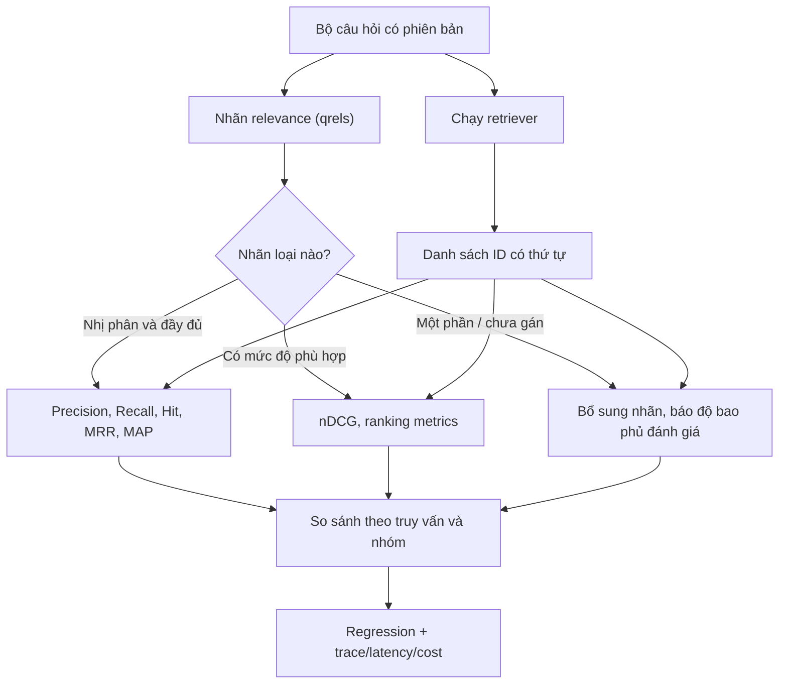

# Thiết kế phép đo precision, recall hoặc thứ hạng khi có nhãn phù hợp

> **Chương:** Đánh giá RAG  
> **Module:** `SPRING_AI_EVALUATION_OBSERVABILITY` — đánh giá ứng dụng Spring AI bằng dữ liệu kiểm thử, tiêu chí relevance/fact checking, bài test RAG hoặc tool calling; kết hợp metrics, traces, token, độ trễ và chi phí để phát hiện chất lượng suy giảm khi đổi prompt, model hoặc pipeline.

## Mục tiêu học tập

Sau bài này, bạn có thể:

1. Xác định **loại nhãn đang sở hữu** và chọn phép đo retrieval thực sự tính được từ những nhãn đó.
2. Định nghĩa đầy đủ `Precision@K`, `Recall@K`, `Hit@K`, `MRR@K`, `AP/MAP@K` và `nDCG@K`, bao gồm quy ước khi không có tài liệu liên quan hoặc nhãn chưa đầy đủ.
3. Thiết kế **qrels** (query relevance judgments), bộ truy vấn, cách gán nhãn, phép tổng hợp và tiêu chí chấp nhận thay đổi một cách tái lập.
4. Triển khai một bộ chấm điểm có kiểm tra dữ liệu đầu vào bằng Java rồi áp dụng cho danh sách tài liệu truy xuất từ Spring AI.
5. Giải thích vì sao retrieval đạt điểm cao vẫn có thể dẫn đến câu trả lời kém, và cách liên kết phép đo với traces/metrics của từng phiên bản pipeline.

## 1. Bắt đầu từ nhãn, không bắt đầu từ công thức

Trong Retrieval-Augmented Generation (RAG), retriever xếp hạng những đoạn tài liệu có khả năng trả lời câu hỏi. Muốn đo hệ thống lấy nguồn có tốt không, trước hết phải biết **kết quả nào được coi là đúng**.

Hai câu hỏi cần được tách bạch:

- **Độ phù hợp (relevance):** Trong các kết quả đã trả, bao nhiêu kết quả chứa bằng chứng thích hợp, và những bằng chứng tốt nằm ở vị trí nào?
- **Độ đầy đủ (coverage):** Trong những tài liệu, đoạn hoặc dữ kiện cần thiết để trả lời, hệ thống đã tìm được bao nhiêu?

Một bộ kết quả có thể đứng đầu bằng tài liệu đúng nhưng bỏ sót ba nguồn khác. Khi đó `Hit@K` hoặc `MRR` có thể rất cao dù `Recall@K` thấp. Ngược lại, retriever có thể tìm đủ nguồn nhưng xếp chúng ở cuối danh sách, làm chúng bị cắt khỏi context.



### Vì sao phải có nhãn phù hợp?

Một số dữ liệu đo được **không cần nhãn**, ví dụ số kết quả, thời gian retrieval hoặc số token. Nhưng những dữ liệu đó **không phải phép đo precision/recall**. Nếu chưa có danh sách tài liệu đúng hoặc một rubric gán nhãn được kiểm chứng, không thể khẳng định “retrieval precision = 90%” chỉ từ điểm cosine similarity hoặc từ model tự đánh giá chính nó.

Trong bài này, `qrels` là bảng ánh xạ **(câu hỏi, tài liệu/chunk) → nhãn độ liên quan**. Cùng một tài liệu có thể relevant cho câu hỏi A và irrelevant cho câu hỏi B.

## 2. Chọn metric bằng ma trận điều kiện

| Dữ liệu/nhu cầu | Metric phù hợp | Điều kiện cần | Không nên suy luận |
| --- | --- | --- | --- |
| Có **nhãn nhị phân** và biết đầy đủ tập relevant | `Precision@K` và `Recall@K` | Cùng đơn vị ID; kết quả top K có nhãn | Precision tự đại diện cho độ bao phủ |
| Chỉ cần tìm **một nguồn đủ để trả lời** | `Hit@K`, `MRR@K` | Nguồn relevant được xác định; thứ tự đáng tin | Một hit nghĩa là câu hỏi nhiều nguồn đã đủ |
| Câu hỏi cần **nhiều nguồn** | `Recall@K`; thêm coverage theo facts | Gold set đủ tin cậy, hoặc cấu trúc support sets | MRR cao nghĩa là có đủ tất cả bằng chứng |
| Cần đánh giá **cả nhiều hit và thứ hạng** | `AP@K`, `MAP@K` | Nhãn nhị phân, thứ tự và tổng relevant rõ ràng | MAP có thể thay cho đánh giá nội dung câu trả lời |
| Có **nhãn graded** (ví dụ 0–3) | `nDCG@K` | Rubric phân mức nhất quán, đủ nhãn cho danh sách xếp hạng | Điểm vector similarity chính là graded relevance |
| Chỉ gán nhãn cho **một phần kết quả** | Báo `judgment coverage`, mở rộng qrels; có thể báo metric giới hạn/phụ thuộc giả định | Công bố rõ unjudged và phạm vi kết luận | Mặc định tài liệu chưa gán nhãn là sai |
| Câu hỏi **không có đáp án trong corpus** | Tỷ lệ phát hiện không có bằng chứng, hành vi từ chối đúng | Nhãn `answerable=false`, corpus và quyền truy cập cố định | Gán tùy ý `Recall@K = 1` khi mẫu số bằng 0 |
| Chỉ có **prompt/context và câu trả lời** | Answer relevance, groundedness, fact checking | Rubric câu trả lời và nguồn tham chiếu | Đó là thước đo trực tiếp retrieval recall |

Một hệ thống có thể báo nhiều metric, nhưng mỗi metric phải trả lời một câu hỏi cụ thể. Với kho kiến thức chính sách, **Recall@K** thường quan trọng nếu bỏ sót ngoại lệ sẽ tạo câu trả lời sai. Với công cụ tìm đúng một điều khoản, **MRR@K** hữu ích vì vị trí hit đầu tiên quyết định mức dễ sử dụng. Với reranker, **nDCG@K** phù hợp khi có nhiều mức độ hỗ trợ câu trả lời.

## 3. Thiết kế qrels: nhãn nào, ở cấp nào?

### 3.1. Định nghĩa relevance theo khả năng trả lời

Giả sử câu hỏi giả định:

> “Nhân viên nộp đề nghị công tác trước bao lâu, ai duyệt và trường hợp nào cần phê duyệt bổ sung?”

Tập tài liệu chứa:

| ID | Nội dung | Nhãn nhị phân | Graded relevance |
| --- | --- | ---: | ---: |
| `D10` | Thời hạn **ít nhất 3 ngày làm việc** | 1 | 3 |
| `D11` | **Trưởng bộ phận** là người phê duyệt | 1 | 2 |
| `D12` | **Vượt hạn mức** cần thêm phê duyệt của tài chính | 1 | 1 |
| `D17` | Mức phụ cấp bữa ăn, không trả lời ba ý trên | 0 | 0 |
| `D18` | Hướng dẫn đặt phòng, không trả lời ba ý trên | 0 | 0 |

Trong ví dụ này, cả `D10`, `D11` và `D12` đều có **nhãn nhị phân 1** vì mỗi tài liệu chứa một ý bắt buộc. Thang graded 3, 2, 1 là **quy ước minh họa về mức ưu tiên/đóng góp** của từng nguồn cho tình huống cụ thể; không có nghĩa điều kiện duyệt bổ sung kém quan trọng trong mọi nghiệp vụ. Nếu rủi ro cao, chuyên gia có thể cho `D12` mức 3.

Khi dùng graded labels, cần ghi rõ rubric, ví dụ:

| Grade | Ý nghĩa ví dụ |
| ---: | --- |
| 0 | Không giúp trả lời hoặc sai phiên bản/quyền |
| 1 | Có bằng chứng bổ trợ nhưng chưa tự giải quyết toàn bộ ý liên quan |
| 2 | Hỗ trợ trực tiếp một ý bắt buộc |
| 3 | Bằng chứng chính xác, đầy đủ điều kiện và đặc biệt quan trọng với truy vấn |

Không lấy mức 0–3 **từ điểm similarity**. Nhãn nên do người hiểu nghiệp vụ duyệt hoặc do quy trình annotation có kiểm soát; nếu sử dụng LLM-as-a-judge, hãy kiểm tra độ đồng thuận với mẫu có người chấm và lưu phiên bản judge.

### 3.2. Cấp tài liệu hay cấp chunk?

Một tài liệu gốc có thể được chia thành nhiều chunk:

```text
source_document_id = POLICY-12
  chunk_id = POLICY-12#1: "Hạn nộp đề nghị là 3 ngày ..."
  chunk_id = POLICY-12#2: "Ngoại lệ: trường hợp khẩn cấp ..."
  chunk_id = POLICY-12#3: "Người phê duyệt là trưởng bộ phận ..."
```

Nếu gold set chứa `POLICY-12` nhưng retriever trả ba `chunk_id`, phải quyết định:

1. **Chunk-level:** qrels chứa `POLICY-12#1`, `#2`, `#3` với nhãn riêng; đo khả năng tìm đúng passage.
2. **Document-level:** ánh xạ từ chunk về `source_document_id`, sau đó tính metric tài liệu gốc theo một quy tắc loại trùng rõ ràng.
3. **Fact-level:** quy định các facts cần có cùng bộ nguồn hỗ trợ, rồi chấm coverage những facts có đủ chứng cứ trong context.

Khi đo tài liệu gốc, một source xuất hiện trong ba slot không nên bị tính là ba **tài liệu khác nhau**. Tuy nhiên, giữ ranking gốc để quan sát lãng phí slot/token do các chunk gần trùng.

### 3.3. Qrels phiên bản hóa

Bộ nhãn có thể lưu bằng JSON Lines hoặc bảng tương ứng:

```json
{
  "case_id": "travel-approval-001",
  "question": "Nộp công tác trước bao lâu, ai duyệt, khi nào cần duyệt thêm?",
  "answerable": true,
  "corpus_version": "travel-policy-v3",
  "label_version": "qrels-v2",
  "label_unit": "source_document_id",
  "binary_relevant_ids": ["D10", "D11", "D12"],
  "grades": {
    "D10": 3,
    "D11": 2,
    "D12": 1,
    "D17": 0,
    "D18": 0
  },
  "judgments_exhaustive": true,
  "tags": ["multi-fact", "policy", "conditional"]
}
```

**Lưu ý:** `judgments_exhaustive = true` chỉ hợp lý nếu người tạo dữ liệu biết đủ tập nguồn liên quan trong corpus dùng để đánh giá. Trong kho lớn, kết luận “không còn tài liệu đúng khác” thường khó bảo đảm; khi đó phải ghi nhận tập nhãn chưa đầy đủ và giới hạn các phép đo.

Một phiên bản qrels tốt còn ghi bối cảnh người dùng, ngôn ngữ, ngày hiệu lực, nguồn hợp lệ theo quyền, người duyệt, rubric và ngày cập nhật. Tránh trộn kết quả chấm trên `corpus_version` khác với phiên bản mà nhãn được dựng.

## 4. Định nghĩa metric và các quy ước dễ sai

Với một câu hỏi, đặt:

- `R`: tập ID relevant theo **nhãn nhị phân đầy đủ**, với `|R| > 0`.
- `L = [d1, d2, ..., dn]`: ranking theo thứ tự retriever trả về.
- `K`: số slot đầu cần đo, `K >= 1`.
- `rel(i) = 1` nếu ID đứng ở vị trí i relevant và chưa được tính ở vị trí trước (đối với ID trùng); nếu không thì bằng 0.

Ta có `hits(K) = Σ rel(i)` với i từ 1 đến `min(K,n)`.

### 4.1. Precision@K: mức sạch của top K

\[
\operatorname{Precision@K}=\frac{hits(K)}{K}
\]

Nếu `K=5`, retriever đưa ra hai tài liệu đúng và ba tài liệu nhiễu thì `Precision@5 = 2/5 = 0,4`. Trong bài này dùng **mẫu số K cố định** kể cả khi hệ thống trả ít hơn K kết quả: những slot không có kết quả được coi là không có hit. Một số hệ thống sử dụng số kết quả trả về làm mẫu số; không trộn hai quy ước giữa các bản thử.

Precision cao hữu ích khi ngữ cảnh model bị giới hạn token, nhưng nó **không đo trực tiếp số nguồn cần thiết đã bị bỏ sót**.

### 4.2. Recall@K: mức đầy đủ nguồn có nhãn

\[
\operatorname{Recall@K}=\frac{hits(K)}{|R|}
\]

Nếu bộ gold có bốn nguồn cần thiết mà top 5 chỉ tìm được ba thì `Recall@5 = 3/4 = 0,75`. Chỉ số này phụ thuộc mạnh vào **độ đầy đủ của qrels**. Tập nhãn thiếu các tài liệu liên quan sẽ tạo recall quá cao hoặc quá thấp tùy cách xử lý hit chưa được duyệt.

**Nếu `R` rỗng:** công thức thông thường có mẫu số bằng 0, nên trả trạng thái *not applicable* và chấm nhóm không có đáp án riêng; không tự đưa 0 hoặc 1 vào trung bình recall.

### 4.3. Hit@K và MRR@K: bằng chứng đầu tiên

\[
\operatorname{Hit@K} =
\begin{cases}
1 & \text{khi } hits(K)>0\\
0 & \text{khi } hits(K)=0
\end{cases}
\]

Với truy vấn có thể trả lời, reciprocal rank là:

\[
\operatorname{RR@K} =
\begin{cases}
1/r & \text{khi hit đầu tiên có thứ hạng } r \le K\\
0 & \text{khi không có hit trong top K}
\end{cases}
\]

`MRR@K` là trung bình `RR@K` trên nhiều truy vấn. Nếu chỉ cần một bằng chứng duy nhất, MRR cho biết retriever có đưa đáp án lên gần đầu không. Với câu hỏi cần ba tài liệu, MRR vẫn có thể bằng 1 ngay khi chỉ tìm được tài liệu đầu tiên.

### 4.4. AP/MAP@K: đánh giá nhiều hit và thứ hạng

**Average Precision@K (AP@K)** gộp precision tại từng vị trí có hit:

\[
\operatorname{AP@K} =
\frac{1}{|R|}
\sum_{i=1}^{K} \operatorname{Precision@i}\cdot rel(i)
\]

Nếu ranking ngắn hơn K, các vị trí sau đó đóng góp 0. `MAP@K` là trung bình `AP@K` trên tập câu hỏi có nhãn đầy đủ. Quy ước này dùng mẫu số **tổng số relevant documents** (`|R|`), nên tài liệu chưa tìm được làm giảm AP. Có tài liệu dùng cách chuẩn hóa khác, ví dụ `min(|R|, K)`; hãy chỉ so sánh các con số có cùng định nghĩa.

Ví dụ khi hai retriever có cùng `Recall@5` nhưng một hệ đưa các nguồn đúng ở vị trí 1,2,3 còn hệ khác đưa ở vị trí 1,3,5, hệ đầu có AP cao hơn. MAP hữu ích cho so sánh ranking nhị phân với nhiều hit, còn MRR chủ yếu phản ánh hit đầu tiên.

### 4.5. nDCG@K: khi nhãn có nhiều mức

Với nhãn graded `g_i` của kết quả ở vị trí i:

\[
\operatorname{DCG@K} =
\sum_{i=1}^{K}
\frac{2^{g_i}-1}{\log_2(i+1)}
\qquad
\operatorname{nDCG@K}=\frac{\operatorname{DCG@K}}{\operatorname{IDCG@K}}
\]

`IDCG@K` là DCG của thứ tự lý tưởng (graded documents được xếp giảm dần theo điểm). Nếu `IDCG@K=0`, nDCG không xác định theo công thức này; tách trường hợp không có tài liệu relevant hoặc quy ước một cách minh bạch. Khi các ID trùng nhau, cần quy định tính gain của lần xuất hiện sau bằng 0 để không thưởng cho duplication.

**Điểm mạnh của nDCG:** tài liệu grade 3 đứng ở vị trí 1 thường có giá trị lớn hơn grade 1 đứng ở vị trí 1. **Giới hạn:** số đo nhạy với rubric graded và tập nhãn, không biết model có sử dụng nguồn đúng hay không.

## 5. Tính tay trên một ranking và hiểu sự khác nhau

Giữ qrels ví dụ: `R = {D10, D11, D12}`; graded: `D10→3`, `D11→2`, `D12→1`, `D17→0`, `D18→0`.

Retriever trả:

| Rank | ID | Binary relevant | Grade | Precision đến vị trí hiện tại |
| ---: | --- | ---: | ---: | ---: |
| 1 | `D10` | 1 | 3 | `1/1 = 1,00` |
| 2 | `D17` | 0 | 0 | `1/2 = 0,50` |
| 3 | `D11` | 1 | 2 | `2/3 ≈ 0,667` |
| 4 | `D12` | 1 | 1 | `3/4 = 0,75` |
| 5 | `D18` | 0 | 0 | `3/5 = 0,60` |

Với `K=3`:

- `Precision@3 = 2/3 ≈ 0,667`.
- `Recall@3 = 2/3 ≈ 0,667`.
- `Hit@3 = 1`, `RR@3 = 1` vì `D10` ở hạng 1.
- `AP@3 = (1 + 2/3) / 3 ≈ 0,556`; mẫu số vẫn là 3 vì `D12` bị bỏ lỡ ở top 3.

Với `K=5`:

- `Precision@5 = 3/5 = 0,60`; `Recall@5 = 3/3 = 1,00`.
- `RR@5 = 1` vẫn không đổi.
- `AP@5 = (1 + 2/3 + 3/4) / 3 ≈ 0,806`.
- Với graded labels trên, `DCG@5 = 7 + 3/log₂(4) + 1/log₂(5) ≈ 8,931`.
- `IDCG@5 = 7 + 3/log₂(3) + 1/log₂(4) ≈ 9,393`, suy ra `nDCG@5 ≈ 0,951`.

Các giá trị AP và nDCG tương đối cao vì bằng chứng trực tiếp nằm sớm; `Precision@5` chỉ 0,60 vì hai vị trí chứa tài liệu nhiễu. Không có mâu thuẫn: **mỗi metric đo một khía cạnh khác nhau**.

Nếu dùng `K=3` để dựng prompt cuối, `D12` có thể bị loại; câu trả lời có nguy cơ thiếu điều kiện phê duyệt bổ sung. Đây là lý do cần báo `Recall@K` song song với ranking metrics.

## 6. Nhãn thiếu, trùng lặp và truy vấn không có đáp án

### 6.1. Unjudged khác irrelevant

Giả sử mới gán nhãn `D10,D11,D12,D17` nhưng retriever mới đưa thêm `D99`. Nếu `D99` chưa được chuyên gia xem, nó là **unjudged**. Tự động gán `grade=0` sẽ làm precision của mô hình mới thấp đi, dù `D99` có thể chứa chứng cứ tốt.

Ba lựa chọn hợp lý:

1. **Bổ sung annotation:** gom top hits từ các bản retriever (pooling), loại trùng và yêu cầu người duyệt gán nhãn. Đây là hướng nên dùng cho kết luận quan trọng.
2. **Báo metric giới hạn phạm vi:** chỉ nói “precision trên các kết quả đã được duyệt”, đồng thời báo tỷ lệ `judged@K`. Chỉ số này có thể bị thiên lệch nếu các đoạn chưa duyệt không phân bố ngẫu nhiên.
3. **Dùng ước lượng có giả định rõ:** một số phép đánh giá IR chuyên sâu dành cho incomplete judgments, nhưng cần ghi thuật toán, giả định sampling và độ bất định. Không tùy tiện gọi chúng là `Recall@K` chuẩn.

**Judgment coverage@K** là tỷ lệ các vị trí top K mà ta biết nhãn. Nó đo **mức hoàn chỉnh của việc đánh giá**, hoàn toàn không phải chất lượng retriever.

### 6.2. Trùng lặp và identity

Khi ranking có `[D10, D10, D11]`, định nghĩa slot-level có thể tính hit tại lần xuất hiện đầu của `D10`, lần lặp sau có gain bằng 0. Nếu trước khi chấm lại loại trùng và dồn `D11` lên vị trí 2, kết quả sẽ khác.

Cần giữ hai dữ liệu:

- **Original ranking:** giữ nguyên các vị trí thực tế, để đo chất lượng thứ hạng và mức lãng phí slot.
- **Normalized IDs:** dùng cho so sánh với gold source IDs hoặc fact coverage, theo quy tắc ánh xạ đã định.

Không thay đổi cách xử lý duplicate khi so sánh baseline với bản mới. Thống nhất cấp qrels (chunk/source) trước khi chấm.

### 6.3. Không có nguồn trả lời

Một câu hỏi như “Chính sách có áp dụng cho văn phòng không tồn tại trong tài liệu không?” có thể được đánh dấu `answerable=false`. Không nên xem retriever trả bất kỳ đoạn cùng chủ đề là thành công. Với loại truy vấn này, đo khả năng **không dùng nguồn không đủ căn cứ**, hành vi từ chối/đề nghị bổ sung và số false evidence.

### 6.4. Một fact có nhiều nguồn thay thế

Nếu sự kiện `F1` có thể được chứng minh bởi `D10` **hoặc** `D20`, không nhất thiết phải tìm cả hai để trả lời. Ngược lại, sự kiện `F2` cần kết hợp `D11` **và** `D12` thì có `D11` một mình là chưa đủ.

Schema hỗ trợ có thể định nghĩa:

```json
{
  "fact_id": "F2",
  "acceptable_support_sets": [
    ["D11", "D12"],
    ["D30"]
  ]
}
```

Mỗi danh sách con nghĩa là **tất cả** ID trong đó phải xuất hiện và còn nguyên bằng chứng; các danh sách con là lựa chọn thay thế **hoặc**. Đây là **fact coverage**, khác với `Recall@K` trên tập document IDs. Nên báo hai chỉ số riêng khi câu hỏi cần suy luận đa nguồn.

## 7. Mã Java chấm retrieval có kiểm tra qrels

Ví dụ sau dùng **Java 17+ thuần**, không phụ thuộc API của Spring AI. Mục tiêu là kiểm tra được quy tắc chấm, sau đó truyền vào ranking do retriever/advisor trả về. Bộ chấm **yêu cầu qrels hoàn chỉnh** cho các metric theo gold set; gặp tài liệu chưa gán nhãn trong top K sẽ báo lỗi thay vì âm thầm xem như sai.

```java
import java.util.Comparator;
import java.util.HashSet;
import java.util.List;
import java.util.Map;
import java.util.Objects;
import java.util.OptionalDouble;
import java.util.Set;

public final class RankedRetrievalEvaluator {
    private RankedRetrievalEvaluator() {}

    public record Scores(
            double precisionAtK,
            OptionalDouble recallAtK,
            OptionalDouble reciprocalRankAtK,
            OptionalDouble averagePrecisionAtK,
            OptionalDouble nDcgAtK) {}

    public static Scores score(
            List<String> ranking,
            Map<String, Integer> qrels,
            int k,
            boolean judgmentsExhaustive) {

        Objects.requireNonNull(ranking, "ranking");
        Objects.requireNonNull(qrels, "qrels");
        if (k < 1) throw new IllegalArgumentException("k phải >= 1");
        if (!judgmentsExhaustive) {
            throw new IllegalArgumentException(
                    "Qrels chưa đầy đủ: không tính các metric như gold chuẩn");
        }
        if (qrels.values().stream().anyMatch(g -> g == null || g < 0)) {
            throw new IllegalArgumentException("Grade phải là số nguyên >= 0");
        }

        Set<String> seen = new HashSet<>();
        int relevantCount = (int) qrels.values().stream()
                .filter(g -> g > 0).count();

        int hits = 0;
        double firstReciprocalRank = 0.0;
        double apNumerator = 0.0;
        double dcg = 0.0;

        for (int i = 0; i < Math.min(k, ranking.size()); i++) {
            String id = ranking.get(i);
            Integer grade = qrels.get(id);
            if (grade == null) {
                throw new IllegalArgumentException(
                        "Tài liệu top K chưa có nhãn: " + id);
            }

            // ID lặp không được nhận thêm gain, nhưng vẫn chiếm một slot.
            int countedGrade = seen.add(id) ? grade : 0;
            if (countedGrade > 0) {
                hits++;
                if (firstReciprocalRank == 0.0) {
                    firstReciprocalRank = 1.0 / (i + 1);
                }
                apNumerator += hits / (double) (i + 1);
            }
            double discount = Math.log(i + 2.0) / Math.log(2.0);
            dcg += (Math.pow(2.0, countedGrade) - 1.0) / discount;
        }

        // Thứ tự lý tưởng từ toàn bộ nguồn có nhãn dương trong qrels.
        List<Integer> idealGrades = qrels.values().stream()
                .filter(g -> g > 0)
                .sorted(Comparator.reverseOrder())
                .limit(k)
                .toList();
        double idealDcg = 0.0;
        for (int i = 0; i < idealGrades.size(); i++) {
            double discount = Math.log(i + 2.0) / Math.log(2.0);
            idealDcg += (Math.pow(2.0, idealGrades.get(i)) - 1.0)
                    / discount;
        }

        return new Scores(
                hits / (double) k,
                relevantCount == 0
                        ? OptionalDouble.empty()
                        : OptionalDouble.of(hits / (double) relevantCount),
                relevantCount == 0
                        ? OptionalDouble.empty()
                        : OptionalDouble.of(firstReciprocalRank),
                relevantCount == 0
                        ? OptionalDouble.empty()
                        : OptionalDouble.of(apNumerator / relevantCount),
                idealDcg == 0.0
                        ? OptionalDouble.empty()
                        : OptionalDouble.of(dcg / idealDcg));
    }
}
```

### Minh họa chạy tính toán

```java
Map<String, Integer> qrels = Map.of(
        "D10", 3, "D11", 2, "D12", 1, "D17", 0, "D18", 0);
List<String> ranking =
        List.of("D10", "D17", "D11", "D12", "D18");

var at3 = RankedRetrievalEvaluator.score(ranking, qrels, 3, true);
var at5 = RankedRetrievalEvaluator.score(ranking, qrels, 5, true);

System.out.println(at3.precisionAtK());               // ~0.667
System.out.println(at3.recallAtK().orElseThrow());      // ~0.667
System.out.println(at5.averagePrecisionAtK()
        .orElseThrow());                                // ~0.806
System.out.println(at5.nDcgAtK().orElseThrow());        // ~0.951
```

Phần gọi trên là **đoạn minh họa trong một method/test**; cần import `List` và `Map`. Với `judgmentsExhaustive=true`, bản chấm giả định `qrels` đã bao gồm **mọi tài liệu relevant trong corpus đánh giá** và nhãn cho mọi kết quả xuất hiện ở top K. `Map` chỉ có năm phần tử là đủ cho corpus giả định của ví dụ, **không thể mặc định đầy đủ đối với một kho thật**.

Quy ước của mã:

- Một ID trùng chỉ có gain tại vị trí xuất hiện đầu, các vị trí trùng tiếp theo vẫn tiêu tốn slot.
- `Precision@K` có mẫu số K, kể cả khi retriever trả ít hơn K hit.
- `Recall@K`, RR, AP và nDCG là **not applicable** khi không có relevant item; không đưa chúng vào mean như giá trị 0 hoặc 1.
- `AP@K` chuẩn hóa theo số tài liệu relevant trong qrels, tương thích với công thức đã định nghĩa ở phần 4.
- Nếu nhãn graded được dùng để suy ra binary relevance, mã coi `grade > 0` là relevant; sản phẩm thật cần ghi rõ ngưỡng chuyển đổi trong phiên bản rubric.

Đoạn code phục vụ học cách tính metric, chưa hỗ trợ weighted facts, bộ nhãn không đầy đủ, confidence intervals hoặc ngữ cảnh từ nhiều lượt tool calling. Những phép đo ấy cần lớp evaluation riêng.

## 8. Gắn vào Spring AI ở đúng ranh giới

Trong một ứng dụng dùng `VectorStore`, danh sách `Document` trả về có thể chuyển thành ranking theo ID:

```java
import java.util.List;
import java.util.Map;
import org.springframework.ai.document.Document;
import org.springframework.ai.vectorstore.SearchRequest;
import org.springframework.ai.vectorstore.VectorStore;

// Đoạn minh họa trong một method đã có vectorStore được cấu hình:
String question = "Ai duyệt công tác, hạn nộp và ngoại lệ là gì?";

List<Document> hits = vectorStore.similaritySearch(
        SearchRequest.builder()
                .query(question)
                .topK(5)
                .build());

List<String> rankedIds = hits.stream()
        .map(Document::getId)
        .toList();
Map<String, Integer> qrels = Map.of(
        "D10", 3, "D11", 2, "D12", 1, "D17", 0, "D18", 0);

var scores = RankedRetrievalEvaluator.score(
        rankedIds, qrels, 5, true);
```

Đây là mã minh họa theo kiểu API `VectorStore`, `SearchRequest.builder()` và `Document` của những phiên bản Spring AI hỗ trợ các tên này. Cần đối chiếu dependency thực tế khi triển khai, nhất là các advisor có thể dùng bộ truy xuất và cách lọc khác nhau.

**Cảnh báo quan trọng về ID:** `Document.getId()` có thể là **chunk ID** do ingestion/index tạo ra. Khi gold set được gán nhãn ở cấp tài liệu gốc như `D10`, phải ánh xạ về `source_document_id` trước khi chấm hoặc đổi cả qrels sang cấp chunk. Nếu để lệch cấp ID, `Recall@K` có thể bằng 0 giả tạo.

### Đo stage retrieval và stage context riêng

Một pipeline RAG thường có:

```text
query
  → initial retrieval candidates  (top 20)
  → permission / metadata filter
  → rerank                         (top 10)
  → selection / deduplication
  → context compression/token cut  (top 4 blocks còn nội dung)
  → ChatModel prompt
  → answer
```

Nếu đánh giá **retriever** thuần, chấm những candidate IDs ngay sau retriever. Nếu đánh giá **reranker**, chấm danh sách sau rerank với K cố định. Nếu mục tiêu là xem model **được cung cấp đủ chứng cứ hay không**, kiểm tra **nội dung context cuối** tại ranh giới gọi `ChatModel`. Không đặt tên “retrieval recall” cho metric tính trên văn bản prompt cuối mà không phân biệt stage.

Khi Spring AI sử dụng retrieval advisor, log bên ngoài một lời gọi `similaritySearch` riêng lẻ không nhất thiết phản ánh đúng danh sách advisor dùng, vì advisor có thể viết lại query hoặc thực hiện lọc/rerank. Nên lấy bằng chứng từ đúng stage đã được instrument trong pipeline đang chạy. Metadata của advisor nếu có chỉ nói được điều mà vị trí ghi nhận thực sự quan sát.

### Kiểm thử RAG hoặc tool calling

Nếu ứng dụng gọi tool để lấy dữ liệu:

- Chấm retrieval metrics cho **công cụ tìm kiếm** nếu có qrels và ranking;
- Đánh giá **tool-selection correctness** và **argument correctness** riêng cho quyết định gọi công cụ;
- Với dữ liệu tool thực gửi tới lượt gọi model sau, đối chiếu **groundedness và citation** của câu trả lời.

Không đánh đồng việc tool được gọi thành công với `Precision@K` hoặc `Recall@K`, vì các metric đó yêu cầu định nghĩa tập kết quả truy xuất và nhãn phù hợp.

## 9. Tổng hợp metric cho bộ câu hỏi, tránh kết luận sai

Giả sử bộ test có ba câu có đáp án và mỗi câu có các kết quả tại `K=3`:

| Case | Số gold relevant | Số hit trong top 3 | Precision@3 | Recall@3 |
| --- | ---: | ---: | ---: | ---: |
| A | 1 | 1 | `1/3` | `1` |
| B | 3 | 2 | `2/3` | `2/3` |
| C | 5 | 2 | `2/3` | `2/5` |

**Macro recall** là trung bình mỗi câu một trọng số:

\[
\operatorname{MacroRecall@3} =
\frac{1 + 2/3 + 2/5}{3} \approx 0.689.
\]

**Micro recall** cộng toàn bộ hit và toàn bộ gold relevant:

\[
\operatorname{MicroRecall@3} =
\frac{1+2+2}{1+3+5} = \frac{5}{9}\approx 0.556.
\]

Hai con số khác nhau vì case C có nhiều tài liệu relevant nên ảnh hưởng mạnh hơn đến micro recall. Không có cách nào “đúng tuyệt đối”: macro giúp mỗi câu hỏi có trọng số bằng nhau, micro phản ánh tỷ lệ tìm được trên toàn bộ tập nguồn chuẩn. Cần báo rõ cách tổng hợp, và tách case không có đáp án khỏi phép tính recall.

**Macro precision@3** trong ví dụ là `(1/3 + 2/3 + 2/3)/3 = 5/9 ≈ 0,556`. Với K không đổi và cả ba case trả đầy đủ thứ tự slot, micro precision cũng bằng `5/9`; nếu K thay đổi theo case hoặc dùng quy ước mẫu số khác, kết quả có thể khác.

### Đo theo nhóm và độ bất định

Nên báo số lượng case và metric phân theo:

- Câu một nguồn và nhiều nguồn;
- Câu hỏi phủ định/điều kiện/ngoại lệ;
- Câu cần từ khóa chính xác hoặc mã sản phẩm;
- Tài liệu vừa cập nhật, tài liệu lỗi thời và câu không có đáp án;
- Quyền truy cập/tenant, ngôn ngữ và độ dài câu hỏi.

Với tập test nhỏ, chênh vài phần trăm có thể do một vài case. Khi so sánh hai retriever trên **cùng** câu hỏi, có thể dùng paired bootstrap theo `case_id` để ước lượng khoảng tin cậy cho chênh lệch metric. Không lấy khoảng tin cậy trên hàng triệu chunk như thể chúng là những câu hỏi độc lập.

## 10. Thiết kế regression evaluation trước và sau khi thay pipeline

### 10.1. Cố định biến và lưu phiên bản

Với mỗi lần chạy, lưu tối thiểu:

| Thông tin | Để làm gì? |
| --- | --- |
| `run_id`, `case_id`, `trace_id` | Liên kết điểm chấm với truy vấn và trace |
| `qrels_version`, `corpus_version` | Giữ tập gold và dữ liệu nguồn tương ứng |
| `retriever_version`, `index_version` | Giải thích thay đổi embedding, chunking, hybrid search |
| `reranker_version`, `filter_version` | Tách sự thay đổi stage và quy tắc quyền truy cập |
| `K`, duplicate policy, unjudged policy | Bảo đảm con số so sánh cùng định nghĩa |
| `prompt_version`, `model_version` | Liên hệ tác động đến câu trả lời cuối |
| `ranked_ids` và stage | Phân tích lý do tăng/giảm metric theo từng truy vấn |

Chạy hai bản trên **cùng câu hỏi và cùng điều kiện** khi muốn đo thay đổi retrieval. Nếu corpus hoặc quyền truy cập đổi, phải ghi rõ đây không còn là phép so sánh “chỉ thay retriever”.

### 10.2. Đặt ngưỡng có điều kiện

Không có một ngưỡng universal như “Recall@5 luôn phải trên 90%”. Với tác vụ chính sách có hậu quả nếu bỏ sót ngoại lệ, có thể yêu cầu:

- `Recall@K` không giảm so với baseline trên toàn bộ tập holdout;
- Coverage những **sự kiện bắt buộc** đạt ngưỡng riêng cho nhóm rủi ro cao;
- `nDCG@K` hoặc `MRR@K` không suy giảm đáng kể ở nhóm câu một nguồn;
- Độ trễ p95, token và chi phí không vượt ngưỡng vận hành đã được phê duyệt.

Những tiêu chí này phải gắn với kích thước tập test, độ tin cậy của nhãn và chi phí của lỗi nghiệp vụ. Cải thiện `Recall@20` nhưng tăng độ trễ và làm giảm groundedness có thể không đáng triển khai.

### 10.3. Kết hợp evaluation với observability

Ví dụ bản ghi một case (dữ liệu giả định):

```json
{
  "run_id": "rag-test-v8",
  "case_id": "travel-approval-001",
  "trace_id": "trace-example-100",
  "qrels_version": "qrels-v2",
  "corpus_version": "travel-policy-v3",
  "retriever_version": "hybrid-v8",
  "observation_stage": "post_rerank",
  "k": 5,
  "ranked_ids": ["D10", "D17", "D11", "D12", "D18"],
  "metric_policy": {
    "binary_threshold": 1,
    "precision_denominator": "k",
    "duplicate_gain": "first_occurrence_only",
    "unjudged": "error"
  },
  "precision_at_k": 0.6,
  "recall_at_k": 1.0,
  "ap_at_k": 0.805556,
  "ndcg_at_k": 0.9508,
  "retrieval_latency_ms": 87,
  "model_input_tokens": 1320,
  "model_output_tokens": 170,
  "answer_groundedness": "PARTIAL"
}
```

Traces/metrics giúp truy vết sự thay đổi: reranker có đẩy `D12` từ vị trí 10 lên 4 không, bước token trimming có bỏ nó khỏi context không, lời gọi model có tăng độ trễ do thêm nguồn không? Token usage và chi phí phụ thuộc model/provider và cách tính phí tại thời điểm chạy, nên phải lưu phiên bản/bảng giá khi ước tính tiền.

Không đưa câu hỏi hay nội dung tài liệu nhạy cảm vào span attributes/metric labels; thường chỉ lưu count, trạng thái, phiên bản, fingerprint, ID cần thiết tại kho có phân quyền. Không dùng `case_id` hay `trace_id` làm nhãn cho metric time series có cardinality lớn.

## 11. Khi retrieval metric tốt nhưng câu trả lời vẫn sai

Giả sử `Recall@5 = 1` và `nDCG@5 = 0,95` trên ví dụ chính sách, nhưng model vẫn trả sai người duyệt. Ba khả năng cần tách:

1. **Tài liệu retrieval tìm đúng nhưng context mất nguồn:** Rerank, giới hạn token, nén hoặc template đã loại đoạn chứa câu “trưởng bộ phận phê duyệt”.
2. **Context đủ bằng chứng nhưng model dùng sai:** Prompt/model thêm thông tin không được hỗ trợ; cần chấm groundedness, factual correctness và citation accuracy trên **nội dung cuối**.
3. **Nhãn/qrels không đúng:** Nhãn được tạo trên bản chính sách cũ, sai quyền người dùng hoặc annotation đã bỏ sót ngoại lệ.

Một thí nghiệm có kiểm soát là giữ cùng prompt/model, chạy generation với **retrieved context** và **oracle context** (đoạn được người duyệt xác nhận là đầy đủ). Nếu oracle context sửa được lỗi, tập trung vào retrieval/context assembly; nếu cả hai sai, điều tra generation hoặc chất lượng dữ liệu chuẩn. Kết quả chỉ mang tính khoanh vùng, vì thứ tự và độ dài context cũng có thể ảnh hưởng.

## 12. Bộ kiểm tra trước khi công bố con số

| Câu hỏi kiểm tra | Nếu không đạt |
| --- | --- |
| Qrels có cùng cấp ID với ranking không? | Sửa mapping chunk/source trước khi đo |
| Corpus và quyền truy cập có cùng phiên bản với gold không? | Đóng băng lại dữ liệu và nhãn |
| Tất cả top K đã có nhãn hoặc có chính sách unjudged rõ ràng? | Mở rộng annotation/ghi hạn chế kết quả |
| Có ghi rõ mẫu số Precision@K và AP@K? | Khóa công thức và test lại |
| Có quy ước xử lý duplicate/tie/ít hơn K hit? | Định nghĩa và giữ nguyên cho mọi bản thử |
| Có tách câu không có đáp án? | Đánh giá nhóm này theo tiêu chí abstention/no-evidence |
| Có báo K, số câu, nhóm câu và micro/macro? | Bổ sung trước khi so sánh phần trăm |
| Đã gắn retrieval stage, prompt version và model version? | Bổ sung provenance/trace |
| Có xem các case giảm điểm và context cuối? | Chưa kết luận nguyên nhân chất lượng RAG |

## 13. Bài thực hành

Một hệ thống trả lời câu hỏi nghỉ phép được đánh giá với các nguồn giả định:

| ID | Nội dung | Graded label |
| --- | --- | ---: |
| `P01` | Tổng phép năm của nhân viên | 3 |
| `P02` | Quy tắc nộp đơn nghỉ dài ngày | 2 |
| `P03` | Người phê duyệt đơn | 1 |
| `P08` | Lịch nghỉ lễ, không trực tiếp trả lời | 0 |
| `P09` | Tin nhắn nhắc đặt lịch | 0 |

Gold binary relevant là `{P01, P02, P03}`. Retriever X trả `[P01, P08, P02, P09, P03]`; retriever Y trả `[P02, P03, P01, P08, P09]`.

**Yêu cầu:**

1. Tính `Precision@3` và `Recall@3` cho X và Y.
2. Tính `RR@3`. Giải thích vì sao RR không giúp phân biệt rõ hai hệ này.
3. Tính `AP@3` theo quy ước của bài. Hệ nào cho nhiều bằng chứng đúng sớm hơn?
4. Theo graded labels 3, 2, 1, hãy tính hoặc dự đoán hệ nào có `nDCG@3` cao hơn. Kết quả có cùng thứ tự với `Recall@3` không?
5. Nếu `P03` được đổi thành “unjudged” vì chưa kiểm tra revision mới, bạn còn có thể báo `Recall@3` như trước không?
6. Nếu prompt cuối của Y bị cắt mất phần `P03`, retrieval metric nào cho biết điều này?

### Đáp án gợi ý

1. X: trong top 3 có `P01,P02`, nên `Precision@3 = 2/3`, `Recall@3 = 2/3`. Y: cả ba nguồn trong top 3, nên `Precision@3 = 3/3 = 1`, `Recall@3 = 3/3 = 1`.
2. Cả X và Y đều có hit ở vị trí đầu, do đó `RR@3 = 1`. RR không phản ánh hit thứ hai/thứ ba.
3. X có relevant tại vị trí 1 và 3: `AP@3 = (1 + 2/3)/3 ≈ 0,556`. Y có ba relevant liên tiếp: `AP@3 = (1+1+1)/3 = 1`. Y xếp nguồn đúng sớm hơn.
4. **X có `nDCG@3` cao hơn**, dù recall thấp hơn: X xếp `P01` (grade 3) ở vị trí 1 và `P02` (grade 2) ở vị trí 3, nên `DCG@3 = 7 + 3/log₂(4) = 8,5`. Y xếp `P02` (grade 2), `P03` (grade 1), `P01` (grade 3), nên `DCG@3 = 3 + 1/log₂(3) + 7/log₂(4) ≈ 7,131`. `IDCG@3 = 7 + 3/log₂(3) + 1/log₂(4) ≈ 9,393`. Vậy `nDCG@3` của X ≈ 0,905, Y ≈ 0,759. Điều này minh họa **một hệ có Recall@3 cao hơn vẫn có nDCG@3 thấp hơn** do xếp nguồn quan trọng nhất muộn.
5. Không được khẳng định qrels vẫn đầy đủ nếu nhãn `P03` chưa được kiểm chứng. Cần xác minh lại version và gán nhãn, hoặc báo kết quả có giới hạn, tránh coi unjudged là irrelevant.
6. **Không có metric retrieval nào từ ranking IDs** chứng minh tài liệu đã sống sót đến prompt cuối. Phải đo **final-prompt evidence coverage** và kiểm tra ngữ cảnh thực được gửi tới model.

## Ghi nhớ

- **Chọn metric theo nhãn và mục tiêu:** precision/recall cần nhãn nhị phân đáng tin; MRR phù hợp khi tìm hit đầu; MAP đánh giá nhiều hit có thứ tự; nDCG cần nhãn graded.
- **Không có gold phù hợp thì không có precision/recall đáng tin:** similarity score, token count hay output trôi chảy không thay thế qrels.
- **Thống nhất quy ước:** K, mẫu số, duplicate, unjudged, tie, đơn vị chunk/source, corpus/version và cách tổng hợp.
- **Báo cả mức đầy đủ và vị trí:** Hit/MRR cao có thể che khuất nguồn bắt buộc bị bỏ sót; Recall cao có thể kèm nhiều nhiễu và chi phí.
- **Kiểm chứng end-to-end:** retrieval metrics cần được nối với final-context coverage, groundedness, factual correctness, traces, latency, token và chi phí khi đánh giá ứng dụng Spring AI.
