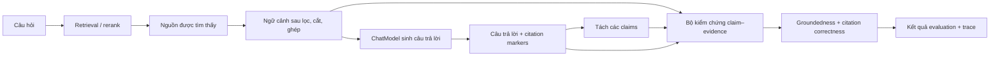

# Đánh giá câu trả lời có căn cứ và tính đúng của trích dẫn trong RAG

> **Chương:** Đánh giá RAG  
> **Module:** `SPRING_AI_EVALUATION_OBSERVABILITY` — thực hành đánh giá chất lượng ứng dụng Spring AI qua bộ dữ liệu, relevance, fact checking, RAG và tool calling; kết hợp metrics, traces, token, chi phí và độ trễ để tìm nguyên nhân suy giảm theo phiên bản prompt, model và pipeline.

## Mục tiêu học tập

Sau bài này, bạn có thể:

1. Phân biệt **câu trả lời có căn cứ vào ngữ cảnh (groundedness/faithfulness)**, **đúng thực tế (factual correctness)** và **trích dẫn đúng nguồn (citation correctness)**.
2. Tách câu trả lời thành những **nhận định có thể kiểm chứng (claims)**, kiểm tra bằng chứng hỗ trợ từng nhận định và phát hiện câu khẳng định vượt quá phạm vi nguồn.
3. Thiết kế bộ dữ liệu có câu hỏi, ngữ cảnh cuối đã cung cấp cho model, claim chuẩn, citation markers, nguồn và phiên bản tài liệu.
4. Xây rubric cùng các metric như **grounded claim rate**, **citation validity**, **citation support precision**, **citation coverage** và **completeness**, với mẫu số và trạng thái không thể đánh giá được định nghĩa rõ ràng.
5. Tổ chức việc chấm bằng quy tắc xác định, LLM-as-a-judge và người duyệt; tích hợp vào pipeline Spring AI rồi dùng observability để khoanh vùng lỗi.

## 1. Vì sao RAG cần đánh giá cả căn cứ và trích dẫn?

RAG (Retrieval-Augmented Generation) cung cấp tài liệu ngoài cho mô hình ngôn ngữ trước khi sinh câu trả lời. Mô hình có thể **trả lời đúng nhưng trích dẫn sai**, **trích đúng nguồn nhưng hiểu sai**, hoặc **đưa ra kết luận nghe hợp lý mà không được tài liệu hỗ trợ**.

Nếu chỉ đo `Recall@K` của retriever, ta biết những nguồn liên quan *đã được tìm thấy* nhưng chưa biết câu trả lời có sử dụng đúng chúng không. Nếu chỉ đo answer relevance, ta biết câu trả lời có hướng vào câu hỏi nhưng chưa biết từng mệnh đề có bằng chứng hay không.



Điểm cốt lõi là kiểm chứng trên **ngữ cảnh thực sự được chuyển vào lời gọi model**, sau khi advisor, reranker, template, compression hoặc token trimming đã xử lý. Một ID tài liệu nằm trong log retrieval chưa đủ chứng minh nội dung của tài liệu đó còn ở prompt.

## 2. Phân biệt các tiêu chí chất lượng

| Tiêu chí | Câu hỏi cần trả lời | Dữ liệu tham chiếu | Ví dụ lỗi |
| --- | --- | --- | --- |
| **Groundedness / faithfulness** | Từng nhận định trong câu trả lời có được bằng chứng **đã cấp cho model** hỗ trợ không? | Nội dung prompt/tool messages tại đúng lượt gọi model | Prompt ghi 3 ngày, model nói 2 ngày |
| **Factual correctness** | Nhận định có đúng với sự thật hoặc quy định đang áp dụng không? | Golden answer, nguồn chuẩn độc lập, ngày hiệu lực | Prompt dùng chính sách cũ 5 ngày nên model trả 5 thay vì 3 ngày hiện hành |
| **Answer relevance** | Câu trả lời có giải quyết đúng câu hỏi không? | Câu hỏi + câu trả lời | Người dùng hỏi ai duyệt, model chỉ giải thích phụ cấp |
| **Completeness** | Có đủ các ý bắt buộc, điều kiện và ngoại lệ không? | Bộ required facts/gold claims | Đúng thời hạn nhưng bỏ sót người phê duyệt |
| **Citation validity** | Marker hoặc liên kết trỏ tới nguồn hợp lệ, tồn tại trong tập evidence được phép trích dẫn không? | Bảng marker → source, citation schema | Dẫn `[7]` dù prompt chỉ có `[1]`, `[2]` |
| **Citation support / attribution** | Nguồn được trích **có thực sự chứng minh** câu được gắn trích dẫn không? | Claim + đúng đoạn được trích trong final context | Dẫn tài liệu phụ cấp ăn cho câu “trưởng bộ phận duyệt” |
| **Citation coverage** | Những nhận định phải có nguồn có được gắn **đủ trích dẫn hỗ trợ** không? | Các claims + rubric yêu cầu dẫn nguồn | Có nhiều câu mang dữ kiện nhưng chỉ dẫn nguồn cho câu đầu |

**Groundedness khác factual correctness:** Một tài liệu cũ ghi “5 ngày” và model trả “5 ngày” có thể **grounded** vào chính tài liệu cũ đó, nhưng **sai theo quy định mới**. Ngược lại, model trả “3 ngày” tình cờ đúng thực tế dù prompt không có căn cứ thì có thể **factually correct nhưng ungrounded**.

**Citation validity khác citation support:** Marker `[D01]` tồn tại mới chứng minh liên kết có đích; phải đọc đoạn của D01 để xác nhận nó hỗ trợ **đúng claim được trích**. Một trích dẫn hợp lệ về mặt cú pháp vẫn có thể là trích dẫn sai.

## 3. Ví dụ xuyên suốt: câu trả lời và bằng chứng

Giả sử hệ thống tra cứu **quy định công tác giả định** của doanh nghiệp. Corpus ở thời điểm kiểm thử gồm:

| Nguồn | Đoạn evidence đã được đưa vào prompt cuối | Vai trò |
| --- | --- | --- |
| `D01@v3` — marker `[1]` | “Đơn công tác phải nộp **trước ít nhất 3 ngày làm việc**, trừ trường hợp khẩn cấp được xác nhận.” | Thời hạn và ngoại lệ |
| `D02@v3` — marker `[2]` | “**Trưởng bộ phận** phê duyệt đơn công tác.” | Người phê duyệt |
| `D03@v3` — marker `[3]` | “Khi **chi phí vượt hạn mức**, cần có **phê duyệt bổ sung của tài chính**.” | Phê duyệt bổ sung |
| `D07@v3` — marker `[4]` | “Phụ cấp tiền ăn tối đa là 150.000 đồng một ngày.” | Cùng chủ đề, không hỗ trợ ba ý hỏi |

Người dùng hỏi: **“Đơn công tác phải nộp trước bao lâu, ai duyệt, và khi nào cần duyệt thêm?”**

Một câu trả lời có căn cứ và trích dẫn phù hợp:

> “Thông thường, đơn phải nộp trước **ít nhất 3 ngày làm việc**; có ngoại lệ cho trường hợp khẩn cấp được xác nhận **[1]**. **Trưởng bộ phận** duyệt đơn **[2]**. Khi chi phí vượt hạn mức, cần có phê duyệt bổ sung từ **tài chính [3]**.”

Các biến thể sau thể hiện **những lỗi khác nhau**:

| Câu trả lời | Nhận xét |
| --- | --- |
| “Nộp trước **2 ngày làm việc** [1].” | Marker tồn tại nhưng claim **mâu thuẫn** với `[1]` |
| “**Phòng nhân sự** phê duyệt [2].” | Marker tồn tại, claim không được `[2]` hỗ trợ |
| “Nộp trước 3 ngày làm việc [4].” | Nội dung có thể đúng nhưng **nguồn [4] không chứng minh thời hạn** |
| “Nộp trước 3 ngày làm việc [8].” | `[8]` không tồn tại trong evidence: **citation validity fail** |
| “Nộp trước 3 ngày làm việc; trưởng bộ phận duyệt.” | Nội dung đúng nhưng **thiếu citation** nếu nghiệp vụ bắt buộc phải dẫn nguồn |
| “Mọi đơn đều phải nộp trước 3 ngày làm việc [1].” | Phát biểu **quá tuyệt đối**: `[1]` có ngoại lệ khẩn cấp |
| “Nộp trước 3 ngày [1], trưởng bộ phận duyệt [2], và nhân sự gửi email xác nhận.” | Hai claim đầu được hỗ trợ; claim cuối **chưa có bằng chứng** |

Một điểm quan trọng: nguồn `[1]` chứa điều kiện **“ngày làm việc”** và ngoại lệ khẩn cấp. Nếu model bỏ từ “làm việc” hoặc thay “thông thường” bằng “luôn luôn”, cần xem có thay đổi ý nghĩa trong phạm vi nghiệp vụ không. Không chỉ so chuỗi từ khóa để kết luận.

## 4. Tách câu trả lời thành các claim có thể kiểm chứng

Đánh giá nguyên một câu dài bằng một nhãn “đúng/sai” khó giải thích khi có vài phần đúng và vài phần sai. Nên phân tách thành **atomic claims**: mỗi claim diễn đạt một mệnh đề có thể đối chiếu với evidence.

Ví dụ:

> “Đơn nộp trước ít nhất 3 ngày làm việc và trưởng bộ phận phê duyệt; riêng đơn vượt hạn mức cần tài chính duyệt thêm.”

Có thể tách thành:

- `C1`: “Thời hạn thông thường: ít nhất 3 ngày làm việc.”
- `C2`: “Trưởng bộ phận phê duyệt đơn công tác.”
- `C3`: “Nếu vượt hạn mức chi phí, cần tài chính phê duyệt bổ sung.”

Nếu câu trả lời còn nói “không có ngoại lệ”, tách thêm `C4` và đánh giá riêng. **Phủ định, điều kiện, định lượng, đối tượng, khoảng thời gian và phiên bản chính sách** là một phần của claim, không thể tự ý loại khi tách.

### Các quy tắc tách claim

1. **Bảo toàn ý nghĩa:** Giữ “ít nhất”, “ngày làm việc”, “chỉ khi”, “trừ trường hợp”, “theo bản hiệu lực từ ...”. Bỏ điều kiện có thể biến claim đúng thành sai.
2. **Không chấp nhận claim được suy ra từ lỗi tách câu:** Claim extraction phải được chấm kiểm tra riêng ở bộ mẫu có người duyệt.
3. **Phân biệt câu có tính sự kiện với câu điều phối:** “Dưới đây là thông tin” không cần citation; “Người dùng bắt buộc phải...” là claim và cần kiểm chứng.
4. **Giữ ánh xạ tới vị trí văn bản:** Lưu `claim_id`, đoạn gốc hoặc offset, và các citation markers gắn với claim. Nếu câu có nhiều vế, citation ở cuối câu không tự động chứng minh tất cả các vế.
5. **Cho phép nhiều nguồn:** Một claim có thể cần kết hợp hai tài liệu; chỉ đánh dấu được hỗ trợ khi **đủ các mảnh bằng chứng**.

### Trạng thái đánh giá claim

| Trạng thái | Ý nghĩa | Ví dụ |
| --- | --- | --- |
| `SUPPORTED` | Evidence cuối thực sự chứng minh mệnh đề theo phạm vi câu hỏi | “3 ngày làm việc” có trong `[1]` |
| `CONTRADICTED` | Evidence chứa thông tin trái với mệnh đề | Model ghi 2 ngày trong khi nguồn ghi 3 |
| `NOT_ENOUGH_INFO` | Không có đủ evidence để xác nhận hoặc bác bỏ | Model nêu “cần email HR” khi nguồn không nhắc đến |
| `PARTIALLY_SUPPORTED` | Chỉ một phần claim được chứng minh hoặc thiếu điều kiện quan trọng | Nói “đơn phải nộp trước 3 ngày” mà bỏ tính chất “làm việc” |
| `UNJUDGED` | Thiếu nhãn, thiếu quyền truy cập evidence hoặc judge không thể kết luận | Mất snapshot prompt, tài liệu nguồn không thể kiểm tra |

Không nên gộp `NOT_ENOUGH_INFO` với `CONTRADICTED`. Cả hai đều chưa đạt groundedness nhưng gợi ý cách xử lý khác nhau: thiếu bằng chứng thì cần truy xuất/cấp dữ liệu hoặc từ chối, còn mâu thuẫn cần điều tra sai diễn giải hoặc sai phiên bản.

## 5. Trích dẫn phải được kiểm chứng ở cấp **claim–evidence**

Mỗi marker trong câu trả lời phải trỏ tới **đúng đoạn** mà model được phép trích dẫn; một tài liệu có hàng chục trang thì trỏ về tiêu đề chung không đủ để đánh giá claim chi tiết.

### 5.1. Kiểm tra cấu trúc trích dẫn

Trước tiên kiểm tra bằng quy tắc xác định:

- Marker có đúng cú pháp được yêu cầu, ví dụ `[1]`, `[2]`, hoặc một URI tài liệu hợp lệ?
- Marker có trong **danh mục evidence cuối** của đúng lượt gọi model không?
- Marker được ánh xạ đến đúng `source_id`, `chunk_id`, `revision` và vị trí trong prompt không?
- Link hoặc anchor có đúng tài liệu/đoạn được phép truy cập không? Có bị thay revision sau thời điểm đánh giá không?
- Nếu câu yêu cầu dẫn **trang/đoạn**, thông tin vị trí có mặt và nhất quán không?

Kiểm tra cấu trúc thường đơn giản, có thể chạy tự động và đáng tin cậy hơn một judge ngôn ngữ.

### 5.2. Kiểm tra nguồn **thực sự chứng minh claim**

Ngay cả khi marker hợp lệ, cần xét quan hệ **nội dung và suy luận**:

- **Direct support:** Câu trong evidence trực tiếp xác nhận claim.
- **Compositional support:** Claim cần kết hợp nhiều nguồn hoặc một chuỗi suy luận hợp lệ có giải thích rõ.
- **Insufficient support:** Nguồn chỉ nói cùng chủ đề, thiếu điều kiện, phủ định hoặc phạm vi.
- **Contradictory evidence:** Nguồn được trích phản bác claim.

Ví dụ claim “Khoản X được hoàn khi có hóa đơn” có thể cần cả:

- `D10`: “Khoản X thuộc nhóm chi phí được hoàn.”
- `D11`: “Chỉ được hoàn chi phí nếu có hóa đơn hợp lệ.”

Nếu citation chỉ gắn `[D10]`, claim có thể thiếu điều kiện. Nếu có một tài liệu `D12` ghi đầy đủ quy tắc, citation `[D12]` có thể đủ. Đây là bài toán **support-set coverage**; không đánh giá bằng cách chỉ tìm thấy một ID trong gold set.

### 5.3. Trích dẫn thừa và trích dẫn sai

Câu “Trưởng bộ phận duyệt [2][4]” có một nguồn đúng (`[2]`) và một nguồn không chứng minh được (`[4]`). Nếu rubric yêu cầu **mọi citation đều hỗ trợ claim**, câu này có thể đạt **claim groundedness** nhưng không đạt **citation precision tuyệt đối**. Hệ thống đánh giá nên ghi cả hai kết quả để chỉ ra vấn đề chính xác.

Với nhiều citation trong một câu, có thể có hai quan hệ cần ghi:

- `claim → support_set`: một hay nhiều nguồn **đồng thời cần thiết** để chứng minh claim.
- `claim → cited_links`: tất cả các marker model thật sự gắn vào claim.

Chấm riêng việc có một support set đầy đủ và việc **không có trích dẫn thừa hoặc trích sai**.

## 6. Định nghĩa các metric và mẫu số

Không tồn tại một bộ thước đo citation được chuẩn hóa duy nhất cho mọi dự án RAG. Các chỉ số dưới đây là **định nghĩa minh bạch cho bộ đánh giá của bài**; khi so sánh hệ thống phải dùng cùng rubric và cách xử lý trường hợp thiếu nhãn.

Cho `C` là tập các **claim sự kiện cần chấm**, và `E` là tập các đoạn evidence cuối đã cấp cho model:

| Metric | Định nghĩa đề xuất | Cần lưu ý |
| --- | --- | --- |
| **Grounded claim rate** | Số claim `SUPPORTED` chia cho tổng claim đủ điều kiện chấm | Báo riêng `UNJUDGED`, không tự biến thành supported |
| **Contradiction rate** | Số claim `CONTRADICTED` chia cho tổng claim đủ điều kiện | Phân biệt với thiếu bằng chứng |
| **Citation validity rate** | Số citation links có marker ánh xạ đến evidence hợp lệ chia cho tổng citation links | Mới đo cấu trúc, chưa đo nội dung hỗ trợ |
| **Citation support precision** | Số liên kết claim–citation được đánh giá là hỗ trợ claim chia cho số liên kết claim–citation đã được chấm | Mỗi link phải được chấm ngữ nghĩa; có thể báo cả links sai/thừa |
| **Citation-supported claim coverage** | Số claim **bắt buộc có citation** có đủ bộ nguồn trích dẫn chứng minh chia cho tổng claim bắt buộc dẫn nguồn | Claim có marker nhưng không đủ support set vẫn chưa covered |
| **Answer completeness** | Số required facts được trình bày đúng chia cho tổng required facts trong bộ gold | Khác việc claim có bám context; đánh giá đủ ý |
| **Citation abstention rate** (nếu cần) | Tỷ lệ câu được đánh dấu không đủ bằng chứng và từ chối kết luận hợp lý | Chấm riêng ở nhóm câu không thể trả lời |

**Ví dụ tính tay.** Một câu trả lời có bốn claims cần chấm:

| Claim | Nhãn groundedness | Citation links | Đánh giá liên kết |
| --- | --- | --- | --- |
| `C1`: 3 ngày làm việc | `SUPPORTED` | `[1]` | [1] hỗ trợ |
| `C2`: trưởng bộ phận duyệt | `SUPPORTED` | `[2]`, `[4]` | [2] hỗ trợ, [4] không hỗ trợ |
| `C3`: quá hạn mức cần tài chính duyệt thêm | `SUPPORTED` | Không có | Thiếu dẫn nguồn |
| `C4`: HR luôn gửi email xác nhận | `NOT_ENOUGH_INFO` | `[9]` | [9] không tồn tại |

Giả sử rubric yêu cầu cả bốn claims phải có trích dẫn, và ba facts chuẩn bắt buộc là `C1, C2, C3`. Khi đó:

- **Grounded claim rate = 3/4 = 75%**. Claim C3 được hỗ trợ bởi evidence dù model quên dẫn nguồn.
- **Citation validity rate = 3/4 = 75%** vì có bốn liên kết citation, trong đó `[1], [2], [4]` có đích hợp lệ; `[9]` không tồn tại.
- **Citation support precision = 2/4 = 50%** nếu chính sách chấm các link sai/hỏng là không hỗ trợ. Hai link được hỗ trợ là `C1→[1]` và `C2→[2]`. Khi dùng quy ước chỉ xét link hợp lệ, giá trị sẽ là `2/3`; phải công bố mẫu số.
- **Citation-supported claim coverage = 2/4 = 50%** vì C1 và C2 có ít nhất một bộ trích dẫn đầy đủ; C3 thiếu citation và C4 có citation sai.
- **Answer completeness = 3/3 = 100%** nếu C1–C3 là ba facts chuẩn và được diễn đạt đúng. Vậy completeness cao **không** đồng nghĩa groundedness/citation tốt.

Nếu kết quả judge là `UNJUDGED` do thiếu context snapshot, báo số lượng bị loại và lý do. Không gán những case chưa đánh giá được vào mẫu số theo cách làm điểm trông tốt lên hoặc xấu đi không minh bạch.

## 7. Chuẩn bị bộ dữ liệu đánh giá có provenance

Một case có thể gồm **câu hỏi**, **context cuối**, **answer**, **gold claims**, **danh sách nguồn**, và **citation mappings**. Những trường hữu ích:

| Trường | Ý nghĩa |
| --- | --- |
| `case_id`, `run_id`, `trace_id`, `call_id` | Định danh case và đúng lượt gọi model |
| `question`, `answer` | Câu hỏi và câu trả lời thực được sinh |
| `corpus_version`, `prompt_version`, `model_version` | So sánh hồi quy giữa các lần chạy |
| `final_context_blocks` | Các đoạn evidence sau biến đổi có `marker`, `source_id`, `revision`, `text` hoặc snapshot ref |
| `claims` | `claim_id`, nội dung, vị trí trong answer và citation markers |
| `required_facts` | Các sự kiện bắt buộc để đánh giá completeness |
| `acceptable_support_sets` | Những bộ source IDs có thể hỗ trợ một claim, biểu thị kết hợp AND/OR |
| `judge_version`, `rubric_version` | Giữ phương pháp đánh giá có thể tái hiện |

Ví dụ case **giả định** (rút gọn, các đoạn text được lưu nguyên trong test fixture):

```json
{
  "case_id": "travel-claims-001",
  "call_id": "req-10-answer-1",
  "corpus_version": "travel-policy-v3",
  "question": "Nộp đơn khi nào, ai duyệt, khi nào duyệt thêm?",
  "final_context_blocks": [
    {
      "marker": "1",
      "source_id": "D01",
      "revision": "v3",
      "text": "Đơn nộp trước ít nhất 3 ngày làm việc, trừ khẩn cấp có xác nhận."
    },
    {
      "marker": "2",
      "source_id": "D02",
      "revision": "v3",
      "text": "Trưởng bộ phận phê duyệt đơn công tác."
    },
    {
      "marker": "3",
      "source_id": "D03",
      "revision": "v3",
      "text": "Chi phí vượt hạn mức cần phê duyệt bổ sung của tài chính."
    }
  ],
  "answer": "Nộp trước ít nhất 3 ngày làm việc [1]; trưởng bộ phận duyệt [2]. Khi vượt hạn mức cần tài chính duyệt thêm [3].",
  "claims": [
    {
      "claim_id": "C1",
      "text": "Thông thường nộp trước ít nhất 3 ngày làm việc.",
      "citation_markers": ["1"],
      "acceptable_support_sets": [["D01"]]
    },
    {
      "claim_id": "C2",
      "text": "Trưởng bộ phận phê duyệt.",
      "citation_markers": ["2"],
      "acceptable_support_sets": [["D02"]]
    },
    {
      "claim_id": "C3",
      "text": "Vượt hạn mức cần tài chính phê duyệt bổ sung.",
      "citation_markers": ["3"],
      "acceptable_support_sets": [["D03"]]
    }
  ],
  "required_facts": ["C1", "C2", "C3"],
  "rubric_version": "grounding-v1"
}
```

Đây là schema minh họa, không phải định dạng mặc định của Spring AI. Trường `acceptable_support_sets` chứa các bộ nguồn **đã được người duyệt kiểm chứng**, không được tự tin suy ra từ việc model trích dẫn. Nếu một claim cần đồng thời `D10` **và** `D11`, biểu diễn `[["D10","D11"]]`; nếu có thể thay bằng `D12` chứa đủ quy tắc, biểu diễn `[["D10","D11"],["D12"]]`.

**Ranh giới dữ liệu:** Một source có trong `retrieved_candidates` nhưng không còn ở `final_context_blocks` thì không thể được dùng làm chứng cứ model đã được cấp. Mã citation trên answer phải được đối chiếu với **final context cùng `call_id`**, không đối chiếu đại khái với toàn bộ vector store.

## 8. Quy trình chấm: xác định, ngữ nghĩa và kiểm duyệt

Một hệ thống evaluation mạnh nên phân tầng kiểm tra thay vì nhờ một LLM trả về duy nhất “đúng/sai”.

### Bước 1 — Kiểm tra cấu trúc bằng quy tắc

Kiểm tra cú pháp marker, marker có tồn tại, mapping đúng call/revision, trích dẫn bị thiếu, ID trùng và số lượng claims. Các lỗi này có thể xác định được **mà không cần model judge**.

### Bước 2 — Tách claims và kiểm tra ngôn ngữ

Tách claim thành mệnh đề nhỏ, bảo toàn phủ định, ngoại lệ, số lượng, ngày hiệu lực và điều kiện. Nếu dùng LLM để tách, cần đối chiếu với mẫu đã chấm tay; lỗi tách claim có thể làm đánh giá groundedness sai hàng loạt.

### Bước 3 — Đánh giá claim–evidence

Với mỗi claim, đối chiếu **tất cả đoạn trong final context** để chấm `SUPPORTED`, `CONTRADICTED`, `NOT_ENOUGH_INFO` hoặc `PARTIALLY_SUPPORTED`. Sau đó kiểm tra **riêng tập đoạn được trích dẫn** để quyết định attribution/citation support.

Một câu có thể grounded theo toàn bộ prompt nhưng **trích nhầm** một nguồn khác. Do đó cần hai phép đánh giá:

- `grounded_against_all_context`: có đủ chứng cứ *ở đâu đó* trong final context?
- `supported_by_cited_context`: các nguồn model *thực sự dẫn* có đủ chứng cứ?

### Bước 4 — Kiểm tra đúng thực tế bằng nguồn chuẩn

Nếu muốn chấm factual correctness, đối chiếu claim với nguồn chuẩn độc lập hoặc phiên bản chính sách hiện hành, không chỉ với prompt model nhận. Nguồn “v3” và “v2” có thể mâu thuẫn; cần xác định version áp dụng theo thời điểm câu hỏi.

### Bước 5 — Tổng hợp và ghi lý do

Đối với claim không đạt, lưu `claim_id`, `reason_code`, nguồn đối chiếu, trích đoạn chứng cứ và ID trace; ưu tiên dữ liệu có thể tái hiện thay vì chỉ ghi một điểm số. Lưu cả judge model version, prompt, rubric, sampling settings và kết quả bất đồng nếu có người duyệt.

## 9. Mã Java: kiểm tra citation ở mức cấu trúc và bộ nguồn chuẩn

Ví dụ Java 17+ sau **không phụ thuộc phiên bản Spring AI**. Nó dùng mapping `marker → source_id` của final prompt và bộ `acceptableSupportSets` đã gán nhãn để:

- Phát hiện claim thiếu citation, marker không tồn tại và claim không có nhãn.
- Kiểm tra các source ID được trích có chứa **ít nhất một bộ nguồn** được công nhận là đủ cho claim hay không.
- Ghi rõ đây là **kiểm tra điều kiện về ID**, *chưa phải* đánh giá ngữ nghĩa rằng đoạn text thực sự chứng minh claim.

```java
import java.util.ArrayList;
import java.util.HashSet;
import java.util.List;
import java.util.Map;
import java.util.Objects;
import java.util.Set;

public final class CitationStructureAuditor {
    private CitationStructureAuditor() {}

    public record Claim(
            String id, String text, List<String> citationMarkers) {}

    // Mỗi phần tử của list là một tập source IDs phải có ĐỒNG THỜI.
    // Các phần tử khác nhau trong list là những cách chứng minh thay thế.
    public record GoldClaim(
            String id, List<Set<String>> acceptableSupportSets) {}

    public enum Status {
        UNJUDGED, NO_CITATION, UNKNOWN_MARKER,
        MISSING_REQUIRED_SOURCES, SOURCE_SET_COVERED
    }

    public record Finding(
            String claimId, Status status,
            Set<String> citedSourceIds,
            Set<String> unknownMarkers) {}

    public static List<Finding> audit(
            List<Claim> claims,
            Map<String, String> finalContextMarkerToSourceId,
            Map<String, GoldClaim> goldClaims) {
        Objects.requireNonNull(claims);
        Objects.requireNonNull(finalContextMarkerToSourceId);
        Objects.requireNonNull(goldClaims);

        List<Finding> results = new ArrayList<>();
        for (Claim claim : claims) {
            GoldClaim gold = goldClaims.get(claim.id());
            Set<String> sourceIds = new HashSet<>();
            Set<String> unknown = new HashSet<>();

            for (String marker : claim.citationMarkers()) {
                String sourceId = finalContextMarkerToSourceId.get(marker);
                if (sourceId == null) {
                    unknown.add(marker);
                } else {
                    sourceIds.add(sourceId);
                }
            }

            Status status;
            if (gold == null) {
                status = Status.UNJUDGED;
            } else if (claim.citationMarkers().isEmpty()) {
                status = Status.NO_CITATION;
            } else if (!unknown.isEmpty()) {
                status = Status.UNKNOWN_MARKER;
            } else {
                boolean covered = gold.acceptableSupportSets().stream()
                        .filter(set -> !set.isEmpty())
                        .anyMatch(sourceIds::containsAll);
                status = covered
                        ? Status.SOURCE_SET_COVERED
                        : Status.MISSING_REQUIRED_SOURCES;
            }
            results.add(new Finding(
                    claim.id(), status,
                    Set.copyOf(sourceIds), Set.copyOf(unknown)));
        }
        return List.copyOf(results);
    }
}
```

Ví dụ gọi với ba claims của chính sách giả định:

```java
import java.util.List;
import java.util.Map;
import java.util.Set;

// Đoạn ví dụ đặt trong một method, các kiểu record của auditor được dùng trực tiếp.
var claims = List.of(
        new CitationStructureAuditor.Claim(
                "C1", "Nộp trước 3 ngày làm việc", List.of("1")),
        new CitationStructureAuditor.Claim(
                "C2", "Trưởng bộ phận duyệt", List.of("4")),
        new CitationStructureAuditor.Claim(
                "C3", "Vượt hạn mức cần tài chính duyệt", List.of()));

var gold = Map.of(
        "C1", new CitationStructureAuditor.GoldClaim(
                "C1", List.of(Set.of("D01"))),
        "C2", new CitationStructureAuditor.GoldClaim(
                "C2", List.of(Set.of("D02"))),
        "C3", new CitationStructureAuditor.GoldClaim(
                "C3", List.of(Set.of("D03"))));

var findings = CitationStructureAuditor.audit(
        claims,
        Map.of("1", "D01", "2", "D02", "3", "D03", "4", "D07"),
        gold);
// C1 -> SOURCE_SET_COVERED
// C2 -> MISSING_REQUIRED_SOURCES vì marker 4 trỏ đến D07
// C3 -> NO_CITATION
```

**Giới hạn quan trọng:** Trạng thái `SOURCE_SET_COVERED` chỉ nói rằng *các source ID được trích bao phủ một support set gán nhãn*. Nó không chứng minh rằng câu chữ thực sự trong **đoạn đã chèn vào prompt** còn đầy đủ, hoặc model đã suy luận hợp lệ. Tài liệu `D01` có thể bị cắt mất từ “làm việc”; auditor trên không phát hiện được. Để chấm groundedness hoặc citation precision về ngữ nghĩa, phải bổ sung bước so claim với **snapshot văn bản cuối** bằng người đánh giá, luật nghiệp vụ hoặc LLM judge đã hiệu chuẩn.

Một claim có citation thừa cũng có thể đạt `SOURCE_SET_COVERED`: ví dụ `[2][4]` cho claim C2. Nếu rubric yêu cầu **mọi link đều hỗ trợ**, phải có phép chấm riêng theo từng liên kết. Không đặt tên kết quả của class trên là “citation semantic accuracy”.

## 10. Kết nối với Spring AI và phiên bản API

Trong Spring AI, retrieval có thể do `VectorStore` hoặc một advisor thực hiện trước khi gọi `ChatModel`. Cách lấy danh sách `Document`, ngữ cảnh advisor và object response **phụ thuộc phiên bản Spring AI đang dùng**. Vì vậy, tích hợp evaluation nên có hai lớp:

1. **Capture adapter:** lấy `question`, `final prompt/messages`, evidence mapping và `answer` tại những ranh giới thực sự quan sát được, cùng `request_id`/`call_id`. Nếu advisor tự chèn context, hãy capture **sau** bước advisor cuối thay đổi messages, ngay trước `ChatModel`, hoặc tại provider adapter khi cần biết payload gửi ra.
2. **Evaluator độc lập:** chạy kiểm tra cấu trúc Java, kiểm chứng claim–evidence và rubric. Nó nhận schema của ứng dụng, không phụ thuộc tên khóa metadata của một bản advisor.

### Phân biệt ba nguồn đánh giá trong Spring AI

| Dữ liệu | Lấy từ đâu | Phục vụ kiểm thử |
| --- | --- | --- |
| `retrieved_document_ids` | Kết quả retriever hoặc advisor context nếu API hỗ trợ | `Precision@K`, `Recall@K` của retrieval |
| `final_context_blocks` và `marker_to_source` | Prompt/messages được capture tại ranh giới model | Groundedness và citation attribution |
| `answer` và `usage` | Kết quả lời gọi model và metadata provider (nếu cung cấp) | Answer relevance, completeness, latency/token/cost |

Spring AI có khái niệm evaluator, ví dụ `RelevancyEvaluator` và `FactCheckingEvaluator` trong các phiên bản hỗ trợ. Khi dùng các evaluator ấy, phải **xác minh contract của đúng version**: input yêu cầu gì, kết quả chấm là boolean/score nào, model judge nào được sử dụng, và liệu nó có kiểm tra **claim-citation links** hay chỉ chấm câu trả lời tổng thể. Không nên coi một “fact checking passed” chung là bằng chứng mọi citation marker đều đúng.

Một pipeline tích hợp gợi ý:

```text
case_id / request_id
    |
    +-- retrieval observation
    |      +-- candidate IDs, ranks, corpus/index version
    |
    +-- final-context capture at ChatModel boundary
    |      +-- call_id, ordered context blocks, source revisions
    |      +-- marker_to_source map, prompt digest/snapshot reference
    |
    +-- model response
    |      +-- answer, citations, model/prompt version
    |
    +-- evaluation
           +-- claim extraction and required-fact matching
           +-- deterministic marker checks
           +-- semantic claim–evidence and citation checks
           +-- factual correctness vs authoritative gold
           +-- metrics + reason codes + trace link
```

### Khi dùng tool calling

Ví dụ model gọi `searchPolicies` và nhận dữ liệu từ tool ở **lượt sau**. Kết quả tool ở thời điểm `tool-1` chưa thể là bằng chứng đã có trong `call-1` nếu model chỉ nhận tool message trong `call-2`. Muốn đánh giá groundedness phải gắn `source_id`, `tool_call_id`, `call_id` và những đoạn tool output thực sự xuất hiện trong messages của đúng lần gọi.

Thành công của tool không đồng nghĩa tính đúng trích dẫn: model có thể nhận đúng kết quả SQL nhưng trích marker `[1]` thuộc tài liệu vector khác, hoặc bỏ qua điều kiện trên dữ liệu tool. Cần kiểm tra **provenance theo từng claim** trên cả advisor documents và tool responses.

## 11. LLM-as-a-judge: rubric rõ ràng và giới hạn

LLM có thể hỗ trợ đánh giá khi một claim đòi suy luận ngữ nghĩa khó biểu diễn bằng luật. Tuy nhiên, việc dùng model chấm không tự tạo ground truth. Nên truyền **chỉ** dữ liệu cần chấm: câu hỏi, claim cụ thể, các đoạn context có ID/marker, những nguồn citation và rubric.

Một rubric minh họa cho **một claim**:

| Điểm | Groundedness | Giải thích mong đợi |
| --- | --- | --- |
| 2 | `SUPPORTED` | Evidence xác nhận toàn bộ claim, gồm điều kiện, phạm vi, phủ định, định lượng |
| 1 | `PARTIALLY_SUPPORTED` | Có hỗ trợ một phần nhưng thiếu điều kiện/ngoại lệ quan trọng |
| 0 | `NOT_ENOUGH_INFO` hoặc `CONTRADICTED` | Không đủ nguồn hoặc có nguồn phản bác; phải ghi rõ loại |
| N/A | `UNJUDGED` | Không đủ dữ liệu/chất lượng để chấm |

Những gì cần yêu cầu judge xuất ra: `claim_id`, `groundedness_status`, `citation_support_status`, `supporting_markers`, `contradicting_markers`, `reason` và `confidence/uncertainty` nếu có quy ước phù hợp. Không coi giá trị confidence tự tạo ra là xác suất đã hiệu chuẩn.

Ví dụ prompt judge ở mức ý tưởng:

```text
Vai trò: kiểm tra một claim theo nguồn đã cung cấp.
Đầu vào:
  - question, claim, citation markers
  - final-context blocks cùng marker và nguồn
Yêu cầu:
  1. Đánh giá claim có được bất kỳ đoạn context nào hỗ trợ không.
  2. Đánh giá riêng liệu các nguồn được claim trích có đủ hỗ trợ không.
  3. Giữ nguyên điều kiện, ngày hiệu lực, lượng, phủ định, ngoại lệ.
  4. Nêu marker và đoạn chứng cứ ngắn; không suy từ kiến thức bên ngoài.
  5. Nếu không đủ dữ liệu, trả NOT_ENOUGH_INFO hoặc UNJUDGED.
```

**Hiệu chuẩn trước khi triển khai:** tạo tập mẫu do người hiểu nghiệp vụ chấm; so sánh mức đồng thuận giữa judge và người chấm, đặc biệt các ca phủ định, điều khoản đa nguồn, nguồn mâu thuẫn và trích dẫn sai nhưng văn bản trả lời đúng. Cố định judge model version, rubric, prompt và độ ngẫu nhiên, đồng thời xem xét lặp lại nếu đầu ra không ổn định.

## 12. Quan sát chất lượng theo từng phiên bản

Chấm offline cho biết chất lượng trên bộ test; metrics/traces giúp chỉ ra điểm phát sinh suy giảm trong pipeline thực tế. Với mỗi `case_id` nên lưu:

| Dữ liệu | Ý nghĩa |
| --- | --- |
| `retriever/index/corpus_version` | Có thay dữ liệu hay thứ tự nguồn không? |
| `prompt/model/judge/rubric_version` | Có thay mẫu yêu cầu sinh/chấm hoặc model không? |
| `request_id`, `trace_id`, `call_id` | Truy dấu đúng model call và evidence |
| `retrieved_count`, `context_count`, `truncated_count` | Có mất tài liệu trước prompt không? |
| `grounded_claim_rate`, `citation_validity_rate`, `citation_support_precision` | Chất lượng claim và citation có suy giảm không? |
| `input/output_tokens`, `latency_ms`, `estimated_cost` | Có đánh đổi chất lượng bằng chi phí và độ trễ không? |
| `judge_failures`, `unjudged_claim_count` | Kết quả có thiếu/không đáng tin do instrumentation hay judge? |

Ví dụ giả định khi đổi từ bản A sang bản B:

| Chỉ số trên cùng tập case | A | B | Điều nên điều tra |
| --- | ---: | ---: | --- |
| `Retrieval Recall@5` | 0,86 | 0,94 | B tìm được thêm nguồn |
| `Final-context fact coverage` | 0,85 | 0,82 | B có thể mất bằng chứng do cắt/nén |
| `Grounded claim rate` | 0,92 | 0,84 | Model sinh thêm nhận định thiếu căn cứ |
| `Citation support precision` | 0,91 | 0,73 | Citation mapping/rubric/prompt có thể thay |
| p95 latency (giây) | 2,0 | 3,2 | Context dài hơn hoặc thêm lượt gọi |

Các số **chỉ minh họa**, chưa chứng minh nguyên nhân. Cần kiểm tra các case cụ thể: retrieval có đủ nguồn không, advisor có cắt đoạn không, model có dùng sai điều kiện không, citation marker có bị đánh lại sai khi render không, judge có đổi version hay không.

**Giữ an toàn dữ liệu:** Không lưu prompt thô, đoạn tài liệu nội bộ, API key hoặc thông tin cá nhân vào metric labels/span attributes phát tán rộng. Có thể lưu `manifest_ref`, IDs đã chuẩn hóa và count trong trace; nội dung dùng để kiểm chứng nên ở kho audit được mã hóa, phân quyền và có retention phù hợp. Hash của văn bản quá ngắn cũng có nguy cơ bị suy đoán; cân nhắc bảo vệ fingerprint theo rủi ro.

## 13. Quy trình regression evaluation cho groundedness và citation

1. **Cố định dữ liệu:** bộ câu hỏi, corpus version, snapshot context, gold claims, required facts và rubric; giữ một tập holdout chưa dùng để tinh chỉnh.
2. **Thu đúng ngữ cảnh:** ghi những đoạn thực sự đã đến `ChatModel` theo từng `call_id`, gồm các nguồn advisor, memory hoặc tool.
3. **Chạy deterministic checks:** marker mapping, citation không tồn tại, thiếu citation, trùng marker, revision và phân quyền.
4. **Chấm claim–evidence:** tách claims, kiểm chứng groundedness trên context toàn phần và attribution trên riêng các nguồn được trích.
5. **Chấm factual correctness riêng:** đối chiếu gold/nguồn có hiệu lực để phát hiện trường hợp được grounded trên dữ liệu cũ hoặc sai.
6. **Tổng hợp có giải thích:** báo số case, số claims, số links, tỷ lệ `UNJUDGED`, từng reason code, chỉ số theo nhóm và khoảng biến thiên nếu dùng judge không xác định.
7. **So sánh baseline và bản mới:** xem chênh lệch theo từng nhóm (multi-hop, phủ định, số liệu, tài liệu mới, tool calling, không có đáp án), cùng p50/p95 latency, token và cost.
8. **Duyệt lỗi quan trọng:** người hiểu nghiệp vụ kiểm tra các ca có nhiều nguồn, điều khoản ngoại lệ, mâu thuẫn phiên bản hoặc rủi ro cao trước khi đưa ra quyết định phát hành.

Không có ngưỡng “citation accuracy tối thiểu 95%” phù hợp mọi ứng dụng. Tác vụ hỗ trợ quyết định nhạy cảm có thể cần yêu cầu chặt chẽ hơn tác vụ tổng hợp ghi chú. Đặt ngưỡng dựa trên mức rủi ro, độ tin cậy của bộ nhãn và giá trị thực tế với người dùng.

## 14. Bài thực hành

Xét cùng câu hỏi công tác ở phần 3. Trong *final prompt* của lượt gọi model chỉ còn:

```text
[1] D01: Đơn nộp trước ít nhất 3 ngày làm việc,
         trừ trường hợp khẩn cấp có xác nhận.
[2] D02: Trưởng bộ phận phê duyệt đơn.
[4] D07: Phụ cấp tiền ăn tối đa 150.000 đồng/ngày.
```

**Chú ý:** `D03` từng có trong danh sách retrieval nhưng **đã bị loại khỏi final prompt**.

Model trả:

> “Đơn phải nộp trước ít nhất 3 ngày làm việc [1]. Trưởng bộ phận phê duyệt [4]. Nếu vượt hạn mức, tài chính sẽ phê duyệt thêm [3]. Không có ngoại lệ nào đối với thời hạn [1].”

**Yêu cầu:**

1. Tách tối thiểu bốn atomic claims và chỉ ra claim nào có căn cứ trong **toàn bộ final context**.
2. Kiểm tra từng citation `[1]`, `[4]`, `[3]` và `[1]`: marker nào không tồn tại, marker nào tồn tại nhưng không hỗ trợ claim?
3. Trong bốn claims, tính **grounded claim rate** theo rubric chỉ chấm supported hoàn toàn; tính **citation validity rate** theo số link; giải thích mẫu số.
4. Vì sao không thể dùng việc `D03` đã có trong `retrieved_candidates` để chấm câu về tài chính là grounded?
5. Đề xuất một phép thử để phân biệt lỗi retrieval/context assembly với lỗi generation.

### Đáp án gợi ý

1. `C1` “nộp trước ít nhất 3 ngày làm việc” được `[1]` hỗ trợ; `C2` “trưởng bộ phận phê duyệt” được **toàn bộ context** hỗ trợ ở `[2]`; `C3` “vượt hạn mức thì tài chính duyệt thêm” **không có evidence** trong prompt cuối; `C4` “không có ngoại lệ nào” **mâu thuẫn** với `[1]`.
2. `C1→[1]`: marker hợp lệ và hỗ trợ. `C2→[4]`: marker có tồn tại nhưng chỉ nói về phụ cấp, **không hỗ trợ claim**. `C3→[3]`: marker **không có trong final context** dù D03 từng được tìm thấy. `C4→[1]`: marker tồn tại nhưng **mâu thuẫn claim** vì `[1]` có ngoại lệ.
3. **Grounded claim rate = 2/4 = 50%** vì chỉ C1 và C2 được context toàn phần hỗ trợ. **Citation validity rate = 3/4 = 75%** vì trong bốn citation links, `[1], [4], [1]` có đích hợp lệ, còn `[3]` không tồn tại. Chỉ **1/4** link thực sự hỗ trợ đúng claim: C1→[1].
4. Groundedness phải chấm trên nội dung model **thực sự đã được cấp**, không chấm theo candidates chưa chắc đã vào prompt; D03 không còn trong final context.
5. So sánh lời gọi dùng context hiện tại với **oracle context** có đầy đủ `D01, D02, D03` nhưng giữ nguyên model/prompt và rubric. Nếu thêm oracle context giải quyết lỗi thiếu căn cứ ở C3, xem lại khâu chọn/cắt context; nếu vẫn trích sai [4] hoặc bỏ qua ngoại lệ, kiểm tra generation, citation formatting và reasoning.

## Ghi nhớ

- **Groundedness** hỏi claim có được **context cuối đã cấp** hỗ trợ không; **factual correctness** hỏi có đúng theo nguồn chuẩn hay thực tế không.
- **Trích dẫn đúng có hai tầng:** marker/link phải hợp lệ và **đúng đoạn được trích phải hỗ trợ claim**. Có nguồn tồn tại chưa đủ chứng minh trích dẫn đúng.
- **Tách claim để chẩn đoán:** phân biệt `SUPPORTED`, `CONTRADICTED`, `NOT_ENOUGH_INFO`, `PARTIALLY_SUPPORTED` và `UNJUDGED`; giữ nguyên điều kiện, phủ định, con số và phiên bản.
- **Báo nhiều metric với mẫu số rõ:** grounded claim rate, citation validity, citation support precision và citation-supported claim coverage đo các khía cạnh khác nhau.
- **Cần provenance và quan sát:** lưu đúng context theo `call_id`, phiên bản nguồn/prompt/model, trace, token, latency, chi phí và lý do thất bại để sửa chính xác tầng gây lỗi trong Spring AI.
