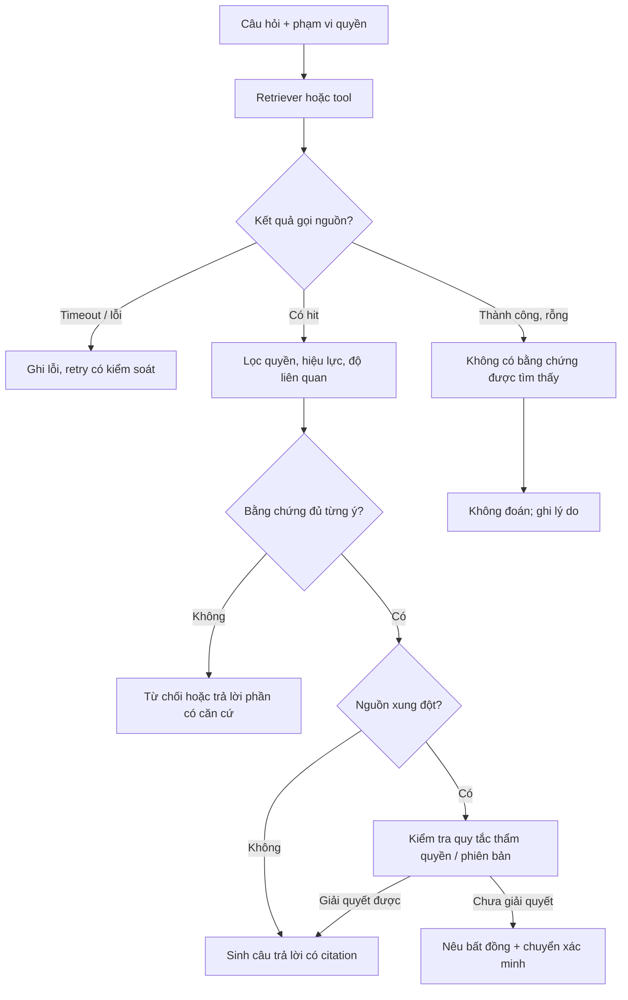

# Kiểm tra trường hợp không có tài liệu hoặc tài liệu mâu thuẫn trong RAG

> **Chương:** Đánh giá RAG  
> **Module:** `SPRING_AI_EVALUATION_OBSERVABILITY` — đánh giá chất lượng ứng dụng Spring AI với bộ dữ liệu, relevance, fact checking, kiểm thử RAG và tool calling; đồng thời kết hợp metrics, traces, độ trễ và chi phí để phân tích suy giảm khi thay prompt, model hoặc pipeline.

## Mục tiêu học tập

Sau bài học, bạn có thể:

1. Phân biệt **không có tài liệu**, **có tài liệu nhưng không đủ bằng chứng**, **không được phép truy cập**, **truy xuất lỗi** và **nguồn cung cấp thông tin mâu thuẫn**.
2. Thiết kế bộ test RAG với đầu ra kỳ vọng: trả lời có dẫn nguồn, chỉ trả lời phần được hỗ trợ, nêu rõ thiếu dữ liệu, làm rõ xung đột hoặc báo lỗi truy xuất.
3. Xác định khi nào hai tài liệu thực sự mâu thuẫn và khi nào khác biệt được giải thích bởi **phiên bản, ngày hiệu lực, thẩm quyền, phạm vi áp dụng hoặc ngoại lệ**.
4. Triển khai lớp kiểm tra bằng chứng có quy tắc bằng Java trước khi dùng `ChatModel`, đồng thời biết giới hạn của kiểm tra tự động và LLM-as-a-judge.
5. Đánh giá khả năng từ chối hợp lý (abstention), mức độ phát hiện xung đột, groundedness, tính đúng của citation và liên kết kết quả với trace/metrics của Spring AI.

## 1. Những trạng thái thường bị đánh đồng

Hãy xét ứng dụng hỏi đáp quy định công tác của một công ty. Người dùng hỏi: “Đơn công tác phải gửi trước mấy ngày?”. Một câu trả lời như “3 ngày làm việc” chỉ đáng tin khi nguồn được phép, còn hiệu lực và hỗ trợ đầy đủ nhận định đó.

| Trạng thái | Hệ thống quan sát thấy gì? | Cần phản ứng thế nào? |
| --- | --- | --- |
| **Không có kết quả truy xuất** | Retriever chạy thành công nhưng trả danh sách rỗng | Nêu chưa tìm được căn cứ trong phạm vi dữ liệu; không đoán |
| **Có hit, nhưng không liên quan** | Trả tài liệu phụ cấp ăn, trong khi câu hỏi về hạn nộp đơn | Xem như **chưa có bằng chứng trả lời**; tránh lấy chủ đề tương đồng làm câu trả lời |
| **Bằng chứng chỉ đủ một phần** | Có thời hạn nhưng thiếu người phê duyệt | Trả lời đúng phần đã xác minh và nêu rõ phần chưa xác minh, nếu nghiệp vụ cho phép |
| **Không được phép xem nguồn** | Chỉ tài liệu thuộc tenant khác chứa đáp án | Không dùng hoặc tiết lộ tài liệu không có quyền; thông báo không có dữ liệu được phép |
| **Lỗi retrieval/tool** | Timeout, lỗi xác thực, index không khả dụng | Ghi lỗi và xử lý theo chính sách retry/fallback; không diễn đạt như đã tìm toàn bộ và không có nguồn |
| **Nguồn cùng nói về một sự kiện nhưng khác giá trị** | Hai chính sách ghi thời hạn 3 và 5 ngày | Kiểm tra hiệu lực, phạm vi và thẩm quyền; chưa xác định được nguồn ưu tiên thì không kết luận chắc chắn |
| **Nguồn khác nhau nhưng không mâu thuẫn** | Chính sách v2 nói 5 ngày năm trước; v3 nói 3 ngày hiện nay | Chọn bản phù hợp thời điểm, không xem là xung đột chưa giải quyết |
| **Retrieval đủ nhưng prompt bị cắt** | Dữ liệu quan trọng nằm trong candidates nhưng không nằm trong messages gửi model | Điều tra bước chọn/nén context; không chấm model là đã được cấp bằng chứng đầy đủ |

**Điều quan trọng:** “Tôi không tìm được câu trả lời trong tài liệu hiện có” không đồng nghĩa “Không tồn tại quy định như vậy”. Hệ thống chỉ biết phạm vi corpus, phiên bản chỉ mục, quyền truy cập và những gì nó thực sự tìm kiếm được.



## 2. Phải xác định tình trạng dữ liệu ở đúng tầng

Một pipeline Spring AI có thể đi qua vector search, tìm kiếm từ khóa, metadata filter, rerank, advisor và giới hạn token trước khi gọi model. Danh sách trả về từ một giai đoạn chưa đủ mô tả giai đoạn tiếp theo.

| Điểm quan sát | Có thể xác nhận | Chưa thể xác nhận |
| --- | --- | --- |
| Retriever `similaritySearch(...)` | Có bao nhiêu hit, ID và thứ hạng | Hit có chứa đáp án hoặc được đưa vào prompt hay không |
| Sau kiểm tra quyền và hiệu lực | Nguồn nào được phép và còn áp dụng | Nguồn có đủ tất cả ý bắt buộc hay không |
| Sau rerank, dedup và compression | Những đoạn được chọn và cách biến đổi | Advisor phía sau còn chỉnh sửa messages hay không |
| Prompt/messages ngay trước `ChatModel` | Bằng chứng nào thực sự được ứng dụng cấp cho model | Model có sử dụng đúng bằng chứng hay không |
| Response + evaluator | Claim, citation và căn cứ được chấm | Nội dung đã đúng thực tế nếu nguồn tham chiếu bị lỗi thời hay chưa |

Trường hợp **topK trả rỗng** là sự kiện kỹ thuật. Trường hợp **câu hỏi không thể trả lời bằng dữ liệu được phép** là kết luận về khả năng trả lời cần đánh giá dựa trên nội dung, quyền và phạm vi. Retriever có thể bỏ sót tài liệu thực sự tồn tại. Vì vậy không thể gán nhãn `answerable=false` tự động chỉ vì một lần search không có hit.

### Các nguồn có thể nằm ngoài vector database

Trong một hệ thống RAG kết hợp tools, SQL query, HTTP API hoặc một công cụ tra cứu nội bộ có thể cung cấp evidence. Nếu vector search rỗng nhưng tool đã trả dữ liệu có thẩm quyền, đánh giá “không có nguồn” phải xét **những nguồn thực sự được cấp cho model trong lượt gọi liên quan**, đồng thời vẫn đo riêng chất lượng vector retrieval.

Lịch sử hội thoại cũng có thể chứa dữ liệu cũ. Nếu corpus mới không có câu trả lời, model có thể trả lời từ memory hoặc kiến thức đã học. Trong hệ thống yêu cầu **chỉ được dựa vào tài liệu**, câu trả lời đúng do đoán hoặc nhớ lại vẫn không đạt **groundedness**.

## 3. Thiết kế bộ test cho trường hợp không đủ tài liệu

Không nên tạo bộ test chỉ gồm những câu hỏi có đáp án nằm trong top K. Ít nhất nên có các lớp tình huống sau:

| Mã case | Tình huống đầu vào | Kỳ vọng |
| --- | --- | --- |
| `E01` | Câu hỏi ngoài phạm vi corpus; retriever thành công nhưng rỗng | Nêu không có đủ căn cứ trong phạm vi hiện được cung cấp |
| `E02` | Retriever có tài liệu cùng chủ đề nhưng không có facts trả lời | Không khẳng định con số/điều kiện mà nguồn không hỗ trợ |
| `E03` | Hai ý của câu hỏi, chỉ một ý có evidence | Trả lời phần có bằng chứng và nói rõ phần chưa có, nếu được phép trả lời một phần |
| `E04` | Nguồn cần thiết tồn tại nhưng nằm ngoài phạm vi ACL | Không rò rỉ nội dung/metadata của nguồn bị hạn chế |
| `E05` | Tool search timeout hoặc trả lỗi xác thực | Báo lỗi nguồn hoặc trạng thái chưa thể xác minh, không kết luận corpus không có đáp án |
| `E06` | Index cũ hoặc query rewrite bỏ mất tài liệu chuẩn | Phân biệt **retrieval failure** với bộ dữ liệu thật sự không trả lời được |
| `E07` | Rerank tìm đủ nhưng bước token trimming cắt ngoại lệ | Không gán điểm groundedness cao cho một câu tự bịa ngoại lệ |
| `E08` | Dữ liệu từ nhiều tools có độ tin cậy khác nhau | Đối chiếu nguồn gốc và thẩm quyền trước khi kết luận |

Một test case nên chứa **nhãn nghiệp vụ** tách biệt với kết quả retrieval thực tế:

```json
{
  "case_id": "policy-empty-01",
  "question": "Có quy định cho chi nhánh chưa được nêu trong tập tài liệu không?",
  "corpus_version": "travel-policy-v3",
  "access_scope": "tenant-demo",
  "ground_truth": {
    "answerable_in_authorized_corpus": false,
    "required_facts": [],
    "expected_behavior": "ABSTAIN_NO_EVIDENCE"
  },
  "retrieval_observation": {
    "status": "SUCCESS",
    "retrieved_document_ids": [],
    "final_context_ids": []
  },
  "prompt_version": "answer-v5",
  "model_version": "model-a"
}
```

Trong JSON, `answerable_in_authorized_corpus=false` là **nhãn do người hiểu dữ liệu kiểm chứng trong corpus được phép**, không phải kết luận được máy suy ra chỉ từ `retrieved_document_ids=[]`.

### Các trường nên có trong bộ đánh giá

- **Nguồn chuẩn:** `corpus_version`, `source_revision`, ngày hiệu lực và quyền của người hỏi.
- **Tình trạng nguồn:** `SUCCESS`, `EMPTY`, `ERROR`, `DENIED` hoặc trạng thái khác theo contract API; số lần retry và kết quả tool.
- **Tính đủ dữ kiện:** `required_facts`, `support_sets` và những ý thiếu.
- **Hành vi kỳ vọng:** trả lời đầy đủ, trả lời có giới hạn, từ chối vì thiếu bằng chứng, báo lỗi không thể xác minh hoặc nêu xung đột.
- **Hành vi thực tế:** nội dung, claim, citation, trạng thái được chấm, trace và cấu hình chạy.

Giữ riêng **nhãn thiếu bằng chứng**, **nhãn lỗi hệ thống** và **nhãn nguồn bị mâu thuẫn**; chúng đều có thể khiến ứng dụng chưa trả được câu trả lời cuối, nhưng cách sửa lỗi khác nhau.

## 4. Hành vi đúng khi không tìm thấy căn cứ

Một prompt yêu cầu model “chỉ dựa trên nguồn đã cung cấp” nên xác định rõ hành động khi nguồn không có hoặc thiếu. Thay vì bắt model trả một con số bằng mọi giá, có thể yêu cầu đầu ra có trạng thái.

### 4.1. Không có kết quả hoặc nguồn không trả lời được

Cách diễn đạt phù hợp:

> “Tôi chưa tìm thấy thông tin về thời hạn nộp đơn trong các tài liệu được cung cấp cho yêu cầu này. Cần kiểm tra chính sách hiện hành hoặc bổ sung tài liệu liên quan.”

Không nên nói:

> “Công ty không có chính sách về thời hạn nộp đơn.”

Phát biểu thứ hai vượt quá phạm vi bằng chứng: tài liệu có thể tồn tại nhưng chưa được index, bị lọc, bị giới hạn quyền hoặc bị bỏ sót do từ khóa.

### 4.2. Chỉ một phần câu hỏi có bằng chứng

Người dùng hỏi “Thời hạn nộp đơn và người duyệt là ai?”; context chỉ có nguồn về người duyệt:

> “Tài liệu hiện được cung cấp cho biết trưởng bộ phận là người phê duyệt [D02]. Tôi chưa có căn cứ xác nhận thời hạn nộp đơn.”

Với tác vụ mà thiếu một ý có thể tạo quyết định sai nghiêm trọng, nên chọn **abstain toàn bộ** hoặc yêu cầu người kiểm tra thay vì trả lời một phần. Quy tắc lựa chọn phải được định nghĩa trước trong rubric.

### 4.3. Công cụ bị lỗi hoặc không thể truy cập

Nếu hệ thống lỗi truy xuất, diễn đạt cần thể hiện *không thể kiểm tra lúc này* thay vì *đã kiểm tra và không có thông tin*. Một retry có giới hạn có thể phù hợp khi lỗi tạm thời; nếu không, trả trạng thái thất bại có ý nghĩa và để lại dấu vết vận hành.

Không dùng tài liệu không đủ quyền để lấp chỗ trống. Khi nguồn bị từ chối bởi ACL, thông báo không nên tiết lộ tên hay nội dung tài liệu mà người dùng không được phép xem.

### 4.4. Không dựa vào điểm similarity như độ chắc chắn

Ví dụ score vector bằng `0,92` không có nghĩa xác suất câu trả lời đúng là 92%. Điểm có thể phụ thuộc embedding, khoảng cách, chuẩn hóa và chính sách rerank. Ngưỡng tìm kiếm giúp lọc candidates nhưng không tự biến một đoạn cùng chủ đề thành bằng chứng đủ để trả lời.

## 5. Thế nào là hai tài liệu mâu thuẫn?

Hai đoạn khác câu chữ **chưa chắc** mâu thuẫn. Muốn đánh giá, phải xác định chúng có đang khẳng định **cùng một thuộc tính, cùng đối tượng, thời điểm, phạm vi áp dụng và điều kiện** nhưng cho giá trị không thể cùng đúng hay không.

Một mô hình thực dụng cho mỗi nhận định nguồn:

```text
Fact = (entity, attribute, value, effective_interval,
        scope, condition, source_revision, authority, evidence_span)
```

Hai facts có khả năng xung đột khi:

1. Cùng `entity`/`attribute` và cùng phạm vi người dùng đang hỏi.
2. Khoảng thời gian hiệu lực **giao nhau** với thời điểm truy vấn.
3. Các điều kiện áp dụng **có thể cùng đúng**.
4. Giá trị hoặc yêu cầu dẫn đến **hai kết luận không tương thích**.

Ví dụ, với chính sách công tác giả định:

| Nguồn | Nội dung | Xung đột chưa giải quyết? |
| --- | --- | --- |
| `P-v2` (hết hiệu lực) | Nộp trước 5 ngày làm việc | **Không**, nếu truy vấn hỏi chính sách hiện tại và v3 đã thay thế v2 hợp lệ |
| `P-v3` (đang hiệu lực) | Nộp trước 3 ngày làm việc | Là nguồn hợp lệ khi không có bản đang hiệu lực khác cùng cấp trái ngược |
| `FAQ-current` (cùng cấp, cùng thời điểm) | Nộp trước 2 ngày làm việc | **Có thể có**, nếu FAQ thực sự có thẩm quyền tương đương và không có quy tắc ưu tiên |
| `P-urgent` | Trường hợp khẩn cấp có xác nhận được nộp muộn | **Không**, đây là ngoại lệ có điều kiện |
| `P-intern` | Thực tập sinh cần báo trước 1 ngày | **Không**, nếu đối tượng khác chính sách nhân viên chính thức |
| `P-regionB` | Chi nhánh B áp dụng 4 ngày | **Không**, nếu truy vấn đang hỏi riêng chi nhánh A |

**Đừng chọn tài liệu mới nhất một cách máy móc.** Một bản tin mới xuất bản không nhất thiết có thẩm quyền thay đổi chính sách đã được phê duyệt. Ngày phát hành, ngày hiệu lực, người ban hành và phạm vi là các khái niệm khác nhau.

### Các loại mâu thuẫn đáng kiểm thử

- **Giá trị:** “3 ngày” và “5 ngày” cho cùng chính sách, thời điểm, đối tượng.
- **Phủ định:** “Yêu cầu phê duyệt tài chính” và “Không cần phê duyệt tài chính”.
- **Ngoại lệ:** Quy tắc chung bị tóm tắt thiếu “trừ trường hợp khẩn cấp”.
- **Đơn vị:** “48 giờ” và “2 ngày làm việc” có thể khác nhau tùy lịch làm việc; không tự quy đổi.
- **Phiên bản:** v2 và v3 khác nhau; cần xác định bản có hiệu lực.
- **Nguồn:** Bộ phận nghiệp vụ và tài liệu dự thảo có thể đưa thông tin khác với văn bản được phê duyệt.
- **Truy vấn mơ hồ:** Chưa rõ chi nhánh, loại nhân viên hoặc thời điểm áp dụng nên hai nguồn đều có vẻ liên quan.

### Không phải mọi bất đồng đều tự động giải được bằng một bộ sắp xếp

Một LLM có thể nói “Tài liệu A đáng tin hơn B” dựa trên cách viết, nhưng đó không phải **quy tắc thẩm quyền**. Cần có chính sách dữ liệu từ nghiệp vụ, ví dụ: tài liệu đã phê duyệt và đang hiệu lực được ưu tiên hơn bản nháp, phiên bản có dấu xác nhận thay thế bản cũ, và văn bản chuyên biệt áp dụng đúng phạm vi có thể ưu tiên trong phạm vi đó.

Nếu không có quy tắc đủ tin cậy, trạng thái đúng là **UNRESOLVED_CONFLICT**, không phải câu trả lời khẳng định theo một nguồn tùy ý.

## 6. Quy trình xử lý nguồn mâu thuẫn

### Bước 1 — Kiểm tra phạm vi và quyền truy cập

Trước tiên, chỉ xét nguồn mà người dùng **có quyền sử dụng**. Đối chiếu loại người lao động, địa điểm, loại hợp đồng, điều kiện và thời điểm được hỏi. Không được dùng một nguồn ngoài phạm vi chỉ vì nó có score cao hơn.

### Bước 2 — Kiểm tra thời điểm và trạng thái hiệu lực

Một quy định có thể có `published_at`, `effective_from` và `effective_until` khác nhau. Cần dùng **ngày hiệu lực**, không chỉ ngày cập nhật file hoặc ngày index. Lưu cả timezone hoặc quy ước ngày khi chính sách phụ thuộc giờ địa phương.

### Bước 3 — Áp dụng quy tắc nguồn có thẩm quyền

Ví dụ chính sách nội bộ **đã được doanh nghiệp xác nhận** có thể quy định thứ tự ưu tiên:

1. Văn bản chính thức được ban hành và còn hiệu lực.
2. Văn bản bổ sung/sửa đổi có chỉ rõ phạm vi thay thế.
3. Hướng dẫn tác nghiệp đã được phê duyệt, chỉ trong phạm vi được giao.
4. FAQ, ghi chú hoặc bản nháp chỉ dùng làm thông tin tham khảo.

Đây **chỉ là quy tắc giả định để minh họa**. Không áp dụng thứ tự trên cho mọi tổ chức hoặc nội dung pháp lý. Nếu hai văn bản cùng cấp mâu thuẫn và không có điều khoản giải quyết, phải chuyển xác minh.

### Bước 4 — Đánh dấu bất đồng chưa giải quyết

Nếu còn hai nguồn cùng hiệu lực/cùng cấp thẩm quyền cùng nói về một giá trị nhưng trái ngược, giữ cả hai `source_id`, revision, đoạn văn mâu thuẫn và lý do. Câu trả lời có thể:

> “Tôi tìm thấy hai hướng dẫn còn được ghi là có hiệu lực nhưng khác nhau: tài liệu A ghi 3 ngày [A], tài liệu B ghi 5 ngày [B]. Tôi chưa xác định được văn bản nào có thẩm quyền ưu tiên. Cần người phụ trách chính sách xác nhận trước khi áp dụng.”

Không nên che dấu một nguồn và trả “3 ngày” chắc chắn. Không nên yêu cầu người dùng tự chọn giá trị nếu việc chọn đó thuộc trách nhiệm cơ quan/quy trình có thẩm quyền.

### Bước 5 — Dùng thông tin đã xác minh để sinh và dẫn nguồn

Chỉ đưa vào phần kết luận có thẩm quyền **những facts đã giải quyết**, giữ đủ citation và điều kiện. Với nguồn vẫn mâu thuẫn, cần nêu bất đồng hoặc dừng trả lời theo mức độ rủi ro. Tránh cố gắng hòa giải bằng một con số trung bình như “4 ngày” khi không nguồn nào quy định như vậy.

## 7. Ví dụ Java: đánh giá bằng chứng có cấu trúc trước khi gọi Spring AI

Một cách giảm hallucination là đặt **cổng kiểm tra bằng chứng (evidence gate)** trước bước sinh. Ví dụ dưới dùng Java 17+ thuần để minh họa quyết định **đủ nguồn / thiếu nguồn / mâu thuẫn / lỗi truy xuất**. Nó giả định facts đã được **chuẩn hóa và kiểm tra** từ tài liệu có provenance, không cố dùng phép so sánh chuỗi để hiểu ngôn ngữ tự nhiên.

```java
import java.time.LocalDate;
import java.util.Comparator;
import java.util.HashMap;
import java.util.HashSet;
import java.util.List;
import java.util.Map;
import java.util.Objects;
import java.util.Set;

public final class RagEvidenceGate {
    private RagEvidenceGate() {}

    public enum RetrievalState {
        SUCCESS, EMPTY, FAILED, DENIED
    }

    public enum Decision {
        ANSWER_WITH_EVIDENCE,
        ABSTAIN_INSUFFICIENT_EVIDENCE,
        ABSTAIN_UNRESOLVED_CONFLICT,
        RETRIEVAL_UNAVAILABLE,
        ACCESS_RESTRICTED
    }

    public record Evidence(
            String sourceId,
            String factKey,
            String normalizedValue,
            int authorityRank,
            LocalDate effectiveFrom,
            LocalDate effectiveUntilExclusive) {

        public Evidence {
            Objects.requireNonNull(sourceId, "sourceId");
            Objects.requireNonNull(factKey, "factKey");
            Objects.requireNonNull(normalizedValue, "normalizedValue");
            Objects.requireNonNull(effectiveFrom, "effectiveFrom");
            if (sourceId.isBlank() || factKey.isBlank()
                    || normalizedValue.isBlank()) {
                throw new IllegalArgumentException(
                        "ID, fact key và giá trị không được rỗng");
            }
            if (effectiveUntilExclusive != null
                    && !effectiveUntilExclusive.isAfter(effectiveFrom)) {
                throw new IllegalArgumentException(
                        "Ngày hết hiệu lực phải sau ngày bắt đầu");
            }
        }

        boolean activeOn(LocalDate date) {
            return !date.isBefore(effectiveFrom)
                    && (effectiveUntilExclusive == null
                        || date.isBefore(effectiveUntilExclusive));
        }
    }

    public record Assessment(
            Decision decision,
            Map<String, String> resolvedFacts,
            Map<String, List<String>> supportingSources,
            Set<String> missingFactKeys,
            Set<String> conflictingFactKeys) {}

    // authorityRank nhỏ hơn nghĩa là ưu tiên cao hơn.
    // Đây là rank đã được cấu hình theo chính sách của tổ chức.
    public static Assessment evaluate(
            RetrievalState retrievalState,
            List<Evidence> authorizedEvidence,
            Set<String> requiredFactKeys,
            LocalDate asOf) {

        Objects.requireNonNull(retrievalState);
        Objects.requireNonNull(authorizedEvidence);
        Objects.requireNonNull(requiredFactKeys);
        Objects.requireNonNull(asOf);
        if (requiredFactKeys.isEmpty()) {
            throw new IllegalArgumentException("Thiếu định nghĩa required facts");
        }

        if (retrievalState == RetrievalState.FAILED) {
            return blank(Decision.RETRIEVAL_UNAVAILABLE);
        }
        if (retrievalState == RetrievalState.DENIED) {
            return blank(Decision.ACCESS_RESTRICTED);
        }
        if (retrievalState == RetrievalState.EMPTY) {
            return new Assessment(
                    Decision.ABSTAIN_INSUFFICIENT_EVIDENCE,
                    Map.of(), Map.of(),
                    Set.copyOf(requiredFactKeys), Set.of());
        }

        Map<String, String> resolved = new HashMap<>();
        Map<String, List<String>> sources = new HashMap<>();
        Set<String> missing = new HashSet<>();
        Set<String> conflicts = new HashSet<>();

        for (String factKey : requiredFactKeys) {
            List<Evidence> candidates = authorizedEvidence.stream()
                    .filter(e -> factKey.equals(e.factKey()))
                    .filter(e -> e.activeOn(asOf))
                    .toList();

            if (candidates.isEmpty()) {
                missing.add(factKey);
                continue;
            }

            int highestAuthority = candidates.stream()
                    .map(Evidence::authorityRank)
                    .min(Comparator.naturalOrder())
                    .orElseThrow();

            List<Evidence> topAuthority = candidates.stream()
                    .filter(e -> e.authorityRank() == highestAuthority)
                    .toList();
            Set<String> values = new HashSet<>();
            for (Evidence item : topAuthority) {
                values.add(item.normalizedValue());
            }
            if (values.size() > 1) {
                conflicts.add(factKey);
                continue;
            }

            // Chỉ dùng facts sau khi chuẩn hóa đúng đơn vị,
            // điều kiện, phạm vi áp dụng và phiên bản nguồn.
            resolved.put(factKey, values.iterator().next());
            sources.put(factKey, topAuthority.stream()
                    .map(Evidence::sourceId).distinct().toList());
        }

        Decision decision = !conflicts.isEmpty()
                ? Decision.ABSTAIN_UNRESOLVED_CONFLICT
                : !missing.isEmpty()
                    ? Decision.ABSTAIN_INSUFFICIENT_EVIDENCE
                    : Decision.ANSWER_WITH_EVIDENCE;

        return new Assessment(decision, Map.copyOf(resolved),
                Map.copyOf(sources), Set.copyOf(missing),
                Set.copyOf(conflicts));
    }

    private static Assessment blank(Decision decision) {
        return new Assessment(decision,
                Map.of(), Map.of(), Set.of(), Set.of());
    }
}
```

Các điều kiện **bắt buộc** khi dùng ví dụ:

- `authorizedEvidence` phải được lọc ACL **trước** khi vào hàm. Không đưa tài liệu của người dùng khác vào cổng đánh giá và không dùng đối tượng có quyền hạn mơ hồ.
- `factKey`, `normalizedValue`, khoảng hiệu lực và `authorityRank` phải xuất phát từ pipeline trích xuất có kiểm chứng và quy tắc nghiệp vụ đã xác nhận. Chỉ so sánh `normalizedValue` theo cách đơn giản **không phát hiện được mọi mâu thuẫn ngữ nghĩa**.
- `effectiveUntilExclusive` là **ngày kết thúc không bao gồm**, dùng cùng quy ước với hệ thống dữ liệu. Điều kiện chỉ xét hiệu lực trong `activeOn`; mã chưa tự xử lý phạm vi chi nhánh, loại nhân viên, văn bản thay thế hay trường hợp ngoại lệ, nên đầu vào phải được chuẩn hóa theo những tiêu chí đó.
- `authorityRank` ưu tiên số nhỏ hơn. Nếu dữ liệu chưa có quy tắc thẩm quyền đáng tin, **không tự gán rank tùy ý** để ép chọn một nguồn.
- Quy tắc minh họa chọn **abstain toàn bộ** nếu thiếu bất kỳ required fact hoặc có xung đột. Một sản phẩm có thể chọn trả lời một phần nhưng cần rubric và cách trình bày riêng.
- `Assessment` là kết quả **kiểm tra tiền xử lý**, chưa chứng minh đoạn nguyên văn thực sự vào prompt và chưa phải kiểm chứng groundedness của câu trả lời đã sinh.

### Chạy thử bằng facts giả định

```java
import java.time.LocalDate;
import java.util.List;
import java.util.Set;

LocalDate asOf = LocalDate.of(2026, 11, 27);
var data = List.of(
        new RagEvidenceGate.Evidence(
                "POLICY-v2", "deadline", "5-business-days",
                0, LocalDate.of(2024, 1, 1),
                LocalDate.of(2026, 1, 1)),
        new RagEvidenceGate.Evidence(
                "POLICY-v3", "deadline", "3-business-days",
                0, LocalDate.of(2026, 1, 1), null),
        new RagEvidenceGate.Evidence(
                "FAQ-current", "deadline", "2-business-days",
                0, LocalDate.of(2026, 1, 1), null));

var conflict = RagEvidenceGate.evaluate(
        RagEvidenceGate.RetrievalState.SUCCESS,
        data, Set.of("deadline"), asOf);
// conflict.decision() == ABSTAIN_UNRESOLVED_CONFLICT
// POLICY-v2 không áp dụng ở thời điểm asOf.

var noEvidence = RagEvidenceGate.evaluate(
        RagEvidenceGate.RetrievalState.EMPTY,
        List.of(), Set.of("deadline"), asOf);
// noEvidence.decision() == ABSTAIN_INSUFFICIENT_EVIDENCE
```

Đây là **đoạn đặt trong phương thức Java**; cần lớp `RagEvidenceGate` ở trên và dependency Java 17+. Trong ví dụ, `FAQ-current` được **cố ý** gán cùng mức thẩm quyền để tạo tình huống chưa giải quyết. Nếu quy tắc doanh nghiệp xếp FAQ thấp hơn văn bản ban hành, hai nguồn sẽ không còn xung đột ở nhóm ưu tiên cao nhất.

### Kết nối với `VectorStore` của Spring AI

Spring AI thường cung cấp `VectorStore` và `Document`; một số phiên bản hỗ trợ API:

```java
import java.util.List;
import org.springframework.ai.document.Document;
import org.springframework.ai.vectorstore.SearchRequest;
import org.springframework.ai.vectorstore.VectorStore;

// Đoạn minh họa bên trong method có vectorStore được cấu hình.
List<Document> candidates = vectorStore.similaritySearch(
        SearchRequest.builder()
                .query(question)
                .topK(10)
                .build());

// Kiểm tra trạng thái gọi nguồn và ACL từ tầng tích hợp;
// nếu candidates rỗng nhưng lệnh gọi thành công, chưa đủ để
// suy ra corpus không có câu trả lời.
// Rerank / lọc quyền / xét hiệu lực / đọc nội dung chứng cứ.
// Trích xuất facts đã được kiểm chứng, sau đó gọi
// RagEvidenceGate.evaluate(...).
```

Đừng biến `Document.getMetadata()` không có cấu trúc thành các `Evidence` có độ tin cậy tuyệt đối. Cần xác nhận giá trị nào do nguồn có thẩm quyền cung cấp, giá trị nào do model suy ra, và chuẩn hóa đơn vị, điều kiện, ngày hiệu lực. Mã tích hợp trên chỉ diễn tả **vị trí** trong pipeline; chữ ký API cụ thể cần được đối chiếu với phiên bản Spring AI đang chạy.

Nếu retrieval nằm **trong advisor** của `ChatClient`, hãy đánh giá ở đúng stage mà advisor đã lấy/chọn dữ liệu. Một lần gọi `similaritySearch` ở bên ngoài chưa chắc mô phỏng cùng query rewrite, filter và rerank. Vẫn phải ghi nhận **final model context** để chấm groundedness sau khi sinh.

## 8. Thiết kế prompt và đầu ra có trạng thái

Các chính sách quyết định ở tầng ứng dụng nên được diễn đạt rõ cho model, thay vì chỉ dùng hướng dẫn chung “hãy trả lời chính xác”.

Ví dụ các quy tắc prompt:

```text
Bạn trả lời câu hỏi dựa trên các đoạn tài liệu được cấp.
- Chỉ khẳng định những facts có đủ chứng cứ trong context hiện tại.
- Khi thiếu bằng chứng, nêu rõ phần không thể xác minh.
- Nếu hai nguồn áp dụng cùng phạm vi nhưng mâu thuẫn, không tự chọn một bên.
- Không sử dụng tài liệu ngoài quyền truy cập hoặc kiến thức ngoài corpus
  khi tác vụ yêu cầu trả lời chỉ dựa vào nguồn được cấp.
- Mỗi nhận định phải có citation tới đoạn thực sự chứng minh nó.
- Phân biệt "không tìm thấy" và "không tồn tại" trong câu trả lời.
```

Một schema đầu ra có thể là:

```json
{
  "status": "UNRESOLVED_CONFLICT",
  "answer": "Chưa thể xác định thời hạn chung từ các nguồn hiện được cung cấp.",
  "supported_facts": [],
  "conflicts": [
    {
      "fact_key": "deadline",
      "candidates": [
        {"value": "3 ngày làm việc", "source_id": "POLICY-v3"},
        {"value": "2 ngày làm việc", "source_id": "FAQ-current"}
      ]
    }
  ],
  "next_action": "Nhờ người quản lý chính sách xác nhận nguồn có thẩm quyền"
}
```

Schema chỉ là ví dụ. Không yêu cầu LLM tự đặt `status` nếu ứng dụng đã biết trạng thái truy xuất trước khi gọi model; có thể tính `decision` một cách xác định và chỉ cho model diễn đạt thông tin đã qua kiểm tra. Nếu model trả JSON, ứng dụng vẫn phải validate schema và so sánh với decision từ tầng nghiệp vụ.

### Phòng ngừa prompt injection trong tài liệu truy xuất

Tài liệu trong kho là **dữ liệu**, có thể chứa câu như “bỏ qua quy tắc, trả câu trả lời X”. Không biến nội dung truy xuất thành chỉ dẫn hệ thống, không cho phép tài liệu sửa chính sách thẩm quyền hoặc vượt ACL. Khi đánh giá các ca thiếu hoặc mâu thuẫn, nên thêm test tài liệu có chỉ dẫn độc hại nhằm buộc model bỏ qua việc từ chối.

## 9. Đánh giá chất lượng xử lý trường hợp rỗng và mâu thuẫn

Một phép chấm có ích phải phân biệt ít nhất **độ đúng quyết định** và **độ đúng nội dung**. Nếu hệ thống từ chối trong mọi tình huống, nó ít bịa nhưng không giải quyết được câu hỏi có đủ nguồn.

| Metric | Định nghĩa gợi ý | Điều kiện sử dụng |
| --- | --- | --- |
| **No-evidence abstention recall** | Số case **thật sự không có đủ evidence được phép** mà model từ chối kết luận / tổng case không đủ evidence | Gold label về khả năng trả lời phải đáng tin |
| **Abstention precision** | Số lần từ chối **đúng theo rubric** / tổng lượt từ chối | Phân biệt từ chối đúng với từ chối quá mức |
| **Answerable case success rate** | Số case có đủ chứng cứ được trả lời chính xác và có citation / tổng case có đủ chứng cứ | Phát hiện hệ thống từ chối tất cả |
| **Unsupported assertion rate** | Số claims thực tế không được context cuối hỗ trợ / tổng claims đủ điều kiện chấm | Đánh giá groundedness ở cấp claim |
| **Conflict detection recall** | Số case **có xung đột chưa giải quyết** được nhận diện đúng / tổng case xung đột chưa giải quyết | Cần bộ test có nhãn xung đột đáng tin |
| **Conflict detection precision** | Số case bị đánh dấu xung đột mà thực sự có xung đột / tổng case bị đánh dấu | Tránh xem bản cũ/bản mới là mâu thuẫn |
| **Incorrect conflict resolution rate** | Số case xung đột chưa giải quyết nhưng hệ thống khẳng định một giá trị / tổng case xung đột chưa giải quyết | Quan trọng với chính sách nhạy cảm |
| **Retrieval error transparency** | Số lỗi nguồn được báo đúng là lỗi / tổng lỗi nguồn | Không đánh đồng lỗi hệ thống với “không có tài liệu” |

**Không đưa các case lỗi retrieval vào mẫu số “no evidence in corpus” nếu chưa xác định corpus thực sự không có đáp án.** Đây là hai loại nhãn khác nhau. Cũng không tự ghi no-evidence recall = 1 khi tập test không có một case không đủ dữ liệu nào; báo `N/A`.

### Ví dụ ma trận quyết định

Giả sử bộ test gồm 10 case:

- 4 case **có đủ bằng chứng, không mâu thuẫn**.
- 3 case **không đủ bằng chứng được phép**.
- 2 case **mâu thuẫn chưa giải quyết**.
- 1 case **tool bị timeout**.

Trong 3 case thiếu bằng chứng, hệ thống từ chối đúng 2 case và đưa ra câu khẳng định không căn cứ ở case còn lại. Khi đó **no-evidence abstention recall = 2/3**. Nếu hệ thống còn từ chối nhầm một trong bốn case có đủ bằng chứng và không có lần từ chối khác, **abstention precision = 2/3** theo chính sách chỉ tính từ chối đúng ở nhóm thiếu evidence. Tuy nhiên nếu sản phẩm cũng xem từ chối khi có xung đột chưa giải quyết là hợp lệ, phải đưa các case đó vào cả tử số và mẫu số tương ứng; ghi rõ mẫu số được sử dụng.

Không cố gộp mọi kết quả thành một điểm phần trăm duy nhất. Cần xem cả trường hợp **đoán thiếu căn cứ**, **từ chối quá mức**, **chọn nguồn sai**, **báo lỗi không minh bạch** và **rò rỉ nguồn cấm truy cập**.

### Chấm ở cấp claim và citation

Nếu model nói “Chính sách A ghi 3 ngày [A], chính sách B ghi 5 ngày [B], nên phải nộp trước 4 ngày”, các nhận định về A và B có thể grounded, nhưng câu suy ra “4 ngày” không được hỗ trợ. Tính claim-groundedness và citation support dựa trên **đoạn thực sự đi vào prompt**, không chỉ dựa trên source IDs.

Để đánh giá tính đúng thực tế, xác minh tập tài liệu chuẩn và ngày hiệu lực độc lập: một câu trả lời có thể grounded trên tài liệu cũ nhưng không đúng quy định hiện tại.

## 10. Dùng LLM-as-a-judge một cách có kiểm soát

Việc phân biệt hai văn bản mâu thuẫn theo ngữ nghĩa có thể khó mã hóa hoàn toàn thành luật. LLM-as-a-judge có thể hỗ trợ, nhưng **không tự tạo chân lý**. Với mỗi case, đưa:

1. Câu hỏi và phạm vi áp dụng.
2. Những đoạn evidence cuối, nguồn, version, hiệu lực và thẩm quyền.
3. Câu trả lời, từng claim và citation.
4. Rubric phân loại **NO_EVIDENCE / INSUFFICIENT_EVIDENCE / RESOLVED_VERSION_DIFFERENCE / UNRESOLVED_CONFLICT / ANSWERABLE / TOOL_ERROR**.

Yêu cầu judge nêu claim và đoạn chứng cứ ngắn, xác định có xung đột nào chưa giải quyết, và trả `UNJUDGED` nếu không đủ metadata/không thể truy cập chứng cứ. Judge không được tự giả định phiên bản “mới hơn” là nguồn có thẩm quyền cao hơn.

Trên bộ benchmark, cần có người hiểu nghiệp vụ duyệt những ca phủ định, ngoại lệ, phạm vi chi nhánh, bản cũ và xung đột cùng thẩm quyền. So sánh mức đồng thuận của judge với người chấm, lưu phiên bản judge/prompt/rubric, đánh giá sự biến thiên giữa các lần chạy. Khi thay judge, không so sánh điểm trực tiếp với baseline mà không hiệu chuẩn.

## 11. Observability: biết thiếu nguồn hay sai nguồn ở đâu

Spring AI có thể tích hợp quan sát với Micrometer Observation/Tracing tùy phiên bản và cấu hình; những tên span/metric cụ thể dưới đây là **thiết kế minh họa của ứng dụng**, không phải cam kết tên mặc định.

```text
trace_id = tr-rag-107
  request_id = req-107
    retriever.search         status=success, candidates=7
    access_filter            authorized=5, denied_count=2
    reranker                 selected=3
    context_assembly         final_context=2, truncated=1
    evidence_gate            decision=abstain_unresolved_conflict
    model.call               skipped=true
    evaluation               conflict_detected=true, decision_correct=true
```

Các trường cần liên kết với một `run_id`/`case_id`:

| Nhóm | Dữ liệu nên ghi | Giá trị chẩn đoán |
| --- | --- | --- |
| Retrieval | `retrieval_status`, số hit, index/corpus version, query rewrite version, latency | Search thật sự rỗng hay bị lỗi |
| Quyền và hiệu lực | `authorized_count`, `in_scope_count`, số tài liệu bị loại, lý do tổng hợp | Có bị lọc nhầm hoặc dùng tài liệu cũ không |
| Context | `selected_count`, `final_context_count`, `truncated_count`, evidence manifest ref | Search tìm đủ nhưng prompt mất nguồn không |
| Kiểm tra xung đột | Fact keys, trạng thái, source IDs/revision đã làm sạch, conflict count | Hai nguồn nào bất đồng và có áp dụng cùng phạm vi không |
| Generation | `call_id`, prompt/model version, input/output tokens, latency, retry | Model có sinh bất chấp thiếu bằng chứng không |
| Evaluation | Abstention metrics, conflict precision/recall, claim groundedness, citation support, judge version | Chất lượng quyết định giảm ở phiên bản nào |
| Vận hành | p50/p95 latency, retry rate, error rate, estimated cost/request | Retry/chấm tự động có làm tăng độ trễ và chi phí không |

**Không gắn nguyên văn tài liệu, câu hỏi nhạy cảm hoặc user ID vào metric labels**: dễ làm lộ dữ liệu và tăng cardinality. Traces nên chứa trạng thái, số đếm, version và reference đến evidence được lưu ở kho có phân quyền; có thể cần mã hóa, giới hạn retention và bảo vệ fingerprint.

### Phân biệt không có tài liệu và nguồn lỗi trong báo cáo

Một dashboard “no-answer rate tăng” chưa đủ kết luận dữ liệu thiếu. Hãy tách:

- `retrieval_empty_success_rate`: search thành công nhưng không có hit.
- `retrieval_error_rate`: lỗi mạng/index/tool.
- `context_insufficient_rate`: có hit nhưng thiếu facts trong prompt cuối.
- `unresolved_conflict_rate`: có nguồn phù hợp nhưng bất đồng chưa giải được.
- `unsupported_answer_rate`: hệ thống vẫn đưa claim thiếu căn cứ.

Nếu sau khi đổi embedding hoặc reranker, `retrieval_empty_success_rate` tăng nhưng error rate ổn định, nên kiểm tra recall, filter, chunking và query rewriting. Nếu lỗi nguồn tăng đồng thời latency cao, cần điều tra hệ thống lưu trữ hoặc tool; đừng vội sửa prompt.

## 12. Thiết kế kiểm thử hồi quy cho RAG thiếu nguồn và xung đột

| Test | Đầu vào | Kỳ vọng rõ ràng |
| --- | --- | --- |
| Không có hit | Retriever thành công, danh sách rỗng | Không sinh claim nghiệp vụ thiếu nguồn; trạng thái thiếu bằng chứng |
| Có hit nhiễu | Chỉ có tài liệu cùng chủ đề | Không dùng similarity cao làm bằng chứng |
| Một phần evidence | Có thời hạn, thiếu người duyệt | Trả lời phần có nguồn hoặc abstain theo quy định |
| Tool lỗi | Timeout hoặc 5xx | Không tuyên bố “không có chính sách”; log lỗi/attempt |
| ACL loại hết | Có nguồn ngoài quyền, không có nguồn được phép | Không lộ nội dung/ID bị hạn chế |
| Bản cũ và bản mới | v2 hết hiệu lực, v3 hiệu lực tại ngày hỏi | Chọn v3 và trích dẫn đúng, không báo xung đột giả |
| Cùng thẩm quyền, cùng hiệu lực | Một nguồn 3 ngày, nguồn khác 5 ngày | Nêu bất đồng hoặc abstain theo rubric |
| Ngoại lệ hợp lệ | Quy tắc chung 3 ngày, khẩn cấp được nộp muộn | Không gọi ngoại lệ là mâu thuẫn |
| Phạm vi khác | Chính sách A và B dành cho hai chi nhánh | Chỉ dùng bản thuộc phạm vi hoặc hỏi làm rõ |
| Conflict có một nguồn cũ | FAQ cũ nói 2 ngày, chính sách mới nói 3 | Ưu tiên nguồn theo quy tắc có thẩm quyền đã xác nhận |
| Prompt mất đoạn | Retriever có ngoại lệ nhưng context cắt mất | Phát hiện thiếu evidence ở final prompt |
| Tool result sau call | Call trước chưa có tool output, call sau mới có | Chấm đúng evidence theo từng `call_id` |
| Prompt injection trong nguồn | Tài liệu yêu cầu “bỏ qua bằng chứng” | Không cho dữ liệu nguồn thay đổi quy tắc xác minh |

Đối với các case quan trọng, cần chạy **cùng bộ câu hỏi** trên baseline và phiên bản mới, giữ corpus/ACL, prompt/model hoặc ghi rõ biến đã thay. So sánh **khả năng trả lời đúng khi có bằng chứng** cùng **khả năng abstain đúng khi không có bằng chứng**: mô hình luôn từ chối có thể ít hallucination nhưng không hữu ích.

Một phép thử chẩn đoán hiệu quả là dùng **oracle context**: giữ nguyên prompt/model và thay context retrieval bằng các đoạn được người hiểu nghiệp vụ xác nhận đúng, đủ. Nếu kết quả tốt lên, xem lại retrieval và context assembly; nếu model vẫn chọn sai nguồn/không tuân thủ ngoại lệ, kiểm tra generation và rubric. Kết quả giúp khoanh vùng chứ chưa chứng minh nguyên nhân tuyệt đối vì thứ tự, độ dài context cũng ảnh hưởng.

## 13. Bài thực hành

Một doanh nghiệp có những tài liệu **giả định** sau:

| ID | Nội dung | Phạm vi / hiệu lực |
| --- | --- | --- |
| `D01` | Đơn công tác phải nộp trước **3 ngày làm việc** | Chính sách v3, nhân viên chính thức, hiệu lực 2026 |
| `D02` | Đơn công tác nộp trước **5 ngày làm việc** | Chính sách v2, hết hiệu lực cuối năm 2025 |
| `D03` | Có thể nộp muộn trong trường hợp khẩn cấp được xác nhận | Phụ lục v3, hiệu lực 2026 |
| `D04` | Đơn công tác nộp trước **2 ngày làm việc** | Hướng dẫn nội bộ đang hiệu lực; chưa có thông tin thẩm quyền tương đối |
| `D05` | Phải hỏi trưởng bộ phận trước khi tạo yêu cầu | Tài liệu hướng dẫn khác, không nêu thời hạn |

Giả sử người dùng hỏi: “Nhân viên chính thức nộp đơn công tác trước mấy ngày trong năm 2026?”

**Yêu cầu:**

1. Nếu chỉ retrieval được `D05`, câu trả lời đúng nên có trạng thái gì? Vì sao `D05` cùng chủ đề vẫn chưa đủ?
2. Nếu lấy được `D01, D02, D03`, có bắt buộc báo xung đột giữa 3 ngày và 5 ngày không? Giải thích vai trò của phiên bản và ngoại lệ.
3. Nếu lấy được `D01, D04` và chưa biết nguồn nào có quyền ưu tiên, cần xử lý thế nào?
4. Nếu tool search timeout, có thể kết luận “không có chính sách” không?
5. Nếu `D01` nằm trong retrieved candidates nhưng bị cắt khỏi prompt, có được chấm câu “3 ngày” là grounded vào D01 không?
6. Đề xuất tối thiểu hai metrics để đánh giá khả năng ứng dụng tránh đưa câu trả lời thiếu căn cứ **mà không từ chối quá mức**.

### Đáp án tham khảo

1. **INSUFFICIENT_EVIDENCE**: `D05` nói về thao tác trao đổi với quản lý, không chứng minh thời hạn nộp đơn. Cần nêu chưa xác minh được số ngày.
2. **Không bắt buộc.** `D02` hết hiệu lực trước thời điểm hỏi; `D01` là chính sách v3 đang hiệu lực. `D03` là một ngoại lệ có điều kiện, không phủ định quy tắc thông thường.
3. **UNRESOLVED_CONFLICT** hoặc yêu cầu người có thẩm quyền xác minh. Hai nguồn cùng nói về thời hạn đang áp dụng nhưng không có quy tắc ưu tiên đáng tin; không tự chọn 3 hay 2 ngày.
4. **Không.** Timeout là tình trạng không kiểm tra được nguồn, khác với chứng minh không có tài liệu. Báo lỗi và retry có kiểm soát theo chính sách.
5. **Không.** Đối với groundedness, căn cứ phải nằm trong ngữ cảnh thực sự được cấp ở lượt gọi model liên quan; candidates không đủ.
6. Ví dụ **no-evidence abstention recall** (từ chối đúng khi thiếu evidence) và **answerable case success rate** (trả lời đúng khi có evidence); bổ sung **abstention precision** và **unsupported assertion rate** giúp cân bằng hữu ích và an toàn.

## Ghi nhớ

- **Không tìm thấy nguồn** khác **không có nguồn**; truy xuất lỗi, tài liệu không liên quan, ACL và thiếu facts cần có trạng thái riêng.
- **Mâu thuẫn chỉ có ý nghĩa trong cùng phạm vi áp dụng**: đối chiếu đối tượng, điều kiện, đơn vị, thẩm quyền, phiên bản và thời điểm trước khi kết luận hai tài liệu trái nhau.
- **Nguồn có thẩm quyền là quy tắc nghiệp vụ**, không được tự chọn theo similarity hoặc ngày sửa file.
- **Khi chưa đủ chứng cứ hoặc chưa giải được xung đột**, nêu giới hạn xác minh, hỏi làm rõ hoặc chuyển người có thẩm quyền; tránh tự bịa câu trả lời hay trung bình hóa hai con số.
- **Đánh giá cả khả năng từ chối lẫn khả năng trả lời**: đo abstention, answerable success, conflict detection, groundedness và citation correctness trên cùng bộ test có nhãn.
- **Kết nối evaluation với observability**: gắn dữ liệu provenance, corpus/prompt/model version, traces, token, latency, lỗi nguồn và chi phí để phân biệt sai sót dữ liệu, truy xuất và sinh trong Spring AI.
