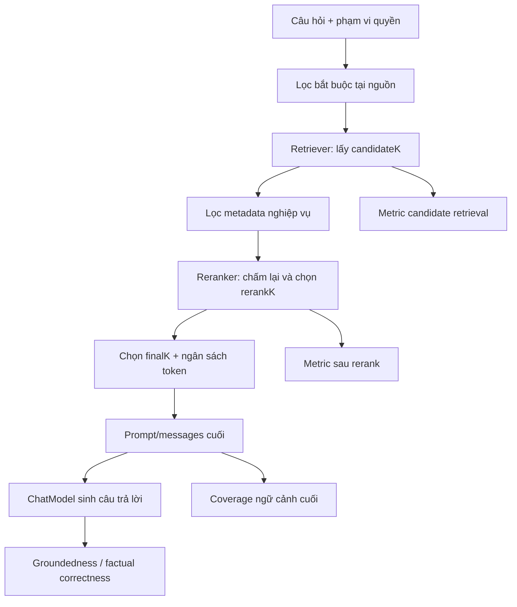

# So sánh thay đổi top-k, bộ lọc và bước xếp hạng lại trong RAG

> **Chương:** Đánh giá RAG  
> **Module:** `SPRING_AI_EVALUATION_OBSERVABILITY` — đánh giá chất lượng ứng dụng Spring AI bằng bộ dữ liệu, tiêu chí relevance, fact checking, kiểm thử RAG và gọi công cụ; kết hợp metrics, traces, token, chi phí và độ trễ để xác định nguyên nhân chất lượng thay đổi giữa các phiên bản prompt, model và pipeline.

## Mục tiêu học tập

Sau bài này, bạn có thể:

1. Phân biệt `candidateK`, `rerankK`, `finalK` và ngân sách token; mô tả tác động của việc thay đổi top-k ở **từng giai đoạn**.
2. Thiết kế phép so sánh có kiểm soát giữa cấu hình **không lọc/có lọc**, **không rerank/có rerank**, và các mức K khác nhau trên cùng bộ nhãn.
3. Phân biệt bộ lọc **bắt buộc** (quyền truy cập, tenant, hiệu lực nguồn) với bộ lọc **phục vụ cải thiện độ liên quan**; nhận ra lỗi khi lọc sau khi cắt top-k.
4. Đo `Recall@K`, `Precision@K`, `MRR@K`, `nDCG@K`, độ bao phủ bằng chứng trong prompt cuối, khả năng trả lời có căn cứ, latency, token và chi phí.
5. Xác định nguyên nhân một thử nghiệm tăng recall ở retrieval nhưng giảm chất lượng câu trả lời; đưa ra quyết định cấu hình phù hợp với ràng buộc vận hành.

## 1. Ba nút điều chỉnh thường ảnh hưởng lẫn nhau

Trong Retrieval-Augmented Generation (RAG), pipeline lấy một nhóm tài liệu ứng viên, có thể lọc theo metadata, sắp lại thứ tự bằng reranker, chọn các đoạn đưa vào prompt rồi gọi LLM. Ba kiểu thay đổi phổ biến:

- **Top-k:** Tăng/giảm số kết quả ở một giai đoạn. Tăng K ở retrieval có thể tìm thêm chứng cứ; tăng K ở prompt có thể tăng nhiễu, token và thời gian xử lý.
- **Bộ lọc:** Chỉ cho phép những kết quả thỏa điều kiện. Bộ lọc đúng giúp bỏ dữ liệu sai phạm vi; bộ lọc quá chặt có thể loại chính nguồn cần để trả lời.
- **Reranking:** Chấm lại và đổi thứ tự candidates để những đoạn hữu ích hơn nằm sớm; reranker **không thể khôi phục một tài liệu không có trong danh sách đầu vào**.



Sơ đồ mô tả **một** cách tổ chức. Một số hệ thống áp dụng lọc ngay trong truy vấn vector store, một số kết hợp lọc ở tầng tìm kiếm và sau rerank. Điều bắt buộc là **có ranh giới quan sát rõ** để biết K được áp dụng khi nào và các tài liệu bị loại ở bước nào.

### Không có một biến “topK” chung cho mọi pipeline

| Ký hiệu | Ý nghĩa | Ví dụ | Rủi ro khi hiểu nhầm |
| --- | --- | ---: | --- |
| `candidateK` | Số ứng viên lấy từ search trước rerank | 20 | Gán `topK=20` ở vector search nhưng prompt chỉ nhận 4 đoạn |
| `rerankK` | Số kết quả giữ lại sau xếp hạng lại | 8 | Reranker có 20 đầu vào nhưng chỉ chuyển 8 |
| `finalK` | Số đoạn tối đa được chọn cho context | 4 | Thấy retrieval recall cao nhưng prompt thiếu nguồn ở hạng 5 |
| `contextTokenBudget` | Giới hạn token dành cho chứng cứ | 1.500 | Chọn 4 ID nhưng một số đoạn bị cắt giữa câu |
| `answerMaxTokens` | Giới hạn token sinh của model | 300 | Không phải số tài liệu truy xuất |

Trong một pipeline tuần tự không bổ sung nguồn mới, thông thường `finalK ≤ rerankK ≤ candidateK`. Nếu có nhiều nhánh retrieval, tool hoặc mở rộng thêm tài liệu, những bất đẳng thức này có thể không áp dụng trực tiếp. Cần ghi số liệu theo **từng nhánh và từng lượt gọi model**.

## 2. Một bộ test cố định để so sánh

Ví dụ giả định: người dùng hỏi “Đơn công tác cần nộp trước bao lâu, ai duyệt, và trường hợp vượt hạn mức chi phí cần thêm phê duyệt nào?”

| ID | Nội dung | Loại tài liệu | Có bằng chứng cần thiết? |
| --- | --- | --- | --- |
| `D01` | Nộp trước **ít nhất 3 ngày làm việc** | `policy` | Có: thời hạn |
| `D02` | **Trưởng bộ phận** phê duyệt | `policy` | Có: người duyệt |
| `D03` | Vượt hạn mức cần thêm **tài chính** duyệt | `appendix` | Có: ngoại lệ chi phí |
| `D07` | Phụ cấp tiền ăn tối đa 150.000 đồng | `guide` | Không |
| `D08` | Hướng dẫn đặt khách sạn | `guide` | Không |
| `D09` | Chính sách công tác phiên bản hết hiệu lực | `archived` | Không cho câu hỏi hiện hành |
| `D10` | Lịch công tác tuần của một nhóm | `schedule` | Không |
| `D11` | Thông báo nội bộ khác | `notice` | Không |

Giả sử các nguồn đều được phép truy cập, ngoại trừ những ràng buộc được nêu riêng trong thí nghiệm. Bộ nhãn tại **cấp tài liệu gốc** có `R = {D01, D02, D03}` và ba facts cần trả lời là `F1` (thời hạn), `F2` (người duyệt), `F3` (duyệt thêm).

Với cùng một truy vấn, vector search giả định trả ranking:

```text
Rank            1     2     3     4     5     6     7     8
Document       D01   D07   D08   D02   D09   D03   D10   D11
Gold relevant   1     0     0     1     0     1     0     0
```

Đây là **bộ dữ liệu minh họa**, không phải số liệu của Spring AI hoặc một dịch vụ thực tế. Nó cho thấy một retriever có thể đưa nguồn chính xác lên đầu nhưng xếp hai bằng chứng bổ sung xuống thấp.

### Các cấu hình thử nghiệm

| Run | `candidateK` | Bộ lọc nghiệp vụ | Rerank | `finalK` | Kết quả vào bước chọn context (giả định) |
| --- | ---: | --- | --- | ---: | --- |
| **A — baseline** | 3 | Không | Không | 3 | `[D01, D07, D08]` |
| **B — tăng candidates** | 8 | Không | Không | 3 | `[D01, D07, D08]` |
| **C — thêm rerank** | 8 | Không | Có, xếp đúng ba nguồn lên trước | 3 | `[D01, D02, D03]` |
| **D — lọc loại tài liệu quá hẹp** | 8 | Chỉ `doc_type=policy` | Không | 3 | `[D01, D02]`; mất `D03` là appendix |
| **E — lọc theo phạm vi hợp lý** | 8 | Cho phép `policy`, `appendix`; bỏ bản hết hiệu lực | Không | 3 | `[D01, D02, D03]` |

Ở D/E, giả định lọc được áp dụng **trên cả tám candidates trước khi lấy finalK** và giữ thứ tự tương đối. Trong thực tế, đẩy lọc vào search engine có thể làm thay đổi cả tập candidates lẫn thứ hạng vì thuật toán tìm kiếm hoạt động trên tập dữ liệu đã lọc; không được xem bảng là một cam kết hành vi của vector store.

Điểm đáng chú ý của B: tăng `candidateK` từ 3 lên 8 đã tạo **cơ hội** tìm đủ nguồn, nhưng nếu vẫn lấy ngay ba kết quả đầu thì prompt không cải thiện. Cần đi kèm một bước **chọn, lọc hoặc rerank** phù hợp.

## 3. Thiết kế phép đo theo đúng vị trí K

Một chỉ số như `Recall@3` chỉ có ý nghĩa khi biết **danh sách xếp hạng nào** được đưa vào công thức. Nên dùng tên nhất quán:

- `candidate_recall@8`: tỷ lệ nguồn gold nằm trong tám candidates ban đầu.
- `post_filter_recall@3`: tỷ lệ nguồn gold nằm trong ba kết quả đầu **sau bộ lọc**.
- `post_rerank_recall@3`: tỷ lệ nguồn gold nằm trong ba kết quả đầu **sau rerank**.
- `final_context_fact_coverage`: tỷ lệ facts có bằng chứng **còn nguyên trong prompt cuối**, sau chọn và cắt token.
- `answer_groundedness`: tỷ lệ claims của câu trả lời thực sự có căn cứ trong prompt.

Với `R = {D01,D02,D03}` và bảng ở phần 2:

| Run/stage | Kết quả top 3 sau stage | `Precision@3` | `Recall@3` | `Hit@3` |
| --- | --- | ---: | ---: | ---: |
| A — candidates | `D01,D07,D08` | `1/3` | `1/3` | `1` |
| B — candidates đầu 3 | `D01,D07,D08` | `1/3` | `1/3` | `1` |
| C — sau rerank | `D01,D02,D03` | `3/3` | `3/3` | `1` |
| D — sau lọc `policy` | `D01,D02` | `2/3` | `2/3` | `1` |
| E — sau lọc `policy+appendix` | `D01,D02,D03` | `3/3` | `3/3` | `1` |

Theo quy ước ở đây, `Precision@3` luôn lấy mẫu số **3**, kể cả run D chỉ còn hai kết quả. Khi so sánh, phải cố định quy ước mẫu số và cách xử lý trùng ID. MRR/Hit đều bằng 1 ở tất cả run vì `D01` luôn ở vị trí đầu, nhưng chúng không phát hiện sự khác biệt về **đủ ba nguồn**. Đây là lý do cần đo recall, coverage và chất lượng thứ hạng cùng nhau.

### Candidate recall đặt giới hạn cho reranker

Nếu candidates không chứa `D02` và `D03`, reranker không thể xếp chúng lên đầu. Trong pipeline chỉ rerank trên candidates có sẵn:

\[
\text{RelevantIDs}(RerankedTopK)\subseteq\text{RelevantIDs}(Candidates)
\]

Vì vậy `Recall(RerankedTopK) ≤ Recall(Candidates)` khi đo cùng gold set và cùng đơn vị ID. Với `candidateK=3` ở run A, recall tối đa của reranker trên các candidates ấy chỉ là `1/3`, dù reranker có chính xác tuyệt đối.

Nếu thấy recall sau rerank **cao hơn** recall của candidates đã log, có thể do hai giai đoạn sử dụng đơn vị ID khác nhau, lọc dữ liệu ghi nhận sai stage, hoặc pipeline thực ra có thêm retrieval/expansion giữa hai điểm đo.

## 4. Thay đổi top-k: tăng bao nhiêu mới hợp lý?

### 4.1. Tăng candidates và tăng context là hai quyết định khác nhau

Giữ `candidateK=20` để reranker có đủ lựa chọn có thể mang lại lợi ích nhưng vẫn giới hạn `finalK=4` để tránh prompt quá dài. Ngược lại, tăng `finalK` từ 4 lên 12 có thể làm nhiều chứng cứ đi vào model hơn, song cũng đưa các đoạn nhiễu và trùng lặp vào context.

| Điều chỉnh | Kỳ vọng có thể xảy ra | Cần đo để kết luận |
| --- | --- | --- |
| Tăng `candidateK`, giữ `finalK` | Candidate recall tăng; reranker tốn thêm thời gian | Candidate recall, post-rerank recall, rerank latency |
| Tăng `finalK`, giữ retrieval | Có thêm chứng cứ vào prompt nhưng tăng nhiễu | Final-context fact coverage, groundedness, input tokens |
| Giảm `finalK` | Tiết kiệm token; có thể mất ngoại lệ hoặc nguồn thứ hai | Coverage theo fact, citation accuracy, cost |
| Tăng `rerankK` | Cho bước downstream nhiều nguồn hơn | Recall ở vị trí được chuyển tiếp, latency, token |
| Giảm `candidateK` | Nhanh hơn nhưng hạn chế trần recall | Candidate Recall@K, số case đa nguồn thất bại |

### 4.2. Đo đường cong theo K, không tối ưu theo một điểm

Chạy các giá trị `candidateK = 3, 5, 10, 20` với **cùng query, corpus và filter**. Khi đánh giá rerank, giữ `finalK` cố định (ví dụ 4) để biết tác động của việc tăng ứng viên. Khi đánh giá context size, giữ candidates và rerank cố định, chỉ đổi `finalK` hoặc `contextTokenBudget`.

Ghi trên từng câu hỏi: candidates IDs, thứ tự, source revision, tài liệu bị loại và số tokens của **đoạn cuối**. Đường cong `Recall@K` thông thường không giảm khi tăng K trên **một ranking đã cố định**, nhưng nếu mỗi K kích hoạt một tìm kiếm mới với thuật toán gần đúng hoặc filter khác, kết quả không nhất thiết là một prefix hoàn toàn giống nhau.

### 4.3. K không thay thế được ngân sách token

Hai chunks có độ dài 200 và 2.000 tokens là hai chi phí rất khác nhau. `finalK=4` chưa bảo đảm tất cả bằng chứng trong bốn chunk được đưa vào prompt. Nếu áp dụng truncation, cần lưu **final context** chứ không chỉ ID; một nguồn có thể vẫn hiện diện nhưng mất điều khoản ngoại lệ.

Với câu hỏi nhiều phần, chiến lược chọn đoạn theo **bao phủ các facts** có thể tốt hơn lấy đúng K chunks đầu tiên; mọi chiến lược này cần được thử nghiệm với nhãn và kiểm tra tính đúng bằng chứng.

## 5. Bộ lọc metadata: giảm nhiễu hoặc làm mất bằng chứng

Bộ lọc có thể dùng `tenant_id`, `role`, `effective_date`, `document_type`, `language`, `region`, `revision` hoặc trạng thái tài liệu. Hai nhóm phải được xử lý khác nhau.

### 5.1. Lọc bắt buộc về quyền và tính hợp lệ

Nguồn không được phép truy cập **không được dùng làm ứng viên để trả lời**, dù cho điểm relevance rất cao. Nếu chỉ tìm trên toàn bộ corpus rồi áp dụng ACL sau khi lấy top 3, top 3 có thể toàn dữ liệu không được phép; sau lọc còn rỗng dù corpus được phép có tài liệu đúng ở rank 4 hoặc thấp hơn.

Thực hành cần thiết:

- Áp dụng tenant/ACL ở **nguồn truy xuất đáng tin** hoặc một tầng bảo mật có đảm bảo tương đương, không dựa vào việc model tự tuân thủ hướng dẫn.
- Khi tìm kiếm không hỗ trợ filter đáng tin cậy, cần dùng kiến trúc phân vùng/index quyền phù hợp; chỉ lọc hậu kỳ để tối ưu chất lượng **không thay thế** bước kiểm soát quyền.
- Tập gold `R` phải phản ánh **những tài liệu hợp lệ trong phạm vi quyền** của test case. Không chấm retriever là thiếu recall vì nó không trả các nguồn mà người dùng không được phép xem.
- Không đưa tên, nội dung hoặc ID bí mật của tài liệu bị từ chối vào prompt hay log thông thường.

### 5.2. Lọc phục vụ chất lượng: phải kiểm chứng false negatives

Ví dụ filter `doc_type=policy` bỏ các hướng dẫn du lịch và phụ cấp, nhưng `D03` nằm trong `appendix` cũng bị loại. Precision nhìn chung có thể tăng, trong khi recall của câu hỏi đa nguồn giảm. Filter `doc_type in (policy, appendix)` có thể phù hợp hơn cho ví dụ, nhưng không tự động đúng với mọi bài toán.

Các trường hợp làm filter sai:

1. **Metadata thiếu/không nhất quán:** Một số tài liệu không có `doc_type`, hoặc có giá trị `"policy-appendix"` khác `"appendix"`.
2. **Ngày hiệu lực không chuẩn:** Filter theo `updated_at` thay vì `effective_from` làm bỏ bản đúng hoặc giữ bản cũ.
3. **Phạm vi địa lý/ngôn ngữ quá cứng:** Nguồn tiếng Anh có thể là nguồn chuẩn duy nhất cho câu hỏi tiếng Việt.
4. **Filter theo khái niệm suy từ câu hỏi:** Query classifier nhầm loại tài liệu làm loại luôn nguồn cần tìm.
5. **Lọc sau cắt topK:** Trả thiếu kết quả dù nguồn hợp lệ có ngay sau `candidateK`.

Nên đo **filter survival rate** (tỷ lệ ứng viên giữ lại), **relevant drop count** (số nguồn gold bị lọc), `Recall@K` trước/sau lọc, và tỷ lệ case context bị thiếu nguồn do filter.

### 5.3. Thứ tự filter và top-k thay đổi kết quả

Với ranking `[D01,D07,D08,D02,D09,D03,...]`:

```text
Sai cho mục tiêu tìm đủ nguồn:
  search top3          -> [D01,D07,D08]
  filter policy+appendix -> [D01]

Lọc trên candidates đủ rộng (để minh họa):
  search top8          -> [D01,D07,D08,D02,D09,D03,D10,D11]
  filter policy+appendix -> [D01,D02,D03]
  take final3          -> [D01,D02,D03]

Nếu filter được đẩy xuống index:
  search within eligible corpus -> danh sách/tính điểm có thể khác;
  phải đo lại trên hệ thống thực tế.
```

**Lưu ý:** Việc lấy `top8` rồi lọc là phép thử **chất lượng** trên candidates đã được phép truy cập. Với ACL, giải pháp phải chặn truy cập ngay từ nguồn hoặc qua cơ chế bảo mật tương đương; không dùng ví dụ này như hướng dẫn lọc quyền sau khi đọc dữ liệu cấm.

## 6. Reranker: cải thiện thứ hạng nhưng không tạo bằng chứng

Retriever ban đầu thường tối ưu việc **tìm candidates có khả năng liên quan**. Reranker nhận `(question, candidate_text)` và cho điểm hoặc thứ tự mới phù hợp hơn với mục tiêu trả lời.

Reranker có thể là mô hình cross-encoder, LLM judge/reranker, một quy tắc nghiệp vụ hoặc mô hình học xếp hạng. Mỗi loại có độ trễ, chi phí và khả năng diễn giải khác nhau.

| Vấn đề | Retriever ban đầu | Reranker |
| --- | --- | --- |
| Đầu vào | Query + index/corpus | Query + danh sách candidates có sẵn |
| Mục đích | Tìm được nguồn liên quan, ưu tiên recall | Đẩy nguồn hữu ích lên trước khi chọn context |
| Có thể bổ sung nguồn không có trong candidates? | Có thể, qua tìm kiếm | Không, nếu chỉ xếp lại |
| Rủi ro | Bỏ sót từ khóa, điều kiện, nguồn mới, filter sai | Ưu tiên đoạn cùng chủ đề, bỏ sót bằng chứng thứ yếu |
| Chi phí | Index/search latency | Chi phí chấm nhiều candidates, CPU/GPU hoặc token |
| Phép đo chính | Candidate Recall@K | nDCG@K, MRR@K, post-rerank Recall@finalK, latency |

### 6.1. MRR không đủ cho câu hỏi nhiều nguồn

Trong ví dụ, `D01` đã ở vị trí 1 trước và sau rerank. `MRR@3 = 1` ở cả A lẫn C. Tuy nhiên A thiếu `D02, D03` trong prompt, C đưa đủ cả ba vào top 3. Đánh giá tốt hơn cần kết hợp `Recall@3`, `Precision@3`, coverage theo fact và chỉ số thứ hạng có tính mọi tài liệu relevant như `nDCG@3`.

### 6.2. Rerank có thể hại nếu rubric không đúng

Nếu reranker đánh giá “câu nào giống câu hỏi nhất?” nó có thể ưu tiên đoạn nói thời hạn và đẩy đoạn về **ngoại lệ** xuống cuối, dù chính ngoại lệ là ý bắt buộc. Với câu đa nguồn, cần cân nhắc tính đa dạng bằng chứng, điều kiện/ngoại lệ và các nhánh truy vấn.

Khi so sánh reranker:

- Giữ **cùng một danh sách candidates có thứ tự và nội dung** cho thử nghiệm offline nếu muốn đo riêng khả năng xếp hạng.
- Đánh giá theo đúng `K` downstream, không chỉ so điểm reranker riêng lẻ.
- Ghi model/version, score normalization, prompt của reranker (nếu dùng LLM), số candidates, batch size, timeout và chi phí.
- Kiểm tra các case phủ định, đa điều kiện, số liệu, nguồn mới, tiếng Việt và tài liệu có cấu trúc.

### 6.3. Reranking và source authority

Điểm relevance cao không cho quyền vượt qua ACL hoặc chọn bản chính sách hết hiệu lực. Rerank chỉ nên làm việc trên **nguồn hợp lệ**; tính hiện hành, quyền truy cập và thẩm quyền cần được áp dụng bằng quy tắc được xác nhận ở tầng dữ liệu.

## 7. Thiết kế phép thí nghiệm có kiểm soát

Muốn biết một thay đổi có ích, mỗi thí nghiệm cần một giả thuyết đo được và một baseline cố định.

### 7.1. Khóa những yếu tố nền

Tối thiểu ghi:

- `dataset_version`, `qrels_version` và cách gán nhãn ở cấp source/chunk/fact.
- `corpus_version`, `index_version`, pipeline ingestion/chunking, embedding model và cách xử lý duplicates.
- Phiên bản và thông số truy vấn, query rewrite, bộ lọc ACL/metadata, tenant, thời gian hiệu lực.
- `candidateK`, `rerankK`, `finalK`, token budget, prompt/model version.
- Cấu hình tính metrics, judge/rubric version và phương pháp tính token/cost.

Nếu cùng lúc đổi embedding, filter, reranker, prompt và model thì khó biết nguyên nhân. Có thể làm **ablation**: lần lượt thêm từng thay đổi vào một baseline, rồi thử kết hợp khi đã hiểu tác động riêng.

### 7.2. Ma trận thí nghiệm gợi ý

| ID | Giả thuyết | Thay đổi duy nhất | Metric chính | Điều kiện đánh đổi |
| --- | --- | --- | --- | --- |
| `T1` | Cần thêm candidates cho câu đa nguồn | `candidateK: 5 → 20`; giữ reranker/finalK | Candidate recall và final Recall@K | Search/rerank latency |
| `T2` | Lọc metadata bỏ nhiễu | Thêm filter doc_type có kiểm chứng | Post-filter Precision/Recall@K | Relevant drop / ACL correctness |
| `T3` | Reranker đưa nguồn đúng lên sớm | Bật rerank trên cùng 20 candidates | nDCG@finalK, Recall@finalK | Rerank latency/cost |
| `T4` | Context lớn hơn giữ đủ facts | `finalK: 3 → 5`; giữ upstream | Final-prompt fact coverage | Tokens, groundedness |
| `T5` | Bớt chunks trùng cải thiện hiệu quả | Thêm dedup trước chọn context | Unique source coverage | Có mất các chunk chứa ý khác nhau? |
| `T6` | Kết hợp filter và rerank hiệu quả hơn | Giữ filter, bật rerank trên cùng eligible set | Chất lượng câu trả lời đầu-cuối | Latency, chi phí, độ ổn định |

Một so sánh tốt cần tính điểm **trên từng case**, rồi tổng hợp theo nhóm. Không chỉ so 10 câu mẫu dễ; cần câu đa nguồn, điều kiện/ngoại lệ, dữ liệu mới, truy vấn mơ hồ, tiếng Việt và câu **không có đáp án**.

### 7.3. Hai dạng so sánh khác nhau

**Offline replay:** Cố định danh sách candidates trong file đánh giá và chạy các thuật toán lọc/rerank khác nhau. Cách này giúp tách ảnh hưởng của bước sau search, nhưng không phản ánh thay đổi do filter được đẩy xuống index.

**End-to-end replay:** Chạy lại toàn bộ pipeline với corpus/index/ACL đã cố định và các cấu hình cần so sánh. Cách này phản ánh vận hành thực, nhưng kết quả có thể chịu ảnh hưởng của search gần đúng, network, model judge và model sinh.

Đừng kết luận “filter không thay đổi recall” từ offline replay rồi áp dụng nguyên xi cho pushdown filter vào vector index; vị trí áp dụng có thể làm đổi tập ứng viên.

## 8. Java: phép đo từng stage với cùng tập nhãn

Hàm Java 17+ dưới đây nhận danh sách ID xếp hạng và qrels nhị phân ở cấp **cùng đơn vị** (đều là source IDs hoặc đều là chunk IDs). Một ID lặp lại chỉ được tính hit lần đầu, nhưng **vẫn chiếm một vị trí**, phản ánh chi phí slot của ranking thực.

```java
import java.util.HashSet;
import java.util.List;
import java.util.Objects;
import java.util.Set;

public final class RetrievalStageMetrics {
    private RetrievalStageMetrics() {}

    public record Scores(
            double precisionAtK,
            double recallAtK,
            boolean hitAtK,
            double reciprocalRankAtK) {}

    public static Scores score(
            List<String> rankedIds, Set<String> goldRelevantIds, int k) {
        Objects.requireNonNull(rankedIds, "rankedIds");
        Objects.requireNonNull(goldRelevantIds, "goldRelevantIds");
        if (k < 1 || goldRelevantIds.isEmpty()) {
            throw new IllegalArgumentException(
                    "K phải dương và gold relevant IDs không được rỗng");
        }

        Set<String> seen = new HashSet<>();
        int hits = 0;
        double firstRelevantRr = 0.0;

        for (int i = 0; i < Math.min(k, rankedIds.size()); i++) {
            String id = rankedIds.get(i);
            if (seen.add(id) && goldRelevantIds.contains(id)) {
                hits++;
                if (firstRelevantRr == 0.0) {
                    firstRelevantRr = 1.0 / (i + 1);
                }
            }
        }

        return new Scores(
                hits / (double) k,
                hits / (double) goldRelevantIds.size(),
                hits > 0,
                firstRelevantRr);
    }

    public static void main(String[] args) {
        Set<String> gold = Set.of("D01", "D02", "D03");
        List<String> baseline = List.of("D01", "D07", "D08");
        List<String> reranked = List.of("D01", "D02", "D03");

        System.out.println(score(baseline, gold, 3));
        // Scores[precisionAtK=0.333..., recallAtK=0.333...,
        //        hitAtK=true, reciprocalRankAtK=1.0]

        System.out.println(score(reranked, gold, 3));
        // Scores[precisionAtK=1.0, recallAtK=1.0,
        //        hitAtK=true, reciprocalRankAtK=1.0]
    }
}
```

**Quy ước của ví dụ:** `Precision@K` dùng mẫu số K ngay cả khi trả ít hơn K; qrels được giả định đầy đủ; nhãn không xét graded relevance; câu hỏi có gold set rỗng được đưa sang nhóm kiểm thử *no-evidence/abstention* riêng. Khi nguồn có nhiều chunk, cần ánh xạ ID thống nhất và không tính nhiều chunk của cùng nguồn như nhiều tài liệu nếu nhãn ở cấp source.

### 8.1. Đo cùng một run ở các giai đoạn

```java
import java.util.List;
import java.util.Set;

Set<String> gold = Set.of("D01", "D02", "D03");
List<String> candidates = List.of(
        "D01", "D07", "D08", "D02",
        "D09", "D03", "D10", "D11");
List<String> afterRerank = List.of(
        "D01", "D02", "D03", "D07",
        "D08", "D09", "D10", "D11");

var candidateMetrics =
        RetrievalStageMetrics.score(candidates, gold, 8);
var finalMetrics =
        RetrievalStageMetrics.score(afterRerank, gold, 3);

// candidateMetrics.recallAtK() = 1.0
// finalMetrics.recallAtK() = 1.0
// Trong một run không rerank, lấy 3 ID đầu của candidates chỉ đạt 1/3.
```

Hai score không nên được so sánh như `Precision@8` và `Precision@3` là cùng một biến không đổi. Để chấm **tác động riêng của rerank**, hãy tính `Recall@3`/`nDCG@3` **trước và sau rerank trên cùng candidates**, cùng tập nhãn.

## 9. Spring AI: chỗ lấy ứng viên, gắn filter và rerank

Trong Spring AI, `VectorStore` hỗ trợ tìm `Document` và một số phiên bản cung cấp `SearchRequest.builder()` với `query(...)` và `topK(...)`. Đoạn sau minh họa **retrieval stage** và cố tình không giả định tất cả ứng dụng dùng cùng advisor/reranker:

```java
import java.util.List;
import org.springframework.ai.document.Document;
import org.springframework.ai.vectorstore.SearchRequest;
import org.springframework.ai.vectorstore.VectorStore;

// Ví dụ bên trong service có VectorStore đã cấu hình.
int candidateK = 20;
var request = SearchRequest.builder()
        .query(question)
        .topK(candidateK)
        .build();

List<Document> candidates = vectorStore.similaritySearch(request);

// Ghi ID, rank, source revision, metadata stage và thời gian search.
// Áp dụng bước lọc chất lượng và rerank theo contract của pipeline.
// Ghi thứ tự sau rerank và context cuối trước ChatModel.
```

Đây là **đoạn minh họa** cho API phổ biến, không phải class tự chạy; cần đối chiếu phiên bản Spring AI đang dùng. Một số VectorStore hỗ trợ `filterExpression` trong `SearchRequest` để đẩy lọc metadata vào truy vấn, nhưng **cú pháp, kiểu dữ liệu và khả năng hỗ trợ filter** phụ thuộc phiên bản/nhà cung cấp vector store. Không nên copy một biểu thức filter chưa kiểm chứng rồi mặc định nó thực thi đúng ACL.

Với ứng dụng dùng `ChatClient` và retrieval advisor, advisor có thể tự tìm kiếm, chèn context hoặc thay đổi yêu cầu trước khi gọi model. Vì vậy:

1. Muốn đo **candidates thực của advisor**, cần instrument retrieval trong advisor hoặc đọc metadata tương ứng nếu phiên bản hỗ trợ.
2. Muốn đo **sau rerank**, cần thu thứ tự và nội dung sau đúng reranker thực tế.
3. Muốn đo **final context**, phải quan sát prompt/messages ngay trước `ChatModel` sau các advisor còn khả năng sửa message.
4. Nếu có `tool calling`, mỗi tool response có thể bổ sung evidence cho một **lượt gọi model kế tiếp**, cần gắn `call_id` và nguồn riêng.

Không coi một `similaritySearch(...)` gọi độc lập là kết quả chính xác của advisor nếu advisor đang có query rewrite, filter, rerank hoặc chính sách token riêng.

### Reranker trong ứng dụng

Có thể tạo một hợp đồng nội bộ không phụ thuộc nhà cung cấp reranker:

```java
import java.util.List;
import org.springframework.ai.document.Document;

public interface DocumentReranker {
    // Giữ provenance: ID và metadata phải theo được sau rerank.
    List<Document> rerank(
            String question, List<Document> authorizedCandidates);
}
```

Triển khai adapter cho cross-encoder hoặc LLM reranker ở tầng tích hợp theo phiên bản và thư viện cụ thể. Khi chạy thực tế, cần xác định cách xử lý timeout, retry và fallback về thứ tự ban đầu; ghi `rerank_status` để không trộn các request có rerank thành công với các request fallback.

## 10. Kiểm tra đầu-cuối: retrieval tốt chưa chắc câu trả lời tốt

Sau rerank, ba nguồn `D01,D02,D03` có thể đứng đầu nhưng `D03` bị cắt mất phần “phê duyệt bổ sung của tài chính” vì token budget. Khi đó:

- `post_rerank_recall@3 = 1` theo ID.
- `final_context_fact_coverage = 2/3` nếu prompt chỉ còn đủ bằng chứng cho `F1` và `F2`.
- Model trả “không cần tài chính duyệt thêm” là **không grounded** và có thể sai thực tế.

Để phân biệt nguyên nhân, có thể chạy hai lời gọi generation bằng cùng prompt/model:

1. **Retrieved context:** context mà pipeline hiện tại tạo ra.
2. **Oracle context:** những đoạn đã được người duyệt xác nhận chứa đủ `F1,F2,F3`.

Nếu oracle context giúp trả lời đúng trong khi retrieved context không đúng, nên kiểm tra retrieval, filter, rerank và context selection. Nếu cả hai đều sai, kiểm tra model/prompt/khả năng diễn giải, trích dẫn và độ ổn định. Kết quả chỉ giúp **khoanh vùng**, không chứng minh nguyên nhân tuyệt đối vì thứ tự, độ dài ngữ cảnh và tính ngẫu nhiên cũng có thể ảnh hưởng.

### Khi top-k tăng nhưng factual correctness giảm

Những nguyên nhân cần xem xét:

- Nhiễu tăng khiến model dựa vào tài liệu không trả lời trực tiếp.
- Bản tài liệu cũ hoặc ngoài phạm vi được đưa vào context.
- Phần điều kiện/phủ định bị cắt để nhường chỗ cho tài liệu khác.
- LLM bị phân tán chú ý giữa nhiều đoạn tương tự nhưng khác hiệu lực.
- Prompt không đủ chặt về citation, nên model trộn dữ liệu từ nhiều nguồn.

Những giả thuyết này cần được kiểm tra bằng **evidence manifest và trace thực**, thay vì chỉ kết luận từ tổng số token.

## 11. Quan sát metrics, traces, độ trễ và chi phí

Evaluation trả lời *“chất lượng thay đổi như thế nào?”*; observability giúp trả lời *“trong request này, đoạn nào đã bị loại hoặc tốn thời gian?”*. Spring AI có thể tích hợp với Micrometer Observation/Tracing tùy phiên bản và cấu hình. Những tên span/field dưới đây là **thiết kế minh họa cho ứng dụng**, không phải cam kết của một phiên bản Spring AI.

```text
trace_id = trace-rag-008
  request_id = req-008
    auth_filter        eligible_corpus_version=policy-v3
    vector_search      candidate_k=20, returned=20, latency_ms=86
    metadata_filter    kept=15, removed=5, policy=policy-and-appendix-v2
    rerank             input=15, output=6, latency_ms=122
    context_assembly   final_k=4, blocks=4, truncated=1
    model.call         call_id=req-008-answer-1,
                       input_tokens=1810, output_tokens=196,
                       latency_ms=920
    evaluation         candidate_recall_at_20=1.0,
                       final_fact_coverage=0.67,
                       answer_groundedness=partial
```

| Nhóm số liệu | Nên ghi | Ý nghĩa |
| --- | --- | --- |
| Retrieval | `candidateK`, số candidates, rank, IDs, corpus/index version, latency | Tăng K có thực sự tìm thêm nguồn liên quan? |
| Filter | Tên/version chính sách, count giữ/loại, relevant drops trong test | Filter có quá chặt hoặc sai phạm vi? |
| Rerank | Model/version, input count, output count, rank delta, latency, fallback | Có đưa nguồn cần thiết lên đầu với chi phí chấp nhận được? |
| Context | `finalK`, token budget, số block trùng/cắt, evidence manifest | Chứng cứ có còn trong prompt cuối? |
| Generation | Prompt/model version, groundedness, citation support, answer completeness | Model có dùng đúng bằng chứng đã cấp? |
| Vận hành | p50/p95 end-to-end latency, retries, timeouts, tokens, cost/request | Giá trị cải thiện có xứng với độ trễ và chi phí? |

Một phép rerank có thể làm `Recall@4` tăng nhưng thêm 250 ms latency; quyết định chấp nhận phụ thuộc SLA và rủi ro của tác vụ. Chi phí reranker dùng API có thể tính theo token/lời gọi; tính chi phí LLM trả lời phải dựa usage thực tế và bảng giá/model ở thời điểm chạy.

**Không đưa nguyên văn câu hỏi, tài liệu, API key hoặc ID riêng lẻ có cardinality cao vào metric labels.** Traces lưu correlation IDs và tham chiếu đến kho audit có phân quyền. Nếu cần snapshot prompt để kiểm chứng groundedness, áp dụng mã hóa, giới hạn thời gian lưu và chính sách truy cập.

## 12. Báo cáo thay đổi bằng dữ liệu có thể tái lập

Một bản ghi per-case minh họa:

```json
{
  "run_id": "rag-exp-008",
  "case_id": "travel-approval-001",
  "trace_id": "trace-example-008",
  "corpus_version": "travel-policy-v3",
  "qrels_version": "travel-qrels-v2",
  "pipeline_version": "hybrid-rerank-v5",
  "prompt_version": "answer-v4",
  "model_version": "model-a",
  "config": {
    "candidate_k": 8,
    "final_k": 3,
    "filter_policy": "policy-and-appendix",
    "reranker": "reranker-v2"
  },
  "ranked_candidates": [
    "D01", "D07", "D08", "D02", "D09", "D03", "D10", "D11"
  ],
  "post_filter_ids": ["D01", "D02", "D03"],
  "post_rerank_ids": ["D01", "D02", "D03"],
  "final_context_ids": ["D01", "D02", "D03"],
  "metrics": {
    "candidate_recall_at_8": 1.0,
    "final_recall_at_3_by_id": 1.0,
    "final_context_fact_coverage": 0.6667,
    "answer_groundedness": "PARTIAL"
  },
  "observability": {
    "retrieval_latency_ms": 83,
    "rerank_latency_ms": 104,
    "model_input_tokens": 1750,
    "model_output_tokens": 160
  }
}
```

Các số liệu trên **chỉ minh họa**. `final_context_ids` chứa `D03` nhưng `final_context_fact_coverage` chỉ `2/3` vì giả định đoạn D03 bị cắt mất câu chứng minh phê duyệt tài chính. Muốn giải thích được sự khác biệt, cần lưu thêm **văn bản final evidence hoặc fingerprint/snapshot có phân quyền**, không chỉ IDs.

### So sánh nhiều phiên bản

| Chỉ số trên cùng bộ test | Baseline A | Bản B | Bản C |
| --- | ---: | ---: | ---: |
| Candidate Recall@K | 0,78 | 0,91 | 0,91 |
| Recall@4 sau chọn/rerank | 0,67 | 0,69 | 0,85 |
| Final-context fact coverage | 0,66 | 0,68 | 0,81 |
| Grounded answer rate | 0,84 | 0,83 | 0,88 |
| p95 latency (giây) | 1,9 | 2,2 | 2,7 |
| Input tokens trung bình | 1.000 | 1.050 | 1.450 |

Đây là bảng **giả định**: B tăng candidate K nhưng chỉ cải thiện nhẹ downstream; C thêm rerank/chọn context tốt hơn nên coverage tăng, đổi lại latency và tokens. Không thể kết luận nhân quả nếu giữa các run còn thay corpus, prompt, model hoặc tập test.

### Kiểm định thay đổi có thật hay chỉ do mẫu

Trên mỗi câu hỏi, lưu điểm baseline và bản thử để tính **paired difference**. Báo trung bình/macro theo case và nhóm (đơn nguồn, đa nguồn, ngoại lệ, không có đáp án). Với bộ test đủ lớn, có thể dùng paired bootstrap theo `case_id` để ước lượng khoảng tin cậy của chênh lệch.

Nếu generation hoặc judge có tính ngẫu nhiên, cần chạy nhiều lần hoặc cố định thông số khi khả thi. Tránh tuyên bố một mức cải thiện vài phần trăm là chắc chắn nếu chỉ có 10 câu hỏi.

## 13. Checklist trước khi quyết định triển khai

1. **Phạm vi test rõ ràng?** Cùng câu hỏi, corpus, ACL, ngày hiệu lực và nhãn.
2. **K được ghi theo stage?** Candidate K, rerank K, final K và token budget có tên riêng.
3. **Filter đúng quyền?** ACL được thực thi đáng tin tại nguồn/tầng bảo mật; qrels chỉ gồm nguồn được phép.
4. **Filter có false negatives?** Kiểm tra appendix, văn bản hiệu lực, metadata bị thiếu và trường hợp nhiều ngôn ngữ.
5. **Rerank có đủ candidates?** Đánh giá candidate recall ceiling trước khi kết luận reranker kém.
6. **Có metric đầy đủ bằng chứng?** Không chỉ nhìn Hit/MRR; báo Recall@K, nDCG và fact coverage.
7. **Prompt cuối đã được quan sát?** Đối chiếu final evidence sau nén/cắt với câu trả lời và citation.
8. **Có theo dõi latency/cost?** So sánh p50/p95, rerank overhead, token và retry.
9. **Có test trường hợp xấu?** Multi-hop, ngoại lệ, câu không trả lời được, dữ liệu cũ, tool lỗi và prompt injection.
10. **Có khả năng rollback cấu hình?** Lưu config/version để khôi phục baseline nếu chất lượng thật suy giảm.

## 14. Bài thực hành

Một bộ test nghỉ phép có ba tài liệu liên quan: `R = {P01, P02, P03}`.

- `P01`: số ngày phép.
- `P02`: điều kiện nộp đơn nghỉ dài ngày.
- `P03`: người phê duyệt.
- `P07`: lịch nghỉ lễ, không trả lời trực tiếp.
- `P08`: hướng dẫn làm việc từ xa, không trả lời trực tiếp.

Retriever đưa ra candidates `[P01, P07, P08, P02, P03]`. Hai cấu hình:

| Cấu hình | Candidate K | Rerank | Final K | Context theo ID |
| --- | ---: | --- | ---: | --- |
| X | 3 | Không | 3 | `[P01, P07, P08]` |
| Y | 5 | Có, đẩy bằng chứng cần lên đầu | 3 | `[P01, P02, P03]` |

**Yêu cầu:**

1. Tính `Precision@3` và `Recall@3` cho X và Y.
2. Vì sao `Hit@3` hoặc `MRR@3` có thể không phân biệt được hai cấu hình?
3. Nếu tăng candidate K của X lên 5 nhưng vẫn chọn top 3 đầu **không rerank/lọc**, các chỉ số ở final K có thay đổi không?
4. Giả sử `P03` là tài liệu kiểu `appendix`. Filter chỉ cho phép `doc_type=policy` sẽ gây lỗi gì?
5. Nếu context của Y có cả ba ID nhưng nội dung `P02` bị cắt mất điều kiện “nghỉ từ 3 ngày liên tiếp”, có thể chấm final-context fact coverage là `3/3` không?
6. Nêu tối thiểu ba loại dữ liệu cần ghi vào trace/evaluation report để so sánh chất lượng và chi phí giữa X, Y.

### Đáp án gợi ý

1. X có một nguồn đúng trong ba vị trí: `Precision@3 = 1/3`, `Recall@3 = 1/3`. Y có ba nguồn đúng: `Precision@3 = 1`, `Recall@3 = 1`.
2. Hai hệ đều có `P01` ở vị trí đầu; `Hit@3 = 1` và `RR@3 = 1` ở cả hai. Chúng không phản ánh việc tìm đủ `P02,P03`.
3. Không. Khi giữ nguyên thứ tự retrieval, top 3 vẫn là `[P01,P07,P08]`; tăng candidates chỉ giúp các bước downstream có thêm lựa chọn.
4. `P03` có thể bị loại dù chứa bằng chứng bắt buộc. Cần kiểm chứng false negatives của filter và cho phép appendix nếu nguồn đó hợp lệ; với ACL vẫn phải áp dụng quyền truy cập riêng.
5. Không. ID còn trong prompt nhưng câu cần để chứng minh fact đã bị cắt; phải kiểm tra **văn bản cuối**. Fact coverage có thể chỉ còn `2/3`.
6. Ví dụ: danh sách candidates và ranking, IDs sau filter/rerank, final context snapshot/manifest, `candidateK/finalK`, `Recall@K`/fact coverage, latency rerank, input tokens, chi phí ước tính và phiên bản corpus/prompt/model.

## Ghi nhớ

- **Top-k có nhiều giai đoạn:** tăng candidate K không tự tăng chất lượng nếu final K và thứ tự chọn context không đổi.
- **Bộ lọc phải đúng mục đích:** ACL/tenant/hiệu lực là ràng buộc nguồn; lọc nghiệp vụ cần được đo cả precision lẫn nguy cơ bỏ sót bằng chứng.
- **Reranker không thể tìm tài liệu chưa có:** candidate recall đặt trần cho recall sau rerank khi pipeline chỉ sắp lại nguồn đã có.
- **So sánh cùng dữ liệu và metric cùng stage:** báo Recall/Precision, ranking metrics, final-context coverage, groundedness, citations, latency, token và chi phí.
- **Kết luận dựa trên trace và câu hỏi thất bại:** xác định nguồn mất ở search, filter, rerank hay context trimming trước khi sửa prompt hoặc model.
