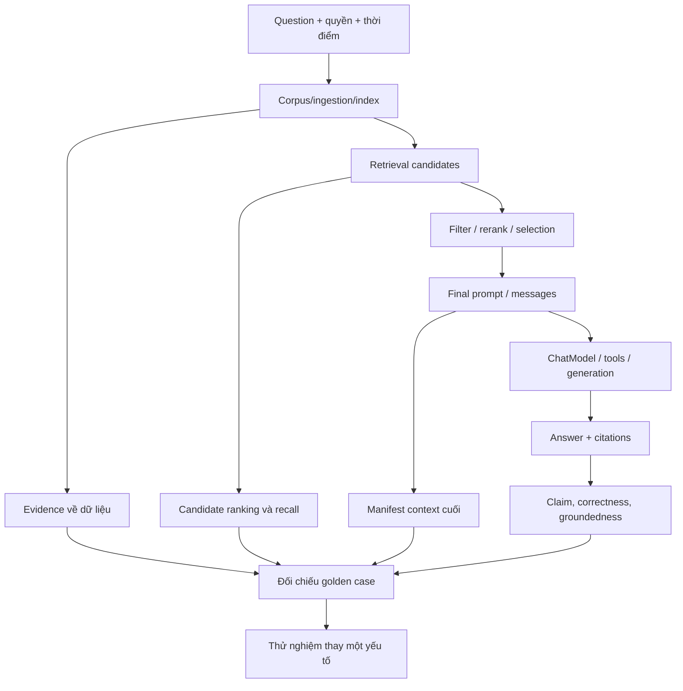
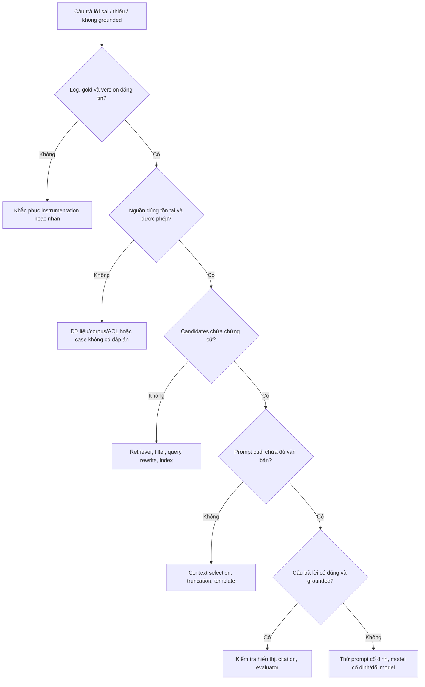

# Khoanh vùng lỗi ở dữ liệu, truy xuất, prompt hay bước sinh trong RAG

> **Chương:** Đánh giá RAG  
> **Module:** `SPRING_AI_EVALUATION_OBSERVABILITY` — đánh giá chất lượng ứng dụng Spring AI bằng tập dữ liệu kiểm thử, relevance, fact checking và kiểm thử luồng RAG hoặc gọi công cụ; đồng thời đo metrics, traces, token, chi phí và độ trễ để tìm nguyên nhân chất lượng suy giảm qua phiên bản prompt, model và pipeline.

## Mục tiêu học tập

Sau bài này, bạn có thể:

1. Tách pipeline RAG thành các ranh giới quan sát để xác định **bằng chứng biến mất hoặc bị diễn giải sai ở bước nào**.
2. Nhận biết dấu hiệu của lỗi **dữ liệu nguồn**, **truy xuất/xếp hạng**, **tạo prompt/ngữ cảnh** và **sinh câu trả lời**, cùng lỗi tool/đo lường dễ bị nhầm sang bốn nhóm này.
3. Thiết kế phép thử có kiểm soát với **oracle source**, **oracle context**, **prompt cố định**, **context cố định** và **model cố định** để kiểm định giả thuyết thay vì suy đoán.
4. Thu thập golden dataset, evidence provenance, metrics, traces, token/latency/cost, kết quả đánh giá relevance, groundedness và factual correctness để phân tích regression.
5. Viết bộ phân loại **giả thuyết lỗi** bằng Java và áp dụng vào một luồng Spring AI mà không coi việc có ID tài liệu là bằng chứng model đã nhận nội dung đầy đủ.

## 1. Một câu trả lời sai có thể bắt nguồn từ nhiều nơi

Trong Retrieval-Augmented Generation (RAG), câu hỏi không đi thẳng tới mô hình. Một đường đi đơn giản có thể gồm: chọn corpus, chia tài liệu thành chunks, tạo embeddings/index, tìm ứng viên, lọc quyền và phiên bản, rerank, lắp context vào prompt, gọi `ChatModel`, phân tích câu trả lời và hiển thị citations.

Giả sử người dùng hỏi: **“Đơn công tác phải nộp trước bao lâu, ai phê duyệt và khi nào cần tài chính duyệt thêm?”**. Ứng dụng trả: “Nộp trước 2 ngày; phòng nhân sự duyệt; không cần tài chính”. Có ít nhất bốn khả năng:

- **Dữ liệu sai hoặc thiếu:** Corpus chỉ chứa chính sách cũ, thiếu tài liệu nói về người duyệt hoặc có bản nháp chưa bị loại.
- **Truy xuất sai:** Corpus có nguồn chuẩn, nhưng retriever không tìm được hoặc xếp chúng ngoài phạm vi được chọn.
- **Prompt/ngữ cảnh sai:** Retriever đã tìm đúng, nhưng filter/rerank/truncation bỏ mất ngoại lệ, hoặc prompt không phân biệt nguồn đang hiệu lực với bản cũ.
- **Sinh sai:** Model đã nhận đủ nguồn và hướng dẫn rõ, nhưng suy diễn sai, trộn hai nguồn hoặc tạo citation không hỗ trợ claim.

Đôi khi còn có **lỗi hệ thống** (timeout, tool trả dữ liệu lỗi, index chưa cập nhật) hoặc **lỗi đo lường** (golden label không tương ứng corpus, judge thay đổi, log thiếu). Những vấn đề này cần được tách ra, không tự động quy hết cho “LLM hallucination”.



**Nguyên tắc chẩn đoán:** Một điểm số thấp chỉ cho biết **có triệu chứng**. Để xác định **nguyên nhân**, phải có bằng chứng ở nhiều ranh giới và thử nghiệm thay đổi được kiểm soát.

## 2. Bốn nhóm lỗi và dấu hiệu quan sát

| Tầng | Ví dụ nguyên nhân | Tín hiệu quan sát được | Phép thử xác nhận |
| --- | --- | --- | --- |
| **Dữ liệu nguồn** | Thiếu chính sách, nguồn sai hiệu lực, chunk mất phủ định, parser làm rơi bảng | Không có bằng chứng đúng trong corpus/index được phép hoặc nội dung index khác bản gốc | Kiểm tra bản gốc, revision, chunking/index, ACL và oracle source |
| **Truy xuất/xếp hạng** | Query rewrite lệch ý, embedding bỏ sót thuật ngữ, `topK` quá nhỏ, filter quá chặt, reranker đưa nguồn xuống cuối | Nguồn chuẩn tồn tại nhưng không có trong candidates hoặc không vào top K downstream | Chạy retrieval trực tiếp trên corpus cố định, xét ranking và Recall@K theo từng stage |
| **Prompt/ngữ cảnh** | Template bỏ nguồn, marker sai, context trimming cắt ngoại lệ, system instruction mơ hồ, thứ tự dữ liệu gây nhầm | Candidate đúng nhưng nội dung cuối không có; hoặc có nhưng thiếu quy tắc yêu cầu dẫn chứng | Capture messages tại ranh giới model; chạy lại với oracle context hoặc prompt biến thể |
| **Sinh/model** | Model tính sai, tổng hợp sai multi-hop, lẫn đơn vị, tạo citation giả, không tuân thủ prompt rõ | Context cuối đủ và chuẩn nhưng answer có claim không được hỗ trợ hoặc thiếu required facts | Giữ context và prompt cố định, lặp generation/đổi model/đo claim-level |

### Lỗi context assembly nằm ở đâu?

Để phân tích chi tiết, nên chia “prompt” thành hai phần:

1. **Context assembly:** Lọc, dedup, nén, cắt, gắn marker và nối chứng cứ vào messages.
2. **Instruction design:** System/user template, quy tắc trả lời, abstention, ưu tiên nguồn và yêu cầu citation.

Hai phần đều liên quan đầu vào model nhưng cách sửa khác nhau. Nếu mất một câu vì giới hạn token, sửa “hãy đọc kỹ” trong prompt không khôi phục được câu đã mất. Nếu chứng cứ đủ mà prompt cho phép dùng kiến thức bên ngoài, cần thay chỉ dẫn và kiểm tra generation.

### Chú ý nhiều nguyên nhân cùng tồn tại

Corpus có thể thiếu nguồn mới, retriever còn lọc nhầm appendix, và model đồng thời trích dẫn sai. Một phép thử sửa lỗi retrieval rồi thấy đáp án cải thiện **không chứng minh** các tầng khác hoàn toàn đúng. Báo cáo nên ghi cả **primary suspected stage**, **contributing factors** và **unresolved hypotheses**.

## 3. Golden case để chẩn đoán chứ không chỉ chấm điểm

Một bộ test có thể lưu câu hỏi và đáp án mong đợi; để chẩn đoán cần thêm **provenance** và **facts bắt buộc**.

Ví dụ chính sách công tác **giả định**:

| Nguồn | Bằng chứng | Revision |
| --- | --- | --- |
| `D01` | Phải nộp đơn trước **ít nhất 3 ngày làm việc**, trừ trường hợp khẩn cấp được xác nhận | `policy-v3` |
| `D02` | **Trưởng bộ phận** phê duyệt đơn | `policy-v3` |
| `D03` | **Vượt hạn mức chi phí** cần tài chính phê duyệt bổ sung | `appendix-v3` |
| `D07` | Quy định phụ cấp tiền ăn | `guide-v3` |
| `D08` | Bản cũ yêu cầu nộp trước 5 ngày làm việc | `policy-v2`, đã hết hiệu lực |

Golden facts:

- `F1`: Thông thường nộp trước ít nhất **3 ngày làm việc**.
- `F2`: **Trưởng bộ phận** phê duyệt.
- `F3`: Khi vượt hạn mức, **tài chính** phê duyệt bổ sung.
- `F4`: Có **ngoại lệ** cho trường hợp khẩn cấp được xác nhận.

Một case đánh giá có cấu trúc:

```json
{
  "case_id": "travel-approval-001",
  "question": "Nộp đơn công tác trước bao lâu, ai duyệt, khi nào cần duyệt thêm?",
  "query_time": "2026-11-27",
  "access_scope": "employee-demo",
  "answerable": true,
  "corpus_version": "travel-policy-v3",
  "index_version": "travel-index-v6",
  "golden_relevant_source_ids": ["D01", "D02", "D03"],
  "required_facts": [
    {"id": "F1", "support_sets": [["D01"]]},
    {"id": "F2", "support_sets": [["D02"]]},
    {"id": "F3", "support_sets": [["D03"]]},
    {"id": "F4", "support_sets": [["D01"]]}
  ],
  "expected_answer_properties": {
    "use_current_revision": true,
    "cite_factual_claims": true,
    "preserve_conditions_and_exceptions": true
  },
  "tags": ["multi-source", "conditional", "policy"]
}
```

`support_sets` mô tả những tập nguồn có thể chứng minh một fact: các ID trong cùng một tập phải có đủ, còn các tập khác nhau là phương án thay thế. Trong thực tế cần kiểm tra **nội dung đoạn evidence**, không chỉ đánh dấu covered khi thấy ID. Một nguồn có thể bị cắt mất chính câu cần để chứng minh fact.

### Dữ liệu chuẩn nên có thêm gì?

- **Bản gốc:** nguồn tài liệu, phiên bản, ngày hiệu lực, chủ thể áp dụng, checksum và quyền truy cập.
- **Bản index:** chunk ID, source ID, offset/section, revision, text sau parse, embedding/index version.
- **Nhãn truy xuất:** relevant source IDs hoặc chunk IDs, graded relevance khi có, quy tắc xử lý nguồn thay thế và tài liệu chưa gán nhãn.
- **Nhãn câu trả lời:** required facts, claim chuẩn, điều kiện/ngoại lệ, câu hỏi có thể trả lời hay không.
- **Quan sát từng run:** candidates theo rank, kết quả sau filter/rerank, **prompt cuối** và answer thật.

Nếu qrels được dựng từ bản v2 nhưng corpus đã chuyển sang v3, điểm evaluation có thể báo “sai” cho một lời đáp đúng. Luôn kiểm tra **label/version drift** trước khi quy lỗi cho pipeline.

## 4. Gắn dấu vết tại các ranh giới quan trọng

### 4.1. Dữ liệu và chỉ mục

Ghi `corpus_version`, `source_revision`, `chunking_version`, `index_version`, thời điểm ingest và mapping `chunk_id → source_id`. Khi parser làm rơi một cột bảng hoặc cắt mất từ “không”, vector search vẫn có thể trả chunk với ID hợp lệ nhưng nội dung sai.

Một test dữ liệu cần đối chiếu:

1. Nguyên bản nguồn chuẩn.
2. Text sau extraction/cleanup.
3. Chunks được đưa vào index.
4. Bản snapshot ngữ cảnh model thực sự nhận.

Nếu nội dung bị hỏng ở bước 2 thì lỗi thuộc **ingestion/data quality**; nếu bước 2 đúng nhưng chunk 3 mất điều kiện thiết yếu do cách chia thì thuộc **chunking/index preparation**; nếu chunk đúng có trong index nhưng search không lấy ra thì thuộc **retrieval**.

### 4.2. Retriever và reranker

Log danh sách có thứ tự sau mỗi stage: `retrieval_candidates`, `post_filter`, `post_rerank`. Nên lưu count, ID, rank, score nếu thang đo được định nghĩa, filter policy và status của tool. Một kết quả `similarityScore=0.9` **không phải** xác suất nội dung chính xác 90%.

**Không đặt tên “Recall@K”** cho danh sách chưa có gold labels đáng tin. Khi có qrels, cần thống nhất cấp source/chunk và phạm vi ACL, không coi tài liệu chưa gán nhãn là không liên quan một cách mặc định.

### 4.3. Context cuối và prompt

Đây là ranh giới phân biệt **truy xuất đúng** với **model có thực sự được cấp dữ liệu**. Manifest nên có:

| Trường | Tại sao cần? |
| --- | --- |
| `request_id`, `trace_id`, `call_id` | Phân biệt nhiều lần gọi model trong cùng request |
| `prompt_version`, `model_version` | So sánh prompt/model có kiểm soát |
| `final_context_blocks` | Evidence thực được chèn sau lọc/nén/cắt |
| `marker → source_id/chunk_id/revision` | Kiểm chứng citation và phạm vi áp dụng |
| `final_block_digest`, `truncated`, `position` | Phát hiện nội dung bị thay/cắt/đổi thứ tự |
| `recording_boundary` | Nêu rõ ghi tại input `ChatModel` hay payload adapter |

**Không nên** chỉ log `Document.getId()` từ `VectorStore` rồi kết luận toàn bộ `Document.getText()` đã có trong prompt: advisor có thể lọc hoặc cắt sau đó. Nếu cần đọc chính xác nội dung để chấm groundedness, phải có snapshot được bảo vệ hoặc cơ chế tái lập đoạn cuối đáng tin.

### 4.4. Generation và kết quả đánh giá

Tách câu trả lời thành **atomic claims**. Ghi status cho từng claim:

- `SUPPORTED`: được final context hỗ trợ.
- `CONTRADICTED`: final context có thông tin trái claim.
- `NOT_ENOUGH_INFO`: không đủ căn cứ trong final context.
- `PARTIALLY_SUPPORTED`: thiếu điều kiện/ngoại lệ hoặc một vế.
- `UNJUDGED`: thiếu snapshot/metadata, judge lỗi hoặc chưa được duyệt.

Chấm **factual correctness** với nguồn chuẩn phù hợp thời điểm riêng với **groundedness**. Model có thể bám chính sách cũ nên grounded nhưng sai hiện hành; hoặc đoán đúng thực tế nhưng không có căn cứ trong prompt. Với citations, kiểm tra marker có đích hợp lệ **và** đoạn trích có chứng minh đúng claim không.

## 5. Một ví dụ chẩn đoán từng bước

Với câu hỏi công tác, quan sát một run giả định:

```text
gold:              D01, D02, D03
corpus v3:         có đủ D01, D02, D03
retrieval top 6:   D01, D07, D02, D08, D03, D10
post-rerank top 3: D01, D02, D03
selected context:  D01, D02, D03
final prompt:      D01(full), D02(full), D03(truncated)
answer:            "Nộp trước 3 ngày [1];
                    nhân sự duyệt [2];
                    không cần tài chính duyệt thêm [3]."
```

Hãy kiểm tra lần lượt:

| Câu hỏi | Dữ liệu đối chiếu | Kết luận tạm thời |
| --- | --- | --- |
| Corpus có đúng nguồn hiện hành? | `D01/D02/D03@v3` | Chưa thấy thiếu dữ liệu |
| Retriever có tìm đủ nguồn gold? | `Recall@6 = 3/3` | Retrieval candidates đạt yêu cầu về nguồn |
| Reranker có đưa nguồn vào top 3? | `[D01,D02,D03]` | Ranking downstream chứa đủ IDs |
| Model có nhận đủ **văn bản** chứng minh 3 facts? | `D03` bị cắt | Có dấu hiệu **lỗi context assembly** |
| Claim “nhân sự duyệt” có được `D02` hỗ trợ? | `D02` ghi “trưởng bộ phận” | **Lỗi trả lời/generation hoặc instruction** |
| Claim “không cần tài chính” có căn cứ? | Đoạn `D03` còn lại thiếu điều kiện | **Chưa có căn cứ trong final prompt** |

Không nên báo đơn giản “retrieval thất bại” vì nguồn `D03` đã được tìm. Cũng không nên khẳng định “tất cả do model” vì một phần quan trọng đã bị cắt trước lời gọi model. Đây là trường hợp **nhiều tầng cùng đóng góp lỗi**.

### Dấu hiệu giả gây chẩn đoán sai

- Đếm `retrieved_count=3` rồi coi `context_coverage=100%`: không kiểm tra text sau trimming.
- Gán nhãn “hallucination” cho câu “phòng nhân sự duyệt” mà không biết tài liệu nguồn đã lỗi thời hay chưa.
- Kết luận prompt kém vì model không tuân thủ khi **tool call thất bại** và không trả chứng cứ.
- Dùng output của một judge khác phiên bản để so baseline và release, tạo sai lệch điểm do **thước đo** chứ không do pipeline.

## 6. Cây quyết định khoanh vùng lỗi

Thay vì đoán nguyên nhân ngay từ answer, dùng trình tự:



Đây là **cây triage**, không phải mô hình nhân quả tuyệt đối. Một nguồn “được phép” nhưng không có quyền truy cập do sai ACL là lỗi config/authorization; một câu không có đáp án thật sự có thể là case kỳ vọng abstain chứ không phải lỗi dữ liệu. Cần giữ trạng thái riêng cho `SOURCE_ERROR`, `ACCESS_DENIED` và `UNANSWERABLE`.

### Ba câu hỏi bắt buộc trước khi sửa mã

1. **Điểm biến mất đầu tiên của bằng chứng ở đâu?** Trong corpus, candidates, sau filter hay prompt cuối?
2. **Nếu đưa chứng cứ chuẩn vào nhưng giữ model/prompt cũ, lỗi có còn không?**
3. **Nếu giữ chứng cứ chuẩn và model, thay chỉ dẫn prompt, lỗi có giảm không?**

Ba câu hỏi này biến “RAG trả lời sai” thành những giả thuyết có thể thử nghiệm, tránh thay đổi đồng thời toàn bộ pipeline.

## 7. Thí nghiệm đối chứng (counterfactual) để xác nhận giả thuyết

Mục tiêu là thay **một thành phần** trong khi giữ những yếu tố còn lại càng giống càng tốt. Một ma trận gợi ý:

| Run | Dữ liệu/ngữ cảnh | Prompt | Model | Điều đang kiểm tra |
| --- | --- | --- | --- | --- |
| **A — baseline** | Context do pipeline thực tạo | `P0` | `M0` | Triệu chứng thực tế |
| **B — oracle context** | Các đoạn gold được chuyên gia duyệt | `P0` | `M0` | Nếu cung cấp đúng và đủ nguồn thì generation có cải thiện không? |
| **C — prompt variant** | **Cùng oracle context B** | `P1` | `M0` | Tác động riêng của hướng dẫn/định dạng/citation |
| **D — model variant** | **Cùng oracle context B** | `P0` | `M1` | Tác động riêng của model |
| **E — retrieval change** | Context tạo bởi retriever mới | `P0` | `M0` | Tác động của retrieval + context assembly downstream |
| **F — fixed-context replay** | Cùng snapshot final context của A | `P0` | `M0` | Độ biến thiên generation/nhà cung cấp |

**Oracle context** là các đoạn mà người hiểu nghiệp vụ xác nhận đủ chứng cứ để trả lời, đúng phiên bản/quyền. Không nhất thiết là toàn bộ corpus; nhồi quá nhiều tài liệu chuẩn cũng có thể làm model khó xử lý, khiến so sánh kém công bằng.

### Diễn giải kết quả thường gặp

| Kết quả quan sát | Giả thuyết được củng cố | Còn cần kiểm tra |
| --- | --- | --- |
| A sai, B đúng | Retrieval hoặc context assembly làm mất/sai evidence | Trong A nguồn chuẩn có nằm ở candidates hay bị cắt không? |
| B sai, C đúng | Prompt/instructions/format có ảnh hưởng đáng kể | `P1` có vô tình thay đổi các biến khác không? |
| B sai, D đúng | Model có khác biệt khả năng làm tác vụ | Cùng tokenizer, truncation, system constraints và định dạng? |
| A và F cho kết quả không ổn định | Generation có biến thiên hoặc dependency không cố định | Sampling, external tools, provider/model drift |
| A đúng nhưng citation lỗi | Rendering/mapping citation hoặc chỉ dẫn trích dẫn | Marker có còn ánh xạ đến đúng source revision? |
| Tất cả run sai cùng một fact | Gold/source có thể sai hoặc task khó ngoài năng lực | Xác nhận label, nguồn chuẩn, điều kiện, đáp án kỳ vọng |

**Không kết luận nhân quả từ một lần chạy** khi model và tool có tính không xác định. Với case quan trọng, lặp lại nhiều lần và báo tỷ lệ thành công, phân phối latency/chi phí; khóa seeds và sampling settings khi API hỗ trợ nhưng đừng giả định chúng bảo đảm tái lập hoàn toàn.

### Cẩn thận với so sánh không công bằng

- Nếu `M1` có cửa sổ context khác `M0`, cùng “một danh sách source IDs” chưa chắc có nghĩa cùng **văn bản** được truyền vào model.
- Nếu thay prompt làm đổi thứ tự context hoặc số tokens, hiệu quả có thể đến từ **khác input**, không chỉ khác câu lệnh.
- Nếu corpus hoặc ACL đổi giữa A và E, không thể coi đây là phép thử chỉ thay retriever.
- Nếu judge biết câu trả lời oracle và chấm ưu ái chính văn bản đó, kết quả có thể bị **data leakage**. Dùng holdout cases và rubric độc lập.

## 8. Đo gì ở từng tầng để không sửa nhầm chỗ

| Tầng | Metric hoặc kiểm tra | Nguồn dữ liệu | Diễn giải |
| --- | --- | --- | --- |
| Data | `source_freshness`, parse loss, revision mismatch, chunk coverage | Bản gốc và index | Có đủ và đúng nguồn trước search? |
| Retrieval | `Recall@K`, `Precision@K`, `MRR@K`, `nDCG@K`, filter-drop | Qrels và ranking | Có tìm đúng nguồn, xếp đủ sớm? |
| Context | `final_prompt_fact_coverage`, `truncated_count`, citation map accuracy | Messages cuối và gold facts | Bằng chứng còn nguyên trong request gửi model? |
| Generation | Grounded claim rate, factual correctness, answer completeness, citation support | Answer, final context, nguồn chuẩn | Model có sinh đúng và có căn cứ? |
| Operation | p50/p95 latency, tool error, retry, timeout, tokens, cost/request | Trace/span, usage | Lỗi có do thời gian/chặn nguồn/chi phí? |
| Evaluator | `unjudged_rate`, judge disagreement, qrels version drift | Rubric và audit | Số liệu có đáng tin để kết luận không? |

### Dữ liệu không có đáp án

Với `R = ∅`, `Recall@K` có mẫu số bằng 0, không tính theo công thức thông thường. Đánh giá **abstention correctness** và khả năng không đưa claim không căn cứ. Nếu retriever tìm nhiều tài liệu cùng chủ đề nhưng không có bằng chứng, không xem số hit cao là thành công.

### Truy vấn đa nguồn

Một câu hỏi có thể cần đồng thời `D01` và `D02`, hoặc một tài liệu `D09` khác chứa đủ cả hai. Khi đo coverage theo fact, cần khai báo support sets **AND/OR**. `Recall@K` ở cấp document không thay thế hoàn toàn việc có đủ facts, đặc biệt nếu chunk bị cắt mất nửa câu.

### Khi retrieval ổn nhưng factual correctness thấp

Kiểm tra nhanh:

1. Corpus có nguồn cũ/trái nhau mà gold chỉ nhận bản đang hiệu lực?
2. Context selection có ưu tiên bản sai dù candidate recall cao?
3. Model có bỏ điều kiện “ít nhất”, “ngày làm việc”, “trừ khẩn cấp”?
4. Chấm groundedness theo **final prompt** có đúng, hay judge dùng **retrieved candidates** làm reference?

## 9. Java 17: bộ triage tạo giả thuyết lỗi từ bằng chứng

Lớp Java độc lập với Spring AI sau nhận những trạng thái đã được **kiểm chứng bởi test/telemetry**, rồi đưa ra một **nghi vấn ưu tiên**. Mỗi kết quả là gợi ý khoanh vùng, không phải bằng chứng nguyên nhân duy nhất.

```java
import java.util.List;
import java.util.Objects;

public final class RagFailureTriage {
    private RagFailureTriage() {}

    public enum Stage {
        OBSERVABILITY_OR_LABELS,
        SOURCE_DATA,
        RETRIEVAL_OR_RANKING,
        PROMPT_OR_CONTEXT_ASSEMBLY,
        PROMPT_OR_GENERATION,
        NO_DETECTED_FAILURE
    }

    public record Signals(
            boolean referenceValidated,
            boolean retrievalSucceeded,
            boolean authoritativeEvidenceExists,
            boolean retrievedCandidatesContainEvidence,
            boolean finalPromptContainsSufficientEvidence,
            boolean answerMatchesGold,
            boolean answerGroundedInFinalPrompt) {}

    public record Diagnosis(
            Stage firstStageToInvestigate,
            List<String> reasons,
            boolean multipleProblemsPossible) {}

    public static Diagnosis diagnose(Signals s) {
        Objects.requireNonNull(s, "signals");

        if (!s.referenceValidated()) {
            return new Diagnosis(
                    Stage.OBSERVABILITY_OR_LABELS,
                    List.of("Qrels, source revisions, logs hoặc rubric "
                            + "chưa được xác nhận; chưa thể quy lỗi pipeline"),
                    true);
        }
        if (!s.retrievalSucceeded()) {
            return new Diagnosis(
                    Stage.RETRIEVAL_OR_RANKING,
                    List.of("Công cụ truy xuất lỗi; kiểm tra timeout, "
                            + "ACL, index, network trước khi chấm recall"),
                    true);
        }
        if (!s.authoritativeEvidenceExists()) {
            return new Diagnosis(
                    Stage.SOURCE_DATA,
                    List.of("Không tìm thấy bằng chứng chuẩn trong corpus "
                            + "được phép: xác minh ingestion và phạm vi dữ liệu",
                            "Nếu case được nhãn unanswerable, "
                            + "đánh giá hành vi abstain thay vì gọi là lỗi"),
                    true);
        }
        if (!s.retrievedCandidatesContainEvidence()) {
            return new Diagnosis(
                    Stage.RETRIEVAL_OR_RANKING,
                    List.of("Nguồn chuẩn tồn tại nhưng không trong candidates",
                            "Kiểm tra query rewrite, index, "
                            + "metadata filter và candidateK"),
                    true);
        }
        if (!s.finalPromptContainsSufficientEvidence()) {
            return new Diagnosis(
                    Stage.PROMPT_OR_CONTEXT_ASSEMBLY,
                    List.of("Candidate có bằng chứng, prompt cuối thiếu",
                            "Kiểm tra rerank, dedup, compression, "
                            + "token trimming, advisor/template"),
                    true);
        }
        if (!s.answerMatchesGold()
                || !s.answerGroundedInFinalPrompt()) {
            return new Diagnosis(
                    Stage.PROMPT_OR_GENERATION,
                    List.of("Context cuối đủ nhưng answer sai/chưa grounded",
                            "Thử prompt biến thể và model biến thể "
                            + "trên cùng oracle context"),
                    true);
        }
        return new Diagnosis(
                Stage.NO_DETECTED_FAILURE,
                List.of("Không thấy lỗi ở các tín hiệu đã cung cấp; "
                        + "vẫn cần kiểm tra citation, output rendering "
                        + "và các facts chưa được nhãn"),
                false);
    }
}
```

### Minh họa kết quả

```java
var signals = new RagFailureTriage.Signals(
        true,  // golden labels/trace đã kiểm tra
        true,  // retrieval thành công
        true,  // corpus có nguồn chuẩn
        true,  // candidates có nguồn chuẩn
        false, // prompt cuối thiếu một fact bắt buộc
        false, // answer không đúng toàn bộ gold
        false  // một số claim không grounded
);

var diagnosis = RagFailureTriage.diagnose(signals);
System.out.println(diagnosis.firstStageToInvestigate());
// PROMPT_OR_CONTEXT_ASSEMBLY
```

**Giới hạn:** Các booleans không tự có. `authoritativeEvidenceExists` cần xác minh corpus và ACL; `retrievedCandidatesContainEvidence` cần qrels; `finalPromptContainsSufficientEvidence` cần so **văn bản** cuối với facts, không chỉ ID; `answerMatchesGold` và `answerGroundedInFinalPrompt` cần rubric/nguồn chuẩn. Triage có thể ưu tiên nơi **bằng chứng mất lần đầu**, nhưng không loại trừ lỗi generation đồng thời.

Lỗi retrieval có thể là **hệ thống không khả dụng** chứ không phải chất lượng ranking; trong production nên tách `retrievalStatus` thành các giá trị `SUCCESS/EMPTY/ERROR/ACCESS_DENIED` để báo đúng nguyên nhân, thay vì chỉ một boolean.

## 10. Spring AI: chỗ instrument và cách tái hiện

Ứng dụng có thể dùng `VectorStore`, `ChatClient`, các advisor (ví dụ advisor thêm dữ liệu từ vector store) hoặc tools. Không có một vị trí log hoàn hảo cho mọi phiên bản Spring AI, nên cần xác định **contract của pipeline đang chạy**.

### 10.1. Ví dụ gọi retriever và ghi nhận candidates

Với những bản Spring AI có `VectorStore` và `SearchRequest.builder()`:

```java
import java.util.List;
import org.springframework.ai.document.Document;
import org.springframework.ai.vectorstore.SearchRequest;
import org.springframework.ai.vectorstore.VectorStore;

// Đoạn minh họa bên trong service có VectorStore đã cấu hình:
String question = "Ai duyệt đơn công tác và thời hạn nộp là gì?";
List<Document> candidates = vectorStore.similaritySearch(
        SearchRequest.builder()
                .query(question)
                .topK(8)
                .build());

// Ở đây chỉ chứng minh retrieval trả những candidate Documents.
// Log IDs, rank, revision và mapping chunk->source ở tầng này.
// Không suy ra tài liệu đã vào outgoing prompt.
```

Tùy phiên bản và vector store, metadata filter có thể đi cùng `SearchRequest`. Để đảm bảo an toàn, tenant/ACL phải được thực thi ở tầng bảo mật đáng tin, không đợi LLM xử lý. Nếu retrieval nằm bên trong advisor, gọi search độc lập bên ngoài có thể không phản ánh query rewrite/filter/rerank của advisor: cần instrument **chính advisor được dùng trong request thật**.

### 10.2. Replay với context và prompt cố định

Một phép kiểm tra riêng generation nên cấp cùng context được xác minh qua `Prompt` và so với response:

```java
import java.util.List;
import org.springframework.ai.chat.model.ChatModel;
import org.springframework.ai.chat.messages.SystemMessage;
import org.springframework.ai.chat.messages.UserMessage;
import org.springframework.ai.chat.prompt.Prompt;

// Đoạn minh họa trong method đã có ChatModel và test fixture.
String system = "Chỉ trả lời bằng chứng trong ngữ cảnh. "
        + "Thiếu bằng chứng thì nói chưa đủ căn cứ. "
        + "Trích dẫn [1], [2] khi nêu dữ kiện.";

String frozenContext = """
        [1] Đơn công tác nộp trước ít nhất 3 ngày làm việc.
        [2] Trưởng bộ phận phê duyệt đơn.
        """;
String question = "Nộp đơn trước bao lâu và ai duyệt?";
String user = "Ngữ cảnh:\n" + frozenContext
        + "\nCâu hỏi:\n" + question;

Prompt prompt = new Prompt(List.of(
        new SystemMessage(system), new UserMessage(user)));
String answer = chatModel.call(prompt)
        .getResult().getOutput().getText();

// Lưu answer, prompt_version, model_id, usage và latency nếu có.
// Chấm groundedness bằng đúng frozenContext và rubric của test.
```

Đây là ví dụ **gọi trực tiếp `ChatModel` không qua advisor**, để cô lập hành vi generation. API/constructor cần đối chiếu phiên bản Spring AI của dự án. Khi replay qua `ChatClient` có advisor/memory, chuỗi messages có thể tiếp tục biến đổi nên phải xác minh prompt thực chuyển tới model. Nếu muốn so sánh câu trả lời theo cùng context, không để advisor tự truy xuất lần hai trong phép thử.

### 10.3. Các điểm instrument cần có

| Điểm | Dữ liệu ghi | Dùng để |
| --- | --- | --- |
| Ingestion/index | Bản gốc, revision, chunk mapping, index version | Chẩn đoán data quality |
| Search callback | Query cuối, filters, candidates, scores/rank, latency | Chẩn đoán retrieval |
| Reranker/selector | IDs vào/ra, lý do loại, vị trí | Chẩn đoán rerank/selection |
| Input `ChatModel` | Ordered messages, final evidence, prompt digest | Chẩn đoán context assembly |
| Response model | Answer, usage, model status, tool calls | Chẩn đoán generation và vận hành |
| Evaluator | Claim-level groundedness, correctness, citation link, judge version | Chẩn đoán chất lượng |

Spring AI có tích hợp observability theo phiên bản và cấu hình, nhưng một span mặc định **không nhất thiết** chứa toàn bộ candidate IDs hoặc prompt text. Hãy dùng instrumentation có chủ đích hoặc manifest tham chiếu trong kho audit riêng; tên advisor và cách đọc context có thể thay đổi theo version.

## 11. Chẩn đoán khi có tool calling và nhiều lượt gọi model

Với agent, chuỗi xử lý có thể là:

```text
call-1  model quyết định gọi searchPolicies
tool-1  searchPolicies trả D01, D02
call-2  model nhận tool message, yêu cầu fetchPolicyRevision
tool-2  fetchPolicyRevision trả D03@v3
call-3  model nhận D01, D02, D03 -> sinh final answer
```

Đừng gộp evidence của cả request rồi gán chúng cho mọi lượt gọi. `D03` **không thể** là căn cứ model đã có trong `call-1` nếu chỉ xuất hiện sau `tool-2`. Mỗi `call_id` phải có manifest cuối riêng.

Các loại lỗi tool cần tách:

- **Tool-selection error:** Model chọn sai công cụ hoặc bỏ qua công cụ bắt buộc.
- **Tool-argument error:** Chọn đúng công cụ nhưng truyền sai key, tenant, ngày hoặc query.
- **Tool execution failure:** Timeout, lỗi xác thực, trả dữ liệu rỗng hoặc payload sai kiểu.
- **Tool output processing error:** Tool trả đúng, nhưng code chuẩn hóa/sắp xếp/cắt làm mất field quan trọng.
- **Generation error:** Model nhận đúng tool result nhưng diễn giải hoặc trích dẫn sai.

Một lần tool trả rỗng không chứng minh corpus không có nguồn. Nếu tool có lỗi, không chấm retrieval recall bằng cách coi mọi hit bằng 0; cần ghi `retrieval_status`, retry/attempt và đánh giá reliability riêng.

## 12. Kết hợp metrics, traces, chi phí và độ trễ

Trong Spring AI có thể tích hợp Micrometer Observation/Tracing theo cấu hình. Tên spans và field dưới đây là **thiết kế minh họa**, không phải tên được Spring AI bảo đảm ở mọi phiên bản.

```text
trace_id = tr-rag-009
request_id = req-009
  corpus.resolve         corpus_v=policy-v3, index_v=idx-6
  retrieval.search       candidate_k=8, candidates=6, latency_ms=71
  retrieval.rerank       input=6, output=3, latency_ms=114
  context.assemble       blocks=3, truncated_blocks=1
  model.answer           call_id=req-009-answer-1
    manifest_ref         audit://manifest/req-009-answer-1
    input_tokens         1420
    output_tokens        170
    model_latency_ms     930
  evaluation             retrieval_recall_at_6=1.0,
                         final_fact_coverage=0.75,
                         grounded_claim_rate=0.50
```

Những chỉ số hữu ích để điều tra:

| Nhóm | Ví dụ số liệu | Ý nghĩa chẩn đoán |
| --- | --- | --- |
| Data | `index_lag`, parse failures, stale revision rate | Dữ liệu mới có vào index đúng không? |
| Retrieval | `Recall@K`, rank delta, empty rate, filtered count | Tìm đúng nguồn, bỏ nguồn ở đâu? |
| Context | `final_fact_coverage`, truncated count, context token estimate | Prompt có giữ đủ chứng cứ không? |
| Generation | Groundedness, factual correctness, citation accuracy | Answer sai dù được cấp nguồn hay không? |
| Reliability | Tool error/timeout/retry rate, response errors | Có vấn đề hạ tầng hoặc tool? |
| Cost/latency | p50/p95 latency, input/output tokens, cost per answered case | Đánh đổi chất lượng với chi phí vận hành |
| Evaluation | `unjudged_rate`, judge disagreement, label version | Có lỗi thước đo hoặc thiếu dữ liệu chấm? |

### Không tự quy lỗi prompt khi chi phí tăng

Ví dụ, p95 latency tăng có thể do reranker chạy trên 40 candidates thay vì 10, network chậm hoặc model trả output dài hơn. Cần xem **latency theo stage** và số lần gọi model/tool, không chỉ tổng thời gian. Chi phí cũng có thể tăng vì retry hoặc dùng judge/reranker có trả phí dù câu trả lời cuối ngắn.

### Bảo mật dữ liệu quan sát

Không đặt raw prompt, câu hỏi nhạy cảm, nội dung tài liệu nội bộ, API key hoặc ID người dùng vào metric labels. Traces thường chỉ giữ `trace_id`, `call_id`, phiên bản, số đếm, digest và tham chiếu `manifest_ref`; snapshot evidence chi tiết, nếu được phép lưu, nên ở kho audit phân quyền, mã hóa và retention phù hợp. Hash của đoạn ngắn có thể bị dò từ điển; cân nhắc HMAC hoặc chiến lược bảo vệ theo rủi ro.

## 13. So sánh regression giữa các phiên bản

Giả sử cùng tập test cố định, ba phiên bản cho kết quả **minh họa**:

| Chỉ số | A — baseline | B — retriever mới | C — retriever mới + prompt sửa |
| --- | ---: | ---: | ---: |
| `Retrieval Recall@5` | 0,81 | 0,92 | 0,92 |
| `Final-prompt fact coverage` | 0,75 | 0,71 | 0,83 |
| `Grounded answer rate` | 0,86 | 0,80 | 0,90 |
| `Citation support precision` | 0,88 | 0,76 | 0,91 |
| p95 latency (giây) | 2,0 | 2,5 | 2,7 |
| Input tokens trung bình | 1.100 | 1.650 | 1.700 |

Đọc báo cáo thận trọng:

- B tìm được nhiều nguồn hơn A, nhưng fact coverage ở prompt **giảm**: nghi vấn có nguồn nhiễu, cắt token hoặc cách chọn context chưa phù hợp.
- C giữ retriever của B nhưng đổi prompt, fact coverage **lại tăng**: nếu chỉ thay câu chữ instruction mà context assembly không đổi, điều này cần điều tra vì **coverage của prompt là thuộc tính đầu vào**. Có thể bản C thực tế đã thay template/chọn context hoặc cách đo, chứ không chỉ hướng dẫn sinh.
- C có groundedness cao hơn B, nhưng chưa chứng minh nguyên nhân nếu prompt thay cách format, token budget và số nguồn được chèn cùng lúc.

**Bài học:** Khi một metric ở tầng upstream thay đổi dù được cho là “chỉ sửa model/prompt instruction”, cần xem lại danh sách những gì đã thay và instrumentation. Không dùng một biểu đồ đẹp để bỏ qua mâu thuẫn giữa định nghĩa metric và cấu hình thử nghiệm.

### Quy trình regression được khuyến nghị

1. **Khóa bộ test:** câu hỏi, qrels, required facts, corpus snapshot, quyền truy cập và ngày hiệu lực.
2. **Khóa công thức:** K, cấp chunk/source, xử lý duplicate, unlabeled docs, cách chấm groundedness, judge/rubric version.
3. **Ghi từng stage:** candidate ranking, filter/rerank, final prompt evidence, model output và tool attempts.
4. **Chạy ablation:** thay một yếu tố; khi cần thay nhiều yếu tố thì ghi rõ ma trận thử nghiệm.
5. **So sánh theo case:** tìm câu nào đổi kết quả, đối chiếu log, xác định điểm bằng chứng bị thay/mất đầu tiên.
6. **Giải thích bằng thử nghiệm:** chạy oracle context, frozen prompt/context và model variant.
7. **Báo số lượng và độ bất định:** macro metrics theo case, các nhóm lỗi, tỷ lệ unjudged và lặp lại những case biến thiên cao.
8. **Đặt ngưỡng triển khai theo nghiệp vụ:** chất lượng, độ trễ, chi phí, quyền truy cập và rủi ro chấp nhận được.

## 14. Checklist xử lý một sự cố production

| Câu hỏi | Bằng chứng cần kiểm tra |
| --- | --- |
| Đáp án chuẩn có hợp lệ theo ngày và quyền người hỏi? | Gold revision, `as_of`, tenant, source authority |
| Truy xuất thành công hay tool timeout? | `retrieval_status`, latency, attempts, errors |
| Có tài liệu chuẩn trong index? | Ingestion/index version, source-chunk mapping |
| Nó có trong candidates trước filter? | Search ranking, `candidateK`, query rewrite |
| Nó có bị lọc/rerank khỏi top K? | Filter policy, kept/dropped IDs, rank delta |
| Nội dung chứng minh fact còn trong messages cuối? | Prompt manifest, digest, đoạn bị cắt |
| Prompt có hướng dẫn xử lý thiếu nguồn/mâu thuẫn/citation? | `prompt_version`, test instructions |
| Answer đã sai ở claim nào? | Claim-level groundedness, correctness và citation support |
| Có prompt/model/judge version drift? | Config snapshot, provider/model ID, rubric |
| Thử nghiệm nào chứng minh một thay đổi giải quyết được lỗi? | Oracle-context/frozen-context A/B, replay và holdout |

Trước khi sửa prompt để “ngăn hallucination”, nên xác định **đường đi của bằng chứng**. Nếu điều khoản chưa từng vào context, không thể yêu cầu model dẫn lại chính xác điều khoản đó; nếu context đầy đủ nhưng model vẫn sai, cần kiểm thử prompt/generation thay vì chỉ tăng `topK`.

## 15. Bài thực hành: xác định lỗi bằng chứng ở tầng nào

Cho corpus giả định có nguồn chuẩn `D01` (thời hạn 3 ngày làm việc), `D02` (trưởng bộ phận duyệt), `D03` (chi phí vượt hạn mức cần tài chính duyệt thêm).

Đội đánh giá ghi nhận bốn tình huống:

| Case | Corpus/index | Retrieval | Prompt cuối | Câu trả lời |
| --- | --- | --- | --- | --- |
| **A** | Index chỉ có D01 và D02; D03 thiếu do parser lỗi | Chỉ tìm D01,D02 | Chỉ D01,D02 | Bỏ qua phê duyệt tài chính |
| **B** | Có đủ ba nguồn | Top 3: D01,D07,D08; D02,D03 xếp ngoài K | Chỉ D01,D07,D08 | Nói nhân sự duyệt |
| **C** | Có đủ ba nguồn | Top 5 có D01,D02,D03 | D03 bị cắt mất phần duyệt bổ sung | Nói không cần tài chính |
| **D** | Có đủ ba nguồn | Top 3 có D01,D02,D03 | Đủ văn bản chuẩn và prompt yêu cầu bám nguồn | Trả “2 ngày, HR duyệt” |

**Yêu cầu:**

1. Đề xuất **tầng cần kiểm tra đầu tiên** cho mỗi case; nêu một dữ liệu xác minh và một cách sửa thử nghiệm.
2. Vì sao case C không được báo “retrieval sai” dù câu trả lời vẫn thiếu căn cứ?
3. Với case D, thử nghiệm nào giúp tách vấn đề prompt instruction với khả năng sinh của model?
4. Nếu case A vẫn trả đúng thông tin phê duyệt tài chính nhờ kiến thức sẵn có của model, có đạt groundedness vào context hiện tại không?
5. Nêu tối thiểu ba trường trong log giúp tránh kết luận sai do khác phiên bản nguồn hoặc khác model call.

### Đáp án gợi ý

1. **A — dữ liệu/ingestion:** so bản gốc và chunks/index của D03, sửa parser rồi reindex; **B — retrieval/ranking:** xem `Recall@K` và rank của D02/D03, thử tăng candidates kết hợp rerank; **C — context assembly:** xem đoạn D03 bị cắt trong manifest, thử budget/chọn evidence tốt hơn; **D — prompt/generation:** so claim với context chuẩn, chạy replay cùng context với prompt biến thể và model khác.
2. D03 **đã được tìm thấy**; dữ kiện bị mất **sau** retrieval. Cần đánh giá final-context fact coverage và điều tra token trimming/selection.
3. Giữ cùng oracle context và cùng model, thay chỉ dẫn prompt `P0/P1`; sau đó giữ prompt và context cố định, thử model `M0/M1`. Lặp lại để tránh nhầm khác biệt do sampling.
4. **Không.** Một nhận định có thể đúng tình cờ nhưng không được context hỗ trợ, nên không đạt groundedness theo rubric chỉ dựa trên chứng cứ đã cung cấp.
5. Ví dụ `corpus_version`, `source_revision`, `index_version`, `call_id`, `trace_id`, `prompt_version`, `model_version`, `final_context_digest` và `retrieval_status`.

## Ghi nhớ

- **Chẩn đoán theo ranh giới:** dữ liệu nguồn → candidates → filter/rerank → prompt cuối → answer, không quy mọi lỗi về model.
- **Điểm biến mất đầu tiên của bằng chứng** là tín hiệu quan trọng, nhưng nhiều tầng có thể cùng gây lỗi.
- **Đánh giá đúng đối tượng:** `Recall@K` dùng ranking + gold; groundedness dùng **context cuối**; factual correctness dùng nguồn chuẩn cùng phiên bản và thời điểm.
- **Thử nghiệm có kiểm soát:** oracle context, frozen prompt/context, prompt variant, model variant và ablation giúp xác minh giả thuyết thay vì đoán.
- **Gắn evaluation với observability:** trace, version, evidence manifest, retries, latency, token và cost để phân biệt lỗi dữ liệu, truy xuất, prompt, generation và đo lường.
