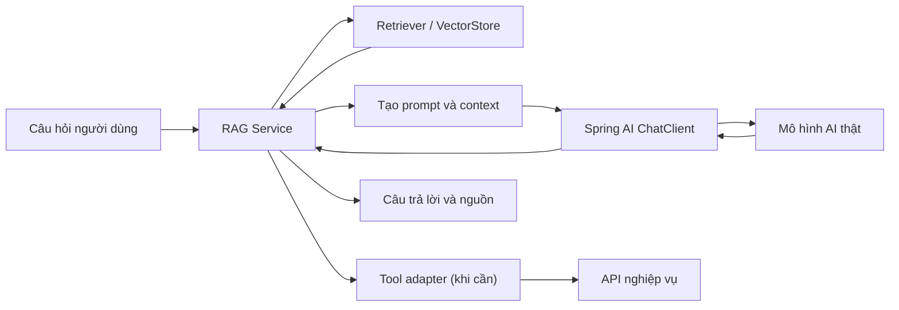

# Phân biệt unit test, kiểm thử hợp đồng và đánh giá bằng mô hình thật

Trong ứng dụng Spring AI, một phản hồi có thể **đúng về mặt kỹ thuật nhưng sai về nội dung**. Ví dụ, hệ thống RAG gửi request hợp lệ tới mô hình, nhận HTTP 200 và parse được JSON, nhưng lại trả lời sai chính sách đổi trả; hoặc mô hình trả lời đúng câu hỏi nhưng gọi nhầm công cụ và truyền sai mã đơn hàng. Vì vậy, cần phân biệt ba loại kiểm thử giải quyết **ba câu hỏi khác nhau**:

1. **Unit test:** Logic ứng dụng có hoạt động đúng khi các phụ thuộc được kiểm soát không?
2. **Kiểm thử hợp đồng (contract test):** Hai thành phần giao tiếp với nhau có thống nhất về cấu trúc dữ liệu và hành vi giao tiếp không?
3. **Đánh giá bằng mô hình thật (real-model evaluation):** Với mô hình, prompt, tài liệu và công cụ thực tế, hệ thống có tạo ra câu trả lời **hữu ích, liên quan, có căn cứ, đúng sự thật** và đủ ổn định không?

Đây là ba lớp bổ sung cho nhau trong chiến lược đánh giá và quan sát (evaluation & observability) của Spring AI. Không lớp nào thay thế hoàn toàn hai lớp còn lại.

## 1. Đặt ba lớp kiểm thử cạnh nhau

| Tiêu chí | Unit test | Contract test | Đánh giá bằng mô hình thật |
|---|---|---|---|
| Mục đích | Phát hiện lỗi trong logic xác định của ứng dụng | Phát hiện sai lệch giao thức, schema, kiểu dữ liệu, quy tắc gọi API/tool | Đo chất lượng câu trả lời và hành vi của cả pipeline |
| Đối tượng | Prompt builder, chọn tài liệu, điều phối RAG, mapping, fallback, quy tắc gọi tool | HTTP request/response, JSON Schema, adapter model/vector store/tool, lỗi và retry | Prompt + model + retrieval + reranking + tool calling + dữ liệu đánh giá |
| Phụ thuộc | Mock, stub, fake; không cần mạng | Server giả lập, kiểm thử consumer/provider hoặc môi trường hợp đồng có kiểm soát | Endpoint model thật, dữ liệu và dịch vụ thật/được cô lập theo kịch bản |
| Kết quả kỳ vọng | Giá trị hoặc tương tác xác định | Hợp đồng request/response và xử lý lỗi chính xác | Điểm số theo rubric, tỉ lệ đạt, ví dụ lỗi và phân tích thống kê |
| Tính ổn định | Rất cao | Cao khi giữ cố định hợp đồng | Có dao động do lấy mẫu, thay đổi model và dữ liệu |
| Tốc độ/chi phí | Nhanh, rẻ | Tương đối nhanh, rẻ | Chậm và có chi phí token, hạ tầng, đánh giá |
| Thời điểm chạy | Mỗi lần sửa code, mỗi pull request | Mỗi pull request và khi nâng SDK/provider/schema | Theo lịch, trước phát hành, khi đổi prompt/model/index/pipeline |
| Không chứng minh được | Câu trả lời thật có chính xác hay không | Câu trả lời có liên quan hoặc không ảo giác hay không | Mọi nhánh code, mọi chi tiết schema và tính đúng tuyệt đối |

Trong bài này, ta xét một ứng dụng **hỏi đáp chính sách nội bộ bằng RAG**:



Một câu hỏi như “Đơn hàng DH-001 đang ở trạng thái nào?” có thể đòi hỏi hệ thống chọn đúng tool, truyền đúng `orderId` và dùng kết quả trả về. Câu hỏi “Chính sách đổi hàng là bao lâu?” có thể đòi hỏi truy xuất đúng tài liệu, đưa nội dung vào prompt, rồi chỉ trả lời điều được tài liệu hỗ trợ.

## 2. Unit test: kiểm tra logic mà không gọi mô hình thật

### 2.1. Những gì nên kiểm tra

Unit test phù hợp với hành vi mà code phải quyết định được độc lập với tính ngẫu nhiên của LLM:

- Kiểm tra và chuẩn hóa đầu vào; không chuyển câu hỏi rỗng vào model.
- Tạo context từ các chunk được truy xuất, bảo toàn ID nguồn và thứ tự đã chọn.
- Giới hạn số tài liệu, lọc chunk trùng, xử lý kết quả truy xuất rỗng.
- Chọn prompt template, biến template, cấu hình model hoặc tool cho từng trường hợp.
- Mapping kết quả có cấu trúc, kiểm tra field bắt buộc và xử lý lỗi parser.
- Retry, timeout, circuit breaker hoặc fallback theo điều kiện đã định.
- Kiểm soát quyền truy cập tool, xác thực tham số trước khi thực thi.

Ở lớp này, hãy **mock ranh giới với model và hệ thống truy xuất**, nhưng giữ logic cần kiểm tra là code thật. Tránh kiểm tra một chuỗi trả lời tự nhiên do model thật tạo ra bằng `assertEquals` trong unit test.

### 2.2. Ví dụ: tách logic RAG khỏi Spring AI adapter

Ví dụ tối giản dưới đây không phụ thuộc vào SDK cụ thể của nhà cung cấp model. `Retriever` và `AnswerGenerator` là hai cổng giao tiếp được ứng dụng tự định nghĩa:

```java
import java.util.List;
import java.util.stream.Collectors;

record Chunk(String id, String text) {}
record RagAnswer(String text, List<String> sourceIds) {}

interface Retriever {
    List<Chunk> retrieve(String question);
}

interface AnswerGenerator {
    String generate(String question, String context);
}

final class RagService {
    private final Retriever retriever;
    private final AnswerGenerator generator;

    RagService(Retriever retriever, AnswerGenerator generator) {
        this.retriever = retriever;
        this.generator = generator;
    }

    RagAnswer answer(String question) {
        if (question == null || question.isBlank()) {
            throw new IllegalArgumentException("Câu hỏi không được rỗng");
        }

        List<Chunk> chunks = retriever.retrieve(question);
        if (chunks == null || chunks.isEmpty()) {
            return new RagAnswer("Không đủ dữ liệu để trả lời.", List.of());
        }

        String context = chunks.stream()
                .map(chunk -> "[%s] %s".formatted(chunk.id(), chunk.text()))
                .collect(Collectors.joining("\n"));

        String answer = generator.generate(question, context);
        List<String> ids = chunks.stream().map(Chunk::id).toList();
        return new RagAnswer(answer, ids);
    }
}
```

Kiểm tra bằng JUnit 5 và Mockito:

```java
import static org.junit.jupiter.api.Assertions.*;
import static org.mockito.ArgumentMatchers.*;
import static org.mockito.Mockito.*;

import java.util.List;
import org.junit.jupiter.api.Test;
import org.junit.jupiter.api.extension.ExtendWith;
import org.mockito.ArgumentCaptor;
import org.mockito.Mock;
import org.mockito.junit.jupiter.MockitoExtension;

@ExtendWith(MockitoExtension.class)
class RagServiceTest {
    @Mock Retriever retriever;
    @Mock AnswerGenerator generator;

    @Test
    void forwardsRetrievedEvidenceAndSourceIds() {
        String question = "Thời hạn đổi hàng là bao lâu?";
        when(retriever.retrieve(question))
                .thenReturn(List.of(new Chunk("policy-01",
                        "Khách hàng được đổi hàng trong 14 ngày.")));
        when(generator.generate(eq(question), anyString()))
                .thenReturn("Thời hạn đổi hàng là 14 ngày.");

        RagAnswer result = new RagService(retriever, generator).answer(question);

        assertEquals(List.of("policy-01"), result.sourceIds());
        ArgumentCaptor<String> context = ArgumentCaptor.forClass(String.class);
        verify(generator).generate(eq(question), context.capture());
        assertEquals("[policy-01] Khách hàng được đổi hàng trong 14 ngày.",
                context.getValue());
    }

    @Test
    void refusesToInventAnswerWhenRetrieverReturnsNothing() {
        when(retriever.retrieve("Chính sách X là gì?")).thenReturn(List.of());

        RagAnswer result = new RagService(retriever, generator)
                .answer("Chính sách X là gì?");

        assertEquals("Không đủ dữ liệu để trả lời.", result.text());
        assertTrue(result.sourceIds().isEmpty());
        verifyNoInteractions(generator);
    }
}
```

Hai test trên xác minh **đường đi của dữ liệu** và **quy tắc fallback**, không giả định rằng model biết câu trả lời. Chúng không chứng minh câu trả lời “14 ngày” do model thật tạo ra là đúng.

Trong ứng dụng Spring AI, phần triển khai `AnswerGenerator` có thể dùng `ChatClient`:

```java
import org.springframework.ai.chat.client.ChatClient;

final class SpringAiAnswerGenerator implements AnswerGenerator {
    private final ChatClient chatClient;

    SpringAiAnswerGenerator(ChatClient.Builder builder) {
        this.chatClient = builder.build();
    }

    @Override
    public String generate(String question, String context) {
        return chatClient.prompt()
                .system("Chỉ trả lời dựa trên context được cung cấp; "
                        + "không tự tạo thêm sự kiện.")
                .user(user -> user
                        .text("Context:\n{context}\n\nCâu hỏi:\n{question}")
                        .param("context", context)
                        .param("question", question))
                .call()
                .content();
    }
}
```

Adapter này cần được kiểm tra tại lớp tích hợp/hợp đồng thích hợp. Kiểm thử riêng `RagService` sẽ tiếp tục ổn định ngay cả khi đổi provider hoặc cách gọi `ChatClient`. Tên API và cấu hình tự động của Spring AI có thể khác nhau giữa các phiên bản; cần đồng bộ dependencies với phiên bản dự án đang sử dụng.

### 2.3. Giới hạn quan trọng của mock

Một mock luôn trả “14 ngày” cho câu hỏi về đổi hàng chỉ chứng minh ứng dụng nhận đúng **giá trị do test cài đặt**. Mock không mô phỏng đáng tin cậy khả năng suy luận, chọn tool, tuân thủ chỉ dẫn hay hiện tượng hallucination của model. Tương tự, mock `Retriever` trả đúng chunk không phát hiện việc embedding hoặc vector index thực tế tìm sai tài liệu.

Nếu lỗi phụ thuộc vào văn bản mà model thực sự sinh ra, hãy chuyển sang **đánh giá bằng mô hình thật**. Nếu lỗi nằm ở request, response, schema hoặc mapping giữa hai hệ thống, hãy dùng **contract test**.

## 3. Kiểm thử hợp đồng: kiểm tra ranh giới giữa các hệ thống

### 3.1. “Hợp đồng” của một ứng dụng Spring AI là gì?

Hợp đồng là tập quy tắc mà **bên gọi** và **bên cung cấp** phải cùng hiểu: endpoint, HTTP method, header, tham số, kiểu dữ liệu, field bắt buộc, JSON Schema, mã lỗi và cách diễn giải phản hồi.

Những ranh giới đáng kiểm tra gồm:

| Ranh giới | Ví dụ hợp đồng cần xác minh |
|---|---|
| Ứng dụng ↔ dịch vụ tìm kiếm tài liệu | Request chứa `query` và `topK`; response có `items[].id`, `items[].text` |
| Spring AI adapter ↔ model provider | Tên model, định dạng messages/tool schema, cấu trúc completion, mã lỗi và giới hạn sử dụng |
| Tool callback ↔ API nghiệp vụ | Tên tool, tham số bắt buộc (như `orderId`), kiểu dữ liệu, phản hồi và cơ chế xác thực |
| Ứng dụng ↔ vector store | Chiều vector, tên collection/index, metadata filter, mapping document và lỗi truy vấn |
| Dịch vụ ↔ consumer khác | Schema của API trả answer, citations, request ID và mã lỗi |

Một test mock REST response có thể xác minh **ứng dụng của mình phát request đúng và đọc response đúng**. Để chứng minh dịch vụ thật vẫn tương thích, cần thêm kiểm chứng phía provider (ví dụ consumer-driven contract/Pact, OpenAPI hoặc JSON Schema validation) hoặc smoke test ở môi trường tích hợp. Mock server đơn thuần không tự kiểm tra được thay đổi trên provider.

### 3.2. Ví dụ: kiểm thử hợp đồng với dịch vụ tìm kiếm tài liệu

Giả sử hệ thống RAG gọi một dịch vụ nội bộ qua HTTP. Adapter dùng Spring Framework `RestClient`:

```java
import java.util.List;
import java.util.Map;
import org.springframework.http.MediaType;
import org.springframework.web.client.RestClient;

final class EvidenceApiClient {
    private final RestClient http;

    EvidenceApiClient(String baseUrl) {
        this.http = RestClient.builder().baseUrl(baseUrl).build();
    }

    List<Evidence> search(String question) {
        SearchResponse response = http.post()
                .uri("/search")
                .contentType(MediaType.APPLICATION_JSON)
                .body(Map.of("query", question, "topK", 3))
                .retrieve()
                .body(SearchResponse.class);

        if (response == null || response.items() == null) {
            throw new IllegalStateException("Thiếu trường items");
        }
        return response.items();
    }

    record Evidence(String id, String text) {}
    record SearchResponse(List<Evidence> items) {}
}
```

Test sử dụng WireMock để kiểm tra hình dạng request và khả năng đọc response (cần khai báo dependency WireMock tương thích với bộ thư viện test của dự án):

```java
import static com.github.tomakehurst.wiremock.client.WireMock.*;
import static com.github.tomakehurst.wiremock.core.WireMockConfiguration.*;
import static org.junit.jupiter.api.Assertions.*;

import com.github.tomakehurst.wiremock.WireMockServer;
import org.junit.jupiter.api.AfterEach;
import org.junit.jupiter.api.BeforeEach;
import org.junit.jupiter.api.Test;

class EvidenceApiClientContractTest {
    private WireMockServer server;

    @BeforeEach
    void startServer() {
        server = new WireMockServer(wireMockConfig().dynamicPort());
        server.start();
    }

    @AfterEach
    void stopServer() {
        server.stop();
    }

    @Test
    void sendsExpectedSearchRequestAndReadsEvidenceResponse() {
        server.stubFor(post(urlEqualTo("/search"))
                .withRequestBody(equalToJson("""
                    {"query":"Thời hạn đổi hàng?","topK":3}
                    """))
                .willReturn(aResponse()
                        .withStatus(200)
                        .withHeader("Content-Type", "application/json")
                        .withBody("""
                            {"items":[
                              {"id":"policy-01","text":"Đổi hàng trong 14 ngày."}
                            ]}
                            """)));

        var evidence = new EvidenceApiClient(server.baseUrl())
                .search("Thời hạn đổi hàng?");

        assertEquals(1, evidence.size());
        assertEquals("policy-01", evidence.get(0).id());
        server.verify(1, postRequestedFor(urlEqualTo("/search")));
    }
}
```

Test này phát hiện các lỗi như đổi `topK` thành chuỗi sai kiểu, đổi tên `query`, thay đổi đường dẫn `/search` hoặc adapter không đọc được `items`. Nên bổ sung test cho HTTP 4xx/5xx, response thiếu field, timeout và retry; kiểm tra phản hồi lỗi có được dịch thành ngoại lệ nghiệp vụ đúng như hợp đồng hay không.

**Với tool calling**, cần kiểm thử riêng rằng schema công bố cho model đúng với tham số mà tool thực thi chấp nhận. Ví dụ tool `getOrderStatus(orderId: String)` phải xác minh `orderId` là bắt buộc, đúng kiểu và thuộc phạm vi mà người dùng được phép tra cứu. Contract test có thể kiểm tra JSON Schema, serialization và tool adapter. Việc **mô hình có chọn đúng tool ở đúng thời điểm hay không** vẫn thuộc đánh giá bằng mô hình thật.

### 3.3. Phân biệt với integration test và end-to-end test

- **Contract test** tập trung vào *tính tương thích tại ranh giới*; thường có thể dùng server giả lập và dữ liệu cố định.
- **Integration test** tập trung vào *khả năng phối hợp của nhiều thành phần thật*, ví dụ Spring AI + vector store chạy qua Testcontainers.
- **End-to-end test** chạy luồng người dùng từ đầu đến cuối. Một E2E test có model thật cũng có thể thu thập dữ liệu cho evaluation, nhưng chỉ kiểm tra HTTP 200 thì chưa đánh giá được chất lượng câu trả lời.

Tên gọi các lớp có thể chồng lấn tùy dự án; điều quan trọng là phải nói rõ test đang xác minh **hợp đồng**, **tích hợp kỹ thuật** hay **chất lượng ngữ nghĩa**.

## 4. Đánh giá bằng mô hình thật: kiểm tra điều mà mock không biết

### 4.1. Cần đo những gì?

Một thử nghiệm với model thật phải gọi pipeline tương ứng môi trường mục tiêu (hoặc môi trường thử nghiệm được kiểm soát), sau đó chấm kết quả theo **tiêu chí công khai và lặp lại được**. Với Spring AI, có thể kết hợp chương trình gọi `ChatClient`, các evaluator phù hợp với phiên bản Spring AI đang dùng và bộ chấm điểm tự định nghĩa; không nên mặc định một thang điểm hoặc API evaluator cụ thể là bất biến giữa các phiên bản.

| Tiêu chí | Câu hỏi đánh giá | Ví dụ lỗi |
|---|---|---|
| **Relevance** (độ liên quan) | Câu trả lời có giải quyết đúng câu hỏi, đủ trọng tâm không? | Hỏi thời hạn đổi hàng nhưng chỉ mô tả quy trình thanh toán |
| **Groundedness/faithfulness** (bám nguồn) | Các khẳng định có được context truy xuất hỗ trợ không? | Nguồn ghi 14 ngày nhưng trả lời 30 ngày |
| **Fact checking** (kiểm chứng sự kiện) | Các khẳng định quan trọng có khớp với dữ kiện chuẩn hoặc nguồn đáng tin cậy không? | Trích sai một điều khoản dù văn bản có vẻ hợp lý |
| **Citation correctness** | Nguồn trích dẫn có thực sự chứng minh phát biểu tương ứng không? | Dẫn `policy-02` nhưng sự kiện nằm ở `policy-01` |
| **Answerability/abstention** | Khi không đủ nguồn, model có từ chối khẳng định thiếu căn cứ không? | Tự đoán mức phí chưa có trong dữ liệu |
| **Tool correctness** | Chọn đúng tool, truyền đúng tham số, sử dụng đúng kết quả không? | Gọi `getOrderStatus` bằng mã đơn hàng khác |
| **Latency/cost/error** | Chất lượng có đạt ngân sách thời gian, token, chi phí và tỉ lệ lỗi không? | Trả lời đúng nhưng p95 latency tăng gấp đôi |

**Relevance khác groundedness:** Một câu trả lời có thể rất đúng trọng tâm nhưng bịa dữ kiện. **Groundedness khác fact checking:** Một câu trả lời có thể trung thành với tài liệu truy xuất, nhưng chính tài liệu đó đã lỗi thời hoặc sai. Khi đó cần kiểm chứng với nguồn chuẩn được quản trị; chỉ dùng model khác làm “giám khảo” không biến nhận định thành sự thật.

### 4.2. Thiết kế tập dữ liệu đánh giá

Mỗi trường hợp đánh giá nên lưu **câu hỏi, dữ kiện tham chiếu, trạng thái có thể trả lời, hành vi tool kỳ vọng, nhãn phân nhóm và phiên bản dữ liệu**. Có thể dùng JSONL để xử lý từng case và phân tích các lần chạy:

```json
{"id":"rag-001","question":"Thời hạn đổi hàng là bao lâu?","reference_facts":["Chính sách phiên bản v2 cho phép đổi hàng trong 14 ngày."],"expected_source_ids":["policy-01"],"answerable":true,"tags":["rag","factual"]}
{"id":"rag-002","question":"Phí đổi hàng tại chi nhánh chưa công bố là bao nhiêu?","reference_facts":[],"expected_source_ids":[],"answerable":false,"tags":["rag","abstention"]}
{"id":"tool-001","question":"Kiểm tra trạng thái đơn DH-001","expected_tool":{"name":"getOrderStatus","arguments":{"orderId":"DH-001"}},"answerable":true,"tags":["tool","argument-mapping"]}
```

Đây là **dữ liệu giả định phục vụ minh họa**, không phải chính sách có thật. Với RAG, hãy lưu hoặc đóng băng snapshot của kho tài liệu/index để biết thay đổi điểm số đến từ prompt, model hay retrieval. Đồng thời giữ một tập *holdout* chưa dùng để chỉnh prompt, tránh tối ưu chỉ để “thuộc đáp án”.

Tập dữ liệu tốt cần có cả câu thường gặp, câu dài/mơ hồ, nguồn mâu thuẫn, dữ liệu lỗi thời, câu không thể trả lời, tài liệu gây nhiễu, tiếng Việt nhiều cách diễn đạt và tình huống tool lỗi/thiếu quyền. Phân nhóm dữ liệu theo loại nghiệp vụ và độ khó giúp phát hiện mô hình tốt lên ở nhóm dễ nhưng giảm ở nhóm quan trọng.

### 4.3. Thực thi evaluation và lưu kết quả

Ví dụ một lần gọi model thật bằng `ChatClient` với một case RAG:

```java
ChatClient chatClient = chatClientBuilder.build();

String answer = chatClient.prompt()
        .system("""
            Chỉ dùng tài liệu được đưa vào để trả lời.
            Nếu tài liệu không đủ căn cứ, nói rõ không đủ dữ liệu.
            Không tạo ra chính sách hoặc con số mới.
            """)
        .user(user -> user
                .text("Tài liệu:\n{context}\n\nCâu hỏi:\n{question}")
                .param("context", "policy-01: Đổi hàng trong 14 ngày.")
                .param("question", "Thời hạn đổi hàng là bao lâu?"))
        .call()
        .content();

// Đưa answer cùng dữ kiện chuẩn, nguồn và trace vào bộ chấm điểm.
// Không dùng assertEquals("Thời hạn ...", answer) cho mọi lần gọi model.
```

`chatClientBuilder` là `ChatClient.Builder` đã được cấu hình model thật (ví dụ inject từ Spring Boot). Cần khóa rõ cấu hình của thử nghiệm: tên và phiên bản model nếu provider cung cấp, nhiệt độ/seed nếu hỗ trợ, phiên bản prompt, phiên bản embedding/index, cấu hình retriever, tập câu hỏi và phiên bản rubric. **Seed và temperature thấp chỉ giảm dao động, không bảo đảm hoàn toàn tái lập kết quả**.

Quy trình chấm điểm có thể triển khai như sau:

```text
for each case in evaluation_dataset:
    trace = run_rag_or_tool_pipeline(case.question)
    check_schema_and_safety_invariants(trace)
    relevance = judge_relevance(case.question, trace.answer)
    groundedness = judge_grounding(trace.answer, trace.retrieved_sources)
    fact_check = compare_claims_to_verified_reference_facts(
        trace.answer, case.reference_facts
    )
    tool_result = check_tool_name_arguments_and_outcome(
        trace.tool_calls, case.expected_tool
    )
    persist(case.id, prompt_version, model_version, index_version,
            rubric_version, answer, scores, retrieved_ids,
            tool_calls, latency_ms, tokens, estimated_cost, trace_id)

aggregate_by_tag_and_compare_to_baseline()
```

Đây là **mã giả về quy trình**, không phải API Java sẵn có. Có thể dùng evaluator hỗ trợ trong Spring AI hoặc tự viết một `EvalRunner`; cần xem chữ ký API đúng với phiên bản Spring AI đã khóa. Khi dùng LLM-as-a-judge, hãy buộc giám khảo trả kết quả có cấu trúc theo rubric, tách dữ liệu cần chấm khỏi chỉ dẫn hệ thống, ghi lý do chấm và kiểm tra thủ công một mẫu. Giám khảo cũng có thiên lệch và có thể bị nội dung retrieved document dẫn dắt.

**Rubric đơn giản** cho từng chiều relevance và groundedness có thể là:

| Điểm | Relevance | Groundedness |
|---|---|---|
| 0 | Không trả lời đúng vấn đề | Khẳng định quan trọng mâu thuẫn với nguồn hoặc hoàn toàn thiếu nguồn |
| 1 | Trả lời một phần hoặc lan man | Có một phần được hỗ trợ, một phần không đủ căn cứ |
| 2 | Trả lời đúng và đủ ý cần thiết | Các khẳng định quan trọng đều được nguồn hỗ trợ; từ chối khi không đủ nguồn |

Chấm `fact checking` theo **từng sự kiện quan trọng** thay vì chỉ theo văn phong. Với tool, có thể so sánh chính xác tên tool, các tham số quan trọng và kết quả thực thi; phần giải thích ngôn ngữ tự nhiên sau khi nhận kết quả vẫn cần đánh giá ngữ nghĩa.

### 4.4. Đánh giá kết quả bằng thống kê, không kết luận từ một lần chạy

Mô hình có thể đưa ra các cách diễn đạt khác nhau cho cùng một sự kiện. Vì vậy, ngoài từng case lỗi, cần báo cáo:

- Tỉ lệ pass theo rubric của relevance, groundedness, factuality và abstention.
- Tool-call accuracy: tỉ lệ chọn đúng công cụ và truyền đúng tham số trên các case cần công cụ.
- Tỉ lệ lỗi cứng: parse/JSON Schema fail, timeout, HTTP error, vi phạm quy tắc bảo mật hoặc dẫn nguồn không tồn tại.
- Phân vị độ trễ p50/p95, token đầu vào/đầu ra, chi phí ước tính theo bảng giá đã ghi nhận.
- Điểm và tỉ lệ pass theo nhóm (`tags`): loại câu hỏi, độ dài nguồn, loại tool, phiên bản prompt/model.

Ví dụ giả định: prompt B tăng relevance pass từ 88% lên 93%, nhưng giảm groundedness pass từ 91% xuống 82%. Không thể kết luận B tốt hơn nếu tiêu chí bắt buộc là trả lời có căn cứ. Chỉ so sánh khi hai phiên bản dùng **cùng dataset, rubric, cách tính điểm và cấu hình được ghi nhận**. Nếu có thay đổi retrieval hoặc nguồn, cần báo rõ đó là một thay đổi pipeline chứ không quy riêng hiệu ứng cho prompt.

Khi dữ liệu hoặc model có độ biến động lớn, chạy lặp lại các case quan trọng, lưu cả phân bố kết quả và khoảng tin cậy phù hợp. Các ngưỡng như “groundedness phải đạt ≥ 90%” chỉ là **ví dụ chính sách release**; ngưỡng thật phải do yêu cầu nghiệp vụ, chi phí sai sót và chất lượng bộ chấm điểm quyết định.

## 5. Kết hợp evaluation và observability để tìm nguyên nhân

**Evaluation cho biết chất lượng có đạt hay không; observability giúp truy ra vì sao.** Với Spring AI, có thể dùng Micrometer Observation/Tracing và giải pháp thu thập tương ứng (ví dụ OpenTelemetry, Prometheus, Grafana, Jaeger hoặc nền tảng APM đang dùng). Tín hiệu và tên metric cụ thể phụ thuộc phiên bản Spring AI, tích hợp provider và cấu hình quan sát.

Một bản ghi đánh giá có giá trị nên liên kết tới:

| Thông tin cần lưu | Giá trị chẩn đoán |
|---|---|
| `runId`, `caseId`, `traceId` | Nối một kết quả chấm điểm với các span xử lý |
| `promptVersion`, `modelName/modelVersion` | Xác định phiên bản gây thay đổi chất lượng |
| `indexVersion`, `retrievedDocumentIds`, điểm tìm kiếm | Tìm lỗi lấy sai, thiếu hoặc xếp hạng sai nguồn |
| `toolName`, tham số đã che dữ liệu nhạy cảm, trạng thái | Phân biệt chọn sai tool với API nghiệp vụ thất bại |
| `inputTokens`, `outputTokens`, `latencyMs` | Phân tích chi phí và độ trễ theo từng giai đoạn |
| `rubricVersion`, điểm từng tiêu chí, lý do chấm | Biết liệu điểm số thay đổi vì tiêu chí chấm khác nhau |

Không mặc định nhà cung cấp nào cũng trả đủ số token hoặc thông tin giá; chi phí thường phải ước tính từ số token được báo cáo và bảng giá tương ứng tại thời điểm đo. Giữ telemetry ở mức cần thiết, **che hoặc không lưu PII, bí mật API, nội dung nhạy cảm và dữ liệu không có quyền xử lý**. Hạn chế cardinality của metric label; để `caseId` hoặc nội dung dài trong trace/log có kiểm soát thay vì đưa thành nhãn metric.

### Ví dụ điều tra một regression

Giả sử phiên bản mới trả lời sai chính sách đổi hàng:

1. **Unit test pass:** Logic nối context và fallback vẫn hoạt động.
2. **Contract test pass:** API tìm kiếm vẫn trả đúng schema.
3. **Real-model evaluation giảm groundedness:** Nhiều câu trả lời khẳng định “30 ngày”.
4. **Đối chiếu trace:** Nếu `retrievedDocumentIds` chứa tài liệu cũ, kiểm tra index version, bộ lọc metadata, embedding và reranker. Nếu tài liệu đúng đã được đưa vào prompt mà câu trả lời vẫn sai, kiểm tra prompt, model, context window và hành vi sinh nội dung.
5. **So sánh phiên bản:** Chạy lại cùng các case trên baseline và candidate để khoanh vùng thay đổi; thêm case gây lỗi vào tập regression.

Một sự cố khác: model chọn đúng `getOrderStatus` và tham số đúng nhưng API trả HTTP 422 do đổi schema. Đây trước hết là lỗi hợp đồng/tích hợp tool; không nên chỉ “sửa prompt” để che vấn đề.

## 6. Lập chiến lược chạy kiểm thử trong CI/CD

| Thời điểm | Bộ kiểm thử | Điều kiện phát hành |
|---|---|---|
| Khi sửa code và tạo pull request | Unit test + contract test nhanh; test bảo mật và schema quan trọng | Không có lỗi xác định, không phá hợp đồng |
| Khi sửa adapter/provider/vector store/tool schema | Contract test consumer/provider + integration smoke test | Schema, lỗi, quyền truy cập và mapping tương thích |
| Khi đổi prompt, model, embedding, retriever, reranker hoặc dữ liệu | Evaluation tập nhỏ đại diện; trước release chạy bộ holdout đủ lớn | Điểm chất lượng của từng nhóm quan trọng không thấp hơn ngưỡng đã phê duyệt |
| Theo lịch (ví dụ hằng đêm) | Evaluation hồi quy trên model thật, chạy lặp lại trường hợp dễ dao động | Cảnh báo regression và lưu điểm cùng trace |
| Sau triển khai | Theo dõi metrics/traces, lỗi tool, latency, chi phí; lấy mẫu đánh giá với quyền dữ liệu phù hợp | Điều tra khi vượt SLO hoặc dấu hiệu chất lượng giảm |

Không nên biến toàn bộ real-model eval thành test cứng chạy mỗi lần commit: chi phí cao, kết quả có nhiễu và phụ thuộc dịch vụ ngoài. Ngược lại, chỉ dùng unit/contract test trong CI sẽ bỏ sót suy giảm chất lượng câu trả lời. Tách một **bộ smoke eval nhỏ**, một **bộ regression đầy đủ** và **theo dõi production** thường phù hợp hơn.

Trong dự án Spring Boot, có thể gắn `@Tag("llm-eval")` và cấu hình tác vụ CI riêng cho test sử dụng API thật. Không nhúng API key vào source/test fixture; cấp qua secret của môi trường chạy và lưu rõ model đang được phép dùng.

## 7. Các lỗi thiết kế kiểm thử thường gặp

| Sai lầm | Vì sao sai | Cách khắc phục |
|---|---|---|
| Mock model rồi kết luận prompt đạt chất lượng | Mock chỉ trả kết quả đã định trước | Đánh giá trên model thật và dữ liệu đại diện |
| Kiểm tra response chỉ có HTTP 200 | Không đo độ liên quan hoặc đúng sự thật | Kết hợp rubric relevance, groundedness, factuality |
| Dùng `assertEquals` với nguyên văn câu trả lời model | Diễn đạt tự nhiên có thể thay đổi | Kiểm tra các bất biến; dùng đánh giá ngữ nghĩa cho nội dung |
| Chỉ hỏi một câu “happy path” | Không phát hiện hallucination, nguồn thiếu, tool lỗi | Bổ sung case không thể trả lời, nhiễu, dữ liệu mâu thuẫn, lỗi công cụ |
| Coi contract test dùng mock server là provider test | Mock chỉ chứng minh những gì đã stub | Xác minh hợp đồng với provider hoặc chạy smoke test tích hợp |
| Dùng cùng tập câu hỏi để chỉnh prompt và báo điểm cuối | Dễ học thuộc benchmark và làm đẹp chỉ số | Tách tập phát triển và holdout, version dataset |
| Đổi đồng thời model, prompt, index rồi quy lỗi cho một yếu tố | Không thể xác định nguyên nhân | Thay đổi có kiểm soát, lưu version và trace |
| Dùng LLM-judge như “chân lý” | Judge có thể thiên lệch hoặc mắc lỗi | Hiệu chuẩn với người đánh giá và nguồn dữ kiện chuẩn |
| Ghi toàn bộ prompt, response, tool arguments vào metrics | Rủi ro lộ dữ liệu và label cardinality lớn | Kiểm soát lưu trữ, redaction, quyền truy cập và retention |

## 8. Bài thực hành tự kiểm tra

Hãy xây dựng một RAG hỏi đáp tài liệu giả định có hai nguồn:

- `policy-v1`: “Đổi hàng trong 30 ngày”, nhưng đã hết hiệu lực.
- `policy-v2`: “Đổi hàng trong 14 ngày”, là chính sách hiện hành.

Tạo ba tầng kiểm thử:

1. **Unit:** Nếu retriever trả về `policy-v2`, context phải giữ đúng ID và nội dung; nếu không trả nguồn nào, không gọi generator.
2. **Contract:** API truy xuất phải chấp nhận `query`, `topK` và trả `id/text` đúng schema; thử trường hợp thiếu `items` và HTTP 500.
3. **Real-model eval:** Hỏi “Tôi được đổi hàng trong bao lâu?”, “Tôi có được đổi hàng sau 20 ngày không?” và “Phí đổi hàng là bao nhiêu?”; kiểm tra dùng nguồn hiện hành, không bịa phí và dẫn đúng tài liệu. Chạy lần lượt trên hai phiên bản prompt rồi so sánh groundedness, latency và token.

**Câu hỏi tự đánh giá:** Nếu cả unit và contract test đều xanh nhưng model vẫn trả “30 ngày”, bạn sẽ tìm trong trace điều gì đầu tiên? Gợi ý: kiểm tra các chunk được chọn, metadata về hiệu lực của tài liệu, thứ tự xếp hạng, context thực tế gửi vào model, sau đó mới xét prompt và model.

## 9. Ghi nhớ

- **Unit test** trả lời: “Logic do lập trình viên kiểm soát có đúng không?”
- **Contract test** trả lời: “Các thành phần có giao tiếp theo đúng thỏa thuận không?”
- **Đánh giá bằng mô hình thật** trả lời: “Người dùng có nhận kết quả đúng, liên quan, có căn cứ và đủ ổn định không?”
- **Observability** nối các kết quả trên với trace, metrics, phiên bản prompt/model/index và chi phí để tìm nguyên nhân khi chất lượng suy giảm.

Một chiến lược kiểm thử Spring AI đáng tin cậy cần cả ba lớp, tập dữ liệu được quản lý phiên bản, tiêu chí chấm rõ ràng và cơ chế quan sát đủ để biến một điểm số giảm thành một lỗi có thể điều tra và sửa được.
