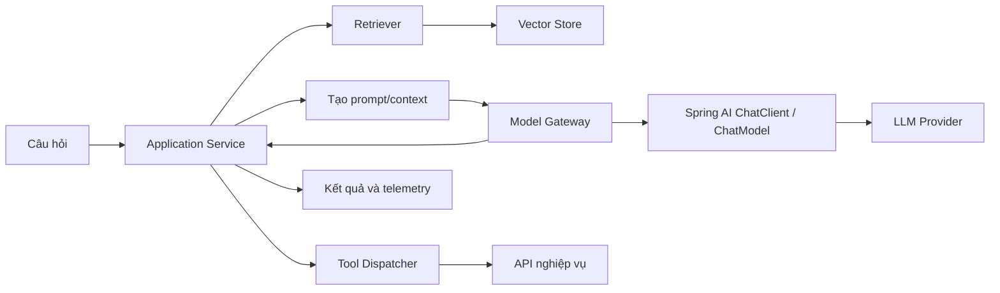
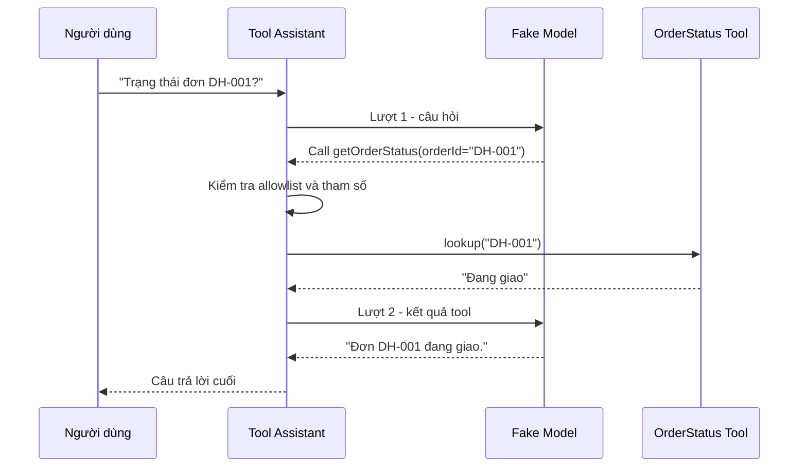
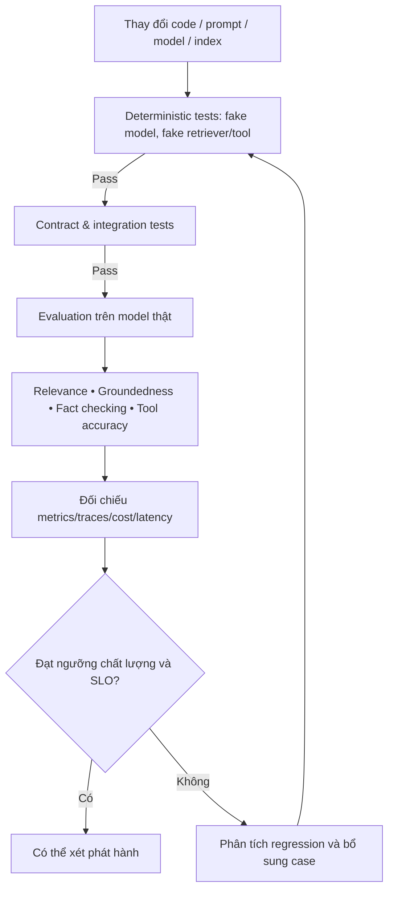

# Giả lập mô hình để kiểm tra luồng xử lý có tính xác định

Trong ứng dụng Spring AI, một lời gọi mô hình ngôn ngữ có thể phụ thuộc vào mạng, nhà cung cấp dịch vụ, giới hạn tốc độ, phiên bản model và cách mô hình sinh văn bản. Nếu mọi bài test đều gọi LLM thật, chúng thường **chậm, tốn chi phí và khó tái lập chính xác khi thất bại**. Mặt khác, nhiều quy tắc quan trọng của ứng dụng hoàn toàn có thể kiểm tra mà không cần một mô hình “thông minh”: chọn tài liệu nào cho prompt, gọi công cụ theo tham số nào, dừng sau bao nhiêu bước, xử lý lỗi ra sao và ghi nhận telemetry như thế nào.

Kỹ thuật cốt lõi là **thay lời gọi mô hình thật bằng một bản giả lập có kiểm soát** (fake/stub/mock model), rồi kiểm tra đầu vào, đầu ra và các tương tác của luồng ứng dụng. Bài học thuộc chương **Chiến lược kiểm thử** của `SPRING_AI_EVALUATION_OBSERVABILITY`: dùng kiểm thử xác định làm nền cho đánh giá chất lượng RAG, tool calling và theo dõi metrics, traces, chi phí, độ trễ khi thay đổi prompt, model hoặc pipeline.

## 1. Mục tiêu và phạm vi

Sau bài học, bạn có thể:

- Phân biệt đầu ra **có tính xác định của bài test** với đầu ra **có thể biến thiên của LLM thật**.
- Chọn ranh giới giả lập thích hợp khi ứng dụng dùng `ChatClient`, `ChatModel`, retriever và tool callback trong Spring AI.
- Tạo **scripted fake model**: định nghĩa trước kết quả của từng lần gọi và ghi lại request.
- Kiểm tra luồng RAG không nguồn, nhiều nguồn, điều kiện từ chối trả lời và quản lý provenance.
- Kiểm tra luồng gọi công cụ nhiều bước, thứ tự tương tác, allowlist, tham số và giới hạn số lần gọi.
- Tạo tình huống lỗi, timeout, retry, kết quả sai schema và xác minh cơ chế phục hồi một cách ổn định.
- Phân biệt điều được fake chứng minh với điều phải đánh giá lại qua model thật và observability thực tế.

### 1.1. “Có tính xác định” nghĩa là gì?

Với **cùng mã ứng dụng, input, trạng thái ban đầu và kịch bản giả lập**, một test xác định phải cho cùng kết quả và cùng chuỗi tương tác. Ta chủ động khóa những biến nằm ngoài logic cần kiểm tra:

| Nguồn biến động | Cách kiểm soát trong test | Điều cần kiểm tra |
|---|---|---|
| LLM sinh câu trả lời khác nhau | Fake trả văn bản hoặc cấu trúc tool call đã viết trước | Pipeline chuyển đúng prompt, context và xử lý đúng response |
| Retriever/vector store trả chunk khác nhau | Fake repository trả danh sách chunk cố định | Ghép context, metadata, fallback, giới hạn chunk |
| API nghiệp vụ thay đổi hoặc chậm | Fake tool hoặc HTTP stub | Tên tool, tham số, phân quyền, hành vi khi lỗi |
| Đồng hồ và backoff thay đổi | Inject `Clock`, scheduler hoặc sleeper giả | Retry count, thời hạn, timeout, elapsed time logic |
| Sinh ID ngẫu nhiên | Inject bộ sinh ID có seed/chuỗi cố định | Tương quan request ID, trace/test event |
| Đa luồng hoặc xử lý bất đồng bộ | Dùng test scheduler, executor kiểm soát được | Thứ tự sự kiện và cách kết thúc luồng |

**Giả lập không làm cho mô hình thật trở nên xác định**. Nó giúp phần code ứng dụng được kiểm thử với những phản hồi mô hình đã cố định. Khi cần đo relevance, fact checking, groundedness hoặc khả năng tự chọn công cụ của LLM, vẫn phải chạy evaluation riêng trên model thật.

## 2. Chọn loại test double phù hợp

“Mock” thường được dùng như tên gọi chung, nhưng các kiểu giả lập có mục đích khác nhau:

| Kiểu | Cách hoạt động | Khi nên dùng |
|---|---|---|
| **Stub** | Trả một câu trả lời định trước | Test xử lý nhánh thành công hoặc lỗi |
| **Fake** | Có triển khai đơn giản nhưng hoạt động thật, ví dụ queue kết quả và history các lần gọi | Test chuỗi RAG, tool calling nhiều bước |
| **Mock** | Đặt kỳ vọng tương tác rồi verify số lần gọi, tham số và thứ tự | Xác minh gọi đúng dependency với Mockito |
| **Spy** | Bọc một triển khai thật và ghi nhận lời gọi | Quan sát một adapter/prompt builder có ít tác dụng phụ |
| **Record/replay** | Ghi lại phản hồi thật, sau đó phát lại từ fixture | Tái hiện lỗi và kiểm tra parser khi provider trả dữ liệu đặc biệt |

Record/replay cũng có giới hạn: fixture có thể chứa dữ liệu nhạy cảm, nhanh lỗi thời và không phản ánh thay đổi của provider. Cần làm sạch fixture trước khi lưu, quản lý phiên bản và kiểm tra hợp đồng với provider theo lịch.

Một fake tốt nên có **ba khả năng**: trả kết quả theo kịch bản, ghi lại request thực nhận và **báo lỗi nếu ứng dụng gọi model nhiều hơn dự kiến**. Nếu fake cứ lặng lẽ trả “OK” cho mọi request, test khó phát hiện vòng lặp vô hạn hoặc gọi model thừa.

### 2.1. Đặt fake ở ranh giới nào?

Giả sử một ứng dụng hỏi đáp RAG có thể gọi tool kiểm tra đơn hàng:



Trong unit test của `Application Service`, đặt fake tại **Model Gateway** và **Retriever/Tool port**: phần điều phối thật vẫn chạy; các phụ thuộc bên ngoài được cố định. Trong integration test của Spring AI adapter, có thể giả lập sâu hơn ở `ChatModel` hoặc HTTP provider để kiểm tra việc `ChatClient` xây dựng prompt, nhận `ChatResponse` và xử lý metadata. Khi chạy đánh giá chất lượng, dùng model thật cùng dataset chuẩn.

Không nên đưa fake vào code production theo kiểu `if (testMode) return "OK"`. Dùng **dependency injection** để lựa chọn adapter qua cấu hình test, giữ logic sản phẩm không phụ thuộc vào chế độ kiểm thử.

## 3. Ví dụ đầy đủ: kiểm thử luồng RAG bằng scripted fake

Ta xây một ứng dụng trả lời chính sách đổi hàng. Luồng mong muốn:

1. Kiểm tra câu hỏi hợp lệ.
2. Truy xuất chứng cứ từ kho tài liệu.
3. Nếu không có chứng cứ, trả thông báo thiếu dữ liệu mà **không gọi model**.
4. Nếu có chứng cứ, tạo prompt kèm ID nguồn rồi gọi model đúng một lần.
5. Trả lời và giữ danh sách tài liệu đã truy xuất để phục vụ quan sát, chẩn đoán.

Ví dụ sau sử dụng Java 17+, tách các cổng giao tiếp để có thể thay bằng model thật khi chạy ứng dụng. Các nguồn và chính sách đều **là dữ liệu giả định**.

### 3.1. Viết service với ranh giới rõ ràng

```java
import java.util.List;
import java.util.Objects;
import java.util.stream.Collectors;

record Evidence(String id, String text) {}
record RagResult(String text, List<String> retrievedIds) {}

@FunctionalInterface
interface EvidenceRetriever {
    List<Evidence> retrieve(String question);
}

@FunctionalInterface
interface TextGenerator {
    String generate(String systemPrompt, String userPrompt);
}

final class RagService {
    static final String SYSTEM = """
        Chỉ dùng thông tin trong tài liệu được cung cấp.
        Nếu không có đủ căn cứ, hãy nói rõ không đủ dữ liệu.
        Không tự thêm điều khoản, mức phí hay thời hạn.
        """;

    private final EvidenceRetriever retriever;
    private final TextGenerator model;

    RagService(EvidenceRetriever retriever, TextGenerator model) {
        this.retriever = Objects.requireNonNull(retriever);
        this.model = Objects.requireNonNull(model);
    }

    RagResult answer(String question) {
        if (question == null || question.isBlank()) {
            throw new IllegalArgumentException("Câu hỏi không được rỗng");
        }

        List<Evidence> evidence = Objects.requireNonNull(
                retriever.retrieve(question), "Retriever trả null");

        if (evidence.isEmpty()) {
            return new RagResult("Không đủ dữ liệu để trả lời.", List.of());
        }

        String context = evidence.stream()
                .map(item -> "[%s] %s".formatted(item.id(), item.text()))
                .collect(Collectors.joining("\n"));
        String prompt = "Tài liệu:\n" + context
                + "\n\nCâu hỏi:\n" + question;

        String generated = model.generate(SYSTEM, prompt);
        if (generated == null || generated.isBlank()) {
            throw new IllegalStateException("Mô hình không trả nội dung");
        }

        return new RagResult(
                generated,
                evidence.stream().map(Evidence::id).toList());
    }
}
```

Ở đây `retrievedIds` chỉ có nghĩa **các tài liệu đã đưa vào prompt**, chưa phải nguồn chứng minh cho từng phát biểu trong câu trả lời. Nếu sản phẩm yêu cầu citation chính xác, cần có định dạng dẫn nguồn, bộ parser và bước kiểm tra citation riêng.

### 3.2. Tạo fake model có kịch bản và history

Thay vì viết fake luôn trả cùng một chuỗi, ta tạo một queue kết quả. Lần gọi thứ nhất lấy phần tử thứ nhất, lần thứ hai lấy phần tử thứ hai. Fake cũng lưu bản sao tham số thật nhận được.

```java
import java.util.ArrayDeque;
import java.util.ArrayList;
import java.util.Deque;
import java.util.List;

record ModelRequest(String systemPrompt, String userPrompt) {}

final class ScriptedTextGenerator implements TextGenerator {
    private final Deque<String> responses;
    private final List<ModelRequest> requests = new ArrayList<>();

    ScriptedTextGenerator(List<String> responses) {
        this.responses = new ArrayDeque<>(responses);
    }

    @Override
    public String generate(String systemPrompt, String userPrompt) {
        requests.add(new ModelRequest(systemPrompt, userPrompt));
        if (responses.isEmpty()) {
            throw new AssertionError("Có lời gọi model ngoài kịch bản");
        }
        return responses.removeFirst();
    }

    List<ModelRequest> requests() {
        return List.copyOf(requests);
    }

    int remainingResponses() {
        return responses.size();
    }
}
```

Nếu code đột ngột gọi thêm model do thay đổi pipeline, fake sẽ báo lỗi. Nếu code bỏ qua một bước, cuối test còn response chưa dùng. Hai hướng kiểm tra này giúp phát hiện **cả gọi dư lẫn gọi thiếu**.

### 3.3. Test với JUnit 5

```java
import static org.junit.jupiter.api.Assertions.*;

import java.util.List;
import org.junit.jupiter.api.Test;

class RagServiceTest {

    @Test
    void buildsPromptWithEvidenceAndCallsModelExactlyOnce() {
        EvidenceRetriever retriever = question -> List.of(
                new Evidence("policy-v2", "Được đổi hàng trong 14 ngày."));
        var model = new ScriptedTextGenerator(
                List.of("Thời hạn đổi hàng là 14 ngày."));

        RagResult result = new RagService(retriever, model)
                .answer("Được đổi hàng trong bao lâu?");

        assertEquals("Thời hạn đổi hàng là 14 ngày.", result.text());
        assertEquals(List.of("policy-v2"), result.retrievedIds());
        assertEquals(1, model.requests().size());
        assertTrue(model.requests().get(0).userPrompt()
                .contains("[policy-v2] Được đổi hàng trong 14 ngày."));
        assertTrue(model.requests().get(0).userPrompt()
                .contains("Được đổi hàng trong bao lâu?"));
        assertTrue(model.requests().get(0).systemPrompt()
                .contains("Không tự thêm điều khoản"));
        assertEquals(0, model.remainingResponses());
    }

    @Test
    void skipsModelWhenThereIsNoEvidence() {
        EvidenceRetriever retriever = question -> List.of();
        var model = new ScriptedTextGenerator(List.of());

        RagResult result = new RagService(retriever, model)
                .answer("Phí đổi hàng là bao nhiêu?");

        assertEquals("Không đủ dữ liệu để trả lời.", result.text());
        assertTrue(result.retrievedIds().isEmpty());
        assertTrue(model.requests().isEmpty());
    }

    @Test
    void rejectsBlankQuestionBeforeCallingDependencies() {
        EvidenceRetriever retriever = question -> {
            throw new AssertionError("Retriever không được gọi");
        };
        var model = new ScriptedTextGenerator(List.of());
        var service = new RagService(retriever, model);

        assertThrows(IllegalArgumentException.class,
                () -> service.answer("  "));
        assertTrue(model.requests().isEmpty());
    }

    @Test
    void rejectsBlankModelAnswer() {
        EvidenceRetriever retriever = question -> List.of(
                new Evidence("policy-v2", "Được đổi hàng trong 14 ngày."));
        var model = new ScriptedTextGenerator(List.of("  "));

        assertThrows(IllegalStateException.class,
                () -> new RagService(retriever, model).answer("Thời hạn?"));
        assertEquals(0, model.remainingResponses());
    }
}
```

Tất cả assertion ở đây là **xác định** vì câu trả lời đến từ scripted fake. Chúng chứng minh rằng ứng dụng chuyển dữ liệu đúng và xử lý các nhánh đúng. Chúng **không chứng minh** LLM thật sẽ trả “14 ngày” hay sẽ luôn tuân thủ câu lệnh “không tự thêm điều khoản”.

### 3.4. Kết nối cổng này với Spring AI thật

Ứng dụng production có thể triển khai `TextGenerator` bằng `ChatClient`:

```java
import org.springframework.ai.chat.client.ChatClient;

final class SpringAiTextGenerator implements TextGenerator {
    private final ChatClient chatClient;

    SpringAiTextGenerator(ChatClient.Builder builder) {
        this.chatClient = builder.build();
    }

    @Override
    public String generate(String systemPrompt, String userPrompt) {
        return chatClient.prompt()
                .system(systemPrompt)
                .user(userPrompt)
                .call()
                .content();
    }
}
```

Ví dụ adapter dùng API `ChatClient` thường gặp của Spring AI; cách cấu hình model/provider và một số chữ ký API có thể thay đổi theo phiên bản dependency đang dùng. Unit test của `RagService` không phụ thuộc vào những chi tiết đó. Khi cần xác minh **Spring AI thực sự chuyển prompt và giải mã response đúng**, bổ sung test adapter với `ChatModel` giả hoặc provider HTTP stub; khi cần đo **chất lượng ngôn ngữ**, chạy model thật.

## 4. Giả lập nhiều lượt gọi để kiểm tra tool calling

Tool calling khó hơn RAG văn bản một lượt: mô hình có thể đề xuất gọi công cụ, ứng dụng kiểm tra và thực thi công cụ, chuyển kết quả về model, rồi nhận câu trả lời cuối. Chỉ cần thứ tự hoặc tham số sai là có thể dẫn đến lỗi nghiệp vụ.

Ví dụ quy trình kiểm tra trạng thái đơn hàng:



### 4.1. Biểu diễn quyết định của mô hình bằng dữ liệu có kiểu

Không nên kiểm tra tool call bằng cách tìm chuỗi “getOrderStatus” trong văn bản trả lời. Trong hệ thống thật, tool calls được biểu diễn bằng cấu trúc protocol/metadata. Trong ví dụ độc lập dưới đây, ta dùng kiểu `ModelStep` để phân biệt **trả lời cuối** và **đề nghị gọi tool**:

```java
import java.util.ArrayList;
import java.util.List;
import java.util.Map;

sealed interface ModelStep
        permits ModelStep.FinalAnswer, ModelStep.CallTool {
    record FinalAnswer(String text) implements ModelStep {}
    record CallTool(String name, Map<String, String> arguments)
            implements ModelStep {}
}

record Turn(String role, String content) {}

@FunctionalInterface
interface TurnModel {
    ModelStep next(List<Turn> transcript);
}

@FunctionalInterface
interface OrderStatusLookup {
    String lookup(String orderId);
}

final class ToolAssistant {
    private final TurnModel model;
    private final OrderStatusLookup orders;

    ToolAssistant(TurnModel model, OrderStatusLookup orders) {
        this.model = model;
        this.orders = orders;
    }

    String ask(String question) {
        if (question == null || question.isBlank()) {
            throw new IllegalArgumentException("Thiếu câu hỏi");
        }
        List<Turn> transcript = new ArrayList<>();
        transcript.add(new Turn("user", question));
        boolean invokedTool = false;

        // Tối đa 2 lượt model: đề nghị tool, rồi trả lời cuối.
        for (int step = 0; step < 2; step++) {
            ModelStep response = model.next(List.copyOf(transcript));

            if (response instanceof ModelStep.FinalAnswer answer) {
                if (answer.text() == null || answer.text().isBlank()) {
                    throw new IllegalStateException("Câu trả lời cuối rỗng");
                }
                return answer.text();
            }
            if (!(response instanceof ModelStep.CallTool call)) {
                throw new IllegalStateException("Phản hồi model không hợp lệ");
            }
            if (invokedTool) {
                throw new IllegalStateException("Quá số lần gọi tool cho phép");
            }
            if (!"getOrderStatus".equals(call.name())) {
                throw new IllegalArgumentException("Tool không được phép");
            }

            String id = call.arguments() == null
                    ? null : call.arguments().get("orderId");
            if (id == null || !id.matches("DH-[0-9]{3,}")) {
                throw new IllegalArgumentException("orderId không hợp lệ");
            }

            invokedTool = true;
            String status = orders.lookup(id);
            transcript.add(new Turn(
                    "assistant_tool_call", "getOrderStatus(orderId=" + id + ")"));
            transcript.add(new Turn("tool_result", status));
        }
        throw new IllegalStateException("Model chưa tạo câu trả lời cuối");
    }
}
```

`Turn` là dạng transcript **nội bộ dùng để dạy và kiểm thử luồng**. Khi triển khai trên provider thật, adapter phải chuyển sang cấu trúc message/tool-call ID của chính giao thức đó; không gửi các role minh họa như `assistant_tool_call` làm role thực cho provider. Ví dụ cũng cố tình dùng một tool chỉ đọc và giới hạn một lần gọi. Với tool có tác dụng phụ (đặt hàng, thanh toán, thay đổi dữ liệu), cần thêm xác thực quyền, idempotency và cơ chế xác nhận hành động phù hợp.

### 4.2. Fake phản hồi theo thứ tự và kiểm tra tool result

```java
import java.util.ArrayDeque;
import java.util.ArrayList;
import java.util.Deque;
import java.util.List;

final class ScriptedTurnModel implements TurnModel {
    private final Deque<ModelStep> steps;
    private final List<List<Turn>> requests = new ArrayList<>();

    ScriptedTurnModel(List<ModelStep> steps) {
        this.steps = new ArrayDeque<>(steps);
    }

    @Override
    public ModelStep next(List<Turn> transcript) {
        requests.add(List.copyOf(transcript));
        if (steps.isEmpty()) {
            throw new AssertionError("Model được gọi ngoài kịch bản");
        }
        return steps.removeFirst();
    }

    List<List<Turn>> requests() {
        return List.copyOf(requests);
    }

    int remainingSteps() {
        return steps.size();
    }
}
```

### 4.3. Kiểm thử chuỗi gọi công cụ bằng JUnit

```java
import static org.junit.jupiter.api.Assertions.*;

import java.util.List;
import java.util.Map;
import java.util.concurrent.atomic.AtomicInteger;
import java.util.concurrent.atomic.AtomicReference;
import org.junit.jupiter.api.Test;

class ToolAssistantTest {
    @Test
    void usesCorrectToolArgumentAndPassesResultBackToModel() {
        var fake = new ScriptedTurnModel(List.of(
                new ModelStep.CallTool(
                        "getOrderStatus", Map.of("orderId", "DH-001")),
                new ModelStep.FinalAnswer("Đơn DH-001 đang giao.")));
        var calledId = new AtomicReference<String>();
        var calls = new AtomicInteger();
        OrderStatusLookup tool = id -> {
            calledId.set(id);
            calls.incrementAndGet();
            return "Đang giao";
        };

        String answer = new ToolAssistant(fake, tool)
                .ask("Trạng thái đơn DH-001?");

        assertEquals("Đơn DH-001 đang giao.", answer);
        assertEquals("DH-001", calledId.get());
        assertEquals(1, calls.get());
        assertEquals(2, fake.requests().size());
        assertEquals(1, fake.requests().get(0).size());
        assertEquals("tool_result",
                fake.requests().get(1).get(2).role());
        assertEquals("Đang giao",
                fake.requests().get(1).get(2).content());
        assertEquals(0, fake.remainingSteps());
    }

    @Test
    void rejectsUnknownToolWithoutExecutingBusinessCode() {
        var fake = new ScriptedTurnModel(List.of(
                new ModelStep.CallTool(
                        "refundOrder", Map.of("orderId", "DH-001"))));
        OrderStatusLookup forbidden = id -> {
            throw new AssertionError("Không được thực thi tool");
        };

        assertThrows(IllegalArgumentException.class,
                () -> new ToolAssistant(fake, forbidden)
                        .ask("Hoàn tiền DH-001"));
    }

    @Test
    void rejectsSecondToolCallAndStopsLoop() {
        var fake = new ScriptedTurnModel(List.of(
                new ModelStep.CallTool(
                        "getOrderStatus", Map.of("orderId", "DH-001")),
                new ModelStep.CallTool(
                        "getOrderStatus", Map.of("orderId", "DH-002"))));
        var calls = new AtomicInteger();
        OrderStatusLookup tool = id -> {
            calls.incrementAndGet();
            return "Đang giao";
        };

        assertThrows(IllegalStateException.class,
                () -> new ToolAssistant(fake, tool)
                        .ask("Kiểm tra đơn DH-001"));
        assertEquals(1, calls.get());
    }
}
```

Các test chứng minh **khi nhận những quyết định giả lập cụ thể, ứng dụng xử lý chính xác**. Không có test nào chứng minh model thật sẽ tự chọn `getOrderStatus`, chọn đúng `orderId` hoặc không ảo giác về trạng thái đơn.

Nếu sử dụng **tool calling do Spring AI tự điều phối** qua `ChatClient` và `ToolCallback`, hãy giữ nguyên luồng do framework cung cấp. Có thể kiểm thử callback nghiệp vụ riêng và thay `ChatModel` bằng fake tạo phản hồi có metadata tool-call tương thích với phiên bản Spring AI. Không cần sao chép vòng điều phối tool của framework vào ứng dụng chỉ để viết test. Ví dụ `ToolAssistant` ở trên dành cho **trường hợp ứng dụng tự quản lý vòng điều phối**.

## 5. Fake cả lỗi và điều kiện biên, không chỉ kịch bản thành công

Để kiểm thử logic xử lý lỗi, fake phải phát ra **cùng loại tín hiệu** mà ứng dụng cần phản ứng: exception, response rỗng, dữ liệu sai cấu trúc, hoặc số lượt gọi bất thường. Không nhất thiết giả lập toàn bộ độ phức tạp của provider.

| Tình huống giả lập | Kỳ vọng xác định của ứng dụng |
|---|---|
| LLM trả chuỗi rỗng hoặc `null` | Báo lỗi có kiểm soát, không phát hành câu trả lời rỗng |
| LLM trả JSON thiếu field bắt buộc | Parser/validator không nhận một object không hợp lệ |
| LLM trả tool không nằm trong allowlist | Từ chối trước khi thực thi code nghiệp vụ |
| Tham số tool sai kiểu, thiếu hoặc không đúng định dạng | Báo lỗi xác thực tham số, không gọi API |
| Model liên tục yêu cầu tool | Dừng ở giới hạn lượt gọi và thông báo trạng thái thất bại |
| Retriever trả không có tài liệu | Không tạo dữ kiện mới, fallback theo chính sách |
| Retriever có tài liệu trùng hoặc quá dài | Áp dụng dedup, lọc metadata, giới hạn token/chunk như thiết kế |
| Provider báo 429/503 | Retry đúng điều kiện, số lần và backoff; hết lượt thì dừng |
| Provider báo 400 hoặc lỗi xác thực | Không retry vô hạn lỗi không thể phục hồi |
| Tool trả timeout hoặc lỗi nghiệp vụ | Phân biệt lỗi tool, dừng/khôi phục theo chính sách |
| Model stream bị ngắt giữa chừng | Không trả nội dung chưa hoàn chỉnh như một thành công |

### 5.1. Ví dụ fake phát lỗi từ lần gọi đầu tiên

Với `TextGenerator` đã tách ở phần 3, ta có thể dùng lambda:

```java
TextGenerator unavailableModel = (system, user) -> {
    throw new IllegalStateException("Provider timeout (giả lập)");
};

var service = new RagService(
        question -> List.of(new Evidence("policy-v2", "Đổi trong 14 ngày.")),
        unavailableModel);

assertThrows(IllegalStateException.class,
        () -> service.answer("Thời hạn đổi hàng?"));
```

Test trên chỉ xác nhận **cơ chế hiện tại truyền lỗi lên caller**; nếu ứng dụng có retry hoặc fallback thật, test phải đặt fake bên trong thành phần đó và kiểm tra số lần thử cũng như kết quả sau từng lỗi. Không thể tuyên bố đã kiểm thử retry nếu code đang được gọi chưa hề có retry.

### 5.2. Kiểm tra retry mà không phải chờ thời gian thật

Một cách tổ chức tốt là đưa **backoff** qua interface để test không gọi `Thread.sleep`:

```java
import java.time.Duration;

@FunctionalInterface
interface Backoff {
    void pause(Duration duration);
}

// Ứng dụng thật:
// Backoff backoff = duration -> Thread.sleep(duration.toMillis());
//
// Trong test:
// List<Duration> pauses = new ArrayList<>();
// Backoff fakeBackoff = pauses::add;
//
// Sau khi gọi RetryService thực tế, xác minh số lần gọi model,
// pauses và hành vi khi đã hết maxAttempts.
```

Đây là **minh họa điểm tiêm phụ thuộc**, chưa phải một `RetryService` hoàn chỉnh. Với `RetryTemplate` hoặc `@Retryable` của Spring, cần kiểm thử qua đúng proxy/configuration đang kích hoạt retry; gọi trực tiếp một method tự gọi bên trong cùng bean có thể bỏ qua AOP. Timeout, reactive streaming và các retry scheduler cần fake tương ứng, tránh phụ thuộc đồng hồ thật.

### 5.3. Dùng test data có cấu trúc cho output JSON

Nếu ứng dụng yêu cầu model trả:

```json
{"answer":"14 ngày","sourceIds":["policy-v2"],"confidence":0.9}
```

Hãy tạo ít nhất các fixture: JSON hợp lệ; thiếu `answer`; `sourceIds` sai kiểu; thiếu trích dẫn; không phải JSON; chuỗi quá dài; chứa trường bất ngờ nếu schema cấm. **Cần kiểm tra bằng parser và schema validator thật** trong code ứng dụng. Fake chỉ cung cấp input lỗi để bắt buộc parser đi qua nhánh tương ứng; fake không tự chứng minh model thật luôn trả schema đúng.

## 6. Cách giả lập trực tiếp các thành phần Spring AI

Việc chọn giả lập ở cổng nghiệp vụ như `TextGenerator` giúp unit test ít bị ảnh hưởng khi nâng SDK. Tuy vậy, có những trường hợp cần thử chính phần tích hợp với Spring AI. Khi ấy có thể dùng fake hoặc mock tại mức tương ứng:

| Thành phần cần kiểm tra | Cách giả lập | Assertion nên có |
|---|---|---|
| Ứng dụng dùng `ChatClient` | Mock/fake `ChatModel` mà `ChatClient` được xây dựng từ đó | Nội dung messages, vai trò, thứ tự, options và response parser |
| Service dùng `ChatModel` trực tiếp | Fake trả `ChatResponse` tương ứng phiên bản | Số lần `call(Prompt)`, nội dung prompt, mapping generation |
| Advisor RAG | Retriever/vector store giả, đôi khi model cũng giả | Context được đưa vào đúng chỗ, các advisor tham gia đúng thứ tự |
| Tool callback | Callback giả ghi nhận input/đầu ra hoặc tool thật với service giả | Tên tool, schema, tham số, kiểm tra quyền và số lần gọi |
| Streaming | Fake phát nhiều chunk/event theo kịch bản | Ghép chunk, kết thúc stream, hủy, lỗi giữa chừng, không phát trùng |
| Structured output | Model trả JSON cố định | Mapping, validation, xử lý malformed response |

Về mặt khái niệm, một test adapter ở lớp Spring AI có thể:

```text
Given:
  ChatModel giả nhận Prompt, trả ChatResponse dựng sẵn.
  ChatClient thật được tạo từ ChatModel giả.
When:
  Service gọi ChatClient.prompt().system(...).user(...).call().
Then:
  Fake nhận đúng messages và model options.
  Service nhận/parse được nội dung từ ChatResponse.
  Không có request tới provider bên ngoài.
```

Lưu ý các kiểu như `Prompt`, `ChatResponse`, `AssistantMessage`, `Generation`, cấu trúc `ToolCall` và API tool advisor có thể khác nhau giữa các phiên bản Spring AI. Khi viết test ở mức này phải **đồng bộ chính xác với version của dự án**, tránh sao chép constructor hoặc builder từ bài hướng dẫn thuộc version khác. Để không phụ thuộc vào chữ ký SDK trong unit test, ví dụ code chính đã dùng adapter `SpringAiTextGenerator`.

Khi cần kiểm tra giao tiếp với nhà cung cấp, HTTP stub hoặc contract test cần xác minh cả request thực tế được serialize và response được deserialise. Test với `ChatModel` giả chạy trong cùng tiến trình chưa phát hiện được việc provider thay đổi endpoint, field, headers hoặc giới hạn API.

## 7. Ghi nhận metrics, traces và chi phí trong test giả lập

Module Spring AI evaluation & observability quan tâm đồng thời chất lượng, **metrics, traces, chi phí và độ trễ**. Fake model hữu ích cho việc kiểm tra **luồng ghi nhận telemetry**, nhưng phải tách điều này khỏi số liệu vận hành thật.

| Có thể kiểm tra bằng fake | Phải đo hoặc đối chiếu với model thật |
|---|---|
| Có phát event `llm.request` / `llm.error` theo nhánh xử lý không? | Tần suất lỗi provider thực tế |
| Có giữ cùng correlation/request/trace ID qua RAG và tool không? | Phân bố traces, lỗi mạng và hành vi provider thực |
| Có gắn prompt version, model label, index version vào bản ghi không? | Chất lượng so sánh giữa các phiên bản thật |
| Khi fake trả token metadata cố định, bộ tính chi phí có áp dụng đúng bảng giá giả định không? | Token usage thật, bảng giá có hiệu lực, chi phí hóa đơn thực |
| Khi fake clock tiến 100 ms, code có tính thời gian đúng không? | Độ trễ p50/p95/p99 của retriever, tool và model thật |
| Có tránh ghi prompt chứa PII vào metric labels không? | Tuân thủ chính sách dữ liệu trong hệ thống vận hành |

Một test có thể dùng `SimpleMeterRegistry` của Micrometer để kiểm tra việc gia tăng counter, hoặc một observation handler chỉ ghi nhận event. Ví dụ minh họa trực tiếp Micrometer:

```java
import static org.junit.jupiter.api.Assertions.*;
import io.micrometer.core.instrument.simple.SimpleMeterRegistry;

try (var registry = new SimpleMeterRegistry()) {
    registry.counter("app.ai.flow.requests", "result", "fallback")
            .increment();

    assertEquals(1.0,
            registry.get("app.ai.flow.requests")
                    .tag("result", "fallback")
                    .counter()
                    .count());
}
```

Đoạn mã trên chỉ minh họa **kiểm tra metric recorder**. Để xác minh một **luồng ứng dụng**, registry phải được tiêm vào đúng component thực sự thực thi nhánh fallback và assertion phải đọc kết quả **sau khi gọi service**, không tự tăng counter trong chính test rồi kết luận luồng đã phát metric.

Khi đo thời gian, có thể tiêm `Clock` hoặc `Ticker` giả để xác minh phép tính. Một model fake trả lời ngay lập tức không có ý nghĩa để đánh giá latency thực, cũng không trả token thật để suy ra chi phí. Với Spring AI, tên các metric/span có thể thay đổi theo version; hãy dùng tên/attribute đã chuẩn hóa theo phiên bản dự án đang chạy. Tránh đưa văn bản prompt, full response, người dùng hoặc mã đơn hàng vào nhãn metric có cardinality cao. Những dữ liệu cần phân tích nên đặt trong trace/log có kiểm soát và được che dữ liệu nhạy cảm.

## 8. Test matrix cho RAG và tool calling

Trước khi triển khai fake, nên xác định rõ **nhánh logic cần giữ ổn định**. Bảng sau là bộ test gợi ý:

| Case | Input fake | Kỳ vọng xác định |
|---|---|---|
| RAG-01 | Retriever trả một chunk có `id=policy-v2`; model trả câu cố định | Prompt có chunk + ID, model được gọi một lần |
| RAG-02 | Retriever trả rỗng | Fallback và không gọi model |
| RAG-03 | Retriever trả hai chunk theo thứ tự chọn | Prompt giữ đúng thứ tự hoặc áp dụng quy tắc sort xác định |
| RAG-04 | Retriever trả tài liệu trùng/không đủ quyền | Logic dedup/filter loại đúng chunk trước khi gửi model |
| RAG-05 | Model trả rỗng, sai JSON, thiếu citations | Validator xử lý lỗi, không âm thầm coi là hợp lệ |
| TOOL-01 | Model lượt 1 đề nghị tool hợp lệ, lượt 2 trả lời | Gọi tool đúng một lần, đưa kết quả vào lượt 2 |
| TOOL-02 | Model đề nghị tool không được phép | Chặn trước khi thực thi |
| TOOL-03 | Model thiếu hoặc làm sai `orderId` | Không gọi API nghiệp vụ |
| TOOL-04 | Model gọi tool lặp vượt giới hạn | Dừng và phát lỗi có kiểm soát |
| TOOL-05 | Tool timeout/đổi schema | Retry/fallback theo chính sách, không tái thực thi nguy hiểm |
| OBS-01 | Nhánh fallback, thành công, lỗi được kích hoạt bằng fake | Phát metric/event đúng nhãn và số lần |
| OBS-02 | Đồng hồ giả, token usage giả | Phép tính và format đúng; không diễn giải là hiệu năng model thật |

Với mỗi case, lưu rõ **test name, input fixture, expected behavior** và thành phần thật đang được kiểm tra. Có thể tổ chức fixture theo kịch bản `rag/no-evidence`, `rag/invalid-json`, `tools/unknown-tool` để bổ sung khi tìm thấy lỗi hồi quy. Test data không được chứa API key hoặc thông tin cá nhân thực.

### Tránh kiểm thử quá sát câu chữ của prompt

Ví dụ kiểm tra `assertEquals` toàn bộ prompt dài hàng nghìn ký tự có thể khiến test thất bại sau thay đổi trình bày không làm thay đổi hành vi. Khi yêu cầu là **cấu trúc context**, hãy kiểm tra các bất biến: có câu hỏi, có ID nguồn, có ranh giới tài liệu, có chính sách xử lý nguồn rỗng. Khi yêu cầu là **phiên bản prompt chính xác** (ví dụ đã khóa cho một release), kiểm tra snapshot có version và review thay đổi snapshot có chủ đích.

Không thể chỉ dùng `contains("14 ngày")` để xác minh grounding: prompt có chứa một mệnh đề đúng không có nghĩa model thực tế sẽ áp dụng nó. Đây là lý do các test trên phải được ghép với evaluation.

## 9. Mối quan hệ với đánh giá mô hình thật

Ba tầng kiểm thử phối hợp với nhau:



Deterministic test đặc biệt có ích khi thay đổi `prompt template`, `retriever orchestration`, `tool dispatcher`, retry hoặc schema parser. Nếu chúng pass nhưng evaluation lại giảm:

- **Nguồn retrieval sai:** kiểm tra retrieved document IDs, score, metadata filter và version index/embedding.
- **Nguồn đúng nhưng câu trả lời sai:** kiểm tra prompt đã gửi, model version, context length và cách model dùng chứng cứ.
- **Model chọn nhầm tool:** kiểm tra tool descriptions, schema, lời gọi thực tế và dữ liệu task; test giả lập chỉ chứng minh dispatcher xử lý tool request thế nào.
- **Chi phí/độ trễ tăng:** kiểm tra token usage, số model turns, retry, span của từng bước; không suy ra p95 từ test dùng fake model.

**Nguyên tắc phân vai:** Unit test bằng fake trả lời “Code sẽ làm gì *nếu* mô hình trả X?”; model evaluation trả lời “Trong thực tế mô hình *có* trả X, trả đúng hay đưa ra hành vi mong muốn không?”. Hai câu hỏi khác nhau và đều cần thiết.

### Quản lý phiên bản và khả năng tái lập

Để một lỗi có thể điều tra sau nhiều phiên bản prompt, model và pipeline, lưu trong kết quả evaluation:

```json
{
  "caseId": "rag-001",
  "promptVersion": "p-07",
  "modelVersion": "provider-model-version",
  "indexVersion": "docs-2026-11",
  "datasetVersion": "eval-v3",
  "rubricVersion": "r2",
  "retrievedIds": ["policy-v2"],
  "traceId": "trace-example",
  "scores": {"relevance": 2, "groundedness": 2},
  "latencyMs": 812,
  "inputTokens": 520,
  "outputTokens": 48
}
```

Các giá trị chỉ để minh họa định dạng, không phải kết quả đo thật. Khi lưu lần chạy bằng fake, nên đặt `mode="simulated"` để tách hẳn với số liệu model thật; không đưa điểm từ fake vào dashboard đánh giá chất lượng ngôn ngữ như thể đó là kết quả thật.

## 10. Những sai lầm cần tránh

| Sai lầm | Hệ quả | Cách sửa |
|---|---|---|
| Fake luôn trả “OK” bất kể input | Không phát hiện prompt thiếu tài liệu hoặc lời gọi model dư | Ghi request, xác minh số lượt và dùng scripted outputs |
| Mock mọi method của chính service đang kiểm thử | Test chỉ xác minh cách mock đã được cấu hình | Giữ logic service thật, mock phụ thuộc ở ranh giới |
| Dùng fake để báo “relevance đạt 100%” | Điểm chỉ phản ánh câu trả lời do test tự điền | Đánh giá trên model thật với dataset và rubric rõ |
| Kiểm tra nguyên văn câu trả lời từ LLM thật bằng `assertEquals` | Test dễ flaky dù câu trả lời vẫn đúng về nghĩa | Dùng fake cho nhánh xác định; rubric và evaluator cho ngữ nghĩa |
| Không kiểm tra request fake nhận được | Fake trả đúng dù prompt/context bị lỗi | Ghi nhận và assert nội dung/metadata quan trọng |
| Cho phép model giả đề xuất tool bất kỳ | Có thể bỏ sót kiểm tra allowlist và quyền | Test tool hợp lệ, tool bị cấm, tham số sai, giới hạn lượt gọi |
| Test timeout bằng `Thread.sleep` thực | Test chậm và phụ thuộc scheduling | Inject clock, scheduler, backoff fake |
| Coi mock ChatModel là kiểm tra tương thích provider | Không phát hiện thay đổi API thực | Bổ sung contract/integration smoke test |
| Coi latency/token của fake là số liệu production | Kết luận sai về chi phí và SLO | Đo metrics/traces trên model và hạ tầng thật |
| Gắn snapshot test với dữ liệu nhạy cảm | Lộ dữ liệu qua repository và CI logs | Dùng dữ liệu giả, redaction và quyền truy cập |

## 11. Bài thực hành

Thiết kế một chatbot hỗ trợ khách hàng có hai khả năng: trả lời chính sách đổi hàng từ RAG và kiểm tra đơn hàng qua `getOrderStatus`. Dùng dữ liệu **giả định**: `policy-v2` quy định 14 ngày; đơn `DH-001` có trạng thái “Đang giao”.

**Phần A — RAG xác định**

1. Tạo một fake retriever trả `policy-v2` và scripted model trả “14 ngày”.
2. Test rằng prompt chứa câu hỏi, nội dung tài liệu và ID nguồn; model được gọi đúng một lần.
3. Cho retriever trả danh sách rỗng: xác minh fallback và không gọi model.
4. Cho model trả chuỗi rỗng: xác minh lỗi được xử lý thay vì phát câu trả lời rỗng.

**Phần B — Tool calling xác định**

1. Fake model trả `CallTool("getOrderStatus", {"orderId":"DH-001"})`, rồi `FinalAnswer("Đơn đang giao")`.
2. Fake tool ghi nhận mã đơn hàng và trả “Đang giao”.
3. Test số lần gọi model, số lần gọi tool và nội dung lượt thứ hai.
4. Thử `refundOrder`, `orderId` thiếu và hai lần gọi tool liên tiếp: xác minh luồng dừng đúng quy tắc.

**Phần C — Kết nối với evaluation và observability**

1. Thêm nhãn `promptVersion` và `pipelineVersion` trong event hoặc trace thử nghiệm.
2. Chạy deterministic test trong mỗi pull request.
3. Tạo tập evaluation riêng gồm câu có nguồn đúng, không có nguồn và câu hỏi cần tool; gọi model thật theo lịch hoặc trước phát hành.
4. So sánh relevance, groundedness, tool-call accuracy, token, chi phí và latency khi thay đổi prompt/model/index. Dựa vào trace để tìm nguyên nhân nếu điểm giảm.

**Câu hỏi tự kiểm tra:** Fake model luôn trả “14 ngày”, toàn bộ unit test xanh, nhưng khi dùng model thật chatbot lại trả “30 ngày”. Test đã bỏ sót lỗi gì? Đáp án: unit test không kiểm tra khả năng mô hình thật đọc và tuân thủ chứng cứ. Hãy kiểm tra tài liệu đã truy xuất và prompt thực tế trong trace, sau đó chạy evaluation có nguồn chuẩn để xác định lỗi retrieval hay generation.

## 12. Ghi nhớ

- **Giả lập model** giúp khóa một phụ thuộc có biến động để kiểm thử logic ứng dụng theo cách nhanh, rẻ và tái lập được.
- **Scripted fake có request history** hiệu quả hơn fake luôn trả cùng một câu; nó phát hiện lời gọi dư, thiếu, sai thứ tự và sai nội dung.
- **RAG** cần kiểm tra context, nguồn truy xuất, fallback và xử lý response; **tool calling** cần kiểm tra tên tool, tham số, quyền, thứ tự, số lượt và xử lý lỗi.
- Với **Spring AI**, nên đặt fake ở ranh giới nghiệp vụ để unit test bền vững; dùng fake `ChatModel` hoặc HTTP stub khi kiểm tra tích hợp thật của `ChatClient`.
- Fake có thể kiểm tra **cơ chế phát metrics/traces và phép tính giả lập**, nhưng không đo được chất lượng câu trả lời, token, chi phí hay latency thực của mô hình.
- Chiến lược đáng tin cậy kết hợp **deterministic tests → contract/integration tests → real-model evaluation → observability**, đồng thời quản lý phiên bản prompt, model, dataset và pipeline.
