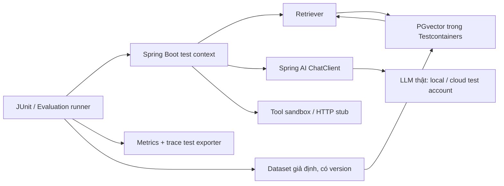
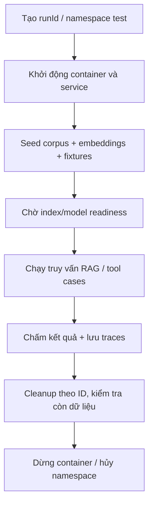
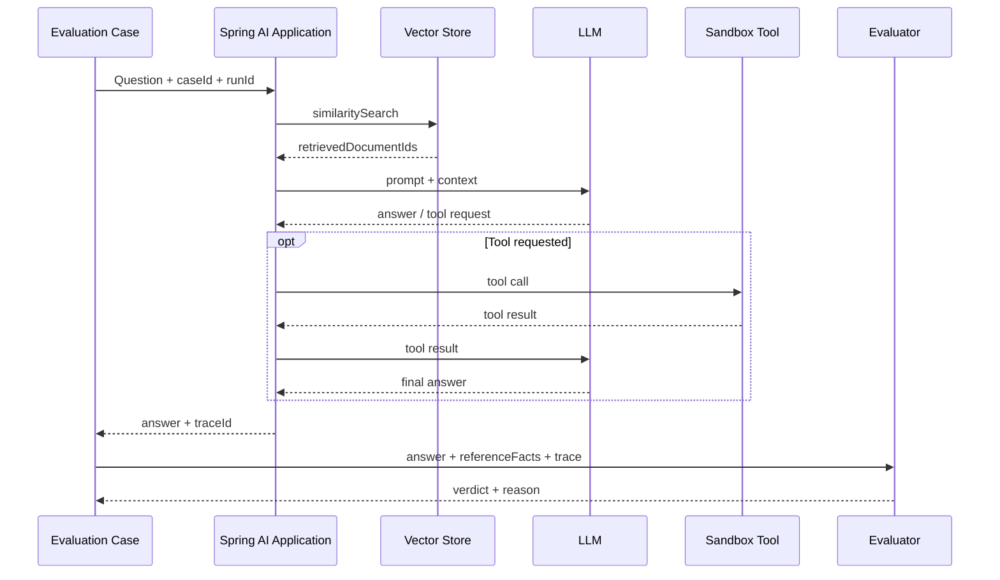

# Thực hiện kiểm thử tích hợp với mô hình và tài nguyên biệt lập

Một unit test có thể xác nhận rằng ứng dụng Spring AI ghép prompt đúng, gửi đúng câu hỏi và xử lý tốt phản hồi giả lập. Tuy nhiên, khi chạy thật, hệ thống còn phải kết nối với **mô hình sinh ngôn ngữ, mô hình embedding, vector store, bộ truy xuất tài liệu, công cụ nghiệp vụ và hệ thống quan sát**. Mỗi ranh giới đều có thể thất bại: embedding không đúng chiều vector, truy vấn trả sai tài liệu, cấu hình ChatClient không nhận model, tool gửi nhầm tham số hoặc một bản cập nhật prompt làm giảm groundedness.

**Kiểm thử tích hợp với mô hình và tài nguyên biệt lập** giúp xác nhận các thành phần thật phối hợp với nhau, trong một môi trường có thể kiểm soát và không làm thay đổi dữ liệu vận hành. Bài học thuộc chương **Chiến lược kiểm thử** của module `SPRING_AI_EVALUATION_OBSERVABILITY`. Ta sẽ kết hợp kiểm thử RAG, tool calling, tập dữ liệu đánh giá, relevance, fact checking và việc đo metrics, traces, token, chi phí, độ trễ để so sánh các phiên bản prompt/model/pipeline.

Hai mục tiêu phải được tách rõ:

1. **Kiểm chứng khả năng tích hợp:** Ứng dụng có kết nối và trao đổi dữ liệu đúng với các thành phần thật không?
2. **Đánh giá chất lượng đầu ra:** Khi các thành phần phối hợp với nhau, câu trả lời có liên quan, đúng dữ kiện, bám nguồn và sử dụng công cụ đúng không?

Một bài test tích hợp trả HTTP 200 và câu trả lời không rỗng **chưa chứng minh** chất lượng RAG tốt. Ngược lại, một lần chấm chất lượng đạt điểm cao **chưa chứng minh** tất cả nhánh lỗi, schema hay cơ chế cô lập tài nguyên đều hoạt động đúng.

## 1. Hiểu đúng “tích hợp” và “biệt lập”

### 1.1. Các mức kiểm thử khác nhau

| Lớp kiểm thử | Thành phần chạy thật | Thành phần giả lập | Khả năng phát hiện |
|---|---|---|---|
| Unit test | Logic service, prompt builder, điều phối do ứng dụng quản lý | Chat model, retriever, tool, clock | Sai nhánh xử lý, tham số, fallback, số lần gọi |
| Contract test | Adapter/parser/serializer thật | HTTP server hoặc provider stub | Sai request/response, header, schema, error mapping |
| Integration test có provider giả | Spring context, ChatClient, HTTP adapter, vector store thật | Endpoint LLM giả lập | Lỗi wiring và giao thức giữa các thành phần |
| Integration test có **mô hình thật** | Model/embedding provider, RAG, vector store, tool sandbox | Chỉ các hệ thống ngoài phạm vi test | Lỗi cấu hình và hành vi tổng thể thực tế |
| Evaluation trên tập dữ liệu | Pipeline cần đo, evaluator, nguồn tham chiếu | Có thể không có | Relevance, groundedness, fact checking, tool accuracy, latency/cost |

Một test có thể thuộc nhiều lớp. Ví dụ: test tích hợp chạy RAG thật, rồi chấm kết quả theo bộ dữ kiện chuẩn, vừa xác minh kết nối vừa cung cấp một **mẫu** cho evaluation. Tuy vậy, một mẫu đơn lẻ chưa đủ để kết luận chất lượng toàn bộ pipeline.

### 1.2. “Biệt lập” có nhiều chiều

**Biệt lập tài nguyên** không chỉ là chạy database trong container. Cần kiểm soát:

| Tài nguyên | Cách cô lập | Nguy cơ nếu dùng tài nguyên chung |
|---|---|---|
| PostgreSQL/PGvector | Testcontainers, database hoặc schema riêng | Ghi đè index, dữ liệu cũ làm sai kết quả |
| Bộ tài liệu RAG | Fixture giả định, version hóa, metadata `runId`/`caseId` | Truy xuất trộn tài liệu ngoài tập test |
| Embedding/index | Model embedding và dimensions được khóa, index riêng | Không tương thích chiều vector, thay ranking |
| Chat model | Local model có model artifact cố định hoặc tài khoản/provider test có ngân sách | Kết quả thay đổi không rõ nguyên nhân, vượt quota/cost |
| Tool/API nghiệp vụ | WireMock, sandbox endpoint, fake tool callback, tài khoản thử nghiệm | Gọi nhầm API ghi dữ liệu thật |
| Queue/cache/object storage | Container/test namespace, tên tài nguyên duy nhất, TTL | Test ảnh hưởng lượt chạy khác |
| Credentials | Secret riêng, quyền tối thiểu, không dùng thông tin production | Truy cập sai dữ liệu hoặc rò rỉ bí mật |
| Metrics/traces | `runId` riêng, exporter test hoặc backend quan sát tách biệt | Khó truy nguyên regression, dữ liệu telemetry lẫn production |

**Nếu dùng mô hình cloud thật**, chỉ có thể cô lập môi trường **của phía ứng dụng và tài khoản/khóa/quota được cấp riêng**; bản thân dịch vụ model của nhà cung cấp vẫn là hệ thống bên ngoài có thể thay đổi. Muốn kiểm soát toàn bộ model endpoint, cân nhắc một **mô hình chạy cục bộ** bằng Ollama hoặc runtime nội bộ với model artifact được cố định.



## 2. Đặt câu hỏi kiểm thử trước khi xây môi trường

Với một trợ lý hỏi đáp chính sách, giả sử tài liệu thử nghiệm `policy-v2` ghi “Đổi hàng trong 14 ngày” và một tool `getOrderStatus` trả trạng thái đơn giả `DH-001`. Dữ liệu chỉ phục vụ minh họa.

Ta cần xác minh những câu hỏi cụ thể:

1. **Khởi tạo:** Spring Boot có tạo được `ChatClient`, `EmbeddingModel`, `VectorStore` và tool callback cần dùng?
2. **Lưu trữ:** Có thể tạo embedding, ghi tài liệu vào PGvector và tìm đúng chunk từ câu hỏi?
3. **Sinh câu trả lời:** Model có nhận được context thật đã truy xuất và tạo phản hồi hợp lệ?
4. **Dẫn nguồn:** Hệ thống có lưu/hiển thị ID các tài liệu đã đưa vào prompt? Các claim có thực sự được nguồn hỗ trợ?
5. **Tool:** Model có đề xuất tool được phép, tham số đúng; callback có sử dụng sandbox không?
6. **Cô lập:** Sau test không còn tài liệu, event, quyền hay tác động lên hệ thống khác?
7. **Quan sát:** Có trace/correlation ID để nối retrieval, generation, tool, evaluation, token, chi phí và độ trễ?
8. **Hồi quy:** Khi đổi prompt/model/index, test và rubric có phát hiện khác biệt so với baseline?

Điều kiện đạt cần phù hợp mục tiêu: kết nối DB, migration và schema là **bất biến xác định**; một câu trả lời ngôn ngữ tự nhiên từ model thật nên được kiểm tra qua **sự kiện quan trọng** và tập evaluation nhiều case, thay vì chỉ so khớp nguyên văn.

## 3. Chọn hai loại môi trường tích hợp

### 3.1. Môi trường A: tài nguyên thật, endpoint mô hình giả

Đây thường là lựa chọn cho pull request:

- Chạy Spring Boot context và PGvector trong Testcontainers.
- Ghi tài liệu giả định, chạy truy vấn qua adapter thật.
- Thay provider LLM bằng một HTTP stub có response và mã lỗi xác định.
- Kiểm tra request JSON, headers, response mapping, retry, fallback và xử lý lỗi.

**Ưu điểm:** nhanh hơn, ổn định, không phát sinh token thật. **Giới hạn:** không kiểm chứng model thật có tuân thủ prompt, chọn tool đúng hoặc có hiểu ngữ nghĩa của tài liệu.

### 3.2. Môi trường B: model thật, tài nguyên phụ trợ biệt lập

Dùng cho smoke test có chọn lọc, trước phát hành hoặc evaluation theo lịch:

- Chạy model cục bộ có snapshot xác định **hoặc** gọi cloud provider bằng khóa/tài khoản dành riêng cho test.
- Chạy vector store riêng, chứa fixture version hóa.
- Cấu hình embedding model và dimensions đồng bộ.
- Chỉ cấp tool sandbox; không gắn tài khoản và endpoint có tác dụng phụ trên production.
- Ghi model/version, sampling, prompt hash, dataset/index version và trace.
- Chấm nội dung bằng rubric relevance, groundedness, fact checking, tool accuracy; báo cả lỗi kỹ thuật.

**Ưu điểm:** phát hiện các vấn đề thực của model/pipeline. **Giới hạn:** cần mạng/GPU hoặc API key, chi phí/độ trễ cao, model cloud có thể thay đổi và đầu ra không hoàn toàn xác định.

### 3.3. Những gì cần khóa để tái lập

| Thuộc tính | Ví dụ cần ghi vào một lần chạy |
|---|---|
| `datasetVersion` | `eval-policies-v3` |
| `promptVersion` | `rag-prompt-07` |
| `modelProvider` / `modelId` | Provider, model ID được cấu hình |
| `embeddingModelId` / `dimensions` | Embedding model và chiều vector thực tế |
| `vectorIndexVersion` | Index/schema/fixture version |
| `topK` / filter / reranker | Tham số retrieval |
| `temperature` / seed nếu hỗ trợ | Cấu hình lấy mẫu |
| `toolSchemaVersion` | JSON schema và phiên bản callback |
| `rubricVersion` | Các tiêu chí chấm |
| `runId` / `traceId` | Khóa truy vết cho từng lần chạy |

Temperature bằng 0 hay seed cố định **không bảo đảm tuyệt đối** cùng câu trả lời giữa các lần chạy. Với model cloud, provider còn có thể thay đổi backend hoặc alias model. Những thông tin đó là **giới hạn về khả năng tái lập** cần được báo cáo minh bạch.

## 4. Chuẩn bị project Spring Boot / Spring AI cho integration test

Các ví dụ trong bài dùng Java 17+, JUnit Jupiter, Spring Boot, Spring AI, Testcontainers và PGvector. **Tên starter, thuộc tính cấu hình và API có thể thay đổi theo phiên bản Spring AI/Spring Boot**, vì vậy phải khóa một bộ dependency tương thích trong BOM của dự án trước khi chạy code. Ví dụ dưới đây minh họa các dependency thường dùng trong Spring AI 1.x, không chỉ định số phiên bản để tránh trộn các release không tương thích.

```groovy
dependencies {
    // springAiVersion lấy từ gradle.properties hoặc cấu hình version
    // tập trung của dự án; khóa một bản Spring AI tương thích Boot.
    implementation platform('org.springframework.ai:spring-ai-bom:' + springAiVersion)
    implementation 'org.springframework.ai:spring-ai-starter-model-openai'
    implementation 'org.springframework.ai:spring-ai-starter-vector-store-pgvector'
    runtimeOnly 'org.postgresql:postgresql'

    testImplementation 'org.springframework.boot:spring-boot-starter-test'
    testImplementation 'org.testcontainers:junit-jupiter'
    testImplementation 'org.testcontainers:postgresql'
}
```

Khai báo `springAiVersion` thành phiên bản cụ thể trong `gradle.properties` hoặc cơ chế quản lý version hiện có của dự án. Trong ứng dụng sử dụng starter PGvector, cần cấu hình `DataSource` để nó trỏ tới database do test tạo. Một số bản Spring AI hỗ trợ khởi tạo schema qua `spring.ai.vectorstore.pgvector.initialize-schema`; phải kiểm tra version, yêu cầu extension `vector` và chiều embedding trước khi chạy.

**Điều kiện hạ tầng:**

- Docker/Testcontainers chạy được trong môi trường CI/test local.
- Có image PostgreSQL đã cài extension pgvector và quyền tạo extension/schema.
- Có cấu hình embedding model đúng với kích thước vector của index.
- Khi dùng cloud model: key riêng được cấp qua secrets, budget và hạn mức cụ thể.
- Mọi fixture là dữ liệu giả định, không mang thông tin định danh cá nhân thực.

Không nên sử dụng H2 để khẳng định các thao tác vector similarity search tương thích PostgreSQL/pgvector thật, bởi extension, SQL, index và type có khác biệt.

## 5. Cô lập PGvector bằng Testcontainers

### 5.1. Khởi động database riêng cho bài test

Đây là một mẫu test cho Spring Boot có `DataSource` và PGvector starter. Testcontainers dùng image chứa pgvector; `DockerImageName.asCompatibleSubstituteFor("postgres")` khai báo image tương thích với module PostgreSQL của Testcontainers.

```java
import org.junit.jupiter.api.Tag;
import org.junit.jupiter.api.Test;
import org.junit.jupiter.api.condition.EnabledIfEnvironmentVariable;
import org.springframework.beans.factory.annotation.Autowired;
import org.springframework.ai.chat.client.ChatClient;
import org.springframework.ai.document.Document;
import org.springframework.ai.vectorstore.VectorStore;
import org.springframework.ai.vectorstore.SearchRequest;
import org.springframework.boot.test.context.SpringBootTest;
import org.springframework.test.context.DynamicPropertyRegistry;
import org.springframework.test.context.DynamicPropertySource;
import org.springframework.test.context.TestPropertySource;
import org.testcontainers.containers.PostgreSQLContainer;
import org.testcontainers.junit.jupiter.Container;
import org.testcontainers.junit.jupiter.Testcontainers;
import org.testcontainers.utility.DockerImageName;

import java.util.List;
import java.util.Map;
import java.util.stream.Collectors;

import static org.junit.jupiter.api.Assertions.*;

@Tag("live-ai")
@EnabledIfEnvironmentVariable(
        named = "RUN_LIVE_AI_IT", matches = "true")
@Testcontainers(disabledWithoutDocker = true)
@SpringBootTest
@TestPropertySource(properties = {
        "spring.ai.vectorstore.pgvector.initialize-schema=true"
})
class LiveRagIntegrationTest {

    @Container
    static final PostgreSQLContainer<?> PG =
            new PostgreSQLContainer<>(
                    DockerImageName.parse("pgvector/pgvector:pg16")
                            .asCompatibleSubstituteFor("postgres"))
                    .withDatabaseName("eval_it")
                    .withUsername("eval_user")
                    .withPassword("eval_password")
                    .withInitScript("sql/pgvector-init.sql");

    @DynamicPropertySource
    static void databaseProperties(DynamicPropertyRegistry registry) {
        registry.add("spring.datasource.url", PG::getJdbcUrl);
        registry.add("spring.datasource.username", PG::getUsername);
        registry.add("spring.datasource.password", PG::getPassword);
    }

    @Autowired VectorStore vectorStore;
    @Autowired ChatClient.Builder chatClientBuilder;

    @Test
    void retrievesEvidenceAndGeneratesAnAnswerWithRealModel() {
        Document fixture = new Document(
                "Chính sách thử nghiệm policy-v2: "
                        + "thời hạn đổi hàng là 14 ngày.",
                Map.of("caseId", "rag-live-001",
                       "sourceId", "policy-v2",
                       "fixtureVersion", "v2"));

        // Tài liệu chỉ tồn tại trong DB riêng của test.
        vectorStore.add(List.of(fixture));

        try {
            List<Document> hits = vectorStore.similaritySearch(
                    SearchRequest.builder()
                            .query("Thời hạn đổi hàng là bao lâu?")
                            .topK(3)
                            .build());

            assertNotNull(hits);
            assertFalse(hits.isEmpty(), "Retriever không trả chứng cứ");
            assertTrue(hits.stream()
                    .anyMatch(doc -> doc.getId().equals(fixture.getId())));

            String context = hits.stream()
                    .map(doc -> "[" + doc.getId() + "] " + doc.getText())
                    .collect(Collectors.joining("\n"));

            ChatClient chatClient = chatClientBuilder.build();
            String answer = chatClient.prompt()
                    .system("""
                        Chỉ trả lời từ các tài liệu được cung cấp.
                        Nếu không đủ dữ liệu, hãy nói không đủ dữ liệu.
                        Không tự tạo ra thời hạn, mức phí hoặc chính sách.
                        """)
                    .user(user -> user
                            .text("Tài liệu:\n{context}\n\nCâu hỏi:\n{question}")
                            .param("context", context)
                            .param("question",
                                    "Thời hạn đổi hàng là bao lâu?"))
                    .call()
                    .content();

            assertNotNull(answer);
            assertFalse(answer.isBlank());
            // Một kiểm tra factual smoke có chủ đích trên fixture nhỏ:
            assertTrue(answer.contains("14"),
                    "Câu trả lời thiếu dữ kiện 14 ngày: " + answer);
        } finally {
            // Cô lập DB vẫn là lớp bảo vệ chính; xóa cả fixture trong
            // finally để giữ test sạch nếu mở rộng nhiều test methods.
            vectorStore.delete(List.of(fixture.getId()));
        }
    }
}
```

Tạo file resource `src/test/resources/sql/pgvector-init.sql` có nội dung:

```sql
CREATE EXTENSION IF NOT EXISTS vector;
```

**Đọc đúng phạm vi đoạn code:**

- Đây là **một ví dụ tích hợp**, cần đặt trong một ứng dụng Spring Boot đã cấu hình OpenAI chat + embedding model và PGvector. `ChatClient.Builder` và `VectorStore` phải được autoconfiguration tạo thành công; đoạn code không tự khai báo các bean hay API key đó.
- Những phiên bản Spring AI khác nhau có thể dùng `Document.getText()` hoặc API truy cập nội dung khác; kiểm tra chính xác phiên bản đã khóa. Constructor `Document` và SearchRequest builder cũng phải đồng nhất với release đang dùng.
- Nếu embedding trả kích thước khác mặc định của PGvector starter, cấu hình `spring.ai.vectorstore.pgvector.dimensions` hoặc index/schema phù hợp với embedding đã chọn. Đừng để schema giả định 1.536 chiều trong khi model embedding trả kích thước khác.
- `@Container static` tạo **một container cho class test**, không phải một container mới cho mọi method. Với nhiều method, cần phân vùng dữ liệu theo case ID, cleanup đúng và tránh chạy song song nếu dùng chung collection.
- Điều kiện `RUN_LIVE_AI_IT=true` giúp không tự gọi cloud model trong lệnh test thông thường. `@Testcontainers(disabledWithoutDocker = true)` cũng cần runtime có Docker tương thích.
- Điều kiện `assertTrue(answer.contains("14"))` là một **smoke assertion cho một dữ kiện quan trọng, có nguồn rõ**. Nó không thay thế bộ evaluation có nhiều case, và vẫn có thể biến động khi model trả lời theo cách khác.

### 5.2. Vì sao cần kiểm tra cả retrieval và generation?

Nếu chỉ gọi `ChatClient` với đoạn context hard-code, bài test sẽ chứng minh tích hợp với **model** nhưng không xác minh **embedding + vector search**. Nếu chỉ kiểm tra `vectorStore.similaritySearch` trả tài liệu, bài test chưa xác minh việc prompt thực sự mang chứng cứ đến model. Ví dụ đã đi qua các bước `add → embedding → PGvector → search → context → ChatClient → model` để phát hiện các lỗi phối hợp.

Với ứng dụng đang dùng `QuestionAnswerAdvisor` hoặc `RetrievalAugmentationAdvisor`, test cần gọi **đúng luồng advisor production** và xác minh context do advisor chèn vào; không tự dựng context rồi kết luận advisor đã được kiểm thử. Code trên là cách ghép RAG thủ công nhằm làm rõ ranh giới và thường hữu ích như một phép kiểm tra hạ tầng đầu tiên.

### 5.3. Khi nào cần tạo namespace riêng?

Nếu nhóm chạy nhiều test song song, một database/container per class có thể vẫn chứa nhiều fixture chung. Cần cân nhắc:

- Tạo database/schema/table riêng cho mỗi test suite hoặc mỗi run.
- Đặt metadata `runId`/`caseId` lên mọi chunk và áp dụng metadata filter khi tìm kiếm.
- Với pgvector hoặc vector store có collection/index riêng, tạo tên index/collection duy nhất theo run.
- Trong `finally` hoặc cleanup hook, xóa tài liệu theo ID và kiểm tra còn dữ liệu không.
- Không bật Testcontainers reusable containers cho bộ kiểm thử yêu cầu trạng thái sạch, trừ khi có quy trình reset đáng tin.

Một metadata field tồn tại **không đồng nghĩa đã cô lập được retrieval**: nếu query không sử dụng metadata filter, các run vẫn có thể nhìn thấy chunk của nhau. Các filter và cú pháp của `SearchRequest` phụ thuộc phiên bản Spring AI/vector store; cần xác minh nó thực sự được chuyển thành truy vấn phù hợp.

## 6. Cấu hình model và credentials phục vụ kiểm thử tích hợp

### 6.1. Cloud provider: tài khoản test riêng

Ví dụ với OpenAI provider của Spring AI, cấu hình ứng dụng thường lấy khóa qua property `spring.ai.openai.api-key`; có thể được cấp từ biến môi trường `SPRING_AI_OPENAI_API_KEY` theo cơ chế binding của Spring Boot. Các property model cụ thể cần đối chiếu version đang dùng, thường gồm:

```properties
# Ví dụ cấu hình test; không ghi khóa thật vào repository.
spring.ai.openai.chat.options.model=<model-id-da-khoa>
spring.ai.openai.embedding.options.model=<embedding-model-id>
spring.ai.vectorstore.pgvector.initialize-schema=true
spring.ai.vectorstore.pgvector.dimensions=<so-chieu-vector-thuc-te>
```

Đây là **template cấu hình**; các giá trị trong dấu ngoặc nhọn phải được thay bằng giá trị thật trước khi chạy, và cú pháp YAML/properties phải tương thích bản starter của dự án. Có thể sử dụng Spring profile riêng `ai-live-it`, file test properties không chứa secrets và biến môi trường/CI secret cho credential.

Chạy test thật cần đồng thời:

1. `RUN_LIVE_AI_IT=true`.
2. Docker/Testcontainers có quyền tạo container.
3. Credentials provider được cấp qua secret của môi trường.
4. Model chat + embedding được cấu hình và có quota.
5. Ngân sách token/chi phí cùng giới hạn số case/attempt rõ ràng.

Không dùng account production chung để test tool có khả năng ghi dữ liệu. Nếu cloud provider thay alias model, endpoint hoặc quota, kết quả có thể thay đổi dù code ứng dụng không sửa.

### 6.2. Local model: cô lập cả inference endpoint

Một lựa chọn khác là dùng Ollama/engine nội bộ, với model artifact được chuẩn bị sẵn và endpoint thuộc mạng container/test. Chẳng hạn:

```text
integration-test-network
├── spring-boot-test
├── pgvector-test-container
└── ollama-test-service
    ├── chat-model-artifact: pinned
    └── embedding-model-artifact: pinned
```

Không chỉ pin Docker image; **trọng số model, tokenizer, cấu hình inference và embedding model** cũng cần version hóa hoặc ghi digest. Kiểm tra readiness thực tế sau khi model được tải, không coi container “running” là model đã sẵn sàng. Model nội bộ có thể yêu cầu GPU/RAM lớn và vẫn có độ biến thiên do sampling/hardware. Cần giới hạn số trường hợp và thời gian khởi động trong CI.

### 6.3. Dùng provider HTTP stub khi không cần mô hình thật

Một test gọi HTTP mock/WireMock vẫn có thể kiểm tra code cấu hình ChatClient/ChatModel adapter, JSON request, status mapping và retry, nhưng **không chứng minh model hiểu dữ liệu**. Nên đặt tên test và nhãn báo cáo rõ:

```text
mode=stubbed-model       -> kiểm thử transport, schema và wiring
mode=live-local-model    -> inference thật trên model cục bộ
mode=live-cloud-model    -> inference thật qua provider bên ngoài
```

Tách nhãn này trong report để không vô tình cộng kết quả fake vào điểm chất lượng model thật.

## 7. Kiểm thử tool calling với công cụ biệt lập

Trong Spring AI, model có thể đề xuất gọi tool do ứng dụng công bố. Tùy cấu hình, framework có thể quản lý vòng điều phối: model yêu cầu tool → callback chạy → kết quả trả lại model → tạo câu trả lời cuối. Một tool thật có thể truy cập thanh toán, đơn hàng hoặc hệ thống CRM. **Không cấp tool production có tác dụng phụ cho bài test mô hình thật.**

### 7.1. Tạo sandbox tool không truy cập hệ thống ngoài

Ví dụ tool chỉ trả dữ liệu giả định và ghi lại tham số nhận được:

```java
import java.util.List;
import java.util.concurrent.CopyOnWriteArrayList;
import org.springframework.ai.tool.annotation.Tool;
import org.springframework.ai.tool.annotation.ToolParam;

public class SandboxOrderTools {
    private final List<String> requestedIds =
            new CopyOnWriteArrayList<>();

    @Tool(description = """
        Tra cứu trạng thái đơn hàng thử nghiệm theo mã orderId.
        Chỉ áp dụng cho dữ liệu sandbox, không thay đổi đơn hàng.
        """)
    public String getOrderStatus(
            @ToolParam(description = "Mã đơn hàng dạng DH-001")
            String orderId) {
        requestedIds.add(orderId);
        if (!"DH-001".equals(orderId)) {
            return "Không tìm thấy đơn hàng thử nghiệm";
        }
        return "Đang giao";
    }

    public List<String> requestedIds() {
        return List.copyOf(requestedIds);
    }
}
```

Một ví dụ gọi model thật với tool sandbox:

```java
SandboxOrderTools sandbox = new SandboxOrderTools();
ChatClient chatClient = chatClientBuilder.build();

String answer = chatClient.prompt()
        .system("Tra cứu trạng thái đơn khi người dùng hỏi về đơn hàng.")
        .user("Đơn DH-001 của tôi đang ở trạng thái nào?")
        .tools(sandbox)
        .call()
        .content();

assertNotNull(answer);
assertFalse(answer.isBlank());

// Lưu sandbox.requestedIds() để chấm tool-call accuracy.
// Không mặc định model thật luôn chọn tool ở mọi lần chạy.
```

Tùy phiên bản Spring AI, annotation và cách khai báo tool có thể thay đổi. Chỉ nên đưa `SandboxOrderTools` vào bối cảnh test; đừng cho tool này trở thành callback chung trên production ChatClient.

### 7.2. Chấm hành vi tool bằng trace, không chỉ câu trả lời cuối

Giả sử answer cuối nói “Đang giao” nhưng model gọi `getOrderStatus("DH-002")`; về nghiệp vụ đó vẫn là một lỗi, kể cả khi câu chữ cuối tình cờ đúng. Một evaluator tool nên chấm tối thiểu:

| Tiêu chí | Kiểm tra |
|---|---|
| Tool selection | Có gọi `getOrderStatus` khi câu hỏi cần tra cứu không? |
| Tool arguments | `orderId` phải bằng `DH-001` |
| Tool execution | Callback sandbox có nhận đúng mã và chạy đúng số lần? |
| Result use | Câu trả lời cuối có sử dụng kết quả trả về, không bịa trạng thái? |
| Permission boundary | Không gọi tool ngoài allowlist hoặc API production |
| Retry/idempotency | Lỗi timeout không khiến tool có tác dụng phụ bị gọi lặp vô hạn |

Các điều kiện tên tool, tham số và số lần gọi có thể chấm **deterministic** bằng code. Chất lượng diễn giải ngôn ngữ của model có thể chấm theo rubric. Khi chạy với model thật, phải tính cả tỉ lệ lỗi và số lượt, không giả định một lần hỏi thành công chứng minh tool calling luôn đúng.

### 7.3. Nếu tool dùng HTTP

Sử dụng WireMock hoặc một HTTP test server trong mạng test; trả 200 với dữ liệu giả, 404 với mã không tồn tại, 429, 503, timeout và JSON schema sai. Trong integration test, kiểm tra adapter thật xây request đúng và diễn giải response đúng. Không dùng server production, cũng không dùng access token có quyền truy xuất dữ liệu khách hàng.

## 8. Dataset biệt lập, version hóa và tránh ô nhiễm kết quả

Model thật chỉ đáng đánh giá khi có bộ dữ liệu tham chiếu. Bộ test nên lưu các case có nguồn và nhãn rõ:

```json
{"caseId":"rag-001","question":"Thời hạn đổi hàng hiện hành?","referenceFacts":["Đổi hàng trong 14 ngày"],"sourceIds":["policy-v2"],"answerable":true,"tags":["rag","factual"],"expectedTool":null}
{"caseId":"rag-002","question":"Phí đổi hàng là bao nhiêu?","referenceFacts":[],"sourceIds":[],"answerable":false,"tags":["rag","abstention"],"expectedTool":null}
{"caseId":"tool-001","question":"Trạng thái đơn DH-001?","referenceFacts":["DH-001 đang giao"],"sourceIds":[],"answerable":true,"tags":["tool","argument-mapping"],"expectedTool":{"name":"getOrderStatus","arguments":{"orderId":"DH-001"}}}
```

Đây là **fixture giả định**. Mỗi lần chạy cần ghi `datasetVersion` hoặc checksum. Khi tài liệu thay đổi, phải version lại cả corpus, embedding/index và các reference facts; không nên dùng dữ liệu mới cùng nhãn cũ rồi quy điểm giảm cho model.

### 8.1. Tách tập phát triển, hồi quy và holdout

- **Development set:** dùng để sửa prompt, retrieval, tool schema; có thể kiểm tra thường xuyên.
- **Regression set:** tập các lỗi đã gặp, phải chạy lại sau mỗi thay đổi đáng kể.
- **Holdout set:** không dùng trong quá trình chỉnh prompt; dành cho đo chất lượng cuối và phát hiện overfitting vào benchmark.

Nên có ca dễ và khó: câu paraphrase tiếng Việt, nhiều tài liệu tương tự, tài liệu cũ/mới mâu thuẫn, câu không thể trả lời, truy xuất sai metadata, yêu cầu tool sai hoặc tool lỗi, nguồn chứa chỉ dẫn giả mạo (*prompt injection*).

### 8.2. Nguyên tắc seed và cleanup



Giữ toàn bộ lifecycle trong một test fixture/runner được quản lý. Nếu seed thất bại giữa chừng, cleanup vẫn cần chạy trong `finally` hoặc hook sau test. Testcontainers tự dọn container do nó quản lý khi lifecycle kết thúc, nhưng không tự xóa mọi tài nguyên tạo **bên ngoài container** như cloud vector index, bucket, webhook hoặc dữ liệu tool sandbox. Những tài nguyên ngoài đó phải có tên riêng và cleanup rõ ràng.

## 9. Tách smoke assertions và semantic evaluation

Không nên dùng các kiểm tra quá lỏng như “response khác null” để báo chất lượng đạt. Đồng thời, không nên đòi model thật sinh nguyên văn một câu cố định khi các cách diễn đạt đều đúng.

| Mục đích | Ví dụ kiểm tra |
|---|---|
| Kết nối model | Lời gọi thành công, response được parse |
| Kết nối vector store | Có thể add/query/delete tài liệu, không lỗi schema |
| Retrieval | Đúng `sourceId` xuất hiện trong topK, metadata filter đúng |
| RAG factual smoke | Một dữ kiện bắt buộc (“14 ngày”) xuất hiện trong câu trả lời của fixture rất nhỏ |
| Relevance evaluation | Câu trả lời giải quyết đúng câu hỏi theo rubric |
| Groundedness evaluation | Các claim trọng yếu được nguồn truy xuất hỗ trợ |
| Fact checking | Các claim khớp nguồn chuẩn còn hiệu lực, kể cả khi retrieval sai |
| Tool-call accuracy | Tool name, args, count và outcome đúng trace |
| Answerability/abstention | Thiếu nguồn thì không bịa, có nguồn thì không từ chối vô cớ |
| Performance | p50/p95 latency, token usage, chi phí theo run |

### 9.1. Ví dụ kết quả một case evaluation

```json
{
  "runId": "eval-it-2026-11-example",
  "caseId": "rag-001",
  "mode": "live-cloud-model",
  "datasetVersion": "policy-eval-v3",
  "promptVersion": "rag-prompt-07",
  "modelId": "configured-chat-model",
  "embeddingModelId": "configured-embedding-model",
  "indexVersion": "policy-index-v3",
  "rubricVersion": "groundedness-v2",
  "retrievedSourceIds": ["policy-v2"],
  "verdict": "PASS",
  "relevanceScore": 2,
  "groundednessScore": 2,
  "latencyMs": 1250,
  "inputTokens": 450,
  "outputTokens": 62,
  "estimatedCost": null,
  "traceId": "trace-example"
}
```

Những con số chỉ để minh họa cấu trúc báo cáo, **không phải số đo thực**. Một score từ LLM-as-a-judge là một phán quyết có thể sai; cần hiệu chuẩn trên golden cases và kiểm tra một mẫu thủ công. `estimatedCost=null` có nghĩa chưa tính được chi phí đáng tin cậy; không tự thay bằng 0.

### 9.2. Phân biệt FAIL, INVALID và ERROR

- **FAIL:** hệ thống trả lời/điều phối không đạt rubric; evaluator đã đưa ra verdict hợp lệ.
- **INVALID:** đầu ra evaluator không đúng định dạng/schema, chưa có verdict hợp lệ.
- **ERROR:** lỗi chạy case như không kết nối được model, timeout, quota, lỗi container, database hoặc tool.
- **SKIPPED:** test không được chạy vì thiếu flag, Docker hoặc credentials; cần báo skip, không tính là PASS.

Khi report có nhiều ERROR/SKIPPED, không được chia PASS cho chỉ những case thành công rồi tuyên bố mô hình có chất lượng cao trên toàn bộ dataset. Báo riêng **evaluation coverage** và lý do mất dữ liệu.

## 10. Quan sát metrics, traces, token, chi phí và độ trễ

Đánh giá chất lượng chỉ chỉ ra **triệu chứng**; traces/metrics giúp phân tích nguyên nhân. Trong Spring AI, có thể kết hợp Micrometer Observation và các exporter/collector phù hợp. Tên span/metric cụ thể tùy version và provider; các trường dưới đây mô tả **thông tin nên thu thập**, không khẳng định API nào cũng tự cung cấp.



| Thành phần | Thông tin cần lưu |
|---|---|
| Retrieval | Query, topK, filter, IDs, score (nếu có), retrieval duration |
| Generation | Model ID/version, prompt hash/version, request latency, token usage |
| Tool | Tên tool, schema version, tham số **đã được che dữ liệu nhạy cảm**, duration, trạng thái |
| Evaluator | Rubric, judge version, PASS/FAIL/INVALID/ERROR, thời gian và token của judge |
| Test runner | `runId`, `caseId`, attempt, phase, env, lỗi và kết quả cleanup |
| Tổng hợp | Pass rate, valid coverage, p50/p95, total token và chi phí ước tính |

Phân biệt token/chi phí **model phục vụ câu trả lời** và token/chi phí **model làm giám khảo**. Một số provider không cung cấp usage đầy đủ khi timeout/stream bị cắt; hãy đánh dấu `unknown` hoặc ước tính có ghi rõ phương pháp. **Không coi 0 token của một request lỗi là chi phí chắc chắn bằng 0**.

### 10.1. Cách gắn tương quan giữa các span

Một luồng test nên có `runId` và `caseId` xuyên suốt từ seed → query → model → tool → evaluation. Trong một trace, có thể phân biệt các span:

```text
evaluation.case
├── dataset.seed
├── rag.retrieve
│   └── vectorstore.query
├── ai.chat.generate
│   └── tool.getOrderStatus (nếu có)
├── evaluation.judge
└── dataset.cleanup
```

Đây là **mẫu cấu trúc span do ứng dụng có thể thiết kế**. Tên span thật của Spring AI/Micrometer tùy phiên bản. Tránh ghi full prompt/answer có dữ liệu nhạy cảm vào metric labels; nếu cần lưu trong trace, áp dụng redaction, quyền truy cập và thời hạn lưu phù hợp. Đừng đặt `caseId`/`traceId` cardinality cao làm nhãn Prometheus.

### 10.2. Điều tra hồi quy theo phiên bản

Giả sử `groundedness` giảm khi đổi pipeline B. Xem theo thứ tự:

1. **Cùng dataset và rubric?** Nếu đổi nguồn/tiêu chí, chưa thể so sánh trực tiếp.
2. **Cùng môi trường, embedding, index và metadata filter?** Nếu sai, retrieval có thể đổi hoàn toàn.
3. **RetrievedSourceIds có đổi?** Nếu sai tài liệu, tìm lỗi ở retrieval, embedding, ranking hoặc index.
4. **Nguồn đúng nhưng answer sai?** Xem prompt, model ID/version, context length và cách model dùng chứng cứ.
5. **Tool gọi sai?** Kiểm tra tool schema, prompt mô tả tool, arguments và outcome.
6. **Latency/chi phí tăng?** Xem token, số lượt model/tool, retry, thời gian retrieval và giới hạn đồng thời.
7. **Evaluator có INVALID/ERROR tăng?** Nếu có, tìm vấn đề ở judge hoặc hạ tầng chấm trước khi quy lỗi cho ứng dụng.

Một test biệt lập tốt giúp biết thay đổi đến từ **code, prompt, model, index hay dữ liệu**. Nếu nhiều yếu tố đổi cùng lúc, hãy tổ chức chạy đối chứng để khoanh vùng thay vì chỉ so điểm tổng.

## 11. Tổ chức chạy kiểm thử trong CI/CD

Không nên bắt mọi pull request phải gọi model cloud thật với toàn bộ benchmark. Một cách phân tầng hợp lý:

| Khi nào | Tập test | Yêu cầu để pass |
|---|---|---|
| Mỗi commit / pull request | Unit, contract, HTTP stub; container vector store với fixture nhỏ | Không lỗi kết nối/schema/logic xác định |
| Khi đổi adapter hoặc DB/index schema | PGvector/Testcontainers integration; migration, filter và cleanup | Đúng compatibility và dữ liệu được cô lập |
| Khi đổi prompt, model, embedding, retriever hoặc tool schema | Live-model smoke trên vài case trọng yếu | Không lỗi hạ tầng; các invariants trọng yếu đạt |
| Trước release | Dataset evaluation với model thật, golden/holdout cases | Đạt ngưỡng relevance, groundedness, factuality, tool accuracy theo rubric |
| Theo lịch | Regression evaluation + telemetry so baseline | Phát hiện suy giảm chất lượng, tăng latency/cost |
| Sau triển khai | Quan sát metrics/traces thực, đánh giá mẫu theo quyền dữ liệu | Điều tra sự cố và so với benchmark |

### 11.1. Tách live test khỏi test mặc định

Annotation `@Tag("live-ai")` giúp hệ thống build tách test cần model thật. `@EnabledIfEnvironmentVariable` giúp đảm bảo bài test không vô tình gọi API trong môi trường thiếu cờ kích hoạt.

Ví dụ Gradle Groovy DSL (cần điều chỉnh theo project hiện có):

```groovy
tasks.named('test', Test) {
    useJUnitPlatform {
        excludeTags 'live-ai'
    }
}

tasks.register('liveAiTest', Test) {
    testClassesDirs = sourceSets.test.output.classesDirs
    classpath = sourceSets.test.runtimeClasspath
    useJUnitPlatform {
        includeTags 'live-ai'
    }
    shouldRunAfter tasks.named('test')
}
```

Trước khi chạy `liveAiTest`, CI phải đặt biến kích hoạt, secrets và cấu hình model. Nếu nguồn cấu hình không đủ, **skip hoặc fail rõ nguyên nhân** tùy chính sách; không báo bài test là PASS giả.

**Một ví dụ điều kiện phát hành** có thể yêu cầu:

```text
integration_technical_errors == 0
AND successful_evaluation_coverage >= required_coverage
AND relevance_pass_rate >= relevance_threshold
AND groundedness_pass_rate >= groundedness_threshold
AND tool_argument_accuracy >= tool_threshold
AND p95_latency_ms <= latency_budget_ms
AND estimated_cost_per_case <= cost_budget
```

Đây là **định nghĩa tiêu chí gợi ý**, các ngưỡng phải dựa vào rủi ro và SLA/SLO thực của dự án. Nếu không có đủ case hợp lệ, pass rate không đáng tin và release gate không nên tự cho qua.

## 12. Kiểm thử các nhánh lỗi và điều kiện biên

Tài nguyên biệt lập cho phép tạo các tình huống khó và không an toàn nếu thực hiện trên production:

| Kịch bản | Cách tạo trong test | Kỳ vọng |
|---|---|---|
| DB chưa có extension vector | Container PG thiếu init SQL | Startup báo lỗi rõ, không ghi “model kém chất lượng” |
| Embedding dimension không khớp index | Cố ý cấu hình sai trong environment test riêng | Ghi lỗi tương thích schema/dimensions |
| Database reset giữa hai lần chạy | Container mới, seed cùng fixture | Không xuất hiện chunk cũ |
| Retriever trả không có nguồn | Corpus không chứa câu trả lời hoặc filter loại hết | RAG fallback theo chính sách, không bịa |
| Index có nguồn cũ/mới | Seed `policy-v1` và `policy-v2`, metadata hiệu lực | Retrieval/filter sử dụng đúng nguồn còn hiệu lực |
| Tool trả HTTP 404/503/timeout | WireMock/sandbox response script | Không phát hành kết quả tool giả, xử lý lỗi có kiểm soát |
| Model provider trả 429 | Stub/contract test có Retry-After | Retry/hoãn đúng budget, không gây retry storm |
| Model trả JSON sai schema | Provider stub trả malformed JSON | Validator từ chối, không chuyển thành PASS |
| Model stream bị cắt | HTTP stub phát vài chunk rồi ngắt | Không coi response chưa hoàn chỉnh là thành công |
| Hai run chạy song song | Tạo namespace/runId riêng | Không đọc chéo fixture, cleanup không xóa của run khác |
| CI thiếu API key | Tắt cờ live hoặc secret bị thiếu | Skip/fail với lý do rõ, không gọi production |
| Prometheus collector không sẵn | Test exporter/fake registry | Không mất dữ liệu case; telemetry failure được phân loại |

**Phân biệt test hạ tầng và test chất lượng:** ví dụ “DB thiếu extension vector” cần thất bại kỹ thuật; “câu trả lời 30 ngày dù nguồn ghi 14 ngày” là một lỗi nội dung. Nếu cả hai bị gom thành FAIL, báo cáo chất lượng sẽ không giải thích được nguyên nhân.

### 12.1. Kiểm tra resource leak

Đừng chỉ xác minh test method hoàn tất. Với nhiều lần chạy, hãy quan sát:

- Số kết nối DB trả về pool có trở lại mức ban đầu không?
- Các subscription/HTTP streaming request đã được hủy chưa?
- Document IDs của run cũ còn được tìm thấy không?
- Tool sandbox có tác động ngoài namespace không?
- Queue, cache và object storage ngoài Docker đã cleanup chưa?
- Collector/metrics registry có giữ state khiến test mới đếm sai không?

Một `finally` xóa fixture là hữu ích, nhưng không đảm bảo mọi đường lỗi/timeout/kill process đều thực hiện cleanup. Với tài nguyên remote, cần thêm TTL, chủ sở hữu và job cleanup được quản lý.

## 13. Các sai lầm thường gặp

| Sai lầm | Tại sao nguy hiểm | Cách khắc phục |
|---|---|---|
| Gọi model thật nhưng dùng vector store production | Test có thể trộn hoặc thay đổi dữ liệu thật | DB/index riêng, dataset giả, quyền tối thiểu |
| Có Testcontainers nhưng dùng chung provider key không budget | Vẫn có rủi ro chi phí/quota của cloud | Account/key test, cost cap và live flag |
| Chỉ pin Docker image, bỏ qua model artifact | Kết quả inference thay đổi giữa các run | Ghi model digest/version và settings |
| Đổi cả prompt, embedding, index và model trong một test | Không biết nguyên nhân suy giảm | Version hóa và chạy so sánh có kiểm soát |
| Chỉ assert HTTP 200 / non-null answer | Không phát hiện hallucination hoặc trích nguồn sai | Thêm semantic evaluation, golden cases |
| Assert nguyên văn một câu LLM thật | Dễ flaky với diễn đạt tương đương | Kiểm tra facts bất biến và rubric |
| Seed tài liệu có `runId` nhưng không filter | Retrieval vẫn lấy dữ liệu của run khác | Dùng namespace/schema và filter có test |
| Test tool gọi API production | Có thể tạo tác động thật | Callback sandbox hoặc HTTP stub, allowlist |
| Tính kết quả SKIPPED/ERROR như PASS | Chất lượng báo cáo sai | Báo coverage và trạng thái riêng |
| Dùng cache/index có sẵn không reset | Test phụ thuộc thứ tự chạy | Lifecycle rõ, seed sạch, cleanup |
| Lấy latency của model fake làm SLO thật | Chẩn đoán sai hiệu năng | Đo model/provider và hạ tầng thật |
| Cộng chi phí judge vào chi phí ứng dụng | Sai phân bổ chi phí | Tách app/model và judge telemetry |
| Lưu API key/prompt nhạy cảm trong log CI | Rủi ro lộ dữ liệu | Secrets, redaction, hạn chế retention |

## 14. Bài thực hành có tiêu chí hoàn thành

Xây một bài kiểm thử Spring AI hỏi đáp chính sách bằng RAG và kiểm tra đơn hàng. Dùng toàn bộ dữ liệu giả:

- `policy-v2`: thời hạn đổi hàng hiện hành 14 ngày.
- `policy-v1`: thời hạn cũ 30 ngày, đã hết hiệu lực.
- `DH-001`: đơn thử nghiệm đang giao.
- Một câu hỏi không có nguồn: “Phí đổi hàng tại chi nhánh chưa công bố là bao nhiêu?”.

### Phần A — Môi trường biệt lập

1. Tạo PostgreSQL + pgvector qua Testcontainers, enable extension và schema theo phiên bản starter.
2. Cấu hình embedding model, dimensions và ChatClient; xác minh Spring context khởi động.
3. Dùng `runId` hoặc database/schema riêng; seed hai chính sách có metadata `active` và version.
4. Kiểm tra truy vấn chỉ trả chính sách còn hiệu lực khi có filter.
5. Xóa tài liệu và kiểm tra không còn retrieval từ các case đã cleanup.

### Phần B — Tích hợp mô hình thật

1. Chạy `RUN_LIVE_AI_IT=true` với local model hoặc cloud test account.
2. Kiểm tra đường đi `add → embedding → vector search → context → ChatClient`.
3. Hỏi “Thời hạn đổi hàng hiện hành?”, “Có được đổi sau 20 ngày?” và câu hỏi chưa có mức phí.
4. Lưu answer, retrieved source IDs, prompt/model/index versions, token, chi phí và latency.
5. Chấm groundedness và fact checking theo nguồn chuẩn; ghi rõ nếu một case không thể trả lời.

### Phần C — Tool calling và quan sát

1. Tạo `SandboxOrderTools` với dữ liệu `DH-001` và chỉ cấp tool này cho ChatClient trong test.
2. Hỏi “Đơn DH-001 đang ở trạng thái nào?”; ghi tool call và tham số model đề xuất.
3. So khớp tool name, `orderId`, số lần gọi và nội dung answer với fixture.
4. Dùng HTTP stub cho tình huống tool 503/timeout và model 429; phân loại ERROR rõ ràng.
5. Liên kết `caseId`/`runId` với trace retrieval/generation/tool/judge; tách chi phí hai model.

### Phần D — Báo cáo và phát hành

1. Chạy test kỹ thuật theo PR, live smoke khi cần và dataset evaluation trước release.
2. So sánh baseline với một thay đổi prompt: relevance, groundedness, tool accuracy, p95 latency và estimated cost.
3. Báo thêm evaluation coverage, INVALID/ERROR/SKIPPED, và danh sách case regression.
4. Đặt gate ngăn phát hành nếu lỗi kỹ thuật chưa xử lý hoặc các case quan trọng không đạt.

**Câu hỏi 1.** Bài test tạo PGvector container riêng nhưng vẫn dùng embedding endpoint chung; đã biệt lập hoàn toàn chưa?  
**Trả lời:** Chưa. Database đã cô lập, nhưng embedding endpoint vẫn có quota, chi phí và khả năng thay đổi ở provider ngoài. Cần ghi rõ phạm vi cô lập và dùng tài khoản test hoặc embedding model local khi muốn khép kín môi trường.

**Câu hỏi 2.** Model trả đúng “14 ngày”, nhưng `retrievedSourceIds` chứa `policy-v1` đã hết hiệu lực. Có thể coi RAG đạt không?  
**Trả lời:** Không thể kết luận chỉ từ answer. Cần xác minh vì sao retrieval chọn nguồn cũ, liệu câu trả lời có căn cứ thực sự và hệ thống có bỏ lọt lỗi metadata/ranking không. Tách **retrieval correctness** khỏi **answer correctness**.

**Câu hỏi 3.** 100 ca có 60 PASS, 10 FAIL, 20 ERROR và 10 SKIPPED. Pass rate là bao nhiêu?  
**Trả lời:** Pass rate trên **70 phán quyết hợp lệ** là `60/70 ≈ 85,71%`; coverage hợp lệ trên toàn bộ bộ dữ liệu là `70/100 = 70%`. Không thể chỉ công bố 85,71% mà bỏ qua 30 ca chưa có verdict.

**Câu hỏi 4.** Vì sao một lần chạy live-model test thành công chưa chứng minh prompt B tốt hơn prompt A?  
**Trả lời:** Mẫu quá nhỏ và model có dao động; cần cùng dataset/version, cùng rubric và môi trường có thể so sánh, cùng quy tắc chấm điểm; đánh giá theo nhóm và nếu cần chạy lặp có kiểm soát.

## 15. Ghi nhớ

- **Integration test** xác minh các thành phần Spring AI hoạt động cùng nhau; **real-model evaluation** đo chất lượng ngữ nghĩa của pipeline.
- **Tài nguyên biệt lập** phải bao gồm database/index, fixture, tool, credential, cache/queue và telemetry; cloud model không tự trở thành biệt lập chỉ vì ứng dụng chạy Testcontainers.
- **Testcontainers PGvector** cho phép kiểm tra add/search/delete, embedding dimensions, schema và retrieval với database riêng thay vì mô phỏng bằng H2.
- **Model thật** cần môi trường chạy có cờ kích hoạt, secrets, quota, budget, model/version và rubric có phiên bản.
- **Tool calling** trong test phải dùng sandbox callback hoặc HTTP stub; kiểm tra cả dấu vết gọi công cụ, không chỉ câu trả lời cuối.
- **Dataset và index** cần seed, metadata filter, version và cleanup; không để state giữa các run làm sai kết quả.
- **Metrics, traces, token, chi phí và độ trễ** phải liên kết với `runId`/`caseId` và được phân tách cho application model, judge model và từng bước pipeline.
- **CI/CD** nên kết hợp unit/contract, container integration, live smoke và evaluation trên golden/holdout datasets, kèm coverage và gate rõ ràng.

Một chiến lược kiểm thử tích hợp tốt giúp trả lời hai câu hỏi khác nhau nhưng liên quan chặt chẽ: **hệ thống Spring AI có thực sự vận hành đúng trên các tài nguyên được kiểm soát không, và chất lượng của model/RAG/tool pipeline có đạt yêu cầu trong dữ liệu đại diện không?** Khi cả kết quả đánh giá lẫn trace hạ tầng được quản lý theo phiên bản, ta có cơ sở xác định nguyên nhân suy giảm và kiểm tra các bản sửa một cách đáng tin cậy.
