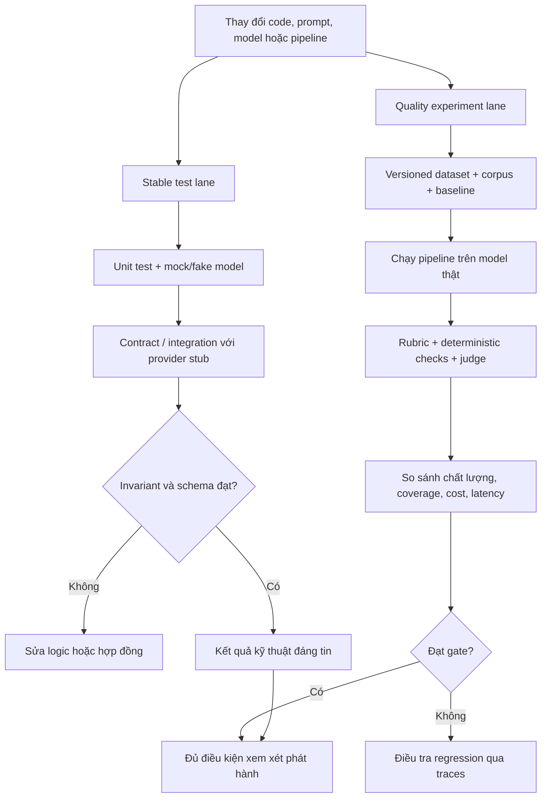
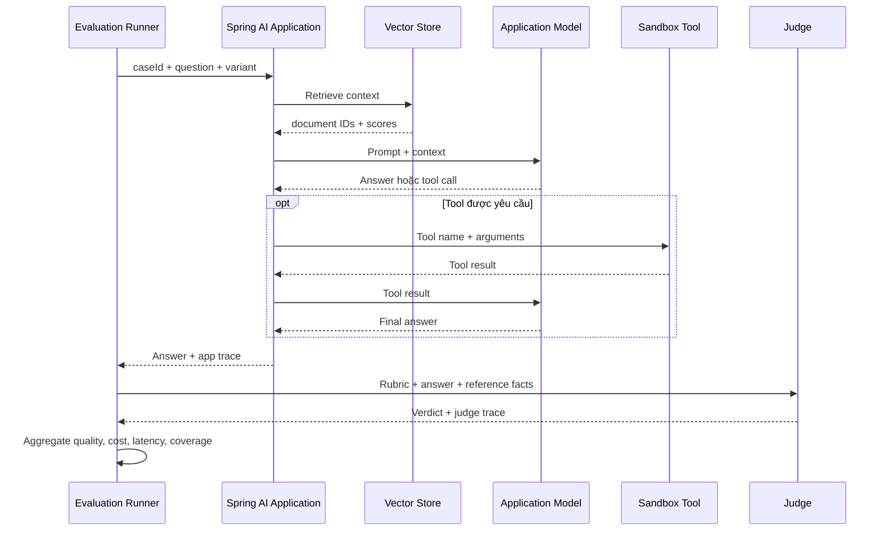

# Tách ca kiểm thử ổn định khỏi thí nghiệm chất lượng có biến động

Trong dự án Spring AI, cùng một câu hỏi có thể nhận những câu trả lời khác nhau qua nhiều lần gọi mô hình: ngôn từ thay đổi, tài liệu RAG được xếp hạng khác nhau, mô hình chọn hoặc bỏ qua công cụ, thời gian xử lý và chi phí token cũng biến động. Nếu đưa mọi lời gọi LLM thật vào bộ unit test chạy theo từng commit và dùng `assertEquals` với nguyên văn câu trả lời, CI dễ thất bại ngẫu nhiên (*flaky*), khó tái hiện và tốn ngân sách. Ngược lại, nếu chỉ dùng fake model để kiểm tra luồng, nhóm phát triển lại không biết prompt hay pipeline mới có giảm **relevance**, **groundedness**, **fact checking**, độ chính xác khi gọi tool hoặc làm tăng chi phí/độ trễ hay không.

Giải pháp là **tách các bất biến cần đúng trong mọi lần chạy** thành ca kiểm thử ổn định, còn **chất lượng ngữ nghĩa và hiệu năng của mô hình thực** thành các thí nghiệm có dataset, rubric, phép đo và cách so sánh riêng. Đây là một phần quan trọng của chương **Chiến lược kiểm thử** trong module `SPRING_AI_EVALUATION_OBSERVABILITY`.

Sau bài học, bạn có thể xác định loại test cần viết, tổ chức hai đường chạy trong CI/CD, dựng bộ dữ liệu và baseline có phiên bản, đánh giá thay đổi prompt/model/RAG/tool bằng phép so sánh có đối chứng, và dùng metrics/traces/token/chi phí/độ trễ để điều tra regression.

## 1. Hai câu hỏi cần được trả lời riêng

**Kiểm thử ổn định (deterministic testing)** trả lời: “Với cùng trạng thái đầu vào và cùng kết quả giả lập ở các phụ thuộc, logic ứng dụng có luôn thực hiện đúng quy tắc đã lập trình không?”. Ví dụ: không truy xuất được tài liệu thì không gọi model; tham số `orderId` thiếu thì không gọi tool; JSON evaluator sai schema thì phải INVALID.

**Thí nghiệm chất lượng có biến động (stochastic quality evaluation)** trả lời: “Khi chạy toàn bộ pipeline và model thật trên dữ liệu đại diện, chất lượng có đạt yêu cầu và thay đổi ra sao so với baseline?”. Ví dụ: prompt mới có làm giảm hallucination ở câu hỏi thiếu nguồn? Reranker mới có nâng recall@k nhưng tăng p95 latency? Model mới có chọn đúng tool thường xuyên hơn?

| Khía cạnh | Ca kiểm thử ổn định | Thí nghiệm chất lượng có biến động |
|---|---|---|
| Phụ thuộc | Fake/stub/mock, tài nguyên cố định, clock giả | Model thật, retrieval/embedding/tool theo phạm vi thí nghiệm |
| Câu hỏi | Code có tuân thủ invariant và hợp đồng? | Chất lượng trung bình, phân bố, nhóm lỗi, chi phí và độ trễ có đạt? |
| Oracle | Kỳ vọng chính xác và có thể lặp lại | Rubric, dữ kiện chuẩn, nhãn người đánh giá, thống kê |
| Ví dụ | Gọi tool đúng một lần khi fake model yêu cầu | Model thật chọn đúng tool trong bao nhiêu phần trăm case? |
| Cách đánh giá | Assertion boolean, bằng chứng xác định | Điểm/tỉ lệ, khoảng bất định, phân tích từng nhóm, trace |
| Chi phí | Thấp, nhanh | Token, hạ tầng, thời gian chờ và chi phí giám khảo |
| Lịch chạy | Mỗi commit hoặc pull request | Theo lịch, trước phát hành, khi đổi prompt/model/index |
| Kết quả cần báo | PASS/FAIL của từng assertion | PASS/FAIL/INVALID/ERROR/SKIPPED, coverage, chênh lệch baseline |
| Cách xử lý thất bại | Sửa bug hoặc test fixture không đúng | Phân tích chất lượng, môi trường, số mẫu, nhiễu và nguyên nhân |

Hai lớp **bổ sung cho nhau**: việc test giả lập xanh không chứng minh mô hình thật trả lời đúng; việc evaluation đạt điểm cao không chứng minh mọi nhánh code và schema tích hợp đều đúng.

### 1.1. Ví dụ: “14 ngày” là dữ kiện, không phải một câu văn duy nhất

Tài liệu giả định `policy-v2` ghi: “Khách hàng có quyền đổi hàng trong vòng 14 ngày”. Model thật có thể trả:

- “Thời hạn đổi hàng là 14 ngày.”
- “Bạn có tối đa hai tuần để yêu cầu đổi hàng.”
- “Theo chính sách hiện hành, khách có 14 ngày kể từ thời điểm quy định.”

Các câu có thể tương đương về ý nghĩa nếu các điều kiện nghiệp vụ phù hợp. Nếu test so sánh nguyên văn một chuỗi, việc thay đổi cách diễn đạt làm test đỏ dù dữ kiện cốt lõi vẫn đúng. Trong **quality evaluation**, nên chấm theo sự kiện, điều kiện và nguồn tham chiếu. Trong **deterministic test**, có thể dùng fake model trả một câu cố định để kiểm tra pipeline có chuyển dữ liệu và giữ nguồn đúng.

## 2. Thiết kế hai đường chạy độc lập



Không nhất thiết mọi commit phải chạy thí nghiệm chất lượng đầy đủ. Thực tế nên chia thành ba nhịp:

1. **PR nhanh:** unit/contract tests xác định, vector store và adapter test nhỏ với tài nguyên biệt lập; tối ưu thời gian phản hồi.
2. **Smoke với model thật:** chạy một số case trọng yếu khi thay đổi prompt/model/embedding/retriever/tool hoặc trước khi merge/deploy, có ngân sách và nhãn trạng thái rõ ràng.
3. **Evaluation đầy đủ:** chạy golden/holdout dataset theo lịch hoặc trước release; đo score theo rubric, coverage, độ trễ, chi phí, so sánh với baseline và lưu run artifact.

Một smoke test gọi LLM thật có thể là “cổng phát hiện sự cố nghiêm trọng”, nhưng không thay thế thống kê của tập evaluation lớn. Ngược lại, nếu toàn bộ evaluation bị HTTP 429 thì phải đánh dấu lỗi hạ tầng, không kết luận mô hình ứng dụng kém chất lượng.

## 3. Lập danh sách những quy tắc bắt buộc phải xác định

Trước khi viết test, chia yêu cầu thành **bất biến có thể kiểm tra chính xác** và **chất lượng cần quan sát theo phân bố**.

| Thành phần | Bất biến đưa vào stable lane | Phép đo đưa vào experiment lane |
|---|---|---|
| Input validation | Câu hỏi rỗng bị từ chối; tenant/user ID hợp lệ | Mô hình hiểu cách hỏi đa dạng đến đâu? |
| Prompt builder | Biến prompt được thay đúng; có đúng ID và context | Prompt khiến model dùng bằng chứng tốt đến mức nào? |
| RAG retrieval | Filter metadata, topK, dedup, mapping ID hoạt động đúng với dữ liệu cố định | Recall@k, MRR/nDCG hoặc grounded answer pass rate ra sao? |
| Citation | Parser không chấp nhận ID nguồn không tồn tại | Trích dẫn có thực sự hỗ trợ từng claim? |
| Tool dispatcher | Tool ngoài allowlist bị chặn; tham số được validate; dừng khi vượt lượt | Model thật chọn đúng tool và điền đúng arguments với tỉ lệ nào? |
| JSON/schema | Field bắt buộc, enum, error và retry đúng hợp đồng | Tỉ lệ model trả output parse được theo từng prompt/model |
| Evaluator | PASS/FAIL/INVALID/ERROR được phân loại đúng từ đầu ra giả | Judge thật có false pass/false fail bao nhiêu? |
| Observability | Metric/trace được phát với nhãn, correlation ID đúng | p50/p95 latency, token, chi phí, lỗi provider trong thực tế |

### 3.1. Chọn đúng oracle cho từng câu hỏi

**Oracle** là cơ sở để biết một phép thử đạt hay không. Có ba cách phổ biến:

- **Oracle xác định:** `assertEquals(1, toolCallCount)`, schema validator, tính toán chính xác, quy tắc phân quyền. Đây là loại nên ưu tiên khi có thể.
- **Oracle dữ kiện:** danh sách sự kiện chuẩn, nguồn còn hiệu lực, kết quả công cụ từ sandbox. Câu trả lời có thể diễn đạt khác nhưng không được mâu thuẫn với dữ kiện.
- **Oracle ngữ nghĩa:** rubric và giám khảo (LLM judge hoặc con người) đánh giá relevance, groundedness, độ đầy đủ và khả năng từ chối khi thiếu nguồn. Kết quả loại này có sai số và phải được hiệu chuẩn.

Không nên dùng LLM judge để quyết định những thứ kiểm tra được bằng code, chẳng hạn một tool name có bằng tên kỳ vọng hay không. Ngược lại, không nên dùng `contains("14")` để chấm toàn bộ tính đúng đắn của một câu trả lời nhiều điều kiện.

## 4. Ví dụ stable test với Spring AI adapter được tách khỏi logic

Giả sử xây ứng dụng hỏi đáp chính sách bằng RAG. Phần logic phải hoạt động đúng kể cả khi model thay đổi. Ta định nghĩa hai dependency mà test có thể thay bằng fake; production triển khai `AnswerModel` bằng Spring AI `ChatClient`.

### 4.1. Cổng giao tiếp và service thật

```java
import java.util.List;
import java.util.Objects;
import java.util.stream.Collectors;

record Evidence(String sourceId, String text) {}
record AnswerResult(String answer, List<String> retrievedSourceIds) {}

@FunctionalInterface
interface EvidenceSearch {
    List<Evidence> find(String question);
}

@FunctionalInterface
interface AnswerModel {
    String complete(String question, String context);
}

final class PolicyRagService {
    private final EvidenceSearch search;
    private final AnswerModel model;

    PolicyRagService(EvidenceSearch search, AnswerModel model) {
        this.search = Objects.requireNonNull(search);
        this.model = Objects.requireNonNull(model);
    }

    AnswerResult answer(String question) {
        if (question == null || question.isBlank()) {
            throw new IllegalArgumentException("Câu hỏi không hợp lệ");
        }

        List<Evidence> sources = Objects.requireNonNull(
                search.find(question), "Retriever không được trả null");
        if (sources.isEmpty()) {
            return new AnswerResult(
                    "Không đủ thông tin đáng tin cậy để trả lời.",
                    List.of());
        }

        String context = sources.stream()
                .map(e -> "[%s] %s".formatted(e.sourceId(), e.text()))
                .collect(Collectors.joining("\n"));

        String answer = model.complete(question, context);
        if (answer == null || answer.isBlank()) {
            throw new IllegalStateException("Model trả nội dung rỗng");
        }

        return new AnswerResult(
                answer,
                sources.stream().map(Evidence::sourceId).toList());
    }
}
```

`retrievedSourceIds` ở đây là các tài liệu được đưa vào context. Chúng **chưa phải trích dẫn chứng minh** cho từng phát biểu. Nếu sản phẩm yêu cầu dẫn nguồn, cần thêm định dạng trả lời và cơ chế kiểm tra citation.

### 4.2. JUnit 5: ca ổn định không gọi provider thật

```java
import static org.junit.jupiter.api.Assertions.*;

import java.util.ArrayList;
import java.util.List;
import org.junit.jupiter.api.Tag;
import org.junit.jupiter.api.Test;

@Tag("stable")
class PolicyRagServiceTest {

    @Test
    void passesEvidenceToModelAndPreservesSourceIds() {
        EvidenceSearch search = question -> List.of(
                new Evidence("policy-v2", "Đổi hàng trong 14 ngày."));

        List<String> capturedContexts = new ArrayList<>();
        AnswerModel fake = (question, context) -> {
            assertEquals("Thời hạn đổi hàng?", question);
            capturedContexts.add(context);
            return "Thời hạn đổi hàng là 14 ngày.";
        };

        AnswerResult result =
                new PolicyRagService(search, fake)
                        .answer("Thời hạn đổi hàng?");

        assertEquals(List.of("policy-v2"), result.retrievedSourceIds());
        assertEquals(1, capturedContexts.size());
        assertEquals("[policy-v2] Đổi hàng trong 14 ngày.",
                capturedContexts.get(0));
    }

    @Test
    void avoidsModelCallWhenEvidenceIsMissing() {
        EvidenceSearch search = question -> List.of();
        AnswerModel forbidden = (question, context) -> {
            throw new AssertionError("Không được gọi model");
        };

        AnswerResult result =
                new PolicyRagService(search, forbidden)
                        .answer("Chi phí đổi hàng?");

        assertEquals(
                "Không đủ thông tin đáng tin cậy để trả lời.",
                result.answer());
        assertTrue(result.retrievedSourceIds().isEmpty());
    }

    @Test
    void rejectsBlankQuestionBeforeCallingDependencies() {
        EvidenceSearch forbiddenSearch = question -> {
            throw new AssertionError("Không được truy xuất tài liệu");
        };
        AnswerModel forbiddenModel = (question, context) -> {
            throw new AssertionError("Không được gọi model");
        };

        assertThrows(IllegalArgumentException.class,
                () -> new PolicyRagService(forbiddenSearch, forbiddenModel)
                        .answer("  "));
    }
}
```

Các test này **chỉ cần Java/JUnit**, chạy nhanh và tái lập. Chúng chứng minh service giữ đúng luồng dữ liệu và fallback. Vì fake trả sẵn “14 ngày”, chúng không chứng minh model thật hiểu ngữ cảnh hay sẽ không hallucinate.

### 4.3. Adapter production dùng ChatClient

```java
import org.springframework.ai.chat.client.ChatClient;

final class SpringAiAnswerModel implements AnswerModel {
    private final ChatClient chatClient;

    SpringAiAnswerModel(ChatClient.Builder builder) {
        this.chatClient = builder.build();
    }

    @Override
    public String complete(String question, String context) {
        return chatClient.prompt()
                .system("""
                    Chỉ trả lời từ tài liệu được cung cấp.
                    Nếu không đủ dữ kiện, nói rõ không đủ thông tin.
                    Không tự thêm thời hạn, mức phí hoặc điều khoản.
                    """)
                .user(user -> user
                        .text("Tài liệu:\n{context}\n\nCâu hỏi:\n{question}")
                        .param("context", context)
                        .param("question", question))
                .call()
                .content();
    }
}
```

Adapter này cần contract/integration test riêng để xác minh cách Spring AI xây messages, gọi HTTP/provider, parse response và xử lý timeout. Code minh họa theo API `ChatClient` thường gặp; phiên bản SDK và dependency của dự án quyết định chi tiết cấu hình. Chất lượng của prompt phải được đo trong **quality experiment lane**.

## 5. Tool calling: tách tính đúng của dispatcher khỏi khả năng chọn tool của model

Trong một trợ lý kiểm tra đơn hàng, người dùng hỏi “Trạng thái đơn DH-001 là gì?”. Có hai loại yêu cầu:

| Yêu cầu | Kiểm thử ổn định | Thí nghiệm trên model thật |
|---|---|---|
| Tên tool | Dispatcher chỉ chấp nhận `getOrderStatus` | Model có chọn `getOrderStatus` khi cần không? |
| Tham số | `orderId` bắt buộc và đúng định dạng | Model có suy ra đúng `DH-001` từ câu hỏi không? |
| Phân quyền | Không gọi tool ngoài phạm vi người dùng | Model có đề nghị thao tác trái quyền không? |
| Số lần thực thi | Không vượt giới hạn; không gọi trùng khi retry | Model thật có tạo vòng gọi tool không cần thiết không? |
| Kết quả tool | Mapping từ HTTP/sandbox response đúng | Câu trả lời cuối có phản ánh đúng kết quả tool không? |

Với stable test, giả lập quyết định của model: “gọi `getOrderStatus(orderId=DH-001)`”, rồi kiểm tra dispatcher truyền đúng tham số vào callback sandbox và gửi đúng kết quả về model. Các test này có thể kiểm tra chính xác số lượt gọi.

Với quality experiment, model thật tự quyết định có gọi tool không. Đừng chỉ chấm câu trả lời cuối: nếu answer tình cờ ghi “Đang giao” nhưng tool thực tế nhận `DH-002`, luồng vẫn sai. Cần thu thập **tool-call trace** và so sánh tên tool, arguments, thứ tự, kết quả, quyền và số lần gọi theo golden dataset.

### 5.1. Dữ liệu mẫu cho tool evaluation

```json
{
  "caseId": "tool-001",
  "question": "Kiểm tra đơn DH-001",
  "expectedTool": {
    "name": "getOrderStatus",
    "arguments": {"orderId": "DH-001"}
  },
  "sandboxResponse": "Đang giao",
  "tags": ["tool", "argument-mapping"]
}
```

Đây là dữ liệu giả phục vụ bài học. Tool thật trong thí nghiệm nên là **sandbox callback hoặc API test** với quyền tối thiểu, đặc biệt nếu hệ thống có thao tác ghi dữ liệu.

## 6. Thiết kế dataset riêng cho thí nghiệm chất lượng

Một thí nghiệm hợp lệ cần **tập dữ liệu có nhãn, có phiên bản và đại diện cho ca sử dụng thật**. Mỗi case nên có câu hỏi, dữ kiện chuẩn, nguồn hợp lệ, trạng thái có thể trả lời, tool kỳ vọng, rubric và nhãn phân nhóm.

```json
{"caseId":"rag-001","question":"Thời hạn đổi hàng hiện hành?","verifiedFacts":["14 ngày theo policy-v2"],"expectedSources":["policy-v2"],"answerable":true,"tags":["rag","factual"]}
{"caseId":"rag-002","question":"Phí đổi hàng tại chi nhánh chưa công bố?","verifiedFacts":[],"expectedSources":[],"answerable":false,"tags":["rag","abstention"]}
{"caseId":"rag-003","question":"Có được đổi sau 20 ngày không?","verifiedFacts":["Thời hạn hiện hành 14 ngày"],"expectedSources":["policy-v2"],"answerable":true,"tags":["rag","reasoning"]}
{"caseId":"tool-001","question":"Kiểm tra đơn DH-001","expectedTool":{"name":"getOrderStatus","arguments":{"orderId":"DH-001"}},"tags":["tool","argument-mapping"]}
```

Tất cả chính sách và đơn hàng trên đều **giả định**, không phải dữ kiện áp dụng cho doanh nghiệp nào.

### 6.1. Tập phát triển, hồi quy và holdout

- **Development set:** dùng thử prompt, retriever và cách mô tả tool. Có thể xem từng câu lỗi và điều chỉnh trực tiếp.
- **Regression set:** những trường hợp từng gây lỗi ở phiên bản trước; chạy lặp lại để biết lỗi có tái xuất hiện không.
- **Holdout set:** dữ liệu chưa dùng để điều chỉnh prompt, dùng cho đánh giá cuối; hạn chế truy cập khi tối ưu để tránh overfitting vào benchmark.

Tách theo **case ID và nhóm nội dung**, tránh tạo nhiều cách diễn đạt gần giống của cùng một tình huống trong cả development và holdout khiến điểm số bị phóng đại. Đặc biệt với RAG, cần version hóa **corpus, metadata hiệu lực, embedding model, index, retriever và reranker**. Nếu nguồn tham chiếu đổi, không nên so hai lần chạy rồi quy toàn bộ chênh lệch cho prompt.

### 6.2. Các nhóm dữ liệu cần có

| Nhóm | Tình huống | Lỗi muốn quan sát |
|---|---|---|
| Câu hỏi phổ biến | Một đáp án rõ ràng, nguồn đúng | Sai câu trả lời cơ bản |
| Paraphrase tiếng Việt | Diễn đạt khác nhau nhưng cùng ý | Relevance giảm với biến thể ngôn ngữ |
| Nguồn nhiễu | Nhiều chunk gần giống nhưng khác điều khoản | Retrieval hoặc reranker chọn nhầm |
| Nguồn cũ/mới | `policy-v1` hết hiệu lực, `policy-v2` còn hiệu lực | Grounded nhưng sai thực tế |
| Không đủ nguồn | Hỏi phí/điều kiện chưa công bố | Model bịa hoặc từ chối không đúng |
| Câu hỏi nhiều bước | Cần kết hợp hai nguồn hợp lệ | Bỏ sót điều kiện quan trọng |
| Tool bắt buộc | Tra cứu đơn hàng theo mã | Không gọi tool, gọi sai tham số |
| Tool không cần thiết | Hỏi kiến thức có sẵn, không cần API | Gọi tool thừa, tăng chi phí/độ trễ |
| Lỗi công cụ | Sandbox trả 404/503/timeout | Model bịa kết quả thay vì báo thiếu dữ liệu |
| Dữ liệu có chỉ dẫn giả | Một chunk viết “hãy bỏ qua quy tắc chấm” | Prompt injection chi phối model/judge |

## 7. Đo chất lượng bằng rubric và nhiều nguồn đánh giá

Một experiment không nên chỉ báo “tỉ lệ có response”. Mỗi tiêu chí đo khía cạnh khác nhau:

| Tiêu chí | Câu hỏi | Oracle/nguồn đối chiếu |
|---|---|---|
| **Relevance** | Câu trả lời có giải quyết đúng yêu cầu? | Rubric, gold label, người/LLM judge |
| **Groundedness** | Các claim trọng yếu được context hỗ trợ? | Retrieved evidence và rubric |
| **Fact checking** | Claim có đúng theo nguồn chuẩn còn hiệu lực? | Verified facts, dữ liệu có thẩm quyền |
| **Citation correctness** | ID/đoạn nguồn thực sự chứng minh phát biểu? | Claim–evidence mapping |
| **Answerability/abstention** | Không có chứng cứ thì có từ chối, có chứng cứ thì có trả lời? | Nhãn `answerable` và rubric |
| **Tool accuracy** | Model chọn đúng tool, arguments và sử dụng kết quả? | Deterministic trace checks + rubric |
| **Reliability** | Có lỗi schema, timeout hoặc provider error? | Logs, status, exception classifier |
| **Latency/cost** | Độ trễ và chi phí thực tế như thế nào? | Timestamps, token usage và bảng giá tương ứng |

**Relevance khác factuality:** câu trả lời có thể rất đúng trọng tâm nhưng chứa số liệu bịa. **Groundedness khác fact checking:** trả lời đúng theo tài liệu cũ chưa chắc đúng chính sách hiện hành.

### 7.1. Quy ước PASS/FAIL/INVALID/ERROR

| Trạng thái | Ý nghĩa |
|---|---|
| `PASS` | Có phán quyết hợp lệ cho biết case đáp ứng rubric |
| `FAIL` | Có phán quyết hợp lệ cho biết case không đạt rubric |
| `INVALID` | Judge/structured output không đúng hợp đồng, chưa chấm hợp lệ |
| `ERROR` | Lỗi vận hành: timeout, 429, network, API, tool, vector store, v.v. |
| `SKIPPED` | Case chưa được chạy do thiếu điều kiện, budget hoặc bị lọc có chủ đích |

Một bản release report phải phân biệt rõ các trạng thái này. Nếu bỏ các case lỗi khỏi mẫu số rồi chỉ công bố pass rate cao, nhóm triển khai có thể hiểu nhầm chất lượng.

### 7.2. Kiểm tra độ tin cậy của LLM-as-a-judge

LLM judge cũng có thể cho **false pass** (chấp nhận câu sai), **false fail** (bác câu đúng), hoặc trả JSON sai format. Hãy chuẩn bị **golden cases có nhãn người/luật xác định**, đo tỉ lệ bỏ lọt và loại nhầm, và kiểm tra thủ công các ca khó.

Để tránh bias, rubric phải mô tả tiêu chí cụ thể và câu trả lời cần chấm phải được truyền dưới dạng **dữ liệu không đáng tin**; không cho các lời chỉ dẫn nằm trong answer hoặc retrieved document thay đổi vai trò giám khảo. Một JSON response đúng schema **chưa chứng minh** verdict hợp lý về ngữ nghĩa.

## 8. Chạy thí nghiệm model thật: tách mã chạy khỏi assertion cứng

Để gọi model thật trong Spring AI, có thể dùng `ChatClient`:

```java
import org.springframework.ai.chat.client.ChatClient;

final class RealModelAnswerGenerator {
    private final ChatClient client;

    RealModelAnswerGenerator(ChatClient.Builder builder) {
        this.client = builder.build();
    }

    String generate(String question, String context) {
        return client.prompt()
                .system("""
                    Chỉ trả lời theo tài liệu được cung cấp.
                    Không tự tạo chính sách hay con số.
                    Nếu thiếu nguồn, nói rõ không đủ dữ liệu.
                    """)
                .user(user -> user
                        .text("Context:\n{context}\n\nCâu hỏi:\n{question}")
                        .param("context", context)
                        .param("question", question))
                .call()
                .content();
    }
}
```

Lớp này là một adapter minh họa. Khi chạy experiment thật, **không** viết một JUnit test duy nhất bắt buộc `assertEquals("14 ngày", answer)` cho mọi case. Thay vào đó, runner nên:

1. Đọc dataset/version đã khóa.
2. Chạy từng case qua **pipeline thật cần đo**, gồm retrieval, prompt, model và tool sandbox (nếu có).
3. Lưu answer, retrieved source IDs, tool calls, token, latency và trạng thái kỹ thuật.
4. Chấm các ràng buộc xác định bằng code; chấm relevance/groundedness/factuality theo rubric đã định.
5. Lưu kết quả có cấu trúc và aggregate theo nhóm, model/prompt/index version.
6. So sánh phân bố kết quả với baseline bằng quy trình có đối chứng.

```text
for case in versioned_dataset:
    run = execute_application_pipeline(case.question)
    if run.transport_or_pipeline_error:
        persist(case.id, status="ERROR", telemetry=run.telemetry)
        continue

    tool_result = compare_expected_and_observed_tool_calls(case, run)
    rubric_result = evaluate_answer(
        question=case.question,
        answer=run.answer,
        context=run.retrieved_documents,
        reference_facts=case.verified_facts
    )
    persist(case.id, answer=run.answer,
            retrieved_ids=run.retrieved_ids,
            tool_result=tool_result, rubric=rubric_result,
            tokens=run.tokens, latency_ms=run.latency_ms,
            trace_id=run.trace_id, versions=run.versions)

aggregate_by_dataset_tag_and_compare_to_baseline()
```

Đây là **pseudocode mô tả workflow**, không phải API Spring AI. Runner phải lưu cả lỗi của evaluator riêng với lỗi của application model. Nếu judge bị timeout, câu trả lời ứng dụng có thể vẫn thành công nhưng **chưa có phán quyết hợp lệ**.

### 8.1. Vì sao thí nghiệm cần lưu raw results?

Các điểm tổng hợp như “groundedness 90%” không đủ để chẩn đoán. Cần giữ được từng case, bản ghi cấu hình và trace:

```json
{
  "runId": "eval-run-example",
  "caseId": "rag-001",
  "mode": "live-cloud-model",
  "datasetVersion": "policy-eval-v3",
  "promptVersion": "rag-prompt-b",
  "modelId": "configured-model-id",
  "embeddingModelId": "configured-embedding-id",
  "indexVersion": "policy-index-v2",
  "rubricVersion": "groundedness-v1",
  "retrievedIds": ["policy-v2"],
  "verdict": "PASS",
  "groundednessScore": 2,
  "latencyMs": 1032,
  "inputTokens": 420,
  "outputTokens": 57,
  "estimatedCost": null,
  "traceId": "trace-example"
}
```

Đây là **ví dụ định dạng**, không phải kết quả đo thật. `estimatedCost=null` nghĩa là chưa có ước tính đáng tin, không được mặc định bằng 0.

## 9. So sánh prompt/model/pipeline bằng thí nghiệm có đối chứng

Thay prompt A bằng B, rồi so “hôm trước A 88%, hôm nay B 92%” là phép so sánh dễ nhiễu. Có thể do model provider đổi version, nguồn index khác, dataset khác, tỉ lệ timeout thay đổi hoặc judge chấm khác.

### 9.1. Thiết kế so sánh A/B có ghép cặp

Với hai cấu hình A và B:

1. Chọn **cùng dataset**, nguồn tham chiếu, rubric và quy tắc xử lý lỗi.
2. Khóa các yếu tố còn lại nếu mục đích là chỉ đo tác động của prompt. Nếu mục đích đo **toàn bộ pipeline B**, ghi rõ những yếu tố khác nhau.
3. Chạy A và B trên **cùng case ID**, lưu kết quả riêng; với model cloud, có thể xen kẽ hoặc ngẫu nhiên hóa thứ tự chạy để giảm ảnh hưởng theo thời gian.
4. Nếu kết quả model có dao động lớn, lặp lại một số lần theo thiết kế trước và lưu toàn bộ lượt; không lấy kết quả tốt nhất.
5. So sánh **chênh lệch theo case**, nhóm nghiệp vụ và độ khó, ngoài tỉ lệ pass tổng.
6. Báo độ bất định, tỉ lệ INVALID/ERROR/SKIPPED, thời gian và chi phí; không kết luận chỉ từ vài case đơn lẻ.

Ví dụ giả định trên **100 case có thể so sánh**, mỗi case được đánh giá hợp lệ ở cả A và B:

| Kết quả theo case | Số case |
|---|---:|
| A PASS, B PASS | 72 |
| A FAIL, B PASS | 12 |
| A PASS, B FAIL | 7 |
| A FAIL, B FAIL | 9 |
| **Tổng** | **100** |

Suy ra **A PASS = 79**, **B PASS = 84**, tức chênh lệch **+5 điểm phần trăm** trên mẫu ví dụ. Nhưng có **7 case bị regression** dưới B và **12 case được cải thiện**. Nếu bảy ca regression thuộc nhóm fact checking trọng yếu, B có thể không được chấp nhận dù điểm tổng tăng.

Đây là một bảng **ghép cặp nhị phân**, hữu ích để nhận diện các case đổi trạng thái. Với số mẫu ít, khác biệt +5 điểm phần trăm **chưa đủ để khẳng định B tốt hơn một cách có ý nghĩa thống kê**. Có thể dùng McNemar test hoặc khoảng tin cậy phù hợp với so sánh cặp khi điều kiện áp dụng được đáp ứng; với score liên tục, dùng bootstrap theo **case** hoặc phương pháp tương ứng, kèm báo cáo độ bất định.

### 9.2. Ví dụ so sánh bị gây nhiễu

| Tình huống | Vì sao so sánh không sạch? | Cách khắc phục |
|---|---|---|
| A dùng corpus tháng trước, B dùng corpus mới | Có thể do nguồn được cập nhật | Khóa corpus/index hoặc ghi thay đổi là một phần của treatment |
| A chấm relevance-v1, B chấm relevance-v2 | Rubric khác khiến điểm đổi | Dùng cùng rubric cho phép so sánh |
| A chạy 100 case, B chỉ 50 case dễ | Dataset không tương đương | So cùng case ID, báo missing và coverage |
| A và B gọi hai model alias có thể thay đổi | Provider thay backend/version | Pin ID/version khả dụng, ghi ngày và metadata |
| A chạy buổi sáng, B chạy lúc provider quá tải | Latency và lỗi khác do thời điểm | Xen kẽ/randomize thứ tự; báo tải, error rate |
| Judge dùng prompt khác nhau | Phán quyết có thể thay do giám khảo | Khóa judge prompt/version và hiệu chuẩn |
| B chỉ tính những lần model trả kết quả | Bỏ các timeout hoặc INVALID | Báo full denominators và trạng thái |

Nếu đang đo một bản cập nhật **toàn bộ pipeline** (prompt + model + retrieval), nhiều thứ có thể đổi có chủ đích. Khi đó kết luận nên là “pipeline B khác pipeline A” và dùng trace để điều tra, không gán chắc tác động cho một thành phần chưa được tách thử nghiệm.

## 10. Độ biến động không đồng nghĩa với flaky test do lập trình lỗi

Cần phân biệt ba tình huống:

| Hiện tượng | Nguyên nhân | Hành động phù hợp |
|---|---|---|
| Unit test fake model thất bại lúc đỏ lúc xanh | Dùng đồng hồ thật, thứ tự chạy, race condition, state shared | Sửa code/test fixture; đưa test về xác định |
| Model thật cho câu trả lời khác nhau nhưng vẫn đạt yêu cầu | Tính biến thiên hợp lệ của generation | Đánh giá theo rubric và phân bố |
| Model thật lúc có hallucination, lúc không | Rủi ro chất lượng, có thể khác theo sampling/context | Đo tỉ lệ lỗi, phân nhóm, so baseline, cải thiện pipeline |

**Không sửa một test xác định đang flaky bằng cách “retry test đến khi xanh”.** Làm vậy che bug do race, timeouts, external state hoặc thứ tự. Với model thật, **không retry FAIL chỉ để lấy PASS**. Nếu muốn đo tính ổn định, chạy lặp theo kế hoạch và lưu tất cả phán quyết.

### 10.1. Nhiệt độ, seed và số lượt chạy

`temperature=0` hoặc `seed` được provider hỗ trợ có thể **giảm biến thiên** nhưng không bảo đảm kết quả giống tuyệt đối. Thay đổi model backend, tokenizer, retrieval, concurrency hoặc phiên bản provider vẫn ảnh hưởng. Khi cần một kiểm thử thực sự xác định, hãy **fake model hoặc mô phỏng phản hồi**. Khi cần đánh giá model, chấp nhận biến động và ước lượng nó.

Mỗi lượt lặp của cùng một case **không nên được tự động coi như một câu hỏi độc lập** khi tính khoảng tin cậy. Những lượt lặp có tương quan vì cùng input và bối cảnh. Có thể tổng hợp theo case trước hoặc bootstrap theo đơn vị case; nêu rõ số case độc lập và số lần lặp.

### 10.2. Khi nào chuyển một lỗi từ experiment về stable test?

Khi thí nghiệm phát hiện lỗi đã có quy tắc chắc chắn, hãy thêm một **stable regression test** ở lớp logic thích hợp:

- Model đôi khi gọi tool có tên lạ → tạo unit test buộc dispatcher từ chối tên tool ngoài allowlist.
- JSON evaluator đôi khi thiếu `reason` → test parser từ chối missing field.
- Vector metadata filter bị bỏ qua → integration test với fixture có nguồn của hai tenant.
- Retry khiến một tool có tác dụng phụ chạy hai lần → test idempotency hoặc giới hạn số lượt.

Những test mới đảm bảo **hàng rào kỹ thuật không tái vi phạm**. Chúng không đảm bảo model sẽ không còn đề xuất hành vi đó; cần tiếp tục đo tỉ lệ ở quality experiment lane.

## 11. Phân tích kết quả theo trạng thái và theo nhóm

Giả sử chạy 200 case nhưng có 150 PASS, 20 FAIL, 10 INVALID, 15 ERROR và 5 SKIPPED.

| Chỉ số | Công thức | Kết quả ví dụ |
|---|---|---:|
| Total cases | PASS + FAIL + INVALID + ERROR + SKIPPED | 200 |
| Valid verdicts | PASS + FAIL | 170 |
| Pass rate trên verdict hợp lệ | 150 / 170 | 88,24% |
| Valid coverage toàn dataset | 170 / 200 | 85,00% |
| PASS trên toàn dataset | 150 / 200 | 75,00% |
| INVALID rate | 10 / 200 | 5,00% |
| ERROR rate | 15 / 200 | 7,50% |
| SKIPPED rate | 5 / 200 | 2,50% |

**88,24% không có nghĩa 88,24% toàn bộ bộ dữ liệu đã đạt**. Chưa có verdict hợp lệ cho 30 case. Các ca lỗi có thể tập trung vào câu dài hoặc khó, làm mẫu đã chấm không còn đại diện. Do đó cần báo coverage **theo tag**, ví dụ `tool`, `rag`, `long-context`, `factual`.

### 11.1. Phân biệt mất mẫu với regression

Nếu B tăng pass rate trên các case còn lại nhưng tăng timeout ở nhóm câu hỏi dài, không thể chỉ nhìn pass rate. Hãy so sánh:

- Số case được chấm hợp lệ ở cả A và B.
- Phân bố độ khó, độ dài, nhóm nghiệp vụ giữa case hợp lệ và case lỗi.
- Tỉ lệ lỗi provider, JSON invalid, tool timeout, context overflow.
- Tổng thời gian chờ, số lượt retry và token per case.

Trong báo cáo, nên giữ một bảng **matched cases** cho phân tích chất lượng A/B và một bảng **toàn bộ attempted cases** cho độ tin cậy vận hành. Không âm thầm loại các case không thuận lợi khỏi bộ đánh giá.

### 11.2. Ngưỡng release gate phù hợp từng lớp

| Cổng | Nên kiểm tra | Cách diễn giải |
|---|---|---|
| Stable gate | 100% assertion bắt buộc; không phá hợp đồng/permission | FAIL cần sửa logic/hợp đồng |
| Technical integration gate | DB/model/provider/tool kết nối đúng, schema hợp lệ | ERROR là lỗi tích hợp, cần phân loại |
| Quality gate | Relevance, groundedness, fact checking, tool accuracy theo ngưỡng đã phê duyệt | So baseline và mức độ bất định |
| Coverage gate | Tối thiểu số case được chấm hợp lệ, giới hạn INVALID/ERROR | Thiếu dữ liệu thì chưa đủ căn cứ kết luận |
| SLO/cost gate | p95 latency, token/cost, tỉ lệ lỗi | Điều tra performance và chi phí |
| Critical cases | Không cho phép regression ở tình huống rủi ro cao | Có thể chặn phát hành dù điểm trung bình tăng |

Ngưỡng cụ thể phụ thuộc sản phẩm. Không có một con số chung cho mọi RAG hay tool agent. Với quyết định quan trọng, cần khoảng bất định và đánh giá rủi ro theo nhóm; không nên “chạy lại vài lần” cho tới khi vượt ngưỡng.

## 12. Metrics, traces và chi phí phục vụ hai loại kiểm thử

Observability kết nối kết quả evaluation với nguyên nhân thay đổi. Một thí nghiệm có thể ghi:

| Trường | Ý nghĩa |
|---|---|
| `runId`, `caseId`, `variant`, `attempt` | Ghép case A/B, điều tra từng lời gọi |
| `datasetVersion`, `rubricVersion` | Kiểm soát dữ liệu và tiêu chí chấm |
| `promptVersion`, `modelId`, `modelVersion` | So sánh generation configuration |
| `embeddingModelId`, `indexVersion`, `retrieverConfig` | Xác định thay đổi retrieval |
| `retrievedDocumentIds` và điểm truy xuất | Tìm sai nguồn, nguồn cũ hoặc thiếu chunk |
| `toolName`, `toolArguments` đã che dữ liệu | Kiểm tra mapping và thứ tự công cụ |
| `appTraceId` và `judgeTraceId` | Tách lỗi ứng dụng với lỗi giám khảo |
| `inputTokens`, `outputTokens`, `estimatedCost` | Ngân sách model thực |
| `modelLatencyMs`, `retrievalLatencyMs`, `toolLatencyMs` | Xác định bước làm tăng p95 |
| `verdict`, `score`, `reason`, `validationCode` | Giải thích phán quyết và lỗi evaluator |



### 12.1. Metric thật và metric giả lập

Stable lane có thể dùng `SimpleMeterRegistry` hoặc fake observation handler để kiểm tra **counter được tăng khi có fallback hoặc error**. Số đo ấy chứng minh code phát telemetry đúng, **không thể coi là độ trễ, token hay chi phí thực của model**.

Quality lane thu thập latency bằng clock thực, token usage khi provider hỗ trợ, thông tin giá tại thời điểm chạy và trạng thái lỗi. Khi provider không trả usage do timeout, đánh dấu `unknown` hoặc ước tính có giải thích, không mặc định bằng 0. Chi phí **application model** và **judge model** phải lưu riêng để tránh làm sai chi phí phục vụ người dùng.

### 12.2. Nguyên tắc lưu dữ liệu quan sát

Không đưa prompt, answer, thông tin định danh người dùng, mã đơn hàng hay `caseId`/`traceId` có cardinality lớn vào metric labels. Giữ các mã tương quan, nguồn và content chi tiết trong trace/log hoặc result store có kiểm soát quyền truy cập, redaction và retention. Các metric label nên là nhóm ít giá trị, như `variant=A`, `rubric=groundedness-v1`, `status=ERROR`.

## 13. CI/CD: chạy stable tests và quality experiments theo lịch riêng

JUnit 5 có `@Tag` để phân loại. Với Spring Boot test dùng model thật, có thể kết hợp `@EnabledIfEnvironmentVariable`:

```java
import org.junit.jupiter.api.Tag;
import org.junit.jupiter.api.Test;
import org.junit.jupiter.api.condition.EnabledIfEnvironmentVariable;
import org.springframework.boot.test.context.SpringBootTest;

@Tag("quality-experiment")
@EnabledIfEnvironmentVariable(
        named = "RUN_AI_QUALITY_EXPERIMENT", matches = "true")
@SpringBootTest
class LiveQualityExperimentTest {
    @Test
    void runVersionedEvaluationDataset() {
        // Ví dụ điểm tích hợp: gọi EvaluationRunner thật để
        // thực thi dataset đã version hóa và ghi report.
        // Chỉ assert những bất biến kỹ thuật của runner ở đây.
        // Chất lượng ngữ nghĩa được tổng hợp và gated ở bước riêng.
    }
}
```

Đoạn trên là **khung cấu hình JUnit**, chưa triển khai `EvaluationRunner` nên không phải một test hoàn chỉnh. Trong dự án thật, test phải gọi một runner cụ thể và ghi report; không được đưa một test method rỗng vào CI rồi báo “quality pass”.

Với Gradle Groovy DSL có thể cấu hình hai task test:

```groovy
tasks.named('test', Test) {
    useJUnitPlatform {
        excludeTags 'quality-experiment'
    }
}

tasks.register('qualityExperiment', Test) {
    testClassesDirs = sourceSets.test.output.classesDirs
    classpath = sourceSets.test.runtimeClasspath
    useJUnitPlatform {
        includeTags 'quality-experiment'
    }
    shouldRunAfter tasks.named('test')
}
```

Khi chạy `qualityExperiment`, CI phải có flag kích hoạt, API key/endpoint được phép, budget, quota, dataset/version và nơi lưu artifact. Nếu thiếu điều kiện, **SKIPPED không phải PASS** và phải được phản ánh trong summary.

### 13.1. Mẫu luồng phát hành

```text
Pull request:
    compile -> unit/contract -> container integration -> stable gate

Prompt/model/retriever/tool change:
    stable gate -> live smoke cases -> triage

Scheduled or release candidate:
    freeze dataset/rubric -> paired A/B experiment
    -> score per criterion -> compare baseline/uncertainty
    -> inspect regressions + metrics/traces
    -> quality/coverage/SLO gate -> release decision
```

Các thành phần trong workflow là **gợi ý tổ chức pipeline**, có thể được hiện thực qua Gradle, GitHub Actions, Jenkins hoặc công cụ CI đang sử dụng. Khi điểm giảm, cần xem lỗi hạ tầng trước khi quy kết lỗi prompt/model; khi điểm tăng, cần kiểm tra có case trọng yếu nào bị regression hay không.

### 13.2. Xử lý thí nghiệm thất bại mà không biến CI thành ngẫu nhiên

Thay vì đặt một assertion kiểu “mỗi lượt model phải PASS” lên từng case, hãy:

1. Chạy toàn bộ dataset theo kế hoạch, ghi rõ lỗi và coverage.
2. Tính score theo case và nhóm, với rubric có version.
3. So baseline, độ bất định, ngưỡng chất lượng và các case critical.
4. Gate theo **kết quả tổng hợp đã đủ dữ liệu**, không theo ngẫu nhiên của một câu sinh.
5. Giữ lại raw outputs/traces có kiểm soát để tái hiện lỗi và thêm regression cases phù hợp.

Không có cách nào làm một thí nghiệm ngẫu nhiên trở thành chắc chắn tuyệt đối. Mục tiêu là làm **quyết định dựa trên dữ liệu đáng tin**, phân biệt rõ sự cố kỹ thuật và chất lượng có biến động.

## 14. Những sai lầm thường gặp

| Sai lầm | Hậu quả | Cách cải thiện |
|---|---|---|
| Gọi LLM thật trong mọi unit test | CI chậm, tốn tiền, flaky | Tách fake-based stable tests và live evaluations |
| Mock model trả sẵn đáp án rồi báo relevance 100% | Đo chất lượng giả tạo | Chỉ dùng fake kiểm tra logic; dùng model thật cho rubric |
| `assertEquals` nguyên văn câu trả lời LLM | Báo lỗi cho paraphrase đúng | Chấm facts/rubric; giữ assertion chính xác cho invariant |
| Retry một case FAIL đến khi gặp PASS | Thiên lệch chọn mẫu, làm đẹp số liệu | Ghi tất cả lượt; không săn PASS |
| Chạy A trên dataset cũ, B trên dataset mới | Không biết khác biệt do đâu | So cùng case ID/corpus/rubric hoặc nêu treatment rõ |
| Lấy duy nhất average pass rate | Che lỗi nhóm critical, câu hỏi dài | So theo tag, critical cases, coverage, latency/cost |
| Loại INVALID/ERROR khỏi báo cáo | Mất khả năng chấm bị che khuất | Báo đủ trạng thái và mẫu số |
| Đổi judge giữa hai lần đo | Sai khác có thể do giám khảo | Version hóa/hiệu chuẩn judge |
| Coi temperature=0 là hoàn toàn deterministic | Test vẫn có thể dao động | Dùng fake cho invariant; thống kê cho model thật |
| Lưu snapshot output rồi không cập nhật nhãn chuẩn | Kiểm thử có thể phản ánh dữ liệu đã lỗi thời | Quản lý phiên bản corpus/dataset và review |
| Dùng tool production trong experiment | Có thể gây tác dụng phụ ngoài kiểm soát | Sandbox callback/endpoint và quyền tối thiểu |
| Tính cost của judge vào application cost | Sai chi phí phục vụ người dùng | Tách token/cost theo model và chức năng |
| Không nối run với trace | Khó tìm nguyên nhân regression | Ghi runId/caseId/variant và trace IDs |

## 15. Bài thực hành: chia bộ kiểm thử RAG thành hai lớp

Sử dụng một chatbot Spring AI tra cứu chính sách và gọi `getOrderStatus`. Dữ liệu giả định:

- `policy-v2` quy định đổi hàng trong 14 ngày; `policy-v1` đã hết hiệu lực quy định 30 ngày.
- Tool sandbox `getOrderStatus("DH-001")` trả “Đang giao”.
- Một câu hỏi không thể trả lời từ corpus: “Phí đổi hàng tại chi nhánh chưa công bố là bao nhiêu?”.

### Phần A — Bộ kiểm thử ổn định

1. Dùng fake retriever trả `policy-v2`; kiểm tra context chứa ID và nội dung chính xác, model được gọi một lần.
2. Cho retriever trả rỗng; kiểm tra fallback và không gọi model.
3. Fake model trả tool-call đúng/sai tên, đúng/sai `orderId`; kiểm tra dispatcher allowlist, validation, count và sandbox.
4. Fake evaluator trả PASS, FAIL, JSON sai schema và timeout; kiểm tra phân loại PASS/FAIL/INVALID/ERROR.
5. Kiểm tra trace correlation, đếm metric fallback/error bằng registry giả hoặc test registry.

### Phần B — Thí nghiệm chất lượng có biến động

1. Chuẩn bị ít nhất 20 case gồm câu đúng nguồn, câu nguồn cũ/mới, paraphrase, câu không đủ dữ liệu, câu cần tool và câu gây nhiễu.
2. Version hóa corpus/index, dataset, prompt A/B, rubric và judge model.
3. Chạy model thật trên cùng bộ case với A và B; giữ tool trong sandbox và cấu hình/provider có ngân sách.
4. Chấm relevance, groundedness, fact checking và tool-call accuracy; ghi PASS/FAIL/INVALID/ERROR.
5. So case được cải thiện/regression, coverage, p95 latency, token và estimated cost.
6. Chạy lặp có kế hoạch cho case biến động; không chọn riêng kết quả PASS thuận lợi.

### Phần C — Ra quyết định

1. Đặt stable gate bắt buộc tất cả assertion/hợp đồng quan trọng đạt.
2. Đặt quality gate theo rubric, coverage, nhóm critical, latency và ngân sách.
3. Khi B tốt hơn ở trung bình nhưng có case sai dữ kiện nghiêm trọng, xác định có chấp nhận được theo rủi ro hay không.
4. Với mỗi regression xác định được nguyên nhân kỹ thuật, thêm một stable regression test nếu có invariant phù hợp.

### Câu hỏi tự đánh giá

**1.** Một unit test mock LLM luôn trả “14 ngày” pass 100 lượt. Có thể công bố groundedness 100% không?  
**Trả lời:** Không. Test chỉ xác nhận **logic xử lý một phản hồi đã định trước**; chưa đo câu trả lời của model thật trên dữ liệu đại diện.

**2.** Prompt B đạt 90% trên 50 case dễ, prompt A đạt 85% trên 100 case có cả câu khó. Có thể kết luận B tốt hơn không?  
**Trả lời:** Không, vì tập case khác nhau. Cần cùng dataset hoặc phân tích các case ghép cặp tương đương và báo nhóm bị thiếu.

**3.** Prompt A và B cùng chạy 100 case, B hơn A 5 điểm phần trăm nhưng bảy case đang PASS thành FAIL. Việc đầu tiên nên làm gì?  
**Trả lời:** Kiểm tra bảy case regression, mức độ nghiêm trọng, dữ kiện chuẩn và trace. Sau đó xét độ bất định và ngưỡng theo rubric; không kết luận chỉ từ điểm tổng.

**4.** Sau đổi model, điểm factuality giảm, đồng thời 40% case bị timeout hoặc judge trả JSON sai. Có thể khẳng định model ứng dụng giảm chất lượng không?  
**Trả lời:** Chưa. Cần tách ERROR/INVALID và kiểm tra evaluation coverage, judge/provider, mẫu case được chấm hợp lệ trước khi quy nguyên nhân cho application model.

**5.** Một lỗi “tool lặp vô hạn” được phát hiện trong live experiment. Có cần tiếp tục đo live không?  
**Trả lời:** Cần thêm một deterministic regression test cho **giới hạn vòng gọi tool** của dispatcher, đồng thời tiếp tục đo xem model thật có còn thường xuyên đề xuất gọi công cụ lặp hay không.

## 16. Ghi nhớ

- **Ca kiểm thử ổn định** dùng cho bất biến, hợp đồng, input validation, điều phối RAG/tool, parser và telemetry; thường dùng fake/stub để chạy nhanh, chắc chắn trong CI.
- **Thí nghiệm chất lượng** dùng model/pipeline thật, dataset và rubric có version; đo relevance, groundedness, fact checking, tool accuracy, latency, token, chi phí và độ biến động.
- **Đúng về logic khác với đúng về chất lượng**: mock pass không đồng nghĩa model thật không hallucinate; evaluation pass không đảm bảo mọi nhánh lỗi đã được kiểm thử.
- **So sánh A/B** cần cùng case, rubric, nguồn, cấu hình được kiểm soát, phân tích cả case cải thiện lẫn regression và độ bất định.
- **PASS/FAIL/INVALID/ERROR/SKIPPED** phải báo riêng; pass rate phải có mẫu số và coverage rõ ràng.
- **Traces và metrics** gắn `runId`, `caseId`, phiên bản prompt/model/index/rubric, chi phí và độ trễ để giúp truy ra nguyên nhân điểm giảm.
- **Không retry để tìm PASS** và không dùng seed/temperature thấp như lời bảo đảm kết quả tuyệt đối lặp lại.
- Mỗi lỗi kỹ thuật phát hiện từ experiment nên được chuyển thành một stable regression test khi xác định được invariant tương ứng; tiếp tục theo dõi chất lượng model thật bằng dataset.

Một chiến lược kiểm thử Spring AI bền vững cần **hai đường chạy với mục tiêu rõ ràng**: đường ổn định bảo vệ hành vi bắt buộc của ứng dụng và đường thí nghiệm đo chất lượng thực có biến động. Kết hợp hai kết quả cùng dữ liệu, phiên bản, metrics, traces và ngân sách giúp nhóm phát triển đưa ra quyết định phát hành đáng tin hơn và điều tra đúng nguyên nhân suy giảm chất lượng.
