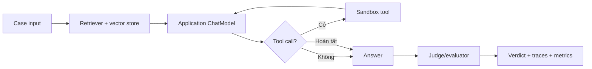
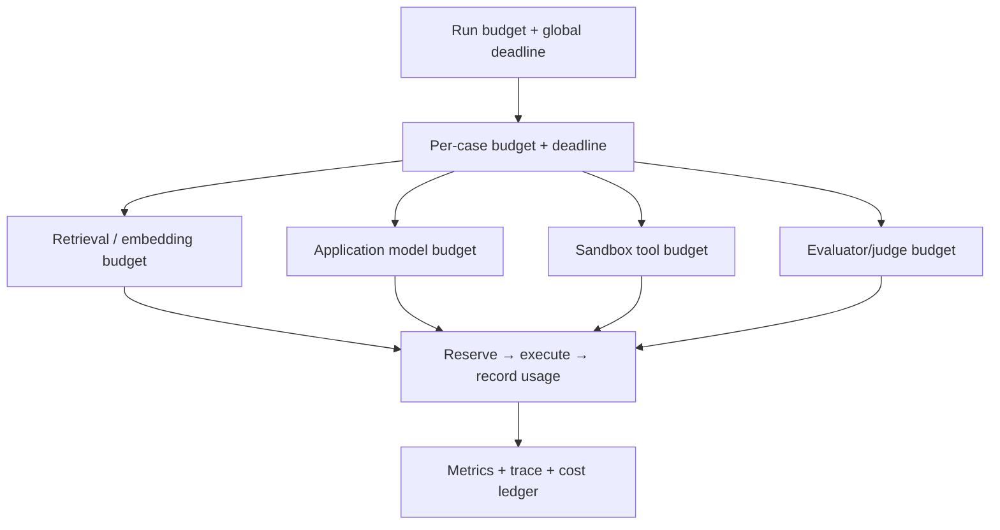
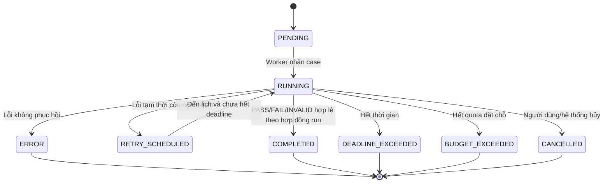
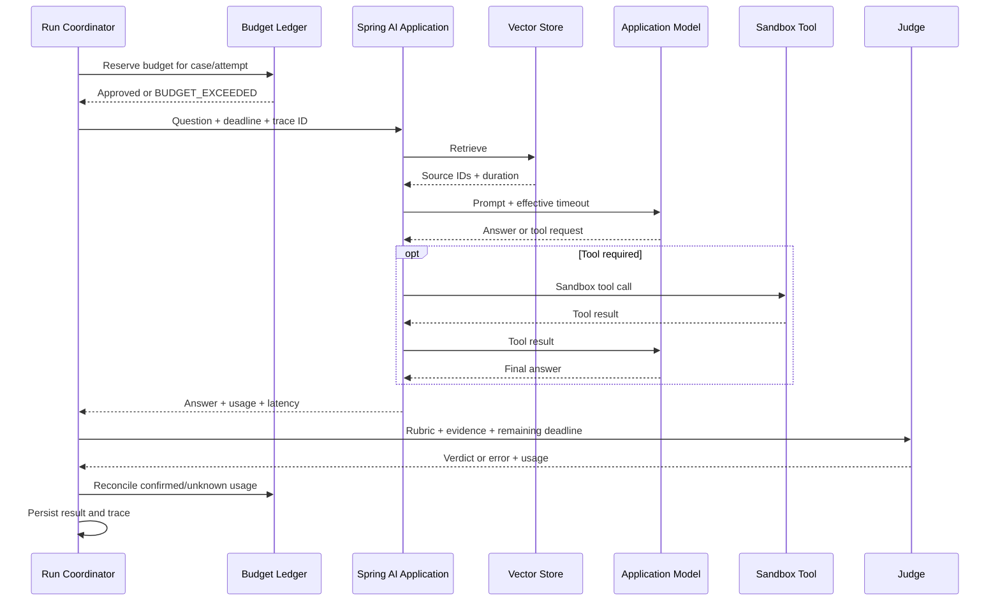

# Đặt thời hạn, ngân sách và khả năng tái chạy

Kiểm thử một ứng dụng Spring AI khác với chạy một hàm Java thuần: một ca đánh giá có thể truy xuất tài liệu, tạo embedding, gọi mô hình chat, sử dụng công cụ, rồi gọi thêm một mô hình làm giám khảo (*LLM-as-a-judge*). Các bước này phụ thuộc vào mạng, hạn mức của nhà cung cấp, dữ liệu và khả năng sinh văn bản có biến động. Nếu không đặt giới hạn, một bộ evaluation có thể **chạy quá thời gian**, **tiêu thụ nhiều token hơn dự kiến**, hoặc **không thể giải thích vì sao kết quả hôm nay khác hôm qua**.

Trong chương **Chiến lược kiểm thử** của module `SPRING_AI_EVALUATION_OBSERVABILITY`, ba khía cạnh phải được thiết kế cùng nhau:

1. **Thời hạn (deadline):** Quy định một lời gọi, một ca kiểm thử và toàn bộ lần chạy được phép kéo dài đến đâu.
2. **Ngân sách (budget):** Giới hạn số lần gọi, token, chi phí, độ đồng thời và thời gian chờ retry để tránh tiêu thụ tài nguyên không kiểm soát.
3. **Khả năng tái chạy (reproducibility/replay):** Ghi lại các phiên bản và dữ kiện đầu vào đủ chi tiết để chạy lại, đối chiếu, điều tra regression giữa các prompt, model, dataset và pipeline RAG/tool calling.

**Thời hạn và ngân sách là ràng buộc vận hành; chúng không tự chứng minh chất lượng câu trả lời.** Một ca bị hủy vì hết thời gian không đồng nghĩa answer sai. Một ca được chấm PASS cũng không có nghĩa nó đạt mục tiêu latency hay chi phí. Vì vậy, kết quả chất lượng phải gắn với metrics, traces và trạng thái hoàn thành của từng ca.

## 1. Định nghĩa phạm vi giới hạn trước khi viết code

Không nên dùng một giá trị `timeout=30s` duy nhất cho mọi thứ. Một pipeline thường có các tầng giới hạn sau:

| Phạm vi | Câu hỏi quản trị | Ví dụ | Ai thực thi? |
|---|---|---|---|
| **Per-attempt** | Một request tới provider/tool được phép chờ tối đa bao lâu? | Mỗi request chat tối đa 6 giây | HTTP client/SDK, scheduler |
| **Per-phase** | Một bước retrieval, tool hoặc judge được phép tốn bao lâu? | Retrieval tối đa 3 giây | Orchestrator hoặc timeout của bước |
| **Per-case** | Một case, gồm mọi attempt, retry và đánh giá, được phép chạy bao lâu? | Toàn ca tối đa 25 giây | Evaluation runner |
| **Per-run/batch** | Toàn bộ bộ dữ liệu và các case còn chờ có deadline gì? | Batch phải hoàn thành trước cửa sổ CI | Job scheduler và run coordinator |
| **Quota/budget** | Tối đa bao nhiêu requests, token hoặc tiền cho case/run? | 3 attempts/case và tổng mức chi dự kiến | Budget ledger và provider quota |
| **Concurrency** | Bao nhiêu model/tool requests được chạy đồng thời? | Tối đa 4 judge calls | Semaphore, queue hoặc rate limiter |

Điều kiện per-attempt giúp một lời gọi không treo mãi. Điều kiện per-case ngăn **nhiều attempts và backoff cộng dồn** vượt quá ngân sách của một ca. Điều kiện per-run ngăn hàng trăm case còn nằm trong queue khiến cả công việc chạy vượt khung thời gian.

### 1.1. Timeout khác deadline

- **Timeout** thường giới hạn một thao tác trong một khoảng thời gian, ví dụ một HTTP request không được chờ quá 6 giây.
- **Deadline** là **mốc kết thúc** của một công việc. Nếu case đã tốn 18/25 giây, mọi lời gọi tiếp theo chỉ còn tối đa 7 giây (trừ thời gian overhead).
- **Soft deadline** là điểm cảnh báo hoặc chủ động không nhận thêm việc.
- **Hard deadline** là điểm không cho phép tiếp tục; các thao tác đang chạy cần được yêu cầu hủy theo khả năng của hệ thống.

Khi phát sinh retry, `3 attempts × 6 seconds` chưa kể backoff có thể vượt xa deadline 15 giây. Vì vậy cần truyền **thời gian còn lại** xuống từng request, không chỉ cấu hình timeout cố định khi khởi tạo bean.

### 1.2. Đồng hồ dùng để đo và đồng hồ dùng để ghi nhật ký

Để tính thời gian đã trôi qua trong cùng một process, nên dùng đồng hồ **đơn điệu** như `System.nanoTime()` thay cho chênh lệch `Instant.now()`: giờ hệ thống có thể bị điều chỉnh NTP hoặc người vận hành đổi. Dùng `Instant`/UTC cho **dấu thời gian** trong log, run manifest, lịch hẹn và thời hạn có ý nghĩa giữa nhiều máy.

Khi một deadline cần được truyền giữa nhiều service, không được truyền giá trị `System.nanoTime()` của máy A sang máy B. Hãy truyền **remaining timeout** hoặc một mốc thời gian UTC được hệ thống thống nhất và tính lại trên từng máy, có dự phòng độ lệch đồng hồ.

## 2. Lập ngân sách thời gian theo các bước của evaluation

Một ca RAG có thể gồm những bước:



Đặt một **deadline tổng cho cả case**, sau đó dự kiến hạn mức cho từng phase. Ví dụ một case cần hoàn tất trong **30 giây**:

| Giai đoạn | Phần dự phòng trong kế hoạch |
|---|---:|
| Retrieval/embedding | 3 giây |
| Application model | 10 giây |
| Tool sandbox nếu có | 5 giây |
| Evaluator/judge | 8 giây |
| Parsing, ghi kết quả, overhead | 4 giây |
| **Tổng dự kiến** | **30 giây** |

Đây chỉ là **phân bổ kế hoạch**, không có nghĩa các phase luôn chạy đúng thời lượng hoặc tất cả đều cần được thực thi. Một trường hợp không cần tool có thể dùng phần thời gian chưa tiêu; một trường hợp tool nhiều lượt cần ngân sách riêng. Nếu model đã dùng 14 giây, runner phải tính lại phần còn lại thay vì tiếp tục mặc định cấp 8 giây cho judge.

### 2.1. Deadline cần được kiểm tra ở mỗi ranh giới

Một quy tắc thường dùng:

```text
remaining_case = case_deadline - monotonic_elapsed
remaining_run  = run_deadline  - monotonic_elapsed_for_run

allowed_for_next_attempt = min(
    configured_attempt_timeout,
    configured_phase_remaining,
    remaining_case,
    remaining_run
)

if allowed_for_next_attempt <= 0:
    stop_and_record_deadline_exceeded()
```

Ngoài việc kiểm tra **trước** lời gọi, cần xác nhận deadline **sau** lời gọi. Nếu một SDK không thực sự tôn trọng timeout được truyền vào, việc nhận response muộn không được âm thầm đánh dấu ca đã hoàn thành đúng hạn. Điều đó không có nghĩa đáp án về nội dung sai; hãy ghi trạng thái quá hạn và giữ raw outcome để điều tra theo chính sách.

### 2.2. Cancellation không tự động bảo đảm kết thúc request phía provider

Một `Future.get(timeout)` ném `TimeoutException` hoặc một reactive operator ném timeout có thể chỉ chấm dứt **việc chờ của caller**. Kết nối HTTP, request streaming hoặc xử lý tại provider có thể vẫn tiếp diễn. Cần xác minh bằng integration test:

- HTTP client có đóng/hủy request và giải phóng connection không?
- Các chunk streaming đã nhận nhưng chưa hoàn tất có bị vô tình đưa qua parser không?
- Sau hủy, có còn tool callback hoặc retry chạy ngầm không?
- Nếu provider đã nhận request, có thể phát sinh token/chi phí dù client không nhận response không?
- Một lời gọi tool có tác dụng phụ có bị gọi lặp sau timeout không?

Với tool có tác dụng phụ, cần token idempotency, quyền, giao dịch hoặc một quy trình xác nhận để tránh retry gây tác động gấp đôi. Trong evaluation nên ưu tiên **sandbox tool chỉ đọc hoặc dữ liệu giả**.

## 3. Retry phải tiêu thụ cả thời gian lẫn ngân sách

Retry chỉ nên áp dụng cho **lỗi có thể phục hồi** và phải nằm trong giới hạn:

| Kết quả hoặc lỗi | Có nên retry không? | Giải thích |
|---|---|---|
| PASS hoặc FAIL hợp lệ từ judge | Không | Đã có verdict; retry FAIL để tìm PASS gây thiên lệch |
| JSON sai schema/INVALID | Tùy chính sách repair, có giới hạn | Không tự sửa thành PASS; lưu raw output |
| HTTP 429 có `Retry-After` | Có thể, khi đủ deadline/budget | Tôn trọng chỉ dẫn provider |
| HTTP 500/502/503/504 | Thường có thể retry giới hạn | Backoff và jitter, tránh retry storm |
| Timeout mạng tạm thời | Có thể retry nếu an toàn | Không biết provider đã xử lý bao nhiêu |
| HTTP 400/422 request sai | Thường không | Lặp request không giúp sửa schema |
| HTTP 401/403 | Không retry mù quáng | Phải sửa credential hoặc quyền |
| Request bị người dùng/hệ thống hủy | Không | Phải tuân lệnh hủy, không âm thầm chạy tiếp |

**`maxAttempts=3` là tổng ba lượt gọi**, gồm lần đầu và tối đa hai lần thử lại. Cần xác minh retry của Spring AI/provider SDK có đang bật sẵn không: nếu cả adapter lẫn runner đều retry, số request thật có thể vượt giới hạn mà code ở một lớp tưởng đã đặt đúng.

### 3.1. Exponential backoff và Retry-After

Một chính sách giả định có base delay 250 ms, hệ số nhân hai và cap 2 giây:

```text
after attempt 1: 250 ms
after attempt 2: 500 ms
after attempt 3: 1_000 ms
after attempt 4+: cap at 2_000 ms
```

Trong môi trường nhiều worker, thêm **jitter** để tránh tất cả retry cùng lúc. Khi provider trả `Retry-After`, giá trị thường là **số giây** hoặc **HTTP-date**; phải parse theo hợp đồng của provider và không gọi lại sớm hơn yêu cầu. Nếu `Retry-After` dài hơn phần thời gian còn lại của case/run, hãy **hoãn case theo scheduler** hoặc kết thúc trạng thái chưa có verdict, không bỏ qua header để retry ngay.

Ví dụ: case còn 4 giây nhưng provider yêu cầu chờ 15 giây. Retry trong 4 giây là không hợp lệ với chính sách chờ; báo `DEFERRED` nếu workflow có hàng đợi tiếp tục sau, hoặc `DEADLINE_EXCEEDED/ERROR` theo mô hình trạng thái đã chọn.

### 3.2. Retry không miễn phí

Một timeout sau khi provider đã nhận request **có thể** đã tiêu thụ input/output tokens. Khi retry, lời gọi thứ hai có thể tính phí lần nữa. Do đó:

- Dự trù ngân sách **trước mỗi attempt**, không chỉ trước ca.
- Theo dõi `attempt_count`, `retry_wait_ms` và kết quả từng attempt.
- Phân biệt chi phí **đã được provider xác nhận**, **ước tính** và **chưa biết**.
- Không giả định timeout có `tokens=0`.
- Giới hạn số model/tool/judge calls cho mỗi case và toàn run.

## 4. Ngân sách requests, tokens, chi phí và đồng thời

Một evaluation thường dùng **hai loại mô hình**: model ứng dụng tạo answer và model giám khảo chấm answer. Nếu mỗi ca RAG còn gọi embedding hoặc reranker, cần tính thêm những phần đó.

| Loại ngân sách | Đơn vị | Ví dụ phạm vi |
|---|---|---|
| Request count | Số lượt gọi | 3 judge attempts/case, 1.000 requests/run |
| Input tokens | Token | Prompt + context + tool transcript |
| Output tokens | Token | Giới hạn output tokens của application/judge |
| Estimated cost | USD hoặc đơn vị tiền do hệ thống thống nhất | Chi phí dự kiến theo bảng giá có version |
| Inference concurrency | Số request song song | Tối đa 4 judge requests |
| Rate limit | Requests/tokens theo cửa sổ thời gian | RPM/TPM do provider quy định |
| Queue/storage | Số case, MB logs/artifacts | Không giữ vô hạn raw responses |
| Time | Attempt, case, phase, run | Deadline và backoff |

**Ngân sách nội bộ không thay thế hạn mức provider.** Bộ đếm nội bộ giúp tránh vượt ngưỡng do tổ chức đặt ra, còn provider có thể áp dụng quota toàn tài khoản hoặc thay đổi giới hạn theo model. Khi nhiều instance cùng dùng một API key, limiter chỉ ở bộ nhớ từng process không đủ để đảm bảo tổng mức sử dụng.

### 4.1. Ước tính chi phí theo token

Nếu giả sử một model có giá **đầu vào 0,50 USD/1 triệu token**, **đầu ra 2,00 USD/1 triệu token** (con số **hoàn toàn minh họa, không phải giá hiện hành của provider**), một lời gọi dùng 1.200 input tokens và 400 output tokens sẽ có:

```text
input_cost  = 1_200 × 0.50 / 1_000_000 = 0.0006 USD
output_cost =   400 × 2.00 / 1_000_000 = 0.0008 USD
call_cost   = 0.0014 USD
```

Một nghìn lời gọi tương tự có chi phí minh họa khoảng **1,40 USD**, **chưa tính** model giám khảo, embedding, retries, tool/API bên thứ ba hoặc chi phí hạ tầng. Nếu mỗi case phải chạy lại hai lần, số lượng request thực tăng tương ứng; việc gộp chi phí application và judge làm mất khả năng phân tích hiệu quả của từng phần.

Để tránh sai số cộng dồn, trong chương trình có thể lưu số tiền dưới dạng **đơn vị nhỏ nhất** (ví dụ micro-USD) bằng integer và làm tròn theo quy tắc nhất quán. Cần version hóa bảng giá và xử lý những trường hợp có cached tokens, reasoning tokens, batch discount hoặc cấu trúc tính phí đặc biệt theo provider. Đừng suy giá hiện tại từ một bài học.

### 4.2. Đặt chỗ ngân sách trước, đối soát sau

Một cách bảo vệ là **reservation**:

1. Trước request, ước tính mức tối đa được phép tiêu thụ, từ `inputTokens` dự kiến và giới hạn `maxOutputTokens`.
2. Trên một budget ledger dùng chung, **đặt chỗ nguyên tử** phần token/chi phí đó.
3. Chỉ gọi provider nếu reservation thành công.
4. Khi provider trả usage thực, đối soát, ghi actual và có thể hoàn lại phần chưa dùng **nếu hệ thống có đủ dữ liệu đáng tin**.
5. Khi timeout và usage không rõ, giữ trạng thái chưa đối soát thay vì khẳng định chưa phát sinh chi phí.

Để dễ kiểm thử, ví dụ Java sau áp dụng chính sách **bảo thủ: đã đặt chỗ thì không hoàn lại**. Điều này có thể dừng batch sớm hơn cần thiết nhưng không tự vượt ngân sách dự kiến; mã production có thể xây lớp accounting chi tiết hơn cho các trạng thái confirmed/estimated/unknown.

### 4.3. Khi nhiều worker cùng chia ngân sách

Nếu runner phân tán ở nhiều máy, `synchronized` trong Java **chỉ bảo vệ trong cùng JVM**. Cần reservation bền vững với database transaction, atomic counter hoặc dịch vụ điều phối, kèm khóa idempotency theo `runId + caseId + attemptId`. Khi worker bị khởi động lại, cùng một attempt không được đặt chỗ hai lần hoặc tạo hai kết quả cuối.

## 5. Java: budget ledger và deadline guard có thể kiểm thử

Đoạn code sau minh họa **logic điều phối độc lập với SDK** để người học có thể kiểm tra deterministically mà không cần API key hay sleep thật. Khi triển khai thật, một adapter `JudgeClient` sẽ gọi Spring AI `ChatClient`, còn timeout request cần được cấu hình trên HTTP transport/provider SDK tương ứng.

### 5.1. Hợp đồng dữ liệu và bộ đếm ngân sách

```java
import java.time.Duration;

enum Verdict {
    PASS, FAIL, INVALID
}

enum RunStatus {
    PASS, FAIL, INVALID, ERROR,
    DEADLINE_EXCEEDED, BUDGET_EXCEEDED
}

record Quote(long reservedTokens, long reservedMicroUsd) {
    Quote {
        if (reservedTokens < 0 || reservedMicroUsd < 0) {
            throw new IllegalArgumentException("Reservation âm");
        }
    }
}

final class BudgetLedger {
    private final long maxTokens;
    private final long maxMicroUsd;
    private long usedTokens;
    private long usedMicroUsd;

    BudgetLedger(long maxTokens, long maxMicroUsd) {
        if (maxTokens < 0 || maxMicroUsd < 0) {
            throw new IllegalArgumentException("Budget âm");
        }
        this.maxTokens = maxTokens;
        this.maxMicroUsd = maxMicroUsd;
    }

    // Đồng bộ chỉ trong một JVM; hệ thống đa worker cần ledger chia sẻ.
    synchronized boolean tryReserve(Quote quote) {
        if (quote.reservedTokens() > maxTokens - usedTokens
                || quote.reservedMicroUsd() > maxMicroUsd - usedMicroUsd) {
            return false;
        }
        usedTokens += quote.reservedTokens();
        usedMicroUsd += quote.reservedMicroUsd();
        return true;
    }

    synchronized long reservedTokens() {
        return usedTokens;
    }

    synchronized long reservedMicroUsd() {
        return usedMicroUsd;
    }
}

record GuardPolicy(
        Duration caseDeadline,
        Duration attemptTimeout,
        Duration retryBackoff,
        int maxAttempts) {
    GuardPolicy {
        if (caseDeadline == null
                || caseDeadline.isZero() || caseDeadline.isNegative()
                || attemptTimeout == null
                || attemptTimeout.isZero() || attemptTimeout.isNegative()
                || retryBackoff == null || retryBackoff.isNegative()
                || maxAttempts < 1) {
            throw new IllegalArgumentException("Guard policy không hợp lệ");
        }
    }
}

@FunctionalInterface
interface MonotonicTicker {
    long nanoTime();
}

@FunctionalInterface
interface Waiter {
    void pause(Duration delay);
}

@FunctionalInterface
interface JudgeClient {
    Verdict judge(String caseId, Duration effectiveTimeout);
}

final class TransientJudgeFailure extends RuntimeException {
    private final Duration retryAfter;

    TransientJudgeFailure(String message, Duration retryAfter) {
        super(message);
        this.retryAfter = retryAfter;
    }

    Duration retryAfter() {
        return retryAfter;
    }
}

record RunResult(String caseId, RunStatus status, int attempts) {}
```

Các phép kiểm tra `isZero()` và `isNegative()` tương thích Java 17; record `GuardPolicy` yêu cầu deadline/timeout dương, retry backoff không âm và tối thiểu một attempt.

Ở đây `Quote` không phải hóa đơn đã thu: nó là **hạn mức được giữ lại** trước attempt. Nhiều ca có thể dùng chung một `BudgetLedger`; nếu ledger không đủ, không được gửi request. Các giá trị thời gian trong `GuardPolicy` dùng để giới hạn case **tương đối**, không phải một lịch hẹn UTC.

### 5.2. Runner áp dụng deadline và reservation trước mỗi attempt

```java
import java.time.Duration;
import java.util.Objects;

final class GuardedJudgeRunner {
    private final JudgeClient client;
    private final BudgetLedger budget;
    private final GuardPolicy policy;
    private final MonotonicTicker ticker;
    private final Waiter waiter;

    GuardedJudgeRunner(
            JudgeClient client, BudgetLedger budget,
            GuardPolicy policy, MonotonicTicker ticker, Waiter waiter) {
        this.client = Objects.requireNonNull(client);
        this.budget = Objects.requireNonNull(budget);
        this.policy = Objects.requireNonNull(policy);
        this.ticker = Objects.requireNonNull(ticker);
        this.waiter = Objects.requireNonNull(waiter);
    }

    RunResult run(String caseId, Quote quote) {
        long startedAt = ticker.nanoTime();
        int attempts = 0;

        while (attempts < policy.maxAttempts()) {
            Duration remaining = remaining(startedAt);
            if (remaining.isZero() || remaining.isNegative()) {
                return new RunResult(
                        caseId, RunStatus.DEADLINE_EXCEEDED, attempts);
            }

            if (!budget.tryReserve(quote)) {
                return new RunResult(
                        caseId, RunStatus.BUDGET_EXCEEDED, attempts);
            }

            attempts++;
            Duration requestTimeout = min(
                    remaining, policy.attemptTimeout());
            try {
                Verdict verdict = client.judge(caseId, requestTimeout);

                // Không coi là đúng hạn nếu response trở về quá muộn.
                if (remaining(startedAt).isZero()
                        || remaining(startedAt).isNegative()) {
                    return new RunResult(
                            caseId, RunStatus.DEADLINE_EXCEEDED, attempts);
                }

                if (verdict == null) {
                    return new RunResult(
                            caseId, RunStatus.INVALID, attempts);
                }
                RunStatus status = switch (verdict) {
                    case PASS -> RunStatus.PASS;
                    case FAIL -> RunStatus.FAIL;
                    case INVALID -> RunStatus.INVALID;
                };
                return new RunResult(caseId, status, attempts);

            } catch (TransientJudgeFailure error) {
                if (attempts >= policy.maxAttempts()) {
                    return new RunResult(caseId, RunStatus.ERROR, attempts);
                }

                Duration delay = policy.retryBackoff();
                if (error.retryAfter() != null) {
                    if (error.retryAfter().isNegative()) {
                        return new RunResult(
                                caseId, RunStatus.ERROR, attempts);
                    }
                    delay = max(delay, error.retryAfter());
                }

                // Sau khi chờ phải còn thời gian cho attempt tiếp theo.
                if (delay.compareTo(remaining(startedAt)) >= 0) {
                    return new RunResult(
                            caseId, RunStatus.DEADLINE_EXCEEDED, attempts);
                }
                waiter.pause(delay);
            }
        }
        throw new IllegalStateException("Không còn attempt");
    }

    private Duration remaining(long startedAt) {
        long elapsed = Math.max(0L, ticker.nanoTime() - startedAt);
        long limit = policy.caseDeadline().toNanos();
        return Duration.ofNanos(Math.max(0L, limit - elapsed));
    }

    private static Duration min(Duration a, Duration b) {
        return a.compareTo(b) <= 0 ? a : b;
    }

    private static Duration max(Duration a, Duration b) {
        return a.compareTo(b) >= 0 ? a : b;
    }
}
```

**Giới hạn minh họa:** Code dùng các khoảng thời gian ngắn vừa phạm vi `Duration.toNanos()` và một ticker đơn điệu trong cùng process. Nó **không tự hủy request** nếu HTTP client bỏ qua `requestTimeout`, cũng chưa có overall deadline của batch, jitter, durable reservation hay replay sau crash. Trong production phải thêm HTTP transport timeout/cancellation, scheduler, trạng thái ERROR có mã nguyên nhân và budget ledger bền vững. Nếu một exception không thuộc `TransientJudgeFailure` xảy ra, ví dụ lỗi lập trình hoặc lỗi quyền, ứng dụng cần phân loại thành ERROR ở biên runner cao hơn; không tự chuyển mọi exception thành lỗi tạm thời.

**Hai điểm cần kiểm tra kỹ:** Ledger đặt chỗ trước attempt và không hoàn lại nếu attempt lỗi; vì vậy nó giữ **giới hạn bảo thủ**, không phải hóa đơn thực. Nếu `Retry-After` vượt thời gian còn lại, runner dừng thay vì retry sớm, kể cả ngân sách token vẫn còn.

### 5.3. Test với fake clock, không sleep thật

```java
import static org.junit.jupiter.api.Assertions.*;

import java.time.Duration;
import java.util.concurrent.atomic.AtomicInteger;
import org.junit.jupiter.api.Test;

class GuardedJudgeRunnerTest {
    static final class FakeTime
            implements MonotonicTicker, Waiter {
        private long nanos;

        @Override
        public long nanoTime() {
            return nanos;
        }

        @Override
        public void pause(Duration delay) {
            nanos += delay.toNanos();
        }

        void advance(Duration elapsed) {
            nanos += elapsed.toNanos();
        }
    }

    private static GuardPolicy policy() {
        return new GuardPolicy(
                Duration.ofSeconds(9),
                Duration.ofSeconds(4),
                Duration.ofMillis(250),
                3);
    }

    @Test
    void retriesWithRetryAfterAndUsesReservationForEachAttempt() {
        var time = new FakeTime();
        var calls = new AtomicInteger();
        JudgeClient judge = (caseId, timeout) -> {
            if (calls.incrementAndGet() == 1) {
                throw new TransientJudgeFailure(
                        "HTTP_429", Duration.ofSeconds(3));
            }
            assertEquals(Duration.ofSeconds(4), timeout);
            return Verdict.PASS;
        };
        var ledger = new BudgetLedger(1_500, 30_000);

        RunResult result = new GuardedJudgeRunner(
                judge, ledger, policy(), time, time)
                .run("rag-001", new Quote(500, 10_000));

        assertEquals(RunStatus.PASS, result.status());
        assertEquals(2, result.attempts());
        assertEquals(2, calls.get());
        assertEquals(Duration.ofSeconds(3).toNanos(), time.nanoTime());
        assertEquals(1_000, ledger.reservedTokens());
        assertEquals(20_000, ledger.reservedMicroUsd());
    }

    @Test
    void stopsWhenAnotherReservationWouldExceedBudget() {
        var time = new FakeTime();
        var calls = new AtomicInteger();
        JudgeClient judge = (caseId, timeout) -> {
            calls.incrementAndGet();
            throw new TransientJudgeFailure("HTTP_503", null);
        };
        var ledger = new BudgetLedger(700, 20_000);

        RunResult result = new GuardedJudgeRunner(
                judge, ledger, policy(), time, time)
                .run("rag-002", new Quote(500, 10_000));

        assertEquals(RunStatus.BUDGET_EXCEEDED, result.status());
        assertEquals(1, result.attempts());
        assertEquals(1, calls.get());
        assertEquals(500, ledger.reservedTokens());
    }

    @Test
    void doesNotIgnoreRetryAfterWhenDeadlineIsTooShort() {
        var time = new FakeTime();
        var calls = new AtomicInteger();
        JudgeClient judge = (caseId, timeout) -> {
            calls.incrementAndGet();
            throw new TransientJudgeFailure(
                    "HTTP_429", Duration.ofSeconds(8));
        };
        var shortPolicy = new GuardPolicy(
                Duration.ofSeconds(3),
                Duration.ofSeconds(2),
                Duration.ofMillis(250),
                3);

        RunResult result = new GuardedJudgeRunner(
                judge, new BudgetLedger(2_000, 30_000),
                shortPolicy, time, time)
                .run("rag-003", new Quote(500, 10_000));

        assertEquals(RunStatus.DEADLINE_EXCEEDED, result.status());
        assertEquals(1, calls.get());
        assertEquals(0, time.nanoTime()); // Không chờ khi vô ích.
    }

    @Test
    void neverRetriesAValidFail() {
        var calls = new AtomicInteger();
        JudgeClient judge = (id, timeout) -> {
            calls.incrementAndGet();
            return Verdict.FAIL;
        };
        var time = new FakeTime();

        RunResult result = new GuardedJudgeRunner(
                judge, new BudgetLedger(1_000, 20_000),
                policy(), time, time)
                .run("rag-004", new Quote(500, 10_000));

        assertEquals(RunStatus.FAIL, result.status());
        assertEquals(1, calls.get());
    }

    @Test
    void flagsAResponseThatReturnsAfterCaseDeadline() {
        var time = new FakeTime();
        JudgeClient slowJudge = (id, timeout) -> {
            time.advance(Duration.ofSeconds(12));
            return Verdict.PASS;
        };

        RunResult result = new GuardedJudgeRunner(
                slowJudge, new BudgetLedger(1_000, 20_000),
                policy(), time, time)
                .run("rag-005", new Quote(500, 10_000));

        assertEquals(RunStatus.DEADLINE_EXCEEDED, result.status());
        assertEquals(1, result.attempts());
    }
}
```

Các test xác minh **logic quyết định trong runner** bằng fake judge và clock; chúng không gọi model thật. Mọi assertion về token ở đây là **reservation**, không phải usage đo từ provider. Trong test thực tế phải kiểm tra thêm HTTP timeout/cancellation, nguồn đồng hồ hệ thống và request count tại fake server để phát hiện retry đã được SDK tự thực hiện.

## 6. Thiết lập ngân sách ở cấp run và tách application với judge

Đối với một dataset 500 case, nên thiết lập **hai tầng ngân sách**:

| Tầng | Ví dụ chính sách |
|---|---|
| **Case budget** | Tối đa 2 application model calls, 2 tool calls, 2 judge attempts; deadline 30 giây |
| **Run budget** | Tổng 500 case, 10.000.000 reserved tokens, giới hạn estimated spend và một deadline batch |

Ngoài tổng ngân sách, nên có **ngân sách riêng theo thành phần**. Ví dụ khi judge xảy ra lỗi schema và retry nhiều lần, nó không nên dùng hết phần chi phí đã dành cho application model; khi application model bị rate limit, runner cũng không cần tiếp tục gọi judge cho một answer chưa hoàn thành.



### 6.1. Đối soát ngân sách khi thông tin usage đến muộn

Một timeout không chứng minh provider chưa tính phí. Một cách thiết kế an toàn:

- Ghi reservation trước request bằng `runId + caseId + attemptId + component`.
- Ghi `providerRequestId` khi có, thời điểm gửi và trạng thái `SENT`.
- Khi response đến, ghi usage confirmed và tính lại balance bằng một ledger có audit.
- Khi request bị hủy hoặc response không đến, ghi `USAGE_UNKNOWN` và giữ estimate; không ghi 0 nếu không có căn cứ.
- Dùng idempotency key hoặc một cơ chế dedup được provider hỗ trợ nếu phù hợp; không giả định tất cả provider đều hỗ trợ idempotency.
- Khi hết budget, **không phát thêm request mới**; giữ artifact của các case đã hoàn tất và đánh dấu các case còn lại là `BUDGET_EXCEEDED` hoặc `SKIPPED_BUDGET` theo thiết kế.

Nếu cần giới hạn chi tiêu **tuyệt đối** ở cấp tài khoản, thiết lập thêm spending cap/quota ở provider. Dù vậy, giá và usage được báo có thể đến muộn; kiểm soát chi phí phần mềm thường là **best effort** dựa trên reservation, không phải bảo đảm hóa đơn chính xác từng micro-USD.

## 7. Khả năng tái chạy gồm ba mức khác nhau

Trong hệ thống LLM, “reproducible” cần được định nghĩa rõ mức độ:

| Mức | Cách thực hiện | Điều có thể khẳng định |
|---|---|---|
| **Deterministic replay** | Phát lại cùng fixtures, HTTP stubs, scripted model, fake clock | Logic ứng dụng được tái hiện gần như chính xác |
| **Controlled live rerun** | Pin dataset, corpus, prompt, model/embedding version nếu có, sampling và công cụ sandbox | So sánh với mức nhiễu đã biết, có đủ provenance |
| **Production-like rerun** | Gọi cloud provider và môi trường tương đương production | Quan sát hành vi thực tế, **không bảo đảm** output/latency giống hệt |

Với model cloud, ngay cả khi `temperature=0` và truyền `seed` (nếu được hỗ trợ), kết quả vẫn có thể khác do backend, model alias, tokenizer, sampling, concurrency hoặc dữ liệu retrieval. Một sự khác biệt giữa hai lần rerun **không nhất thiết** là bug lập trình.

### 7.1. Những gì phải ghi vào run manifest

Một manifest có phiên bản nên bao gồm:

```json
{
  "runId": "eval-2026-11-example",
  "runMode": "live-cloud-model",
  "gitCommit": "commit-sha-placeholder",
  "datasetVersion": "policy-eval-v3",
  "datasetSha256": "checksum-placeholder",
  "corpusVersion": "policy-corpus-v2",
  "indexVersion": "pgvector-index-v4",
  "embeddingModelId": "configured-embedding-model",
  "embeddingDimensions": 1536,
  "retrieval": {
    "topK": 5,
    "filterVersion": "active-policy-v2",
    "rerankerVersion": null
  },
  "application": {
    "provider": "configured-provider",
    "modelId": "configured-model-id",
    "modelRevision": null,
    "promptVersion": "rag-prompt-07",
    "promptSha256": "checksum-placeholder",
    "temperature": 0.2,
    "seed": null,
    "maxOutputTokens": 512
  },
  "tools": {
    "schemaVersion": "order-tool-v2",
    "sandboxFixtureVersion": "orders-v1"
  },
  "judge": {
    "modelId": "configured-judge-model",
    "promptVersion": "judge-prompt-04",
    "rubricVersion": "groundedness-v2"
  },
  "limits": {
    "caseDeadlineMs": 30000,
    "attemptTimeoutMs": 7000,
    "maxAttempts": 3,
    "runBudgetVersion": "budget-v2"
  },
  "pricingVersion": "pricing-snapshot-v1",
  "environment": "isolated-test"
}
```

Các con số và tên version trong JSON chỉ là **ví dụ cấu trúc**, không phải thông số khuyên dùng. Khi provider không công bố model revision bất biến, đặt `modelRevision=null` và ghi lại tên alias, thời điểm chạy cùng các system fingerprints nếu provider cung cấp; không tự sáng tạo “revision chính xác”. Với dataset, lưu checksum của nội dung đã chuẩn hóa, không chỉ một chuỗi tên version do người dùng tự nhập.

### 7.2. Snapshot nào cần giữ?

| Artifact | Vì sao cần |
|---|---|
| Dataset case IDs, câu hỏi, nhãn, reference facts | Biết đang thử cùng tập câu hỏi nào |
| Corpus chunks, metadata hiệu lực, document IDs | Phân biệt lỗi retrieval với lỗi generation |
| Prompt template, options và hash | Biết prompt đã gửi vào model |
| Model/provider ID và revision khi có | Tìm thay đổi model |
| Embedding model/index/filter/reranker | Tái hiện thứ tự retrieval |
| Tool descriptions/schema và sandbox responses | Tái hiện quyết định và kết quả tool |
| Judge rubric/prompt và output schema | Tránh so hai phiên bản chấm khác nhau |
| Retry policy, timeouts, budget, concurrency | Diễn giải latency, lỗi và chi phí |
| Raw/normalized outcomes, trace IDs, token usage | Điều tra từng case và sửa lỗi |

Không lưu API key, credential hoặc dữ liệu cá nhân nguyên văn trong manifest. Với prompt/answer hoặc tài liệu có thông tin nhạy cảm, cần redaction, quyền truy cập, retention và cơ chế liên kết hash/ciphertext theo chính sách dữ liệu. Một checksum có thể chứng minh artifact không thay đổi, nhưng **không thay thế nội dung artifact** khi cần replay.

## 8. Rerun, replay, resume: ba thao tác không giống nhau

- **Rerun:** Chạy lại toàn bộ case bằng model/pipeline trong một cấu hình đã xác định. Trên cloud, có thể khác kết quả do nhiễu.
- **Replay:** Phát lại những request/response hoặc fixtures đã ghi để tái hiện logic xử lý mà không gọi provider thật. Replay giúp debug nhưng không đánh giá model hiện tại.
- **Resume:** Tiếp tục một run đang dở, chỉ xử lý các case chưa có kết quả cuối, giữ nguyên bản cấu hình mà run đó đã “đóng băng”.

### 8.1. Khóa nhận dạng một ca và một attempt

Ví dụ đặt các khóa:

```text
run_id
case_id
stage = RETRIEVE | GENERATE | TOOL | JUDGE
attempt_no
variant = A | B

unique_attempt_key = (run_id, case_id, stage, attempt_no, variant)
unique_final_result_key = (run_id, case_id, rubric_id, variant)
```

Nếu một worker chết sau khi đã gọi model nhưng trước khi lưu verdict, worker khác có thể nhận lại case đó. Nếu không dùng khóa idempotency, kết quả có thể bị ghi đôi, budget bị trừ hai lần, hoặc hai câu trả lời khác nhau vô tình được gộp vào một case. Cần kiểm soát bằng **atomic claim/lease và unique constraint** ở result store.

### 8.2. Mẫu trạng thái khi chạy batch



Một case có output JSON sai hợp đồng có thể được ghi `INVALID` làm final outcome (nếu chính sách không retry format) hoặc thử lại có giới hạn. Khi ghi số liệu, phân biệt **PASS/FAIL của chất lượng**, **INVALID của evaluator**, **ERROR vận hành**, **SKIPPED**, **DEADLINE_EXCEEDED** và **BUDGET_EXCEEDED**.

Nếu resume sau nhiều giờ mà đã đổi model, prompt, index hoặc rubric, không nên âm thầm tiếp tục trong **runId cũ**. Hãy đóng run cũ theo trạng thái thiếu dữ liệu và tạo một run mới có manifest mới, hoặc chỉ resume khi chứng minh được các artifact không đổi.

### 8.3. Cache không phải bằng chứng tái chạy model thật

Sử dụng cache của `question → answer` có thể làm test ổn định, nhưng nếu thay model/prompt/index mà cache key không đổi, kết quả vẫn là của phiên bản trước. Khóa cache nên bao gồm những cấu hình tác động trực tiếp đến output, như:

```text
cache_key = hash(
    normalized_case_input,
    prompt_sha256,
    model_id_and_revision_when_available,
    corpus_and_index_version,
    retrieval_and_tool_config,
    sampling_options,
    evaluator_rubric_version_if_caching_scores
)
```

Khi đang đo latency và cost **thực của model**, không được lấy kết quả cache rồi đưa vào phân bố request latency thực nếu chưa ghi rõ cache hit/miss. Replay và cache nên dùng để tìm bug, không dùng giả làm một lần đánh giá live.

## 9. RAG và tool calling: ví dụ lưu đủ dữ kiện để tìm regression

Giả sử policy hiện hành **giả định** là “đổi hàng trong 14 ngày”, policy cũ là “30 ngày”, và đơn hàng sandbox `DH-001` đang giao.

### 9.1. Một case RAG

```json
{
  "caseId": "rag-001",
  "question": "Thời hạn đổi hàng hiện hành là bao lâu?",
  "verifiedFacts": ["Chính sách hiện hành là 14 ngày"],
  "expectedSourceIds": ["policy-v2"],
  "answerable": true,
  "tags": ["rag", "fact-checking", "groundedness"]
}
```

Khi rerun, cần ghi ít nhất `retrievedSourceIds`, `contextDocumentHashes`, answer, prompt version, embedding/index version và trạng thái evaluator. Nếu model trả “30 ngày”:

1. Retrieval có trả `policy-v1` hết hiệu lực không?
2. Filter metadata `active=true` và phiên bản index có đúng không?
3. Nếu retrieval đúng, prompt đã đưa nguồn “14 ngày” vào model chưa?
4. Nếu context đúng, model có bỏ qua nguồn hoặc tự tạo dữ kiện?
5. Nếu model trả đúng nhưng judge đánh FAIL, rubric/judge có thay đổi?

Những câu hỏi này chỉ trả lời được khi run manifest và traces đủ dữ liệu.

### 9.2. Một case tool calling

```json
{
  "caseId": "tool-001",
  "question": "Kiểm tra trạng thái đơn DH-001",
  "expectedTool": {
    "name": "getOrderStatus",
    "arguments": {"orderId": "DH-001"}
  },
  "sandboxResponse": "Đang giao",
  "tags": ["tool", "argument-mapping"]
}
```

Nếu answer cuối là “Đang giao” nhưng trace cho thấy model đã gọi `getOrderStatus("DH-002")`, câu trả lời tình cờ đúng vẫn không làm cho workflow đạt. Có thể kiểm tra **tool name, arguments, count và quyền** bằng quy tắc xác định; dùng rubric ngữ nghĩa cho chất lượng câu trả lời cuối. Khi retry sau timeout, không thực thi lại tool ghi dữ liệu nếu không có bảo đảm idempotency và sandbox.

### 9.3. Thí nghiệm chất lượng có biến động

Đặt cùng dataset, model version, prompt/rubric và corpus khi muốn so sánh một biến duy nhất. Nếu thay cả model và retriever, kết luận chỉ nên là sự khác biệt của **toàn pipeline**. Khi dùng LLM judge, chạy thêm golden cases để kiểm tra false pass/false fail; một verdict đúng schema chưa chắc đúng chuyên môn.

## 10. Quan sát chi phí và độ trễ để phát hiện nguyên nhân suy giảm

Một lần evaluation nên liên kết **caseId** với các spans, events và resource budgets:



### 10.1. Những trường telemetry cần giữ

| Trường | Mục đích |
|---|---|
| `runId`, `caseId`, `variant`, `attemptId` | Phân biệt rerun, retry và A/B |
| `applicationTraceId`, `judgeTraceId` | Truy về model, retrieval, tool và judge |
| `datasetVersion`, `promptVersion`, `modelRevision`, `indexVersion` | Giải thích điểm đổi qua các lần chạy |
| `attemptTimeoutMs`, `remainingDeadlineMs` | Kiểm tra request có vượt thời hạn không |
| `retryAfterMs`, `backoffMs`, `queueWaitMs` | Tìm phần latency do chờ |
| `reservedTokens`, `actualTokens`, `usageKnown` | Phân biệt reservation và usage thật |
| `reservedCost`, `estimatedCost`, `confirmedCost` | Đối chiếu kế hoạch và chi phí |
| `errorKind`, `httpStatus`, `finalStatus` | Tách lỗi provider với lỗi chất lượng |
| `retrievedSourceIds`, `toolName`, `toolArguments` đã che dữ liệu | Tìm nguồn hoặc công cụ gây regression |
| `retrievalLatencyMs`, `modelLatencyMs`, `judgeLatencyMs` | Phân tích bottleneck |

Các tên metric ví dụ dưới đây là **gợi ý cho ứng dụng**, không phải cam kết tên mặc định Spring AI:

```text
ai.eval.cases.total{status="PASS"}
ai.eval.cases.total{status="BUDGET_EXCEEDED"}
ai.eval.cases.total{status="DEADLINE_EXCEEDED"}
ai.eval.requests.total{component="judge",result="HTTP_429"}
ai.eval.reserved.tokens
ai.eval.actual.tokens
ai.eval.cost.estimated
ai.eval.case.duration
ai.eval.queue.wait.duration
ai.eval.retry.delay.duration
```

Trong Micrometer/Prometheus, nên dùng nhãn ít cardinality như `component`, `status`, `rubricVersion` (nếu ít giá trị). Không đặt nguyên prompt, email, mã người dùng, `caseId` hay `traceId` làm metric label. Những dữ liệu chi tiết thuộc trace/log/result store có kiểm soát quyền truy cập, redaction và retention.

### 10.2. Đừng trộn p95 latency với thời gian chờ retry

Cần xác định rõ đang đo:

- **Model request latency:** khoảng thời gian một request thật đến provider.
- **Retrieval latency:** thời gian truy vấn vector store/reranker.
- **Queue wait:** thời gian case chưa được nhận để chạy.
- **Backoff wait:** thời gian cố ý chờ khi retry.
- **Case end-to-end latency:** từ khi case bắt đầu đến khi có trạng thái cuối (có thể gồm các lượt judge).
- **Run completion time:** tổng thời gian để batch đạt final statuses.

Một model có per-request p95 thấp nhưng hệ thống lại có case end-to-end p95 cao do queue hoặc 429. Nếu chỉ nhìn một metric “latency”, rất dễ tối ưu sai thành phần.

## 11. Cách tính coverage và release gate khi có giới hạn

Giả sử một tập **120 case** có kết quả cuối (số liệu giả định):

| Trạng thái | Số case |
|---|---:|
| PASS | 80 |
| FAIL | 15 |
| INVALID | 5 |
| ERROR | 10 |
| DEADLINE_EXCEEDED | 6 |
| BUDGET_EXCEEDED | 4 |
| **Tổng** | **120** |

Ta có:

- Số case có verdict hợp lệ: `80 + 15 = 95`.
- **Valid coverage:** `95 / 120 ≈ 79,17%`.
- **Pass rate trên các verdict hợp lệ:** `80 / 95 ≈ 84,21%`.
- **PASS trên toàn dataset:** `80 / 120 ≈ 66,67%`.
- **Case không được chấm hợp lệ:** `25 / 120 ≈ 20,83%`, gồm INVALID/ERROR/quá hạn/hết budget.

Không được nói đơn giản “chất lượng đạt 84,21% trên cả dataset” trong khi gần một phần năm case chưa được chấm hợp lệ. Các case tốn nhiều token, dài hoặc cần tool có thể bị quota/deadline loại nhiều hơn, tạo ra **selection bias** nếu chỉ xét những case hoàn thành.

### 11.1. Công thức gate có điều kiện đủ dữ liệu

```text
total = pass + fail + invalid + error + deadline + budget + skipped
valid = pass + fail

valid_coverage = valid / total                # khi total > 0
pass_rate_valid = pass / valid                 # khi valid > 0
unscored_rate = (total - valid) / total        # khi total > 0

release_allowed =
    total > 0
    AND valid > 0
    AND valid_coverage >= minimum_coverage
    AND pass_rate_valid >= minimum_quality
    AND critical_failures == 0
    AND p95_case_latency <= maximum_latency
    AND estimated_cost <= approved_budget
```

Đây là **khung chính sách**, không phải ngưỡng chung cho mọi dự án. Khi `valid=0` thì `pass_rate_valid` **không xác định**, tuyệt đối không mặc định 100%. Với ngân sách không đủ, một tổ chức có thể chọn **không ra quyết định** và lên lịch hoàn thành nốt dataset thay vì đánh dấu FAIL của chất lượng.

### 11.2. So sánh hai phiên bản khi case bị thiếu

Khi so prompt A/B, phân tích ít nhất:

1. **Matched cases:** những case có verdict hợp lệ ở cả A và B, dùng để xem ca cải thiện/hồi quy.
2. **All attempted cases:** tổng hợp coverage và lỗi deadline/budget/error/invalid cho từng biến thể.
3. **Subgroup coverage:** các tag `rag`, `tool`, `long-context`, `factual` có bị mất mẫu khác nhau không?
4. **Chi phí/latency cùng phạm vi:** per-case cost, end-to-end p95, số attempts, retry wait.
5. **Mức độ bất định:** số mẫu, mức biến động, confidence interval phù hợp hoặc kiểm tra thêm trên holdout.

Không retry một case FAIL nhiều lần để chọn ra PASS. Nếu muốn đo tính ổn định của model, thiết kế trước số lượt chấm và báo **toàn bộ phân bố**; những lượt lặp của cùng case không phải các case độc lập để tăng giả tạo cỡ mẫu.

## 12. Ma trận kiểm thử cho deadline, budget và rerun

| ID | Kịch bản | Kỳ vọng xác định |
|---|---|---|
| `TIME-01` | Model trả trong deadline | Có verdict, duration hợp lệ |
| `TIME-02` | Fake clock tiến quá deadline trước request | Không gọi provider, DEADLINE_EXCEEDED |
| `TIME-03` | Provider trả lời muộn hơn case deadline | Không đánh dấu hoàn tất đúng hạn |
| `TIME-04` | Case gần hết hạn trước judge | Chỉ cấp remaining timeout hoặc dừng |
| `TIME-05` | Retry-After lớn hơn remaining deadline | Không retry sớm, dừng/hoãn |
| `TIME-06` | Batch deadline hết khi queue còn case | Không nhận request mới; ghi trạng thái thiếu dữ liệu |
| `BUD-01` | Reservation nằm trong budget | Được gọi provider |
| `BUD-02` | Attempt thứ hai sẽ vượt token cap | Không gửi thêm request |
| `BUD-03` | Cost cap hết trước khi judge chạy | Không gọi judge; ghi budget status |
| `BUD-04` | N worker cùng reserve gần ngưỡng | Không có race vượt budget |
| `BUD-05` | Request timeout, usage chưa biết | Không tự ghi chi phí confirmed = 0 |
| `BUD-06` | SDK và runner đều có retry | Đếm request thật để phát hiện vượt maxAttempts |
| `RERUN-01` | Same fixture, same scripted model | Replay ra cùng output và call sequence |
| `RERUN-02` | Đổi prompt hash nhưng dùng cache cũ | Cache miss hoặc báo version mismatch |
| `RERUN-03` | Resume cùng manifest, case đã hoàn tất | Không ghi final result hai lần |
| `RERUN-04` | Resume sau khi dataset/index đổi | Chặn hoặc tạo run mới |
| `RERUN-05` | Mất worker sau request nhưng trước save | Idempotent reservation và dedup final result |
| `OBS-01` | 429 rồi PASS | Ghi attempts=2, retry wait, final PASS |
| `OBS-02` | Deadline/Budget exceeded | Phân loại riêng với FAIL và INVALID |
| `GATE-01` | Coverage thấp dù pass_rate_valid cao | Release gate không được tự thông qua |

Unit test cho logic deadline và budget có thể dùng fake ticker/fake waiter như phần 5. Contract/integration test cần kiểm tra HTTP timeout, cancellation, `Retry-After`, connection pool, HTTP 429/503 và persistence thực. Run-level concurrency và resume phải kiểm thử trên storage/queue gần giống production, vì `synchronized` trong một JVM không kiểm tra được lỗi phân tán.

## 13. Kịch bản thực hành: xây evaluation run có hạn mức

Giả sử một hệ thống Spring AI RAG trả lời chính sách theo corpus giả định, kèm tool sandbox `getOrderStatus`. Bạn có 50 case, gồm câu trả lời đúng nguồn, nguồn cũ/mới, câu thiếu dữ kiện và câu cần tool.

### Phần A — Quy định ràng buộc

1. Định nghĩa attempt timeout, case deadline và batch deadline thành các setting riêng; không dùng một timeout chung.
2. Định nghĩa tối đa attempts cho application model, tool và judge; chuẩn bị chính sách 429/503 và `Retry-After`.
3. Quy định mức token/cost reservation cho từng component và tổng run, có phân biệt estimated với confirmed usage.
4. Đặt concurrency limit và tốc độ request/token phù hợp provider hoặc model cục bộ.

### Phần B — Viết test xác định

1. Dùng `FakeTime` chạy các kịch bản deadline trước request, timeout sau request và retry vượt thời gian còn lại.
2. Dùng `BudgetLedger` kiểm tra hai worker đặt chỗ sát ngưỡng; không cho vượt cap.
3. Fake judge trả HTTP 429 rồi PASS; kiểm tra retry delay, số attempts và reservation.
4. Fake judge trả FAIL hợp lệ; xác minh runner **không retry** để tìm PASS.
5. Gây lỗi timeout với usage unknown; kiểm tra cost ledger không ghi confirmed cost bằng 0 khi không có căn cứ.

### Phần C — Thiết kế khả năng tái chạy

1. Khóa dataset và corpus version; lưu prompt hash, model ID, embedding/index version, tool schema, rubric và budget policy vào manifest.
2. Tạo `runId`/`caseId`/`attemptId` và khóa unique cho final result.
3. Chạy lần đầu, cố tình dừng sau 30/50 case, rồi resume với manifest nguyên vẹn; xác minh không chạy lại 30 case đã có final result.
4. Thay một prompt hoặc source chunk; kiểm tra hệ thống báo version mismatch hoặc tạo run mới.
5. Dùng replay fixtures để tái hiện lỗi parser/dispatcher, đồng thời ghi rõ rằng kết quả replay không phải điểm chất lượng của model live.

### Phần D — Đánh giá chất lượng và observability

1. Chạy live-model evaluation trong sandbox có ngân sách riêng, chấm relevance, groundedness, fact checking và tool accuracy.
2. Lưu metrics/traces cho retrieval, application model, judge, tool, backoff, queue và total case duration.
3. Báo PASS/FAIL/INVALID/ERROR/DEADLINE_EXCEEDED/BUDGET_EXCEEDED và coverage theo tag.
4. So baseline prompt A/B trên matched cases và phân tích nguyên nhân regression; không trộn chi phí judge vào application cost.
5. Đặt release gate dựa vào **cả chất lượng, coverage, độ trễ, chi phí và nhóm case trọng yếu**.

### Câu hỏi tự kiểm tra

**1.** Một case có deadline 10 giây; lần đầu model dùng 7 giây, backoff 2 giây, attempt timeout cố định là 6 giây. Runner nên làm gì?  
**Đáp án:** Sau khi chờ còn khoảng 1 giây (chưa kể overhead). Runner chỉ có thể thử trong **thời gian còn lại** nếu transport hỗ trợ và chính sách cho phép; nếu không đủ để thực hiện an toàn, dừng và báo deadline, không cấp thêm 6 giây.

**2.** Judge gặp timeout nhưng provider đã xử lý request. Có thể hoàn lại toàn bộ token reservation và ghi actual cost bằng 0 không?  
**Đáp án:** Không đủ căn cứ. Provider có thể đã tiêu token; phải ghi usage unknown/estimated và chỉ đối soát theo thông tin có thẩm quyền.

**3.** Rerun với `temperature=0`, cùng prompt và model alias nhưng answer khác. Có phải bug chắc chắn không?  
**Đáp án:** Không. Model cloud, backend hoặc retrieval có thể thay đổi; cần so manifest, model revision nếu có, nguồn, index và traces. Chỉ deterministic replay bằng fixtures mới có thể kỳ vọng đầu ra giống hệt theo hợp đồng của test.

**4.** Một batch có 80 PASS, 15 FAIL và 25 case bị lỗi/hết budget. Có thể công bố pass rate 84,21% không?  
**Đáp án:** Có thể nói **80/95 ≈ 84,21% trên 95 verdict hợp lệ**, nhưng phải báo valid coverage **95/120 ≈ 79,17%** và 25 ca chưa có verdict. Không được diễn giải 84,21% là kết quả đại diện toàn bộ dataset khi thiếu mẫu đáng kể.

**5.** Resume sau khi index RAG đã đổi nhưng `runId` cũ giữ nguyên. Có vấn đề gì?  
**Đáp án:** Hai phần của cùng run dùng hai bộ tài liệu khác nhau, khiến điểm không còn so sánh được. Nên khóa index/corpus để resume hoặc tạo một run mới với manifest mới.

## 14. Những lỗi triển khai thường gặp

| Sai lầm | Rủi ro | Biện pháp |
|---|---|---|
| Chỉ đặt timeout cho HTTP | Case vẫn chạy rất lâu do retry/queue | Thêm per-case/per-run deadlines |
| Dùng giờ hệ thống để đo elapsed | NTP/clock adjustment làm lệch thời gian | Dùng monotonic ticker trong process |
| Cho attempt mới timeout cố định dù deadline gần hết | Vi phạm thời hạn tổng | Truyền remaining timeout |
| Coi cancel future là hủy provider chắc chắn | Request ngầm còn chạy, token vẫn bị tính | Test HTTP cancellation và tracking |
| Retry 429 trước `Retry-After` | Provider càng quá tải, tăng lỗi | Chờ đúng hoặc hoãn khi thiếu deadline |
| Retry FAIL của judge đến khi PASS | Làm đẹp chất lượng giả tạo | Không retry verdict hợp lệ |
| Dùng `double` tùy tiện và không version bảng giá | Sai lệch accounting | Integer minor units và pricing snapshot |
| Chỉ cap số case, không cap attempts/tokens | Retry làm vượt ngân sách | Reserve trước từng attempt |
| Dùng ledger `synchronized` cho nhiều JVM | Race và vượt quota | Atomic durable ledger/shared limiter |
| Timeout được ghi usage=0 | Báo thiếu chi phí thật | Đánh dấu unknown và reconciliation |
| Giữ model alias nhưng coi revision cố định | Rerun khó lặp lại | Ghi alias, thời điểm và revision/fingerprint nếu có |
| Cache không kèm prompt/index version | Trả kết quả cũ cho cấu hình mới | Versioned cache key |
| Resume run khi dataset/rubric đã đổi | Trộn thí nghiệm không tương đương | Chặn resume hoặc tạo run mới |
| Chỉ báo pass rate của case hoàn tất | Che mất case khó bị timeout/budget | Báo coverage và subgroup missingness |
| Lưu API key hoặc dữ liệu nhạy cảm vào artifact | Rủi ro bảo mật | Secrets, redaction, access policy |

## 15. Ghi nhớ

- **Per-attempt timeout** giữ một lời gọi không treo vô hạn; **per-case và per-run deadline** giữ toàn bộ quá trình, kể cả queue/backoff/retry, không vượt thời hạn.
- Đo elapsed bằng **đồng hồ đơn điệu** trong process; dùng UTC cho timestamps và điều phối xuyên máy. **Cancellation** phải được kiểm chứng tại HTTP client và các tool có tác dụng phụ.
- Ngân sách cần bao gồm **attempts, token, chi phí, concurrency, rate limit và thời gian**. Đặt chỗ trước request, lưu actual/estimated/unknown usage và tránh retry storm.
- Đừng retry phán quyết **FAIL hợp lệ** để tìm PASS. HTTP 429/5xx, timeout và output INVALID cần các chính sách xử lý khác nhau.
- **Deterministic replay** tái hiện code bằng fixtures; **live rerun** so sánh model thật trong điều kiện kiểm soát nhưng không bảo đảm output giống hệt.
- Một **run manifest** phải ghi dataset/corpus, prompt, model, embedding/index, tool schema, judge rubric, sampling, budget, code commit và checksum cùng trace provenance.
- **Rerun, replay và resume** có mục đích khác nhau; resume cần idempotency, unique keys và không trộn các phiên bản khác nhau trong một run.
- Báo cáo Spring AI cần giữ **PASS/FAIL/INVALID/ERROR/DEADLINE_EXCEEDED/BUDGET_EXCEEDED, valid coverage, latency và cost**. Một pass rate cao nhưng coverage thấp chưa đủ cơ sở kết luận chất lượng.

Đặt thời hạn, ngân sách và khả năng tái chạy một cách nhất quán giúp evaluation không chỉ **chạy trong phạm vi cho phép** mà còn **giải thích và kiểm chứng lại được kết quả**. Khi có manifest, result store, metrics và traces đầy đủ, nhóm phát triển có thể phân biệt lỗi vận hành của evaluator với suy giảm relevance/factuality hoặc sai luồng RAG/tool calling khi thay đổi prompt, model và pipeline.
