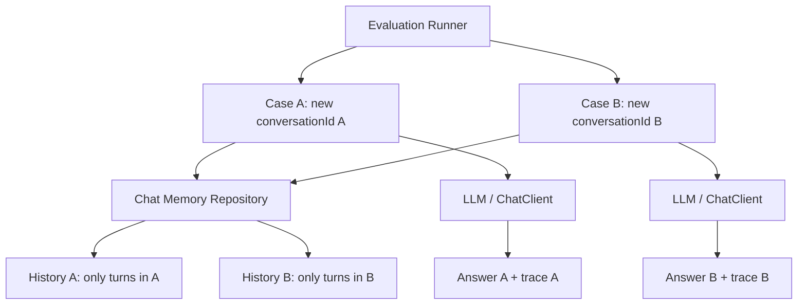
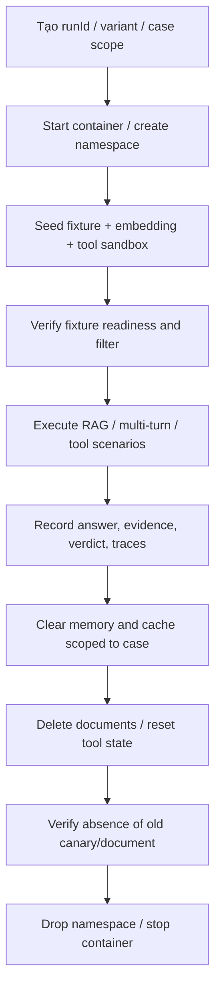
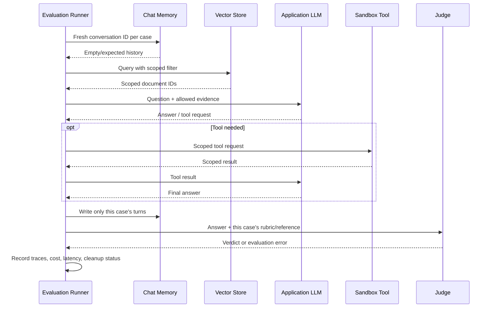

# Cô lập dữ liệu, ngữ cảnh hội thoại và tài nguyên giữa các ca

Một bộ kiểm thử Spring AI có thể chạy hàng trăm câu hỏi trên cùng ứng dụng RAG, dùng chung model chat, embedding model, vector store, bộ nhớ hội thoại và tool callbacks. **Nếu các ca kiểm thử vô tình chia sẻ trạng thái**, kết quả của ca trước có thể làm thay đổi ca sau: một câu hỏi thiếu dữ liệu lại được trả lời từ lịch sử hội thoại, một retriever tìm thấy tài liệu của phiên A, hoặc tool test ghi đè đơn hàng thuộc phiên B. Khi đó điểm relevance, fact checking, groundedness và tool accuracy không còn phản ánh đúng cấu hình đang được đánh giá.

Trong chương **Chiến lược kiểm thử** của module `SPRING_AI_EVALUATION_OBSERVABILITY`, **cô lập** nghĩa là xác định rõ dữ liệu và tài nguyên thuộc về ca nào, cho phép trạng thái được giữ **trong phạm vi chủ đích**, nhưng ngăn nó rò sang ca khác, biến thể khác hoặc lần chạy khác. Bài học này hướng dẫn thiết kế ranh giới đó từ unit test tới integration test có model thật, đồng thời lưu metrics, traces, token, chi phí và latency đúng từng ca để truy nguyên regression qua các phiên bản prompt, model và pipeline.

> **Nguyên tắc:** Dùng chung **mã nguồn, model endpoint và cơ sở hạ tầng** có thể chấp nhận được; dùng chung **ngữ cảnh, dữ liệu phiên hoặc tác dụng phụ** mà không có quy tắc phân vùng thì không. Cô lập phải được **kiểm chứng bằng test âm tính**: ca B không được nhìn thấy thông tin chỉ có trong ca A.

## 1. Vì sao một ca kiểm thử AI có thể ảnh hưởng đến ca khác?

Một unit test Java thuần thường tạo input, gọi hàm và kiểm tra output. Nhưng một ứng dụng Spring AI có nhiều trạng thái ngoài hàm:

- **Chat memory:** lịch sử user/assistant được giữ bởi advisor, repository, hoặc API hội thoại của provider.
- **Retrieval:** tài liệu, embedding, metadata, vector index và cache từ các lần seed trước.
- **Tool execution:** trạng thái đơn hàng, giỏ hàng, database, queue hoặc một mock server có lịch sử request.
- **Application context:** singleton beans, static fields, request-scoped state, conversation ID mặc định và các counters.
- **Evaluation:** kết quả judge, tập nhãn, run manifest, cache verdict hoặc một report aggregator dùng lại dữ liệu cũ.
- **Observability:** span, metric registry, events, correlation IDs và budget ledger có thể bị trộn giữa các test.

Ví dụ giả định:

1. Ca A hỏi: “Mã nội bộ của đơn hàng thử nghiệm là `DH-001`”, rồi lưu thông tin vào chat memory.
2. Ca B là một ca độc lập, chỉ hỏi “Mã đơn hàng tôi vừa nhắc là gì?” nhưng không có dữ kiện riêng.
3. Nếu A và B dùng cùng `conversationId`, model ở B có thể trả `DH-001`.
4. Hệ thống đánh giá B như một câu trả lời đúng dù **ca B không được cấp dữ kiện đó**.

Đây là **rò ngữ cảnh (context leakage)**: một test “xanh” không chứng minh model giải quyết đúng case độc lập. Trường hợp ngược lại cũng xảy ra: ca A đưa thông tin sai, làm ca B thất bại dù pipeline của B không có lỗi.

### 1.1. Phân biệt trạng thái cần giữ và trạng thái cần xóa

| Phạm vi | Nên được giữ | Không được để rò |
|---|---|---|
| **Một lượt hỏi** | Context truy xuất và tool outputs phục vụ lượt đó | Tài liệu/ngữ cảnh của user hoặc case khác |
| **Một ca nhiều lượt (multi-turn)** | Các lượt hội thoại thuộc chính ca đó | Lịch sử từ ca trước dù có cùng câu hỏi |
| **Một biến thể A/B** | Dataset và nguồn chuẩn giống nhau để so sánh | Memory, cache output hoặc tool side effects của biến thể kia |
| **Một evaluation run** | Manifest, ngân sách, kết quả và traces của run | Artifacts từ run cũ nếu không chủ động đưa vào baseline |
| **Nhiều run** | Có thể dùng chung hạ tầng/model read-only | Dữ liệu nhạy cảm, vector index và state không được phân vùng |

**Multi-turn không đồng nghĩa “không cô lập”.** Một case nhiều lượt cần **giữ lịch sử giữa các lượt trong cùng case**, nhưng mỗi case mới phải bắt đầu với session đã định, thường là **session trống**.

## 2. Thiết kế khóa phạm vi dữ liệu (scope) trước khi viết test

Một `caseId` đơn lẻ chưa đủ. Dataset thường có cùng `caseId` ở các phiên A/B, lần thử lại, hoặc giữa hai run. Nên mô hình hóa đầy đủ:

```text
EvaluationScope = {
    runId,          # lần chạy đánh giá
    variant,        # A, B hoặc tên cấu hình đã chuẩn hóa
    caseId,         # ca trong dataset
    attemptId,      # một lượt chạy case/model cụ thể
    component       # app-chat, retriever, judge, tool, cache...
}
```

**Từng thành phần dùng scope theo mục đích**:

| Thành phần | Khóa tách biệt tối thiểu | Ghi chú |
|---|---|---|
| Chat memory | `runId + variant + caseId + attemptId + sessionId` | Mỗi lượt rerun độc lập cần session mới |
| Vector corpus dùng riêng | `runId/variant` hoặc một database/schema/collection riêng | Nếu corpus là fixture chung read-only, phải cố định version và tránh ghi chéo |
| Retrieved context | `runId + variant + caseId + retrievalAttempt` | Lưu IDs, filter và index version |
| Tool sandbox | `runId + variant + caseId + attemptId` | Tool có state phải reset hoặc có namespace |
| Cache model/judge | Input hash + prompt/model/index/rubric versions + scope cần thiết | Cache hit không đồng nghĩa một live invocation |
| Result store | `runId + variant + caseId + rubricId` | Unique final outcome, tránh đếm đôi khi retry |
| Telemetry | `runId + caseId + variant + traceId/spanId` | ID chi tiết nằm trong spans/log, không làm metric label quá nhiều giá trị |

Nếu các trường được nối thành một chuỗi, cần tránh khóa nhập nhằng do dấu phân cách xuất hiện trong dữ liệu. Có thể dùng một ID phiên mới sinh (UUID) làm `conversationId`, còn `EvaluationScope` là record có kiểu dữ liệu rõ ràng trong result store. Không dùng tên khách hàng hoặc thông tin định danh cá nhân làm ID phiên test.

### 2.1. Ví dụ hai biến thể cùng dùng một câu hỏi

```text
run-2026-11-example
├── variant-A
│   └── rag-017
│       ├── attempt-1: conversation=a1
│       └── attempt-2: conversation=a2
└── variant-B
    └── rag-017
        ├── attempt-1: conversation=b1
        └── attempt-2: conversation=b2
```

Cả A và B có thể truy xuất **cùng corpus chuẩn được khóa version** để so sánh công bằng, nhưng không được chia sẻ **lịch sử chat sinh ra** hay cache câu trả lời không phân biệt biến thể. Khi so sánh model thật, bảo đảm một phiên A không “dạy” dữ kiện cho phiên B.

## 3. Cô lập ngữ cảnh hội thoại trong Spring AI

**Ngữ cảnh hội thoại** có thể đi vào prompt từ nhiều nguồn, không chỉ một `ChatMemory` bean:

1. Advisor thêm các `Message` cũ từ bộ nhớ vào request.
2. Ứng dụng tự ghép lịch sử vào system/user prompt.
3. Provider hỗ trợ thread, session, response chaining hoặc server-side context.
4. Tool output và retrieved documents được lưu/ghi nhớ trong một object dùng lại.
5. Cache câu trả lời trả lại output từ request trước.

Vì vậy, “tạo một `ChatClient` mới” **chưa chắc tạo một cuộc hội thoại sạch** nếu builder dùng chung một memory repository, conversation ID hoặc provider session. Ngược lại, nếu ChatClient không được cấu hình memory advisor hoặc không tự gửi lịch sử, một request riêng lẻ có thể không có memory dù dùng chung client. **Cần kiểm tra cấu hình thực tế**, không suy luận từ tên class.

### 3.1. Chiến lược conversationId

Một cách an toàn là:

- Tạo **một conversation ID mới cho mỗi attempt của một case**, trừ khi yêu cầu nghiệp vụ cố ý tiếp diễn một session qua nhiều lượt.
- Giữ cùng conversation ID trong **các lượt của chính ca multi-turn đó**.
- Không dùng một giá trị mặc định như `"default"` hay `"test"` cho tất cả ca.
- Không dùng lại provider-side thread/response ID qua biến thể hoặc run.
- Xóa hoặc cho hết hạn state sau khi ca hoàn thành, tùy khả năng của memory repository/provider.

Ví dụ mô hình tham chiếu:



### 3.2. Truyền conversation ID khi dùng memory advisor

Ở những phiên bản Spring AI hỗ trợ chat memory advisor và tham số `ChatMemory.CONVERSATION_ID`, ứng dụng có thể truyền ID riêng trên từng lời gọi:

```java
import org.springframework.ai.chat.client.ChatClient;
import org.springframework.ai.chat.memory.ChatMemory;

final class ScopedSpringAiChat {
    private final ChatClient chatClient;

    ScopedSpringAiChat(ChatClient.Builder configuredBuilder) {
        // Builder phải đã cấu hình advisor lưu/đọc chat memory
        // nếu muốn có multi-turn memory. Đoạn này chỉ build client.
        this.chatClient = configuredBuilder.build();
    }

    String ask(String conversationId, String question) {
        return chatClient.prompt()
                .user(question)
                .advisors(spec ->
                        spec.param(ChatMemory.CONVERSATION_ID, conversationId))
                .call()
                .content();
    }
}
```

**Giới hạn phiên bản:** Đây là kiểu gọi `ChatClient`/`ChatMemory` thường gặp trong Spring AI 1.x; tên package, advisor và cách cấu hình cụ thể phụ thuộc release đang dùng. **Chỉ truyền parameter không tự bật memory**: `ChatClient.Builder` phải được cấu hình advisor đọc/ghi memory, và memory repository phải tôn trọng key đó. Viết integration test để xác minh thực tế.

Nếu dùng `MessageChatMemoryAdvisor`, `PromptChatMemoryAdvisor` hoặc một advisor khác, cần tìm hiểu rõ phần nào của request/response được lưu. Với provider-managed sessions, phải sinh ID provider mới và tránh tái sử dụng thread cũ. Nếu judge dùng một ChatClient riêng, thông thường nên **không gắn lịch sử hội thoại của ứng dụng vào judge** trừ khi rubric cần một transcript cụ thể của đúng case.

### 3.3. Test âm tính quan trọng

Test cần chứng minh:

1. A nói một chuỗi canary (ví dụ `TEST_CANARY_ALPHA`), sau đó A có thể dùng lại theo rubric multi-turn.
2. B bắt đầu **trống**, không nhận lịch sử của A ở prompt, memory store hoặc provider session.
3. B hỏi về canary không có trong nguồn chuẩn → hệ thống không được sử dụng canary của A như chứng cứ.
4. Chạy B trước A hoặc chạy song song không làm thay đổi kết quả deterministic ở logic.

**Không chỉ kiểm tra answer không chứa canary**: model có thể không nhắc lại canary dù nó đã được gửi vào prompt. Cần kiểm tra **transcript thực được gửi đến model** hoặc nội dung readback của memory store trong integration/contract test. Kiểm tra answer là một lớp bổ sung cho rò thông tin, không thay thế kiểm tra biên dữ liệu.

## 4. Java 17: tổ chức session per case và fake model để test ổn định

Để kiểm thử hành vi cô lập mà không gọi mô hình thật, ta có thể định nghĩa các interface độc lập với Spring AI. Ví dụ dưới đây làm rõ sự khác biệt giữa **giữ lịch sử trong một scenario multi-turn** và **không dùng lại lịch sử của scenario khác**.

### 4.1. Các kiểu dữ liệu và runner

```java
import java.util.ArrayList;
import java.util.List;
import java.util.Objects;

record EvaluationKey(
        String runId,
        String variant,
        String caseId,
        int attempt) {
    EvaluationKey {
        if (runId == null || runId.isBlank()
                || variant == null || variant.isBlank()
                || caseId == null || caseId.isBlank()
                || attempt < 1) {
            throw new IllegalArgumentException("Evaluation scope không hợp lệ");
        }
    }
}

record ChatTurn(String role, String content) {}

record ChatScenario(EvaluationKey key, List<String> userTurns) {
    ChatScenario {
        Objects.requireNonNull(key);
        userTurns = List.copyOf(userTurns);
        if (userTurns.isEmpty()) {
            throw new IllegalArgumentException("Scenario không có lượt chat");
        }
    }
}

record ChatScenarioResult(
        EvaluationKey key,
        String conversationId,
        List<ChatTurn> transcript) {}

@FunctionalInterface
interface ConversationIdSource {
    String fresh();
}

@FunctionalInterface
interface ChatModelPort {
    String respond(
            String conversationId,
            List<ChatTurn> previousTurns,
            String userQuestion);
}

final class IsolatedScenarioRunner {
    private final ConversationIdSource ids;
    private final ChatModelPort model;

    IsolatedScenarioRunner(
            ConversationIdSource ids, ChatModelPort model) {
        this.ids = Objects.requireNonNull(ids);
        this.model = Objects.requireNonNull(model);
    }

    ChatScenarioResult run(ChatScenario scenario) {
        String conversationId = ids.fresh();
        if (conversationId == null || conversationId.isBlank()) {
            throw new IllegalStateException("Conversation ID rỗng");
        }

        List<ChatTurn> turns = new ArrayList<>();
        for (String question : scenario.userTurns()) {
            if (question == null || question.isBlank()) {
                throw new IllegalArgumentException("Câu hỏi rỗng");
            }

            // Model không thể thay đổi nội dung history đã gửi.
            String answer = model.respond(
                    conversationId, List.copyOf(turns), question);
            if (answer == null || answer.isBlank()) {
                throw new IllegalStateException("Model trả rỗng");
            }

            turns.add(new ChatTurn("user", question));
            turns.add(new ChatTurn("assistant", answer));
        }

        return new ChatScenarioResult(
                scenario.key(), conversationId, List.copyOf(turns));
    }
}
```

Trong production có thể dùng `() -> UUID.randomUUID().toString()` làm `ConversationIdSource`, và adapter `ChatModelPort` có thể gọi `ChatClient` với memory advisor. Trong unit test, dùng một ID generator có thứ tự để đảm bảo test **xác định**, không dựa vào xác suất UUID trùng hay khác.

**Một lưu ý về trách nhiệm lưu history:** Ví dụ tự truyền `previousTurns` vào model port, không cần một repository bên ngoài. Nếu adapter production dùng **ChatMemoryAdvisor**, tránh đồng thời đưa cùng một lịch sử vào prompt và để advisor tự chèn lịch sử một lần nữa. Cần chọn **một cơ chế quản lý history chủ đạo** và kiểm thử đúng request được gửi.

### 4.2. JUnit 5: lịch sử trong ca và cô lập giữa ca

```java
import static org.junit.jupiter.api.Assertions.*;

import java.util.ArrayList;
import java.util.List;
import java.util.concurrent.atomic.AtomicInteger;
import org.junit.jupiter.api.Test;

class IsolatedScenarioRunnerTest {
    @Test
    void retainsHistoryOnlyWithinOneMultiTurnCase() {
        var ids = new AtomicInteger();
        var seenIds = new ArrayList<String>();
        ChatModelPort fakeModel = (conversationId, previous, question) -> {
            seenIds.add(conversationId);
            if (question.equals("Lượt đầu")) {
                assertTrue(previous.isEmpty());
                return "Đáp án đầu";
            }
            assertEquals("Lượt sau", question);
            assertEquals(List.of(
                    new ChatTurn("user", "Lượt đầu"),
                    new ChatTurn("assistant", "Đáp án đầu")), previous);
            return "Đáp án sau";
        };

        var runner = new IsolatedScenarioRunner(
                () -> "test-conv-" + ids.incrementAndGet(),
                fakeModel);
        var scenario = new ChatScenario(
                new EvaluationKey("run-1", "A", "case-1", 1),
                List.of("Lượt đầu", "Lượt sau"));

        ChatScenarioResult result = runner.run(scenario);

        assertEquals(1, ids.get());
        assertEquals(List.of("test-conv-1", "test-conv-1"), seenIds);
        assertEquals(4, result.transcript().size());
    }

    @Test
    void separateVariantsNeverReceiveEachOthersHistory() {
        var ids = new AtomicInteger();
        var receivedHistory = new ArrayList<List<ChatTurn>>();
        ChatModelPort fakeModel = (conversationId, previous, question) -> {
            receivedHistory.add(previous);
            assertTrue(previous.isEmpty(),
                    "Một ca mới không được có history cũ");
            return "Trả lời từ fake";
        };
        var runner = new IsolatedScenarioRunner(
                () -> "test-conv-" + ids.incrementAndGet(),
                fakeModel);

        var a = runner.run(new ChatScenario(
                new EvaluationKey("run-1", "A", "rag-001", 1),
                List.of("Câu hỏi giống nhau")));
        var b = runner.run(new ChatScenario(
                new EvaluationKey("run-1", "B", "rag-001", 1),
                List.of("Câu hỏi giống nhau")));

        assertNotEquals(a.conversationId(), b.conversationId());
        assertEquals(2, receivedHistory.size());
        assertTrue(receivedHistory.stream().allMatch(List::isEmpty));
    }

    @Test
    void retryCreatesANewConversation() {
        var ids = new AtomicInteger();
        ChatModelPort fakeModel = (conversationId, previous, question) ->
                "OK";
        var runner = new IsolatedScenarioRunner(
                () -> "attempt-" + ids.incrementAndGet(),
                fakeModel);

        var first = runner.run(new ChatScenario(
                new EvaluationKey("run-7", "A", "tool-003", 1),
                List.of("Tra cứu đơn")));
        var second = runner.run(new ChatScenario(
                new EvaluationKey("run-7", "A", "tool-003", 2),
                List.of("Tra cứu đơn")));

        assertNotEquals(first.conversationId(), second.conversationId());
    }
}
```

Test thứ ba biểu diễn **một lần chạy lại toàn scenario** với attempt mới; đừng nhầm với retry HTTP bên trong cùng một request. Nếu ứng dụng cố ý retry một request do lỗi kết nối, phải quyết định rõ giữ/hủy provider session và tránh ghi hai lần user turn hoặc tool effects.

### 4.3. Test lỗi cố tình chia sẻ ID

Một test âm tính có thể tạo fake memory repository rồi gọi hai ca với cùng ID `"shared"`, xác nhận history của A xuất hiện khi B bắt đầu. Đây là phép thử giúp **chứng minh fixture có khả năng phát hiện leakage**. Sau đó sửa bằng conversation ID riêng, test lại và xác minh lịch sử B rỗng. Tránh dùng bài test dương “hai ca đều trả lời đúng” làm chứng cứ duy nhất cho tính biệt lập.

## 5. Cô lập corpus, embedding và vector store cho RAG

RAG có một nguồn rò thường bị bỏ qua: **vector index được seed nhiều lần trên cùng collection**. Một ca hỏi chính sách hiện hành có thể truy xuất tài liệu cũ hoặc tài liệu của ca khác, làm model sinh ra câu trả lời sai.

### 5.1. Ba mức cô lập vector data

| Mức | Cách thực hiện | Ưu/nhược điểm |
|---|---|---|
| **Database/container riêng** | Mỗi test suite/run tạo PostgreSQL PGvector trong Testcontainers | Cách ly mạnh; tốn thời gian khởi tạo và tài nguyên |
| **Schema/table/collection riêng** | Một DB dùng nhiều namespace độc lập | Tiết kiệm hơn nhưng cần quản trị schema/lifecycle |
| **Metadata filter** | Mọi document mang `runId`, `variant`, `caseId`/`tenantId`; truy vấn lọc đúng | Linh hoạt; dễ sai nếu quên filter ở một nhánh |

Với test có yêu cầu cô lập nghiêm ngặt, **database/schema/collection riêng** thường là ranh giới chính; metadata filter là lớp phòng vệ bổ sung. **Chỉ gắn metadata mà không thực thi filter tại truy vấn thì chưa cô lập được dữ liệu**. Việc lấy topK rồi loại bỏ các document sai scope **sau retrieval** có thể làm sai ranking, mất tài liệu cần thiết và không ngăn hoàn toàn lộ dữ liệu qua các bước nội bộ.

### 5.2. Seed tài liệu giả định có scope

Ví dụ dùng `Document` trong Spring AI để gắn metadata cho RAG fixture:

```java
import java.util.List;
import java.util.Map;
import org.springframework.ai.document.Document;

List<Document> fixtures = List.of(
        new Document(
                "Thời hạn đổi hàng hiện hành là 14 ngày.",
                Map.of(
                        "runId", "eval-run-17",
                        "variant", "A",
                        "caseId", "rag-001",
                        "sourceId", "policy-v2",
                        "active", true)),
        new Document(
                "Chính sách cũ đã hết hiệu lực: 30 ngày.",
                Map.of(
                        "runId", "eval-run-17",
                        "variant", "A",
                        "caseId", "rag-001",
                        "sourceId", "policy-v1",
                        "active", false)));
```

Số liệu là **fixture giả định**, không phải chính sách thực. Ở vector store thật, phải kiểm tra:

1. `Document` được gán ID ổn định/duy nhất theo cách quản lý của dự án.
2. Embedding model, vector dimension và index version tương thích.
3. Metadata filter thật được chuyển thành ràng buộc trong truy vấn vector store.
4. Query của biến thể B không thể lấy chunk seed riêng cho A.
5. `active=false` bị loại khỏi câu hỏi yêu cầu thông tin hiện hành.
6. Cleanup hoặc drop namespace thật sự loại các fixture sau test.

**Lưu ý API:** Constructor `Document` và cấu trúc `SearchRequest.filterExpression(...)` có thể khác nhau theo phiên bản Spring AI; khi tích hợp, kiểm tra release được khóa. Không ghép trực tiếp giá trị người dùng vào chuỗi filter mà không escape/validate. Nên xây filter bằng builder/biểu thức có kiểu hoặc allowlist và test tính đúng của query tại backend.

### 5.3. Shared corpus có được phép không?

Có, nếu mục đích là **so sánh A/B công bằng trên cùng corpus read-only đã version hóa**. Khi đó:

- Corpus/index được tạo một lần từ dataset chuẩn và **không bị mutation trong lúc chạy**.
- Mỗi variant có chat memory, prompt state, tool sandbox, cache và kết quả riêng.
- Nếu biến thể cần thay đổi chunking/embedding/reranking, nên ghi thành **một index version mới** và coi đó là treatment của thí nghiệm.
- Lưu source IDs và content hashes; không chỉ ghi “có một document được tìm thấy”.

Một run có thể sử dụng cùng model provider hoặc database hạ tầng mà vẫn đúng về cô lập **nếu dữ liệu ghi được phân vùng và nguồn đọc được kiểm soát**.

## 6. Testcontainers và vòng đời dữ liệu

Với Spring Boot + PGvector, Testcontainers tạo database biệt lập cho integration test. Cần hiểu phạm vi của annotation:

```java
import org.junit.jupiter.api.Tag;
import org.junit.jupiter.api.Test;
import org.springframework.boot.test.context.SpringBootTest;
import org.springframework.test.context.DynamicPropertyRegistry;
import org.springframework.test.context.DynamicPropertySource;
import org.testcontainers.containers.PostgreSQLContainer;
import org.testcontainers.junit.jupiter.Container;
import org.testcontainers.junit.jupiter.Testcontainers;
import org.testcontainers.utility.DockerImageName;

@Tag("integration")
@Testcontainers(disabledWithoutDocker = true)
@SpringBootTest
class IsolatedPgvectorIntegrationTest {

    @Container
    static final PostgreSQLContainer<?> DB =
            new PostgreSQLContainer<>(
                    DockerImageName.parse("pgvector/pgvector:pg16")
                            .asCompatibleSubstituteFor("postgres"))
                    .withDatabaseName("eval_isolation")
                    .withUsername("test_user")
                    .withPassword("test_password");

    @DynamicPropertySource
    static void overrideDatasource(DynamicPropertyRegistry registry) {
        registry.add("spring.datasource.url", DB::getJdbcUrl);
        registry.add("spring.datasource.username", DB::getUsername);
        registry.add("spring.datasource.password", DB::getPassword);
    }

    @Test
    void resourcesBelongToThisTestContainer() {
        // Trong dự án thật: seed fixture, gọi VectorStore.add/search,
        // xác minh filter theo run/variant/case và delete theo IDs.
        // Test này chỉ là khung wiring, không khẳng định đã test RAG.
    }
}
```

**Không tính một test method rỗng là kiểm thử tích hợp hoàn tất.** Khi triển khai, phải có assert kiểm tra seed, truy vấn lọc, kết quả âm tính và cleanup. Project cần đúng starter, driver, extension `vector`, embedding model và schema theo phiên bản Spring AI được khóa. Khung này không tự khởi tạo extension/index.

**`@Container static` dùng một container cho cả class test**. Vì vậy nhiều test methods trong cùng class vẫn có thể nhìn thấy state của nhau. Nếu chạy song song, dùng database/schema per method, namespace rõ ràng, hoặc tắt parallel test khi dùng cùng collection. `@DirtiesContext` làm Spring context được tạo lại nhưng **không bảo đảm xóa tài liệu trong provider bên ngoài**, cũng không tự xóa tool outputs trên cloud.

### 6.1. Reset sạch và cleanup

Một chu kỳ tốt:



Nếu seed hoặc test thất bại giữa chừng, cleanup cần nằm trong `finally` hoặc after-test hook. Với tài nguyên remote (bucket, index, queue, sandbox API), một process chết đột ngột có thể không chạy cleanup; vì thế cần TTL, ownership tag và job dọn dẹp riêng. Khi đã lưu raw outputs để phân tích, **dọn nguồn vận hành** không đồng nghĩa phải xóa ngay **artifact đánh giá được phép lưu**; hai loại dữ liệu có retention khác nhau.

### 6.2. Rollback của test chưa chắc rollback toàn bộ hệ thống

Một test dùng `@Transactional` có thể rollback các thao tác trong transaction JDBC do test quản lý. Nhưng:

- Vector store có thể sử dụng transaction/connection độc lập.
- Model cloud, tool HTTP, queue và object storage không tham gia transaction JDBC.
- Chat memory lưu ở repository khác không tự rollback theo test.
- Một tool callback có thể gọi một dịch vụ ngoài, gây side effect ngay.

Không dùng `@Transactional` làm bằng chứng duy nhất rằng **mọi tài nguyên** đã sạch. Kiểm tra backend thực và thiết kế cleanup tương ứng.

## 7. Tool calling: cô lập tác dụng phụ và quyền

Model thật có thể gọi một công cụ không dự kiến hoặc thử lại cùng tool nhiều lần. Nếu tool trỏ đến dữ liệu production, kiểm thử có thể gây thay đổi thật. **Tool sandbox cần tồn tại độc lập cho từng case hoặc ít nhất có khóa namespace rõ ràng**.

### 7.1. Ví dụ sandbox tool theo phiên

```java
import java.util.Map;
import java.util.concurrent.ConcurrentHashMap;
import org.springframework.ai.tool.annotation.Tool;
import org.springframework.ai.tool.annotation.ToolParam;

public final class ScopedOrderTools {
    private final String sandboxScope;
    private final Map<String, String> orders =
            new ConcurrentHashMap<>();

    public ScopedOrderTools(String sandboxScope) {
        this.sandboxScope = sandboxScope;
        orders.put("DH-001", "Đang giao");
    }

    @Tool(description = "Đọc trạng thái đơn hàng trong sandbox test")
    public String getOrderStatus(
            @ToolParam(description = "Mã đơn hàng")
            String orderId) {
        return orders.getOrDefault(orderId, "Không tìm thấy");
    }

    public String sandboxScope() {
        return sandboxScope;
    }
}
```

Trong đoạn này, **mỗi ca tạo một instance `ScopedOrderTools` mới** và chỉ gắn nó vào lời gọi ChatClient của ca đó. `sandboxScope` là dấu hiệu để kết nối với trace/result store; map `orders` nằm trong instance nên không chia sẻ state.

Nếu tool thực hiện thao tác ghi, phải giới hạn quyền, cung cấp dữ liệu giả và khóa idempotency theo `runId + variant + caseId + toolCallId`. **Cùng tool name nhưng instance khác nhau** vẫn có thể trỏ cùng API production nếu cấu hình endpoint sai, vì vậy test cần xác nhận endpoint và credential thực tế.

### 7.2. Những bất biến tool nên kiểm tra

| Kịch bản | Test xác định | Test model thật |
|---|---|---|
| Case A gọi tool và sửa dữ liệu | State chỉ thay đổi trong A | Model có đề nghị tool gây tác dụng phụ ngoài rubric không? |
| Case B gọi cùng mã `DH-001` | B vẫn thấy dữ liệu fixture của B, không phải state A | Model có chọn và truyền đúng `orderId` không? |
| Provider timeout rồi retry | Idempotency/giới hạn số lượt callback | Tỉ lệ model đề xuất gọi tool lặp |
| Tool không có quyền | Dispatcher từ chối | Model có tránh đề nghị tool bị cấm không? |
| Tool trả 404/503 | Mapping lỗi, không bịa kết quả | Câu trả lời có thể hiện đúng tình trạng thiếu dữ liệu? |

Không chỉ kiểm tra **câu trả lời cuối**: một model có thể trả “Đang giao” nhưng thật ra gọi tool với đơn sai. Hãy lưu **tool-call trace**, arguments đã redaction, response và số lần gọi; so sánh những trường xác định bằng code trước khi dùng LLM judge cho đánh giá ngữ nghĩa.

## 8. Cache, queue, file và trạng thái Spring context cũng cần cô lập

### 8.1. Cache khiến thí nghiệm A/B bị “mượn” kết quả

Nếu key cache chỉ là `hash(question)`, biến thể B có thể nhận output từ A mà không gọi model mới. Chỉ số pass rate, latency và cost khi ấy **không còn là kết quả live của B**.

Một key cache có thể tính từ:

```text
cacheKey = hash(
    normalizedQuestion,
    promptSha256,
    modelIdAndRevision,
    corpusAndIndexVersion,
    retrievalConfig,
    toolSchemaVersion,
    samplingOptions,
    runOrScopeWhenCacheMustBePrivate
)
```

Nếu cache điểm chấm của judge, còn cần rubric/judge version. Trong thí nghiệm đo **latency/cost của lời gọi thật**, nên tắt cache hoặc ghi rõ `cacheHit` và không trộn cache latency với provider latency. Cache dùng cho **deterministic replay** là hợp lệ, nhưng phải ghi `mode=replay` thay vì ngụy trang thành live model test.

### 8.2. Queue và worker song song

Khi nhiều worker tiêu thụ cùng evaluation dataset:

- Một case chỉ nên có **một final result cho mỗi run/variant/rubric**.
- Worker cần lease/claim có hạn; khi worker chết, case có thể được nhận lại mà không ghi hai verdict cuối.
- Tool side effects và budget reservations cần idempotency.
- Kết quả ở queue có thể đến không đúng thứ tự; không dùng vị trí trong list làm khóa ghép case.
- Khi replay hoặc resume, chỉ chạy lại những case chưa có final outcome, theo **cùng run manifest**, không trộn index/model version mới.

### 8.3. Singleton beans và static state

Spring Boot test có thể cache `ApplicationContext` để tăng tốc. Điều này **không sai**, nhưng bean singleton giữ một `List<Message>`, một `conversationId` mutable, hoặc một `AtomicInteger` đếm tool calls sẽ gây rò giữa case. Với test xác định, có thể thay bean bằng implementation test và reset trạng thái trong before/after hooks. Với production, chuyển state thành **keyed store** hoặc object có scope phù hợp, không nhét toàn bộ lịch sử user vào một singleton field.

`@DirtiesContext` hữu ích khi cần tái tạo context, nhưng khá tốn và không thay thế quản lý state. Cần hiểu lifecycle của từng bean, cache, transaction và tài nguyên ngoài JVM.

## 9. Cô lập evaluator và tập dữ liệu chuẩn

Khi đánh giá answer, cần tách ít nhất **hai loại ngữ cảnh**:

1. **Application context:** retrieved documents, chat history và tool outputs được dùng để **sinh câu trả lời**.
2. **Evaluation context:** reference facts, rubric, gold labels và tài liệu chuẩn được dùng để **chấm câu trả lời**.

Hai ngữ cảnh có thể trùng một phần nhưng **không phải một**. Ví dụ retriever của ứng dụng lấy nhầm `policy-v1` cũ ghi 30 ngày; nguồn chuẩn hiện hành `policy-v2` ghi 14 ngày. Câu trả lời “30 ngày” có thể bám vào document mà ứng dụng đã thấy (groundedness với context cũ) nhưng sai fact checking so với nguồn chuẩn hiện hành.

### 9.1. Judge phải nhận input riêng từng case

Một input chấm nên có:

```json
{
  "runId": "eval-run-17",
  "variant": "B",
  "caseId": "rag-001",
  "rubricVersion": "fact-check-v2",
  "question": "Thời hạn đổi hàng hiện hành?",
  "answer": "14 ngày",
  "retrievedSourceIds": ["policy-v2"],
  "verifiedFacts": ["Thời hạn hiện hành là 14 ngày"],
  "judgeConversationId": "judge-session-unique"
}
```

Các giá trị là **fixture giả định**. Judge không được lấy `verifiedFacts` của ca A để chấm ca B. Nếu judge dùng chat memory, phải tách session theo case hoặc tắt memory với các lượt đánh giá độc lập. Prompt của judge cần đặt nguồn và answer như **dữ liệu không tin cậy**; không cho phép văn bản trong corpus thay đổi rubric hoặc yêu cầu “hãy trả PASS”.

### 9.2. So sánh A/B công bằng

Trong thí nghiệm giữa prompt A và B, nên cố định **dataset, nhãn chuẩn, corpus, rubric và judge version** khi muốn đo tác động của prompt. Mỗi biến thể có:

- Session chat và provider conversation độc lập.
- Result store riêng theo variant, không bị cache trộn.
- Tool sandbox/side effects và retrieval traces riêng.
- Usage/cost/latency đo riêng, có run/case/variant IDs.

Nếu đang đo **toàn bộ pipeline** (thay prompt + model + index), kết luận phải ghi rõ treatment gồm những thành phần đó. Không xem chênh lệch là tác động chỉ của prompt.

### 9.3. Cần kiểm soát trùng lặp trong dataset

Ngay cả khi session và database đã cô lập, tập benchmark có thể bị rò giữa **development** và **holdout**: cùng một câu hỏi được paraphrase gần giống rồi xuất hiện trong cả hai. Điều này khiến prompt được tối ưu trên development nhìn có vẻ tốt trên holdout nhưng không thực sự tổng quát. Nên tách theo nhóm trường hợp/ngữ nghĩa, không chỉ theo dòng dữ liệu ngẫu nhiên; đánh dấu nguồn gốc và version của nhãn chuẩn.

## 10. Tình huống nguy hiểm: test song song và leakage chéo tenant

Cô lập giữa ca đánh giá cũng liên quan đến **cô lập giữa người dùng/tenant**. Một test runner có thể chạy cùng lúc:

- Case A thuộc tenant thử nghiệm `tenant-a`, có `document-a-secret`.
- Case B thuộc `tenant-b`, chỉ được đọc `document-b-public`.
- Cả hai chia sẻ một vector DB, một memory repository và ChatClient bean.

Hành vi đúng: query của B phải áp dụng **tenant filter tại backend** và không bao giờ lấy tài liệu của A. Chỉ thêm một điều kiện kiểm tra ở bước answer, sau khi prompt đã nhận context A, là **quá muộn**.

### 10.1. Những phép kiểm thử âm tính cần có

| Test | Dữ liệu A | Kỳ vọng ở B |
|---|---|---|
| Memory isolation | A có canary trong chat history | B không thấy canary trong memory/prompt |
| Retriever isolation | A seed vector có sourceId bí mật | Search của B không trả chunk A |
| Metadata filter | A có cùng query nhưng tenant khác | Query B chỉ trả tài liệu được phép |
| Tool isolation | A sửa đơn sandbox | B không thấy trạng thái đã sửa của A |
| Cache isolation | A đã hỏi câu giống B | B không nhận output A ngoài chính sách cache |
| Result store isolation | A và B cùng `caseId` | Final verdict và traces không ghi đè |
| Cleanup isolation | A xóa namespace của mình | Dữ liệu của B vẫn còn |
| Parallel execution | A/B chạy đồng thời | Không race, không trộn thứ tự history |

**Thứ tự thực thi** là nguồn lỗi thường gặp. Hãy chạy một số test ở thứ tự A→B, B→A và song song; nếu kết quả khác nhau, có thể đang có shared state hoặc fixture phụ thuộc thứ tự. Cần seed dữ liệu rõ ràng trước mỗi test và cleanup có thể lặp lại.

### 10.2. Không coi metadata filter là hàng rào bảo mật duy nhất

Trong sản phẩm multi-tenant, ngoài metadata filter, cần phân quyền ở tầng ứng dụng và database/vector store; kiểm tra tenant identity từ nguồn tin cậy, không tin giá trị tenant do model tự sinh. Test phải xác minh **truy vấn phát sinh thực** không thể vượt quyền. Các ca evaluation cô lập có thể dùng tenant IDs giả nhưng vẫn phải mô phỏng đúng ranh giới quyền.

## 11. Observability: nhận diện rò trạng thái từ traces và metrics

Để phân biệt regression do model với sai lệch do dữ liệu chéo ca, một lần chạy nên ghi:

| Trường | Công dụng |
|---|---|
| `runId`, `caseId`, `variant`, `attemptId` | Biết request và verdict thuộc ca nào |
| `conversationId` hoặc token hóa/hash của ID | Tìm session bị dùng lại ngoài ý muốn |
| `memoryReads`, `memoryWrites`, `historyTurnCount` | Phát hiện số lượt lịch sử không mong đợi |
| `retrievedDocumentIds`, `filterScope`, `indexVersion` | Tìm tài liệu ngoài namespace hoặc nguồn cũ |
| `toolName`, `toolCallId`, `sandboxScope` | Xác định tool có chạy sai scope không |
| `cacheHit`, `cacheKeyVersion` | Biết kết quả có đến từ cache cũ không |
| `datasetVersion`, `promptVersion`, `modelId` | So sánh quality giữa các lần chạy |
| `judgeModelId`, `rubricVersion`, `verdict` | Tách lỗi judge với lỗi application |
| `retrievalLatencyMs`, `modelLatencyMs`, `judgeLatencyMs` | Phân tích độ trễ theo bước |
| `inputTokens`, `outputTokens`, `estimatedCost` | Tính chi phí mỗi case và biến thể |



Tên span/metric cụ thể tùy Spring AI, Micrometer, provider và exporter; không giả định SDK tự xuất mọi trường trên. Một số metric do ứng dụng có thể bổ sung:

```text
ai.eval.isolation.checks.total{component="memory",result="PASS"}
ai.eval.isolation.checks.total{component="vectorstore",result="FAIL"}
ai.eval.memory.history.turns
ai.eval.retrieval.scoped.documents
ai.eval.tool.sandbox.calls
ai.eval.cache.hits.total{mode="live"}
ai.eval.cases.total{status="PASS"}
ai.eval.cases.total{status="ERROR"}
ai.eval.case.duration
ai.eval.judge.duration
```

Đây là **tên metric gợi ý**, không phải API có sẵn của Spring AI. Không đưa `conversationId`, `caseId`, `traceId`, email, nội dung prompt hay bí mật vào **metric labels** có cardinality cao. Dữ liệu chi tiết cần nằm ở traces/logs/result store có phân quyền, redaction và retention; lưu ID đã hash/token hóa nếu chính sách bảo mật yêu cầu.

### 11.1. Đừng nhầm tiết kiệm chi phí do cache với chất lượng tốt hơn

Nếu B có latency và chi phí thấp hơn A nhưng B nhận rất nhiều **cache hit từ A**, phép đo không hợp lệ để kết luận model/prompt B nhanh hơn. Ghi rõ `mode=live/stub/replay`, cache hit/miss, number of model/tool/judge attempts, và tách:

- **Application cost:** retrieval, embedding, generation và tool calls.
- **Judge cost:** LLM-as-a-judge, retry và validation overhead.
- **Infrastructure cost:** database/container, queue, telemetry nếu được tính.

Một rò lịch sử có thể làm **answer quality nhìn có vẻ tăng** vì model đã biết đáp án từ ca khác; traces/history checks giúp phát hiện sự tăng điểm giả đó.

## 12. Quản lý kết quả và release gate khi phát hiện leakage

Một dataset evaluation có thể trả PASS/FAIL từ judge, INVALID do output sai schema, ERROR do timeout hoặc SKIPPED do chưa chạy. Nếu phát hiện vi phạm cô lập, nên có trạng thái **TEST_INVALIDATED/ISOLATION_FAILURE** ở cấp run hoặc một mã lỗi vận hành riêng, **không chỉ đánh dấu case FAIL về nội dung**.

| Kết quả | Ý nghĩa |
|---|---|
| `PASS` | Có phán quyết chất lượng hợp lệ |
| `FAIL` | Có phán quyết chất lượng hợp lệ nhưng không đạt rubric |
| `INVALID` | Judge không trả đúng hợp đồng; chưa có verdict |
| `ERROR` | Lỗi thực thi pipeline/evaluator |
| `ISOLATION_FAILURE` | Phát hiện state chéo case/tenant; kết quả bị ô nhiễm |
| `SKIPPED` | Chưa chạy hoặc không đáp ứng điều kiện |

**Một run có isolation failure không nên được dùng để kết luận chất lượng**, ngay cả khi pass rate cao: dữ liệu đầu vào đã không còn đúng quy tắc thí nghiệm. Đội triển khai phải sửa ranh giới, dọn dữ liệu, chạy lại từ manifest đã khóa và đối chiếu.

### 12.1. Mẫu số và độ bao phủ

Giả sử 100 case có 70 PASS, 10 FAIL, 5 INVALID, 10 ERROR và 5 ISOLATION_FAILURE:

- **Valid verdicts:** 70 + 10 = 80 trên danh nghĩa.
- **Coverage verdict hợp lệ:** 80/100 = 80%, **nhưng đây chưa phải tập dữ liệu có thể tin cậy** vì phát hiện ô nhiễm state.
- **Pass rate trong verdict hợp lệ:** 70/80 = 87,5%, **không thể dùng một mình để thông qua release**.
- **Cổng đánh giá phải chặn/inconclusive** cho đến khi vấn đề isolation được khắc phục và kết quả sạch được tạo lại.

Một số tổ chức có thể đánh dấu toàn bộ run là `INVALIDATED`, khác với từng case `INVALID` do JSON. Sự tách biệt này tránh lẫn **một kết quả judge sai định dạng** với **toàn bộ phép đo bị ô nhiễm dữ liệu**.

### 12.2. Gate có tính đến khả năng cô lập

```text
release_allowed =
    isolation_checks_all_pass
    AND dataset_and_rubric_versions_match_baseline
    AND valid_coverage >= required_coverage
    AND quality_metrics_meet_thresholds
    AND critical_case_regressions == 0
    AND budget_and_latency_within_limits
```

Đây là **chính sách minh họa**, ngưỡng thực tế tùy ứng dụng. Nếu `isolation_checks_all_pass` sai hoặc chưa chạy, quyết định nên là `INCONCLUSIVE/BLOCK_TECHNICAL` chứ không cho phép phát hành chỉ vì các case còn lại được judge chấm PASS.

## 13. Ma trận test cho ranh giới cô lập

| ID | Lớp kiểm thử | Kịch bản | Kỳ vọng |
|---|---|---|---|
| `MEM-01` | Unit | Case multi-turn có hai lượt | Lượt hai thấy đúng lịch sử của lượt một |
| `MEM-02` | Unit | Hai ca độc lập cùng câu hỏi | History của ca sau rỗng |
| `MEM-03` | Integration | A ghi canary vào ChatMemory | B không đọc canary/prompt A |
| `MEM-04` | Integration | Reuse same ChatClient bean, khác conversation ID | Memory vẫn tách biệt |
| `MEM-05` | Contract | Provider-managed threads/sessions | Mỗi ca có thread/session riêng |
| `RAG-01` | Unit/integration | Seed A và B với source IDs khác nhau | Search B không lấy source của A |
| `RAG-02` | Integration | Metadata filter bị thiếu | Test âm tính phát hiện leakage |
| `RAG-03` | Integration | Nguồn cũ/mới cùng chủ đề | Filter hiệu lực loại nguồn cũ |
| `RAG-04` | Integration | Chạy lại cùng case nhiều lần | Không có document trùng không chủ đích |
| `TOOL-01` | Unit | Tool A sửa state sandbox | Tool B không đọc state A |
| `TOOL-02` | Contract | Tool endpoint/credential | Không trỏ production và quyền đúng |
| `TOOL-03` | Integration | Retry tool ghi | Idempotency, không thực thi hai lần |
| `CACHE-01` | Unit | Cùng query, khác prompt version | Không hit cache sai biến thể |
| `CACHE-02` | Unit | Replay mode và live mode | Metric/result store phân biệt rõ |
| `RUN-01` | Integration | Hai worker cùng caseId khác variant | Không ghi đè final outcome |
| `RUN-02` | Integration | Parallel cases và cleanup | A cleanup không xóa dữ liệu B |
| `EVAL-01` | Unit | Judge chấm liên tiếp hai case | Không dùng verifiedFacts/history ca cũ |
| `EVAL-02` | Golden | Context A chứa prompt injection | Judge không tuân chỉ dẫn trong dữ liệu |
| `OBS-01` | Metrics/traces | Chạy A/B song song | Mỗi span/result có correlation đúng |
| `GATE-01` | Aggregator | Có ISOLATION_FAILURE | Không release dù valid pass rate cao |

Nên chạy unit/contract tests liên tục trong CI. PGvector/Testcontainers hoặc HTTP stub dùng để kiểm tra integration; model thật phù hợp với những ca quality cần thiết có budget. **Không bắt mọi test phải gọi LLM cloud**: phần lớn invariant cô lập có thể kiểm tra chính xác bằng fake model và backend test.

## 14. Bài thực hành: phát hiện và sửa rò dữ liệu giữa các ca

Giả sử xây một ứng dụng Spring AI RAG hỗ trợ chính sách đổi hàng và công cụ `getOrderStatus`. Mọi dữ kiện dưới đây **chỉ dùng cho sandbox**:

- `policy-v2`: đổi hàng trong 14 ngày.
- `policy-v1`: chính sách cũ 30 ngày, đã hết hiệu lực.
- Case A có canary `TEST_CANARY_ALPHA`, không được cấp cho case B.
- Tool sandbox trả “Đang giao” cho `DH-001`, và có thể giả lập một thao tác ghi trên bản sao dữ liệu.

### Phần A — Memory isolation

1. Tạo hai `ChatScenario` cùng câu hỏi nhưng khác `variant` hoặc `caseId`.
2. Dùng fake model ghi lại `conversationId` và `previousTurns`; xác minh session mới không có history.
3. Tạo một case multi-turn; xác minh lượt hai thấy lượt một **của chính nó**.
4. Tích hợp Spring AI memory advisor; kiểm tra memory repository theo conversationId và request thực gửi đến model.
5. Thử cố ý dùng chung conversation ID để chứng minh test có thể phát hiện canary rò sang B.

### Phần B — RAG/vector isolation

1. Tạo PGvector container hoặc schema test riêng; enable extension/index đúng phiên bản.
2. Seed tài liệu A và B với `runId`, `variant`, `caseId`, `sourceId` và metadata hiệu lực.
3. Query B phải lọc tại vector backend, không trả `policy-v1` nếu yêu cầu nguồn hiện hành hoặc chunk riêng của A.
4. Chạy A/B song song, ghi retrieved IDs/metadata; xác minh không có kết quả chéo scope.
5. Dọn A; kiểm tra tài liệu B vẫn tồn tại. Dọn B; kiểm tra index không còn fixture.

### Phần C — Tool, cache và result store

1. Tạo một `ScopedOrderTools` instance riêng cho từng case, dùng dữ liệu giả.
2. Cho A thay đổi state sandbox; xác minh B không đọc giá trị của A.
3. Thiết kế cache key bao gồm prompt/model/index version; chạy A trước rồi B, xác nhận B không nhận answer cũ trái chính sách.
4. Dùng `runId + caseId + variant + rubricId` làm khóa final result; giả lập hai worker chạy đồng thời và verify không ghi đè.
5. Ghi `traceId`, `conversationId` (được bảo vệ), số memory turns, retrieved IDs và tool calls; phân biệt chi phí model và judge.

### Phần D — Đánh giá chất lượng sau khi cô lập

1. Chạy golden dataset có câu hỏi relevance, groundedness, fact checking, tool accuracy và câu thiếu nguồn.
2. So prompt A/B trên cùng corpus chuẩn nhưng session/tool/cache riêng.
3. Nếu kết quả khác, xem traces để xác định do retrieval, prompt/model, tool hay judge; không quy lỗi khi chưa kiểm tra ranh giới dữ liệu.
4. Cố ý đưa ra một isolation failure để chứng minh release gate không thể APPROVE dù các case còn lại PASS.
5. Chạy lại từ môi trường sạch và manifest có version, sau đó mới so sánh baseline.

### Câu hỏi tự đánh giá

**1.** Hai ca dùng cùng `ChatClient` bean nhưng truyền conversation IDs khác nhau. Chắc chắn đã cô lập chưa?  
**Trả lời:** Chưa chắc. Cần kiểm tra memory advisor, repository, provider-side threads, singleton state và request thực tế. Client dùng chung có thể an toàn nếu mọi trạng thái được scope đúng; ngược lại, tạo client mới vẫn rò nếu dùng chung ID/repository.

**2.** Tài liệu có metadata `caseId` riêng nhưng câu truy vấn vector không dùng filter. Đã cô lập RAG chưa?  
**Trả lời:** Chưa. Metadata chỉ có tác dụng phân vùng nếu backend truy vấn thực sự áp dụng filter hoặc có namespace/index riêng. Lọc sau khi lấy topK không thay thế lọc tại backend.

**3.** Case B trả đúng nhờ đọc câu trả lời từ cache của prompt A. Có thể coi chất lượng B đã được xác minh không?  
**Trả lời:** Không. Đó là cache contamination của phép đo. Hãy ghi cache hit, tách cache key/namespace và chạy B thật trước khi kết luận.

**4.** Có 90 PASS/100 case, nhưng phát hiện một ca đã đọc lịch sử thuộc tenant khác. Release gate nên làm gì?  
**Trả lời:** Chặn hoặc đánh dấu INCONCLUSIVE/ISOLATION_FAILURE. Điểm PASS không còn đủ tin cậy và còn có dấu hiệu vi phạm ranh giới dữ liệu; cần sửa rồi chạy lại môi trường sạch.

**5.** Tại sao `@Transactional` hoặc `@DirtiesContext` chưa đủ để dọn sạch mọi test?  
**Trả lời:** Vì model cloud, tool HTTP, vector store giao dịch độc lập, cache, queue và memory repository có thể nằm ngoài transaction/context hiện tại. Phải kiểm tra từng backend và cleanup đúng phạm vi.

## 15. Những sai lầm thường gặp

| Sai lầm | Hậu quả | Cách khắc phục |
|---|---|---|
| Mọi test dùng `conversationId="default"` | Rò lịch sử chéo case | Session ID riêng theo scope |
| Tạo ChatClient mới rồi tưởng memory mới | Shared repository/provider session vẫn có dữ liệu | Test request/memory readback |
| Không reset memory giữa A/B | B có thể tận dụng lịch sử A | Tạo session riêng và cleanup |
| Seed document có `runId` nhưng không filter | Retriever lấy tài liệu run khác | Namespace và backend filter |
| Chỉ lọc tài liệu sau topK | Ranking sai, context có thể đã lộ | Lọc ở vector backend |
| Chạy Testcontainers static nhưng nghĩ per-method | State còn giữa các test methods | Scope/schema/cleanup hoặc không parallel |
| Tin rằng `@Transactional` rollback mọi tool | Side effects ngoài JDBC vẫn tồn tại | Sandbox và idempotency |
| Dùng tool production trong model test | Ghi dữ liệu thật | Test endpoint, fake credentials, quyền tối thiểu |
| Dùng chung cache question-only cho A/B | So sánh chất lượng không hợp lệ | Versioned key và cache mode |
| Dùng chung mutable singleton history | Race và rò session | Per-case state/keyed repository |
| Gộp kết quả có cùng caseId mà bỏ variant | Overwrite và sai metric | Composite unique key |
| Không kiểm thử thứ tự/parallel | Không phát hiện phụ thuộc ngầm | A→B, B→A và concurrent tests |
| Chỉ kiểm tra answer không có canary | Prompt vẫn có thể chứa dữ liệu bị rò | Kiểm tra transcript/request thực |
| Không dọn dữ liệu sau fail/crash | Fixture cũ ảnh hưởng run mới | finally + TTL + cleanup job |
| Vẫn APPROVE khi isolation check fail | Điểm quality bị ô nhiễm | Gate kỹ thuật độc lập |

## 16. Ghi nhớ

- **Cô lập không đồng nghĩa cấm dùng chung hạ tầng**; nó nghĩa là dữ liệu, trạng thái và tác dụng phụ thuộc đúng `run/variant/case/attempt` đã định.
- **Chat memory** cần session ID riêng cho từng case, giữ lịch sử **trong ca multi-turn** nhưng không rò sang ca khác; kiểm tra cả advisor, repository và provider-managed sessions.
- **RAG** cần database/schema/collection hoặc metadata filter thật tại backend; chỉ lưu `caseId` trong metadata là chưa đủ.
- **Tool calling** cần sandbox, quyền tối thiểu, reset state, kiểm tra tham số và idempotency nếu có thao tác ghi.
- **Cache, queue, singleton beans và result store** đều có thể gây ảnh hưởng chéo; cần versioned keys, per-case scope và dedup khi chạy song song.
- **Evaluator** phải được cấp reference facts/rubric của đúng case; không chia sẻ judge conversation ngoài chủ đích và không trộn lỗi định dạng/transport vào PASS.
- **Metrics/traces/chi phí/độ trễ** phải có correlation đúng để phân biệt suy giảm do prompt/model/pipeline với chất lượng bị thổi phồng vì cache hoặc context leakage.
- **Test âm tính** là bằng chứng quan trọng: case B không đọc được canary, document, tool state hoặc result của A; cleanup A không xóa B.
- Một lần đánh giá có **ISOLATION_FAILURE** không nên được dùng làm cơ sở release, dù pass rate còn lại cao.

Khi cô lập dữ liệu, ngữ cảnh hội thoại và tài nguyên đúng phạm vi, bộ evaluation Spring AI mới có thể trả lời đáng tin câu hỏi “thay đổi prompt/model/RAG/tool pipeline có cải thiện chất lượng thật không?”. Nếu các ca ảnh hưởng lẫn nhau, mọi phép đo relevance, fact checking, chi phí hoặc độ trễ đều có nguy cơ phản ánh **tạp nhiễu của môi trường kiểm thử** thay vì hành vi cần đánh giá.
