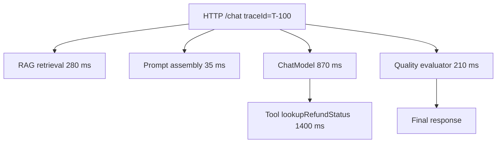
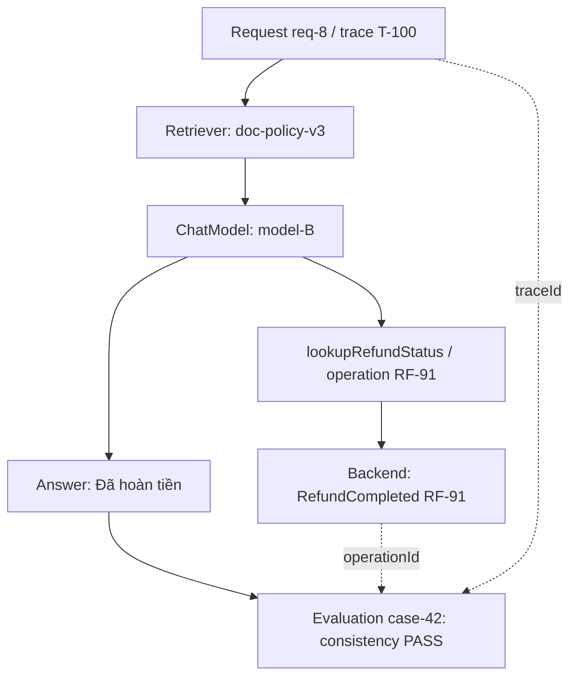
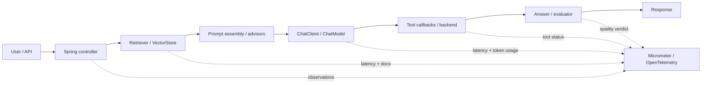
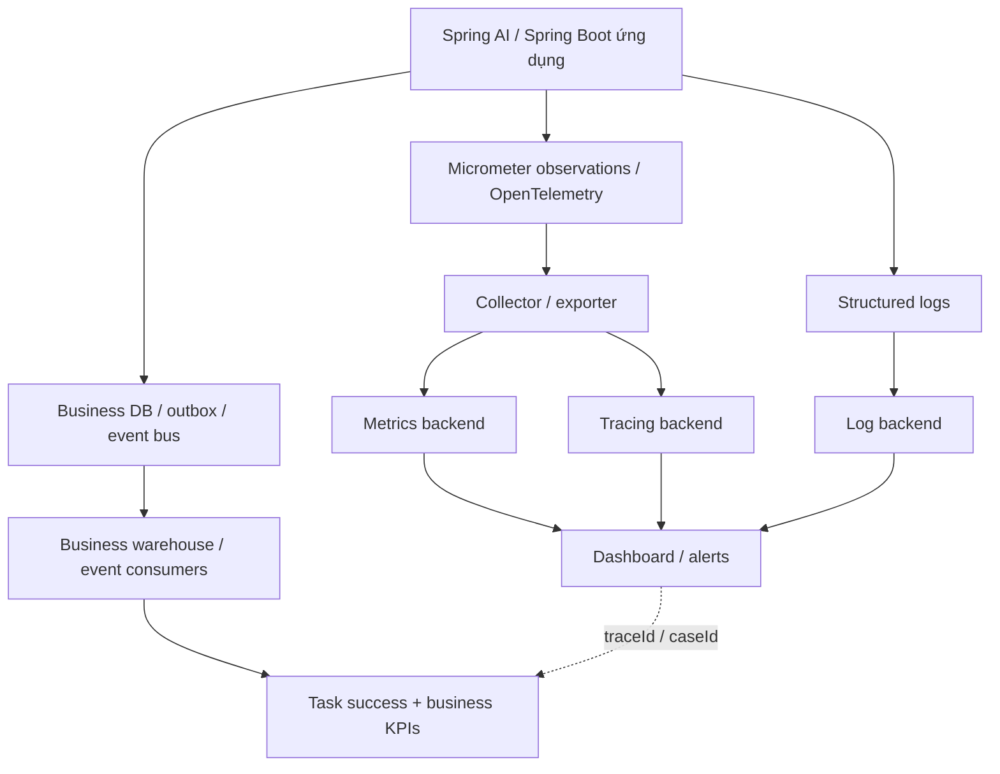

# Phân biệt log, metric, trace và sự kiện nghiệp vụ trong quan sát ứng dụng Spring AI

Một chatbot hỗ trợ khách hàng đột nhiên trả lời chậm hơn sau khi thay prompt. Dashboard cho thấy **p95 latency tăng**, nhưng vẫn chưa trả lời được: chậm ở truy xuất tài liệu, gọi mô hình, chạy công cụ hay chấm chất lượng? Sau đó nhóm phát hiện chatbot đã trả lời “Đã hoàn tiền” trong khi hệ thống thanh toán chưa xác nhận giao dịch. Đây còn là vấn đề **chất lượng và kết quả nghiệp vụ**, không chỉ hiệu năng.

Để điều tra đúng, cần biết sự khác biệt giữa bốn loại tín hiệu:

- **Log:** một bản ghi chi tiết về điều đã xảy ra hoặc được quan sát tại một thời điểm.
- **Metric:** số đo có thể tổng hợp theo thời gian để theo dõi mức độ, xu hướng và cảnh báo.
- **Trace:** chuỗi hoạt động có quan hệ nhân quả trong một lượt xử lý, giúp tìm bước chậm hoặc lỗi.
- **Sự kiện nghiệp vụ (*business event*):** một sự thật có ý nghĩa trong miền nghiệp vụ, chẳng hạn “yêu cầu hoàn tiền đã được tiếp nhận” hay “giao dịch hoàn tiền đã hoàn tất”.

Trong chương **Nền tảng quan sát** của module **SPRING_AI_EVALUATION_OBSERVABILITY**, bốn tín hiệu này được dùng để đánh giá ứng dụng Spring AI dựa trên dataset, relevance, fact checking, luồng RAG và tool calling, đồng thời liên kết chất lượng với metrics, traces, chi phí và độ trễ qua những phiên bản prompt, model và pipeline.

**Nguyên tắc bao trùm:** log, metric và trace giúp *quan sát quá trình*; sự kiện nghiệp vụ giúp ghi nhận *điều gì đã thực sự thay đổi hoặc được xác nhận trong nghiệp vụ*. Chúng bổ sung cho nhau, nhưng không thay thế nhau.

## 1. Mục tiêu học tập

Sau bài này, bạn có thể:

1. Giải thích log, metric, trace và business event theo **đơn vị dữ liệu, phạm vi, khả năng truy vấn và mục đích**.
2. Phân biệt trace span, span event, log entry và domain event; không nhầm một sự kiện kỹ thuật với giao dịch đã thành công.
3. Thiết kế chiến lược liên kết `traceId`, `spanId`, `requestId`, `caseId` và mã giao dịch mà không làm tăng cardinality của metrics.
4. Quan sát luồng Spring AI gồm retrieval, prompt assembly, ChatModel, advisor, tool và evaluator bằng tín hiệu phù hợp.
5. Đo độ trễ, token usage, chi phí, tỷ lệ lỗi và kết quả đánh giá chất lượng; dùng trace/log để tìm nguyên nhân.
6. Tách việc **đã gọi công cụ** khỏi việc **nghiệp vụ đã hoàn tất**, đặc biệt trong trường hợp timeout, retry và xử lý bất đồng bộ.
7. Tổ chức dữ liệu quan sát bảo vệ thông tin nhạy cảm, có khả năng phục vụ dashboard, cảnh báo và kiểm thử hồi quy.

## 2. Hình dung bốn tín hiệu qua một yêu cầu

Người dùng hỏi chatbot:

> “Đơn ORD-1042 của tôi đã được hoàn tiền chưa? Nếu chưa, cho biết bước tiếp theo.”

Ứng dụng:

1. Xác thực quyền xem đơn.
2. Dùng Spring AI gọi `lookupRefundStatus` hoặc truy xuất chính sách liên quan.
3. Nhận trạng thái giao dịch từ backend.
4. Sinh câu trả lời, rồi kiểm tra rằng lời nói về trạng thái khớp nguồn.
5. Gửi câu trả lời tới người dùng.

Quan sát cùng một lượt xử lý bằng bốn cách:

| Tín hiệu | Bản ghi ví dụ | Câu hỏi trả lời tốt nhất |
|---|---|---|
| **Log** | `WARN refund_lookup_timeout requestId=req-8 tool=lookupRefundStatus` | Chuyện gì xảy ra tại một điểm cụ thể? |
| **Metric** | `app_ai_tool_calls_total{tool="lookupRefundStatus",outcome="timeout"}` tăng | Timeout xảy ra bao nhiêu lần, tỷ lệ bao nhiêu, có tăng theo thời gian không? |
| **Trace** | Span `HTTP → retrieval → ChatModel → tool → evaluator`, tool mất 1,4 s | Bước nào chậm/lỗi trong **lượt yêu cầu này**? |
| **Business event** | `RefundCompleted(orderId=ORD-1042, operationId=RF-91)` do backend có thẩm quyền ghi nhận | Giao dịch hoàn tiền đã thật sự hoàn thành hay chưa? |

Nếu **không có business event hoàn tất**, cũng không có trạng thái cuối từ backend, một dòng log “tool invoked” và một trace span thành công **không đủ** để chatbot khẳng định “đã hoàn tiền”.

## 3. Log: bản ghi chi tiết theo thời điểm

**Log** là thông điệp hoặc bản ghi có ngữ cảnh được ghi khi chương trình chạy. Một log có thể mô tả lỗi, quyết định điều phối, dữ liệu thống kê của request hoặc kết quả kiểm thử.

Ví dụ log có cấu trúc (các giá trị minh họa):

```json
{
  "timestamp": "2026-11-27T08:10:25Z",
  "level": "WARN",
  "service": "spring-ai-support",
  "message": "Tool lookup timed out",
  "traceId": "4fae2b...",
  "spanId": "8cd91...",
  "requestId": "req-8",
  "toolName": "lookupRefundStatus",
  "errorType": "TIMEOUT",
  "durationMs": 1400,
  "promptVersion": "support-v3"
}
```

Đây là **schema log tự thiết kế**, không phải dạng JSON mặc định mà mọi ứng dụng Spring AI đều xuất ra. Để có JSON log thực tế, cần cấu hình logger/encoder và cơ chế gắn trace context phù hợp.

### 3.1. Log hữu ích khi nào?

- Cần biết một lỗi cụ thể đã đi qua nhánh xử lý nào.
- Cần xem lý do xác thực thất bại, retry hoặc kết quả parser.
- Cần điều tra vì sao một case evaluation được chấm `FAIL`.
- Cần nối một mã lỗi ứng dụng với trace và phiên bản đang chạy.
- Cần có bản ghi audit kỹ thuật được kiểm soát quyền, nếu phù hợp.

Log có thể được tìm theo `requestId`, `traceId` hoặc trường đã lập chỉ mục. Khi lượng request rất lớn, chi phí lưu và tìm kiếm log có thể cao; không nên dựa vào việc ghi mọi nội dung prompt/response của mọi lượt yêu cầu.

### 3.2. Một log không nói lên toàn bộ bức tranh

Dòng “ChatModel call completed” không cho biết p95 latency toàn hệ thống, tỷ lệ thất bại theo một tuần hay liệu đơn hàng đã hoàn tiền. Nó chỉ mô tả một quan sát ở thời điểm ghi.

Log cũng có thể bị mất, trễ hoặc phát sinh nhiều lần. Không được dùng “có một dòng log hoàn tất” để thay thế kiểm tra trạng thái giao dịch đáng tin cậy.

### 3.3. Cấu trúc log phù hợp ứng dụng AI

Nên có các trường:

| Nhóm | Trường gợi ý | Chú ý |
|---|---|---|
| Bối cảnh kỹ thuật | `service`, `environment`, `timestamp`, `level` | Dùng tên ổn định. |
| Liên kết | `traceId`, `spanId`, `requestId` | ID chỉ để tìm kiếm/correlation, không nhất thiết là nguồn chân lý. |
| Cấu hình AI | `modelId`, `promptVersion`, `pipelineVersion` | Cẩn thận không đưa ID phiên bản quá phân mảnh thành nhãn metric. |
| RAG | `retrievedCount`, `usedContextCount`, `retrievalStatus` | Không log raw tài liệu nếu không cần. |
| Tool | `toolName`, `toolStatus`, `errorCode`, `durationMs` | Không tự coi `toolStatus=200` là thành công nghiệp vụ. |
| Evaluation | `caseId`, `rubricVersion`, `verdict`, `failureReason` | Phân biệt lỗi evaluator và lỗi câu trả lời. |

**Quy tắc bảo mật:** không log API key, token xác thực, OTP, dữ liệu cá nhân, toàn bộ nội dung tài liệu mật hoặc tham số tool nhạy cảm. Nếu cần lưu nội dung để phân tích chất lượng, dùng kho có kiểm soát truy cập, thời hạn lưu và quy trình ẩn dữ liệu.

## 4. Metric: xu hướng, phân bố và ngưỡng cảnh báo

**Metric** là phép đo định lượng được thu thập theo thời gian. Thường gặp:

- **Counter:** số lượt tích lũy, ví dụ số request, lỗi tool, lỗi JSON parse.
- **Timer/Histogram:** phân bố thời gian xử lý, ví dụ độ trễ retrieval, ChatModel, evaluator; có thể tính các phân vị.
- **Gauge:** một giá trị tại thời điểm đo, ví dụ số job chờ hoặc request đang chạy.
- **Distribution summary:** phân bố giá trị đo, ví dụ số chunk hoặc token, tùy công cụ và cách instrument.

Metric phù hợp để trả lời các câu như:

- p95 latency tăng từ khi nào?
- Tỷ lệ request lỗi trên model mới có cao hơn baseline không?
- Bao nhiêu lượt RAG không tìm thấy tài liệu?
- Cost/request có tăng sau khi thêm reranker hoặc evaluator không?
- Tỷ lệ groundedness pass trong tập test mới là bao nhiêu?

### 4.1. Đơn vị và phép tổng hợp

Ví dụ tên metric **do ứng dụng tự đặt**:

```text
app.ai.requests            counter; tags: feature, outcome
app.ai.request.duration    timer; tags: feature, outcome
app.ai.retrieval.duration  timer; tags: pipeline_version
app.ai.tool.calls          counter; tags: tool, outcome
app.ai.evaluation.cases    counter; tags: criterion, verdict
app.ai.tokens              distribution; tags: model, direction
app.ai.estimated.cost      distribution; tags: model, feature
```

Đừng nhầm tên metric minh họa với một tập tên mặc định của Spring AI hoặc OpenTelemetry. Tên instrument, tiền tố và tag phụ thuộc SDK, thư viện, phiên bản, backend và cấu hình.

Khi tính tỷ lệ lỗi:

\[
\operatorname{ToolFailureRate}
= \frac{\text{số lượt tool thực sự lỗi}}
{\text{tổng lượt gọi tool có kết quả đánh giá được}}
\]

Khi số mẫu ở mẫu số bằng 0, báo `N/A`, không tự gán 0%. Cần tách `TIMEOUT`, `CANCELLED`, `BUSINESS_REJECTED` và `EVALUATION_ERROR` vì chúng có nguyên nhân và hành động khắc phục khác nhau.

### 4.2. Tại sao không chỉ nhìn trung bình?

Giả sử có 100 request:

- 95 request mất 0,5 giây.
- 5 request mất 8 giây.

Trung bình là:

\[
\frac{95 \times 0.5+5\times 8}{100}=0.875\text{ giây}.
\]

Trung bình dưới 1 giây có thể che một nhóm request rất chậm. Nên theo dõi phân vị như p50, p95, p99, cùng số request và khoảng thời gian quan sát. Việc tính phân vị phải dựa trên phân bố/quan sát được tập hợp theo phương pháp phù hợp; **không lấy trung bình các p95 của từng máy** để suy ra p95 toàn hệ thống.

### 4.3. Cardinality: nguy cơ lớn của metric labels

Metric labels/tags phù hợp với những giá trị có tập hữu hạn:

```text
tool_name = lookupOrder | cancelBooking | searchPolicies
outcome   = success | error | timeout
feature   = customer-support | internal-rag
```

Không nên gắn các giá trị có thể tăng gần như vô hạn:

```text
orderId
userId
rawQuestion
traceId
operationId
fullSourceUrl
```

Vì mỗi tổ hợp tag tạo ra một time series mới, việc đưa hàng triệu order IDs vào metric label có thể gây nổ cardinality, tăng bộ nhớ/chi phí và làm hệ thống metrics hoạt động kém. Các ID này thuộc log, trace hoặc kho sự kiện có quyền truy cập phù hợp.

## 5. Trace: đường đi của một lượt xử lý

**Distributed trace** liên kết các hoạt động liên quan trong một yêu cầu. Mỗi hoạt động thường được biểu diễn bằng một **span** có thời gian bắt đầu/kết thúc, quan hệ cha-con và các thuộc tính.

Ví dụ luồng chatbot RAG:



Sơ đồ minh họa những công đoạn có thể có; quan hệ span thực tế phải theo đúng thứ tự và mô hình điều phối của ứng dụng. Không phải mọi bước trong RAG đều tự tạo span nếu thiếu instrumentation.

### 5.1. Trace khác log và metric thế nào?

Metric có thể nói “p95 tool latency tăng”, nhưng không chỉ ra **request nào** bị chậm. Trace cho biết request `T-100` đã đi qua một lời gọi tool mất 1,4 giây. Log của span tương ứng có thể chứa mã lỗi cụ thể hoặc bối cảnh điều tra.

Trace thường có:

- `traceId`: định danh cho toàn bộ luồng có liên quan.
- `spanId`: định danh một đơn vị công việc.
- `parentSpanId`: liên kết phân cấp khi có quan hệ cha-con.
- `start/end/duration`, `status`, `attributes`.
- Có thể có **span events** (các dấu mốc trong span) và **span links** (liên kết các ngữ cảnh không theo quan hệ cha-con).

**Span event không đồng nghĩa business event.** Span event như “retry started” là dấu mốc telemetry. Business event như “RefundCompleted” là sự kiện thuộc miền nghiệp vụ, cần semantics và nguồn phát đáng tin.

### 5.2. Trace context xuyên qua dịch vụ và hàng đợi

Khi ChatClient gọi một dịch vụ tool qua HTTP, trace context có thể được truyền qua headers (ví dụ cơ chế W3C Trace Context khi dùng OpenTelemetry). Với bước xử lý bất đồng bộ qua hàng đợi, cần có cơ chế propagation hoặc span links phù hợp. Nếu context không được truyền, request có thể xuất hiện thành các trace rời rạc.

Không nên tự nhét trace ID vào payload nghiệp vụ thay cho cơ chế propagation chuẩn. Ngược lại, **business operation ID** cần ổn định và có ý nghĩa để đối chiếu trạng thái giao dịch, kể cả khi một tác vụ kéo dài qua nhiều trace khác nhau.

### 5.3. Một trace “thành công” chưa chắc tác vụ thành công

Nếu một span tool kết thúc không có exception, điều đó có thể chỉ chứng minh lời gọi được xử lý xong ở tầng kỹ thuật. Backend vẫn có thể trả:

```json
{
  "operationId": "RF-91",
  "status": "REJECTED",
  "reasonCode": "PROMOTION_NOT_ELIGIBLE"
}
```

Trong trường hợp đó:

- **Technical call:** Có thể thành công vì nhận được phản hồi hợp lệ.
- **Business outcome:** Yêu cầu hoàn tiền bị từ chối theo chính sách.
- **Assistant answer:** Phải phản ánh `REJECTED`, không nói “Đã hoàn tiền”.

Đây là lý do cần quan sát cả **technical outcome** và **verified business outcome**.

## 6. Sự kiện nghiệp vụ: sự thật có ý nghĩa với hệ thống

**Business event** ghi nhận một điều có ý nghĩa trong miền nghiệp vụ đã xảy ra hoặc được xác nhận theo một hợp đồng cụ thể. Ví dụ:

- `RefundRequested`: yêu cầu hoàn tiền đã được ghi nhận.
- `RefundApproved`: yêu cầu được phê duyệt theo quy tắc nghiệp vụ.
- `RefundCompleted`: backend xác nhận giao dịch hoàn tiền đã hoàn tất.
- `BookingCancellationRejected`: yêu cầu hủy lịch bị từ chối.
- `SupportCaseResolved`: một yêu cầu hỗ trợ được đóng theo trạng thái nghiệp vụ.

Khác với log chẩn đoán, một sự kiện nghiệp vụ thường có **cấu trúc ổn định, ID sự kiện, chủ thể, đối tượng, thời điểm, trạng thái, schema version và quy tắc xử lý lặp**. Nó có thể được công bố qua event bus hoặc lưu dưới dạng outbox/event store và được nhiều dịch vụ dùng.

### 6.1. Ví dụ payload sự kiện

```json
{
  "eventId": "evt-62",
  "eventType": "RefundCompleted",
  "schemaVersion": "1",
  "aggregateId": "ORD-1042",
  "operationId": "RF-91",
  "occurredAt": "2026-11-27T08:10:25Z",
  "actorType": "refund-service",
  "outcome": "SUCCEEDED",
  "policyVersion": "refund-policy-v3",
  "correlationId": "support-conversation-52"
}
```

Đây là **một contract minh họa do hệ thống ứng dụng tự xây dựng**. Không phải sự kiện hay schema mặc định của Spring AI. Chỉ phát `RefundCompleted` khi thành phần quản lý giao dịch có quyền xác nhận **đã hoàn tất**, không phát khi model “dự đoán có thể hoàn tất”.

### 6.2. Sự kiện nghiệp vụ khác một dòng log ra sao?

| Đặc điểm | Log kỹ thuật | Business event |
|---|---|---|
| Mục đích chính | Chẩn đoán/ghi nhận diễn tiến chương trình. | Biểu diễn một sự thật hoặc chuyển trạng thái nghiệp vụ. |
| Hợp đồng dữ liệu | Có thể linh hoạt theo mức log và phiên bản ứng dụng. | Nên version hóa rõ, có consumer và semantics ổn định. |
| Độ tin cậy | Có thể sampling, bỏ log, thay mức log. | Cần cơ chế giao nhận/lưu bền phù hợp khi dùng cho tích hợp nghiệp vụ. |
| Ví dụ | “Called refund API” | “RefundCompleted” sau xác nhận. |
| Hệ quả | Thường dùng để quan sát. | Có thể kích hoạt cập nhật hệ thống, thông báo, đối soát. |

**Không phải mọi business event đều cần đi qua message broker.** Nó có thể được lưu trong database hoặc phát nội bộ, nhưng nếu các dịch vụ khác phụ thuộc vào nó thì phải xác định rõ yêu cầu độ bền, thứ tự, lặp và khôi phục.

### 6.3. Transactional outbox và việc phát sự kiện

Một lỗi phổ biến: database đã ghi thành công nhưng việc phát message lỗi, hoặc message được phát trước khi transaction database rollback. Nếu sự kiện cần phản ánh thay đổi trạng thái đã commit, **transactional outbox** là một lựa chọn: ghi thay đổi nghiệp vụ và bản ghi outbox trong cùng transaction, rồi chuyển message ra broker qua worker riêng.

Ngay cả với outbox, consumer thường phải **xử lý lặp an toàn**: mô hình *at-least-once delivery* có thể phát lại event. Dùng `eventId`/`operationId` và idempotent processing theo hợp đồng. Không nên tuyên bố có “exactly once end-to-end” chỉ vì công nghệ broker có cơ chế chống trùng ở một tầng.

### 6.4. Sự kiện nghiệp vụ làm cầu nối tới chất lượng AI

Trong một chatbot có hành động, metric `task_success_rate` không nên chỉ dựa vào câu “Tôi đã hoàn thành” do assistant sinh. Nó nên lấy bằng chứng từ **trạng thái có thẩm quyền hoặc business event**. Ví dụ:

```text
question: "Hủy lịch BK-102"
assistant_claimed_status: SUCCEEDED
verified_business_status: FAILED

tool_result_consistency: FAIL
task_success: false
```

Nhờ đó, evaluation có thể chấm đúng **tool-result consistency** và **task success**, thay vì chỉ đánh giá câu chữ.

## 7. Bảng so sánh tổng hợp bốn tín hiệu

| Khía cạnh | Log | Metric | Trace | Business event |
|---|---|---|---|---|
| Đơn vị chính | Bản ghi tại một thời điểm. | Giá trị hoặc phân bố theo thời gian. | Trace/span của một luồng thực thi. | Sự kiện theo khái niệm nghiệp vụ. |
| Trả lời tốt | “Điều gì xảy ra?” | “Bao nhiêu, xu hướng ra sao?” | “Tại sao request này chậm/lỗi ở bước nào?” | “Trạng thái/nghiệp vụ nào đã xảy ra?” |
| Truy vấn thường gặp | Theo thời gian, mức log, ID, mã lỗi. | Theo thời gian, aggregation và labels. | Theo trace ID, span, duration và attributes. | Theo aggregate ID, event type, operation ID, thời điểm. |
| Chi tiết | Có thể rất chi tiết. | Tổng hợp, ít chiều và cardinality kiểm soát. | Chi tiết theo đường đi nhưng có thể bị sampling. | Chi tiết theo contract nghiệp vụ. |
| Độ bền | Tùy log pipeline. | Tùy hệ thống đo và retention. | Tùy sampling/exporter/retention. | Tùy yêu cầu nghiệp vụ và hệ thống sự kiện. |
| Nguồn chân lý cho giao dịch | Không mặc định. | Không. | Không. | Có thể, nếu phát từ backend có thẩm quyền và contract xác nhận trạng thái. |
| Công cụ lưu trữ | Log backend. | Time-series monitoring backend. | Distributed tracing backend. | DB/outbox/event bus/warehouse. |

Sự kiện nghiệp vụ có thể **được chuyển thành log, metric hoặc span event để quan sát**; nhưng bản ghi telemetry suy ra đó không nên được dùng ngược lại làm bằng chứng quyết định nghiệp vụ nếu nguồn phát và tính toàn vẹn chưa được xác nhận.

## 8. Liên kết bốn tín hiệu: correlation và provenance

Một thiết kế thực tế cần liên kết những sự kiện cùng liên quan đến một phiên làm việc hoặc một tác vụ. Tuy nhiên, mỗi ID có một chức năng khác nhau:

| ID | Phạm vi | Vai trò |
|---|---|---|
| `traceId` | Một chuỗi thực thi có liên kết quan sát. | Tìm các spans/logs của một lần xử lý. |
| `spanId` | Một công đoạn trong trace. | Khoanh vùng lỗi hoặc thời gian của bước cụ thể. |
| `requestId` | Một yêu cầu API/HTTP hoặc lượt tương tác. | Liên kết log ứng dụng và phản hồi. |
| `conversationId` | Nhiều lượt hội thoại. | Nhìn hành vi xuyên nhiều request khi được phép. |
| `evaluationRunId` / `caseId` | Một lần chạy và một ca kiểm thử. | So sánh baseline/candidate đúng cùng mẫu dữ liệu. |
| `operationId` | Một thao tác nghiệp vụ thực thi. | Tra trạng thái cuối, retry/idempotency, đối soát. |
| `documentId` / `chunkId` | Tài liệu và đoạn nguồn RAG. | Truy vết claim tới bằng chứng đã dùng. |

**Không nên dùng một ID duy nhất cho tất cả mục đích.** Trace có thể bị sampling hoặc kết thúc trước một công việc bất đồng bộ. Operation ID cần tiếp tục sống đủ lâu để kiểm tra giao dịch. Case ID giúp so sánh evaluation ngay cả khi mỗi lần chạy có trace ID mới.

### 8.1. Ví dụ tương quan một ca RAG + tool



Nếu operation RF-91 chưa có trạng thái hoàn tất, evaluation phải xem câu “Đã hoàn tiền” là chưa có bằng chứng, dù trace và log cho thấy tool đã được gọi.

### 8.2. Phân biệt event time và processing time

Một business event có `occurredAt` (thời điểm nghiệp vụ xảy ra) khác `ingestedAt` (thời điểm hệ thống nhận được dữ liệu). Với hệ thống phân tán hoặc xử lý lại, event có thể được ghi vào warehouse muộn hơn thời điểm phát sinh. Khi so sánh latency hoặc tỷ lệ task success theo ngày, cần thống nhất đang nhóm theo **event time**, **request time** hay **processing time**.

Nếu không làm rõ, dashboard có thể báo “hôm nay có ít đơn được hoàn tiền” chỉ vì consumer đang chậm, không phải vì quá trình hoàn tiền thật sự ít hơn.

## 9. Quan sát một pipeline Spring AI

Spring AI cung cấp các cơ chế observability dựa trên hệ sinh thái Spring/Micrometer cho nhiều thành phần khi chúng được cấu hình phù hợp. Tùy phiên bản và provider, khả năng thu thập lời gọi ChatModel, embeddings, vector store, advisors hoặc tool callbacks có thể khác nhau. **Không giả định tất cả thành phần tự sinh cùng một tên metric hay span.** Các bước evaluation/custom business event thường cần instrumentation riêng.

Một pipeline có thể có:



### 9.1. Log nên ghi gì ở từng công đoạn?

| Công đoạn | Log có ích | Tránh ghi |
|---|---|---|
| API request | request ID, feature, mã lỗi chuẩn hóa, trạng thái xác thực tổng quát. | Token đăng nhập, dữ liệu riêng tư. |
| Retrieval | query rewrite ID, top-k, số chunk, phiên bản index, lý do rỗng. | Raw tài liệu hạn chế hoặc embedding vector. |
| Prompt assembly | template version, số chunk thực sự dùng, token ước lượng. | Toàn bộ prompt chứa PII theo mặc định. |
| Model | model/provider ID, token usage nếu được báo, loại lỗi, retry. | API key, nguyên văn câu hỏi nhạy cảm. |
| Tool | tool name, outcome, duration, operation ID ở log có kiểm soát. | Mã thanh toán đầy đủ hoặc arguments nhạy cảm. |
| Evaluation | case ID, rubric version, verdict, loại claim lỗi. | Raw corpus hoặc gold answer trong log công khai. |

### 9.2. Metric nên đo gì?

- **Request:** count, error rate, p50/p95 end-to-end.
- **Retrieval:** duration, empty-result rate, count chunks trước/sau rerank, chất lượng recall trên dataset.
- **Model:** latency, token usage đầu vào/đầu ra theo nguồn cung cấp, timeout và rate limit.
- **Tool:** duration, failure/timeout/business rejection rate, số lần retry.
- **Evaluation:** pass rate theo criterion như relevance, groundedness, factual correctness và tool consistency.
- **Cost:** ước lượng theo token usage/model và các phí retrieval/reranker/tool/evaluation được tính trong dự án.

Các tên metric cụ thể cần được chuẩn hóa trong hệ thống. Mỗi metric phải có **đơn vị, tập nhãn, loại phép đo, nguồn dữ liệu và quy tắc tính mẫu số**.

### 9.3. Trace nên đặt ranh giới ở đâu?

Trace phải giúp tìm được **critical path** và các công đoạn tốn thời gian. Không phải mọi method Java đều cần span. Các span có ích thường bao gồm:

- API ingress và orchestration chính.
- Vector search / retrieval / rerank.
- ChatModel invocation và retries.
- Tool invocation và request tới backend.
- Custom validation và evaluation nếu chi phí đáng kể.

Khi có nhiều tool calls song song, tổng durations của các spans **có thể lớn hơn end-to-end latency** do chúng chồng lấp. Không được cộng tổng thời gian của mọi span rồi kết luận đó là thời gian phản hồi tới người dùng.

## 10. Ví dụ instrumentation bằng Micrometer

Đoạn Java sau minh họa cách kết hợp **metric, observation và log** cho một phần xử lý tự xây dựng, chẳng hạn chấm chất lượng câu trả lời. Lớp này không tự tạo business event; event nghiệp vụ phải phát từ thành phần có quyền xác nhận kết quả.

Các import, cấu hình và API phải được điều chỉnh theo phiên bản Spring Boot/Micrometer mà dự án sử dụng.

```java
import io.micrometer.core.instrument.Counter;
import io.micrometer.core.instrument.MeterRegistry;
import io.micrometer.core.instrument.Timer;
import io.micrometer.observation.Observation;
import io.micrometer.observation.ObservationRegistry;
import java.util.function.Supplier;
import org.slf4j.Logger;
import org.slf4j.LoggerFactory;

public final class AiEvaluationTelemetry {

    private static final Logger log =
        LoggerFactory.getLogger(AiEvaluationTelemetry.class);

    private final MeterRegistry meters;
    private final ObservationRegistry observations;

    public AiEvaluationTelemetry(
        MeterRegistry meters,
        ObservationRegistry observations
    ) {
        this.meters = meters;
        this.observations = observations;
    }

    public <T> T record(
        String criterion,
        String promptVersion,
        Supplier<T> evaluation
    ) {
        // Chỉ dùng nhãn có tập giá trị được kiểm soát.
        Observation observation = Observation
            .createNotStarted("app.ai.evaluation", observations)
            .lowCardinalityKeyValue("criterion", criterion)
            .lowCardinalityKeyValue("prompt.version", promptVersion)
            .start();

        Timer.Sample timer = Timer.start(meters);
        String outcome = "success";

        try (Observation.Scope ignored = observation.openScope()) {
            T result = evaluation.get();
            log.info("Evaluation finished: criterion={}, promptVersion={}",
                criterion, promptVersion);
            return result;
        }
        catch (RuntimeException ex) {
            outcome = "error";
            observation.error(ex);
            log.warn("Evaluation failed: criterion={}, errorType={}",
                criterion, ex.getClass().getSimpleName());
            throw ex;
        }
        finally {
            timer.stop(Timer.builder("app.ai.evaluation.duration")
                .tag("criterion", criterion)
                .tag("outcome", outcome)
                .register(meters));

            Counter.builder("app.ai.evaluation.executions")
                .tag("criterion", criterion)
                .tag("outcome", outcome)
                .register(meters)
                .increment();
            observation.stop();
        }
    }
}
```

**Phạm vi mã:** `Observation` thể hiện một hoạt động được quan sát; khả năng chuyển thành trace/span phụ thuộc vào cấu hình observation handlers, tracer và exporter. `Timer` đo duration của phần công việc; `Counter` đếm lượt chạy. Không phải đoạn mã tự động xuất trace ra hệ thống ngoài hay đánh giá độ đúng của câu trả lời.

Trong code trên, `outcome="success"` nghĩa **bước evaluation thực thi không ném lỗi**, không nghĩa **câu trả lời được chấm PASS**. Với kết quả đánh giá, cần thêm metric/verdict rõ ràng:

```text
evaluation_execution_outcome = success | error
evaluation_quality_verdict   = pass | fail | needs_review
```

Nếu ứng dụng ghi `promptVersion` vào metric tag, cần giới hạn và quản lý số lượng phiên bản còn được sử dụng; không ghi hash duy nhất cho từng request vào tag. Với `caseId` hay `traceId`, dùng log/trace thay vì metric label.

### 10.1. Kết nối traceId vào log

Khi hệ thống đã có tracing và logging correlation phù hợp, có thể cấu hình MDC/log encoder để thêm `traceId` và `spanId`. Việc này **phụ thuộc cấu hình**: chỉ ghi một chuỗi mang tên `traceId` không làm phát sinh distributed trace.

Trong xử lý bất đồng bộ, cần bảo toàn context phù hợp với executor và cơ chế messaging; nếu không, log của callback có thể mất trace correlation dù request ban đầu có trace.

### 10.2. Tách metric kỹ thuật và business event

**Không phát business event trong khối `finally` chỉ vì một lời gọi Java hoàn tất.** Business event cần được phát tại ranh giới giao dịch có thẩm quyền:

```text
RefundService xác thực quyền và chính sách.
RefundService ghi trạng thái hoàn tất trong transaction.
Outbox ghi RefundCompleted tương ứng trong cùng transaction.
Publisher chuyển event đã commit tới broker/consumer.

Observability:
  log: refund completed với operation ID được phép
  metric: tăng số lượt giao dịch hoàn tất
  trace: nối các bước thực thi
  event: RefundCompleted do backend có thẩm quyền công bố
```

Trong ứng dụng thực, cách triển khai phụ thuộc database, broker, yêu cầu độ bền và nhất quán. Mấu chốt là **semantics của event đến từ hệ thống nghiệp vụ**, không do bản thân mô hình ngôn ngữ quyết định.

## 11. Kết nối bốn tín hiệu với đánh giá chất lượng AI

Module SPRING_AI_EVALUATION_OBSERVABILITY không chỉ cần biết ứng dụng chạy chậm; cần biết câu trả lời có còn đúng và hữu ích không. Để làm vậy, phải ghi nhận kết quả evaluation dưới một **lớp dữ liệu riêng**:

| Kết quả đánh giá | Metric tổng hợp | Log/trace khi cần phân tích | Bằng chứng chuẩn |
|---|---|---|---|
| Answer relevance | Tỷ lệ đạt/ngưỡng hoặc score theo nhóm case. | Case ID, prompt/model version, query, lỗi rubric. | Dataset với intent và required facets. |
| Groundedness | Supported-claim rate, unsupported-claim count. | Used context IDs, claim thất bại, citation mapping. | Context thực sự đưa vào model. |
| Factual correctness | Critical factual error count, pass rate. | Source version, điều kiện, kết quả đối chiếu. | Nguồn chân lý có hiệu lực. |
| Tool-result consistency | False-success rate, mismatch count. | Tool span, operation ID, answer claim. | Verified backend state/business event. |
| Task success | Tỷ lệ tác vụ hoàn tất hợp lệ. | Workflow trace và target IDs. | Trạng thái cuối/receipt của backend. |
| Format/schema | Parse/schema pass rate. | Loại lỗi và field vi phạm. | JSON Schema/contract validator. |

**Quan trọng:** evaluator dựa trên LLM có thể timeout hoặc trả kết quả không ổn định. Cần ghi `evaluation_status=ERROR` riêng với `verdict=FAIL`. Nếu bỏ hết những case evaluator lỗi khỏi báo cáo mà không công bố, metric chất lượng có thể bị thiên lệch.

### 11.1. Ví dụ xác định nguyên nhân chất lượng RAG giảm

Đợt A sử dụng prompt v1, đợt B dùng prompt v2 trên cùng corpus snapshot và tập câu hỏi:

| Tín hiệu | Đợt A | Đợt B | Cần điều tra |
|---|---:|---:|---|
| p95 latency | 1,6 s | 2,5 s | Có công đoạn nào chậm? |
| Input tokens trung bình | 2.200 | 5.900 | Context/prompt có dài hơn? |
| Groundedness pass rate | 94% | 86% | Có bị nhiễu nguồn hoặc sinh thêm claim? |
| Retrieval empty rate | 3% | 3% | Có vẻ không đổi nhiều. |
| Estimated cost/request | 0,6 đơn vị | 1,1 đơn vị | Model usage hay số lượt gọi tăng? |

**Metric** cho thấy xu hướng, nhưng chưa xác định nguyên nhân. Mở các **trace** lỗi của đợt B: có thể thấy ChatModel chậm hơn và input context tăng. Đọc **log có cấu trúc** để biết số chunk đưa vào prompt; sau đó xem **evaluation report** để xác định claim nào không được nguồn hỗ trợ.

Kết luận điều tra phải dựa trên dữ liệu đã đối chiếu, không chỉ suy đoán “token tăng nên tất cả lỗi đều do token”. Những con số trên là **ví dụ giả định**, không phải kết quả benchmark Spring AI.

### 11.2. Ví dụ business outcome không khớp câu trả lời

Một trace cho thấy `cancelBooking` được gọi và trả response HTTP hợp lệ. Log kỹ thuật ghi `tool_call_completed`, nhưng backend phát `BookingCancellationRejected`. Assistant nói “Đã hủy lịch”:

```text
Technical trace status : OK
Business event         : BookingCancellationRejected
Assistant claim        : cancelled = true
Tool-result consistency: FAIL
Task success           : false
```

Trong tình huống này, tối ưu prompt/model chỉ là một phần giải pháp; cần **cổng kiểm tra kết quả có thẩm quyền** trước khi phát câu xác nhận.

## 12. Kiến trúc thu thập và phân tích tín hiệu

Một kiến trúc quan sát khả thi không nhất thiết sử dụng một nền tảng duy nhất:



### 12.1. Vai trò từng khối

- **Instrumentation:** code/library tạo các observations, timers, counters và log.
- **Collector/exporter:** thu, lọc, chuyển đổi và chuyển tín hiệu tới backend phù hợp.
- **Metrics backend:** lưu time series và hỗ trợ alerting, SLO.
- **Tracing backend:** tìm trace, phân tích span và critical path.
- **Log backend:** tìm bản ghi chi tiết theo thời gian và các ID liên kết.
- **Event bus/warehouse:** lưu, phát hoặc phân tích sự kiện nghiệp vụ theo contract, hỗ trợ đối soát và task success.
- **Evaluation store:** nên lưu dataset version, verdict, rubric, model/prompt/pipeline version và ID liên kết, ngay cả khi sơ đồ đơn giản không vẽ riêng mọi kho.

Không nên mặc định một sản phẩm observability thay thế hệ thống giao dịch hoặc event store. Nhiều nền tảng hiển thị cả log, metric và trace trên cùng dashboard, nhưng **ý nghĩa và độ tin cậy của dữ liệu nguồn vẫn khác nhau**.

### 12.2. Instrumentation bắt đầu từ câu hỏi vận hành

Trước khi thu tất cả mọi thứ, xác định câu hỏi cần trả lời:

1. **Chất lượng có giảm không?** Thu verdict evaluation, phân nhóm case, prompt/model/corpus version.
2. **Đâu là bước chậm?** Thu timers và spans cho retrieval/model/tool/evaluator.
3. **Lỗi xảy ra vì sao?** Thu logs phân loại lỗi, nguồn và cấu hình thích hợp.
4. **Người dùng đạt mục tiêu chưa?** Thu trạng thái cuối hoặc business event có thẩm quyền.
5. **Chi phí thay đổi ở đâu?** Thu token usage theo model, số lần retry, tool/rerank/judge cost nếu có.

Mỗi tín hiệu chỉ nên thu với **mức chi tiết cần thiết**, đơn vị rõ, khả năng truy vết và chính sách lưu giữ.

## 13. Retention, sampling, chi phí và bảo mật

### 13.1. Sampling không được làm sai nguồn chân lý

Traces có thể dùng sampling để kiểm soát lượng dữ liệu lưu. Logs cũng có thể được lọc theo cấp độ hoặc sampling. Điều này hợp lý cho quan sát, nhưng:

- Một trace không xuất hiện không chứng minh request không xảy ra.
- Một log không có không chứng minh tool chưa gọi.
- Sự kiện nghiệp vụ trọng yếu **không nên bị loại ngẫu nhiên như telemetry** nếu hệ thống cần nó cho giao dịch, audit hoặc đối soát.
- Nếu metric được suy từ trace có sampling, cần biết phương pháp lấy mẫu trước khi dùng nó làm tỷ lệ chính thức.

Đối với metric rate phục vụ cảnh báo, thường nên instrument trực tiếp tại điểm đo thích hợp hoặc dùng phương pháp tính được hiệu chỉnh theo sampling. Đừng dùng số trace được lưu làm mẫu số cho toàn bộ lưu lượng khi có sampling.

### 13.2. Chọn thời hạn lưu theo giá trị

| Loại tín hiệu | Điều ảnh hưởng retention |
|---|---|
| Log | Nhu cầu điều tra, bảo mật, chi phí lưu, pháp lý. |
| Metric | SLO, so sánh xu hướng tuần/tháng, chi phí time series. |
| Trace | Khả năng mở ca chậm/lỗi, sampling, chi phí span storage. |
| Business event | Nghĩa vụ nghiệp vụ, đối soát, khả năng phát lại và quy định bảo quản dữ liệu. |
| Evaluation dataset/report | Tái lập thí nghiệm và so sánh phiên bản, nguồn chuẩn có hiệu lực. |

Không có một con số retention mặc định đúng cho mọi tổ chức. Dữ liệu nhạy cảm nên có chính sách xóa/ẩn phù hợp và kiểm soát quyền rõ ràng.

### 13.3. Dữ liệu AI có nguy cơ đặc biệt

Prompt, context truy xuất, tool arguments, model response và trace có thể chứa:

- Dữ liệu người dùng và hội thoại riêng tư.
- API key hoặc mã xác thực bị đưa nhầm vào prompt.
- Tài liệu công ty, thông tin khách hàng hoặc khóa truy cập.
- Các chuỗi hướng dẫn độc hại nhúng trong tài liệu truy xuất.

Mặc định nên **tắt hoặc hạn chế ghi raw prompt/completion**, chỉ bật có kiểm soát cho môi trường và mục đích đã được phép. Không đưa raw nội dung vào metric labels, đặc biệt giá trị có cardinality cao. Với hệ thống yêu cầu lưu phục vụ đánh giá, sử dụng dataset đã ẩn dữ liệu và kho riêng có phân quyền.

## 14. Dashboard và cảnh báo cho ứng dụng Spring AI

Một dashboard thực tế nên chia theo mục tiêu:

| Nhóm dashboard | Metric trọng tâm | Hành động khi có bất thường |
|---|---|---|
| **Reliability** | Request error rate, model timeout, tool timeout, retry rate. | Mở trace/log lỗi và phân loại nhà cung cấp, công cụ, mạng. |
| **Latency** | p50/p95 end-to-end và retrieval/model/tool/eval duration. | Tìm span hoặc giai đoạn tăng duration. |
| **Quality** | Relevance pass, groundedness pass, critical fact errors. | Mở evaluation cases, kiểm tra corpus/prompt/model version. |
| **Tool correctness** | False success, pending/unknown, task success. | Đối chiếu verified business state và final answer. |
| **Cost** | Tokens, estimated cost/request, cost/resolved-case. | Kiểm tra prompt length, retrieval top-k, judge và retries. |
| **Business outcomes** | RefundCompleted, BookingCancelled, support resolution. | Đối soát số event và trạng thái nghiệp vụ từ hệ thống nguồn. |

### 14.1. Cảnh báo phải có hành động tiếp theo

Ví dụ:

- p95 latency vượt SLO trong một cửa sổ đo đủ mẫu → mở trace chậm theo feature/pipeline version.
- Tỷ lệ tool timeout tăng sau deploy → lọc theo tool/provider và so sánh logs lỗi.
- Lỗi factual critical xuất hiện trong regression set → chặn candidate và mở các case có nguồn chuẩn.
- Lời xác nhận thành công không khớp business outcome → kích hoạt quy trình xử lý sự cố, không chỉ hiển thị số liệu.

Tránh quá nhiều alert cho metric ít liên quan đến người dùng. Cảnh báo nên có **ngưỡng, phạm vi, khoảng đo, mức độ quan trọng và người xử lý** rõ ràng.

### 14.2. SLO và business KPI không giống nhau

SLO như “99% request phản hồi trong 3 giây” là mục tiêu vận hành. Business KPI như “tỷ lệ yêu cầu hỗ trợ được xử lý thành công” phản ánh kết quả nghiệp vụ. Hai chỉ số có thể biến động độc lập: chatbot rất nhanh vẫn có thể đưa ra quyết định sai; một giao dịch hợp lệ có thể cần xử lý bất đồng bộ lâu hơn thời gian phản hồi chat.

Đánh giá hệ thống AI cần cả **technical SLO**, **quality KPI** và **business outcome**.

## 15. So sánh phiên bản prompt, model và pipeline

Khi triển khai phiên bản mới, cần giữ các điều kiện đánh giá đủ ổn định:

1. **Dataset cố định:** câu hỏi, gold facts, nguồn có hiệu lực và tool fixtures.
2. **Rubric nhất quán:** relevance, groundedness, factual correctness, task success, quy tắc xử lý judge error.
3. **Thông tin phiên bản:** prompt, model, pipeline, corpus, evaluator và tool.
4. **Metrics giống đơn vị và mẫu số:** latency, cost, token usage, lỗi theo cùng cách tính.
5. **Trace/log liên kết:** có khả năng xem từng case suy giảm.
6. **Business outcomes:** không đo thành công chỉ bằng lời assistant, dùng trạng thái được xác minh.

Ví dụ hai ứng viên:

| Metric (giả định) | Baseline A | Candidate B | Diễn giải sơ bộ |
|---|---:|---:|---|
| Groundedness pass | 93% | 96% | B có vẻ dùng nguồn tốt hơn. |
| p95 latency | 1,8 s | 2,6 s | B chậm hơn; mở traces. |
| Input tokens trung bình | 2.000 | 3.900 | B dùng context dài hơn. |
| Estimated cost/request | 0,7 đơn vị | 1,0 đơn vị | B đắt hơn. |
| Tool-result mismatches | 0 | 2 | B có lỗi quan trọng phải điều tra. |

Ngay cả khi B tăng groundedness, **hai lỗi tool-result mismatch** có thể vi phạm quality gate bắt buộc. Quy trình chọn phiên bản phải kiểm tra hard constraints trước rồi mới so relevance, latency và cost. Số liệu trên chỉ dùng để minh họa phương pháp.

### 15.1. Từ metric xuống trace, từ trace đến log và event

Một trình tự điều tra hiệu quả:

1. Dashboard báo p95 hoặc quality score xấu đi.
2. Lọc theo feature, model/prompt/pipeline version và nhóm case.
3. Chọn một trace đại diện có duration/lỗi cao.
4. Tìm span chiếm thời gian hoặc nhánh tool có kết quả bất thường.
5. Tra log liên quan bằng trace/request ID để lấy mã lỗi, thông tin cấu hình.
6. Nếu có hành động nghiệp vụ, đối chiếu operation ID với verified state/business event.
7. Mở evaluation record để xác định claim/tiêu chí nào không đạt.
8. Đề xuất một thay đổi, chạy lại cùng dataset và kiểm chứng không phát sinh hồi quy khác.

Đó là cách chuyển từ câu “AI trả lời kém” thành một giả thuyết kỹ thuật có thể kiểm chứng.

## 16. Những nhầm lẫn phổ biến

1. **“Đã có log thì không cần trace.”** Log ghi chi tiết rời rạc; trace nối các bước và giúp thấy critical path.
2. **“Trace đã thành công nghĩa là giao dịch thành công.”** Span kỹ thuật không thay thế verified business outcome.
3. **“Metric error rate cao cho biết ngay nguyên nhân.”** Nó phát hiện xu hướng, cần trace/log để tìm nguyên nhân.
4. **“Business event chỉ là log JSON có tên đẹp.”** Sự kiện nghiệp vụ có contract, nguồn phát, semantics và có thể có yêu cầu độ bền khác log.
5. **“Có một dòng log RefundCompleted nghĩa là sự kiện đã phát bền vững.”** Log không tự chứng minh transaction/outbox/broker commit.
6. **“Có thể dùng traceId làm metric tag để truy vết.”** Đây là tag có cardinality rất cao, nên dùng trace/log.
7. **“Không thấy trace nghĩa là request không tồn tại.”** Sampling, export lỗi hoặc context propagation có thể làm thiếu trace.
8. **“p95 tổng = tổng p95 từng bước.”** Các giai đoạn có thể chồng lấp và phân vị không cộng tuyến tính.
9. **“Thêm nhiều dữ liệu quan sát luôn tốt.”** Có chi phí, cardinality, rủi ro bảo mật và tác động đến latency.
10. **“Metric token đủ tính chính xác mọi hóa đơn.”** Usage có thể không đầy đủ tùy provider; giá thay đổi và có phí bổ sung ngoài token.
11. **“Kết quả LLM judge PASS là factual correctness chắc chắn.”** Cần gold reference, rubric có hiệu chuẩn và phân biệt evaluation error.
12. **“Một dashboard dùng tất cả tín hiệu nghĩa là mọi tín hiệu có độ tin cậy như nhau.”** Semantics và nguồn chân lý vẫn phải xét riêng.

## 17. Bài tập thực hành

Một ứng dụng Spring AI dùng RAG để tra chính sách, gọi công cụ hủy lịch và chấm chất lượng. Kết quả **giả định**:

```text
Request ID: req-100
Trace ID: trace-100
Prompt version: support-v4

Metrics:
  p95 end-to-end tăng từ 1,8s lên 3,1s sau deploy.
  tool timeout rate tăng từ 1% lên 8%.
  groundedness pass rate giảm từ 95% xuống 87%.

Trace (một request chậm):
  retrieval: 230ms
  ChatModel: 900ms
  cancelBooking tool: timeout sau 1700ms
  evaluator: 190ms

Log:
  WARN tool timeout; operationId=CXL-77
  INFO assistant answer generated

Backend:
  operationId=CXL-77
  verified status=UNKNOWN
  chưa có business event BookingCancelled.

Assistant:
  "Tôi đã hủy lịch BK-102 thành công."
```

### Yêu cầu

1. Phân loại thông tin nào là **log**, **metric**, **trace** và **business outcome/event**.
2. Giải thích tại sao span “assistant answer generated” hoặc log `INFO` không chứng minh lịch đã hủy.
3. Chỉ ra lỗi chất lượng nghiêm trọng nhất và cách phản hồi đúng.
4. Nêu ít nhất ba trường correlation nên ghi và nơi phù hợp để lưu mỗi trường.
5. Đề xuất hai giả thuyết để điều tra p95 và groundedness sau deploy.
6. Thiết kế một metric đánh giá tool-result consistency và một dashboard đơn giản.

### Đáp án gợi ý

**Phân loại:**

- Metric: p95, tool timeout rate, groundedness pass rate.
- Trace: các spans retrieval, ChatModel, tool, evaluator cùng thời gian.
- Log: các dòng `WARN tool timeout` và `INFO assistant answer generated`.
- Business outcome: `verified status=UNKNOWN` từ backend; **chưa có** business event hoàn tất. Việc không thấy event trong pipeline cũng cần kiểm tra độ trễ/độ tin cậy thu thập, nên trạng thái backend có thẩm quyền là căn cứ hiện tại.

**Lỗi nghiêm trọng:** chatbot tuyên bố hủy thành công khi công cụ timeout và trạng thái chưa xác định. Phản hồi phù hợp: “Tôi đã gửi yêu cầu nhưng chưa xác minh được lịch BK-102 đã được hủy hay chưa. Vui lòng kiểm tra trạng thái trong ứng dụng hoặc dùng mã tham chiếu để đối soát.” Chỉ nói “đã gửi yêu cầu” khi tool/backend thật sự xác nhận request được gửi; nếu chưa chắc, dùng “Tôi chưa xác minh được kết quả hủy”.

**Correlation:** `traceId` trong logs/traces, `requestId` trong logs/API, `operationId` trong nghiệp vụ/outbox và logs có phân quyền. Không dùng các ID duy nhất theo từng giao dịch làm metric labels.

**Giả thuyết:** timeout tool tăng kéo dài end-to-end; prompt v4 hoặc context assembly khiến model sinh thêm claim không hỗ trợ. Cần đối chiếu trace, context IDs, input tokens và các case evaluation của hai phiên bản để kiểm tra.

**Metric gợi ý:** `tool_result_consistency_failures_total{tool="cancelBooking",type="false_success"}`, cùng `tool_calls_total{tool="cancelBooking",outcome="timeout"}` và p95 latency. Dashboard có các nhóm *Latency*, *Tool health*, *Quality* và link tới trace, log, verified operation state. Tên metric là minh họa do nhóm tự thiết kế.

## 18. Ghi nhớ

**Log** giúp đọc chi tiết một thời điểm; **metric** theo dõi xu hướng và cảnh báo; **trace** lần theo công đoạn của một lượt xử lý; **business event** ghi nhận sự thật có ý nghĩa nghiệp vụ từ nguồn có thẩm quyền. Khi kết hợp chúng trong Spring AI, cần gắn phiên bản prompt/model/pipeline, correlation IDs, nguồn RAG, kết quả tool và evaluation verdict để thấy rõ cả **hiệu năng, chất lượng và kết quả cho người dùng**. Không nhầm trạng thái kỹ thuật với trạng thái giao dịch; không dùng một loại tín hiệu để thay thế mọi loại còn lại.

### Tài liệu tham khảo

- [Spring AI Reference — Observability](https://docs.spring.io/spring-ai/reference/observability/index.html): quan sát ChatModel, các thành phần AI và cấu hình observability.
- [Spring AI Reference — Chat Client API](https://docs.spring.io/spring-ai/reference/api/chatclient.html): cách gọi model và tổ chức lời đáp.
- [Spring AI Reference — Tool Calling](https://docs.spring.io/spring-ai/reference/api/tools.html): luồng gọi công cụ và phản hồi.
- [Micrometer Documentation](https://docs.micrometer.io/micrometer/reference/): metrics, observations và tracing trong hệ sinh thái Java.
- [OpenTelemetry Concepts](https://opentelemetry.io/docs/concepts/): traces, metrics, logs, context propagation và sampling.
- [W3C Trace Context](https://www.w3.org/TR/trace-context/): định dạng truyền trace context giữa các dịch vụ.
