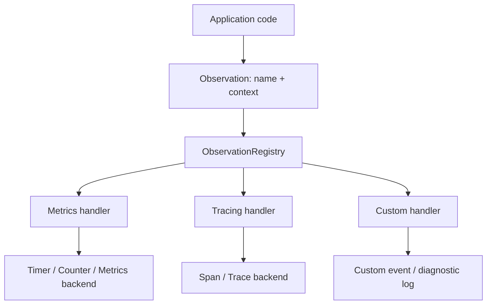
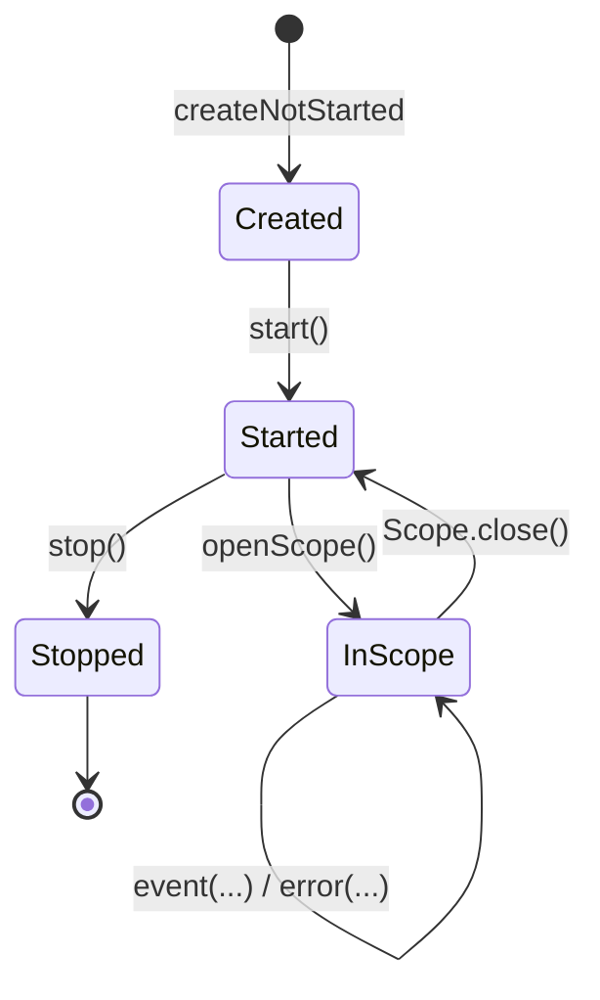
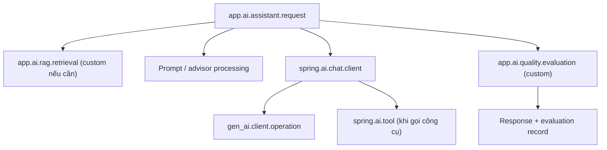

# Observation và vòng đời một phép quan sát trong Micrometer

Khi một request đi qua ứng dụng Spring AI, nó có thể lần lượt truy xuất tài liệu, xây dựng prompt, gọi mô hình, thực thi công cụ và đánh giá chất lượng câu trả lời. Nếu chỉ ghi thời gian tổng, ta biết request chậm nhưng chưa biết **công đoạn nào gây chậm**. Nếu tự viết một `Timer` cho từng bước, một API trace riêng và một cơ chế ghi lỗi khác, việc duy trì correlation giữa các tín hiệu sẽ trở nên khó khăn.

**Micrometer Observation** giải quyết vấn đề này bằng một **API biểu diễn một hoạt động cần được quan sát**, có vòng đời nhất quán và cho phép các `ObservationHandler` chuyển hoạt động đó thành metrics, tracing hoặc những phản ứng quan sát khác. Một `Observation` không tự động đồng nghĩa một metric, một span hoặc một log: điều được tạo ra thực tế tùy thuộc vào registry, handlers và cấu hình hệ thống.

Bài học thuộc chương **Nền tảng quan sát** của module **SPRING_AI_EVALUATION_OBSERVABILITY**. Mục tiêu module là đánh giá chất lượng ứng dụng Spring AI bằng dataset, relevance, fact checking và kiểm thử RAG/tool calling, đồng thời đo metrics, traces, chi phí và độ trễ để tìm nguyên nhân suy giảm giữa các phiên bản prompt, model và pipeline. Trong phạm vi đó, hiểu vòng đời `Observation` giúp ta **đo đúng điều đang diễn ra** trước khi đưa ra kết luận về chất lượng.

## 1. Mục tiêu học tập

Sau bài này, bạn có thể:

1. Giải thích vai trò của `Observation`, `ObservationRegistry`, `Observation.Context`, `ObservationHandler` và `ObservationConvention`.
2. Mô tả chính xác chuỗi sự kiện `createNotStarted → start → openScope → event/error → closeScope → stop`.
3. Phân biệt **vòng đời hoạt động**, **phạm vi (scope) đang hiện hành** và **khoảng thời gian đo**; tránh nhầm `Scope.close()` với `Observation.stop()`.
4. Dùng Micrometer Observation API trong Java/Spring Boot và xử lý lỗi mà không làm mất thông tin quan sát.
5. Phân biệt key-value có **low cardinality** và **high cardinality**, đưa thông tin đúng loại vào metrics/traces và hạn chế dữ liệu nhạy cảm.
6. Liên kết observation tự xây dựng với các observation của Spring AI như ChatClient, ChatModel và tool calling.
7. Thiết kế metrics, traces và bài kiểm thử phục vụ đánh giá RAG, chất lượng câu trả lời, latency, token usage và cost.

## 2. Observation là gì và không phải là gì?

Một `Observation` đại diện cho **một phép quan sát có tên**, mang context và các sự kiện vòng đời. Nó có thể đo hoạt động rất rộng (một request xử lý trọn vẹn) hoặc một bước rõ ràng (retrieval, validation, quality evaluation).

Ví dụ:

```text
Observation name : app.ai.rag.answer
Operation        : Xử lý câu hỏi RAG từ đầu đến khi có phản hồi
Attributes       : feature=policy-qa, pipeline.version=v3
Lifecycle        : created -> started -> scope opened -> ... -> stopped
Potential output : duration metric, trace span, error annotation
```

Tên và các attributes trên là **quy ước minh họa tự đặt**, không phải tên mặc định của Spring AI.

### 2.1. Các thành phần chính

| Thành phần | Trách nhiệm | Điều cần nhớ |
|---|---|---|
| `Observation` | Đại diện hoạt động và phát tín hiệu vòng đời như start, stop, error, event. | Không thay thế nghiệp vụ hoặc evaluator. |
| `ObservationRegistry` | Cấu hình và tổ chức handlers, conventions, predicates/filters để quản lý quan sát. | Có observation nhưng không có handler thích hợp thì không có metric/span mong muốn. |
| `Observation.Context` | Chứa thông tin liên quan phép quan sát, gồm key-values và dữ liệu handlers sử dụng. | Không phải nơi thích hợp để chứa bí mật hoặc payload vô hạn. |
| `ObservationHandler` | Phản ứng với các sự kiện vòng đời để tạo timer, span, log hoặc cơ chế khác. | Một handler có thể chỉ hỗ trợ một kiểu context. |
| `ObservationConvention` | Chuẩn hóa tên và low/high-cardinality key-values theo loại operation. | Giúp nhiều điểm instrument dùng cùng semantic convention. |
| `Observation.Scope` | Đưa observation vào context hiện hành trong một phạm vi mã. | Đóng scope không nhất thiết kết thúc observation. |

**Observation là lớp trừu tượng instrumentation**, còn metrics và tracing là những dạng tín hiệu có thể được xuất ra. Khi cần xác nhận một giao dịch đã thành công, hãy truy vấn kết quả/backend có thẩm quyền; một span không lỗi chỉ cho biết thao tác kỹ thuật đã kết thúc theo semantics của instrumentation.

### 2.2. Luồng từ API đến tín hiệu quan sát



Sơ đồ biểu diễn **khả năng cấu hình**, không ngụ ý `ObservationRegistry` tự gửi dữ liệu qua mạng hay luôn có cả ba handlers. Một ứng dụng chỉ cấu hình metrics có thể không có distributed traces; một ứng dụng chưa bật instrumentation phù hợp có thể không thu tín hiệu nào từ operation tùy chỉnh.

## 3. Vòng đời đầy đủ của một Observation

Vòng đời có sáu bước thường gặp:

1. **Tạo:** mô tả tên và context của hoạt động, nhưng chưa bắt đầu đo.
2. **Start:** thông báo hoạt động bắt đầu, để handlers khởi tạo trạng thái/timer/span theo cấu hình.
3. **Open scope:** đặt observation làm context hiện hành trong đoạn code cần truyền correlation.
4. **Event/error:** ghi sự kiện trong quá trình thực hiện hoặc báo ngoại lệ thật sự.
5. **Close scope:** khôi phục context hiện hành trước khi mở scope.
6. **Stop:** báo kết thúc hoạt động, cho phép handlers hoàn tất thời gian đo/span.



Lược đồ này minh họa đường đi điển hình. API cũng cho phép phát `event` hoặc `error` khi observation đang hoạt động mà không cần một scope hiện hành, tùy điểm instrument. **Scope là cơ chế context, không phải trạng thái bắt buộc duy nhất giữa start và stop.**

### 3.1. Tạo bằng `createNotStarted`

```java
Observation observation = Observation.createNotStarted(
    "app.ai.rag.answer",
    observationRegistry
);
```

Chỉ tạo observation **chưa bắt đầu**. Nếu code thoát trước khi gọi `start()`, không thể giả định handler đã nhận sự kiện bắt đầu. Chỉ thêm tên và tags chưa đủ để tạo biểu đồ metric.

### 3.2. Bắt đầu bằng `start()`

```java
observation.start();
```

Micrometer thông báo các handler phù hợp rằng observation đã bắt đầu. Handler đo thời gian có thể ghi nhận mốc bắt đầu, handler tracing có thể tạo span. Hành động này khác `openScope()`: **một hoạt động có thể đã bắt đầu nhưng chưa được đưa vào thread-local/current context**.

### 3.3. Mở và đóng `Scope`

```java
try (Observation.Scope scope = observation.openScope()) {
    // Các thao tác bên trong có thể sử dụng current observation
    // nếu cơ chế observation/tracing/context được cấu hình đúng.
    performWork();
}
// Scope được đóng ở đây.
```

Scope giúp các thao tác lồng nhau nhận context đang hiện hành. Khi scope đóng, context trước đó được khôi phục; observation có thể tiếp tục tồn tại và **vẫn cần stop**.

### 3.4. Ghi dấu mốc bằng `event()`

```java
observation.event(
    Observation.Event.of("rag.context.selected")
);
```

Event là một **dấu mốc trong phép quan sát**, chẳng hạn đã chọn xong context hoặc bắt đầu retry. Tùy handler, nó có thể trở thành span event/annotation hoặc tín hiệu khác. Không đồng nhất dấu mốc này với **business event** như “RefundCompleted”; event nghiệp vụ chỉ được công bố khi hệ thống nghiệp vụ có bằng chứng tương ứng.

### 3.5. Ghi lỗi bằng `error()`

```java
catch (RuntimeException ex) {
    observation.error(ex);
    throw ex;
}
```

Gọi `error(ex)` giúp handlers biết có ngoại lệ xảy ra; code phải tiếp tục thực hiện chính sách xử lý lỗi phù hợp. **Không tự nuốt ngoại lệ chỉ để trace trông “xanh”.**

Ngược lại, một kết quả nghiệp vụ `INELIGIBLE` hoặc `FAILED` được API trả bình thường không nhất thiết là **exception kỹ thuật**. Nên ghi trạng thái/metric nghiệp vụ riêng thay vì luôn ném exception hoặc gọi `error()` cho mọi trường hợp người dùng không được duyệt.

### 3.6. Kết thúc bằng `stop()`

```java
finally {
    observation.stop();
}
```

Đây là thao tác đánh dấu observation kết thúc. Các handler thích hợp có thể hoàn tất timer hoặc span. Với cách instrument thủ công, đặt `stop()` trong `finally` để vẫn thực thi khi công việc ném lỗi; đảm bảo không gọi `stop()` nhiều lần do nhiều nhánh thoát.

### 3.7. Sơ đồ thứ tự sự kiện

```text
Ứng dụng                      Observation                  Handlers
   |                               |                          |
   | createNotStarted(...)         |                          |
   |------------------------------>|                          |
   | start()                       |                          |
   |------------------------------>| onStart(context)         |
   | openScope()                   |                          |
   |------------------------------>| onScopeOpened(context)   |
   | performWork()                 |                          |
   | event("context.selected")     |                          |
   |------------------------------>| onEvent(...)             |
   | nếu lỗi: error(exception)     |                          |
   |------------------------------>| onError(context)         |
   | Scope.close()                 |                          |
   |------------------------------>| onScopeClosed(context)   |
   | stop()                        |                          |
   |------------------------------>| onStop(context)          |
   |                               |                          |
```

Tên callback trên thể hiện ý nghĩa của `ObservationHandler`; không nên dùng chúng để suy ra mọi handler luôn được gọi trong mọi cấu hình. Chẳng hạn, `onError` chỉ liên quan khi instrument báo lỗi; một handler chỉ xử lý context hỗ trợ hoặc observation có thể được vô hiệu hóa bằng cấu hình.

## 4. Observation, Scope, Timer và Span khác nhau thế nào?

| Khái niệm | Bắt đầu/kết thúc khi nào? | Vai trò |
|---|---|---|
| **Observation** | `start()` đến `stop()`. | Biểu diễn hoạt động được quan sát, kích hoạt handlers. |
| **Observation.Scope** | `openScope()` đến `close()`. | Đặt/khôi phục context hiện hành để tương quan hoạt động lồng nhau. |
| **Timer** | Do mã đo trực tiếp hoặc handler ghi nhận theo semantics timer. | Thống kê số lần và phân bố duration trong metrics backend. |
| **Span** | Do tracer/handler tạo và kết thúc. | Một công đoạn trong distributed trace, có context và quan hệ với các spans khác. |
| **Log** | Được ghi tại một thời điểm. | Chi tiết chẩn đoán, có thể mang trace/span ID. |

Một Observation **có thể** dẫn tới một timer và một span qua hai handler khác nhau. Nhưng:

- `Scope.close()` **không** có nghĩa hoạt động đã hoàn thành.
- `Observation.stop()` không phải là “đóng tất cả công cụ” hay “kết thúc giao dịch”.
- Không phải Observation nào cũng có span.
- Cộng duration của các spans có thể vượt tổng latency nếu các bước chạy song song.
- Một span status thành công không chứng minh nghiệp vụ đã đạt mục tiêu.

### 4.1. Sai lầm dễ gặp: đóng scope nhưng quên stop

```java
Observation observation = Observation.createNotStarted(
    "app.ai.retrieval", registry
).start();

try (Observation.Scope scope = observation.openScope()) {
    retrieveDocuments();
}
// Sai nếu bỏ quên observation.stop(): hoạt động chưa được kết thúc đúng.
```

Nếu dừng observation quá sớm, timer/span sẽ chỉ đo một phần công việc; nếu quên stop, dữ liệu thời gian và trace có thể không được ghi đầy đủ.

### 4.2. Sai lầm ngược lại: stop nhưng không quản lý scope

Mở scope thủ công mà không đóng đúng cách có thể để context hiện hành bị “dính” sang thao tác sau trên cùng thread. Dùng `try-with-resources` cho `Observation.Scope` để khôi phục context khi có lỗi.

## 5. Ví dụ Java đầy đủ: vòng đời thủ công

Ví dụ này bọc một bước **đánh giá chất lượng câu trả lời** bằng `Observation`. Mã dùng API Micrometer; trong Spring Boot thực tế, `ObservationRegistry` thường được inject qua dependency injection sau khi đã cấu hình quan sát.

```java
import io.micrometer.observation.Observation;
import io.micrometer.observation.ObservationRegistry;
import java.util.Objects;
import java.util.function.Supplier;

public final class QualityEvaluationService {

    private final ObservationRegistry registry;

    public QualityEvaluationService(ObservationRegistry registry) {
        this.registry = Objects.requireNonNull(registry);
    }

    public <T> T evaluate(
        String criterion,
        String pipelineVersion,
        Supplier<T> evaluator
    ) {
        Observation observation = Observation
            .createNotStarted("app.ai.quality.evaluation", registry)
            .lowCardinalityKeyValue("criterion", criterion)
            .lowCardinalityKeyValue("pipeline.version", pipelineVersion);

        observation.start();

        try (Observation.Scope scope = observation.openScope()) {
            observation.event(
                Observation.Event.of("evaluation.started")
            );

            T result = evaluator.get();

            observation.event(
                Observation.Event.of("evaluation.completed")
            );
            return result;
        }
        catch (RuntimeException ex) {
            observation.error(ex);
            throw ex;
        }
        finally {
            observation.stop();
        }
    }
}
```

### 5.1. Cách sử dụng

```java
String verdict = service.evaluate(
    "groundedness",
    "rag-v3",
    () -> checkGroundedness(question, answer, retrievedContext)
);
```

`checkGroundedness(...)` ở đây là **hàm nghiệp vụ/đánh giá tự triển khai**, không phải hàm có sẵn của Micrometer. Đoạn mã chỉ quan sát thời gian và lỗi thực thi của evaluation. Nó **không kiểm tra nội dung groundedness** trừ khi hàm `checkGroundedness` làm điều đó.

**Lưu ý rất quan trọng:** nếu hàm trả `"FAIL"` bình thường, observation vẫn kết thúc về mặt kỹ thuật. Muốn theo dõi verdict chất lượng, cần một metric hoặc bản ghi đánh giá riêng:

```text
technical_outcome = SUCCESS    (hàm evaluator chạy được)
quality_verdict   = FAIL       (câu trả lời chưa đạt)
```

Không được hiểu `evaluation.completed` là “câu trả lời đạt”. Tương tự, không dùng lỗi kỹ thuật của evaluator để tự động gán câu trả lời 0 điểm nếu bộ chấm không chạy được.

## 6. Viết gọn bằng `observe(...)`

Micrometer cung cấp cú pháp gọn để bao một lambda:

```java
String answer = Observation
    .createNotStarted("app.ai.rag.answer", observationRegistry)
    .lowCardinalityKeyValue("feature", "policy-qa")
    .observe(() -> generateAnswer(question));
```

Theo cơ chế Observation API, `observe(...)` thực hiện việc **start**, **mở scope**, **chạy lambda**, **báo lỗi nếu lambda ném ngoại lệ**, **đóng scope** và **stop**. Đây là lựa chọn phù hợp nếu vòng đời tương ứng trực tiếp với một đoạn code đồng bộ.

### 6.1. Khi nào dùng phiên bản nào?

| Tình huống | Cách phù hợp |
|---|---|
| Bọc một hàm đồng bộ, không cần tự điều phối dấu mốc | `observation.observe(() -> ...)`. |
| Cần thêm event giữa các giai đoạn hoặc thay đổi attributes trong quá trình chạy | Quản lý `start/openScope/error/stop` thủ công. |
| Muốn thiết kế context chuyên biệt và convention dùng lại | Custom `Observation.Context` và `ObservationConvention`. |
| Có nhiều bước bất đồng bộ hoặc xử lý qua message queue | Thiết kế propagation/scope theo từng callback; không giả định một lambda đồng bộ bao toàn bộ chuỗi. |

Với công việc lâu dài, một observation tổng có thể đại diện cho request/API, còn các bước con tạo observation riêng. Tránh mở một scope kéo dài trên thread sau khi request đã chuyển sang thread khác.

## 7. ObservationHandler: điều gì xảy ra khi lifecycle phát tín hiệu?

Các `ObservationHandler` được đăng ký qua `ObservationRegistry` và nhận những callbacks tương ứng với vòng đời, chẳng hạn `onStart`, `onStop`, `onError`, `onEvent`, `onScopeOpened` và `onScopeClosed`.

Chúng có thể:

- Tạo hoặc cập nhật **timer** khi observation bắt đầu/kết thúc.
- Mở, đóng hoặc ghi dữ liệu vào một **trace span**.
- Xử lý event/error thành annotation/span event hoặc log có kiểm soát.
- Đọc và sử dụng custom context để thống nhất thông tin metric/tracing.

Một handler chỉ thực hiện những công việc mà nó được cấu hình và hỗ trợ. Điều này giải thích vì sao **cùng mã Observation API** có thể cho ra metric trong môi trường A, trace trong môi trường B và cả hai trong môi trường C.

### 7.1. Registry không tự động bằng “có dashboard”

```text
Application code
  -> Observation.start()
  -> ObservationRegistry
  -> registered ObservationHandler(s)
  -> MeterRegistry / Tracer / custom sink
  -> metrics/traces exporter
  -> backend
  -> dashboard
```

Nếu thiếu handler, tracer, exporter, endpoint hoặc quyền gửi dữ liệu, chuỗi có thể dừng ở một mắt xích. Đừng kết luận “Micrometer không đo được” chỉ vì dashboard trống; cần kiểm tra từng tầng.

### 7.2. Handler theo loại context

Handler có thể giới hạn việc xử lý theo `supportsContext(...)`. Một custom handler cho hoạt động RAG có thể chỉ quan tâm đến một kiểu `Observation.Context` riêng. Khi observation dùng context khác, handler đó có thể bỏ qua dù observation vẫn được start/stop.

Đây là lý do nên chuẩn hóa conventions và context đối với các hoạt động quan trọng, thay vì đặt tên và attribute tùy hứng ở mọi chỗ trong code.

## 8. ObservationConvention và ngữ nghĩa thống nhất

**ObservationConvention** tách việc định nghĩa tên/tags khỏi code nghiệp vụ; nhờ đó một loại hoạt động như `retrieval` có tên và key-values nhất quán ở các vị trí instrument.

Ví dụ quy ước do nhóm tự thiết kế:

```text
Observation name   : app.ai.rag.retrieval
Contextual name    : retrieve-policy-documents
Low-cardinality    : feature, retrieval.outcome, pipeline.version
High-cardinality   : evaluation.case_id, corpus.snapshot_id
```

Không có yêu cầu bắt buộc phải đặt tên như trên trong Micrometer. Khi dùng convention của Spring AI hoặc semantic convention bên thứ ba, ưu tiên theo đúng tài liệu của phiên bản đang dùng để tránh tạo hai tên khác nhau cho cùng một loại operation.

### 8.1. Low cardinality và high cardinality

| Loại key-value | Ví dụ phù hợp | Nên sử dụng ở đâu? |
|---|---|---|
| **Low cardinality** | `feature=policy-qa`, `outcome=success/error`, `tool=lookupOrder` | Metric labels và trace attributes khi cấu hình handlers hỗ trợ. |
| **High cardinality** | `requestId=req-572`, `caseId=eval-814`, `operationId=RF-91` | Trace attributes hoặc log có quyền phù hợp; **không đưa vào metric labels**. |
| **Dữ liệu nhạy cảm** | Token đăng nhập, nội dung cá nhân, raw prompt, số tài khoản | Không tự động ghi vào cả metrics, traces hoặc logs. |

Theo conventions Micrometer/Spring AI thông dụng, **low-cardinality key-values có thể xuất hiện ở cả metrics và traces**, còn **high-cardinality key-values chỉ nên xuất hiện trong tracing**, không dùng làm metric tag. Thực tế trường nào được xuất ra còn phụ thuộc handlers/exporters; khai báo high-cardinality không làm xuất hiện trường đó trên mọi tracing backend.

### 8.2. Vì sao cardinality quan trọng?

Giả sử mỗi request có một `requestId` mới và ta đưa nó vào metric label. Một metric `request.duration` sẽ tạo thêm time series cho gần như từng request. Điều đó có thể làm tăng bộ nhớ, chi phí lưu trữ và độ trễ truy vấn.

Nên dùng:

```text
metric tag: feature=policy-qa, outcome=timeout
trace/log : requestId=req-572, operationId=RF-91
```

Đặc biệt, không đưa nguyên câu hỏi hoặc toàn bộ prompt làm key-value chỉ để tiện truy vấn: vừa làm nổ cardinality vừa có nguy cơ lộ thông tin người dùng.

### 8.3. Tránh version tags không kiểm soát

`prompt.version=v3` hoặc `model.id=model-small` có thể hữu ích khi tập giá trị được quản lý và hữu hạn. Nhưng nếu mỗi request tạo một hash/tên phiên bản mới, chúng trở thành high cardinality. Nên giới hạn phiên bản cho dashboard chính; các ID duy nhất đưa vào trace/log hoặc kho evaluation.

## 9. Context hiện hành và observations lồng nhau

Mỗi observation có thể hoạt động trong **scope của một observation cha**. Khi cơ chế tracing được cấu hình đúng, việc tạo một observation con trong scope cha giúp xây dựng quan hệ parent-child trong trace.

```java
Observation parent = Observation
    .createNotStarted("app.ai.request", registry)
    .start();

try (Observation.Scope outer = parent.openScope()) {
    // Trong scope cha, observation con có thể dùng current context.
    Observation child = Observation
        .createNotStarted("app.ai.rag.retrieval", registry)
        .start();

    try (Observation.Scope inner = child.openScope()) {
        retrieveDocuments();
    }
    catch (RuntimeException ex) {
        child.error(ex);
        throw ex;
    }
    finally {
        child.stop();
    }
}
catch (RuntimeException ex) {
    parent.error(ex);
    throw ex;
}
finally {
    parent.stop();
}
```

Trong mã trên, `child` được tạo khi scope cha đang hiện hành. Quan hệ span cha-con thực tế phụ thuộc tracing handlers và cách context được kết nối. Một parent observation không tự có span nếu ứng dụng chưa thiết lập tracing.

### 9.1. Open scope không “chạy nền” qua mọi thread

Rủi ro thường gặp:

1. Mở scope trong thread A.
2. Gửi công việc sang thread B bằng `CompletableFuture`, executor, callback hay stream.
3. Tưởng rằng context/thread-local tự chuyển sang thread B.

Không có bảo đảm như vậy. Cần sử dụng cơ chế **context propagation** tương ứng với framework: Micrometer Context Propagation, cấu hình executor, Reactor Context hoặc tích hợp tracing thích hợp. Khi phát việc qua message queue, cần truyền ngữ cảnh theo giao thức phù hợp và cân nhắc span links cho quan hệ bất đồng bộ.

### 9.2. Ví dụ sai và cách phát hiện

Nếu một ứng dụng có trace HTTP request nhưng span `ChatModel` xuất hiện như trace độc lập, hãy kiểm tra:

- Có chuyển thread/đổi execution context trước lời gọi model không?
- Scope cha còn đang mở trong phần code đồng bộ liên quan không?
- Executor/Reactor có cơ chế truyền context không?
- Có cả observation handler và tracer/exporter hay chưa?
- Provider/SDK streaming có giới hạn propagation cho phiên bản đang dùng không?

Không nên vá bằng cách tự đặt mọi `traceId` giống nhau trong log; trace propagation cần được quản lý bởi tracer/observation context để giữ parent-child và sampling chính xác.

## 10. Observation trong Spring AI

Spring AI xây dựng tính năng observability trên cơ chế của Spring/Micrometer. Với cấu hình phù hợp, có thể thu observation ở các cấp độ như `ChatClient`, `ChatModel`, vector store, embedding model, advisor và tool calling. **Tên cụ thể, attributes và phạm vi hỗ trợ phụ thuộc phiên bản Spring AI, nhà cung cấp model và cấu hình.**

Theo tài liệu Spring AI các phiên bản hiện hành, những observation thường gặp gồm:

| Lớp hoạt động | Tên observation thường thấy | Mục đích |
|---|---|---|
| `ChatClient` | `spring.ai.chat.client` | Quan sát lời gọi client, kết hợp advisor chain khi có. |
| `ChatModel` | `gen_ai.client.operation` | Quan sát gọi model và metadata/usage được provider cung cấp. |
| Tool calling | `spring.ai.tool` | Quan sát lời gọi công cụ, thời gian và thông tin định nghĩa tool. |
| Vector store / embedding | Tên theo convention của thành phần/phiên bản | Quan sát thao tác tìm kiếm hoặc tạo embedding khi hỗ trợ. |
| Custom RAG/evaluation | `app.ai.rag.*`, `app.ai.evaluation.*` do nhóm đặt | Lấp khoảng trống đo lường đặc thù nghiệp vụ. |

Các tên `app.ai.*` **không phải built-in**. Khi tạo observation mới, tránh instrument trùng chính đoạn đã được Spring AI quan sát nếu việc đó dẫn tới đếm hai lần trong cùng một metric. Nếu muốn một observation tổng của workflow, đặt tên riêng và xác định rõ phạm vi bao ngoài.

### 10.1. Bao quanh `ChatClient` bằng một observation cấp nghiệp vụ

```java
import io.micrometer.observation.Observation;
import io.micrometer.observation.ObservationRegistry;
import org.springframework.ai.chat.client.ChatClient;

public final class ObservedAssistant {

    private final ChatClient chatClient;
    private final ObservationRegistry registry;

    public ObservedAssistant(
        ChatClient chatClient,
        ObservationRegistry registry
    ) {
        this.chatClient = chatClient;
        this.registry = registry;
    }

    public String answer(String question) {
        return Observation
            .createNotStarted("app.ai.assistant.request", registry)
            .lowCardinalityKeyValue("feature", "policy-qa")
            .observe(() -> chatClient.prompt()
                .user(question)
                .call()
                .content());
    }
}
```

Đây là observation **bao quanh một lượt xử lý của ứng dụng**. Nếu `ChatClient`/`ChatModel` có instrumentation phù hợp và context được truyền đúng, các hoạt động con có thể được liên kết trong trace. Tuy nhiên, đoạn mã trên **chỉ gọi model**, chưa triển khai retrieval, tool authorization, evaluator hay kiểm tra nguồn; không coi nó là một ví dụ RAG hoàn chỉnh.

### 10.2. Quan sát nhiều giai đoạn trong RAG

Một luồng thường có các mốc:



**Sơ đồ khái niệm:** không phải mọi provider hay cấu hình sẽ tạo các spans theo chính xác quan hệ trên. Trong ứng dụng thực, `Advisor` có thể thực hiện truy xuất bên trong phạm vi `ChatClient`; khi đó retrieval có thể là một nhánh con khác. Mở trace thật để xác minh, không dùng sơ đồ như bản cam kết nội bộ của Spring AI.

### 10.3. Điều gì nên để Spring AI đo sẵn?

Ưu tiên dùng observation mặc định của framework cho những gì nó đã đo:

- Duration của các lời gọi model và tool.
- Thông tin model/provider và usage (khi khả dụng).
- Tracing context của các thành phần được instrument.

Tự tạo observation khi cần:

- Kiểm tra RAG retrieval có đủ các facet hay không.
- Đo bước kiểm tra JSON Schema, fact checking hoặc business-rule gate.
- Đo toàn bộ tác vụ từ input đến verified business outcome.
- Phân biệt **evaluation execution status** với **quality verdict**.
- Đối chiếu lời đáp cuối với kết quả tool/backend.

## 11. Thêm Observation cho retrieval và evaluation

Một bài kiểm tra RAG có thể cần quan sát hai thao tác khác nhau:

1. **Retrieval:** tìm context và lọc theo quyền/phiên bản.
2. **Evaluation:** so answer với câu hỏi, nguồn và rubric để xác định relevance/groundedness.

Ví dụ:

```java
List<String> documents = Observation
    .createNotStarted("app.ai.rag.retrieval", registry)
    .lowCardinalityKeyValue("feature", "policy-qa")
    .observe(() -> retrieveAuthorizedDocuments(question));

String answer = chatClient.prompt()
    .user(question)
    .call()
    .content();

EvaluationVerdict verdict = Observation
    .createNotStarted("app.ai.quality.evaluation", registry)
    .lowCardinalityKeyValue("criterion", "groundedness")
    .observe(() -> evaluateGroundedness(question, documents, answer));
```

`retrieveAuthorizedDocuments(...)`, `evaluateGroundedness(...)` và `EvaluationVerdict` là mã/kiểu nghiệp vụ tự định nghĩa. Trong ứng dụng thực, query và documents không được gửi tới model nếu người dùng không có quyền; cần kiểm tra nguồn trước khi sinh câu trả lời.

**Không nhầm tín hiệu:** hai observation kết thúc bình thường không nói rằng retrieval đủ thông tin hay groundedness đạt chuẩn. Cần lưu một kết quả đánh giá tách biệt:

```json
{
  "caseId": "rag-014",
  "criterion": "groundedness",
  "evaluationExecution": "SUCCESS",
  "qualityVerdict": "FAIL",
  "unsupportedClaimCount": 2,
  "promptVersion": "support-v4",
  "pipelineVersion": "rag-v3",
  "traceId": "trace-014"
}
```

Schema này chỉ là **kết quả đánh giá minh họa tự định nghĩa**. Đừng đưa `caseId` và `traceId` duy nhất vào metric labels; dùng evaluation store/log/traces có quyền truy cập thích hợp.

## 12. Observation và các thước đo latency, token, chi phí

### 12.1. Latency: đo ranh giới chính xác

Một Observation bao quanh `ChatClient.call()` có thể đo thời gian tới khi lời gọi đồng bộ trả kết quả. Với xử lý streaming, cần phân biệt:

- **Time to first token (TTFT):** thời gian tới khi nhận token/đoạn đầu tiên.
- **Total generation time:** thời gian tới khi stream thực sự hoàn tất.
- **End-to-end latency:** từ lúc nhận request đến khi trả xong theo hợp đồng API.
- **Tool duration:** thời gian của công cụ, có thể gồm nhiều retries.
- **Evaluation duration:** thời gian chấm nội dung nếu thực hiện trước trả lời.

Khi đo streaming, **thời điểm hoàn thành stream khác thời điểm trả về đối tượng Publisher/Flux**. Đặt observation quanh lời gọi tạo stream không tự động đảm bảo đo toàn bộ thời gian người dùng nhận dữ liệu; cần cấu hình instrumentation tại thời điểm subscribe/termination theo reactive semantics.

### 12.2. Không cộng p95 theo từng span

Giả sử p95 retrieval là 400 ms và p95 generation là 1.800 ms. Không được kết luận p95 end-to-end là 2.200 ms. Những phân vị này có thể đến từ **những request khác nhau**, và các công đoạn có thể chồng lấp. Cần quan sát duration tổng của mỗi request để tính p95 end-to-end.

### 12.3. Token usage và estimated cost

Các ChatModel provider có thể trả usage với input/output tokens; Spring AI có thể xuất metric liên quan tùy phiên bản và provider, ví dụ tên `gen_ai.client.token.usage` trong tài liệu tham chiếu. Không phải mọi provider/lần gọi đều cung cấp đầy đủ usage, đặc biệt ở các kịch bản streaming hoặc một số thành phần bên ngoài.

Ước lượng đơn giản khi có giá/token đáng tin:

\[
\operatorname{ModelCost}
= \frac{T_{\mathrm{input}}\times P_{\mathrm{input}}
+T_{\mathrm{output}}\times P_{\mathrm{output}}}
{10^{6}}
\]

Trong đó giá `P` giả định được công bố theo **1 triệu token** tương ứng và `T` là số token đo được. Định giá thực tế còn có thể có cached tokens, giá theo tier, tool charge, embedding, reranker, evaluation judge và các loại token đặc biệt. Vì vậy cần gắn giá/currency và thời điểm áp dụng; không suy chi phí chỉ từ duration của Observation.

### 12.4. Cost per resolved task

Khi hệ thống hỏi lại hoặc retry nhiều lần, cost/request thấp chưa chắc tốt. Có thể dùng:

\[
\operatorname{CostPerResolvedTask}
= \frac{\text{tổng chi phí của các lượt liên quan}}
{\text{số tác vụ hoàn tất hợp lệ}}
\]

Kết quả hoàn tất phải dựa trên tiêu chí task success hoặc backend có thẩm quyền, **không chỉ dựa trên việc Observation.stop() đã chạy**. Nếu mẫu số bằng 0, báo `N/A`.

## 13. Xử lý lỗi đúng cách: error, outcome và domain event

Một kiến trúc tốt phân biệt:

| Tín hiệu | Ví dụ | Ghi nhận ở đâu? |
|---|---|---|
| **Exception kỹ thuật** | Model request timeout, parser ném exception. | `observation.error(ex)`, log lỗi được kiểm soát, metric technical error. |
| **Kết quả quality không đạt** | Fact checker chạy thành công nhưng chấm `FAIL`. | Evaluation record, metric verdict riêng, có thể thêm thuộc tính outcome. |
| **Từ chối hợp lệ từ nghiệp vụ** | Đơn không đủ điều kiện hoàn tiền. | Verified backend status/domain event; không tự gọi là exception. |
| **Kết quả đang xử lý** | Tool trả `QUEUED` hoặc `IN_PROGRESS`. | Tool outcome/status, operation ID, không khẳng định completed. |
| **Trạng thái chưa biết** | Timeout sau khi gửi một giao dịch. | UNKNOWN + quy trình tra cứu, không tự gán SUCCESS/FAILURE. |

Một span không lỗi chỉ có thể cho biết code không ném ngoại lệ theo cách instrument. Khi đánh giá **tool-result consistency**, phải đối chiếu trạng thái thật từ tool/backend; việc đo duration của lời gọi công cụ không chứng minh kết quả giao dịch.

### 13.1. Ví dụ điều tra mismatch

```text
Observation "spring.ai.tool" :
  duration = 120 ms
  technical_error = false

Backend tool result:
  status = FAILED
  reason = BOOKING_ALREADY_STARTED

Assistant:
  "Tôi đã hủy lịch BK-102 thành công."

Evaluation:
  tool_result_consistency = FAIL
  task_success = false
```

Nếu chỉ nhìn observation duration 120 ms, ta không nhận ra lỗi. Bổ sung metric/verdict nghiệp vụ là điều bắt buộc cho bài toán này.

## 14. Kiểm thử vòng đời Observation

Không phải mọi bước kiểm tra bài học cần chạy cả hệ thống tracing. Có thể test **vòng đời handler** và **kết quả của instrumented method** riêng, sau đó dùng integration test để kiểm tra exporter/backend.

### 14.1. Những bất biến cần kiểm tra

1. Mỗi lượt xử lý hợp lệ được instrument phải có `start` và `stop` tương ứng, kể cả khi ném exception.
2. Scope mở ra phải được đóng và không gây rò rỉ current context.
3. Ngoại lệ cần được báo qua `error(ex)`, trong khi verdict nghiệp vụ không đạt là nhãn riêng.
4. Low-cardinality tags phải thuộc tập giá trị hữu hạn và không chứa ID người dùng.
5. Khi có tracing, các observations lồng nhau phải nối được parent-child theo thiết kế.
6. Với executor/reactive, correlation phải sống qua ranh giới bất đồng bộ phù hợp.
7. Nếu output bị filter/sampling, test phải nhận ra đây là **cấu hình quan sát**, không kết luận rằng request không chạy.
8. Không phát business event “thành công” chỉ vì observation đã stop.

### 14.2. Ví dụ test bằng handler ghi nhận callback

Trong unit test, có thể đăng ký một handler thử nghiệm vào registry, ghi nhận callbacks. Mã minh họa dưới dùng API Micrometer Observation:

```java
import io.micrometer.observation.Observation;
import io.micrometer.observation.ObservationHandler;
import io.micrometer.observation.ObservationRegistry;
import java.util.concurrent.atomic.AtomicInteger;

ObservationRegistry registry = ObservationRegistry.create();
AtomicInteger starts = new AtomicInteger();
AtomicInteger stops = new AtomicInteger();

registry.observationConfig().observationHandler(
    new ObservationHandler<Observation.Context>() {
        @Override
        public boolean supportsContext(Observation.Context context) {
            return true;
        }

        @Override
        public void onStart(Observation.Context context) {
            starts.incrementAndGet();
        }

        @Override
        public void onStop(Observation.Context context) {
            stops.incrementAndGet();
        }
    }
);

Observation.createNotStarted("app.ai.test.operation", registry)
    .observe(() -> {
        // Công việc cần quan sát trong ca kiểm thử.
    });

assert starts.get() == 1;
assert stops.get() == 1;
```

Đây là **ví dụ kiểm tra vòng đời**, không phải test integration tracing đầy đủ; trong test thật nên dùng JUnit assertions thay cho Java `assert` (có thể bị vô hiệu hóa khi không bật `-ea`), và đối chiếu signature của thư viện Micrometer đang ghim. Nếu cần kiểm tra error, hãy gọi một lambda ném ngoại lệ, kiểm tra handler nhận lỗi và bảo đảm stop vẫn được gọi.

### 14.3. Cần test cả trường hợp lỗi

```text
Case A: Normal -> start=1, stop=1, error=0
Case B: Exception -> start=1, stop=1, error=1
Case C: Scope nesting -> current context được khôi phục
Case D: Cross-thread -> trace correlation được truyền đúng
Case E: Invalid tag -> không xuất raw userId vào metrics
Case F: Evaluation returns FAIL -> technical execution vẫn success
```

Không nên dựa vào một unit test để tuyên bố toàn bộ metrics/traces đã export thành công. Cần test riêng cấu hình ObservationRegistry handlers, MeterRegistry, tracer, exporter và backend.

## 15. Quan sát hồi quy giữa các phiên bản prompt/model/pipeline

Ví dụ cùng một tập 100 case RAG:

| Chỉ số giả định | Prompt A | Prompt B | Kết luận sơ bộ |
|---|---:|---:|---|
| p95 end-to-end latency | 1,7 s | 2,6 s | B chậm hơn. |
| p95 ChatModel duration | 1,2 s | 2,0 s | Nên điều tra ở đoạn model. |
| Input tokens trung bình | 2.100 | 4.900 | Prompt/context của B dài hơn. |
| Groundedness pass rate | 94% | 87% | B suy giảm chất lượng nguồn. |
| Technical error rate | 1% | 1% | Lỗi kỹ thuật không đổi. |
| Estimated cost/request | 0,6 đơn vị | 1,0 đơn vị | B đắt hơn. |

**Observation có ích ở đâu?** Nó giúp thấy công đoạn model và evaluation mất bao lâu, đồng thời liên kết các spans. **Evaluation có ích ở đâu?** Nó giúp biết những khẳng định nào không được context hỗ trợ. Kết luận cuối phải so cả hai, không suy ra chất lượng chỉ từ độ trễ.

### 15.1. Quy trình điều tra

1. Xác nhận cùng dataset, corpus snapshot, cấu hình model/provider và cách chấm.
2. Xem metric theo phiên bản: p95 latency, token usage, timeout, evaluator error.
3. Mở traces các request chậm và các case chất lượng giảm.
4. Kiểm tra observation cha/con và thời gian, tránh tính trùng duration.
5. Đọc log đã ẩn dữ liệu để biết top-k, context length, model parameters và lỗi tool.
6. Đối chiếu evaluation case và nguồn chuẩn để biết claim nào sai.
7. Thay đổi một thành phần có thể kiểm chứng, chạy lại và đảm bảo không vi phạm quality gate.

Không kết luận “input tokens tăng là nguyên nhân duy nhất” chỉ vì hai chỉ số đi cùng nhau. Cần kiểm soát yếu tố nhiễu như model, tải, thời gian phản hồi provider, retries và retrieval behavior.

## 16. Những lỗi thiết kế thường gặp

1. **Tưởng `createNotStarted` đã bắt đầu đo:** quên `start()` hoặc `observe(...)`.
2. **Chỉ đóng scope mà quên stop:** timer/span không có kết thúc đúng.
3. **Stop trước khi phần việc hoàn tất:** duration ngắn giả tạo, nhất là với async/streaming.
4. **Không báo ngoại lệ với `error(ex)`:** telemetry thiếu tín hiệu lỗi dù code ném exception.
5. **Coi mọi business rejection là exception:** làm sai technical error rate.
6. **Coi handler luôn có sẵn:** tạo observation nhưng không có exporter/tracer/metrics configuration.
7. **Đưa `userId`/`traceId` làm low-cardinality tag:** làm nổ metric cardinality và tăng rủi ro riêng tư.
8. **Lạm dụng raw prompt/context trong spans:** có thể rò rỉ PII, secrets hoặc tài liệu nội bộ.
9. **Tin scope tự truyền qua mọi thread:** tạo spans rời rạc, mất correlation.
10. **Instrument trùng built-in observations:** double count, duration chồng lấp gây hiểu nhầm.
11. **Nhầm observation success với quality PASS:** evaluator chạy thành công nhưng câu trả lời có thể sai.
12. **Nhầm tool span OK với giao dịch SUCCEEDED:** trạng thái công cụ có thể `FAILED` hoặc `QUEUED`.
13. **Cộng p95 của các bước:** phân vị không cộng tuyến tính và các bước có thể song song.
14. **Dùng một metric làm nguồn chân lý nghiệp vụ:** cần verified state/business event riêng.
15. **Không version hóa pipeline/rubric:** không thể so sánh regression chính xác.
16. **Coi thiếu trace là không có request:** sampling, exporter hoặc propagation có thể làm thiếu dữ liệu.

## 17. Bài tập thực hành

Một nhóm đang instrument ứng dụng Spring AI:

```java
Observation observation = Observation
    .createNotStarted("app.ai.answer", registry)
    .lowCardinalityKeyValue("userId", "user-782");

try (Observation.Scope scope = observation.openScope()) {
    String answer = chatClient.prompt()
        .user(question)
        .call()
        .content();
    return answer;
}
```

Họ báo rằng dashboard không có thời gian xử lý đáng tin, tracing rời rạc khi thêm `CompletableFuture` và một số kết quả business fail bị tính là “model call success”.

### Yêu cầu

1. Chỉ ra ít nhất **ba lỗi** trong cách instrument ở trên.
2. Viết lại với vòng đời đúng, có `start()`, `openScope()`, xử lý `error()` và `stop()`.
3. Đề xuất low-cardinality key-value phù hợp thay cho `userId`.
4. Giải thích vì sao thêm `CompletableFuture` có thể mất parent trace, và nên xử lý theo nguyên tắc nào.
5. Nếu tool trả `FAILED` nhưng không ném exception, cần ghi những tín hiệu nào?
6. Nêu hai chỉ số phục vụ đánh giá chất lượng và hai chỉ số phục vụ hiệu năng/chi phí.

### Gợi ý đáp án

**Những lỗi chính:** observation chưa `start()`; không gọi `stop()`; `userId` có cardinality rất cao và nhạy cảm nên không dùng low-cardinality; scope không tự được propagate qua mọi executor; kết quả nghiệp vụ và kết quả kỹ thuật chưa được tách.

Mẫu sửa:

```java
Observation observation = Observation
    .createNotStarted("app.ai.answer", registry)
    .lowCardinalityKeyValue("feature", "customer-support")
    .start();

try (Observation.Scope scope = observation.openScope()) {
    return chatClient.prompt().user(question).call().content();
}
catch (RuntimeException ex) {
    observation.error(ex);
    throw ex;
}
finally {
    observation.stop();
}
```

Nếu dùng `CompletableFuture`, phải dùng cơ chế context propagation phù hợp với executor hoặc Reactor/tracing runtime. Không kỳ vọng `ThreadLocal` của thread gốc tự đến thread thực thi.

Nếu tool trả `FAILED`, ghi **tool outcome** và **verified business outcome** trong log/metric hoặc evaluation record; không nhất thiết gọi `observation.error()` nếu đó là kết quả nghiệp vụ bình thường theo hợp đồng. Cần kiểm tra lời đáp cuối có phản ánh `FAILED` hay không.

**Quality metrics:** groundedness pass rate, false-success claim rate. **Performance/cost metrics:** p95 end-to-end latency, tokens hoặc estimated cost per resolved task. Mỗi metric cần đơn vị, denominator và phạm vi rõ ràng; mọi số liệu sử dụng trong bài chỉ có tính minh họa.

## 18. Ghi nhớ

**Observation** là đơn vị instrumentation có vòng đời rõ ràng: **tạo → bắt đầu → mở scope → ghi event/lỗi → đóng scope → kết thúc**. `ObservationRegistry` cùng handlers/conventions quyết định dữ liệu đó trở thành metrics, spans hoặc tín hiệu khác như thế nào. Scope quản lý **context hiện hành**, còn start/stop quản lý **vòng đời hoạt động**. Trong Spring AI, kết hợp observations mặc định của framework với observations tùy chỉnh cho RAG, evaluation và nghiệp vụ, nhưng luôn tách **technical success**, **quality verdict** và **verified task outcome**. Khi phân tích phiên bản prompt/model/pipeline, dùng metrics tìm xu hướng, traces tìm công đoạn, logs tìm chi tiết và nguồn nghiệp vụ xác định kết quả thật.

### Tài liệu tham khảo

- [Micrometer — Observation Introduction](https://docs.micrometer.io/micrometer/reference/observation/introduction.html): `ObservationRegistry`, handlers và vòng đời.
- [Micrometer — Observation Components](https://docs.micrometer.io/micrometer/reference/observation/components.html): `start()`, `stop()`, `event()`, `error()` và `Scope`.
- [Spring AI — Observability](https://docs.spring.io/spring-ai/reference/observability/index.html): quan sát ChatClient, ChatModel, tool calling và các thành phần AI.
- [Spring AI — Chat Client API](https://docs.spring.io/spring-ai/reference/api/chatclient.html): xây dựng lời gọi AI ở cấp ứng dụng.
- [Spring Boot — Actuator Observability](https://docs.spring.io/spring-boot/reference/actuator/observability.html): tích hợp Micrometer Observation trong ứng dụng Spring.
- [Micrometer — Context Propagation](https://docs.micrometer.io/context-propagation/reference/): truyền context qua ranh giới xử lý.
