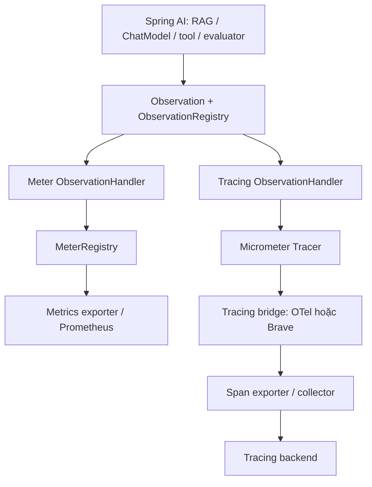
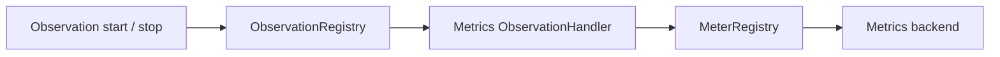
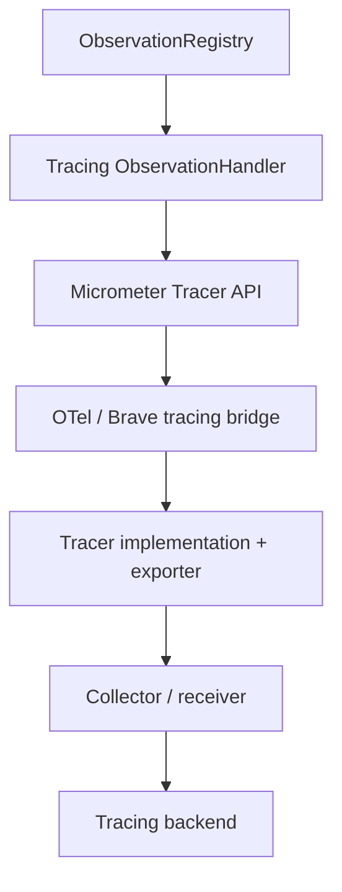
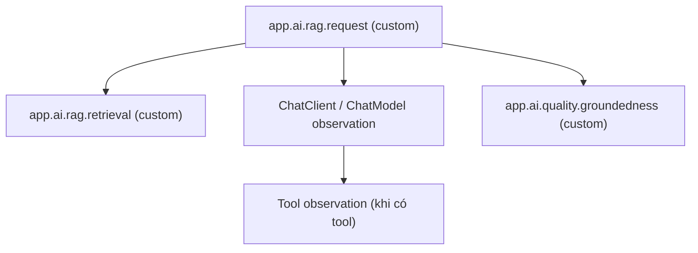

# ObservationRegistry, MeterRegistry và tracing bridge trong ứng dụng Spring AI

Khi một ứng dụng Spring AI trả lời chậm sau khi đổi model, nhóm phát triển thường hỏi: **Request mất bao lâu? Bước nào chậm? Trace có liên kết được tới truy xuất RAG và tool không?** Một `Observation` có thể mô tả hoạt động cần đo, nhưng không tự bảo đảm rằng duration sẽ xuất hiện trên Prometheus hoặc span sẽ tới tracing backend. Muốn thiết kế observability đúng, cần hiểu rõ **`ObservationRegistry`**, **`MeterRegistry`** và **tracing bridge** làm những nhiệm vụ khác nhau như thế nào.

Bài này thuộc chương **Nền tảng quan sát** trong module **SPRING_AI_EVALUATION_OBSERVABILITY**. Module hướng tới đánh giá chất lượng ứng dụng Spring AI bằng tập dữ liệu, relevance, fact checking và kiểm thử RAG/tool calling; đồng thời dùng metrics, traces, chi phí và độ trễ để phát hiện nguyên nhân suy giảm giữa các phiên bản prompt, model và pipeline.

Tư tưởng cốt lõi: **ObservationRegistry nhận và điều phối lifecycle; MeterRegistry quản lý các phép đo; tracing bridge kết nối Micrometer Tracing với tracer cụ thể.** Tất cả đều phục vụ quan sát kỹ thuật, không tự xác nhận tác vụ nghiệp vụ thành công hoặc câu trả lời AI chính xác.

## 1. Kết quả học tập

Sau bài này, bạn có thể:

1. Giải thích vai trò của `Observation`, `ObservationRegistry`, `ObservationHandler`, `MeterRegistry`, `Tracer` và tracing bridge.
2. Phân biệt việc **instrument một hoạt động** với việc **lưu được metric** hay **xuất được distributed trace**.
3. Cấu hình hướng metrics qua Prometheus và hướng traces qua OpenTelemetry/OTLP trong Spring Boot với dependency tương thích.
4. Viết Java dùng Observation API và MeterRegistry để đo custom RAG/evaluation mà không đếm trùng.
5. Dùng trace ID/span ID, parent context, low/high cardinality attributes và context propagation đúng mục đích.
6. Phân biệt lỗi kỹ thuật, verdict chất lượng và trạng thái nghiệp vụ từ kết quả công cụ.
7. Phân tích các triệu chứng như “có metrics nhưng không có traces”, “spans rời nhau” và “p95 tăng sau thay prompt”.

## 2. Kiến trúc tổng thể: một Observation, nhiều tuyến xuất



Sơ đồ mô tả một **hệ thống có đủ các thành phần đã cấu hình**, không phải lời hứa rằng chỉ thêm một dependency là mọi mũi tên hoạt động. Trên thực tế có thể chỉ có metrics, chỉ có traces, cả hai hoặc chưa có đường xuất.

| Thành phần | Trách nhiệm | Không phải là |
|---|---|---|
| **`ObservationRegistry`** | Quản lý handlers, conventions, filters và các sự kiện vòng đời Observation. | Kho time series hoặc tracing backend. |
| **`MeterRegistry`** | Đăng ký counter, timer, gauge, distribution summary; cung cấp phép đo cho registry/exporter. | Bộ quản lý parent-child trace. |
| **`ObservationHandler`** | Chuyển `onStart/onStop/onError/...` thành cập nhật metric, span hoặc xử lý tùy chỉnh. | Business rule validator. |
| **`Micrometer Tracer`** | API tạo/truy cập span, scope và trace context theo Micrometer Tracing. | Collector hay công cụ hiển thị traces. |
| **Tracing bridge** | Adapter từ Micrometer Tracing tới triển khai OTel/Brave. | Exporter hoặc nguồn chân lý giao dịch. |
| **Exporter/Collector** | Chuyển dữ liệu đến backend quan sát. | Model evaluator hoặc công cụ xác nhận nghiệp vụ. |

### 2.1. Ví dụ xuyên suốt

Người dùng hỏi: “Đơn ORD-1042 của tôi đã được hoàn tiền chưa?” Ứng dụng:

1. Kiểm tra quyền xem đơn.
2. Truy xuất chính sách RAG, nếu cần.
3. Gọi `lookupRefundStatus`.
4. Sinh câu trả lời bằng model.
5. Kiểm tra lời đáp có nhất quán với kết quả công cụ không.

Các tín hiệu:

```text
Observation       app.ai.support.request
Child observation app.ai.rag.retrieval
Child observation app.ai.quality.tool_consistency
Meter             request duration, tool timeout count, verdict count
Span              request -> retrieval -> model -> tool -> evaluation
Verified outcome  refund.status = PENDING
```

Nếu tool trả `PENDING`, **không được nói “Đã hoàn tiền”** chỉ vì trace của lời gọi tool thành công ở tầng kỹ thuật.

## 3. ObservationRegistry: nơi điều phối vòng đời quan sát

`ObservationRegistry` thuộc Micrometer Observation. Một `Observation` biểu diễn một hoạt động có tên và metadata, thường thực hiện các thao tác:

```text
createNotStarted -> start -> openScope
                 -> event / error (nếu có)
                 -> closeScope -> stop
```

Registry có thể chứa:

- **Observation handlers:** nhận lifecycle và chuyển thành metrics, tracing hoặc hành vi tùy chỉnh.
- **Observation conventions:** chuẩn hóa tên, contextual name và low/high-cardinality key-values.
- **Observation predicates/filters:** quy định phép quan sát nào được xử lý và cách sửa context theo cấu hình.
- **Scope/current observation:** hỗ trợ liên kết các hoạt động lồng nhau khi có integration phù hợp.

**Lưu ý:** scope không phải vòng đời hoàn chỉnh. `Scope.close()` khôi phục context hiện hành; `Observation.stop()` mới kết thúc hoạt động và cho handlers biết để hoàn thành timer/span.

### 3.1. Ví dụ Java tạo Observation

```java
import io.micrometer.observation.Observation;
import io.micrometer.observation.ObservationRegistry;

public final class RetrievalService {
    private final ObservationRegistry observations;

    public RetrievalService(ObservationRegistry observations) {
        this.observations = observations;
    }

    public String retrieve(String question) {
        return Observation
            .createNotStarted("app.ai.retrieval", observations)
            .lowCardinalityKeyValue("feature", "policy-qa")
            .observe(() -> authorizedSearch(question));
    }

    private String authorizedSearch(String question) {
        // Minh họa: triển khai thật cần xác thực và truy xuất nguồn.
        return "Context được cấp quyền";
    }
}
```

`.observe(...)` giúp thực hiện start, mở scope, chạy lambda, báo exception khi có và kết thúc observation theo API Micrometer. Nó thích hợp cho đoạn mã **đồng bộ**. Với streaming hoặc callback bất đồng bộ, cần đo theo lifecycle thực tế thay vì chỉ bọc thao tác tạo publisher.

### 3.2. Có Observation nhưng không có signal

```java
ObservationRegistry registry = ObservationRegistry.create();

Observation.createNotStarted("app.ai.demo", registry)
    .observe(() -> doWork());
```

Nếu registry này **không có handler metrics/tracing**, đoạn code vẫn chạy nhưng không có timer/span mong muốn. Khi dùng Spring Boot đã có auto-configuration, đừng tạo registry cô lập rồi mong metrics/traces tự xuất hiện ở các registry do Boot quản lý.

### 3.3. Hai cách instrument

| Tình huống | Cách triển khai |
|---|---|
| Bao một thao tác đồng bộ, không cần mốc riêng | `Observation.createNotStarted(...).observe(() -> work())`. |
| Cần event giữa các bước, điều khiển scope | Quản lý `start/openScope/event/error/stop` thủ công. |
| Cần đo số lần occurrence độc lập | `Counter` trực tiếp qua `MeterRegistry`. |
| Cần thông tin thời gian và quan hệ trace | Observation với handlers metrics + tracing thích hợp. |
| Công việc bất đồng bộ hoặc streaming | Instrument theo điểm bắt đầu/hoàn tất thực tế và cơ chế propagation. |

## 4. MeterRegistry: quản lý số đo và time series

`MeterRegistry` là API lõi của Micrometer Metrics. Nó quản lý các loại meter:

| Meter | Ý nghĩa | Ví dụ trong ứng dụng Spring AI |
|---|---|---|
| **Counter** | Số lần tăng tích lũy. | Số tool timeout hoặc số case evaluation FAIL. |
| **Timer** | Số lần và duration của operation. | Thời gian retrieval, model và validator. |
| **DistributionSummary** | Phân bố giá trị không nhất thiết là thời gian. | Số chunk dùng hoặc số token. |
| **Gauge** | Giá trị đang quan sát. | Số job đang chờ, hàng đợi xử lý. |
| **LongTaskTimer** | Thời gian các tác vụ kéo dài khi còn chạy. | Pipeline xử lý lâu hoặc job asynchronous. |

Một meter được đăng ký theo **tên và tập tags**. Backend Prometheus, OTLP metrics hoặc registry khác xác định cách dữ liệu được xuất ra. `MeterRegistry` **không tự tạo distributed spans**.

### 4.1. Ví dụ Counter và Timer trực tiếp

```java
import io.micrometer.core.instrument.MeterRegistry;
import io.micrometer.core.instrument.Timer;
import java.util.concurrent.TimeUnit;

public final class AiMetrics {
    private final MeterRegistry meters;

    public AiMetrics(MeterRegistry meters) {
        this.meters = meters;
    }

    public void recordToolTimeout(String registeredToolName) {
        // Tên tool phải thuộc danh sách hữu hạn do ứng dụng định nghĩa.
        meters.counter("app.ai.tool.timeout",
                "tool", registeredToolName)
            .increment();
    }

    public void recordEvaluationDuration(long elapsedNanos) {
        Timer.builder("app.ai.evaluation.duration")
            .tag("criterion", "groundedness")
            .register(meters)
            .record(elapsedNanos, TimeUnit.NANOSECONDS);
    }
}
```

Đo trực tiếp qua Meter API có ích cho counter dựa trên kết quả có cấu trúc hoặc số liệu riêng. Nếu một operation đã được Observation + metrics handler đo duration, tránh tự ghi Timer **cho cùng ngữ nghĩa và cùng nhãn** dẫn tới double count.

### 4.2. Counter không thay thế evaluation verdict

Counter `app.ai.quality.cases{criterion="groundedness",verdict="fail"}` cần được tăng **sau khi phép chấm thực sự trả FAIL**. Một `Observation` chạy thành công chỉ chứng minh evaluator thực thi; không chứng minh answer đạt chất lượng.

```text
Technical execution: SUCCESS
Quality verdict:     FAIL
Business outcome:    UNKNOWN
```

Ba kết quả khác nhau có thể tồn tại trong cùng một request. Dữ liệu quality phải dựa trên rubric/gold facts; dữ liệu business phải dựa vào backend có thẩm quyền.

### 4.3. Kiểm soát cardinality

Metric tags phải có tập giá trị tương đối nhỏ và ổn định:

```text
criterion = relevance | groundedness | correctness
verdict   = pass | fail | needs_review | error
tool      = lookupOrder | cancelBooking | searchDocuments
feature   = policy-qa | order-support
```

Không đưa `userId`, `traceId`, `caseId` duy nhất, raw question, ID giao dịch hoặc nguyên URL tài liệu vào metric tags. Mỗi kết hợp nhãn tạo thêm time series, có thể gây nổ cardinality, tăng chi phí và rủi ro lộ dữ liệu. Những ID chi tiết phù hợp hơn với **log/trace hoặc evaluation store có phân quyền**.

## 5. Metrics handler: kết nối ObservationRegistry với MeterRegistry



Trong Spring Boot Actuator, auto-configuration có thể lắp các thành phần metrics này khi dependency và cấu hình phù hợp. Với Micrometer thuần, có thể đăng ký handler thủ công.

### 5.1. Ví dụ cấu hình thủ công chỉ tạo metrics

```java
import io.micrometer.core.instrument.MeterRegistry;
import io.micrometer.core.instrument.simple.SimpleMeterRegistry;
import io.micrometer.core.instrument.observation.DefaultMeterObservationHandler;
import io.micrometer.observation.Observation;
import io.micrometer.observation.ObservationRegistry;

MeterRegistry meters = new SimpleMeterRegistry();
ObservationRegistry observations = ObservationRegistry.create();

observations.observationConfig().observationHandler(
    new DefaultMeterObservationHandler(meters)
);

Observation.createNotStarted("app.ai.retrieval", observations)
    .lowCardinalityKeyValue("feature", "policy-qa")
    .observe(() -> doVectorSearch());

long count = meters.get("app.ai.retrieval")
    .tag("feature", "policy-qa")
    .timer()
    .count();
```

Ví dụ giả định `doVectorSearch()` là hàm đã triển khai; `SimpleMeterRegistry` lưu kết quả trong bộ nhớ để demo/unit test, **không tự xuất Prometheus hoặc OTLP**. Đoạn này không có tracing handler/bridge, nên không có trace.

### 5.2. Một observation, nhiều handlers

```text
Observation "app.ai.retrieval"
  -> metrics ObservationHandler -> Timer trong MeterRegistry
  -> tracing ObservationHandler -> Span qua Micrometer Tracer
  -> custom handler (nếu có) -> diagnostic event
```

Các handlers được đăng ký qua `ObservationRegistry` và có thể giới hạn việc nhận context theo `supportsContext`. Nếu registry có handler nhưng handler không hỗ trợ context, hoặc observation bị lọc, dữ liệu vẫn có thể không xuất ra như dự kiến.

## 6. Tracing bridge: Micrometer Tracing tới OpenTelemetry hoặc Brave

Micrometer Tracing cung cấp các khái niệm `Tracer`, `Span`, scope và context propagation. **Bridge** là adapter tới một tracer implementation. Hai lựa chọn thường gặp:

- **`micrometer-tracing-bridge-otel`:** sử dụng OpenTelemetry.
- **`micrometer-tracing-bridge-brave`:** sử dụng Brave.

Trong một cấu hình thông thường, chọn **một con đường tracing nhất quán**. Không thêm đồng thời hai bridge chỉ vì muốn “nhiều trace hơn” nếu không có thiết kế cụ thể cho việc đó.



**Phân biệt:**

1. **Tracing ObservationHandler** nhận start/stop/scope của Observation và tạo/hoàn thành spans.
2. **Bridge** thực hiện Micrometer Tracing API bằng tracer cụ thể.
3. **Exporter/Collector** chuyển spans tới backend.

Nếu thiếu một trong các phần cần thiết, có thể có Observation và metrics nhưng dashboard trace vẫn trống.

### 6.1. TraceId, SpanId và OperationId

| ID | Dùng cho | Có nên làm metric tag? |
|---|---|---|
| `traceId` | Xem các spans của một request có liên kết. | Không, cardinality rất cao. |
| `spanId` | Phân biệt một bước trong trace. | Không. |
| `requestId` | Liên kết HTTP/log của một yêu cầu. | Không. |
| `evaluationCaseId` | Đối chiếu kết quả một case regression. | Không; nên dùng evaluation store/log. |
| `operationId` | Tra trạng thái cuối một giao dịch nghiệp vụ. | Không; cần tồn tại ngoài trace. |
| `toolName` | Nhóm các lời gọi công cụ hữu hạn. | Có thể, nếu được kiểm soát giá trị. |

**TraceId không thay thế operationId.** Một giao dịch bất đồng bộ có thể tiếp tục sau khi trace HTTP kết thúc, hoặc xuất hiện trong nhiều traces khác nhau.

### 6.2. Truyền context qua HTTP và hàng đợi

Khi ứng dụng gọi microservice qua HTTP, tracing thường cần propagation headers. Với OpenTelemetry, W3C Trace Context (ví dụ `traceparent`) là một chuẩn thường gặp. Việc truyền ngữ cảnh phụ thuộc **instrumentation của client/server** và cấu hình, không tự xảy ra chỉ vì đã thêm thư viện bridge.

```text
Chat API trace T
  -> tool orchestration span S1
     -> HTTP client span S2 + propagated context
        -> order service span S3 (cùng trace T nếu cấu hình đúng)
           -> database span S4
```

Nếu HTTP client không được instrument hoặc header không tới service đích, S3 có thể thành root span của trace khác.

### 6.3. Async/Reactive và context propagation

`Observation.Scope` thường gắn với execution context hiện hành. Không mặc định `ThreadLocal` tự truyền qua `CompletableFuture`, executor, queue hoặc Reactor. Cần cơ chế tương thích như Micrometer Context Propagation, Reactor Context hay instrumentation của runtime. Với tác vụ bất đồng bộ không phù hợp quan hệ cha-con, **span links** có thể phản ánh mối liên hệ đúng hơn.

Với **streaming ChatModel**, bọc Observation chỉ quanh thao tác *tạo* `Flux` không bảo đảm đo đến khi stream hoàn tất. Hãy instrument từ lúc subscribe tới terminal event, hoặc dùng instrumentation có sẵn phù hợp phiên bản Spring AI/Reactor.

### 6.4. Sampling và khả năng thiếu trace

Trace có thể được lấy mẫu để giảm chi phí. Không thấy trace **không chứng minh request không xảy ra**. Metrics counters/timers nên được đo theo phương pháp phù hợp cho toàn lưu lượng; nếu suy tỷ lệ từ sampled traces, phải hiểu phương pháp sampling và mẫu số.

## 7. Cấu hình với Spring Boot Actuator

Trong ứng dụng Spring Boot, cách phổ biến là để **Actuator/auto-configuration** tạo các beans, metrics handler, tracer và bridge từ dependency/cấu hình tương thích. Đoạn dưới mang tính **minh họa cho hệ Spring Boot 3.x**; các starter/artifact và property có thể thay đổi theo phiên bản Spring Boot/Spring AI, nên đối chiếu tài liệu của phiên bản đã ghim trước khi áp dụng.

### 7.1. Dependencies minh họa

```xml
<dependencies>
    <dependency>
        <groupId>org.springframework.boot</groupId>
        <artifactId>spring-boot-starter-actuator</artifactId>
    </dependency>

    <!-- Đường metrics Prometheus -->
    <dependency>
        <groupId>io.micrometer</groupId>
        <artifactId>micrometer-registry-prometheus</artifactId>
    </dependency>

    <!-- Chọn một tracing bridge: ví dụ OpenTelemetry -->
    <dependency>
        <groupId>io.micrometer</groupId>
        <artifactId>micrometer-tracing-bridge-otel</artifactId>
    </dependency>

    <!-- Đường gửi traces qua OTLP -->
    <dependency>
        <groupId>io.opentelemetry</groupId>
        <artifactId>opentelemetry-exporter-otlp</artifactId>
    </dependency>
</dependencies>
```

Phiên bản của các dependency nên được quản lý bằng **BOM tương thích của Spring Boot/Spring AI**. Các dependency model provider, vector store và tool service phải thêm riêng theo dự án. Không cần thêm Brave bridge song song với OTel bridge trong cấu hình trên.

### 7.2. Application YAML minh họa

```yaml
spring:
  application:
    name: support-ai

management:
  endpoints:
    web:
      exposure:
        include: health,info,prometheus
  tracing:
    sampling:
      probability: 1.0
  otlp:
    tracing:
      endpoint: http://localhost:4318/v1/traces
```

Ở các phiên bản hỗ trợ cấu hình này:

- `/actuator/prometheus` giúp Prometheus scrape metrics khi đã có registry và endpoint đúng.
- `management.otlp.tracing.endpoint` định hướng trace exporter tới một receiver OTLP/HTTP phù hợp.
- Xác suất sampling `1.0` hữu ích trong **development/test**; production cần tính tới chi phí, throughput, privacy.

**Không mở Actuator ra Internet công khai**. Cần kiểm soát mạng, authentication và authorization cho các endpoints. Trong container/Kubernetes, `localhost` chỉ đúng nếu collector nằm trong network namespace thích hợp; nếu không phải dùng hostname/service thực tế. Các property nêu trên không thay thế kiểm tra version compatibility.

### 7.3. Hai tuyến xuất riêng biệt

```text
Metrics:
  Observation -> meter handler -> MeterRegistry
  -> /actuator/prometheus -> Prometheus -> dashboard

Traces:
  Observation -> tracing handler -> Tracer/bridge
  -> OTLP exporter -> collector/backend -> trace UI
```

**Prometheus endpoint không xuất trace**; exporter OTLP traces cũng không tự xuất mọi metrics sang OTLP. Nếu cần OTLP metrics thay cho Prometheus, cấu hình một metric registry/exporter thích hợp.

## 8. Ví dụ thực tế: custom Observation và quality metric trong Spring AI

Spring AI có thể cung cấp observations cho `ChatClient`, `ChatModel`, tool calling và một số thành phần khác theo phiên bản. **Không giả định mọi API và provider phát cùng một tên observation hoặc cùng thuộc tính**. Hãy dùng observations có sẵn cho lời gọi model/tool và thêm custom observations ở ranh giới workflow còn thiếu.

### 8.1. Mã Java đo toàn workflow và đánh giá groundedness

```java
import io.micrometer.core.instrument.MeterRegistry;
import io.micrometer.observation.Observation;
import io.micrometer.observation.ObservationRegistry;
import org.springframework.ai.chat.client.ChatClient;

public final class ObservedRagService {

    public enum Verdict { PASS, FAIL, NEEDS_REVIEW }
    public record Evidence(String context, int chunkCount) {}

    public interface AuthorizedRetriever {
        Evidence retrieve(String question);
    }

    public interface GroundingJudge {
        Verdict evaluate(String question, String context, String answer);
    }

    private final ChatClient client;
    private final ObservationRegistry observations;
    private final MeterRegistry meters;
    private final AuthorizedRetriever retriever;
    private final GroundingJudge judge;

    public ObservedRagService(
        ChatClient client,
        ObservationRegistry observations,
        MeterRegistry meters,
        AuthorizedRetriever retriever,
        GroundingJudge judge
    ) {
        this.client = client;
        this.observations = observations;
        this.meters = meters;
        this.retriever = retriever;
        this.judge = judge;
    }

    public String answer(String question) {
        return Observation
            .createNotStarted("app.ai.rag.request", observations)
            .lowCardinalityKeyValue("feature", "policy-qa")
            .observe(() -> {

                Evidence evidence = Observation
                    .createNotStarted("app.ai.rag.retrieval", observations)
                    .lowCardinalityKeyValue("feature", "policy-qa")
                    .observe(() -> retriever.retrieve(question));

                if (evidence == null || evidence.context().isBlank()) {
                    return "Tôi chưa có nguồn phù hợp để xác nhận.";
                }

                String answer = client.prompt()
                    .system("""
                        Trả lời chỉ dựa trên CONTEXT được cấp phép.
                        Nếu thiếu bằng chứng, nêu giới hạn.
                        """)
                    .user(u -> u.text("""
                        QUESTION: {question}
                        CONTEXT: {context}
                        """)
                        .param("question", question)
                        .param("context", evidence.context()))
                    .call()
                    .content();

                if (answer == null || answer.isBlank()) {
                    throw new IllegalStateException("Empty model answer");
                }

                Verdict verdict = Observation
                    .createNotStarted("app.ai.quality.groundedness", observations)
                    .lowCardinalityKeyValue("criterion", "groundedness")
                    .observe(() -> judge.evaluate(
                        question, evidence.context(), answer));

                // Đếm chất lượng, không nhầm với execution duration.
                meters.counter("app.ai.quality.cases",
                    "criterion", "groundedness",
                    "verdict", verdict.name().toLowerCase())
                    .increment();

                return verdict == Verdict.PASS
                    ? answer
                    : "Tôi chưa đủ căn cứ để xác nhận nội dung này.";
            });
    }
}
```

**Phạm vi ví dụ:** `AuthorizedRetriever` và `GroundingJudge` là **interface tự thiết kế**, không phải classes mặc định của Spring AI. Retriever thật phải lọc theo quyền và phiên bản dữ liệu. Judge cần rubric, nguồn có thẩm quyền và xử lý lỗi/timeouts riêng. Nếu judge ném exception, Observation có thể ghi lỗi kỹ thuật, nhưng phải ghi `EVALUATION_ERROR` trong báo cáo chấm và không tự coi đáp án đạt hoặc sai.

Custom Observation `app.ai.rag.request` đo **toàn workflow**; các observations mặc định (nếu có) của `ChatClient`/`ChatModel` đo bước bên trong. Không tạo hai timers cùng tên/tags cho cùng một operation rồi hiểu nhầm lượng request tăng gấp đôi.

### 8.2. Sơ đồ một trace có thể thu được



Đây là **sơ đồ khái niệm**, không phải khẳng định mọi trace thực tế có cấu trúc y hệt. Advisor có thể truy xuất trong nội bộ lời gọi client; cần mở trace của phiên bản đang chạy để biết quan hệ span thực.

## 9. Correlation logs với Tracer và trace context

Khi đã có tracing, có thể lấy span hiện hành qua Micrometer Tracer:

```java
import io.micrometer.tracing.Span;
import io.micrometer.tracing.Tracer;
import org.slf4j.Logger;
import org.slf4j.LoggerFactory;

public final class EvaluationLog {
    private static final Logger log =
        LoggerFactory.getLogger(EvaluationLog.class);
    private final Tracer tracer;

    public EvaluationLog(Tracer tracer) {
        this.tracer = tracer;
    }

    public void record(String criterion, String verdict) {
        Span current = tracer.currentSpan();
        String traceId = current == null
            ? "not_available" : current.context().traceId();
        log.info("criterion={}, verdict={}, traceId={}",
            criterion, verdict, traceId);
    }
}
```

Ứng dụng Spring Boot có thể tự đưa `traceId`/`spanId` vào MDC/log pattern khi cấu hình correlation phù hợp. Khi đó không cần ghi ID thủ công ở từng câu log. Nếu `currentSpan()` là `null`, hãy điều tra sampling/scope/tracing configuration; **không tự phát minh ID rồi gọi đó là distributed trace**.

### 9.1. Log/trace nên giữ gì?

| Dữ liệu | Lưu ở đâu? | Lưu ý |
|---|---|---|
| Tên model, feature, criterion, outcome | Metrics và trace/log khi số giá trị có hạn. | Dùng naming conventions nhất quán. |
| Case ID, trace ID, operation ID | Trace/log/evaluation store có kiểm soát quyền. | Không đưa vào metric tag. |
| Độ trễ và token usage | Metric tổng hợp và dữ liệu per-call khi cần. | Ghi đơn vị, nguồn usage, thời điểm đo. |
| Bản raw prompt/response | Chỉ ở kho được phép, ẩn/redact khi cần. | Có nguy cơ chứa PII, API keys, nội dung mật. |
| Kết quả tool cuối | Backend/operation store, kèm metadata truy vết. | Không dùng span status làm nguồn chân lý. |

## 10. Metrics, traces, evaluation record và business outcome

| Dữ liệu | Câu hỏi chính | Ví dụ |
|---|---|---|
| **Metric** | Bao nhiêu lần, xu hướng, độ trễ phân bố? | p95, model timeout rate, groundedness pass rate. |
| **Trace** | Request này chạy qua những spans nào, bước nào chậm? | Retrieval 240 ms, model 1.200 ms, tool 300 ms. |
| **Log** | Lỗi hoặc quyết định tại điểm xử lý có chi tiết gì? | `WARN tool timeout`, mã lỗi đã chuẩn hóa. |
| **Evaluation record** | Claim nào sai, thiếu nguồn, không đáp ứng rubric? | `caseId`, gold facts, expected/actual answer. |
| **Verified business outcome** | Hành động thật đã hoàn thành chưa? | `RefundCompleted` hoặc trạng thái backend `FAILED`. |

Không gộp **technical execution success**, **quality verdict PASS** và **business task success** vào một nhãn duy nhất.

### 10.1. Một tool span OK vẫn có thể là lỗi nghiệp vụ

```json
{
  "tool": "cancelBooking",
  "operationId": "CXL-501",
  "bookingId": "BK-102",
  "httpStatus": 200,
  "businessStatus": "FAILED",
  "reasonCode": "BOOKING_ALREADY_STARTED"
}
```

HTTP 200/technical span OK cho biết lời gọi trả response hợp lệ. Nhưng backend xác nhận hủy **thất bại**. Nếu assistant trả “Đã hủy thành công”, evaluation phải ghi `tool_result_consistency=FAIL`, dù Observation của tool không có exception.

### 10.2. Chỉ số nên đo

- **Technical reliability:** model errors, tool timeouts, retry count.
- **Quality:** relevance, groundedness và factual correctness trên dataset có nguồn chuẩn.
- **Output compliance:** JSON/schema pass rate và business constraint violations.
- **Task outcome:** verified success, partial, failure và unknown từ backend.
- **Latency:** p50/p95 end-to-end, retrieval/model/tool/evaluator duration.
- **Cost:** input/output tokens và estimated cost per *resolved task*.

Các quality metrics thường do nhóm **tự xây dựng**; chỉ thêm tracing bridge không làm chúng tự xuất hiện.

## 11. Latency, token usage và cost: giới hạn của observability

Một `Timer` đo duration theo một ranh giới xác định. Khi thiết kế dashboard, cần rõ:

- **End-to-end**: từ lúc nhận request tới khi trả xong theo hợp đồng API.
- **Retrieval**: query, rerank và chuẩn bị context theo ranh giới instrument.
- **Model**: thời gian tương tác model theo semantics provider.
- **Tool**: thời gian gọi công cụ/backend, tính cả retry hay không phải định nghĩa rõ.
- **Evaluation**: thời gian judge/fact checker/validator.

**Không cộng p95 của các công đoạn** để suy ra p95 request vì các phân vị có thể đến từ những request khác nhau. Spans có thể lồng nhau hoặc song song, nên tổng duration spans cũng không nhất thiết bằng end-to-end latency.

### 11.1. Chi phí token

Một số provider cung cấp token usage, nhưng không phải mọi hình thức streaming hoặc model đều báo giống nhau. Với giá theo 1 triệu token, ước lượng đơn giản:

\[
\operatorname{ModelCost}
=\frac{T_{\mathrm{in}}P_{\mathrm{in}}
+T_{\mathrm{out}}P_{\mathrm{out}}}{10^6}
\]

Phải cộng các khoản chi phí liên quan nếu có: embeddings, reranker, tool, evaluation judge và cached tokens/tier pricing theo bảng giá đúng thời điểm. **Duration của Observation không phải hóa đơn sử dụng model.**

### 11.2. Cost per resolved task

\[
\operatorname{CostPerResolvedTask}
=\frac{\text{tổng chi phí các request thuộc tập đo}}
{\text{số tác vụ hoàn tất hợp lệ}}
\]

Nếu không có tác vụ được giải quyết, ghi `N/A`. Tác vụ hoàn tất phải được xác nhận bằng tiêu chí task success hoặc backend có thẩm quyền, không dựa vào lời assistant hay `Observation.stop()`.

## 12. Hai cấu hình phổ biến

### 12.1. Metrics-only

```text
ObservationRegistry
  -> metrics handler
    -> MeterRegistry
      -> Prometheus/metrics backend
```

Có thể có duration/count nhưng **không có distributed trace**. Điều đó là bình thường nếu chưa cấu hình tracing.

### 12.2. Metrics + tracing

```text
ObservationRegistry
  |-> metrics handler -> MeterRegistry -> metrics
  |-> tracing handler -> Micrometer Tracer -> bridge -> exporter -> spans
```

Đây là cách liên kết một instrumented operation với cả dashboard và trace. Hai tuyến vẫn có retention, sampling và quyền truy cập độc lập.

## 13. Troubleshooting theo triệu chứng

| Triệu chứng | Khả năng nguyên nhân | Điều cần kiểm tra |
|---|---|---|
| Metrics hiện nhưng traces trống | Thiếu bridge/handler/exporter hoặc traces bị sampling. | Dependencies, Tracer bean, observation handler, sampler, collector/backend. |
| Có Observation nhưng không có timer | Registry không có metrics handler hoặc meter/endpoint không được export. | Registry bean, meter name/tags, handler, scrape. |
| Spans RAG bị tách thành traces khác nhau | Mất context qua HTTP/executor/queue. | Propagation headers, scope, client/server instrumentation. |
| Trace của streaming quá ngắn | Đo lúc tạo publisher, không đo đến completion. | Subscribe/termination và reactive instrumentation. |
| Tool trả FAILED nhưng error metric không tăng | Business rejection không phải exception. | Ghi tool outcome riêng với technical errors. |
| Timer đếm trùng | Instrument thủ công cùng operation đã có handler/framework timer. | Meter names, tags, ranh giới hoạt động. |
| Dashboard chậm vì hàng triệu series | `traceId`, `userId`, request hash là metric tags. | Cardinality và nhãn hữu hạn. |
| Trace xuất trong SDK nhưng không hiện backend | Endpoint, TLS/auth, network, collector sai. | Exporter và collector logs, receiver/protocol. |
| Không thấy request cụ thể trong traces | Sampling hoặc export bị lỗi. | Metrics/logs và trace sampling configuration. |
| p95 tăng sau đổi prompt | Prompt/context dài, provider latency, retries, judge. | Traces theo phiên bản, token usage, used context, evaluation records. |

### 13.1. Thứ tự chẩn đoán

1. Observation có thực sự start/stop hoặc `observe(...)` chưa?
2. Code inject đúng registry do ứng dụng cấu hình, không phải registry cô lập chứ?
3. Metrics handler và `MeterRegistry` có meter/endpoint đúng không?
4. Tracing handler, tracer, bridge và exporter có tồn tại không?
5. Sampling/network/collector có nhận spans không?
6. Scope/context propagation có bảo toàn quan hệ cha-con không?
7. Khi kết quả kỹ thuật và nghiệp vụ khác nhau, có đối chiếu nguồn có thẩm quyền chưa?

Đừng sửa prompt chỉ vì trace thiếu; trước hết xác minh đây là **lỗi instrumentation**, không phải lỗi chất lượng.

## 14. Kiểm thử wiring bằng Micrometer thuần

Để kiểm tra tuyến Observation → MeterRegistry, dùng `SimpleMeterRegistry` thay vì phải dựng Prometheus:

```java
import io.micrometer.core.instrument.MeterRegistry;
import io.micrometer.core.instrument.simple.SimpleMeterRegistry;
import io.micrometer.core.instrument.observation.DefaultMeterObservationHandler;
import io.micrometer.observation.Observation;
import io.micrometer.observation.ObservationRegistry;

MeterRegistry meters = new SimpleMeterRegistry();
ObservationRegistry observations = ObservationRegistry.create();
observations.observationConfig().observationHandler(
    new DefaultMeterObservationHandler(meters)
);

Observation.createNotStarted("app.ai.test.retrieval", observations)
    .lowCardinalityKeyValue("feature", "policy-qa")
    .observe(() -> {
        // Workload kiểm thử, không tác động production.
    });

long count = meters.get("app.ai.test.retrieval")
    .tag("feature", "policy-qa")
    .timer()
    .count();

// Trong JUnit: assertEquals(1L, count);
```

Test này chứng minh **metrics handler đã ghi một timer**. Nó không chứng minh Tracer hoặc exporter hoạt động.

### 14.1. Test tracing cần kiểm tra gì?

- Spans đúng tên, duration và attributes được mong đợi.
- Parent-child span lồng nhau đúng khi cùng scope.
- HTTP client/server truyền trace context qua service khác.
- Executor/reactive giữ correlation theo thiết kế.
- Exceptions được đánh dấu và stop/close scope đúng.
- Collector/exporter có nhận dữ liệu và sampling không che test case.

Nên dùng test exporter/backend giả lập tương thích phiên bản, không cần gọi công cụ có tác động thật. Với tool calling, dùng fixture trả `SUCCEEDED`, `FAILED`, `PENDING`, `UNKNOWN` để kiểm tra logic lời đáp riêng với tracing.

## 15. Hồi quy prompt/model/pipeline: kết hợp métrics, trace và evaluation

Giả sử cùng tập 100 câu hỏi RAG (số liệu **minh họa**):

| Chỉ số | Baseline A | Candidate B | Giả thuyết cần kiểm tra |
|---|---:|---:|---|
| p95 end-to-end | 1,7 s | 2,8 s | B chậm hơn ở model hay retrieval? |
| p95 retrieval | 250 ms | 270 ms | Chênh nhỏ; cần xem những ca chậm. |
| Input tokens trung bình | 2.300 | 5.700 | Context/prompt dài hơn. |
| Groundedness pass | 95% | 88% | B có nhiều claim không được hỗ trợ. |
| Tool timeout rate | 2% | 2% | Không có dấu hiệu tăng chung. |
| Estimated cost/request | 0,7 đơn vị | 1,2 đơn vị | B đắt hơn. |

**Metric** chỉ ra xu hướng. **Trace** cho thấy nơi chậm trong từng request. **Evaluation record** cho biết claim nào sai và evidence nào bị thiếu. Cần so sánh cùng corpus snapshot, dataset, rubric, tải và điều kiện provider; không tự kết luận “token tăng là nguyên nhân duy nhất”.

### 15.1. Quy trình điều tra và chọn phiên bản

1. Cố định dataset, gold facts, tool fixture, corpus và rubric.
2. Ghi prompt version, model ID, pipeline version, judge version.
3. Chạy baseline/candidate cùng điều kiện nếu có thể.
4. Kiểm tra hard gates: quyền, schema, dữ kiện trọng yếu, tool-result consistency.
5. So quality score, cost, latency trong tập ứng viên hợp lệ.
6. Mở traces và logs những case suy giảm, đối chiếu context và kết quả tool.
7. Thay một nguyên nhân giả định và chạy lại holdout trước triển khai.

**Span “OK” không đồng nghĩa quality PASS hoặc task success.** Đừng lấy trạng thái kỹ thuật làm kết luận chọn model mới.

## 16. Dashboard, alerting và kiểm soát chi phí telemetry

| Dashboard | Metric chính | Đường điều tra |
|---|---|---|
| **Reliability** | Request error, tool timeout, retry, rate limit. | Tool spans, log lỗi, backend status. |
| **Latency** | p50/p95 request, retrieval, model, evaluation. | Trace critical path, input tokens, retries. |
| **Quality** | Relevance/groundedness/factual correctness pass rate. | Case report, gold evidence, prompt/corpus version. |
| **Tool correctness** | False-success claims, unknown/pending rate. | Operation ID, verified backend outcome. |
| **Cost** | Token usage, cost per request/resolved case. | Model/judge calls, reranker và tools. |

Alerts nên có **ngưỡng, khoảng đo, cỡ mẫu, feature, mức độ nghiêm trọng và hành động xử lý**. Ví dụ, cảnh báo p95 vượt SLO theo một workload xác định phải giúp nhóm mở được trace/log đại diện; một alert “AI chậm” không có phạm vi sẽ khó hành động.

### 16.1. Bảo mật và overhead

Metrics: giới hạn cardinality. Traces: lấy mẫu phù hợp, tránh tạo span cho từng token. Logs: hạn chế raw prompt và payload nhạy cảm. Evaluation: lưu bản ẩn dữ liệu và version để tái lập. Exporters: theo dõi queue/drop và thời gian gửi. Mọi lớp telemetry đều tiêu tốn CPU, bộ nhớ và I/O; quan sát không nên trở thành nguyên nhân gây latency tăng đáng kể.

## 17. Bài tập thực hành

Nhóm đang triển khai Spring AI với thông tin giả định:

```text
Dependencies:
  spring-boot-starter-actuator
  micrometer-registry-prometheus

Quan sát:
  /actuator/prometheus có app.ai.rag.request timer
  trace backend không có span RAG
  logs ở API có traceId
  tool service khác trace với API

Dataset đánh giá (100 case):
  groundedness pass giảm từ 94% xuống 85%
  p95 latency tăng từ 1,9s lên 2,7s
  tool gọi thành công ở tầng HTTP nhưng business status = FAILED
  assistant lại nói "Đã hủy thành công"
```

### Yêu cầu

1. Giải thích vì sao có duration metric nhưng vẫn có thể không có trace.
2. Nêu những lớp cần bổ sung từ Observation tới tracing backend.
3. Chỉ ra ba điểm kiểm tra khi span của tool service tách thành trace khác.
4. Vì sao HTTP 200 và span không lỗi không chứng minh hủy thành công?
5. Đề xuất ba metric và hai loại record để tìm nguyên nhân suy giảm groundedness/latency.
6. Vì sao `traceId` và `orderId` không nên làm Prometheus tags?
7. Lập thứ tự kiểm tra để so hai phiên bản mà không nhầm lỗi exporter với lỗi model.

### Gợi ý đáp án

**1.** Metrics có thể được sinh qua metrics handler và `MeterRegistry`, còn tracing bridge/handler/exporter chưa được cấu hình. Prometheus endpoint chỉ dành cho metrics.

**2.** Cần tracing observation handler, Micrometer Tracer, một bridge OpenTelemetry/Brave tương thích, exporter/collector và backend; kiểm tra sampling, propagation và endpoint. Spring Boot Actuator có thể auto-configure các thành phần khi dependencies phù hợp.

**3.** Kiểm tra HTTP client/server instrumentation, propagation headers, scope khi chuyển thread/executor, sampling và exporter ở hai dịch vụ. Không dùng chỉ log có `traceId` để chứng minh trace propagation đã chuẩn.

**4.** HTTP 200 phản ánh kỹ thuật đã nhận response; nếu payload `FAILED`, tác vụ nghiệp vụ thất bại. Assistant phải phản ánh verified tool result, không tự xác nhận thành công.

**5.** Metrics: p95 end-to-end, groundedness pass rate, input token usage hoặc tool timeout rate. Records: evaluation case kèm gold evidence và trace/log theo request/operation ID có quyền truy cập. Dùng trace để xác định bước chậm, dùng dữ liệu đánh giá để biết claim sai.

**6.** ID duy nhất gây high cardinality, tăng cost và có thể rò rỉ dữ liệu. Chúng phù hợp hơn trong logs/traces hoặc dữ liệu nghiệp vụ được bảo vệ.

**7.** Xác nhận pipeline telemetry hoạt động, cố định dataset/rubric/corpus, chạy baseline/candidate, so metrics, mở traces, đối chiếu quality verdict và business outcome, sau đó thử lại với thay đổi có kiểm soát.

## 18. Ghi nhớ

**`ObservationRegistry`** điều phối lifecycle Observation và các handlers. **`MeterRegistry`** quản lý số liệu như Counter/Timer/Gauge; muốn Observation tạo metrics cần đường metrics handler. **Tracing bridge** kết nối Micrometer Tracing với tracer cụ thể; để thấy spans phải có tracing handler, tracer, exporter và backend hoạt động. Trong Spring AI, hãy tận dụng observations có sẵn, bổ sung custom observations cho RAG/evaluation khi cần, quản lý cardinality và context propagation, đồng thời tách rõ **technical execution**, **quality verdict** và **verified business outcome**. Chỉ khi metrics/traces được ghi đúng mới có thể tin chúng để phân tích chất lượng, latency và chi phí qua các phiên bản.

### Tài liệu tham khảo

- [Micrometer — Observation Introduction](https://docs.micrometer.io/micrometer/reference/observation/introduction.html): `ObservationRegistry`, handlers và lifecycle.
- [Micrometer — Observation Components](https://docs.micrometer.io/micrometer/reference/observation/components.html): context, conventions, scope và events.
- [Micrometer — Meter Concepts](https://docs.micrometer.io/micrometer/reference/concepts.html): `MeterRegistry` và các loại meter.
- [Micrometer Tracing — Reference](https://docs.micrometer.io/tracing/reference/index.html): tracer, bridges và context propagation.
- [Spring Boot — Observability](https://docs.spring.io/spring-boot/reference/actuator/observability.html): auto-configuration và actuator.
- [Spring Boot — Metrics](https://docs.spring.io/spring-boot/reference/actuator/metrics.html): các metrics registries và exporters.
- [Spring AI — Observability](https://docs.spring.io/spring-ai/reference/observability/index.html): observability ChatClient/ChatModel/tool theo phiên bản.
- [OpenTelemetry — Traces](https://opentelemetry.io/docs/concepts/signals/traces/): span và distributed trace context.
