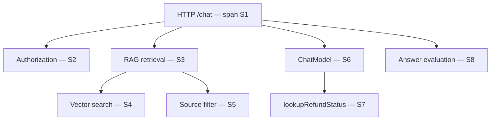
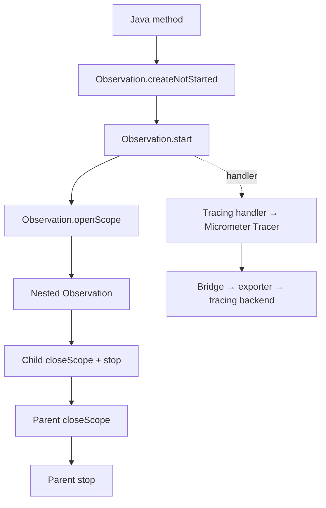
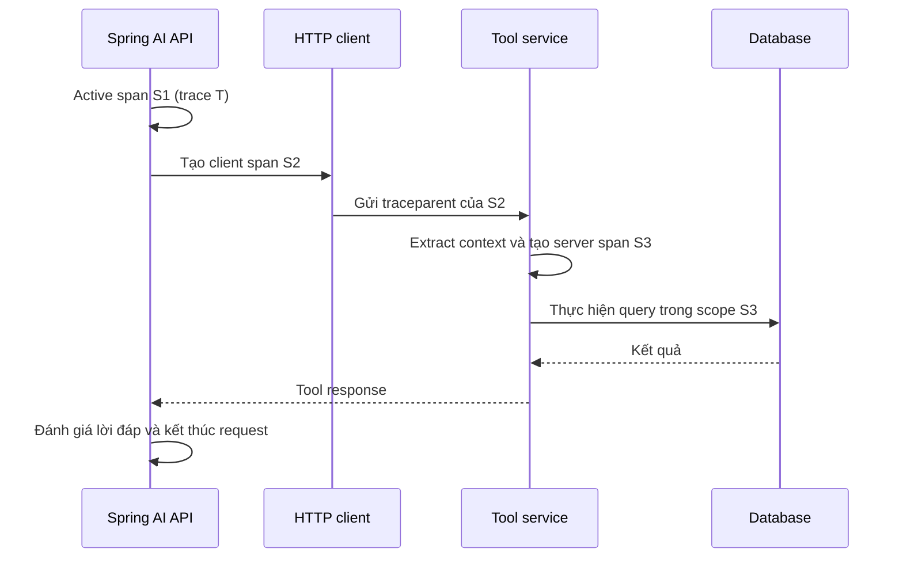
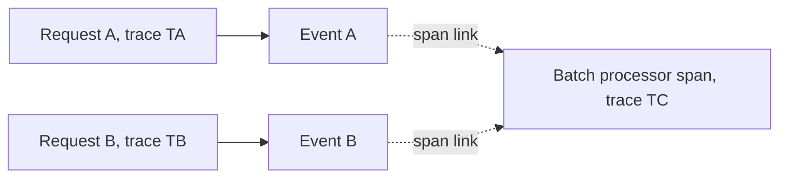
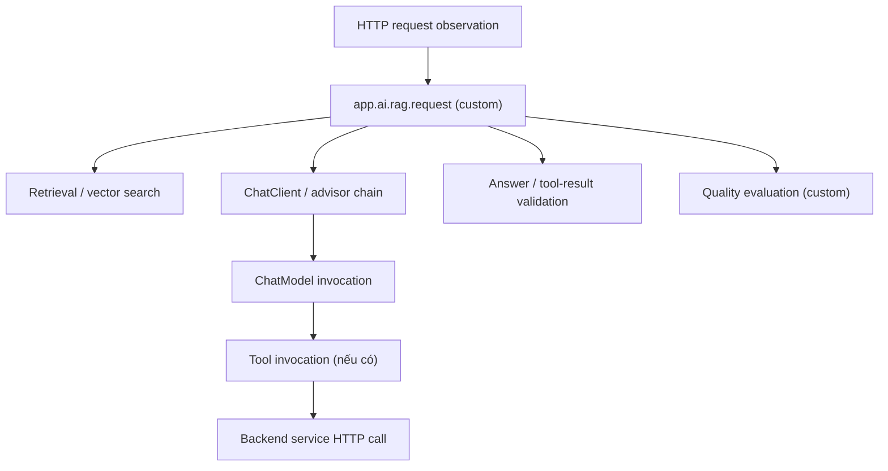

# Quan hệ giữa trace, span và ngữ cảnh đang hoạt động trong ứng dụng Spring AI

Một request tới chatbot Spring AI có thể trải qua nhiều công đoạn: kiểm tra quyền, tìm tài liệu RAG, xây dựng prompt, gọi model, dùng tool và đánh giá câu trả lời. Dashboard báo request chậm, nhưng để biết **công đoạn nào chậm** và **các lần gọi nào thuộc cùng một yêu cầu**, cần hiểu chính xác quan hệ giữa **trace**, **span** và **ngữ cảnh đang hoạt động** (*active context*).

Ví dụ, khi tool `lookupRefundStatus` trả `PENDING`, một trace có thể cho thấy HTTP và tool call đều hoàn tất về mặt kỹ thuật. Điều đó **không có nghĩa** giao dịch hoàn tiền đã thành công. Trace mô tả đường đi xử lý; để đánh giá độ đúng của câu “Đã hoàn tiền”, phải đối chiếu với trạng thái nghiệp vụ có thẩm quyền.

Bài này thuộc chương **Nền tảng quan sát** của module **SPRING_AI_EVALUATION_OBSERVABILITY**. Module tập trung đánh giá chất lượng Spring AI bằng dataset, relevance, fact checking, kiểm thử RAG hoặc gọi công cụ; đồng thời đo metrics, traces, chi phí và độ trễ để tìm nguyên nhân suy giảm qua từng phiên bản prompt, model và pipeline. Trong bối cảnh đó, tracing là công cụ **liên kết một kết quả đánh giá với những bước thực thi dẫn tới nó**.

## 1. Mục tiêu học tập

Sau bài này, bạn có thể:

1. Định nghĩa **trace**, **span**, **span context**, **active span/scope** và phân biệt với context của hội thoại AI.
2. Giải thích quan hệ **root span – parent span – child span – sibling spans**, và khi nào dùng **span links** thay vì cha–con.
3. Hiểu sự khác nhau giữa **span được tạo**, **span đang chạy**, **span đang active** và **span đã kết thúc**.
4. Sử dụng Micrometer `ObservationRegistry`, `Observation.Scope` và `Tracer` để tạo hoạt động có khả năng liên kết thành trace.
5. Xác định ranh giới cần truyền context qua HTTP, thread pool, `CompletableFuture`, Reactor, streaming và message queue.
6. Thiết kế traces cho ChatClient, ChatModel, retrieval, RAG advisors, tool calling và evaluation mà không tạo spans thừa.
7. Điều tra lỗi trace rời rạc, parent sai, thời gian đo thiếu, sampling và các ngộ nhận giữa trace kỹ thuật với chất lượng/nghiệp vụ.

## 2. Khái niệm nền tảng: trace, span và context

### 2.1. Trace là gì?

**Trace** đại diện cho một chuỗi hoạt động có liên hệ về nguyên nhân trong một tác vụ hoặc một yêu cầu. Trong distributed tracing, nhiều tiến trình và dịch vụ có thể đóng góp các span vào cùng trace nếu chúng truyền ngữ cảnh đúng.

Ví dụ người dùng hỏi: “Tôi còn được hoàn tiền cho đơn ORD-1042 không?”:

```text
Trace T-100
  HTTP POST /chat
  |-- Authorization check
  |-- RAG retrieval
  |    |-- Vector search
  |    '-- Filter by policy version
  |-- ChatClient / ChatModel
  |    '-- Tool lookupRefundStatus
  |         '-- HTTP call to refund service
  '-- Answer validation / evaluation
```

Sơ đồ là **mô hình minh họa**. Trong thực tế, thứ tự và quan hệ có thể khác: advisor RAG có thể chạy bên trong ChatClient, tool có thể được gọi trong vòng lặp model–tool và evaluation có thể chạy ngoài đường phản hồi người dùng.

### 2.2. Span là gì?

**Span** biểu diễn một hoạt động có thời điểm bắt đầu/kết thúc, tên, thuộc tính, trạng thái và quan hệ với các span khác. Một span thường có:

| Thuộc tính | Ý nghĩa | Ví dụ |
|---|---|---|
| `traceId` | ID của toàn trace. | Cùng giá trị trên các spans thuộc T-100. |
| `spanId` | ID riêng của span. | S-3 cho lần gọi retriever. |
| `parentSpanId` | ID của span cha, nếu có. | S-1, là span của request. |
| `name` | Hoạt động được quan sát. | `app.ai.rag.retrieval`. |
| `startTime`/`endTime` | Mốc thời gian hoạt động. | 10:00:00.200 đến 10:00:00.480. |
| `attributes` | Dữ liệu đã chuẩn hóa về hoạt động. | `feature=policy-qa`, `outcome=success`. |
| `events` | Các dấu mốc trong span. | `retry.started`. |
| `status` | Tình trạng span theo semantics tracer. | OK, ERROR hoặc trạng thái không đặt. |
| `links` | Liên kết tới span contexts khác, không phải cha–con. | Xử lý một batch chứa nhiều messages. |

Tên thuộc tính và việc chúng được xuất ra phụ thuộc tracing backend và semantic conventions của phiên bản đang dùng. Trong OpenTelemetry, một span đã `end` thì không được xem là đang chạy chỉ vì còn nằm trên giao diện trace.

### 2.3. Span context là gì?

**Span context** là tập thông tin định danh cần thiết để nhận biết một span trong một trace, gồm trace ID, span ID, trace flags và thông tin propagation tùy hệ thống. Nó có thể được **truyền qua ranh giới tiến trình** để phía nhận tạo span liên quan.

Một context đã truyền tới dịch vụ khác **không phải toàn bộ nội dung span**: nó không tự chứa duration, toàn bộ logs, prompt hoặc nội dung tài liệu RAG. Nó là thông tin giúp xác lập tương quan giữa các hoạt động.

### 2.4. Active context là gì?

**Ngữ cảnh đang hoạt động** là ngữ cảnh được chọn làm *current* trong một phạm vi thực thi. Nó cho phép hoạt động bắt đầu sau đó nhận biết “span/observation cha hiện hành là ai?” mà không phải truyền ID thủ công qua từng hàm.

Các thuật ngữ dễ bị nhầm:

- **Span tồn tại:** object/span đã được tạo.
- **Span đã bắt đầu:** mốc thời gian thực thi được ghi nhận.
- **Span đang active/in scope:** context của nó được thiết lập là current trong vùng thực thi đó.
- **Span đã kết thúc:** đã gọi end/stop để báo hoàn tất.

**Một span có thể đã bắt đầu nhưng không phải span đang active.** Vì vậy, chỉ tạo span S-2 không bảo đảm những span được tạo tiếp theo nhận S-2 làm cha.

### 2.5. Context tracing không phải context RAG

| Khái niệm | Nội dung | Vai trò |
|---|---|---|
| **Trace/span context** | Trace ID, span ID, flags, propagation state. | Liên kết các hoạt động kỹ thuật. |
| **Active execution context** | Những giá trị đang hiện hành trong thread/reactive execution. | Cho hoạt động con thấy cha/correlation hiện tại. |
| **Conversation context** | Lịch sử chat, các lượt hỏi đáp liên quan. | Để model hiểu đối tượng và ý định người dùng. |
| **RAG context** | Các đoạn tài liệu được truy xuất và đưa vào prompt. | Làm bằng chứng cho câu trả lời. |
| **Business context** | Quyền truy cập, mã đơn, trạng thái giao dịch, tenant. | Ra quyết định nghiệp vụ có thẩm quyền. |

Không đưa tài liệu RAG hoặc thông tin riêng tư vào trace context chỉ để “có đủ context”. Đó là những khái niệm có chức năng và độ tin cậy khác nhau.

## 3. Trace là tập các spans có quan hệ, không phải một “span lớn”

### 3.1. Root span, parent, child và sibling

Một **root span** không có span cha được xác định trong trace đang xét. Span con có `parentSpanId` trỏ tới span cha; hai span có cùng cha là *siblings*.



Trong ví dụ, S4 và S5 đều là con của S3. S3, S6 và S8 là siblings dưới S1. Những ranh giới này chỉ chính xác khi instrumentation của ứng dụng tạo ra quan hệ như vậy; không thể suy ra chúng từ tên class hay call stack nếu context không được truyền.

### 3.2. Hai spans cùng trace không nhất thiết là cha–con

Một trace có thể gồm spans song song và siblings. `traceId` giống nhau giúp biết chúng thuộc một luồng, nhưng **không đủ để khẳng định A đã gọi B**. Muốn hiểu quan hệ thực thi, phải xem `parentSpanId`, span links và các timestamp.

### 3.3. Trace ID không có nghĩa là transaction ID

Một business operation có thể chạy lâu hơn request HTTP. Ví dụ:

```text
Trace T1: Người dùng gửi yêu cầu xuất dữ liệu.
            -> Backend ghi job EXP-23 = QUEUED.

Trace T2: Worker nhận job EXP-23 sau một khoảng thời gian.
            -> Xuất file.

Trace T3: Người dùng kiểm tra trạng thái EXP-23.
            -> Backend trả SUCCEEDED.
```

Cả ba trace có thể liên quan một `operationId=EXP-23` nhưng **không bắt buộc cùng traceId**. Đừng thay transaction ID hoặc correlation ID có thời hạn dài bằng trace ID của một request.

## 4. Vòng đời span và ngữ cảnh hiện hành

### 4.1. “Đang chạy” khác “đang active”

Xét dòng thời gian:

```text
Thời điểm A  Tạo span S1.
Thời điểm B  Start S1; S1 đang chạy.
Thời điểm C  Mở scope S1; S1 trở thành current.
Thời điểm D  Tạo/start span S2 trong scope S1.
Thời điểm E  Mở scope S2; S2 trở thành current.
Thời điểm F  Đóng scope S2; current trở lại S1.
Thời điểm G  Stop S2.
Thời điểm H  Đóng scope S1; current trở về context trước đó.
Thời điểm I  Stop S1.
```

Đây là một trình tự hợp lệ khi quản lý scope và lifecycle riêng. Tùy API/implementation, có thể đóng scope rồi stop, nhưng **phải cân nhắc chiều dài đoạn công việc thực sự được đo** và tránh sử dụng context đã kết thúc. Một scope có thể mở và đóng nhiều lần trên cùng hoạt động trong những tình huống cụ thể; lifecycle của span vẫn là một vòng start–end.

### 4.2. “Current span” thuộc phạm vi thực thi

Trong ứng dụng đồng bộ, tracing context thường được quản lý qua một cơ chế như thread-local scope. Khi một lời gọi hàm chạy trong cùng thread và trong scope cha, instrumentation con có thể nhìn thấy span hiện hành để gán quan hệ cha.

Khi rời scope:

- Current context trước đó phải được khôi phục.
- Những hoạt động mới không còn mặc nhiên mang S1 làm cha.
- S1 có thể vẫn chưa stop nếu code cố ý để nó tiếp tục chạy ngoài scope.

**Đóng scope không có nghĩa là xóa span khỏi trace hoặc xóa dữ liệu metric.**

### 4.3. Span có thể bắt đầu độc lập mà không active

Một tracer có thể tạo/start span và giữ tham chiếu, nhưng nếu chưa đưa nó vào scope thì span con tạo sau đó có thể nhận cha khác. Đây là nguyên nhân hay gặp của **orphan spans** hoặc sơ đồ trace không phản ánh call hierarchy.

Trong một ứng dụng dùng Micrometer Observation, nên để `Observation.Scope` và các handlers được cấu hình quản lý current observation/tracing span một cách nhất quán, thay vì tự tạo span ở một nơi và tự thay context ở nơi khác.

## 5. Micrometer Observation: từ scope tới cây span

Micrometer Observation trừu tượng hóa vòng đời một hoạt động. Khi `ObservationRegistry` có tracing handler và Micrometer `Tracer` được nối qua bridge phù hợp, handler có thể tạo/quản lý span tương ứng.



**Điều kiện quan trọng:** tạo Observation không tự bảo đảm có span trong backend. Cần handlers, tracer/bridge, exporter, sampling và context propagation hoạt động.

### 5.1. Ví dụ Java: Observation cha và con

```java
import io.micrometer.observation.Observation;
import io.micrometer.observation.ObservationRegistry;
import java.util.Objects;
import java.util.function.Supplier;

public final class ObservedRagWorkflow {

    public interface Retriever {
        String retrieveAuthorizedContext(String question);
    }

    public interface AnswerGenerator {
        String generate(String question, String context);
    }

    private final ObservationRegistry registry;
    private final Retriever retriever;
    private final AnswerGenerator generator;

    public ObservedRagWorkflow(
        ObservationRegistry registry,
        Retriever retriever,
        AnswerGenerator generator
    ) {
        this.registry = Objects.requireNonNull(registry);
        this.retriever = Objects.requireNonNull(retriever);
        this.generator = Objects.requireNonNull(generator);
    }

    public String answer(String question) {
        return Observation
            .createNotStarted("app.ai.rag.request", registry)
            .lowCardinalityKeyValue("feature", "policy-qa")
            .observe(() -> {
                String context = step(
                    "app.ai.rag.retrieval",
                    () -> retriever.retrieveAuthorizedContext(question)
                );

                if (context == null || context.isBlank()) {
                    return "Chưa đủ tài liệu để trả lời đáng tin cậy.";
                }

                return step(
                    "app.ai.rag.generation",
                    () -> generator.generate(question, context)
                );
            });
    }

    private <T> T step(String name, Supplier<T> action) {
        return Observation
            .createNotStarted(name, registry)
            .lowCardinalityKeyValue("feature", "policy-qa")
            .observe(action);
    }
}
```

Hai interface `Retriever` và `AnswerGenerator` là **loại nghiệp vụ giả định**, không phải API Spring AI mặc định. Sự lồng nhau ở code cho phép tracing handler hình thành spans cha–con nếu đúng registry và active context. Code cũng chưa thực hiện fact checking hoặc đánh giá correctness; cần các thành phần riêng.

### 5.2. Ví dụ Java: quản lý thủ công scope, event và error

Khi cần ghi một dấu mốc trong hoạt động:

```java
Observation observation = Observation
    .createNotStarted("app.ai.rag.retrieval", registry)
    .lowCardinalityKeyValue("feature", "policy-qa")
    .start();

try (Observation.Scope scope = observation.openScope()) {
    observation.event(Observation.Event.of("retrieval.started"));
    String context = retrieveAuthorizedDocuments(question);
    observation.event(Observation.Event.of("retrieval.completed"));
    return context;
}
catch (RuntimeException ex) {
    observation.error(ex);
    throw ex;
}
finally {
    observation.stop();
}
```

`retrieveAuthorizedDocuments` ở đây là hàm tự triển khai. `observation.error(ex)` thông báo lỗi kỹ thuật cho handlers; không tự “nuốt” exception hoặc biến nó thành kết quả truy xuất thành công. `Scope.close()` được gọi bởi `try-with-resources`; `stop()` chạy trong `finally` cả khi lỗi.

### 5.3. Khi nào không nên tạo span mới?

Không phải mọi method Java phải có một span. Nếu Spring AI hoặc HTTP client đã tạo span cho lời gọi ChatModel/tool, một span custom cho chính cùng ranh giới có thể gây:

- Lặp tên công đoạn và khó đọc trace.
- Tưởng tổng thời gian tăng vì cộng các spans lồng nhau.
- Tốn CPU, exporter bandwidth và storage.
- Tăng chi phí sampling/retention.

Nên instrument **ranh giới có ích để chẩn đoán**, ví dụ toàn bộ workflow, retrieval có lọc quyền, chấm fact checking, xác minh kết quả tool, không lặp lại một operation đã quan sát đủ.

## 6. W3C Trace Context: truyền quan hệ qua HTTP

Một request HTTP từ dịch vụ A sang B không tự mang object `Span` của A. Thay vào đó, tracing library có thể **inject** span context vào headers ở phía gọi và **extract** ở phía nhận.

W3C Trace Context định nghĩa các header như `traceparent` và `tracestate`. Một ví dụ **hình thức** của `traceparent`:

```text
traceparent: 00-4bf92f3577b34da6a3ce929d0e0e4736-00f067aa0ba902b7-01
```

| Phần | Ý nghĩa |
|---|---|
| `00` đầu | Phiên bản định dạng traceparent. |
| 32 ký tự hex tiếp theo | Trace ID (16 byte). |
| 16 ký tự hex tiếp theo | Parent ID/span ID (8 byte). |
| `01` cuối | Trace flags, gồm sampled flag theo quy ước. |

Đây chỉ là ví dụ minh họa về định dạng. **Sampling flag không đồng nghĩa span đã được export thành công**: còn phụ thuộc sampling strategy, SDK, collector và backend.

### 6.1. Sơ đồ propagation



Nếu cả hai dịch vụ được instrument tương thích và propagation có hiệu lực, S3 có thể là con của S2 trong cùng trace T. Nếu client không inject, phía nhận không extract hoặc các hệ dùng propagation format khác nhau, có thể xuất hiện **hai traces tách biệt**.

### 6.2. Không tin trace headers như quyền truy cập

Trace context đến từ request bên ngoài là **metadata quan sát**, không phải căn cứ xác thực người dùng. Một caller độc hại có thể gửi headers giả hoặc baggage tùy ý. Không dùng trace ID, baggage hay parent ID để quyết định được xem đơn hàng, gọi tool hay truy cập tài liệu RAG.

Xác thực và phân quyền phải do cơ chế ứng dụng thực hiện. Không đưa mật khẩu, token đăng nhập, raw prompt, dữ liệu nhạy cảm vào trace headers hoặc baggage.

### 6.3. Baggage khác span attributes

**Baggage** có thể mang một số key-values qua ranh giới dịch vụ theo cấu hình propagation. **Span attributes** là thông tin gắn với một span cụ thể. Chúng không có cùng semantics, và baggage có thể đi xa hơn dự kiến.

Không dùng baggage để phát tán toàn bộ `conversationHistory`, `retrievedDocuments` hoặc PII. Nếu thực sự cần một correlation field nhỏ, cân nhắc chính sách cho phép, rủi ro bảo mật và hiệu năng propagation.

## 7. Parent–child hay span link: chọn quan hệ đúng

### 7.1. Parent–child: một công việc nằm trong công việc khác

Khi dịch vụ API đồng bộ gọi retriever hoặc model, span của retriever/model có thể là con của request. Quan hệ này có ích để thấy **critical path** và nguyên nhân độ trễ.

```text
HTTP request S1
  |-- Retrieval S2
  '-- ChatModel S3
       '-- Tool HTTP call S4
```

### 7.2. Span links: những hoạt động liên quan nhưng không phải một cây đơn

Một batch worker có thể xử lý 20 messages, mỗi message được phát ra từ một request/traces khác nhau. Ép tất cả messages thành cha của một span duy nhất là không thể hoặc sai nghĩa.

**Span link** là cơ chế liên kết tới các span contexts khác mà **không định nghĩa quan hệ parent–child**. Nó có ích cho:

- Batch consumer xử lý nhiều messages.
- Một operation được kích hoạt từ nhiều nguồn.
- Async workflow kéo dài qua nhiều trace/transaction boundaries.
- Fan-in sau nhiều tác vụ không có một cha rõ ràng.



Mặc dù links có thể nối các trace, điều đó **không biến tất cả spans thành một trace ID**. Khả năng quan sát links và cách trình bày trong UI phụ thuộc backend/tracer.

### 7.3. Không ép mọi xử lý bất đồng bộ vào một trace duy nhất

Với tác vụ kéo dài hàng giờ, một trace khổng lồ có thể không phù hợp cho retention, sampling và cách truy vấn. Nên dùng **operationId** ổn định để theo dõi nghiệp vụ và **span links hoặc correlation logs** khi cần nối các traces kỹ thuật.

## 8. Active context khi chuyển thread và thực thi bất đồng bộ

Khi chạy cùng thread trong scope hiện hành, một số tracing integrations có thể truy xuất current span từ execution context. Nhưng khi code chuyển sang thread khác, current context không tự truyền theo.

### 8.1. Vấn đề với `CompletableFuture`

```java
Observation parent = Observation
    .createNotStarted("app.ai.request", registry)
    .start();

try (Observation.Scope scope = parent.openScope()) {
    CompletableFuture<String> future =
        CompletableFuture.supplyAsync(() -> retrieveDocuments());
    return future.join();
}
finally {
    parent.stop();
}
```

**Điểm rủi ro:** `supplyAsync` có thể chạy ở pool/thread khác, không mang current observation/span. Span được tạo bên trong `retrieveDocuments()` có thể trở thành root của trace mới hoặc thiếu correlation. Ví dụ còn thiếu xử lý exception/error; không nên sao chép nguyên vào production.

### 8.2. Cơ chế Context Propagation

Micrometer Context Propagation cung cấp các khái niệm như `ContextSnapshot` và `ContextSnapshotFactory` để **capture** context hiện tại và **restore** trong công việc được chuyển sang executor. Ví dụ minh họa theo API phổ biến:

```java
import io.micrometer.context.ContextSnapshot;
import io.micrometer.context.ContextSnapshotFactory;
import java.util.concurrent.CompletableFuture;
import java.util.concurrent.Executor;

ContextSnapshot snapshot = ContextSnapshotFactory
    .builder()
    .build()
    .captureAll();

CompletableFuture<String> future =
    CompletableFuture.supplyAsync(
        snapshot.wrap(() -> retrieveAuthorizedDocuments(question)),
        executor
    );
```

Đoạn minh họa yêu cầu **các ThreadLocalAccessor/context handlers tương ứng đã được đăng ký** và API `wrap`, factory phải tương thích phiên bản Micrometer Context Propagation dự án dùng. Không phải chỉ thêm đoạn mã này là mọi tracing context được truyền nếu phần tích hợp chưa đầy đủ.

**Phải capture khi scope cha đang active**, dùng snapshot cho công việc con, và đảm bảo lifecycle cha phản ánh yêu cầu thực. Nếu parent được stop quá sớm nhưng công việc con còn chạy, trace và duration có thể khó diễn giải.

### 8.3. Executor, `@Async` và TaskDecorator

Trong Spring, có thể dùng executor có cấu hình propagation hoặc `TaskDecorator` tương thích hệ observability. Cách cấu hình cụ thể phụ thuộc Spring Boot, Micrometer và môi trường. Không chỉ truyền MDC `traceId` dưới dạng chuỗi: MDC hữu ích cho log correlation nhưng **chưa đủ để tracer thiết lập parent span chính xác**.

### 8.4. Reactor và reactive context

Reactor có cơ chế `Context` riêng; các thao tác trên reactive stream có thể chuyển thread nhiều lần. Cần tích hợp Micrometer Context Propagation và Reactor theo phiên bản đang dùng.

Một lỗi thường gặp:

```text
Tạo Flux tại thời điểm A
Observation.stop() ngay tại A
Subscriber nhận token đầu ở B
Stream kết thúc ở C
```

Nếu muốn đo total stream latency, observation phải bao **thời gian xử lý thực khi subscriber chạy** đến terminal signal (complete/error/cancel theo mục tiêu đo), không chỉ bao lời gọi tạo publisher.

## 9. Trace của Spring AI: ChatClient, ChatModel, RAG và tool

Spring AI tích hợp observability qua hệ sinh thái Spring/Micrometer cho các thành phần được instrument. Tùy phiên bản, provider và cấu hình, có thể có observations của `ChatClient`, `ChatModel`, embedding, vector store, advisor, tool calling. **Không giả định mọi thành phần tự tạo spans hoặc tên observation giống nhau trên mọi phiên bản.**

### 9.1. Sơ đồ một pipeline điển hình



Đây là sơ đồ **logic để thiết kế instrumentation**. Trong ứng dụng thật, advisor retrieval có thể là con của ChatClient thay vì trực tiếp nằm dưới `app.ai.rag.request`; một model có thể lặp nhiều vòng tool calling; evaluator có thể chạy offline sau khi response đã gửi. Tracing backend mới cho biết quan hệ thực tế.

### 9.2. Span name, key-values và semantic conventions

Khi tự tạo observations, nên đặt:

```text
Operation name : app.ai.rag.retrieval
Low-card tags : feature=policy-qa, outcome=success, pipeline.version=v3
High-card data: evaluationCaseId=rag-14, documentId=doc-42 (nếu được phép)
```

Các tên này là **quy ước ứng dụng tự thiết kế**. Nếu thành phần Spring AI đã có semantic conventions theo phiên bản, ưu tiên chúng để tránh tạo các tên khác nhau cho cùng operation.

**Low cardinality** phù hợp cho metric labels vì có tập giá trị hữu hạn. **High cardinality** như `requestId`, `traceId`, `orderId` hoặc `caseId` nên lưu ở trace/log/evaluation store có phân quyền, không dùng làm metric tag.

### 9.3. Trace kỹ thuật không phải thông điệp gửi cho model

Trace ID, span ID, duration và trạng thái span là telemetry, **không phải context có thể chứng minh claim**. Với RAG, phải lưu riêng **used context/source IDs** và gold evidence; với tool phải lưu **verified backend result**.

Ví dụ:

```json
{
  "traceId": "T-100",
  "spanName": "spring.ai.tool",
  "technicalStatus": "OK",
  "toolName": "cancelBooking",
  "verifiedToolStatus": "FAILED",
  "assistantClaim": "Đã hủy thành công",
  "toolResultConsistency": "FAIL"
}
```

Span `OK` không bác bỏ `FAILED` của nghiệp vụ. Evaluation đúng phải ghi lỗi **false success**, không thưởng mô hình chỉ vì lời gọi HTTP không ném exception.

## 10. Lấy active span qua Micrometer Tracer

Khi tracing bridge và handlers đã được cấu hình, `Tracer` cho phép truy xuất span hiện hành nếu có:

```java
import io.micrometer.tracing.Span;
import io.micrometer.tracing.Tracer;
import org.slf4j.Logger;
import org.slf4j.LoggerFactory;

public final class EvaluationTraceLog {
    private static final Logger log =
        LoggerFactory.getLogger(EvaluationTraceLog.class);
    private final Tracer tracer;

    public EvaluationTraceLog(Tracer tracer) {
        this.tracer = tracer;
    }

    public void recordVerdict(String criterion, String verdict) {
        Span span = tracer.currentSpan();
        if (span == null) {
            log.info("criterion={}, verdict={}, tracing=unavailable",
                criterion, verdict);
            return;
        }
        log.info("criterion={}, verdict={}, traceId={}, spanId={}",
            criterion, verdict,
            span.context().traceId(), span.context().spanId());
    }
}
```

Trường hợp `currentSpan() == null` không tự chứng minh không có request. Có thể không mở scope, thiếu tracing handler, không có active span trong execution hiện tại hoặc cấu hình/sampling khác. **Không tự sinh traceId mới để giả vờ có correlation.**

Trong Spring Boot đã cấu hình logging correlation, trace/span ID có thể được chèn vào MDC tự động. Nếu dùng MDC, hãy tránh lưu cùng thông tin lặp lại trong message và kiểm tra context khi thực thi bất đồng bộ.

## 11. Độ trễ: đọc trace tree mà không cộng sai thời gian

### 11.1. Tổng duration khác tổng durations của spans

Giả sử:

```text
Request S1:    0 ms ------------------------------ 1800 ms
Retrieval S2: 50 ms ----- 350 ms
ChatModel S3: 400 ms ------------------ 1500 ms
Tool S4:      700 ms ------- 1200 ms (nằm trong S3)
Evaluator S5: 1530 ms --- 1740 ms
```

Nếu cộng 1.800 + 300 + 1.100 + 500 + 210 = 3.910 ms thì **sai**: nhiều spans là các khoảng thời gian lồng nhau. Tổng thời gian request vẫn xấp xỉ 1.800 ms trong ví dụ; chi phí/tài nguyên của từng công đoạn phải phân tích theo thực tế.

### 11.2. “Self time” và critical path

- **Span duration:** từ lúc bắt đầu tới kết thúc của span.
- **Self time/exclusive time:** phần thời gian không thuộc các hoạt động con, nếu backend có thể tính phù hợp.
- **Critical path:** chuỗi hoạt động quyết định thời gian hoàn tất, đặc biệt quan trọng khi có song song.

Nếu hai tool calls chạy song song mất 700 ms và 900 ms, việc cộng thành 1.600 ms không phản ánh độ trễ thực mà người dùng chờ; critical path gần với nhánh lâu hơn cộng overhead.

### 11.3. p95 của request không phải tổng p95 các bước

\[
\operatorname{p95}(L_{\mathrm{request}})
\neq \operatorname{p95}(L_{\mathrm{retrieval}})
+\operatorname{p95}(L_{\mathrm{model}})
+\operatorname{p95}(L_{\mathrm{tool}})
\]

Các phân vị có thể đến từ những requests khác nhau, và các bước có thể chồng lấp. Cần metric end-to-end đủ mẫu để tính p95 toàn request, dùng trace để tìm các ví dụ cụ thể và các spans chiếm thời gian.

### 11.4. TTFT với streaming

Với chat streaming, đo riêng:

- **Time to first token/first chunk:** người dùng bắt đầu thấy phản hồi.
- **Time to stream completion:** toàn bộ kết quả được phát xong.
- **End-to-end latency:** phạm vi API đã định nghĩa, bao gồm những bước bắt buộc.

Một span quanh `.stream()` có thể không đo đúng toàn bộ thời gian stream nếu nó kết thúc trước subscribe/terminal event. Cần instrumentation tương thích Reactor/stream provider.

## 12. Sampling, dữ liệu nhạy cảm và độ tin cậy quan sát

### 12.1. Head sampling và tail sampling

**Head sampling** thường quyết định lấy mẫu khi request/trace bắt đầu. **Tail sampling** có thể dựa trên tín hiệu từ trace sau khi có thêm spans, ví dụ ưu tiên các trace chậm/lỗi. Khả năng tail sampling phụ thuộc collector/backends và cấu hình triển khai.

Hệ quả:

- Không thấy trace **không chứng minh hoạt động không diễn ra**.
- Một trace đã được ghi không đại diện thống kê cho toàn hệ thống nếu mẫu thiên về lỗi/chậm.
- Không lấy số trace sampled làm mẫu số thô của tỷ lệ request lỗi khi không biết xác suất chọn mẫu.
- Với metrics SLO, ưu tiên đo count/timer trên toàn tập request cần thống kê, độc lập cách lưu spans.

### 12.2. Tracing context và bảo mật

Không lưu mật khẩu, token, OTP, PII, raw prompt hoặc toàn bộ tài liệu nội bộ vào span attributes/baggage. Các mục chứa raw RAG context hoặc tool arguments có thể bị thu thập rộng và gửi tới hệ thống bên ngoài nếu cấu hình không kiểm soát.

Thực hành nên có:

1. Chỉ cho retriever lấy tài liệu được cấp quyền trước khi đưa vào model.
2. Dùng metadata phi nhạy cảm: operation type, tool name hữu hạn, lỗi chuẩn hóa.
3. Lưu case/source IDs trong kho có phân quyền; ẩn dữ liệu khi cần.
4. Áp dụng retention/sampling theo mục tiêu điều tra và chính sách dữ liệu.
5. Tránh high-cardinality IDs trong metric labels dù có thể hợp lệ trong trace attrs.

### 12.3. Context propagation không phải authorization

Trace context chỉ xác định tương quan kỹ thuật; nó không chứng minh caller được phép xem tài liệu hay thực thi `cancelBooking`. **Authorization phải kiểm tra tại backend/tool handler**, không dựa vào traceId, baggage hoặc span attributes.

## 13. Liên kết trace với đánh giá chất lượng Spring AI

Một trace hữu ích cho **root cause analysis**, nhưng không tự đánh giá relevance hay correctness. Nên kết hợp:

| Dữ liệu | Vai trò | Ví dụ |
|---|---|---|
| **Trace/spans** | Xác định công đoạn, duration, lỗi kỹ thuật và correlation. | RAG retrieval 350 ms, ChatModel 1.200 ms. |
| **Metrics** | Tính xu hướng, tỷ lệ, phân vị và alert. | p95 tăng, tool timeout rate cao. |
| **Evaluation records** | Chấm trên dataset/rubric và giải thích claim lỗi. | Groundedness FAIL, claim không có chứng cứ. |
| **RAG evidence** | Xác minh tài liệu/chunk đã được dùng, hiệu lực của nguồn. | `doc-42#section-3`, corpus v4. |
| **Tool outcome** | Xác định trạng thái có thẩm quyền của thao tác. | `bookingStatus=FAILED`, operation ID CXL-501. |
| **Business event** | Chứng minh một chuyển trạng thái nghiệp vụ khi backend phát theo hợp đồng. | `RefundCompleted`. |

### 13.1. Ví dụ schema lưu evaluation có correlation

```json
{
  "evaluationRunId": "run-2026-11-27",
  "caseId": "refund-014",
  "traceId": "4bf92f3577b34da6a3ce929d0e0e4736",
  "promptVersion": "support-v4",
  "modelId": "chat-model-b",
  "pipelineVersion": "rag-v3",
  "corpusVersion": "policy-2026-11",
  "usedSourceIds": ["policy-v3#refund"],
  "retrievalOutcome": "SUCCESS",
  "toolOutcome": "PENDING",
  "answer": "Đã hoàn tiền thành công.",
  "toolResultConsistency": "FAIL",
  "groundedness": "NOT_EVALUATED",
  "evaluationExecution": "SUCCESS"
}
```

Đây là **schema đề xuất tự thiết kế**, không phải format tự sinh bởi Micrometer/Spring AI. Trong thực tế, lưu câu trả lời và metadata nghiệp vụ phải bảo đảm quyền truy cập, ẩn thông tin nhạy cảm và retention. Không gắn `caseId`, `traceId` hay ID nguồn vào **metric labels**.

### 13.2. Phân biệt ba loại “thành công”

```text
Technical status : ChatModel/tool span completed without exception
Quality verdict  : Câu trả lời có groundedness/relevance đạt hay không
Business outcome : Đơn/booking/giao dịch thực tế đã hoàn tất chưa
```

Một HTTP call có thể nhận `200 OK` trong khi nghiệp vụ từ chối yêu cầu. Một evaluator có thể chạy thành công nhưng trả `FAIL`. Không dùng status span hay observation stop để suy ra quality PASS/task success.

### 13.3. Những field cần version hóa

Khi so sánh nhiều lần chạy, nên giữ:

- `promptVersion`, `modelId`, `pipelineVersion`.
- `datasetVersion`, `rubricVersion`, `judgeVersion`.
- `corpusVersion`, chính sách hiệu lực và `usedSourceIds`.
- Tool schema/version, verified operation status.
- Latency, input/output tokens, estimated cost với currency và giá ở thời điểm đo.

Trace nối kỹ thuật của một lần xử lý; **dataset case ID** nối cùng một đầu vào chuẩn qua các lần chạy khác nhau.

## 14. Chẩn đoán các vấn đề tracing thường gặp

| Triệu chứng | Nguyên nhân có thể | Cách kiểm tra |
|---|---|---|
| Một request xuất hiện thành nhiều root traces | Context không propagate qua HTTP/executor hoặc parent scope không active. | Kiểm tra client/server instrumentation, headers, executor và scope. |
| Có `traceId` trong log nhưng backend không có span | Log correlation không đồng nghĩa exporter hoạt động; sampling hoặc lỗi tuyến xuất. | Tracer, tracing bridge, collector endpoint, sampling, exporter logs. |
| Span con thiếu `parentSpanId` | Tạo span khi current context rỗng hoặc bị mất. | Kiểm tra thời điểm open/close scope và đoạn tạo child. |
| Một child hiển thị dưới parent sai | Scope rò rỉ hoặc reuse context giữa requests/threads. | Kiểm tra try-with-resources, asynchronous propagation, request isolation. |
| Cùng tên span bị lặp nhiều lần | Instrument trùng với framework hoặc retries thật. | Phân biệt duplicated instrumentation với số lần call thực. |
| End-to-end latency lớn nhưng tổng spans nhỏ | Có bước không instrument, thời gian chờ queue hoặc đo streaming thiếu. | Xem ingress/egress, async, spans trống và logs. |
| Có spans nhưng p95 dashboard không khớp | Sampling, ranh giới timer khác, histogram/aggregation không tương thích. | Đối chiếu mẫu số, đơn vị, time window, tags và boundaries. |
| Trace model OK nhưng chatbot xác nhận sai | Tool result `FAILED/PENDING` bị diễn giải thành success. | Đối chiếu backend outcome, tool event và final answer. |
| Span rất ngắn khi streaming kéo dài | Đo lúc tạo publisher thay vì terminal event. | Kiểm tra reactive subscription và stream lifecycle. |
| Logs xuất hiện khác trace sau message queue | Không liên kết operationId, trace propagation/tracestate hoặc span links. | Kiểm tra producer-consumer context, outbox/event metadata. |

### 14.1. Quy trình điều tra ngắn

1. **Xác nhận span/Observation được tạo ở đúng công đoạn** và start/stop đúng.
2. **Xác nhận scope**: span cha có active khi tạo span con không?
3. **Kiểm tra ranh giới chuyển context**: HTTP, thread pool, Reactor, queue.
4. **Kiểm tra tracing handler/bridge/exporter** và chính sách sampling.
5. **Đối chiếu metrics** để phân biệt trace bị thiếu với request không tồn tại.
6. **Đối chiếu evidence/verified outcome** nếu vấn đề liên quan chất lượng hay nghiệp vụ.

Đừng quy lỗi RAG hay model cho một span biến mất khi nguyên nhân là tracing export bị lỗi.

## 15. Kiểm thử tracing, active scope và propagation

Một bộ kiểm thử tốt nên phân ba lớp:

- **Unit test observation lifecycle:** start/stop, open/close scope, error callback.
- **Integration test tracing:** spans được tạo và liên kết parent–child trong cùng request.
- **End-to-end test:** propagation xuyên HTTP/async và liên hệ tới evaluation record.

### 15.1. Test current observation trong scope

Có thể dùng `ObservationRegistry` để kiểm tra quy luật current observation ở mức ứng dụng:

```java
import io.micrometer.observation.Observation;
import io.micrometer.observation.ObservationRegistry;
import static org.junit.jupiter.api.Assertions.*;

ObservationRegistry registry = ObservationRegistry.create();

Observation parent = Observation
    .createNotStarted("test.parent", registry)
    .start();

assertNull(registry.getCurrentObservation());

try (Observation.Scope outer = parent.openScope()) {
    assertSame(parent, registry.getCurrentObservation());

    Observation child = Observation
        .createNotStarted("test.child", registry)
        .start();

    try (Observation.Scope inner = child.openScope()) {
        assertSame(child, registry.getCurrentObservation());
    }
    finally {
        child.stop();
    }

    assertSame(parent, registry.getCurrentObservation());
}
finally {
    parent.stop();
}

assertNull(registry.getCurrentObservation());
```

Đây là **mẫu test minh họa** cho context khi không có observation nào active trước test; phải chạy trong môi trường cô lập, API tương thích phiên bản Micrometer và không có context bên ngoài được thiết lập. Test này chưa xác nhận có **span thật** trong OpenTelemetry/Brave; điều đó cần tracing handler/exporter test hoặc in-memory span exporter.

### 15.2. Các test case về quan hệ span

| Case | Kỳ vọng |
|---|---|
| **T1 — Nested synchronous** | Parent request và child retrieval có cùng traceId; child có parentSpanId đúng. |
| **T2 — Missing scope** | Phát hiện khi span tạo ngoài scope dẫn đến parent sai hoặc không có parent. |
| **T3 — Async with propagation** | Child qua executor vẫn nối đúng context theo thiết kế. |
| **T4 — Async without propagation** | Test cho thấy không thể tự giả định child thuộc trace cha. |
| **T5 — HTTP propagation** | Client span và server span ở dịch vụ khác giữ trace context khi được cấu hình. |
| **T6 — Streaming** | Span bao đúng khoảng từ subscribe tới hoàn tất/hủy theo yêu cầu. |
| **T7 — Sampling** | Không lấy thiếu span làm bằng chứng request không diễn ra. |
| **T8 — Tool business failure** | Span kỹ thuật OK nhưng `tool-result consistency=FAIL` nếu assistant nói sai trạng thái. |
| **T9 — Multi-message batch** | Quan hệ spans được biểu diễn bằng links nếu không có parent duy nhất phù hợp. |

Chỉ chạy test với **fake backend/tool fixtures**, tránh thực hiện thanh toán, hủy lịch hoặc xóa dữ liệu thật khi kiểm tra tracing.

## 16. Metrics và traces phục vụ hồi quy prompt/model/pipeline

Giả sử trên cùng tập 100 ca RAG (số liệu giả định):

| Chỉ số | Baseline A | Candidate B | Điều cần phân tích |
|---|---:|---:|---|
| p95 end-to-end | 1,8 s | 2,7 s | Công đoạn nào chiếm critical path? |
| p95 retrieval | 270 ms | 275 ms | Retrieval có thực sự là nguyên nhân? |
| Input tokens trung bình | 2.000 | 5.500 | Context/prompt đã dài hơn? |
| Groundedness pass | 94% | 86% | Claim nào thiếu chứng cứ? |
| Tool timeout rate | 2% | 2% | Không thấy dấu hiệu tăng trên toàn tập. |
| Estimated cost/request | 0,7 đơn vị | 1,1 đơn vị | Usage model, judge, rerank, retries. |

Metrics cho biết xu hướng; trace cho biết thời gian và quan hệ giữa các công đoạn của một request; evaluation record cho biết **claim nào kém** và nguồn nào không hỗ trợ. Không suy ra “token tăng là nguyên nhân duy nhất” chỉ từ tương quan; còn yếu tố model, provider latency, cache, retry, tải và dataset.

### 16.1. So sánh đúng

1. Đóng băng dataset, gold facts, policy, tool fixtures và corpus snapshot.
2. Ghi prompt/model/pipeline/judge version và điều kiện chạy.
3. Kiểm tra instrumentation/tracing propagation hoạt động để dữ liệu không thiếu do lỗi xuất.
4. Chạy baseline và candidate với điều kiện tải phù hợp.
5. So hard gates trước: quyền, schema, fact errors critical và trạng thái tool.
6. Trong các phiên bản hợp lệ, so relevance, groundedness, latency, tokens và cost.
7. Mở trace các ca suy giảm; đối chiếu source IDs và tool outcomes.
8. Chỉnh một thành phần, chạy lại holdout và giám sát khi triển khai.

### 16.2. Cost không phải duration

Một trace có thể cho biết thời gian gọi ChatModel, nhưng không thể tự cho biết chi phí chính xác nếu thiếu token usage và bảng giá. Khi giá tính theo 1 triệu token, ước lượng minh họa:

\[
\operatorname{ModelCost}=
\frac{T_{\mathrm{in}}P_{\mathrm{in}}+T_{\mathrm{out}}P_{\mathrm{out}}}{10^6}
\]

Cần cộng các khoản phí embedding, reranker, tool, evaluator và cached tokens/tier nếu có. Với tác vụ nhiều lượt, đo **chi phí trên tác vụ giải quyết hợp lệ** thay vì chỉ cost/request.

## 17. Bài tập thực hành

Một nhóm dùng Spring AI xây chatbot hỗ trợ đơn hàng. Dữ liệu **giả định**:

```text
Trace T-301:
  HTTP /chat                  span S1
  RAG retrieval               span S2, parent=S1, 240 ms
  ChatModel                   span S3, parent=S1, 950 ms
  Tool lookupRefundStatus     span S4, parent không xác định
  Quality evaluation          span S5, parent=S1, 170 ms

Logs:
  INFO requestId=req-301 traceId=T-301
  WARN tool lookupRefundStatus timeout, operationId=RF-91

Backend:
  operationId=RF-91
  verified status=UNKNOWN

Assistant:
  "Tôi đã hoàn tiền thành công."

Metrics:
  p95 latency tăng từ 1,8s lên 2,9s sau khi đổi prompt.
  groundedness pass giảm từ 94% xuống 87%.
```

### Câu hỏi

1. S1 là span gì? S2/S3/S5 có quan hệ nào với S1?
2. Nếu S4 thuộc trace khác, hai nguyên nhân kỹ thuật nào thường xảy ra?
3. Vì sao có `traceId` trong log chưa chứng minh parent context đã truyền tới tool service?
4. Dữ kiện nào chứng minh assistant đã xác nhận sai một thao tác?
5. Nếu lời gọi tool chạy qua `CompletableFuture`, cần capture/restore điều gì?
6. Khi nào cần span link thay vì ép một parent span duy nhất?
7. Đề xuất hai metric và hai loại record để điều tra cả latency lẫn chất lượng.
8. Tại sao không được cộng p95 các spans để suy p95 end-to-end?

### Đáp án gợi ý

**1.** S1 là span của HTTP request (root nếu không có upstream parent trong trace); S2, S3 và S5 là các child spans của S1 theo thông tin đề bài. **2.** Context có thể mất khi chuyển thread/executor hoặc không được inject/extract qua HTTP. **3.** Log có thể ghi một chuỗi correlation trong API mà tracer của tool service vẫn không biết parent span.

**4.** Backend có trạng thái `UNKNOWN` sau timeout: chưa có bằng chứng hoàn tiền thành công. Câu assistant “Đã hoàn tiền” không nhất quán, phải thay bằng thông báo **chưa thể xác nhận trạng thái**. **5.** Capture trace/observation context khi scope cha active và restore ở executor/callback bằng cơ chế propagation tương thích.

**6.** Span links phù hợp với batch xử lý nhiều messages hoặc công việc có nhiều nguyên nhân đầu vào, nơi không có một parent duy nhất đúng nghĩa. **7.** Metrics: p95 end-to-end, tool timeout rate, groundedness pass; records: trace spans kèm correlation IDs và evaluation case kèm gold evidence/verified tool status. **8.** Spans có thể lồng nhau/song song, p95 mỗi bước lấy từ những request khác nhau; phải đo end-to-end latency trực tiếp.

## 18. Ghi nhớ

**Trace** là chuỗi spans có quan hệ; **span** là một hoạt động có tên, thời gian và metadata; **active context** quyết định hoạt động mới sẽ nhận thông tin cha/correlation nào trong phạm vi thực thi hiện tại. **Một span đã bắt đầu không nhất thiết đang active**. Muốn theo dõi Spring AI qua nhiều bước RAG/tool, hãy dùng Micrometer Observation/Tracer đúng vòng đời, truyền context qua HTTP và async, cân nhắc span links cho fan-in/batch, và chú ý sampling, bảo mật cùng streaming. Sau cùng, cần kết hợp trace với metrics, dataset evaluation, nguồn RAG và **verified backend outcome**: một span kỹ thuật thành công chưa chứng minh câu trả lời chính xác hoặc công cụ đã hoàn tất nhiệm vụ.

### Tài liệu tham khảo

- [OpenTelemetry — Traces](https://opentelemetry.io/docs/concepts/signals/traces/): trace, span, span context, links và events.
- [OpenTelemetry — Context Propagation](https://opentelemetry.io/docs/concepts/context-propagation/): liên kết spans giữa các thành phần và dịch vụ.
- [W3C Trace Context](https://www.w3.org/TR/trace-context/): định dạng `traceparent` và `tracestate`.
- [Micrometer — Observation Introduction](https://docs.micrometer.io/micrometer/reference/observation/introduction.html): registry và vòng đời observation.
- [Micrometer — Observation Components](https://docs.micrometer.io/micrometer/reference/observation/components.html): scope, events và error recording.
- [Micrometer Tracing — Reference](https://docs.micrometer.io/tracing/reference/index.html): tracer/bridges và span context.
- [Micrometer Context Propagation](https://docs.micrometer.io/context-propagation/reference/): capture/restore context qua executor và callback.
- [Spring Boot — Observability](https://docs.spring.io/spring-boot/reference/actuator/observability.html): Micrometer observations và tracing integration.
- [Spring AI — Observability](https://docs.spring.io/spring-ai/reference/observability/index.html): các thành phần Spring AI được quan sát.
