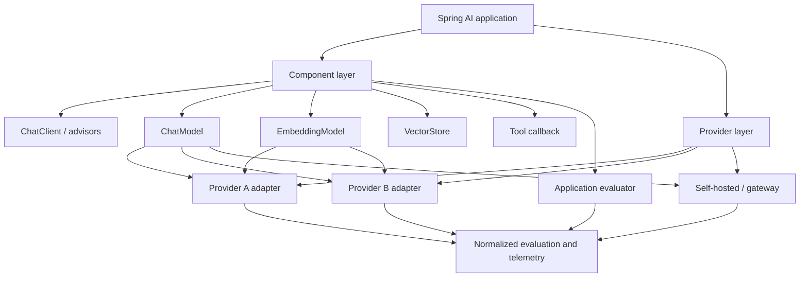
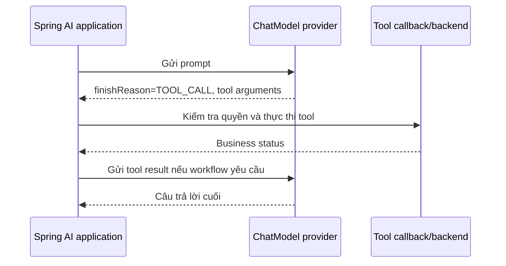
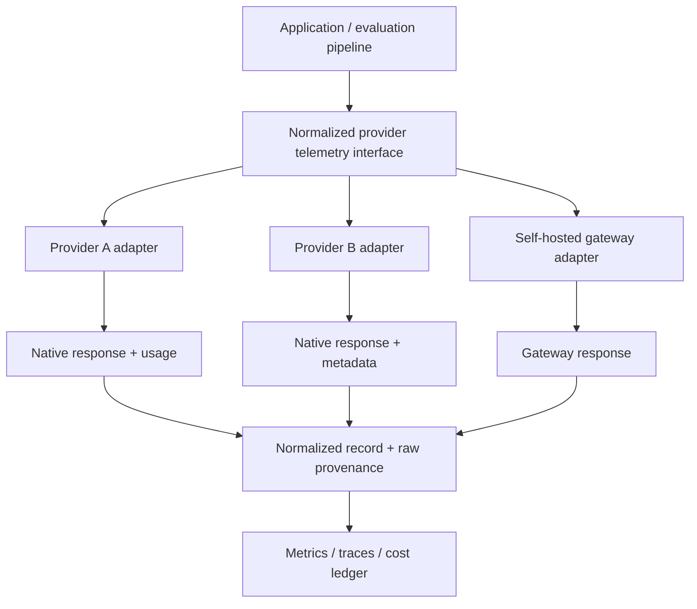

# Khả năng quan sát theo thành phần và nhà cung cấp trong Spring AI

Một ứng dụng Spring AI có thể gọi nhiều model, dùng nhiều vector store, chạy tool ở các dịch vụ khác nhau và chấm chất lượng bằng evaluator riêng. Khi chuyển từ provider A sang provider B, dashboard vẫn có thể hiển thị thời gian gọi model nhưng **token usage, finish reason, rate-limit metadata hoặc chi phí lại thiếu hay mang ý nghĩa khác**. Khi đó, so sánh hai provider bằng cùng một biểu đồ có thể dẫn tới kết luận sai.

Để đánh giá đúng, cần hiểu khả năng quan sát ở hai chiều:

- **Theo thành phần:** ChatClient, ChatModel, embedding model, vector store, advisor/retriever, tool callback, HTTP client và evaluator.
- **Theo nhà cung cấp:** mỗi model/provider có thể trả metadata, usage, trạng thái streaming, lỗi, giới hạn và thông tin định giá khác nhau.

Spring AI tạo một lớp API chung để ứng dụng làm việc với nhiều nhà cung cấp. Lớp trừu tượng đó giúp chuẩn hóa cách gọi, nhưng **không có nghĩa mọi provider đều cung cấp cùng dữ liệu quan sát**. Cần phân biệt trường chuẩn hóa có thể dùng chung, metadata đặc thù provider và dữ liệu mà ứng dụng phải tự đo.

Bài này thuộc chương **Nền tảng quan sát**, module **SPRING_AI_EVALUATION_OBSERVABILITY**. Module hướng tới đánh giá chất lượng ứng dụng Spring AI bằng dataset, relevance, fact checking, kiểm thử RAG/tool calling; đồng thời đo metrics, traces, chi phí và độ trễ để tìm nguyên nhân suy giảm giữa các phiên bản prompt, model và pipeline.

## 1. Mục tiêu học tập

Sau bài này, bạn có thể:

1. Lập bản đồ khả năng quan sát theo từng thành phần và từng provider đang được ứng dụng sử dụng.
2. Phân biệt dữ liệu chuẩn hóa từ abstraction Spring AI với metadata đặc thù của provider.
3. Xác định dữ liệu nào thường có ở ChatModel, embeddings, vector store, tool, HTTP client và evaluator.
4. Thiết kế schema chung cho model ID, token usage, finish reason, latency, lỗi và cost mà không làm mất thông tin gốc.
5. Xử lý trường hợp provider không trả usage, streaming chỉ có usage ở chunk cuối, retry hoặc response bị cắt.
6. So sánh provider/model bằng cùng dataset và quy tắc đo, tránh so sánh các số liệu không tương đương.
7. Xây custom instrumentation cho những khoảng trống quan sát và kiểm thử hợp đồng adapter theo provider.
8. Giữ an toàn cho prompt, response, tool arguments, metadata và dữ liệu RAG trong logs/traces.

## 2. Hai chiều quan sát: component và provider

**Quan sát theo thành phần** trả lời: hoạt động nào trong pipeline đang chạy, mất bao lâu và lỗi ở đâu? **Quan sát theo provider** trả lời: model/service cụ thể cung cấp những metadata nào, usage được tính ra sao và giới hạn nào đang tác động?



Một provider có thể phục vụ cả chat và embeddings, nhưng **không có nghĩa hai API có cùng usage schema hoặc cùng khả năng streaming**. Tương tự, một vector store có thể chạy trong cùng cloud với model provider nhưng vẫn là một thành phần observability riêng.

### 2.1. Bốn câu hỏi trước khi đọc dashboard

1. **Đang đo thành phần nào?** Toàn workflow, một model invocation, một HTTP request, retrieval hay evaluator?
2. **Provider nào đang trả dữ liệu?** Tên model trong cấu hình có thể khác model ID trả về từ response.
3. **Metadata có thật sự được cung cấp không?** Không có field không đồng nghĩa giá trị bằng 0.
4. **Đơn vị và ngữ nghĩa có giống nhau không?** Token, latency, finish reason và retry phải có định nghĩa thống nhất trước khi so sánh.

### 2.2. Không suy capability từ tên provider

Tên một provider không đủ để kết luận mọi model thuộc provider đó có cùng token usage, streaming metadata, cached/reasoning token breakdown, finish reason, tool calling, structured output, rate-limit headers hoặc request ID. Khả năng có thể khác theo **model family, endpoint, API version, region, SDK version và cấu hình**. Capability phải được kiểm tra theo tổ hợp cụ thể đang triển khai.

## 3. Bản đồ instrumentation theo thành phần Spring AI

| Thành phần | Dữ liệu thường cần | Nguồn có thể cung cấp | Phần thường cần bổ sung |
|---|---|---|---|
| **ChatClient** | Thời gian toàn lời gọi client/advisor, feature, trạng thái kết thúc. | Spring AI Observation và application context. | Workflow end-to-end, user/task outcome, quality verdict. |
| **ChatModel** | Model/provider, duration, response metadata, token usage khi có, lỗi. | Spring AI abstraction và provider adapter. | Cost theo rate card, usage còn thiếu, provider-specific fields. |
| **EmbeddingModel** | Số input, duration, model, lỗi, dimensions. | Spring AI/provider response khi hỗ trợ. | Usage/cost, batch size, per-document attribution. |
| **VectorStore** | Query duration, top-k, số kết quả, lỗi. | Spring AI integration/vector store client. | Recall@k, relevance của retrieval, index freshness, ACL correctness. |
| **Advisor / Retriever** | Số tài liệu, filter/rerank, context assembly, thời gian. | Spring AI advisor hoặc application instrumentation. | Source validity, used-context mapping, retrieval quality. |
| **Tool callback** | Tool name, thời gian callback, technical exception. | Spring AI tool observation nếu phiên bản hỗ trợ. | Business status, authorization, idempotency và consistency. |
| **HTTP client** | HTTP status, transport latency, timeout, retries, trace propagation. | Spring Boot/Micrometer/client instrumentation. | Ngữ nghĩa model/tool payload và nghiệp vụ. |
| **Evaluator** | Thời gian chấm, criterion, verdict, judge errors. | Application/evaluation code. | Gold data, rubric version, claim-level evidence, judge calibration. |
| **Business workflow** | Verified task outcome, operation state, business event. | Backend nghiệp vụ có thẩm quyền. | Liên kết với request/trace/evaluation run. |

### 3.1. ChatClient không phải ChatModel

Một lần gọi ChatClient có thể bao advisor, retrieval, nhiều model calls, tool callbacks và output processing. ChatModel observation thường gần với **một invocation của model**. Một workflow có một ChatClient request nhưng nhiều ChatModel invocations là điều hợp lệ khi model cần gọi tool rồi tiếp tục sinh câu trả lời.

```text
ChatClient workflow: 1
  ChatModel invocation #1: yêu cầu tool
  Tool callback: tra trạng thái đơn
  ChatModel invocation #2: tổng hợp kết quả
```

Khi đo chi phí model, tính usage của cả hai invocations. Khi đo số yêu cầu của người dùng, chỉ tính một workflow. Không dùng số model calls làm mẫu số cho task success.

### 3.2. VectorStore duration không phải retrieval quality

Vector store trả kết quả trong 80 ms chỉ nói rằng thao tác tìm kiếm hoàn tất nhanh. Nó không cho biết tài liệu có đúng chủ đề, còn hiệu lực, đúng quyền truy cập, lọt vào top-k hay bị reranker/filter loại bỏ hay không. Để đánh giá retrieval, cần dataset có query, relevant document IDs và quy tắc như Recall@k, Precision@k, MRR hoặc NDCG. Những metric chất lượng này thuộc application/evaluation layer, không tự sinh từ span vector search.

### 3.3. Tool callback duration không phải business success

```text
Technical execution: callback không ném exception
HTTP result:         200 OK
Business outcome:    FAILED
Assistant claim:     "Đã hủy thành công"
Consistency verdict: FAIL
```

Tool callback có thể kết thúc bình thường vì backend trả response hợp lệ `status=FAILED`. Chỉ backend có thẩm quyền mới xác nhận giao dịch đã hoàn tất. Không lấy trạng thái span hoặc HTTP status làm nguồn chân lý.

## 4. Khả năng quan sát theo provider: ma trận cần kiểm chứng

Thay vì khẳng định một provider luôn hỗ trợ một field, hãy xây **capability matrix** theo model, endpoint và phiên bản adapter. Ma trận dưới là khung khảo sát, không phải bảng xếp hạng hay cam kết của bất kỳ vendor nào.

| Capability | Cần xác minh ở provider/model | Ý nghĩa khi quan sát |
|---|---|---|
| Response/model ID | Có model ID thực tế trong response không? | Xác nhận model phục vụ thật, phát hiện alias/route thay đổi. |
| Input/output token usage | Có số token riêng và tổng không? | Tính usage và cost nếu dữ liệu đáng tin. |
| Cached/reasoning token breakdown | Có breakdown và semantics rõ không? | So sánh chi phí/usage chính xác hơn. |
| Finish reason | Có phân biệt stop, length, tool call, refusal hoặc trạng thái khác không? | Phân biệt câu trả lời hoàn chỉnh với bị cắt hoặc đang chuyển tool. |
| Streaming usage | Usage có ở chunk cuối, metadata cuối hay không có? | Đảm bảo không ghi usage bằng 0 khi chưa nhận dữ liệu cuối. |
| Tool/function calling | Có tool call ID, arguments, finish reason, parallel calls không? | Truy vết vòng model–tool và đối chiếu callback. |
| Structured output | Có schema mode/JSON mode và lỗi validation riêng không? | Đo output compliance theo capability thật. |
| Rate limit metadata | Có request/token quota, retry-after hoặc header nào? | Phân biệt lỗi quota với lỗi mạng/model. |
| Request/correlation ID | Có ID từ provider để tra cứu hỗ trợ không? | Nối trace nội bộ với log/provider support khi được phép. |
| Retry semantics | SDK, gateway hay app tự retry? | Tránh đếm một logical request thành nhiều lần không rõ ràng. |
| Embedding usage | Có usage/count/cost cho embedding endpoint không? | Tính chi phí RAG đầy đủ, không chỉ chat tokens. |
| Multimodal usage | Có metadata riêng cho ảnh/audio hoặc modality khác không? | Tránh giả định mọi chi phí đều là text tokens. |

### 4.1. Tạo capability record có version

```yaml
provider: provider-a
modelFamily: chat-family-x
endpointKind: chat-completions
adapterVersion: 1.2.0
capabilities:
  responseModelId: verified
  inputOutputUsage: verified
  streamingFinalUsage: verified
  cachedTokenBreakdown: unknown
  finishReason: verified
  toolCalls: verified
  rateLimitHeaders: verified
  embeddingUsage: not_applicable
lastVerifiedAt: "2026-11-27"
```

Đây là **schema nội bộ minh họa**, không phải cấu hình Spring AI chuẩn. Giá trị `verified` phải dựa trên test/integration response của đúng model/endpoint/adapter. `unknown` có nghĩa chưa kiểm chứng; `not_applicable` nghĩa capability không thuộc endpoint đó. Không điền `false` chỉ vì nhóm chưa kiểm tra.

### 4.2. Phân biệt “không hỗ trợ” và “không có trong response này”

- **Unsupported:** provider/endpoint không cung cấp capability theo hợp đồng.
- **Not reported:** capability có thể tồn tại nhưng response cụ thể không trả field.
- **Not collected:** provider trả dữ liệu nhưng adapter/ứng dụng chưa trích xuất hoặc export.

Ba trường hợp này dẫn tới hành động khác nhau. Nếu usage không có vì streaming response chưa kết thúc, cần chờ terminal metadata; nếu adapter không map field, cần sửa adapter; nếu endpoint không hỗ trợ, cần ghi rõ giới hạn capability trong báo cáo cost.

## 5. Chuẩn hóa metadata nhưng giữ lại ngữ nghĩa gốc

Khi ứng dụng dùng nhiều provider, không nên xây dashboard dựa trên một bộ field tùy tiện. Cần một **normalized schema** tối thiểu cho các khái niệm dùng chung và một phần mở rộng cho metadata đặc thù.

### 5.1. Schema gợi ý cho một model invocation

```json
{
  "invocationId": "inv-204",
  "provider": "provider-a",
  "endpointKind": "chat",
  "configuredModel": "chat-alias",
  "reportedModel": "chat-family-x-2026-10",
  "adapterVersion": "1.2.0",
  "promptVersion": "support-v4",
  "pipelineVersion": "rag-v3",
  "usage": {
    "inputTokens": 1820,
    "outputTokens": 420,
    "totalTokens": 2240,
    "status": "reported"
  },
  "finishReason": "stop",
  "durationMs": 940,
  "technicalOutcome": "success",
  "providerRequestReference": "redacted-or-internal-reference"
}
```

Đây là **schema minh họa do ứng dụng tự thiết kế**. Không phải mọi provider đều trả `reportedModel`, usage hoặc finish reason. Các giá trị chuẩn hóa cần giữ liên kết tới field gốc khi cần điều tra và phải ghi rõ field nào do provider trả, field nào do adapter suy ra.

### 5.2. Không gán giá trị mặc định gây hiểu lầm

Tránh biến usage không có thành 0:

```java
long inputTokens = usage == null ? 0 : usage.getPromptTokens();
```

Nếu `usage == null`, gán 0 khiến dashboard tưởng provider dùng **0 token**. Hãy biểu diễn trạng thái:

```text
usage.status = reported | missing | unsupported | incomplete
inputTokens  = null khi không có dữ liệu
outputTokens = null khi không có dữ liệu
```

Khi tính tổng hoặc tỷ lệ cost, công bố số invocation có usage đầy đủ và số invocation thiếu usage. Không âm thầm loại tất cả mẫu thiếu dữ liệu nếu điều đó làm cost trung bình thiên lệch.

### 5.3. Giữ cả configured model và reported model

Ứng dụng có thể cấu hình alias như `support-chat-current`, nhưng provider response có thể báo model revision thực tế. Nên lưu:

- **Configured model:** tên alias trong cấu hình ứng dụng.
- **Reported model:** giá trị provider trả nếu có.
- **Model family:** nhóm được quản lý để tổng hợp metrics.
- **Deployment/prompt/pipeline version:** phiên bản do ứng dụng kiểm soát.

Không thay thế tên alias bằng reported model mà không lưu nguồn; điều đó có thể làm mất dấu cấu hình routing/rollout.

## 6. Token usage: khác biệt theo provider và loại request

### 6.1. Input/output tokens

Thông thường cần phân biệt input/prompt tokens, output/completion tokens và total tokens theo **định nghĩa của provider**. Không mặc định `total = input + output` trong mọi API. Provider có thể có cached tokens, reasoning tokens, audio/image tokens hoặc cách tính riêng. Hãy giữ field gốc và ghi rõ cách chuẩn hóa.

### 6.2. Cached và reasoning tokens

Một số provider/model có thể báo token đã đọc từ cache hoặc token reasoning/ẩn. Chúng có thể ảnh hưởng giá và giới hạn usage khác nhau. Khi provider có breakdown:

1. Giữ tổng input/output theo schema chung.
2. Lưu cached/reasoning breakdown vào trường mở rộng có tên và đơn vị rõ.
3. Xác định chúng là **subset** hay **phần cộng thêm** theo hợp đồng provider.
4. Không cộng một lần nữa vào total nếu chúng đã nằm trong input/output.

Nếu provider không báo breakdown, ghi `not_reported` thay vì suy ra từ độ dài prompt.

### 6.3. Embedding usage

RAG thường tạo embeddings cho tài liệu và query. Chi phí embedding có thể tính theo input tokens, số input/batch hoặc model/region riêng; một số integration không trả usage trong response. Chỉ nhìn ChatModel usage sẽ **thiếu một phần chi phí RAG**. Đo embedding calls, số văn bản/chunk, batch size, model và chi phí theo bảng giá đúng thời điểm.

### 6.4. Multimodal input

Nếu ứng dụng nhận ảnh, audio hoặc dữ liệu đa phương thức, không ép tất cả vào một trường `textTokens`. Provider có thể tính modality-specific units hoặc token-equivalent riêng. Hãy lưu modality, usage gốc và quy tắc tính giá tương ứng; không đưa raw media vào traces chỉ để giải thích số usage.

## 7. Streaming: usage và finish reason có thể chỉ xuất hiện ở cuối

Một luồng streaming thường trả nhiều chunks. Các chunks đầu có thể chứa text nhưng không có usage; metadata cuối mới chứa usage/finish reason. Nếu code tăng token counter bằng 0 cho mỗi chunk thiếu metadata, dashboard sẽ sai.

### 7.1. Ba mốc thời gian khác nhau

| Chỉ số | Bắt đầu/kết thúc | Câu hỏi |
|---|---|---|
| **Time to first token (TTFT)** | Gửi request → nhận chunk đầu. | Người dùng bắt đầu thấy phản hồi nhanh không? |
| **Stream completion time** | Gửi request → chunk terminal/complete. | Toàn bộ phản hồi mất bao lâu? |
| **End-to-end latency** | Nhận request API → hoàn tất response theo hợp đồng. | Người dùng phải chờ bao lâu cho tác vụ? |

Một HTTP client span có thể đo thời gian tới response stream hoặc terminal signal tùy client/instrumentation. Một ChatModel observation cũng có semantics theo phiên bản. Không giả định mọi duration cùng một mốc.

### 7.2. Xử lý usage cuối stream

1. Tích lũy metadata usage nếu provider phát nhiều phần và contract yêu cầu.
2. Xử lý final chunk/terminal metadata đúng một lần.
3. Phân biệt complete, error và cancel.
4. Nếu client ngắt kết nối trước terminal usage, đánh dấu usage `incomplete` hoặc `missing`.
5. Không ghi usage bằng 0 khi stream bị hủy trước khi nhận metadata.

### 7.3. Mẫu code giả định cho usage của stream

```java
public final class StreamUsageAccumulator {
    private Long inputTokens;
    private Long outputTokens;
    private boolean terminalMetadataReceived;

    public void accept(ProviderChunk chunk) {
        // ProviderChunk là kiểu adapter nội bộ minh họa.
        if (chunk.usage() != null) {
            inputTokens = chunk.usage().inputTokens();
            outputTokens = chunk.usage().outputTokens();
        }
        if (chunk.isTerminal()) {
            terminalMetadataReceived = true;
        }
    }

    public UsageSnapshot snapshot() {
        String status = terminalMetadataReceived
            && inputTokens != null && outputTokens != null
            ? "reported" : "incomplete";
        return new UsageSnapshot(inputTokens, outputTokens, status);
    }

    public record UsageSnapshot(
        Long inputTokens, Long outputTokens, String status) {}
}
```

`ProviderChunk` là **kiểu dữ liệu adapter giả định**, không phải lớp Spring AI có sẵn. Một số API provider có thể gửi usage chỉ ở terminal chunk; một số không gửi. Nếu adapter phát usage dạng cumulative, cần xác định rõ việc thay thế hay cộng dồn để không đếm cùng token nhiều lần.

## 8. Finish reason, tool call và response status

Finish reason có thể phân biệt model dừng tự nhiên, đạt giới hạn token, chuyển sang tool, từ chối hoặc trạng thái khác tùy provider/API. Tên enum và semantics không đồng nhất.

### 8.1. Chuẩn hóa có kiểm soát

```text
STOP
LENGTH_LIMIT
TOOL_CALL
REFUSAL
OTHER
UNKNOWN
```

Đây là **taxonomy nội bộ đề xuất**. Adapter phải map từ raw finish reason có căn cứ và giữ raw value (nếu được phép) trong phần metadata chi tiết. Không map mọi giá trị lạ thành `STOP` vì điều đó che mất trường hợp output bị cắt.

### 8.2. Tool call không phải tool result

Một model response có thể kết thúc bằng `TOOL_CALL`. Điều đó chỉ có nghĩa model yêu cầu ứng dụng thực hiện công cụ. Chuỗi xử lý:



Observability nên phân biệt model requested tool, application accepted/rejected tool call theo policy, callback executed/failed, backend returned `SUCCEEDED/FAILED/PENDING/UNKNOWN` và final assistant claim consistency. Không coi finish reason `TOOL_CALL` là một tool đã chạy; không coi callback completed là nghiệp vụ đã thành công.

## 9. Error taxonomy theo thành phần và provider

| Nhóm | Ví dụ | Tầng sở hữu |
|---|---|---|
| **Configuration** | API key thiếu, model ID sai, endpoint không hợp lệ. | Application/provider adapter. |
| **Authentication/authorization** | 401/403 từ provider hoặc tool service. | HTTP/provider hoặc business security. |
| **Rate limit/quota** | 429, quota exceeded, retry-after. | Provider/HTTP client. |
| **Transport** | Connect timeout, socket reset, DNS/TLS. | HTTP client/network. |
| **Provider service** | 5xx, unavailable, internal error. | Provider adapter/HTTP. |
| **Model output** | Output bị cắt, refusal, content rỗng, malformed structured output. | ChatModel/application validator. |
| **Tool execution** | Callback exception, tool schema mismatch. | Spring AI/application tool. |
| **Business rejection** | Đơn không đủ điều kiện, quyền không cho phép. | Business backend. |
| **Evaluation** | Judge timeout, rubric parse error, missing gold data. | Evaluation pipeline. |

### 9.1. Không đồng nhất exception và verdict FAIL

```text
Evaluator chạy xong, kết luận claim không được hỗ trợ:
  technical execution = SUCCESS
  quality verdict = FAIL

Evaluator timeout:
  technical execution = ERROR
  quality verdict = NOT_EVALUATED

Tool trả HTTP 200 với businessStatus=FAILED:
  HTTP technical outcome = SUCCESS
  business outcome = FAILED
```

Những trường hợp này phải được ghi riêng. Nếu gộp tất cả vào một `success/failure`, đội vận hành không thể biết lỗi đến từ provider, tool, evaluator hay nội dung model.

### 9.2. Retry và logical invocation

Một lần gọi ChatModel có thể có nhiều HTTP attempts do SDK hoặc ứng dụng retry. Cần phân biệt logical model invocation, HTTP attempt, retry count và final outcome. Nếu provider trả 429 rồi lần retry thứ hai thành công, một logical invocation có thể có hai HTTP spans nhưng một kết quả cuối. Cost/usage có thể được tính cho từng attempt nếu provider tính phí; không tự giả định retry không có chi phí.

## 10. Chuẩn hóa latency, usage và cost để so provider

### 10.1. Đo latency cùng ranh giới

| Ranh giới | Định nghĩa nên ghi |
|---|---|
| ChatModel invocation | Từ lúc adapter bắt đầu gọi model đến khi có response/stream hoàn tất theo semantics đã chọn. |
| HTTP attempt | Từ lúc client gửi một attempt đến khi nhận response/terminal/error. |
| ChatClient workflow | Từ lúc bắt đầu lời gọi client đến khi toàn advisor/model/tool flow hoàn tất. |
| Application request | Từ ingress tới response hoàn tất. |
| Evaluation | Từ lúc bắt đầu checker/judge tới verdict hoặc evaluator error. |

Không cộng p95 của các tầng vì các spans có thể lồng nhau và các p95 có thể lấy từ request khác nhau. Nếu so provider A/B, phải dùng cùng ranh giới đo, workload, concurrency và quy tắc xử lý streaming.

### 10.2. Ước lượng chi phí model

Khi bảng giá được công bố theo một triệu token:

\[
\operatorname{ModelCost}
=\frac{T_{\mathrm{input}}P_{\mathrm{input}}
+T_{\mathrm{output}}P_{\mathrm{output}}}{10^6}
\]

Đây chỉ là mô hình cơ bản. Cần xử lý cached input tokens hoặc token nhóm có mức giá riêng, reasoning tokens hoặc modality-specific units, model/region/tier và thời điểm áp dụng bảng giá, embedding/reranking/tool/evaluation judge và retries. **Không so cost provider bằng token count nếu semantics token không tương đương.**

### 10.3. Cost per resolved task

\[
\operatorname{CostPerResolvedTask}
=\frac{\text{tổng chi phí các lượt liên quan}}
{\text{số tác vụ hoàn tất hợp lệ}}
\]

Nếu một provider rẻ hơn mỗi invocation nhưng cần nhiều lần gọi model, tool retry hoặc evaluator sửa lỗi hơn, cost trên một tác vụ giải quyết có thể cao hơn. Mẫu số phải dựa vào **task success đã xác minh**, không dựa vào số response HTTP 200 hoặc câu trả lời do model tự tuyên bố.

## 11. Thiết kế schema metrics dùng chung

```text
app.ai.model.invocations
  tags: provider, model.family, operation, outcome

app.ai.model.duration
  tags: provider, model.family, operation, outcome

app.ai.model.tokens
  distribution: token count
  tags: provider, model.family, direction, token.category

app.ai.model.usage.completeness
  tags: provider, model.family, usage.status

app.ai.tool.executions
  tags: tool, technical.outcome

app.ai.evaluation.verdicts
  tags: criterion, verdict, judge.family

app.ai.workflow.resolved
  tags: feature, outcome, pipeline.version
```

Đây là **tên metric tự thiết kế**, không phải cam kết tên mặc định của Spring AI/Micrometer. Trước khi đăng ký, cần thống nhất đơn vị, counter/timer/distribution, mẫu số và nguồn dữ liệu.

### 11.1. Giới hạn cardinality

Các tags như `provider`, `model.family`, `operation`, `outcome` và `criterion` có thể phù hợp khi danh mục được kiểm soát. Không đưa `requestId`, `traceId`, `userId`, `evaluationCaseId`, `rawQuestion`, `fullPrompt`, `providerRequestId` hoặc `operationId` vào metric labels. Đây là các trường có cardinality cao hoặc nhạy cảm. Nếu cần điều tra từng invocation, dùng trace/log/evaluation store có quyền truy cập phù hợp.

### 11.2. Tách provider-specific fields

| Metadata | Cách lưu gợi ý |
|---|---|
| Provider name | Metric tag và span attribute có kiểm soát. |
| Model family | Metric tag hữu hạn. |
| Full reported model revision | Trace/evaluation record hoặc metadata chi tiết. |
| Raw finish reason | Bản ghi chi tiết; có thể map sang taxonomy chung. |
| Rate-limit remaining | Metric số/gauge nếu ý nghĩa và đơn vị ổn định. |
| Provider request ID | Log/trace có phân quyền, không phải metric tag. |
| Usage breakdown | Numeric fields và cost calculator, không phải label values. |
| Raw provider response | Không log mặc định; chỉ lưu có kiểm soát nếu cần. |

## 12. Ví dụ Java: chuẩn hóa usage nhưng không giả định provider nào cũng trả đủ

Ví dụ sau minh họa một adapter nội bộ nhận dữ liệu usage đã trích xuất từ response/provider metadata rồi chuẩn hóa thành kiểu dùng chung. Các kiểu `ProviderUsage` và `NormalizedUsage` là **kiểu do ứng dụng định nghĩa**, không phải class có sẵn của Spring AI.

```java
import java.util.Objects;

public final class UsageNormalizer {

    public record ProviderUsage(
        Long inputTokens,
        Long outputTokens,
        Long totalTokens,
        Long cachedInputTokens,
        String rawSource
    ) {}

    public record NormalizedUsage(
        Long inputTokens,
        Long outputTokens,
        Long totalTokens,
        Long cachedInputTokens,
        String status,
        String source
    ) {}

    public NormalizedUsage normalize(ProviderUsage raw) {
        if (raw == null) {
            return new NormalizedUsage(
                null, null, null, null, "missing", "none");
        }

        Long input = nonNegative(raw.inputTokens());
        Long output = nonNegative(raw.outputTokens());
        Long total = nonNegative(raw.totalTokens());
        Long cached = nonNegative(raw.cachedInputTokens());

        boolean hasAny = input != null || output != null || total != null;
        boolean completeUsage = input != null && output != null;
        String status = !hasAny
            ? "missing"
            : completeUsage ? "reported" : "incomplete";

        return new NormalizedUsage(
            input, output, total, cached, status, raw.rawSource());
    }

    private Long nonNegative(Long value) {
        return value == null || value < 0 ? null : value;
    }
}
```

Đoạn mã giữ `null` khi thiếu dữ liệu thay vì biến nó thành 0. Quy tắc `completeUsage` ở đây chỉ là ví dụ cho use case cần cả input và output; nếu provider có semantics usage khác, adapter phải ghi rõ. Không tự tính `total=input+output` khi provider không trả total nếu cần so sánh contract chính xác.

### 12.1. Trích usage từ Spring AI response

Spring AI có metadata ở response abstraction; API chính xác và các trường usage có thể thay đổi theo phiên bản/provider. Trong code thật, hãy kiểm tra API response metadata của version Spring AI đang dùng, đọc usage nếu adapter đã map, ghi nguồn dữ liệu, kiểm thử với response fixture và không phụ thuộc raw response class đặc thù trong business logic chung nếu có thể chuẩn hóa qua adapter.

Pseudo-code khái niệm:

```java
// Pseudo-code: tên accessor cụ thể tùy phiên bản Spring AI.
ChatResponse response = chatModel.call(prompt);
var providerMetadata = response.getMetadata();
var usage = providerMetadata.getUsage();
NormalizedUsage normalized = usageAdapter.from(usage);
usageMetrics.record(normalized);
```

Đây là **pseudo-code định hướng**, không phải cam kết mọi version có đúng chuỗi accessor này hoặc mọi provider trả usage. Hãy dùng API thực trong dependency đã ghim và có fallback rõ ràng.

### 12.2. Metric cho completeness

```text
usage.status = reported
usage.status = incomplete
usage.status = missing
usage.status = unsupported
```

Nếu 20% request không có usage, không được báo cost trung bình như thể đã biết đầy đủ toàn bộ lưu lượng. Công bố cả coverage:

\[
\operatorname{UsageCoverage}
=\frac{\text{invocations có usage đầy đủ}}
{\text{tổng invocations thuộc phạm vi đo}}
\]

Nếu mẫu số bằng 0, báo `N/A`. Nếu usage bị thiếu có hệ thống ở một provider, đó là một giới hạn capability cần được nêu khi so sánh.

## 13. Provider adapter và capability contract

Để tránh code nghiệp vụ phụ thuộc vào response riêng của từng vendor, có thể tạo một lớp adapter chuẩn hóa:



Một adapter nên chịu trách nhiệm chuẩn hóa provider/model/endpoint identifiers; map usage và finish reason theo semantics rõ; phân biệt missing, unsupported, incomplete và reported; chuẩn hóa lỗi kỹ thuật nhưng giữ raw error code trong bản ghi chi tiết được phép; ghi retry/attempt count và provider request reference khi có; giữ provenance của field.

### 13.1. Đừng biến adapter thành nguồn chân lý giả

Nếu provider không trả token usage, adapter không được ước lượng từ ký tự rồi ghi như giá trị chính thức. Nếu provider không trả finish reason, adapter không tự gán `STOP` chỉ vì response có text. Nếu SDK retry nhưng không cung cấp số attempt, hãy đo ở client layer hoặc đánh dấu không biết.

### 13.2. Version hóa adapter và capability

Khi nâng SDK/provider adapter, chạy lại capability contract tests; so schema response/metadata; kiểm tra mapping finish reason/error; kiểm tra usage trong non-streaming và streaming; xác nhận trace propagation và HTTP spans không bị mất/nhân đôi; cập nhật capability record và dashboard mapping có kiểm soát.

## 14. So sánh provider công bằng

Để chọn model/provider cho RAG hoặc tool calling, cần cùng một giao thức thử nghiệm:

1. **Cùng dataset:** giữ câu hỏi, gold facts, expected tool outcomes và các nhóm độ khó.
2. **Cùng corpus snapshot:** tài liệu, quyền, metadata và index version giống nhau.
3. **Cùng pipeline semantics:** top-k, reranker, chunking, advisor, system policy và tool schema.
4. **Ghi đúng model/provider:** configured model, reported model, endpoint/region và adapter version.
5. **Cùng concurrency/workload:** tránh một provider chịu tải khác provider kia.
6. **Định nghĩa latency:** TTFT, stream completion, model invocation và end-to-end tách riêng.
7. **Định nghĩa usage/cost:** field gốc, currency, rate card version, cached/reasoning tokens và missing coverage.
8. **Cùng rubric/evaluator:** relevance, groundedness, factual correctness, schema và tool-result consistency.
9. **Cùng business success definition:** chỉ backend có thẩm quyền xác nhận tác vụ.

### 14.1. Ví dụ bảng so sánh (số liệu giả định)

| Chỉ số | Provider A | Provider B | Ghi chú cần xác minh |
|---|---:|---:|---|
| Groundedness pass | 94% | 92% | Cùng corpus, rubric và judge chưa? |
| Tool-result consistency | 99% | 96% | Có tính PENDING/UNKNOWN đúng không? |
| p95 model invocation | 1,2 s | 0,9 s | Cùng định nghĩa và stream completion? |
| p95 end-to-end | 2,1 s | 2,4 s | Retrieval/tool/evaluator có giống nhau? |
| Usage coverage | 100% | 78% | Provider B thiếu usage ở loại request nào? |
| Estimated cost/resolved task | 0,8 | 0,9 | Có cùng rate card/currency/usage semantics? |

Không thể kết luận Provider B rẻ hơn hoặc nhanh hơn chỉ từ một cột. Nếu usage coverage thấp, cost estimate có thể thiếu mẫu; nếu latency model thấp nhưng end-to-end cao, bottleneck có thể ở tool/retrieval/evaluator.

### 14.2. Pareto và quality gates

Trước tiên áp dụng hard gates: không có vi phạm quyền truy cập hoặc rò rỉ dữ liệu; không có lỗi factual critical theo rubric; không khẳng định tool thành công khi backend chưa xác nhận; output bắt buộc tuân thủ schema/contract; capability tối thiểu cần thiết đã được xác minh. Sau đó mới so các mục tiêu mềm như relevance, latency, cost, TTFT và throughput.

## 15. Dashboard và alert theo capability

| Dashboard | Nhóm metric | Câu hỏi |
|---|---|---|
| **Model reliability** | Error, timeout, rate limit, retries theo provider/model family. | Provider nào đang lỗi hoặc bị quota? |
| **Model latency** | p50/p95 invocation, TTFT, stream completion. | Provider/model nào chậm theo cùng semantics? |
| **Usage coverage** | Reported/incomplete/missing/unsupported. | Cost có đủ dữ liệu để so không? |
| **Cost** | Input/output usage, cached usage, cost per resolved task. | Provider/model nào tiêu tốn nhiều nhất cho cùng outcome? |
| **RAG** | Retrieval duration, empty rate, recall@k, groundedness. | Tài liệu hay model đang gây suy giảm? |
| **Tool correctness** | Callback errors, business outcomes, false-success claims. | Assistant có phản ánh đúng backend? |
| **Evaluation health** | Judge execution errors, rubric coverage, verdict distribution. | Chất lượng giảm thật hay evaluator không chạy? |

Alert nên tách provider 429/5xx tăng, usage coverage giảm sau nâng adapter, finish reason `LENGTH_LIMIT` tăng, tool business `FAILED/PENDING` tăng, groundedness/factual correctness vượt quality gate và p95 end-to-end tăng dù model latency không đổi.

## 16. Bảo mật dữ liệu provider và telemetry

Response metadata có thể chứa request ID, model deployment ID, quota headers, organization/project references hoặc thông tin nội bộ. Prompt và tool arguments có thể chứa dữ liệu người dùng.

1. **Không log API keys, bearer tokens, authorization headers hoặc secrets.**
2. Không ghi raw prompt/response/tool arguments mặc định nếu có PII hoặc dữ liệu nội bộ.
3. Provider request ID chỉ lưu trong log/trace được phân quyền, không dùng metric label.
4. Không đưa user ID, order ID, trace ID hoặc evaluation case ID thành metric tags.
5. Chỉ xuất metadata cần thiết; redaction trước exporter nếu có rủi ro.
6. Giới hạn quyền truy cập, retention và vùng lưu cho traces/logs/evaluation records.
7. Không đưa provider headers/baggage vào tool context hoặc model prompt chỉ để thuận tiện tracing.

**High-cardinality không có nghĩa là được phép ghi.** Phân loại cardinality và phân loại độ nhạy cảm là hai bước riêng.

## 17. Troubleshooting theo thành phần/provider

| Triệu chứng | Khả năng nguyên nhân | Bước kiểm tra |
|---|---|---|
| Model span có duration nhưng usage rỗng | Provider không trả usage, adapter chưa map hoặc streaming chưa tới terminal chunk. | Kiểm tra raw response fixture, adapter version, usage coverage. |
| Token usage = 0 trên mọi request | Code mặc định null thành 0. | Phân biệt missing với số 0 thực. |
| Provider B có cost thấp bất thường | Thiếu usage, model alias khác hoặc rate card sai. | Reported model, usage completeness, currency/rate card. |
| Model call count tăng gấp đôi | Retry thật hoặc instrumentation/Counter bị trùng. | So logical invocation, HTTP attempts, spans và SDK retry. |
| HTTP latency cao nhưng ChatModel latency thấp | Ranh giới timer khác, async/streaming hoặc instrument không bao trùm nhau. | Kiểm tra start/end semantics và parent-child spans. |
| Tool span OK nhưng task fail | Business status trả FAILED/PENDING hoặc assistant mapping sai. | Verified backend state và final answer. |
| Streaming usage thiếu | Provider chỉ gửi usage cuối hoặc client cancel. | Terminal metadata và trạng thái complete/cancel/error. |
| Embedding cost không có | Chỉ đo ChatModel, bỏ qua embedding endpoint. | EmbeddingModel calls, provider usage/rate card. |
| Finish reason luôn STOP | Adapter map mọi giá trị unknown về STOP. | Raw finish reason và mapping contract tests. |
| Provider 429 nhưng error dashboard không tăng | SDK retry che lỗi trung gian hoặc chỉ ghi final outcome. | HTTP attempts, retry count và final logical outcome. |
| Trace provider tách khỏi request | HTTP client instrumentation không propagate context. | Client builder, headers, tracer bridge và downstream server. |
| Quality score biến mất sau nâng provider | Evaluator lỗi, schema response đổi hoặc dữ liệu usage/evidence thiếu. | Evaluation execution status, adapter version, fixture diffs. |

### 17.1. Trình tự điều tra

1. Xác định component đang lỗi: model, embedding, vector store, tool, HTTP hay evaluator.
2. Xác định provider/model/endpoint/adapter version chính xác.
3. Kiểm tra built-in observation, HTTP spans và custom application observations.
4. Kiểm tra metadata có được trả, trích xuất và chuẩn hóa không.
5. Đối chiếu token usage, finish reason, attempts và rate-limit metadata.
6. Mở trace/log của case đại diện, kiểm tra prompt/corpus/tool result theo quyền.
7. Chạy lại capability contract test và evaluation dataset.
8. So cost/latency chỉ sau khi semantics và coverage đã tương đương.

## 18. Capability contract tests cho từng provider

Không nên chỉ kiểm tra “API trả 200”. Một bộ contract test nên xác minh metadata cần thiết của từng model/endpoint.

| Test | Fixture/kịch bản | Điều cần xác nhận |
|---|---|---|
| **C01 — Non-streaming usage** | Response có input/output/total usage. | Adapter map đúng, giữ nguồn dữ liệu. |
| **C02 — Missing usage** | Response không có usage. | Status `missing/unsupported`, không gán 0. |
| **C03 — Partial usage** | Chỉ có input hoặc output. | Status `incomplete` và không tính cost như đủ. |
| **C04 — Streaming final usage** | Usage chỉ xuất hiện ở terminal chunk. | Tích lũy/ghi một lần đúng semantics. |
| **C05 — Stream cancellation** | Client cancel trước terminal chunk. | Usage `incomplete`, duration/cancel được ghi đúng. |
| **C06 — Finish reason** | Stop, length limit, tool call, refusal hoặc unknown. | Mapping taxonomy không làm mất ý nghĩa. |
| **C07 — Tool calls** | Một và nhiều tool calls, arguments hợp lệ/không hợp lệ. | Call IDs, count, callback và model continuation. |
| **C08 — Rate limit** | 429 với retry metadata nếu có. | Error class, retry-after và attempts. |
| **C09 — Retry** | Attempt đầu lỗi, attempt sau thành công. | Logical invocation và HTTP attempts không đếm nhầm. |
| **C10 — Reported model** | Provider trả model revision khác alias. | Giữ cả configured/reported model. |
| **C11 — Embedding usage** | Embedding batch có usage. | Số input, batch, model và cost. |
| **C12 — Trace propagation** | Gọi provider qua HTTP client được instrument. | Client span nằm đúng trace và không duplicate. |
| **C13 — Structured output** | JSON hợp lệ và JSON lỗi. | Provider response và application validation được tách. |
| **C14 — Evaluator failure** | Judge timeout/parse error. | `evaluationExecution=ERROR`, verdict `NOT_EVALUATED`. |
| **C15 — Business mismatch** | Tool trả FAILED nhưng model tuyên bố SUCCEEDED. | Tool-result consistency FAIL. |

Các test nên dùng response fixtures, mock server hoặc môi trường sandbox phù hợp; không gọi giao dịch thật. Capability record chỉ chuyển sang `verified` sau khi test đúng model/endpoint/version đã chạy thành công.

### 18.1. Test theo capability, không chỉ theo vendor

Một vendor có thể cung cấp nhiều endpoint/model families với khả năng khác nhau. Ma trận nên khóa theo provider, model family/deployment, endpoint type/API version, Spring AI adapter version, SDK/HTTP client version và region/feature flags nếu ảnh hưởng.

## 19. Bài tập thực hành

Nhóm đang so sánh hai provider cho ứng dụng RAG có tool calling. Kết quả giả định trên cùng dataset 200 case:

```text
Provider A:
  p95 model invocation = 1.3 s
  p95 end-to-end = 2.2 s
  usage coverage = 100%
  groundedness pass = 94%
  tool-result consistency = 99%
  estimated cost/resolved task = 0.80 units

Provider B:
  p95 model invocation = 0.9 s
  p95 end-to-end = 2.5 s
  usage coverage = 72%
  groundedness pass = 91%
  tool-result consistency = 95%
  estimated cost/resolved task = 0.62 units

Provider B:
  usage không có ở một số streaming responses
  HTTP 429 có retry
  model finish reason đôi lúc = LENGTH_LIMIT
```

### Câu hỏi

1. Có thể kết luận Provider B rẻ hơn không? Vì sao?
2. Vì sao model invocation của B nhanh hơn nhưng end-to-end chậm hơn?
3. Cần kiểm tra gì với usage coverage 72% và streaming?
4. 429 retry ảnh hưởng thế nào tới logical invocation count, HTTP attempt count và cost?
5. `LENGTH_LIMIT` có thể ảnh hưởng relevance/groundedness và cần theo dõi ra sao?
6. Nếu tool HTTP 200 nhưng business result FAILED, metric nào cần cập nhật?
7. Hãy đề xuất capability record và ít nhất năm contract tests cho B.
8. Nêu những field không nên dùng làm metric labels.

### Gợi ý đáp án

**1.** Chưa thể khẳng định B rẻ hơn vì usage coverage chỉ 72%; cost estimate có thể thiếu invocation. Cần kiểm tra usage thiếu có tập trung ở streaming/model family nào, bổ sung coverage và rate card/currency cùng thời điểm.

**2.** Có thể retrieval, advisor, tool, retry, evaluator hoặc response processing của B chậm hơn; cần so cùng ranh giới và mở traces đại diện. Model p95 không quyết định end-to-end p95.

**3.** Xác minh provider có gửi usage ở terminal chunk không, client có cancel sớm không, adapter có đọc metadata cuối không và field có bị mất khi stream combine. Ghi `missing/incomplete/unsupported`, không gán 0.

**4.** Một logical invocation có thể gồm nhiều HTTP attempts. Cần đếm attempt và retry riêng; provider có thể tính phí cho attempt tùy hợp đồng, nên không giả định retry miễn phí.

**5.** Output bị cắt có thể thiếu kết luận/citation hoặc dừng trước khi hoàn thành tool flow. Ghi finish reason theo taxonomy, đo tỷ lệ length-limit, kiểm tra output completeness và evaluation verdict.

**6.** Ghi HTTP technical outcome riêng; business outcome FAILED; nếu assistant nói thành công thì tăng `tool-result consistency FAIL/false-success count`.

**7.** Capability record phải gắn provider, model family/deployment, endpoint/API version, adapter/SDK version và verified capabilities. Contract tests nên gồm usage non-streaming, streaming final usage, missing usage, 429/retry, finish reason, reported model, trace propagation hoặc tool calls.

**8.** Không dùng `requestId`, `traceId`, `userId`, raw prompt, provider request ID hoặc operation ID làm metric labels. Những dữ liệu này có cardinality cao hoặc nhạy cảm.

## 20. Ghi nhớ

Khả năng quan sát phải được nhìn **theo cả thành phần lẫn provider**. Spring AI có thể cung cấp observations cho ChatClient, ChatModel, embeddings, vector store và tool theo phiên bản; HTTP client đo transport; application code phải bổ sung retrieval quality, fact checking, tool-result consistency và verified business outcome. Provider có thể khác nhau về token usage, streaming metadata, finish reason, retries, rate limits và model ID. Hãy dùng capability matrix và contract tests cho đúng model/endpoint/adapter version, chuẩn hóa field chung nhưng giữ provenance và dữ liệu gốc được phép, phân biệt missing với zero, đo cost theo rate card và coverage, và so provider trên cùng dataset/rubric/corpus. Khi đó metrics/traces mới giúp giải thích đáng tin cậy sự thay đổi chất lượng, latency và chi phí qua các phiên bản prompt, model và pipeline.

### Tài liệu tham khảo

- [Spring AI Reference — Observability](https://docs.spring.io/spring-ai/reference/observability/index.html): quan sát các thành phần Spring AI theo phiên bản.
- [Spring AI Reference — Chat Client API](https://docs.spring.io/spring-ai/reference/api/chatclient.html): ChatClient và advisor chain.
- [Spring AI Reference — Chat Models](https://docs.spring.io/spring-ai/reference/api/chatmodel.html): abstraction cho ChatModel và response.
- [Spring AI Reference — Embedding Models](https://docs.spring.io/spring-ai/reference/api/embeddings.html): embedding model API.
- [Spring AI Reference — Vector Stores](https://docs.spring.io/spring-ai/reference/api/vectordbs.html): vector store abstraction.
- [Spring AI Reference — Tool Calling](https://docs.spring.io/spring-ai/reference/api/tools.html): tool callbacks và tool calling.
- [Micrometer — Observation](https://docs.micrometer.io/micrometer/reference/observation.html): Observation API, handlers và conventions.
- [Micrometer Tracing Reference](https://docs.micrometer.io/tracing/reference/index.html): tracer, bridge và propagation.
- [Spring Boot — Observability](https://docs.spring.io/spring-boot/reference/actuator/observability.html): tích hợp metrics/tracing trong Spring Boot.
- [OpenTelemetry — Semantic Conventions](https://opentelemetry.io/docs/specs/semconv/): chuẩn hóa thuộc tính telemetry.
