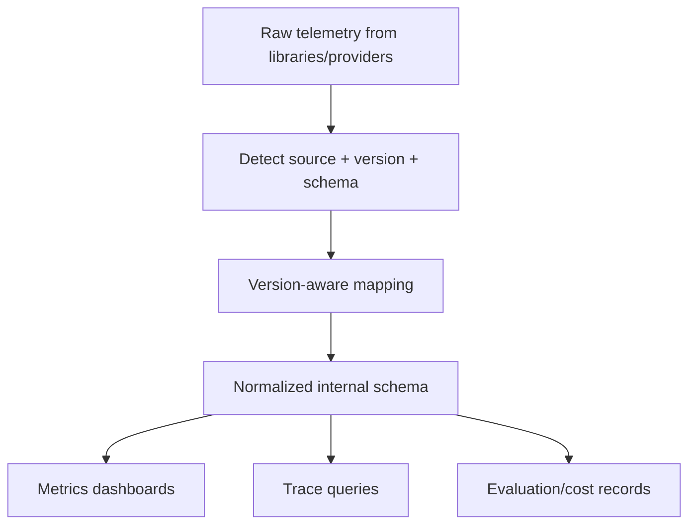

# Đọc semantic convention theo phiên bản thư viện

Sau khi nâng Spring Boot, Spring AI hoặc Micrometer, dashboard có thể đột nhiên không còn hiển thị một số metric/span cũ. Có lúc tên operation thay đổi, attribute được đổi tên, đơn vị duration khác, hoặc một instrumentation bắt đầu phát thêm span. Nếu chỉ nhìn thấy “dữ liệu vẫn có” mà không kiểm tra ngữ nghĩa, nhóm có thể vô tình so sánh hai đại lượng khác nhau dưới cùng một biểu đồ.

**Semantic convention** là quy ước đặt tên và định nghĩa ý nghĩa cho telemetry: span/operation đại diện cho hoạt động nào, attribute mô tả điều gì, giá trị có kiểu và đơn vị ra sao, metric đo đại lượng nào. Convention giúp nhiều thư viện và dịch vụ phát dữ liệu có thể hiểu và so sánh được. Tuy nhiên, convention cũng tiến hóa theo phiên bản. Vì vậy, đọc semantic convention phải gắn với **phiên bản thư viện, phiên bản convention và trạng thái ổn định của từng field**.

Bài này thuộc chương **Nền tảng quan sát** trong module **SPRING_AI_EVALUATION_OBSERVABILITY**. Module đánh giá ứng dụng Spring AI bằng dataset, relevance, fact checking và kiểm thử RAG/tool calling; đồng thời đo metrics, traces, chi phí và độ trễ để tìm nguyên nhân suy giảm giữa các phiên bản prompt, model và pipeline. Nội dung tập trung vào cách đọc và áp dụng convention để dữ liệu observability không bị hiểu sai khi hệ thống nâng cấp.

## 1. Mục tiêu học tập

Sau bài này, bạn có thể:

1. Giải thích semantic convention và phân biệt convention với tên metric/span tùy ý của ứng dụng.
2. Xác định convention đến từ OpenTelemetry, Micrometer, Spring Boot, Spring AI hay provider instrumentation.
3. Đọc version, schema URL, stability level và ghi chú migration của convention.
4. Phân biệt attribute ổn định, experimental/development, deprecated và removed theo đúng tài liệu phiên bản.
5. Đọc span name, attribute, metric name, unit, type và temporality trước khi xây dashboard.
6. Tránh dùng một tên metric cho hai ý nghĩa khác nhau sau khi nâng thư viện.
7. Thiết kế adapter, mapping layer và compatibility tests cho các thay đổi convention.
8. So sánh quality, latency, token usage và cost giữa các phiên bản Spring AI/provider bằng dữ liệu có ngữ nghĩa tương đương.

## 2. Semantic convention là gì?

**Semantic convention** quy định cách mô tả một khái niệm telemetry bằng tên và cấu trúc nhất quán. Ví dụ, một HTTP client span cần biểu đạt đây là lời gọi HTTP, method nào, route/server nào, status gì và duration bao lâu. Nếu mỗi thư viện tự đặt tên tùy ý, hệ thống quan sát sẽ khó nhóm và truy vấn.

Convention có thể quy định:

- **Span/operation name:** tên hoạt động, ví dụ một HTTP client request hoặc model invocation.
- **Attribute keys:** tên trường như HTTP request method, server address, network protocol hoặc model identifier theo bộ convention tương ứng.
- **Attribute value types:** string, integer, boolean, array hoặc cấu trúc được quy định.
- **Metric name và unit:** tên đại lượng, đơn vị và loại phép đo.
- **Event/status semantics:** cách thể hiện lỗi, kết thúc, retry hoặc các sự kiện liên quan.
- **Relationship/context:** cách diễn giải parent-child, links, resource attributes và scope.

Convention không chỉ là một từ điển tên trường. **Tên giống nhau nhưng khác kiểu, đơn vị hoặc ý nghĩa vẫn là dữ liệu không tương thích.**

### 2.1. Convention khác tên do ứng dụng tự đặt

| Loại | Ví dụ | Ai chịu trách nhiệm |
|---|---|---|
| Convention của thư viện/chuẩn | Thuộc tính HTTP hoặc database theo OpenTelemetry semantic conventions. | Nhóm duy trì chuẩn và instrumentation. |
| Convention của framework | Observation name/keys được Spring Boot hoặc Spring AI phát theo version. | Framework/integration tương ứng. |
| Convention của provider | Metadata model/usage/finish reason theo API nhà cung cấp. | Provider và adapter. |
| Convention nội bộ | `app.ai.rag.retrieval`, `app.ai.quality.verdicts`. | Đội phát triển ứng dụng. |

Không nên đặt tên nội bộ giống một key chuẩn rồi gán nghĩa khác. Nếu cần một thuộc tính riêng, dùng namespace ứng dụng rõ ràng và ghi tài liệu.

### 2.2. Convention không tự bảo đảm instrumentation tồn tại

Một tài liệu OpenTelemetry có thể định nghĩa thuộc tính cho một loại operation. Điều đó **không có nghĩa mọi phiên bản Spring AI đều phát thuộc tính đó**. Phải kiểm tra:

1. Thành phần có instrumentation không?
2. Instrumentation đến từ thư viện/agent nào?
3. Version đó có áp dụng convention không?
4. Attribute có được xuất sau sampling/filtering không?
5. Exporter/backend có giữ và hiển thị field không?

## 3. Các lớp convention trong ứng dụng Spring AI

Một trace Spring AI có thể chứa dữ liệu từ nhiều lớp. Cần nhận diện **nguồn sở hữu** trước khi áp dụng quy tắc version.

| Lớp | Ví dụ dữ liệu | Tài liệu cần đối chiếu |
|---|---|---|
| **OpenTelemetry API/SDK** | Span context, status, events, resources, propagation. | OTel specification và SDK version. |
| **OpenTelemetry semantic conventions** | HTTP, database, messaging, RPC, GenAI conventions khi được hỗ trợ. | Phiên bản convention/schema và migration notes. |
| **Micrometer Observation** | Observation names, low/high-cardinality key-values, handlers/conventions. | Micrometer Observation reference/version. |
| **Micrometer Tracing** | Tracer, bridge, propagation, span lifecycle. | Micrometer Tracing reference/version. |
| **Spring Boot Actuator** | Auto-configuration, meters, HTTP server/client observations, tracing properties. | Spring Boot reference đúng major/minor. |
| **Spring AI** | ChatClient, ChatModel, embedding/vector store/tool observations và metadata. | Spring AI reference đúng release. |
| **Provider SDK/API** | Model ID, token usage, finish reason, rate limit, request reference. | API/SDK docs đúng endpoint và model. |
| **Application** | Workflow, evaluation verdict, source validity, business outcome. | Attribute catalog và schema nội bộ. |

### 3.1. Không nhầm OpenTelemetry API với semantic conventions

OpenTelemetry API/SDK định nghĩa cơ chế tạo spans, attributes, events, metrics và export. Semantic conventions định nghĩa **ý nghĩa chuẩn hóa của tên/field cho một domain**. Một span vẫn có thể được tạo hợp lệ bằng OTel API dù attribute names do ứng dụng tự đặt; nhưng để tương thích dashboard và công cụ chung, nên ưu tiên convention phù hợp khi đã có.

### 3.2. Không nhầm Micrometer Observation với OpenTelemetry span

Micrometer Observation cung cấp abstraction cho lifecycle quan sát và handlers. Khi có tracing handler cùng bridge tương thích, Observation có thể được chuyển thành span. Nhưng:

- Không phải mọi Observation đều có span.
- Observation có thể chỉ tạo metrics.
- Convention/keys ở tầng Micrometer có thể khác tên OTel attributes ở tầng exporter.
- Một instrumentation agent khác có thể tạo spans song song với Micrometer.

Do đó, phải biết field quan sát ở **tầng phát sinh** hay **tầng export** trước khi kết luận nó bị thiếu.

## 4. Đọc convention theo version và schema

Convention thay đổi theo thời gian. Khi xem tài liệu, cần ghi tối thiểu:

- **Library version:** ví dụ Spring Boot, Spring AI, Micrometer, OTel instrumentation.
- **Convention version:** phiên bản/schema mà instrumentation tuyên bố áp dụng nếu có.
- **Schema URL:** tham chiếu schema mô tả cách diễn giải dữ liệu, khi SDK/instrumentation phát ra.
- **Stability level:** trạng thái ổn định của convention/field theo tài liệu.
- **Migration notes:** tên cũ, tên mới, thay đổi kiểu/đơn vị/semantics và giai đoạn tương thích.

### 4.1. Library version không bằng convention version

Một ứng dụng có thể chạy Spring Boot 3.x, Spring AI release khác và OTel instrumentation ở version riêng. Không thể lấy version Spring Boot làm version semantic conventions của toàn trace. Một span HTTP có thể đến từ OTel Java agent; span ChatModel đến từ Spring AI/Micrometer; metadata provider đến từ SDK của nhà cung cấp.

Hãy ghi riêng:

```yaml
runtime:
  springBoot: "3.x.y"
  springAi: "release-pinned-version"
  micrometer: "managed-version"
  otelSdk: "managed-version"
instrumentation:
  http: "agent-or-library-and-version"
  springAi: "integration-and-version"
conventions:
  httpSchema: "schema-url-if-present"
  genAiSchema: "schema-url-if-present"
```

Đây là **mẫu manifest nội bộ**, không phải application.yml tiêu chuẩn. Các giá trị minh họa phải được thay bằng version thực từ dependency tree/runtime và metadata exporter. Không suy ra version từ tên dashboard.

### 4.2. Schema URL có vai trò gì?

Trong OpenTelemetry, schema URL có thể được gắn với Resource hoặc Instrumentation Scope để chỉ ra schema dùng diễn giải telemetry. Khi convention được đổi tên hoặc thay cấu trúc, schema URL giúp downstream biết dữ liệu phát theo schema nào và hỗ trợ migration.

Tuy vậy:

- Không phải mọi instrumentation đều phát schema URL.
- Không phải backend nào cũng hiển thị hoặc tự chuyển đổi schema.
- Schema URL không thay thế việc đọc migration notes và kiểm tra dữ liệu thực.
- Nếu một exporter/processor loại bỏ metadata này, cần nhận biết khả năng mất thông tin schema.

**Không tự tạo một schema URL giả** cho dữ liệu nội bộ. Nếu ứng dụng có schema riêng, version hóa nó bằng cơ chế được quản lý của ứng dụng.

## 5. Stability level: stable, development và deprecated

Các bộ convention có thể phân loại trạng thái trưởng thành. Tên cụ thể và quy tắc có thể khác theo bộ tài liệu/version, nhưng khi đọc thường cần nhận diện:

| Trạng thái | Cách hiểu thực tế | Cách sử dụng |
|---|---|---|
| **Stable** | Được công bố ổn định theo chính sách của bộ convention. | Có thể dùng làm nền cho dashboard lâu dài, vẫn theo dõi major migration. |
| **Development/Experimental** | Đang phát triển, có thể thay đổi hoặc chưa bảo đảm tương thích. | Dùng có kiểm soát, version hóa và chuẩn bị migration. |
| **Deprecated** | Được khuyến cáo chuyển khỏi; có thể còn hoạt động trong một giai đoạn. | Ghi kế hoạch thay thế và mốc bỏ hỗ trợ. |
| **Removed** | Không còn được phát/định nghĩa trong version mới. | Phải dùng field thay thế hoặc adapter tương thích. |

Không được giả định một field là stable chỉ vì nó đã tồn tại nhiều năm trong một backend. **Trạng thái phải đọc ở tài liệu đúng convention package/version**, không suy từ tên field.

### 5.1. Stable không có nghĩa bất biến mãi mãi

Stable thường đặt ra kỳ vọng tương thích cao hơn; nhưng thư viện vẫn có thể thay đổi qua major version, convention schema có thể được nâng, và instrumentation implementation có thể sửa cách áp dụng. Cần đọc release notes, migration guides và kiểm thử trước khi nâng.

### 5.2. Deprecated không đồng nghĩa xóa ngay

Một convention có thể giữ field cũ trong giai đoạn chuyển tiếp. Nếu dashboard tiếp tục đọc field cũ, cần biết:

- Field mới đã được phát chưa?
- Có cả field cũ và mới cùng lúc không?
- Hai field có cùng semantics không?
- Khi nào field cũ bị bỏ?
- Dashboard/alert đã chuyển xong chưa?

Không nên xóa field cũ khỏi hệ thống nội bộ chỉ vì đã thấy một cảnh báo deprecated, nếu các consumer còn phụ thuộc và chưa có migration an toàn.

## 6. Đọc một semantic convention entry như thế nào?

Khi đọc tài liệu convention cho một attribute/metric, kiểm tra theo thứ tự:

1. **Identifier/name:** tên chính xác, chữ hoa/thường, namespace.
2. **Brief/description:** nó mô tả request, server, model, operation hay resource?
3. **Type:** string, int, boolean, array hay kiểu khác?
4. **Requirement level:** required, recommended, opt-in hoặc conditionally required theo tài liệu.
5. **Allowed values:** có enum hoặc taxonomy chuẩn không?
6. **Stability:** stable/development/deprecated.
7. **Unit:** seconds, bytes, tokens hoặc dimensionless?
8. **Cardinality/privacy:** có thể chứa ID riêng, raw input hay thông tin nhạy cảm không?
9. **Version/schema:** xuất hiện từ version nào, thay đổi ở version nào?
10. **Migration:** tên/semantics mới, cách chuyển và thời gian tương thích.

### 6.1. Ví dụ đọc thuộc tính giả định

```yaml
attribute:
  name: gen_ai.request.model
  type: string
  description: Model được yêu cầu cho operation này
  requirement: recommended
  stability: verify-in-selected-convention-version
  source: instrumentation/provider adapter
  metricLabel: only-if-bounded-and-reviewed
  privacyReview: required
```

Đây là **ví dụ minh họa cách ghi chú convention**, không phải trích nguyên văn spec và không khẳng định trạng thái hiện hành của key trên mọi release. Khi áp dụng, phải tra tài liệu GenAI semantic conventions đúng phiên bản. Cần phân biệt model được cấu hình yêu cầu với model thực tế provider trả về; hai giá trị có thể khác nhau.

### 6.2. Required/recommended/opt-in không phải trạng thái stability

Một thuộc tính có thể được khuyến nghị nhưng vẫn ở trạng thái phát triển, hoặc là optional nhưng stable. Đây là hai chiều riêng:

- **Requirement:** trong trường hợp nào instrumentation nên/được phép phát field.
- **Stability:** mức cam kết thay đổi của convention.

Đừng suy “recommended = stable” hoặc “optional = experimental”.

## 7. Convention cho HTTP: method, route, status và duration

HTTP instrumentation là ví dụ dễ thấy về sự tiến hóa convention. Tùy OTel semantic convention version và instrumentation version, tên key hoặc cách chuẩn hóa route có thể thay đổi.

### 7.1. Điều cần giữ nhất quán

- HTTP method phải được chuẩn hóa theo convention đang dùng.
- Route nên là route template, không phải URL chứa ID người dùng.
- Server address/port và protocol có semantics riêng.
- Status code phải được ghi đúng kiểu.
- Duration metric phải có đơn vị rõ, không biến thành label.
- Client và server spans cần giữ quan hệ context đúng.

### 7.2. Ví dụ chuyển đổi khái niệm

Một convention version cũ có thể dùng key cũ cho HTTP method; version mới có thể đưa ra key chuẩn hóa mới và quy định cách tương thích. Không nên tự suy tên field cũ/mới từ trí nhớ; hãy lấy đúng migration table trong tài liệu OTel convention đang chọn.

Bảng nội bộ có thể ghi:

| Trường dữ liệu nội bộ | Legacy source | Current source | Kiểu/đơn vị nội bộ |
|---|---|---|---|
| `http.method.normalized` | Key legacy theo version cũ | Key hiện hành theo schema đã chọn | String enum/normalized. |
| `http.route.template` | Route cũ | Route template hiện hành | String, không chứa ID thực. |
| `http.status_code` | Status cũ | Status hiện hành | Integer. |
| `http.client.duration` | Timer cũ | Metric mới theo convention | Seconds trong normalized model. |

Các tên cột bên trái là **schema nội bộ đề xuất**. Phần legacy/current phải được điền từ tài liệu và instrumentation version thật; không dùng bảng ví dụ này như mapping chính thức.

### 7.3. Không so duration nếu đơn vị khác

Một metric có thể đổi từ milliseconds sang seconds hoặc từ một histogram representation sang một kiểu đo khác. Dashboard có thể vẫn vẽ được số nhưng hiển thị sai hệ số 1.000 nếu unit conversion không được áp dụng.

Chuẩn hóa nội bộ nên dùng một đơn vị cố định, thường là **seconds cho duration theo convention hiện hành** khi tương thích, nhưng phải ghi rõ nguồn và chuyển đổi. Không đổi unit bằng cách chỉ sửa label.

## 8. Convention cho GenAI: model, operation, usage và finish

OpenTelemetry có semantic conventions dành cho GenAI đang phát triển theo phiên bản. Các field có thể mô tả:

- Operation name/type.
- Provider hoặc system.
- Requested model và response model.
- Input/output token usage.
- Finish reason hoặc thông tin response.
- Tool call và các thuộc tính liên quan.

**Không phải mọi phiên bản Spring AI/provider adapter đều triển khai toàn bộ convention GenAI.** Một số instrumentation có thể phát convention riêng của framework hoặc metadata đặc thù; cần kiểm tra chính xác phiên bản.

### 8.1. Phân biệt requested model và response model

Ví dụ ứng dụng cấu hình alias `support-current` nhưng provider báo revision `chat-family-x-2026-10`. Nên lưu:

```text
configured.model = support-current
reported.model  = chat-family-x-2026-10
model.family    = chat-family-x
```

Các tên trên là schema nội bộ minh họa. Nếu convention chính thức có key tương ứng, mapping phải tuân thủ version đang áp dụng. Không dùng model ID động làm metric label nếu cardinality không được kiểm soát.

### 8.2. Token usage là dữ liệu số, không phải nhãn

Không làm:

```text
gen_ai.usage.input_tokens = "1820" as metric tag
```

Đúng hướng:

- Dùng counter/distribution/histogram phù hợp cho token count theo thiết kế metrics.
- Dùng span attribute số nếu convention/instrumentation hỗ trợ và policy cho phép.
- Lưu usage per invocation trong evaluation/cost ledger khi cần đối soát.
- Ghi trạng thái `reported`, `missing`, `unsupported` hoặc `incomplete`.

Không biến usage thiếu thành 0; không cộng cached/reasoning token hai lần nếu chúng là subset theo hợp đồng provider.

### 8.3. Finish reason phải giữ ngữ nghĩa

Provider có thể có giá trị raw finish khác nhau. Một normalized taxonomy nội bộ có thể gồm `stop`, `length_limit`, `tool_call`, `refusal`, `other`, `unknown`. Đây là **mapping nội bộ**, không phải enum OTel phổ quát. Giữ raw value được phép trong record chi tiết để không mất khả năng điều tra khi convention thay đổi.

## 9. Convention của Spring AI, Micrometer và OpenTelemetry có thể khác nhau

Một ứng dụng có thể nhìn thấy ba lớp tên:

```text
Application Observation:
  app.ai.rag.request

Spring AI instrumentation:
  observation/span theo convention của release Spring AI

HTTP instrumentation:
  span/attributes theo OTel HTTP semantic conventions
```

Tên ở mỗi lớp có thể có versioning riêng. Một span do OTel Java agent tạo không nhất thiết dùng cùng namespace với span do Spring AI/Micrometer tạo. Không nên buộc tất cả tên về một format duy nhất nếu điều đó làm mất semantic conventions chuẩn.

### 9.1. Xác định nguồn phát của span

Để biết ai tạo một span, kiểm tra:

- **Instrumentation scope name/version** nếu exporter/backend giữ metadata đó.
- Resource attributes như service name, service version, deployment environment.
- Span name, kind, parent ID và attributes.
- Dependency/agent version trong runtime.
- Cấu hình Micrometer/OTel và các client builders thực tế.

Không dựa riêng vào span name vì hai instrumentation khác nhau có thể dùng tên tương tự.

### 9.2. Resource attributes khác span attributes

| Loại | Gắn với | Ví dụ |
|---|---|---|
| **Resource attributes** | Process/service/deployment hoặc resource telemetry. | service name, service version, deployment environment. |
| **Instrumentation scope** | Thư viện/module tạo telemetry. | instrumentation name và version. |
| **Span attributes** | Một operation cụ thể. | operation type, HTTP method, model identifier. |
| **Metric attributes** | Một chuỗi phép đo. | feature, outcome, model family. |

Đừng gắn prompt version của từng request thành resource attribute nếu một process phục vụ nhiều prompt versions. Resource mô tả nguồn telemetry ở phạm vi process/service; prompt version thường thuộc operation/case hoặc deployment configuration tùy kiến trúc.

## 10. Version drift: điều gì có thể thay đổi?

Khi nâng thư viện, các thay đổi có thể gồm:

1. Span/observation name được chuẩn hóa lại.
2. Attribute key được đổi tên hoặc chuyển namespace.
3. Attribute type đổi từ string sang integer/boolean.
4. Một giá trị enum được thay đổi hoặc mở rộng.
5. Attribute chuyển từ recommended sang stable/deprecated.
6. Metric name hoặc unit thay đổi.
7. Histogram boundaries, aggregation hoặc temporality thay đổi.
8. Một instrumentation bắt đầu phát thêm span hoặc ngừng phát span.
9. Scope/propagation behavior thay đổi qua HTTP/reactive clients.
10. Provider adapter thay đổi mapping usage/finish reason/error.

### 10.1. Đổi tên field không phải thay đổi duy nhất

Giả sử dashboard đang dùng `model.duration.ms`. Version mới phát `model.duration` với unit seconds. Nếu chỉ đổi tên trong query nhưng không chuyển đơn vị, p95 sẽ lệch hệ số. Nếu version mới đo từ lúc bắt đầu SDK call đến terminal stream còn version cũ chỉ đo đến response headers, hai metric không còn cùng semantics dù đều là “duration”.

### 10.2. Thay đổi semantic phải được xem như thay đổi hợp đồng

Một mapping migration nên ghi:

```yaml
migration:
  oldLibraryVersion: "previous-pinned-version"
  newLibraryVersion: "target-pinned-version"
  oldConvention: "legacy-schema"
  newConvention: "current-schema"
  changes:
    - field: "duration"
      kind: "unit-and-boundary"
      action: "convert-and-split-dashboard"
    - field: "model.id"
      kind: "attribute-rename"
      action: "dual-read-during-transition"
  compatibilityWindow: "one-release"
```

Đây là **mẫu migration record nội bộ**, không phải release note thật. Điền bằng thay đổi đã xác minh từ dependency/release notes. Không tự đặt migration window cho thư viện bên ngoài; window này là quyết định triển khai của ứng dụng.

## 11. Xây mapping layer và giữ lịch sử dữ liệu

Một dashboard dài hạn không nên phải hiểu mọi tên raw từ tất cả thư viện. Có thể xây lớp mapping nội bộ:



Mapping layer cần:

- Nhận biết nguồn instrumentation và version.
- Đọc schema URL nếu có.
- Map key cũ/mới mà không trộn sai kiểu.
- Chuẩn hóa units và enums.
- Giữ raw provenance được phép.
- Ghi trạng thái unknown/unmapped để phát hiện field lạ.
- Tránh xuất hai series tương đương cùng lúc mà không đánh dấu migration.

### 11.1. Không xóa raw data khi chuẩn hóa

Normalized schema phục vụ truy vấn chung. Raw provider metadata có thể cần cho support/debug, nhưng chỉ lưu các trường được phép, với retention và quyền truy cập phù hợp. Không cần lưu toàn bộ raw response, prompt hoặc tool arguments để giữ provenance.

### 11.2. Không map giá trị không biết thành giá trị thành công

Ví dụ:

- Finish reason không biết → `unknown`, không tự gán `stop`.
- Usage thiếu → `missing`, không gán 0.
- Business status không đọc được → `unknown`, không gán `succeeded`.
- Attribute chưa map → `unmapped`/quarantine, không bỏ im lặng nếu nó quan trọng.

## 12. Ví dụ Java: version-aware metadata normalization

Ví dụ dưới đây minh họa adapter nội bộ nhận raw metadata từ các phiên bản khác nhau rồi chuẩn hóa thành schema ứng dụng. `RawModelMetadata` và `NormalizedModelMetadata` là **record tự định nghĩa**, không phải kiểu Spring AI/OTel có sẵn.

```java
import java.util.Map;
import java.util.Objects;

public final class ModelMetadataNormalizer {

    public record RawModelMetadata(
        String configuredModel,
        String reportedModel,
        Long inputTokens,
        Long outputTokens,
        String rawFinishReason,
        String instrumentationVersion,
        String conventionVersion,
        Map<String, Object> rawAttributes
    ) {}

    public record NormalizedModelMetadata(
        String configuredModel,
        String reportedModel,
        Long inputTokens,
        Long outputTokens,
        String usageStatus,
        String finishReason,
        String instrumentationVersion,
        String conventionVersion
    ) {}

    public NormalizedModelMetadata normalize(RawModelMetadata raw) {
        Objects.requireNonNull(raw, "raw metadata is required");

        Long input = nonNegative(raw.inputTokens());
        Long output = nonNegative(raw.outputTokens());
        String usageStatus = input == null || output == null
            ? "incomplete" : "reported";

        return new NormalizedModelMetadata(
            raw.configuredModel(),
            raw.reportedModel(),
            input,
            output,
            usageStatus,
            mapFinishReason(raw.rawFinishReason()),
            raw.instrumentationVersion(),
            raw.conventionVersion()
        );
    }

    private Long nonNegative(Long value) {
        return value == null || value < 0 ? null : value;
    }

    private String mapFinishReason(String raw) {
        if (raw == null) return "unknown";
        return switch (raw.toLowerCase()) {
            case "stop", "end_turn" -> "stop";
            case "length", "max_tokens" -> "length_limit";
            case "tool_calls", "function_call" -> "tool_call";
            case "content_filter", "refusal" -> "refusal";
            default -> "other";
        };
    }
}
```

**Giới hạn quan trọng:** các raw finish values ở trên chỉ là ví dụ. Mapping thực tế phải theo tài liệu của provider và endpoint cụ thể; không áp dụng switch này cho mọi vendor. Nếu hai raw values có semantics khác nhau, không gộp chúng chỉ để schema đơn giản. `rawAttributes` có thể chứa dữ liệu nhạy cảm; không lưu toàn bộ map vào logs/traces mà chưa lọc.

### 12.1. Vì sao giữ conventionVersion trong normalized record?

Khi một biểu đồ thay đổi sau nâng cấp, nhóm có thể phân tích:

- Bản ghi đến từ instrumentation version nào?
- Convention version nào được khai báo?
- Field gốc có được map đúng không?
- Có phải dữ liệu cũ và mới bị gộp trong một dashboard không?

Không nhất thiết biến convention version thành metric tag nếu tập giá trị tăng không giới hạn; nó có thể phù hợp hơn trong resource/scope metadata, logs hoặc migration registry.

## 13. Migration dashboard an toàn

Một migration có thể gồm các bước:

1. **Inventory:** liệt kê metrics/spans hiện tại, tên, type, unit, tags/attributes và nguồn phát.
2. **Pin:** ghi chính xác dependency versions và instrumentation agents.
3. **Diff:** đối chiếu semantic convention docs/release notes cũ và mới.
4. **Classify:** phân biệt rename, type change, unit change, semantic change, deprecation và removal.
5. **Map:** tạo mapping mới và test trên fixture raw của cả hai version.
6. **Dual-read/dual-write có giới hạn:** nếu cần, dùng cửa sổ chuyển đổi rõ ràng, không duy trì vĩnh viễn.
7. **Dashboard:** tạo query mới, xác minh unit/mẫu số, cập nhật alert.
8. **Canary:** triển khai một phần, so telemetry thực và kiểm tra spans/metrics bị mất hoặc nhân đôi.
9. **Switch:** chuyển dashboard/alerts sang convention mới.
10. **Retire:** bỏ query/adapter cũ khi không còn consumer.

### 13.1. Không gộp series cũ và mới nếu semantics khác

Nếu metric cũ đo *time to response headers* và metric mới đo *time to stream completion*, hai số không thể gộp thành một p95 duy nhất. Nên:

- Đặt tên/nhãn riêng theo semantics.
- Hiển thị ranh giới thời gian rõ.
- Chạy song song trong giai đoạn đối chiếu nếu cần.
- Chuyển dashboard sau khi xác nhận tương đương hoặc chấp nhận thay đổi định nghĩa.

### 13.2. Giữ lịch sử so sánh

Khi metric name đổi, dashboard có thể mất chuỗi lịch sử liền mạch. Có thể dùng mapping/query migration hoặc backfill nếu nền tảng hỗ trợ và semantics tương đương. **Không backfill dữ liệu cũ bằng cách gán ý nghĩa mới** nếu ranh giới đo đã thay đổi.

## 14. Kiểm thử semantic convention theo version

Test không chỉ xác minh “có span”. Cần kiểm tra:

| Nhóm test | Nội dung | Kỳ vọng |
|---|---|---|
| **Name contract** | Span/metric names theo version được ghim. | Tên đúng convention hoặc catalog nội bộ. |
| **Attribute contract** | Key, type, allowed values, requirement. | Không đổi type/semantics âm thầm. |
| **Unit contract** | Duration, bytes, tokens, counts. | Đúng đơn vị và quy đổi. |
| **Schema/version contract** | Instrumentation scope/schema URL khi có. | Version metadata được giữ hoặc thiếu được ghi rõ. |
| **Stability contract** | Experimental/deprecated field. | Có migration policy, không phụ thuộc không kiểm soát. |
| **HTTP convention** | Method, route, status, client/server relation. | Route template và propagation đúng. |
| **GenAI convention** | Operation, model, usage, finish reason. | Mapping đúng provider/model/version. |
| **Cardinality contract** | Metric labels có tập giá trị hữu hạn. | Không đưa request/trace/user IDs vào labels. |
| **Error contract** | Timeout, rate limit, refusal, business rejection. | Tách technical outcome, quality verdict, business outcome. |
| **Compatibility test** | Chạy cùng fixture trên old/new dependency. | Phát hiện rename, unit, missing hoặc duplicate. |

### 14.1. Ví dụ test mapping với JUnit

```java
import static org.junit.jupiter.api.Assertions.*;
import java.util.Map;
import org.junit.jupiter.api.Test;

class FinishReasonMappingTest {

    private final ModelMetadataNormalizer normalizer =
        new ModelMetadataNormalizer();

    @Test
    void mapsKnownValuesAndPreservesUnknownState() {
        assertEquals("stop", normalize("stop"));
        assertEquals("length_limit",
            normalize("max_tokens"));
        assertEquals("tool_call",
            normalize("tool_calls"));
        assertEquals("other",
            normalize("new_vendor_value"));
        assertEquals("unknown",
            normalize(null));
    }

    private String normalize(String rawFinishReason) {
        var raw = new ModelMetadataNormalizer.RawModelMetadata(
            "configured-alias",
            "reported-model",
            10L,
            2L,
            rawFinishReason,
            "adapter-version",
            "schema-version",
            Map.of()
        );
        return normalizer.normalize(raw).finishReason();
    }
}
```

Đây là **mẫu test ý tưởng**. Để compile, expose phương thức mapping qua API phù hợp hoặc test qua public `normalize(...)` với record đầu vào; không cần biến phương thức private thành public chỉ để test. Bộ raw values phải lấy từ provider fixtures thực, không chỉ dựa trên ví dụ.

### 14.2. Test old/new telemetry cùng workload

Chạy một tập request fixture qua hai dependency sets:

- Cùng model/provider mock và response fixture.
- Cùng prompt/pipeline/route.
- Ghi raw spans/metrics của mỗi version.
- Chuẩn hóa bằng mapping tương ứng.
- So operation count, attribute presence, type, unit, parent-child và usage completeness.
- Ghi nhận field deprecated/unmapped và spans bị duplicate.

Không cần gọi provider thật để kiểm tra hầu hết schema mapping; dùng mock server/fixture. Chỉ cần integration sandbox cho các capability không thể mô phỏng hợp lệ bằng fixture.

## 15. Đọc semantic convention trong quy trình đánh giá Spring AI

Khi so prompt/model/pipeline, version của instrumentation cũng là một yếu tố thí nghiệm. Nếu baseline dùng convention cũ còn candidate dùng convention mới, số liệu có thể đổi vì **cách đo** chứ không phải model.

### 15.1. Metadata của một evaluation run

```yaml
evaluationRun:
  datasetVersion: rag-regression-v5
  corpusVersion: policy-corpus-2026-11
  rubricVersion: groundedness-v3
  promptVersion: support-v4
  pipelineVersion: rag-v3
  model:
    provider: provider-a
    configuredId: support-current
    reportedId: chat-family-x-2026-10
  observability:
    springBootVersion: pinned-version
    springAiVersion: pinned-version
    micrometerVersion: pinned-version
    otelInstrumentationVersion: pinned-version
    semanticConventionSchema: schema-url-or-unknown
```

Đây là **record minh họa**, không phải cấu hình framework. Không đưa tất cả các trường này vào metric tags. Evaluation record/log metadata là nơi phù hợp hơn để giữ các version chi tiết và nối chúng với trace/case.

### 15.2. Chỉ so metric có cùng semantics

Trước khi so p95:

- Cùng ranh giới bắt đầu/kết thúc?
- Cùng đơn vị?
- Cùng histogram/aggregation?
- Cùng sample population và sampling policy?
- Cùng cách xử lý retries, streaming/cancel?
- Cùng model invocation hay workflow request?

Trước khi so usage/cost:

- Cùng định nghĩa token?
- Có cùng coverage?
- Có cùng rate card/currency?
- Có cùng cách tính retry, cache, embedding, evaluator?

Trước khi so quality:

- Cùng dataset/corpus/gold facts?
- Cùng rubric/judge version?
- Có ghi nhận đúng finish reason và incomplete output?
- Có đối chiếu verified tool outcome?

### 15.3. Ví dụ hồi quy giả định

| Chỉ số | Baseline | Candidate | Cần kiểm tra |
|---|---:|---:|---|
| p95 model latency | 1,2 s | 1,8 s | Có cùng span boundary/unit không? |
| p95 end-to-end | 2,0 s | 2,4 s | Workflow semantics có đổi không? |
| Input tokens trung bình | 2.000 | 4.800 | Prompt/context có dài hơn? |
| Groundedness pass | 94% | 86% | Claim/evidence nào không đạt? |
| Usage coverage | 100% | 78% | Adapter/convention mới có bỏ field không? |
| Tool false-success | 0 | 2 | Backend status mapping có đổi? |

Candidate có thể thật sự kém hơn, nhưng usage coverage giảm có thể làm cost và một phần telemetry không đầy đủ. Trước khi quy lỗi cho prompt/model, kiểm tra convention mapping, provider adapter, streaming terminal metadata và evaluator execution.

## 16. Cardinality và privacy khi áp dụng convention

Một convention attribute được chuẩn hóa không mặc nhiên phù hợp làm metric label. Cần phân biệt:

- **Low-cardinality attributes:** feature, operation, outcome, criterion, model family đã quản lý.
- **High-cardinality attributes:** request ID, trace ID, user ID, evaluation case ID, provider request ID.
- **Sensitive attributes:** prompt, tool arguments, raw document content, auth headers, email/order details.

High-cardinality và sensitive là hai khái niệm khác nhau: một trường có thể cardinality thấp nhưng nhạy cảm, hoặc cardinality cao nhưng không nhạy cảm. Cả hai đều cần policy.

Không đưa request/trace/user IDs vào metric labels. Không đưa secrets, raw prompt hoặc dữ liệu RAG vào span attributes/baggage nếu chưa có quyền, redaction và retention rõ ràng.

## 17. Những sai lầm thường gặp khi đọc convention

1. **Lấy version Spring Boot làm convention version của toàn trace.** Các instrumentation có thể đến từ nhiều thư viện/agent.
2. **Chỉ nhìn span name.** Cần xem scope/version/resource và attributes.
3. **Cho rằng schema URL luôn có.** Một số instrumentation không phát schema metadata.
4. **Cho rằng stable là không bao giờ đổi.** Vẫn cần theo dõi major upgrades và migration notes.
5. **Coi recommended là stable.** Requirement và stability là hai chiều khác nhau.
6. **Đổi key mà không đổi type/unit.** Dashboard có thể sai dù query chạy.
7. **Map finish reason unknown thành stop.** Che mất output bị cắt hoặc giá trị mới.
8. **Map usage missing thành 0.** Cost bị đánh giá thấp.
9. **Gộp model invocation với workflow duration.** Mẫu số và ranh giới khác nhau.
10. **Coi metric name của Spring AI là hợp đồng vĩnh viễn.** Cần kiểm tra release cụ thể.
11. **Dùng raw provider field làm label.** Cardinality và privacy có thể bùng nổ.
12. **Gộp technical success, quality PASS và business success.** Làm dashboard sai bản chất.
13. **Không kiểm thử agent và library instrumentation cùng lúc.** Có thể mất hoặc nhân đôi spans.
14. **Backfill dữ liệu cũ theo semantics mới.** Lịch sử trở nên không còn trung thực.
15. **Bỏ field experimental mà không có migration.** Có thể làm mất khả năng chẩn đoán đang được dùng.

## 18. Bài tập thực hành

Một ứng dụng nâng đồng thời Spring Boot, Spring AI và OTel Java instrumentation. Sau deploy, dashboard có các biểu hiện:

```text
1. Metric HTTP cũ không còn xuất hiện.
2. Metric mới có unit khác.
3. Model span vẫn có nhưng finish reason không thấy.
4. Token usage giảm gần 30%.
5. Số spans HTTP tăng gần gấp đôi.
6. Groundedness pass giảm từ 94% xuống 86%.
7. Tool backend trả PENDING nhưng assistant nói SUCCEEDED.
```

### Câu hỏi

1. Tại sao không thể kết luận model chất lượng kém chỉ từ bảng dashboard?
2. Cần ghi lại những version nào để xác định nguồn convention?
3. Schema URL giúp gì và giới hạn của nó là gì?
4. Phân biệt field missing, unsupported và not collected.
5. Vì sao unit thay đổi có thể làm p95 sai?
6. Nêu hai nguyên nhân spans HTTP tăng gấp đôi.
7. Token usage giảm có thể do provider, streaming hay adapter như thế nào?
8. Business status PENDING cần được xử lý ra sao trong final answer?
9. Thiết kế bốn contract tests trước khi nâng version tiếp theo.
10. Dữ liệu nào nên giữ ở evaluation record thay vì metric labels?

### Gợi ý đáp án

**1.** Có thể do semantic convention, unit, instrumentation duplication, usage mapping hoặc evaluator thay đổi. Phải xác minh telemetry trước khi kết luận chất lượng model.

**2.** Spring Boot, Spring AI, Micrometer, OTel SDK/Java agent, HTTP client/SDK, provider adapter và convention/schema version nếu có.

**3.** Schema URL chỉ ra schema dùng diễn giải telemetry ở scope/resource khi được phát; không phải mọi instrumentation/backend đều giữ nó, và nó không thay migration notes hoặc test dữ liệu thật.

**4.** Unsupported: endpoint không có capability; missing/not reported: response cụ thể không có field; not collected: provider trả nhưng adapter/processor không lấy hoặc export.

**5.** Nếu số cũ là milliseconds còn mới là seconds, không quy đổi sẽ lệch hệ số 1.000; boundary khác nhau còn làm hai số không tương đương ngay cả khi unit giống.

**6.** OTel agent và Micrometer/HTTP instrumentation cùng đo một client call; hoặc retry thực sự tăng. Kiểm tra instrumentation scope, parent-child, request attempt và retry count.

**7.** Provider có thể không gửi usage cuối stream; client cancel trước terminal chunk; adapter không map field; convention/response schema đổi; code biến null thành 0.

**8.** Không xác nhận hoàn tất. Assistant phải nói đang chờ xử lý/chưa thể xác nhận theo contract; chỉ backend có thẩm quyền mới chuyển task sang SUCCEEDED.

**9.** Ví dụ: HTTP attribute/type/unit migration; GenAI usage streaming final chunk; span duplicate/propagation; finish reason + unknown mapping; evaluator/tool outcome contract.

**10.** Case ID, trace ID, used source IDs, claim-level evidence, raw finish reason, detailed provider request reference và rubric/corpus/prompt version chi tiết nên ở trace/log/evaluation store có phân quyền, không phải metric labels.

## 19. Ghi nhớ

**Semantic convention mô tả ý nghĩa, tên, kiểu, đơn vị và cách dùng của telemetry; version thư viện và version convention không nhất thiết trùng nhau.** Trong một ứng dụng Spring AI, HTTP spans, model observations, Micrometer handlers, provider metadata và custom evaluation có thể đến từ nhiều nguồn. Khi nâng cấp, phải đọc stability/migration notes, kiểm tra schema URL nếu có, so name/type/unit/semantics và xác minh instrumentation thực sự phát gì. Dùng mapping layer có version, giữ missing khác 0, tránh gộp metrics khác ranh giới, test old/new fixtures và chỉ so quality/latency/cost khi dữ liệu tương đương. Trace cho biết luồng kỹ thuật; evaluation record và backend nghiệp vụ mới giúp xác định câu trả lời có đúng và tác vụ đã hoàn tất hay chưa.

### Tài liệu tham khảo

- [OpenTelemetry — Semantic Conventions](https://opentelemetry.io/docs/specs/semconv/): quy ước attributes, metrics và spans theo domain.
- [OpenTelemetry — Semantic Convention Stability](https://opentelemetry.io/docs/specs/semconv/general/semantic-conventions/): nguyên tắc stability và tiến hóa convention.
- [OpenTelemetry — Schemas](https://opentelemetry.io/docs/specs/otel/schemas/): schema URL và chuyển đổi schema.
- [OpenTelemetry — Instrumentation Scope](https://opentelemetry.io/docs/specs/otel/common/instrumentation-scope/): tên/version của instrumentation scope.
- [OpenTelemetry — Resources](https://opentelemetry.io/docs/specs/otel/resource/): resource attributes và service identity.
- [OpenTelemetry — GenAI Semantic Conventions](https://opentelemetry.io/docs/specs/semconv/gen-ai/): convention cho GenAI, cần kiểm tra stability theo release.
- [OpenTelemetry — HTTP Semantic Conventions](https://opentelemetry.io/docs/specs/semconv/http/): convention cho HTTP client/server.
- [Micrometer — Observation](https://docs.micrometer.io/micrometer/reference/observation.html): Observation API, handlers và conventions.
- [Micrometer Tracing](https://docs.micrometer.io/tracing/reference/index.html): tracing bridges, spans và propagation.
- [Spring Boot — Observability](https://docs.spring.io/spring-boot/reference/actuator/observability.html): observability integration theo Spring Boot version.
- [Spring AI — Observability](https://docs.spring.io/spring-ai/reference/observability/index.html): observability của Spring AI theo release.
