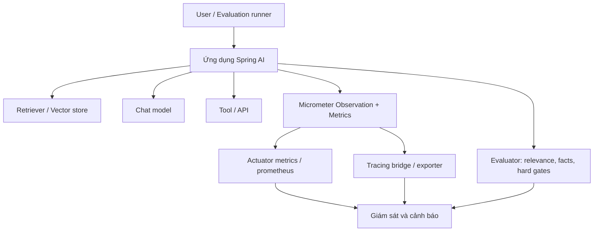

# Bật Actuator và lựa chọn endpoint quản trị cần thiết

## 1. Actuator giải quyết vấn đề nào trong ứng dụng Spring AI?

Một ứng dụng Spring AI có thể hoạt động tốt trong môi trường thử nghiệm nhưng khi vận hành lại xuất hiện các triệu chứng khó chẩn đoán: thời gian phản hồi tăng sau khi đổi model, RAG trả về đoạn tài liệu không liên quan, công cụ đọc trạng thái đơn hàng liên tục timeout, số token tăng bất thường hoặc độ chính xác giảm qua mỗi lần sửa prompt.

Để phân biệt lỗi của hạ tầng, model, bộ truy xuất và công cụ, nhóm phát triển cần **telemetry**: dữ liệu đo đạc và theo dõi hoạt động của hệ thống. Ba tín hiệu phổ biến là:

| Tín hiệu | Trả lời câu hỏi | Ví dụ với Spring AI |
|---|---|---|
| **Metrics** | Trong một khoảng thời gian, có bao nhiêu lần, nhanh/chậm ra sao? | Tỷ lệ lỗi HTTP, p95 latency, số lần gọi model/tool, token nếu có instrumentation |
| **Traces** | Một request cụ thể đã đi qua những bước nào và tốn thời gian ở đâu? | HTTP → retriever → model → tool → model |
| **Logs** | Sự kiện nào đã xảy ra và chương trình báo gì? | API timeout, exception khi parse tool response |

**Spring Boot Actuator** cung cấp endpoint quản trị và tích hợp với Micrometer để kiểm tra trạng thái, xem metrics và kết nối hệ thống giám sát. Trong chương **Cấu hình telemetry** thuộc module `SPRING_AI_EVALUATION_OBSERVABILITY`, bài này tập trung vào **bật Actuator** và **chỉ mở các endpoint thực sự cần thiết**.

Đây không phải một bộ đánh giá chất lượng AI. Endpoint `/actuator/health` có thể báo `UP` ngay khi model trả lời sai sự thật. Muốn đánh giá relevance, factual correctness, RAG grounding hay hành vi tool calling, vẫn cần tập ca, nhãn tham chiếu, rubric và traces của ứng dụng.

### Sau bài học, người học có thể

- Thêm dependency Actuator và Prometheus registry cho dự án Spring Boot dùng Spring AI.
- Hiểu khác biệt giữa endpoint **được tạo**, **được expose qua HTTP** và **được cấp quyền truy cập**.
- Lựa chọn `health`, `info`, `metrics`, `prometheus` theo môi trường.
- Thiết kế liveness/readiness có ý nghĩa, không làm pod restart liên tục khi provider LLM lỗi.
- Kiểm tra endpoint bằng HTTP và xác định nguyên nhân khi gặp 404/401/403/503.
- Bảo vệ endpoint quản trị, tránh lộ prompt, secrets và dữ liệu khách hàng trong telemetry.
- Kết hợp metrics với traces và kết quả evaluation để chẩn đoán regression của prompt, model và pipeline.

## 2. Vị trí của Actuator trong kiến trúc observability

Spring Boot Actuator, Micrometer và Spring AI giữ các vai trò khác nhau:

| Thành phần | Vai trò | Giới hạn |
|---|---|---|
| **Spring Boot Actuator** | Health, info, metrics và các endpoint quản trị tùy cấu hình | Không tự quyết định câu trả lời RAG đúng hay sai |
| **Micrometer Metrics** | Thu meter, tổng hợp số liệu, kết nối registry | Không lưu toàn bộ đường đi của mỗi request |
| **Micrometer Observation** | Ghi nhận các observation từ code/instrumentation | Không tự sinh nhãn vàng để chấm model |
| **Tracing bridge/exporter** | Đưa trace/span đến backend quan sát | Không xuất hiện chỉ vì mở `/actuator/metrics` |
| **Spring AI** | Chat model, RAG, tool calling và observations theo thành phần/phiên bản | Không phải mọi model/provider đều trả đủ token usage |
| **Evaluation runner** | Chạy ca, so kết quả với reference, tính relevance/fact checking/hard gates | Không thay thế hệ thống giám sát hạ tầng |



Một meter có thể giúp phát hiện model latency tăng trên nhiều request. Trace giúp tìm ra request nào có retriever chậm hoặc tool retry. Evaluator cho biết câu trả lời có được tài liệu hỗ trợ và đúng yêu cầu nghiệp vụ không. **Ba góc nhìn bổ trợ cho nhau, không thay thế nhau.**

## 3. Thêm dependency Actuator

Với Spring Boot dùng Gradle Groovy:

```groovy
dependencies {
    implementation 'org.springframework.boot:spring-boot-starter-actuator'
}
```

Với Maven:

```xml
<dependency>
    <groupId>org.springframework.boot</groupId>
    <artifactId>spring-boot-starter-actuator</artifactId>
</dependency>
```

Actuator là thành phần của **Spring Boot**. Ứng dụng có Spring AI vẫn dùng starter này cho các endpoint quản trị Spring Boot, không cần tự tạo một HTTP controller để trả health/metrics.

Muốn cho hệ thống Prometheus scrape metrics, cần thêm registry tương thích:

```groovy
dependencies {
    implementation 'org.springframework.boot:spring-boot-starter-actuator'
    runtimeOnly 'io.micrometer:micrometer-registry-prometheus'
}
```

Dependency Maven tương ứng:

```xml
<dependency>
    <groupId>io.micrometer</groupId>
    <artifactId>micrometer-registry-prometheus</artifactId>
</dependency>
```

**Lưu ý:** việc có dependency registry, việc endpoint `prometheus` được tạo và việc endpoint đó được expose/được phép truy cập là **các điều kiện khác nhau**. Chỉ khai báo `prometheus` trong cấu hình exposure mà không có registry cần thiết có thể dẫn đến HTTP 404.

Các ví dụ tập trung vào cấu hình Spring Boot/Micrometer thường dùng. Khi dự án nâng Spring Boot hoặc Spring AI, cần kiểm tra compatibility và tên thuộc tính/tên meter theo phiên bản đang triển khai, không coi mọi ví dụ trên Internet là tương đương.

## 4. Ba lớp cần kiểm tra khi endpoint không mở được

Một request đến Actuator đi qua ba quyết định:

1. **Endpoint có tồn tại và được enable không?** Chẳng hạn `prometheus` cần registry. Một số endpoint chỉ hiện diện nếu có bean/dependency hỗ trợ.
2. **Endpoint có được expose qua web không?** Thuộc tính `management.endpoints.web.exposure.include` là danh sách cho phép trên HTTP.
3. **Client có quyền không?** Spring Security, reverse proxy, firewall, mTLS hoặc network policy có thể từ chối request.

| HTTP status thường gặp | Khả năng cần kiểm tra | Hướng xử lý |
|---|---|---|
| `404 Not Found` | Thiếu starter, sai path/port, endpoint không hiện diện hoặc không expose | Kiểm tra dependency và cấu hình thực |
| `401 Unauthorized` | Endpoint yêu cầu xác thực | Dùng danh tính hợp lệ, không tắt security |
| `403 Forbidden` | Danh tính thiếu vai trò/quyền | Kiểm tra policy của endpoint |
| `503 Service Unavailable` | Một health status được ánh xạ thành trạng thái không sẵn sàng | Xem health indicators và điều kiện phục vụ |
| `200 OK` | Request được xử lý thành công | Kiểm tra response có đúng cấu trúc/nội dung không |

Mã trạng thái thực tế có thể chịu ảnh hưởng của gateway hoặc security configuration. Không sử dụng bảng này như quy tắc tuyệt đối.

### Đường dẫn thường gặp

Trong cấu hình web thông thường, Actuator dùng base path `/actuator`:

```text
GET /actuator/health
GET /actuator/info
GET /actuator/metrics
GET /actuator/prometheus
```

Mặc định, Spring Boot thường chỉ expose HTTP health endpoint trong cấu hình cơ bản; không nên giả định mọi endpoint ở bảng đã mở chỉ vì có starter. Port, context path và base path đều có thể thay đổi.

## 5. Lựa chọn endpoint theo giá trị và rủi ro

| Endpoint | Tác dụng | Khi nào cần? | Cách quản lý |
|---|---|---|---|
| `health` | Trạng thái health indicators | Hầu hết môi trường | Nội dung tối thiểu, chỉ cho probe/client được phép |
| `info` | Metadata ứng dụng nếu đã cấu hình contributor | Tra phiên bản build/deployment | Kiểm tra kỹ nội dung công bố |
| `metrics` | Danh sách và số đo Micrometer | Local, staging, vận hành nội bộ | Yêu cầu quyền quản trị |
| `prometheus` | Cung cấp số đo để scrape | Khi dùng Prometheus | Chỉ scraper/monitoring được phép |
| `loggers` | Xem/chỉnh mức log khi endpoint hỗ trợ | Điều tra có kiểm soát | Không expose đại trà |
| `env` và `configprops` | Khảo sát thuộc tính cấu hình | Rất hạn chế | Không mở cho người dùng cuối |
| `beans`, `conditions`, `mappings` | Xem cấu trúc runtime | Gỡ lỗi chuyên sâu | Mạng nội bộ, tạm thời |
| `threaddump`, `heapdump` | Chẩn đoán luồng/bộ nhớ | Sự cố đặc biệt | Quyền cao; dữ liệu có thể rất nhạy cảm |
| `httpexchanges` | Thông tin HTTP exchanges khi được hỗ trợ | Debug HTTP có kiểm soát | Cần repository/điều kiện phù hợp |
| `shutdown` | Yêu cầu dừng ứng dụng nếu bật | Hầu như không cần | Không expose công khai |

Không phải endpoint nào ở bảng cũng được tạo trong mọi ứng dụng. Ví dụ `httpexchanges` có thể yêu cầu repository thích hợp; `prometheus` cần registry; `shutdown` thường không được bật để truy cập theo cấu hình thông thường.

**Lựa chọn khởi đầu hợp lý:**

- Chỉ cần biết hệ thống có hoạt động: `health`.
- Muốn xác minh phiên bản phát hành: thêm `info` nếu metadata an toàn.
- Muốn khám phá metric: thêm `metrics` nhưng khóa truy cập.
- Có Prometheus: thêm `prometheus` và cấu hình mạng/identity của scraper.

Không dùng `exposure.include: "*"` như mặc định ở production. Danh sách endpoint phải được xét lại khi thêm dependency hoặc nâng framework, vì endpoint mới có thể được tạo.

## 6. Ví dụ application.yml cho môi trường đã bảo vệ

Ví dụ sau phù hợp cho một ứng dụng nội bộ hoặc staging đã có kiểm soát truy cập:

```yaml
spring:
  application:
    name: spring-ai-evaluation-service

management:
  endpoints:
    web:
      base-path: /actuator
      exposure:
        include: health,info,metrics,prometheus
  endpoint:
    health:
      show-details: never
      probes:
        enabled: true
  metrics:
    tags:
      application: spring-ai-evaluation-service
```

| Khóa cấu hình | Ý nghĩa |
|---|---|
| `spring.application.name` | Tên dịch vụ để theo dõi |
| `management.endpoints.web.base-path` | Đường dẫn gốc của Actuator |
| `management.endpoints.web.exposure.include` | Danh sách endpoint có thể truy cập qua web |
| `management.endpoint.health.show-details: never` | Không trả chi tiết health ra endpoint |
| `management.endpoint.health.probes.enabled: true` | Bật health groups dành cho liveness/readiness khi tương thích |
| `management.metrics.tags.application` | Nhãn application có cardinality thấp cho metrics |

**Exposure không phải authentication.** Nếu `metrics`/`prometheus` được expose mà ứng dụng không có lớp bảo vệ, client có đường mạng đến port có thể truy cập số đo. Cần phối hợp Spring Security, network policy hoặc kênh vận hành riêng.

Nếu production chỉ cần probe và chưa có hệ thống scrape, cấu hình tối thiểu là:

```yaml
management:
  endpoints:
    web:
      exposure:
        include: health
  endpoint:
    health:
      show-details: never
```

Khi cần Prometheus, bổ sung registry, exposure và giới hạn truy cập **trong cùng thay đổi có kiểm tra**. Không tự mở metrics chỉ vì dashboard chưa hiện dữ liệu.

## 7. Cấu hình info an toàn

Endpoint `info` có thể trả rất ít dữ liệu hoặc một đối tượng rỗng nếu chưa có contributor phù hợp. Có thể cho hiển thị metadata không nhạy cảm:

```yaml
info:
  app:
    name: spring-ai-evaluation-service
    purpose: evaluation-observability
    release: "2026.11"

# Một số phiên bản Spring Boot cần bật contributor env cho info.*
management:
  info:
    env:
      enabled: true
```

Chỉ thêm trường đã duyệt: tên ứng dụng, mã phát hành, loại môi trường ở mức được phép. **Không** cho vào `info` API key của model, access token, URI chứa credentials, số đơn người dùng hoặc raw cấu hình RAG nhạy cảm.

Tùy phiên bản, thuộc tính bật contributor và cách dữ liệu `info.*` được hiển thị có thể khác; hãy xem response thực tế thay vì suy đoán.

## 8. Phân chia exposure theo local, staging và production

| Môi trường | Endpoint thường cần | Yêu cầu bổ sung |
|---|---|---|
| **Local** | `health,info,metrics`; `prometheus` khi thử registry | Bind localhost, dữ liệu giả, không log secrets |
| **Staging** | `health,info,metrics,prometheus` theo hệ thống giám sát | Xác thực và mạng nội bộ, kiểm tra security |
| **Production** | `health` tối giản; `prometheus` riêng cho scraper; `metrics` nếu cần chẩn đoán | ACL/firewall, TLS, phân quyền, retention |

Có thể dùng Spring profiles để thay đổi exposure:

```yaml
# Ví dụ nội dung application-local.yml
management:
  endpoints:
    web:
      exposure:
        include: health,info,metrics
```

```yaml
# Ví dụ nội dung application-prod.yml nếu chưa dùng Prometheus
management:
  endpoints:
    web:
      exposure:
        include: health
  endpoint:
    health:
      show-details: never
```

Trong triển khai thật, cần xác minh **profile đang được kích hoạt** và các biến môi trường override. Một cấu hình local bị áp vào production có thể mở quá nhiều endpoint mà người vận hành không nhận ra.

Khi nâng version, đọc lại danh sách endpoint hiện diện và xác minh network exposure; không coi việc bảo mật là hoàn tất sau lần đầu cấu hình.

## 9. Phân biệt health, liveness và readiness

Một hệ thống điều phối thường cần biết:

- **Health:** các health indicator đang báo trạng thái nào?
- **Liveness:** tiến trình có còn hoạt động đủ để không cần restart không?
- **Readiness:** instance hiện có sẵn sàng nhận traffic không?

Khi probes được bật và endpoint có mặt:

```text
GET /actuator/health
GET /actuator/health/liveness
GET /actuator/health/readiness
```

| Nhóm | Điều muốn xác định | Sai lầm thường gặp |
|---|---|---|
| `health` | Sức khỏe kỹ thuật theo các indicator đã cấu hình | Diễn giải UP là chatbot luôn trả đúng |
| `liveness` | App còn chạy và không cần restart | Cho một dịch vụ LLM bên ngoài quyết định restart liên tục |
| `readiness` | App có thể nhận traffic theo tiêu chí đã chọn | Xem readiness là chứng nhận mọi tool/model đều sẵn có |

Nếu provider LLM tạm ngừng, ứng dụng vẫn có thể xử lý lỗi, trả thông báo phù hợp và không nhất thiết cần restart. Đưa provider vào liveness có thể gây **restart loop** của mọi pod. Readiness được thiết kế theo loại dependency thật sự quyết định khả năng phục vụ và khả năng cô lập lỗi; không tự động đưa mọi hệ thống ngoài vào health group.

**Ví dụ body:**

```json
{"status":"UP"}
```

Đây chỉ là trạng thái do các health indicator hiện có báo. Một ứng dụng UP vẫn có thể trả lời sai điều khoản chính sách, bịa số tiền hoặc gọi tool sai. Những lỗi đó phải phát hiện bằng evaluation dataset và tracing.

### Health probe khi dùng port quản trị riêng

Nếu management server chạy port 9091 còn API phục vụ port 8080, probe vào 9091 có thể kiểm tra thành công trong khi server phục vụ ứng dụng thực gặp sự cố. Phải thử thiết kế probe trong topology thật; khi cần, cấu hình health path tương ứng trên cổng ứng dụng theo tính năng phiên bản Boot hỗ trợ.

## 10. Metrics: khám phá số đo thực tế trước khi viết dashboard

Actuator qua Micrometer có thể cho thấy các nhóm số đo:

| Nhóm | Ví dụ | Mục đích |
|---|---|---|
| HTTP | `http.server.requests` (khi được instrument) | Request, latency, status |
| JVM | `jvm.memory.used` và các meter GC | Bộ nhớ, garbage collection |
| CPU/process | System/process meters tùy nền tảng | Theo dõi tài nguyên |
| AI model | Observations model/token **nếu Spring AI/provider hỗ trợ** | Số gọi, usage, độ trễ |
| Retrieval | Meter tùy instrumentation của retriever | Độ trễ, lỗi truy xuất |
| Tools | Meter riêng nếu instrumentation có mặt | Tool latency, error, retry |
| Evaluation | PASS/FAIL/hard gate do dự án xuất riêng nếu cần | Xu hướng chất lượng, không thay gold evaluator |

Không giả định mọi phiên bản Spring AI đều xuất cùng một meter hoặc tag AI. Provider có thể không cung cấp token usage, hoặc framework chỉ ghi một phần các operation. Hãy **chạy request mẫu** và kiểm tra danh sách metric hiện diện trước khi cấu hình dashboard và alert.

### Xem metrics

Ở local với Actuator trên port 8080:

```bash
curl -i http://localhost:8080/actuator/health
curl -i http://localhost:8080/actuator/metrics
curl -i http://localhost:8080/actuator/metrics/http.server.requests
```

Nếu meter chưa xuất hiện, hãy xác minh có request thực, metrics instrumentation và quyền truy cập. Một số meter chỉ được tạo sau lần hoạt động đầu tiên.

### Tránh metric tags có cardinality cao

Không nên gắn các giá trị như `promptText`, `userId`, `orderId`, `requestId` hoặc mã riêng cho từng ca vào tag của mọi time series. Việc này gây:

- Số chuỗi metric tăng rất nhanh.
- Chi phí lưu trữ và scrape tăng.
- Dashboard khó tổng hợp.
- Nguy cơ lộ dữ liệu riêng qua nhãn.

Những tag ít thay đổi như `application`, `environment`, `operation` hoặc nhóm model đã chuẩn hóa phù hợp hơn. Các ID theo từng request, nếu cần, thuộc vùng trace/kết quả đánh giá có quyền truy cập.

## 11. Prometheus: cần registry, exposure và quyền scrape

Để `/actuator/prometheus` hoạt động, cần:

1. Registry `micrometer-registry-prometheus` có mặt và tương thích.
2. Endpoint được enable/available.
3. `prometheus` nằm trong HTTP exposure allowlist ở môi trường cần.
4. Prometheus scraper có đúng host, port, path và quyền truy cập.
5. Network policy và authentication phù hợp để ngăn client không có quyền đọc.

Thử ở local:

```bash
curl -i http://localhost:8080/actuator/prometheus
```

Response Prometheus là văn bản metric để scraper đọc. Tên metric trong định dạng Prometheus có thể khác tên meter hiển thị trong `/actuator/metrics` do quy ước chuyển đổi. Không tự suy đoán một công thức tên chung cho mọi loại meter.

Prometheus thường được cấu hình scrape định kỳ theo chính sách vận hành, không được dùng làm kho lưu raw prompt hoặc completion. Nếu muốn theo dõi chi phí AI, phải có usage thực (khi thu được), mapping giá phù hợp model/thời điểm và công thức tính có nguồn; **không tự điền số tiền ước lượng giả**.

## 12. Traces và logs: không tự xuất hiện dưới một Actuator endpoint

Một trace cho request AI có thể gồm:

```text
HTTP request
  -> chat orchestration
     -> retrieval query
     -> chat model call
     -> tool invocation (nếu có)
     -> chat model response
  -> HTTP response
```

**Mở `/actuator/metrics` không tự tạo endpoint `/actuator/traces` chứa distributed traces.** Muốn theo dõi span, ứng dụng thường cần tracing bridge/exporter và backend quan sát được cấu hình phù hợp. Cách cấu hình cụ thể phụ thuộc phiên bản Spring Boot, Micrometer, Spring AI và hệ thống nhận dữ liệu.

| Sự kiện | Thuộc tính có ích | Dữ liệu không nên đưa nguyên văn nếu không cần |
|---|---|---|
| HTTP | Route chuẩn hóa, status, duration | Cookie, Authorization header |
| Retriever | Số chunk, elapsed time, index version | Nội dung nguồn riêng chưa được cấp quyền |
| Model | Model identifier đã chuẩn hóa, trạng thái, duration, usage nếu có | API key, raw prompt/completion có PII |
| Tool | Tên thao tác, status, lỗi, duration | Credential, toàn bộ payload đơn hàng thật |
| Evaluation | `runId`, `caseId` giả lập, rubric version, PASS/FAIL | Gold answer khi không cần cho người xem telemetry |

Trong Spring AI, khả năng ghi input/output quan sát được có thể phụ thuộc cấu hình và phiên bản. Không mặc định bật thu **raw prompt và raw completion** ở production. Những dữ liệu đó có thể chứa câu hỏi khách hàng, tài liệu truy xuất, kết quả tool và các giá trị nhạy cảm.

Giữ metrics để xem **xu hướng**, traces để phân tích **lần gọi cụ thể**, logs để xem **sự kiện**, và evaluator để chấm **tính đúng nghiệp vụ**.

## 13. Bảo vệ Actuator: exposure không thay thế security

Các lớp bảo vệ nên có:

1. **Allowlist endpoint:** chỉ expose những endpoint cần thiết.
2. **Ranh giới mạng:** firewall, private subnet, Kubernetes NetworkPolicy hoặc reverse proxy.
3. **Authentication:** chỉ hệ thống giám sát và nhân sự được phép mới truy cập.
4. **Authorization:** phân quyền đọc metrics khác với quyền thay đổi loggers/shutdown.
5. **Giảm dữ liệu:** hạn chế health details và thông tin trên `info`.
6. **Audit và retention:** theo dõi thao tác quản trị, bảo vệ log/traces.

Nếu Spring Security có mặt và ứng dụng **không tự cung cấp SecurityFilterChain**, Spring Boot thường có cơ chế bảo mật Actuator mặc định tương ứng. Nhưng khi tự khai báo SecurityFilterChain, cấu hình tự động có thể lùi lại; người phát triển phải kiểm tra endpoint bảo mật bằng chính các matcher và quyền của mình.

### Mã minh họa phân quyền khi Actuator và API dùng cùng port (Servlet)

Ví dụ dưới đây minh họa hướng cấu hình với Spring Security 6 trên một ứng dụng servlet. Nó **không tự tạo người dùng/role**, không phải cấu hình sản xuất hoàn chỉnh và cần kiểm tra theo phiên bản thư viện:

```java
import org.springframework.boot.actuate.autoconfigure.security.servlet.EndpointRequest;
import org.springframework.context.annotation.Bean;
import org.springframework.context.annotation.Configuration;
import org.springframework.core.annotation.Order;
import org.springframework.security.config.Customizer;
import org.springframework.security.config.annotation.web.builders.HttpSecurity;
import org.springframework.security.web.SecurityFilterChain;

@Configuration
class ActuatorAccessConfiguration {

    @Bean
    @Order(1)
    SecurityFilterChain actuatorChain(HttpSecurity http) throws Exception {
        http.securityMatcher(EndpointRequest.toAnyEndpoint())
            .authorizeHttpRequests(auth -> auth
                .requestMatchers(EndpointRequest.to("health")).permitAll()
                .anyRequest().hasRole("OPS"))
            .httpBasic(Customizer.withDefaults());

        return http.build();
    }

    @Bean
    @Order(2)
    SecurityFilterChain apiChain(HttpSecurity http) throws Exception {
        http.authorizeHttpRequests(auth -> auth
                .anyRequest().authenticated())
            .httpBasic(Customizer.withDefaults());
        return http.build();
    }
}
```

Lưu ý khi áp dụng:

- Role `OPS` chỉ có hiệu lực nếu cơ chế identity/authentication cấp role ấy.
- HTTP Basic trong ví dụ chỉ để minh họa; production cần TLS và cơ chế xác thực/quản trị credential phù hợp.
- Cho `health` qua security chain không đồng nghĩa endpoint nên được mở ra Internet; mạng/proxy vẫn cần giới hạn.
- Nếu Actuator chạy ở **management port khác**, các security context và cách áp dụng filter chain có thể khác. Phải thử trên topology triển khai thật.
- Với ứng dụng WebFlux, cấu hình security reactive khác với ví dụ servlet.

**Không sửa vấn đề 401/403 bằng cách xóa toàn bộ cơ chế bảo mật**, cũng không lưu mật khẩu thật vào ví dụ cấu hình hoặc lệnh `curl` được commit.

## 14. Cổng quản trị riêng và rủi ro đi kèm

Khi cần cô lập lưu lượng quản trị, có thể sử dụng một port khác:

```yaml
server:
  port: 8080

management:
  server:
    port: 9091
  endpoints:
    web:
      exposure:
        include: health,info,metrics,prometheus
```

Với cách triển khai tương ứng, các endpoint thường chuyển sang port quản trị:

```bash
curl -i http://localhost:9091/actuator/health
curl -i http://localhost:9091/actuator/prometheus
```

Cần ghi nhớ:

- Port 9091 vẫn có thể bị truy cập trái phép nếu firewall/proxy/auth không được cấu hình.
- Cách Spring Security áp dụng trên management context cần được kiểm tra riêng.
- Liveness/readiness trên management port không mặc nhiên chứng minh server API ở 8080 phục vụ tốt.
- Hệ thống Kubernetes/Prometheus cần đúng port, network policy và scrape path.
- Phải kiểm tra đường dẫn thật sau khi kết hợp context path và base path khác mặc định.

Tách port là **công cụ cô lập mạng**, không phải phương án thay thế quyền truy cập.

## 15. Quy trình kiểm tra endpoint sau khi triển khai

### Bước 1 — Kiểm tra startup

Khởi động ứng dụng với dependency đã thêm, xem các lỗi cấu hình, port conflict và dependency. Không cần bật endpoint nhạy cảm chỉ để thấy ứng dụng khởi động.

### Bước 2 — Kiểm tra health tối giản

```bash
curl -i http://localhost:8080/actuator/health
```

Kỳ vọng khi cấu hình và môi trường phù hợp: response có trường `status` và không hiển thị bí mật. Nếu health không UP, cần đọc trạng thái theo quyền quản trị và điều tra indicator tương ứng.

### Bước 3 — Kiểm tra metrics bằng danh tính có quyền

```bash
curl -i http://localhost:8080/actuator/metrics
```

Chỉ đọc endpoint này từ môi trường được phép. Nếu 404, kiểm tra exposure/dependency; nếu 401/403, kiểm tra identity và quyền thay vì mở rộng exposure.

### Bước 4 — Kiểm tra Prometheus

```bash
curl -i http://localhost:8080/actuator/prometheus
```

Xác nhận registry có mặt, response dạng metrics text và scraper đọc được bằng kênh bảo vệ. Không đưa token vào câu lệnh được lưu hoặc lịch sử shell.

### Bước 5 — Kiểm tra health groups

```bash
curl -i http://localhost:8080/actuator/health/liveness
curl -i http://localhost:8080/actuator/health/readiness
```

Nếu không tồn tại, kiểm tra `management.endpoint.health.probes.enabled`, phiên bản Boot và exposure/context path; không giả định mọi phiên bản đều có cùng cấu hình.

### Bước 6 — Chạy yêu cầu Spring AI giả lập

Gửi một request tra cứu chính sách hoặc tra trạng thái đơn bằng fixture. Quan sát:

- Một số metric HTTP có tăng sau request không?
- Có meter/model/tool/retrieval nào thật sự được phát sinh không?
- Có trace nối được các bước nếu tracing đã được cấu hình không?
- Response và metrics có tránh dữ liệu riêng và secrets không?

### Bước 7 — Thử ranh giới bảo mật

Từ một client **không có quyền quản trị**, xác nhận không đọc được `metrics`, `prometheus` khi chỉ dành cho nội bộ, `env`, `configprops`, `heapdump` hoặc `loggers`. Không thử thao tác thay đổi trạng thái hoặc shutdown trên production chỉ để xác minh bảo mật.

## 16. Dùng Actuator để phân tích regression Spring AI

Giả sử nhóm so sánh hai ứng viên RAG trên **cùng dataset và rubric**:

- **A:** truy xuất 4 chunk, prompt ngắn.
- **B:** truy xuất 12 chunk, prompt dài hơn, cùng chat model.

Kết quả minh họa:

| Chỉ tiêu | A | B | Nhận định |
|---|---:|---:|---|
| Factual correctness trên 100 ca | 91/100 | 95/100 | B đúng hơn trên mẫu cố định |
| Vi phạm hard gate P0 | 0 | 0 | Không có vi phạm P0 trong bộ ca giả định |
| p95 latency | 1,8 giây | 3,1 giây | B chậm hơn; cần xem spans |
| Token trung bình | 850 | 1.950 | B dùng context/prompt dài hơn |
| Chi phí ước lượng | Chưa tính | Chưa tính | Không có bảng giá/usage đủ để tính |

Đây là **dữ liệu ví dụ**, không phải kết quả đo thực. Không kết luận B tốt hơn toàn diện khi latency tăng đáng kể.

Để điều tra:

1. **Evaluator:** tìm ca FAIL→PASS hoặc PASS→FAIL, xem relevance, fact checking, citation, tool correctness.
2. **Actuator metrics:** xem HTTP latency, error rate, JVM/CPU/memory và throughput.
3. **Micrometer/Spring AI observations:** kiểm tra meter thực có của model, retrieval, tool, token.
4. **Traces:** tìm span nào tăng thời gian, có retry hoặc timeout không.
5. **Provenance:** xác nhận dataset/reference, phiên bản policy/index/fixture và rubric không bị thay đổi.
6. **Quyết định phát hành:** cân bằng quality, hard gates, latency và chi phí theo ngưỡng đặt trước.

Health báo UP ở cả A và B không mâu thuẫn với điểm fact checking khác nhau. Nó đo tình trạng vận hành, không đo correctness.

## 17. Lỗi thường gặp và cách tránh

| Triệu chứng | Nguyên nhân thường gặp | Cách khắc phục |
|---|---|---|
| `health` trả 404 | Sai port/path, starter thiếu, endpoint không exposed | Kiểm tra dependency, base path và HTTP exposure |
| `metrics` trả 404 | Chưa expose hoặc endpoint không khả dụng | Xác minh exposure/auto-configuration |
| `prometheus` trả 404 | Chưa có registry tương thích hoặc chưa expose | Thêm registry và kiểm tra quyền |
| `metrics` trả 401/403 | Client chưa xác thực hoặc thiếu role | Cấp quyền tối thiểu, không tắt security |
| `info` trả `{}` | Không có contributor/metadata phù hợp | Bật contributor có chủ đích, không đưa secrets |
| Liveness đổi DOWN khi provider LLM lỗi | Liveness phụ thuộc dịch vụ ngoài | Thiết kế lại health groups |
| Không thấy meter AI | Chưa có invocation/instrumentation hoặc provider chưa trả usage | Chạy request mẫu và kiểm tra phiên bản Spring AI |
| Label Prometheus tăng vô hạn | Gắn userId, prompt, requestId làm tag | Chỉ gắn nhãn cardinality thấp |
| Dashboard chi phí sai | Tự ước lượng token hoặc giá thiếu nguồn | Dựa vào usage và price mapping kiểm chứng |
| Raw prompt hoặc API key xuất hiện trong trace | Instrumentation/logging thu payload quá rộng | Chặn, lọc và kiểm tra telemetry export |
| Management port truy cập từ Internet | Tách port nhưng không giới hạn mạng | ACL, firewall, auth/mTLS |
| App UP nhưng RAG sai | Nhầm health với evaluation | Dùng dataset + evaluator + trace |

## 18. Bài tập thực hành

Bạn có một ứng dụng Spring AI dùng RAG để trả lời chính sách giao hàng, có tool `get_order_status` chỉ đọc. Mục tiêu:

- Có health check cho hệ thống điều phối.
- Ở staging, nhóm vận hành xem được `metrics` và thử Prometheus.
- Production chỉ cho Prometheus scraper nội bộ truy cập endpoint thu metrics.
- Người dùng cuối không được xem cấu hình, heapdump hoặc payload tool.
- Nhóm đánh giá cần so prompt A/B bằng cùng bộ ca và xem latency, tokens, traces.

**Thực hiện:**

1. Chọn dependency và cấu hình local/staging/production theo nhu cầu.
2. Quyết định endpoint nào cần expose và ai được truy cập từng endpoint.
3. Chọn cùng port hay management port riêng, giải thích firewall/security.
4. Bật và thử health/liveness/readiness phù hợp; nêu vì sao provider lỗi không mặc nhiên là liveness failure.
5. Chạy HTTP checks, phân biệt 404 với 401/403.
6. Gửi hai ca RAG/tool giả lập, kiểm tra meter thật xuất hiện sau request.
7. Kiểm tra trace chỉ chứa metadata đã duyệt và không thu secrets.
8. So prompt A/B theo kết quả evaluation, p95 latency và token usage; nếu thiếu giá, ghi chưa tính chi phí.

### Câu hỏi tự kiểm

**Câu 1:** Thêm `spring-boot-starter-actuator` rồi expose `prometheus` nhưng 404. Cần kiểm tra gì?

**Đáp án định hướng:** registry Prometheus, endpoint available/exposed, đúng port/path và proxy/security.

**Câu 2:** `/actuator/health` báo UP có chứng minh assistant trả lời chính sách đúng không?

**Không.** Phải dùng evaluation cases, evidence và evaluator riêng.

**Câu 3:** Vì sao không nên đưa `caseId` riêng của mỗi request vào label metrics?

**Vì** cardinality cao, tăng chi phí time series và có thể rò dữ liệu. Dùng trace/kho kết quả hạn chế quyền cho ID cụ thể.

**Câu 4:** Có nên mở `env` hoặc `heapdump` để Prometheus đo độ trễ không?

**Không.** Metrics/Prometheus đáp ứng việc đo, còn các endpoint kia mang rủi ro không cần thiết.

## 19. Checklist triển khai

- [ ] Đã thêm starter Actuator tương thích với Spring Boot hiện dùng.
- [ ] Registry Prometheus có mặt khi cần endpoint `prometheus`.
- [ ] Phân biệt endpoint tồn tại, được expose và client có quyền.
- [ ] Danh sách exposure là allowlist tối thiểu, không dùng `*` tràn lan.
- [ ] `health` không tiết lộ chi tiết nội bộ hoặc dữ liệu khách hàng.
- [ ] Liveness không phụ thuộc bừa vào API LLM bên ngoài.
- [ ] Readiness có ý nghĩa với khả năng phục vụ của instance.
- [ ] `metrics`/`prometheus` được bảo vệ qua network và identity phù hợp.
- [ ] `env`, `configprops`, `heapdump`, `threaddump`, `loggers`, `shutdown` không bị mở ngoài ý muốn.
- [ ] SecurityFilterChain được kiểm tra nếu ứng dụng có cấu hình tùy biến.
- [ ] Host/port/base path đã được kiểm thử trong topology triển khai thực.
- [ ] Dashboard chỉ sử dụng meter/tags thật có trong phiên bản đang chạy.
- [ ] Metric tags không chứa userId, orderId, raw prompt hoặc các ID cardinality cao.
- [ ] Traces/logs không mặc định thu raw prompt, completion, token bí mật hoặc headers nhạy cảm.
- [ ] Có cách nối kết quả evaluation và trace theo identifier an toàn.
- [ ] Token usage và chi phí có số đo/nguồn giá được xác minh.
- [ ] So sánh prompt/model/RAG trên cùng dataset/rubric, đồng thời theo dõi latency và error rate.
- [ ] Kiểm tra lại cấu hình và bảo mật khi nâng Spring Boot/Spring AI.

**Kết luận:** bật Actuator không có nghĩa phải mở mọi endpoint quản trị. `health` phục vụ điều phối, `metrics/prometheus` phục vụ giám sát tổng hợp, còn tracing và evaluation chỉ rõ vì sao một lần gọi Spring AI chậm hoặc sai. Khi chọn endpoint tối thiểu, khóa đúng quyền truy cập và liên kết telemetry với kết quả bộ dữ liệu đánh giá, nhóm phát triển mới có cơ sở so sánh chất lượng, độ trễ và chi phí giữa các phiên bản mà không tạo rủi ro bảo mật mới.
