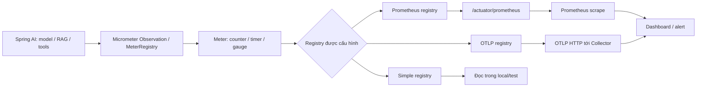

# Cấu hình registry xuất metric phù hợp môi trường

## 1. Bài toán: cùng một ứng dụng AI, không phải môi trường nào cũng xuất metric giống nhau

Trong dự án `SPRING_AI_EVALUATION_OBSERVABILITY`, một ứng dụng dùng Spring AI để gọi chat model, truy xuất RAG và thực thi tool. Nhóm phát triển muốn phát hiện khi relevance/factual correctness giảm sau một thay đổi prompt, đồng thời biết độ trễ, số token và chi phí có tăng hay không.

Ở máy phát triển, nhu cầu có thể chỉ là xem timer và counter sau vài request giả lập. Ở staging, nhóm kiểm thử cần Prometheus lấy mẫu để kiểm tra dashboard trước khi triển khai. Trong production, công ty có thể vận hành Prometheus hoặc một OpenTelemetry Collector chung, cần định tuyến số đo đến hệ thống tập trung có bảo mật và chính sách lưu trữ rõ ràng.

Nếu chỉ thêm dependency Micrometer rồi xem như telemetry đã hoàn thành, ta có thể gặp:

- Meter được tạo nhưng **không có registry xuất ra nơi giám sát**.
- Prometheus không scrape được vì sai port/path, thiếu quyền hoặc endpoint chưa expose.
- Ứng dụng tưởng đã gửi metric OTLP nhưng collector không nhận dữ liệu.
- Một metric có hàng triệu chuỗi thời gian vì gắn `userId`, `requestId` hay nội dung prompt vào tag.
- Dashboard thiếu token usage do model/provider không cung cấp hoặc instrumentation chưa phát sinh meter.
- Một lần thay đổi phiên bản Spring Boot/Spring AI làm tên meter hoặc khả năng export thay đổi mà không được kiểm chứng.

Vì vậy, chủ đề **“Cấu hình registry xuất metric phù hợp môi trường”** trong chương **Cấu hình telemetry** không chỉ là chọn thư viện. Ta phải hiểu mô hình xuất, nơi nhận, vòng đời meter, tính an toàn của nhãn và cách kiểm tra end-to-end.

### Mục tiêu học tập

Sau bài học, người học có thể:

1. Phân biệt `MeterRegistry`, meter, endpoint Actuator, exporter và backend giám sát.
2. Chọn giữa registry đơn giản phục vụ local/test, Prometheus kiểu pull và OTLP kiểu push.
3. Cấu hình dependency cùng Spring Boot properties theo từng môi trường mà không mở nhầm endpoint quản trị.
4. Thiết kế metrics phù hợp cho model, RAG, tool calling, token và độ trễ.
5. Kiểm soát tag cardinality, secrets, dữ liệu cá nhân và chi phí lưu trữ.
6. Kiểm chứng dữ liệu thực đến đúng registry/backend và đối chiếu với traces cùng kết quả đánh giá chất lượng.

## 2. Tư duy đúng về metric, meter và registry

Micrometer là lớp facade đo metrics thường dùng trong Spring Boot. Ứng dụng instrument một **meter** qua `MeterRegistry`; registry quản lý cách tổng hợp/xuất số liệu tới hệ thống quan sát.

| Khái niệm | Ý nghĩa | Ví dụ |
|---|---|---|
| **Meter** | Đối tượng đại diện cho một phép đo và tập tags | Counter số lần gọi tool, Timer độ trễ model |
| **MeterRegistry** | Tập trung đăng ký meter và nối với backend xuất số liệu | `SimpleMeterRegistry`, `PrometheusMeterRegistry`, `OtlpMeterRegistry` |
| **Counter** | Đếm số sự kiện tăng dần | Lần gọi API tool thành công/thất bại |
| **Timer** | Đo số lần thực thi và thời gian; có thể cung cấp phân phối | Độ trễ một pipeline RAG |
| **DistributionSummary** | Thống kê phân phối đại lượng không phải thời gian | Kích thước context hoặc số chunk |
| **Gauge** | Giá trị quan sát tại một thời điểm | Số request đang xử lý |
| **Tag / label** | Kích thước phân nhóm có tập giá trị cần kiểm soát | `operation=rag`, `outcome=error` |
| **Exporter / registry implementation** | Chuyển dữ liệu sang định dạng và giao thức backend | Prometheus scrape, OTLP HTTP export |
| **Backend** | Hệ thống nhận, lưu, truy vấn, hiển thị và cảnh báo | Prometheus, hệ thống nhận OTLP qua collector |

Sơ đồ đường đi phổ biến:



**Điểm cốt lõi:** Actuator `/actuator/metrics` dùng để **kiểm tra meter** khi endpoint được mở; nó không thay thế một hệ thống lưu trữ dài hạn. `/actuator/prometheus` phục vụ **scrape theo định dạng Prometheus**. Với OTLP, registry thông thường **gửi metric tới receiver** bằng cấu hình riêng, không cần mở `/actuator/prometheus`.

### Phân biệt metrics với kết quả đánh giá AI

Metric `http.server.requests` hay timer cho một lần gọi model có thể cho biết lỗi/độ trễ, nhưng không tự biết câu trả lời đã bịa chính sách hay chưa. Relevance, fact checking, retrieval correctness và tool correctness phải được chấm bằng **evaluation dataset, rubric, reference và observed trace**.

Nếu dự án muốn báo số lượng ca PASS/FAIL qua Micrometer, hãy thiết kế custom metrics **tổng hợp, cardinality thấp**; không gắn toàn bộ `caseId`, gold answer hoặc prompt vào metric tags.

## 3. Chọn registry theo môi trường và hạ tầng hiện có

| Lựa chọn | Mô hình | Phù hợp | Ưu điểm | Rủi ro / giới hạn |
|---|---|---|---|---|
| **Simple registry** | In-memory | Local, unit/integration test | Không cần backend mạng, dễ kiểm tra meter | Không phải nơi lưu metric production |
| **Prometheus registry** | Pull/scrape | Hệ thống đã có Prometheus; staging, production | Prometheus thu định kỳ và truy vấn time series | Cần endpoint, network, auth, scrape interval/cardinality |
| **OTLP registry** | Push HTTP | Collector hoặc observability platform nhận OTLP | Có thể gom/định tuyến telemetry qua collector | Cần receiver, retry/buffering, auth/TLS và giám sát export |
| **Registry vendor khác** | Tùy backend, thường push/agent | Tổ chức đã vận hành Datadog, CloudWatch, StatsD... | Kết nối stack hiện có | Tên dependency, config và giới hạn khác nhau theo registry |
| **Composite registry** | Ghi cùng meter tới nhiều registry | Chuyển đổi hệ thống, thử hai backend có kiểm soát | Giúp phát song song | Tốn tài nguyên, có thể trùng chi phí và dữ liệu |

**Không có registry tốt nhất cho tất cả môi trường.** Một quyết định hợp lý phải trả lời: ai nhận metric, scrape hay push, khả năng giữ dữ liệu, network topology, chi phí, quyền truy cập, thời gian lưu và quy tắc về nhãn.

### Ma trận quyết định ngắn

1. **Chỉ cần test logic instrument?** Dùng in-memory/simple hoặc test MeterRegistry thích hợp.
2. **Đã có Prometheus scrape nội bộ?** Dùng Prometheus registry và bảo vệ endpoint.
3. **Đã có collector nhận OTLP?** Xem xét OTLP registry với URL, bảo mật, quy tắc resource attributes và pipeline rõ.
4. **Nền tảng giám sát chỉ hỗ trợ giao thức/agent riêng?** Chọn registry được Spring Boot/Micrometer và backend đó hỗ trợ.
5. **Muốn xuất hai nơi?** Cần lý do cụ thể, kiểm tra duplicate streams và tài nguyên trước khi triển khai song song.

Không bật mọi registry “cho chắc”: nhiều exporter có thể khiến số đo bị ghi trùng ở hai backend, tăng traffic và gây khó diễn giải tổng lượng.

## 4. Simple registry cho local và kiểm thử

Trong môi trường local, yêu cầu thường là xác minh ứng dụng có tạo meter mà không cần dựng Prometheus hoặc Collector.

Ví dụ dependency Java/Gradle nếu muốn trực tiếp sử dụng registry đơn giản cho bài test:

```groovy
dependencies {
    implementation 'org.springframework.boot:spring-boot-starter-actuator'
    testImplementation 'io.micrometer:micrometer-core'
}
```

`SimpleMeterRegistry` thuộc Micrometer core; trong ứng dụng Spring Boot có Actuator/Micrometer, registry in-memory có thể được tự tạo khi không có exporter registry khác tùy cấu hình. Nhưng **không dựa vào giả định tự cấu hình** nếu muốn một unit test hoàn toàn xác định: tạo đối tượng registry riêng trong test.

Ví dụ JUnit độc lập với backend:

```java
import io.micrometer.core.instrument.Counter;
import io.micrometer.core.instrument.simple.SimpleMeterRegistry;
import org.junit.jupiter.api.Test;

import static org.junit.jupiter.api.Assertions.assertEquals;

class MetricsInstrumentationTest {

    @Test
    void recordsToolSuccessWithoutNetworkBackend() {
        try (SimpleMeterRegistry registry = new SimpleMeterRegistry()) {
            Counter counter = Counter.builder("app.ai.tool.calls")
                .tag("operation", "order_lookup")
                .tag("outcome", "success")
                .register(registry);

            counter.increment();
            counter.increment();

            assertEquals(2.0, counter.count());
        }
    }
}
```

Đây là **kiểm thử instrumentation**, không kiểm tra một Prometheus server có scrape thành công hay không. Không kết luận production monitoring đã hoạt động chỉ từ unit test của `SimpleMeterRegistry`.

### Khi nào không nên dùng Simple?

Simple registry không phải giải pháp mặc định để lưu history, so trend theo ngày hoặc cảnh báo production. Muốn xem p95 latency, xu hướng lỗi và tài nguyên sau nhiều lần deploy, cần backend metrics thực sự cùng chính sách retention. Trong local, kết quả biến mất khi ứng dụng ngừng chạy là bình thường.

## 5. Prometheus registry: ứng dụng công bố, server đến lấy

Với Prometheus, ứng dụng **không đẩy trực tiếp** từng request tới Prometheus server. Nó đưa metrics ra một HTTP endpoint để Prometheus **scrape** định kỳ.

### 5.1. Dependency

Gradle:

```groovy
dependencies {
    implementation 'org.springframework.boot:spring-boot-starter-actuator'
    runtimeOnly 'io.micrometer:micrometer-registry-prometheus'
}
```

Maven:

```xml
<dependency>
    <groupId>org.springframework.boot</groupId>
    <artifactId>spring-boot-starter-actuator</artifactId>
</dependency>
<dependency>
    <groupId>io.micrometer</groupId>
    <artifactId>micrometer-registry-prometheus</artifactId>
</dependency>
```

### 5.2. Ví dụ cấu hình Spring Boot

```yaml
spring:
  application:
    name: spring-ai-quality-service

management:
  endpoints:
    web:
      exposure:
        include: health,info,metrics,prometheus
  metrics:
    tags:
      application: spring-ai-quality-service
      environment: staging
```

Đây là **ví dụ cho môi trường staging được bảo vệ**, không phải cấu hình bảo mật đầy đủ. `exposure.include` chỉ quyết định endpoint xuất hiện qua HTTP; **không xác thực client**. Production cần giới hạn quyền và mạng cho `metrics`, `prometheus`, không chỉ dựa vào YAML.

Nếu Spring Boot/registry tương thích, endpoint:

```bash
curl -i http://localhost:8080/actuator/prometheus
```

có thể trả văn bản metric cho Prometheus. Nếu HTTP 404, kiểm tra registry dependency, endpoint có khả dụng và được expose không, base path/port có đúng không. Nếu 401/403, kiểm tra security — **không vô hiệu hóa bảo vệ để có 200**.

### 5.3. Bản cấu hình scraper minh họa

```yaml
# prometheus.yml minh họa; chỉ dùng trong mạng được phép
scrape_configs:
  - job_name: spring-ai-quality-service
    scrape_interval: 15s
    metrics_path: /actuator/prometheus
    static_configs:
      - targets: ["spring-ai-quality-service.internal:8080"]
```

Trong triển khai thực, target/port, TLS/auth và service discovery phải phù hợp hạ tầng. `15s` chỉ là chu kỳ ví dụ. Cấu hình scrape của Prometheus không tự giới hạn việc người dùng ngoài mạng có thể truy cập Actuator; cần ACL/firewall, ingress policy và cơ chế xác thực tương ứng.

### 5.4. Thời điểm một metric “xuất hiện”

Một meter như timer cho tool có thể chỉ được đăng ký sau khi tool được gọi. Nếu chưa có request nào kích hoạt đường xử lý, không thấy meter AI trong `/actuator/metrics` hoặc `/actuator/prometheus` **không nhất thiết có nghĩa exporter hỏng**. Cần gửi một request thử hợp lệ, rồi kiểm tra cả meter lẫn scrape target.

## 6. OTLP registry: đẩy metric tới Collector

Nếu tổ chức đã vận hành OpenTelemetry Collector hoặc một backend nhận OTLP, một lựa chọn là **Micrometer OTLP metrics registry**. Đây là luồng **metrics export**, tách biệt với việc cấu hình **distributed tracing exporter**.

### 6.1. Dependency

Gradle:

```groovy
dependencies {
    implementation 'org.springframework.boot:spring-boot-starter-actuator'
    runtimeOnly 'io.micrometer:micrometer-registry-otlp'
}
```

Maven:

```xml
<dependency>
    <groupId>org.springframework.boot</groupId>
    <artifactId>spring-boot-starter-actuator</artifactId>
</dependency>
<dependency>
    <groupId>io.micrometer</groupId>
    <artifactId>micrometer-registry-otlp</artifactId>
</dependency>
```

### 6.2. Cấu hình ví dụ cho Spring Boot 3.x có hỗ trợ auto-configuration OTLP registry

```yaml
spring:
  application:
    name: spring-ai-quality-service

management:
  endpoints:
    web:
      exposure:
        include: health
  otlp:
    metrics:
      export:
        url: http://otel-collector.internal:4318/v1/metrics
        step: 30s
  metrics:
    tags:
      application: spring-ai-quality-service
      environment: production
```

Chú ý kỹ: `management.otlp.metrics.export.url` và `management.otlp.metrics.export.step` là dạng cấu hình thường dùng khi Spring Boot hỗ trợ OTLP registry; **hãy kiểm tra lại metadata thuộc tính và auto-configuration của phiên bản Boot đang chạy**. Các phiên bản thư viện/backend có thể khác về endpoint, protocol, authentication và quyền đặt header. URL `http://...` trên chỉ để minh họa đường truyền **trong mạng tin cậy**; môi trường thật thường cần TLS và cơ chế xác thực phù hợp.

**Điểm khác Prometheus:** ứng dụng không cần expose `/actuator/prometheus` để OTLP registry đẩy metrics. Collector phải có receiver nhận **metrics** tại endpoint tương ứng và pipeline xuất tới backend. Có collector không đồng nghĩa collector đã cấu hình metrics receiver/exporter.

### 6.3. Giải thích step / chu kỳ export

Một số push registries gom số liệu và gửi theo chu kỳ. `step: 30s` là tham số ví dụ để điều khiển nhịp xuất ở những phiên bản hỗ trợ. Nó **không** có nghĩa mỗi request phải tạo một HTTP export ngay, cũng không bảo đảm dữ liệu luôn được nhận khi backend mất kết nối.

Khi chọn step, cân nhắc:

- Độ mới dữ liệu cần cho alert/dashboard.
- Tần suất request, tải CPU/network do export.
- Khả năng receiver và chính sách rate limit.
- Bản chất temporality/aggregation do Micrometer registry và collector xử lý.
- Cách ứng dụng ngừng chạy/khởi động lại có thể ảnh hưởng dữ liệu chưa flush.

**Không chọn chu kỳ xuất chỉ theo cảm giác “nhỏ hơn thì chính xác hơn”.** Tần suất quá dày có thể tăng overhead, trong khi thông tin cần cho quyết định chất lượng AI vẫn nằm trong dataset và traces chứ không phải ở từng lần flush metric.

### 6.4. OTLP metrics và OTLP traces là hai pipeline khác nhau

| Phần | Dữ liệu | Điều kiện cần |
|---|---|---|
| **OTLP metrics registry** | Meter aggregates: counters, timers, gauges | Registry dependency + config + metrics receiver/exporter |
| **Tracing bridge/exporter** | Spans, trace IDs, parent-child relationships | Tracing dependencies + sampling + trace receiver/exporter |
| **Logs** | Sự kiện và lỗi đã lọc dữ liệu riêng | Logger/appender/exporter phù hợp |

Chỉ thấy metrics ở collector không chứng minh đã có spans cho truy vấn RAG. Tương tự, tracing hoạt động không tự bảo đảm `micrometer-registry-otlp` đang gửi metrics.

## 7. Chọn push hay pull: những khác biệt vận hành quan trọng

| Tiêu chí | Prometheus pull | OTLP metrics push |
|---|---|---|
| Ai khởi tạo truyền dữ liệu? | Prometheus truy cập endpoint ứng dụng | Ứng dụng/registry gửi tới collector |
| Kết nối mạng | Scraper cần đến được app/management port | App cần đến được receiver URL |
| Ranh giới bảo mật | Bảo vệ endpoint scrape | Bảo vệ egress, receiver, TLS/auth |
| Chu kỳ | `scrape_interval` phía Prometheus | `step/export interval` phía registry |
| Cách quan sát lỗi | Scrape target DOWN, scrape error | Export error, collector receiver/backend pipeline |
| Tên/định dạng | Prometheus exposition/time series | OTLP data model và processor/exporter |
| Môi trường thường gặp | Prometheus hoặc hệ giám sát tương thích scrape | Collector tập trung hoặc backend nhận OTLP |

Một team sử dụng Prometheus có thể chọn OTLP qua collector ở một số kiến trúc, nhưng không nên coi hai pipeline đồng nhất về temporality, labels, histograms và network failure. Cần kiểm tra dữ liệu **sau khi nhận ở backend**, không chỉ kiểm tra request export thành công.

### Sự cố điển hình

Ứng dụng dùng OTLP ghi log “export succeeded”, nhưng dashboard không có meter AI. Cần kiểm tra:

1. Meter AI có thật sự được đăng ký sau một request AI không?
2. Registry có đúng class đang được Spring Boot khởi tạo không?
3. Collector có nhận metrics và xuất đúng backend không?
4. Bộ lọc hoặc mapping label có loại meter đó không?
5. Dashboard có dùng đúng tên metric và labels sau chuyển đổi không?

Không nên khắc phục bằng cách tăng quyền hoặc bật raw prompt logging; thiếu meter và thiếu dữ liệu bí mật là hai vấn đề khác nhau.

## 8. Quản lý registry theo profile: local, staging và production

Nên chốt lựa chọn registry dựa trên **môi trường triển khai thật**, không dựa vào người lập trình tình cờ có dependency nào trong classpath.

| Môi trường | Lựa chọn thực hành | Mục tiêu kiểm chứng |
|---|---|---|
| **Unit test** | `SimpleMeterRegistry` trực tiếp | Counter/timer được cập nhật đúng |
| **Local** | Simple hoặc Prometheus cục bộ | Debug meter, nhìn giá trị sau test request |
| **Staging** | Cùng kiểu registry với production khi có thể | Kiểm tra scrape/export, tags, histogram, quyền |
| **Production Prometheus** | Prometheus registry | Thu metrics qua mạng quản trị, theo dõi error/latency |
| **Production Collector** | OTLP registry | Collector nhận/export metrics ổn định và an toàn |

Đừng để local config dùng URL/credentials production. Không commit secret của monitoring backend vào YAML.

### Ví dụ profile local dùng Prometheus để khám phá

```yaml
# Nội dung minh họa của application-local.yml
management:
  endpoints:
    web:
      exposure:
        include: health,info,metrics,prometheus
  metrics:
    tags:
      environment: local
```

### Ví dụ profile production với OTLP metrics

```yaml
# Nội dung minh họa của application-prod.yml
management:
  endpoints:
    web:
      exposure:
        include: health
  otlp:
    metrics:
      export:
        url: https://otel-collector.example.invalid/v1/metrics
        step: 30s
  metrics:
    tags:
      environment: production
```

Tên miền `example.invalid` chỉ là placeholder không có endpoint thật. Production cần thiết lập cơ chế truy cập an toàn cho exporter bằng secret manager, mạng và TLS thích hợp. **Không tạo đồng thời Prometheus và OTLP chỉ vì hai ví dụ cùng xuất hiện trong bài**; phải chọn dependency và profile tương ứng, hoặc vô hiệu hóa registry không dùng theo cách được phiên bản Boot hỗ trợ.

### Kiểm tra effective configuration

Một giá trị có thể bị ghi đè bởi profile khác, biến môi trường, chart Helm hoặc container settings. Sau triển khai, cần xác minh:

- Profile thực được bật.
- Registry được tạo là loại mong muốn.
- URL receiver hoặc địa chỉ scrape đúng với môi trường.
- Endpoint quản trị exposed/authorized như dự định.
- Không có exporter thừa đang gửi ra ngoài môi trường.

## 9. Nhiều registry trong cùng ứng dụng: cơ hội và bẫy

Micrometer có cơ chế composite registry cho nhiều backend. Đây là tính năng hữu ích khi cần chuyển đổi hệ thống quan sát hoặc thử nghiệm song song trong thời gian giới hạn.

Tuy nhiên, nhiều registry có thể tạo vấn đề:

- Cùng sự kiện được xuất tới hai backend với cùng nhãn; dashboard tổng hợp có thể đếm trùng nếu đồng bộ dữ liệu về một nơi.
- Prometheus scrape nhanh trong khi OTLP export theo step dài khiến hai đồ thị khác nhịp.
- Histogram và percentile cấu hình khác nhau tạo metric series khác nhau.
- Dự án quên tắt registry cũ sau migration, gây tăng network/storage cost.
- Những cấu hình tự động không thống nhất khiến meter chỉ được xuất ở một backend.

Khi bắt buộc xuất song song, ghi rõ:

1. Tại sao cần hai registry, thời hạn chuyển đổi và nguồn dữ liệu chính.
2. Những metric nào được phép xuất ở mỗi nơi.
3. Quy tắc tên, tags, histogram và aggregation.
4. Cách kiểm tra bản ghi không bị đếm đôi.
5. Kế hoạch tắt exporter cũ và xác minh sau khi chuyển đổi.

Không giả định cấu hình dual-export sẽ giống nhau ở mọi phiên bản Spring Boot. Kiểm tra danh sách MeterRegistry beans và quan sát end-to-end trong môi trường tương thích production.

## 10. Thiết kế metric có ý nghĩa cho pipeline Spring AI

Đánh giá chất lượng theo relevance, fact checking và các ca RAG/tool gọi công cụ cần **hai loại thông tin**:

- **Sự kiện nghiệp vụ/evaluation:** ca PASS/FAIL, hard gate, gold evidence, quyết định của evaluator.
- **Metric vận hành:** request count, error rate, duration, token usage và tài nguyên.

Không phải mọi chi tiết của evaluator nên được biến thành time series. Chỉ tạo meter cho phần **tổng hợp có thể cảnh báo**:

| Metric theo mục đích | Loại | Tags gợi ý (tập giá trị giới hạn) |
|---|---|---|
| Lượt chạy pipeline | Counter | `pipeline=rag/tool`, `outcome=success/error` |
| Độ trễ pipeline | Timer | `pipeline=rag/tool` |
| Lỗi tool | Counter | `tool_family=order_read/write`, `error_type=timeout/not_found/forbidden` |
| Số chunk trả về | DistributionSummary | `retriever=policy_index` |
| Lượt đánh giá FAIL | Counter | `task_type=rag/tool`, `severity=P0/P1/P2` |
| Số token | Counter hoặc DistributionSummary, nếu có số liệu thật | `direction=input/output`, `model_family` |

Những tên metric trong bảng là **gợi ý thiết kế**, không phải tên meter mặc định do Spring AI tự xuất. Đối với meter của Spring AI, cần kiểm tra instrumentation được phiên bản hiện tại cung cấp. Provider có thể không trả token usage ở mọi chế độ stream hoặc không có dữ liệu phí thực tế.

### Không lưu prompt hoặc mã người dùng trong metric labels

Một câu trả lời RAG dài có thể chứa dữ liệu khách hàng. Nếu gắn `userMessage`, `promptText`, `orderId`, `traceId` hoặc `caseId` duy nhất làm metric tag, sẽ xuất hiện:

- **High cardinality:** số tổ hợp time series tăng theo mỗi request.
- **Rủi ro riêng tư:** nhãn được scrape, query hoặc lưu trữ ở backend nhiều nơi.
- **Chi phí tăng:** memory, CPU, network, indexing và retention.

Thay vào đó, dùng tags đã chuẩn hóa như `operation=rag`, `environment=staging`, `outcome=error`. Để điều tra một `caseId` hoặc `traceId` cụ thể, dùng trace backend và kho evaluation có quyền hạn.

## 11. Ví dụ custom metrics cho một bước xử lý AI

Đoạn Java sau dùng API Micrometer thông dụng để ghi tổng số lần gọi và thời gian thực thi một nhánh ứng dụng. Đây là ví dụ **tự instrument**; không tự động thay thế những observations đã có từ Spring AI.

```java
import io.micrometer.core.instrument.Counter;
import io.micrometer.core.instrument.MeterRegistry;
import io.micrometer.core.instrument.Timer;
import java.util.function.Supplier;
import org.springframework.stereotype.Component;

@Component
public class AiPipelineMetrics {
    private final MeterRegistry registry;

    public AiPipelineMetrics(MeterRegistry registry) {
        this.registry = registry;
    }

    public <T> T record(String pipeline, Supplier<T> action) {
        // Allowlist để giới hạn cardinality, không dùng ID/prompt tự do.
        String safePipeline = switch (pipeline) {
            case "rag" -> "rag";
            case "tool" -> "tool";
            default -> "other";
        };

        Timer.Sample sample = Timer.start(registry);
        String outcome = "success";

        try {
            return action.get();
        } catch (RuntimeException exception) {
            outcome = "error";
            throw exception;
        } finally {
            Counter.builder("app.ai.pipeline.calls")
                .tag("pipeline", safePipeline)
                .tag("outcome", outcome)
                .register(registry)
                .increment();

            sample.stop(
                Timer.builder("app.ai.pipeline.duration")
                    .description("Wall-clock duration of an AI pipeline")
                    .tag("pipeline", safePipeline)
                    .register(registry)
            );
        }
    }
}
```

Ví dụ ứng dụng:

```java
// chatService.callRag(...) là nghiệp vụ minh họa của dự án.
String answer = aiPipelineMetrics.record(
    "rag",
    () -> chatService.callRag("Chính sách đổi trả là gì?")
);
```

Điểm cần hiểu:

- Dữ liệu thời gian của `Timer` phù hợp với duration, không phải một `Gauge` chứa thời gian cuối cùng.
- Counter `outcome` chỉ có hai giá trị minh họa, không chứa mã lỗi tùy ý làm tag.
- Trong ví dụ, lỗi `RuntimeException` được đánh dấu error và ném tiếp. Nếu code trả fallback thành công thay vì throw, cần tự định nghĩa `outcome` phù hợp để không che lỗi.
- Timer luôn được dừng ở `finally`; phải xem phạm vi đo đã bao gồm các bước cần so hay chưa.
- Không tạo timer riêng có tên/nhãn chứa từng input hoặc tên người dùng.
- Spring AI có thể đã cung cấp meter cho một phần operation. **Tránh đo trùng cùng một phạm vi và cộng các thời gian như thể độc lập.**

### Kiểm tra metric tự tạo

Sau ít nhất một lần gọi service trên môi trường có Actuator và quyền truy cập:

```bash
curl -i http://localhost:8080/actuator/metrics/app.ai.pipeline.calls
curl -i http://localhost:8080/actuator/metrics/app.ai.pipeline.duration
```

Nếu endpoint không trả tên meter như mong đợi, kiểm tra code đã đi vào phương thức `record`, registry được inject, exposure và phiên bản runtime. Mã này tạo metrics ở tầng tổng hợp, **không chấm câu trả lời có đúng hay không**.

## 12. Histogram, percentile và SLO: chọn độ chi tiết đúng

Độ trễ trung bình có thể che những request rất chậm. Với RAG hoặc agent gọi nhiều tool, `p95` hay `p99` có ích hơn khi đánh giá trải nghiệm đuôi phân phối.

### Phân biệt cách đo

| Chỉ số | Phản ánh | Rủi ro diễn giải |
|---|---|---|
| Mean latency | Tổng thời gian / số request | Che request rất chậm |
| p50 | Phân vị trung vị | Không phản ánh tail latency |
| p95 | 95% mẫu không vượt mốc này theo bộ dữ liệu đo | Cần biết cửa sổ thời gian và cỡ mẫu |
| p99 | Tail rất cao | Dễ dao động mạnh khi mẫu ít |
| Histogram buckets | Số mẫu theo các ngưỡng độ trễ | Tăng số time series, cần chọn buckets hợp lý |
| SLO threshold | Ngưỡng dịch vụ muốn đáp ứng | Không có nghĩa tự động là hard gate chất lượng AI |

Với Prometheus, **histogram** có thể được tổng hợp qua nhiều instance để tính phân vị từ bucket. Client-side percentiles không có tính cộng gộp tương tự, nên cần thận trọng khi đưa lên dashboard tập trung.

Một cấu hình ví dụ cho các HTTP timers ở những phiên bản Spring Boot hỗ trợ tương ứng:

```yaml
management:
  metrics:
    distribution:
      percentiles-histogram:
        http.server.requests: true
      slo:
        http.server.requests: 250ms,500ms,1s,2s
```

Các ngưỡng chỉ minh họa. Trước khi áp dụng trên production, xác minh:

1. Meter thực sự có tên `http.server.requests` trong phiên bản ứng dụng.
2. Spring Boot nhận các thuộc tính này qua configuration binding.
3. Các bucket được xuất đúng bởi registry đang dùng.
4. Mức tăng số time series và chi phí lưu trữ chấp nhận được.
5. Ngưỡng SLO phản ánh yêu cầu người dùng, không phải chọn tùy tiện.

Không mở histogram cho tất cả timers khi chưa biết số tag combinations. Với pipeline AI, có thể cần timer ở tầng request tổng và timer riêng cho retrieval/model/tool để biết bottleneck; định nghĩa phạm vi đo tránh tính trùng thời gian lồng nhau.

## 13. Token usage, chi phí và những gì registry không tự biết

Trong ứng dụng Spring AI, lượng token có thể được cung cấp qua usage metadata hoặc observation tùy model/provider và chế độ gọi. **Không mặc định có số token ở mọi request**, nhất là khi stream, retry hoặc provider trả metadata không đầy đủ.

Một báo cáo chi phí có thể cần:

| Dữ liệu | Nguồn cần có | Lưu ý |
|---|---|---|
| Input tokens | Usage thực từ model hoặc đo đã kiểm chứng | Không tự suy từ số ký tự |
| Output tokens | Usage thực từ model | Có thể thiếu trong một số luồng |
| Model/provider/version | Cấu hình và metadata thực thi | Pricing thay theo model và thời điểm |
| Số lần gọi/attempt | Trace model và retry events | Một user request có thể dùng nhiều model calls |
| Đơn giá | Bảng giá/contract có hiệu lực | Quy đổi tiền tệ phải có mốc và tỷ giá |
| Tổng chi phí | Công thức áp trên số liệu thật | Nêu rõ phần thiếu và giả định |

Ví dụ công thức khi có usage và đơn giá theo 1 triệu token:

```text
estimated_cost
  = input_tokens  * price_per_million_input  / 1_000_000
  + output_tokens * price_per_million_output / 1_000_000
```

Không coi công thức đơn giản này là bảng giá áp dụng cho mọi provider: caching, batch, reasoning tokens hoặc các hình thức tính phí khác có thể làm hóa đơn thật khác số ước lượng. Nếu dữ liệu chưa đủ, ghi **“chưa tính được”**, không điền chi phí bằng số giả.

Registry giúp **xuất usage metric đã được instrument**, không tạo usage từ không khí. Với chi phí theo từng run, có thể giữ số chi tiết trong kho evaluation/trace có quyền truy cập rồi xuất tổng hợp an toàn lên dashboard.

## 14. Quan sát lỗi export: từ ứng dụng đến dashboard

Một cấu hình YAML đúng về mặt cú pháp vẫn có thể không có dữ liệu trong backend. Phân biệt các tầng:

| Tầng | Câu hỏi kiểm tra | Dấu hiệu khi sai |
|---|---|---|
| **Instrumentation** | Meter có được đăng ký sau request AI không? | Actuator metrics không có tên meter |
| **Registry** | Có đúng bean/implementation không? | Chỉ in-memory, không xuất backend |
| **Transport** | Scrape/HTTP export có thành công không? | Scrape DOWN, connection refused, timeout |
| **Collector** | Có metrics receiver và exporter đúng pipeline không? | Dữ liệu đến collector nhưng không ra backend |
| **Backend** | Metric được lưu, labels và tên đúng không? | Ingest bị lọc, query sai metric |
| **Dashboard** | Cửa sổ thời gian và PromQL/query có đúng không? | Dữ liệu hiện có nhưng panel “No data” |
| **Data quality** | Tags/cardinality/temporality/histogram có phù hợp không? | Tỷ lệ/tổng số và phân vị sai |

### Chẩn đoán Prometheus

1. Chạy request AI mẫu để meter xuất hiện.
2. Đọc `/actuator/metrics` bằng quyền được cấp.
3. Đọc `/actuator/prometheus` từ vị trí scraper có thể truy cập.
4. Kiểm tra trạng thái scrape target trong Prometheus.
5. Query metric ở Prometheus với tên label đúng.
6. Kiểm tra chart time range, scrape interval, series count và cảnh báo cardinality.

### Chẩn đoán OTLP

1. Kiểm tra dependency `micrometer-registry-otlp` và registry được khởi tạo.
2. Kiểm tra URL/port/protocol, TLS/auth và network egress.
3. Kiểm tra collector nhận metrics ở receiver tương ứng.
4. Kiểm tra collector pipeline processors/exporters và lỗi retry/drop.
5. Kiểm tra backend ingestion và mapping tên/nhãn.
6. Theo dõi metrics/logs của exporter (đã giảm dữ liệu) để phát hiện lỗi kéo dài.

**Đừng đổi 404/401/403 thành 200 bằng cách mở toàn bộ endpoint hoặc tắt bảo mật.** Điều tra đúng tầng nguyên nhân.

## 15. Kiểm soát riêng tư, cardinality và ngân sách lưu trữ

Metric “tổng hợp” vẫn có thể lộ dữ liệu nếu tags được lấy từ input tự do. Trước khi thêm meter mới, hãy trả lời:

- Tên metric là gì? Đo điều gì và đơn vị ra sao?
- Tags có các giá trị hữu hạn được quản lý không?
- Có dữ liệu cá nhân, mã đơn, mã tài khoản hoặc nội dung prompt trong metric không?
- Có thể tổng hợp theo group ít rủi ro mà không cần ID cá nhân không?
- Có bao nhiêu tổ hợp tag × histogram buckets × service instances?
- Tần suất export/scrape và thời gian lưu là bao lâu?
- Những role nào được xem dashboard và raw telemetry?

Ví dụ nếu một timer có 5 giá trị `operation`, 4 giá trị `outcome` và 3 giá trị `environment`, đã có **60 tổ hợp nhãn** trước khi xét instance và histogram buckets. Nếu thêm `userId` có 100.000 giá trị, số chuỗi có thể tăng theo cấp số nhân so với mục đích ban đầu.

Đối với metric tổng số lỗi, một nhãn `error_type=timeout/not_found/forbidden/other` hữu ích hơn `exception_message` chứa chuỗi tự do. Cụ thể một lỗi `orderId=...` nên tra ở trace/kho log có ACL, không ở Prometheus label.

### Phát sinh dữ liệu nhạy cảm từ tracing là bài toán khác

Giới hạn metric tags không tự động lọc raw prompt/completion trong traces. Có thể cần cấu hình Micrometer Tracing, OpenTelemetry exporter, SDK logging và hệ thống lưu theo một chính sách privacy riêng. Registry metrics không thay thế kiểm soát trace payload.

## 16. Kết nối registry với đánh giá chất lượng Spring AI

Giả sử nhóm chốt dataset 100 ca, gồm câu hỏi FAQ, trường hợp biên RAG và tool calling. Hai ứng viên:

- **Ứng viên A:** prompt ngắn, `topK=4`, một model.
- **Ứng viên B:** prompt nhiều hướng dẫn grounding, `topK=8`, cùng model.

Sau khi chạy trên **cùng phiên bản dataset, tài liệu, fixture và rubric**, kết quả minh họa:

| Chỉ số | A | B | Nguồn kết quả |
|---|---:|---:|---|
| Factual correctness | 90/100 | 94/100 | Evaluator đối chiếu reference |
| Retrieval success | 88/100 | 93/100 | Gold evidence + observed retrieved docs |
| Lỗi hard gate P0 | 0 | 0 | Tool events, criteria |
| p95 end-to-end latency | 1,7 giây | 2,6 giây | Metrics/backend + span trace |
| Tokens trung bình | 820 | 1.420 | Provider usage nếu có |
| Ước tính chi phí | Chưa có | Chưa có | Chưa đủ dữ liệu giá/usage để tính |

Tất cả giá trị **chỉ minh họa**, không phải kết quả đo từ hệ thống thật.

Phân tích đúng:

1. Evaluator xác nhận B cải thiện accuracy/grounding trên tập ca cố định.
2. Registry xuất latency, error rates và token aggregate để nhìn xu hướng.
3. Traces chỉ ra B chậm do truy xuất nhiều chunk hơn, model xử lý prompt dài hơn hay tool retries.
4. Đối chiếu version của prompt, model, index, tool fixture và rubric để không nhầm thay đổi cấu hình với regression.
5. So với SLO và ngân sách đã đặt trước để quyết định có chấp nhận trade-off hay không.

**Registry nào xuất metrics tốt hơn không có nghĩa model sẽ trả lời đúng hơn.** Chọn registry giải quyết độ tin cậy của telemetry; chọn prompt/model/retrieval giải quyết chất lượng ứng dụng.

## 17. Bộ quy tắc chấp nhận cấu hình registry

| Tiêu chí | Kiểm tra thực tế |
|---|---|
| **Registry đúng môi trường** | Local/test không gửi về backend production; prod dùng registry đã phê duyệt |
| **Dữ liệu tới backend** | Prometheus scrape UP hoặc collector/backend xác nhận nhận metric |
| **Có meter cần đo** | Sau request RAG/tool, meter thật xuất hiện |
| **Tên và units rõ ràng** | Timer theo đơn vị thời gian, counter tăng hợp lý |
| **Cardinality kiểm soát** | Không có ID request/người dùng hoặc prompt trong labels |
| **An toàn transport** | Endpoint scrape hoặc OTLP receiver được bảo vệ |
| **Độ trễ telemetry hợp lý** | Sampling/scrape/export step đáp ứng mục tiêu giám sát |
| **Histogram/SLO** | Bucket được kiểm tra, không tăng chi phí không kiểm soát |
| **Không double counting** | Không cộng cùng sự kiện từ hai registries thành một lần |
| **Không rò nội dung nhạy cảm** | Metric/trace/log kiểm tra theo chính sách dữ liệu |
| **Khả năng truy nguyên** | Dashboard hỗ trợ mở trace và case/evaluation result được phân quyền |
| **Tính ổn định sau nâng cấp** | Tên meter, binding, registry và exporter được kiểm thử sau upgrade |

Các điều kiện phát hành telemetry nên được tự động hóa ở mức có thể: smoke test endpoint, thử scrape/export bằng môi trường giả, xem số metric series, bảo mật đường mạng và xác minh tags.

## 18. Bài thực hành

Bạn có ứng dụng Spring Boot dùng Spring AI trả lời chính sách đổi trả bằng RAG, có tool `get_order_status` chỉ đọc. Yêu cầu:

- Unit test kiểm tra code ghi timer/counter mà không cần backend mạng.
- Staging đang có Prometheus.
- Production có OpenTelemetry Collector nhận OTLP metrics; endpoint quản trị không được mở cho người dùng ngoài.
- Nhóm QA muốn theo dõi p95 latency, tổng lỗi tool, token usage nếu provider cung cấp và số regression FAIL theo mức rủi ro.

Hãy thực hiện:

1. Chọn registry cho unit test, staging và production; nêu rõ lý do.
2. Thêm các dependency phù hợp cho từng lựa chọn. Tránh vô tình mang exporter của staging vào production khi không cần.
3. Viết nội dung cấu hình staging cho `prometheus` và production cho OTLP, trong đó chỉ expose những endpoint được phê duyệt.
4. Chạy một request RAG và một request tool giả, kiểm tra meter xuất hiện ở `/actuator/metrics` hoặc trong registry local.
5. Ở staging, thử đọc `/actuator/prometheus` và trạng thái scrape target.
6. Ở production thử nghiệm, kiểm tra metrics receiver, exporter và backend nhận dữ liệu OTLP.
7. Ghi một custom Timer cho `pipeline=rag/tool`, chỉ dùng tags có tập giá trị nhỏ.
8. Cấu hình hoặc thiết kế histogram cho latency, giải thích cách tính p95 từ backend.
9. Lập danh sách label bị cấm, bao gồm `promptText`, `userId`, `orderId`, `requestId` và thông tin bí mật.
10. Chạy cùng dataset với prompt A/B, so kết quả relevance/factual correctness/hard gates cùng latency/tokens.

### Câu hỏi tự kiểm

**Câu 1:** `/actuator/prometheus` không có metric AI nhưng vẫn có metric JVM. Kết luận registry hỏng được chưa?

**Chưa.** Kiểm tra đường xử lý AI đã chạy, Spring AI instrumentation/version và usage provider.

**Câu 2:** OTLP metrics export thành công nhưng không có distributed traces. Có mâu thuẫn không?

**Không.** Metrics registry và tracing bridge/exporter là hai pipeline cần cấu hình riêng.

**Câu 3:** Vì sao một `Timer` có tag `caseId` với hàng chục nghìn ID gây vấn đề?

**Vì** mỗi tổ hợp label tạo thêm time series, tăng lưu trữ và có nguy cơ lộ dữ liệu chi tiết.

**Câu 4:** B có 95% PASS nhưng p95 latency vượt SLO. Có nên tự động chọn B không?

**Không.** Cần cân đối chất lượng, hard gates, độ trễ và chi phí theo tiêu chí đã khóa trước khi chạy.

## 19. Checklist trước khi phát hành

- [ ] Đã xác định backend/collector và protocol cần dùng theo môi trường.
- [ ] Dependency Micrometer registry tương thích với Spring Boot và không thừa exporter.
- [ ] Unit test dùng registry cục bộ, không gửi dữ liệu ra môi trường thật.
- [ ] Prometheus registry có endpoint scrape khi cần; endpoint được bảo vệ.
- [ ] OTLP registry có receiver đúng URL/protocol, TLS/auth và pipeline backend hợp lệ.
- [ ] Đã xác minh khác biệt giữa pull/scrape interval và push/export step.
- [ ] Đã chạy request mẫu để meter AI xuất hiện, không suy đoán tên meter.
- [ ] Metric names/units/tags được định nghĩa và tài liệu hóa rõ ràng.
- [ ] Không dùng ID riêng, prompt, câu trả lời hoặc thông tin cá nhân làm tags.
- [ ] Histogram và ngưỡng SLO phù hợp cỡ mẫu, độ trễ và chi phí series.
- [ ] Token usage có nguồn thật; chi phí ước tính có bảng giá hợp lệ hoặc để trống.
- [ ] Không nhầm metrics registry với backend tracing hoặc hệ thống đánh giá chất lượng.
- [ ] Có smoke test từ app tới Prometheus/Collector và kiểm tra backend đã lưu series.
- [ ] Có dashboard theo lỗi/latency/tokens, đồng thời xem result relevance, factual correctness, RAG/tool hard gates.
- [ ] Đã kiểm tra bảo mật endpoint, egress, secret quản trị, logs/traces và retention.
- [ ] Có metadata version của ứng dụng, Spring Boot/Spring AI, registry và evaluation run.
- [ ] Có phương án kiểm tra registry, tên meter và histogram sau mỗi lần nâng cấp.

**Kết luận:** cấu hình registry cho Spring AI phải xuất phát từ nhu cầu của từng môi trường và hệ thống nhận metrics, chứ không chỉ từ việc thêm dependency. `SimpleMeterRegistry` thuận tiện cho local/test; Prometheus dùng cơ chế pull/scrape; OTLP phù hợp pipeline push đến collector. Khi kiểm soát cardinality, quyền truy cập, chu kỳ xuất và provenance, metrics mới giúp theo dõi độ trễ, token và chi phí một cách đáng tin, kết hợp với traces và evaluation datasets để tìm nguyên nhân suy giảm chất lượng giữa các phiên bản prompt, model và RAG/tool pipeline.
