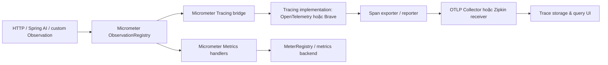

# Thiết lập tracing bridge và bộ xuất trace

## 1. Vì sao ứng dụng Spring AI cần distributed tracing?

Một request hỏi chính sách đổi trả có thể đi qua HTTP controller, bộ định tuyến yêu cầu, retriever của RAG, vector store, chat model, công cụ tra cứu đơn hàng rồi quay lại model để tạo câu trả lời. Khi người dùng báo “trả lời sai và mất hơn 10 giây”, chỉ nhìn tổng thời gian HTTP không đủ biết nguyên nhân.

Trong module `SPRING_AI_EVALUATION_OBSERVABILITY`, ta muốn đồng thời:

- **Đánh giá chất lượng** bằng dataset, reference và các tiêu chí relevance, factual correctness, grounding, tool correctness.
- **Đo hoạt động** bằng metrics, traces, token usage, chi phí và độ trễ.
- **So sánh phiên bản** prompt, model, retriever, tool adapter mà vẫn truy ra bước gây regression.

**Distributed tracing** cho phép nối các bước của một request thành một cây/span graph có tương quan, ngay cả khi request đi qua nhiều dịch vụ. Trong Spring Boot, cầu nối thường dùng là **Micrometer Tracing**: nối các quan sát từ Micrometer Observation với một tracing implementation như OpenTelemetry hoặc Brave, sau đó gửi spans qua exporter tới một backend.

| Câu hỏi | Tín hiệu phù hợp | Ví dụ |
|---|---|---|
| Trong 5 phút qua p95 latency tăng bao nhiêu? | **Metrics** | Timer HTTP/model/retrieval |
| Một request cụ thể bị chậm ở đâu? | **Trace** | Vector search 2 giây, chat model 7 giây |
| Agent có gọi `cancel_order` khi người dùng chỉ hỏi trạng thái không? | **Tool events + trace + evaluator** | Phát hiện side effect trái ý định |
| Model có bịa điều kiện chính sách không? | **Gold reference + evidence + evaluator** | Claim không được tài liệu hỗ trợ |
| Tại sao chi phí một luồng tăng? | **Usage + traces + cấu hình giá** | Agent gọi model ba lần vì retry |

**Trace không phải đáp án vàng.** Trace giúp biết hệ thống đã làm gì; evaluator mới đối chiếu hành vi đó với điều kiện đúng của ca kiểm thử. Một câu trả lời có thể nhanh và có trace đầy đủ nhưng vẫn sai sự thật.

### Kết quả học tập

Sau bài này, người học có thể:

1. Giải thích trace, span, span context, propagation và sampling.
2. Vẽ được tuyến `Observation → tracing bridge → exporter → collector/backend`.
3. Chọn OpenTelemetry/OTLP hoặc Brave/Zipkin phù hợp, không trộn hai bridge tùy tiện.
4. Cấu hình một ví dụ Spring Boot 3.x có Spring AI để xuất trace.
5. Kiểm tra liên kết span HTTP → model/RAG/tool và bối cảnh khi qua HTTP, thread hoặc queue.
6. Truy vết `runId/caseId/attemptId/traceId` an toàn từ bộ đánh giá tới backend.
7. Kiểm soát sampling, quyền truy cập, nội dung nhạy cảm và chi phí telemetry.
8. Chẩn đoán tình huống có metrics nhưng không có traces hoặc span bị đứt quan hệ.

## 2. Nắm vững trace, span và mối quan hệ cha–con

| Thuật ngữ | Ý nghĩa | Ví dụ Spring AI |
|---|---|---|
| **Trace** | Toàn bộ đường thực thi liên quan đến một luồng xử lý, cùng trace ID | Một lần hỏi trợ lý về đơn hàng |
| **Span** | Một đơn vị công việc có thời điểm bắt đầu/kết thúc, tên, trạng thái và thuộc tính | HTTP request, vector search, model invocation |
| **Trace ID** | Định danh giúp nối các spans thuộc cùng trace | Mã truy tìm trong trace backend |
| **Span ID** | Định danh một span cụ thể | Span của lời gọi `get_order_status` |
| **Parent span** | Span bao chứa/tạo ngữ cảnh cho span con | HTTP request là parent của orchestration |
| **Span attributes** | Metadata gắn vào span để lọc/điều tra | `operation=rag`, trạng thái lỗi đã chuẩn hóa |
| **Span events** | Những mốc sự kiện trong span | Retry bắt đầu, timeout, fallback |
| **Context propagation** | Mang trace/span context qua thread, HTTP hoặc dịch vụ | HTTP client truyền `traceparent` |
| **Sampling** | Quy tắc chọn request/trace nào được ghi và xuất | Thu 100% trong local, tỷ lệ hạn chế ở production |

Một ví dụ cây trace khi agent dùng RAG và tool:

```text
Trace ID: <opaque id, minh họa>
└── HTTP POST /ask                         10.2 s
    └── app.ai.answer                     10.0 s
        ├── rag.retrieve                   0.7 s
        │   └── vector-db.query            0.6 s
        ├── chat-model.call                3.8 s
        ├── tool.get_order_status          0.5 s
        │   └── http.client.order-api      0.4 s
        └── chat-model.call                4.8 s
```

Tên span, thời lượng và thứ tự đều **minh họa**, không phải spans mặc định được bảo đảm bởi mọi phiên bản Spring AI. Thực tế một mô hình có thể tạo ít hơn hoặc nhiều hơn tùy instrumentation, tool loop, streaming và framework.

### Tại sao không cộng tùy tiện mọi span duration?

Parent span có thể bao phủ thời gian của child spans; các child còn có thể chạy song song. Nếu cộng thời lượng của tất cả span như những phần độc lập, tổng có thể lớn hơn thời gian người dùng chờ. Để xác định bottleneck, cần xem **timeline**, quan hệ cha–con, phần chồng lắp và critical path.

Khi so hai cấu hình prompt/model, quan sát tổng end-to-end latency bằng metrics và phân rã theo trace; không chỉ cộng duration trên bảng spans.

## 3. Cấu trúc nền tảng: Observation, bridge, exporter và backend

Trong Spring Boot dùng Micrometer, có thể hiểu đường đi như sau:



**Từng khâu có nhiệm vụ riêng:**

1. **Instrumentation/Observation:** ứng dụng hoặc thư viện đánh dấu một operation có thể quan sát.
2. **ObservationRegistry:** điều phối các Observation handlers đã đăng ký.
3. **Tracing bridge:** liên kết Micrometer Observation với Tracer cụ thể.
4. **Tracer:** tạo span, giữ span context và quy tắc sampling/propagation theo implementation.
5. **Exporter/reporter:** vận chuyển spans tới một receiver hoặc hệ thống thu.
6. **Collector/backend:** nhận, xử lý, lưu trữ, truy vấn hoặc hiển thị spans.

Chỉ thêm Actuator không bảo đảm có tracing bridge. Chỉ thêm bridge không bảo đảm spans được gửi tới một backend. Và chỉ có một backend chạy cũng không bảo đảm Spring AI đã tạo các spans chi tiết mà nhóm muốn xem.

### Phân biệt với Micrometer metrics registry

| Thành phần | Xuất loại dữ liệu nào? | Ví dụ dependency/cấu hình |
|---|---|---|
| `micrometer-registry-prometheus` | **Metrics** kiểu Prometheus | `/actuator/prometheus` |
| `micrometer-registry-otlp` | **Metrics** qua OTLP | OTLP metrics receiver |
| `micrometer-tracing-bridge-otel` | **Traces** qua OpenTelemetry instrumentation | Kết hợp tracing exporter |
| `opentelemetry-exporter-otlp` | **Spans/traces** tới OTLP collector qua cấu hình phù hợp | OTLP traces receiver |
| `micrometer-tracing-bridge-brave` | **Traces** qua Brave | Kết hợp Zipkin reporter khi chọn Zipkin |

Đặc biệt, cấu hình `management.otlp.metrics.export.*` cho **metrics** không tự tạo pipeline xuất **traces**. Hai loại tín hiệu có thể dùng chung collector nhưng sử dụng các receiver/pipeline khác nhau.

## 4. Chọn một tracing bridge phù hợp

Micrometer Tracing hỗ trợ nhiều tracing implementations. Hai hướng thông dụng trong hệ sinh thái Spring Boot:

| Hướng | Khi phù hợp | Cần kiểm soát |
|---|---|---|
| **OpenTelemetry bridge + OTLP exporter** | Tổ chức dùng OpenTelemetry Collector hoặc backend tiếp nhận OTLP | Giao thức, endpoint traces, TLS/auth, resource/service metadata |
| **Brave bridge + Zipkin reporter** | Tổ chức đã vận hành Zipkin hoặc có hệ thống dựa trên Brave | Reporter, endpoint Zipkin, propagation format, tương thích các client |

Nếu hệ thống hiện đã có OpenTelemetry Collector, chọn OTel bridge thường giúp nhất quán với kiến trúc quan sát. Nếu đã có Zipkin/Brave, có thể tận dụng hạ tầng đó thay vì bắt buộc triển khai collector mới.

**Không thêm cả hai tracing bridges chỉ để “an toàn”.** Các auto-configurations có thể xung đột hoặc tạo ra các đường tracing khó kiểm soát. Hãy chọn **một tracing implementation chính**, ghi lại lựa chọn và kiểm tra span end-to-end.

Một OpenTelemetry Java agent hoặc instrumentation từ hạ tầng triển khai có thể đã tạo spans trước đó. Khi kết hợp agent với Spring Boot/Micrometer, cần kiểm tra **duplicate spans và context propagation** chứ không mặc định bật cả hai cách instrument cùng operation.

## 5. Ví dụ dependency: Spring Boot 3.x + Micrometer Tracing + OpenTelemetry

Phần này minh họa mô hình phổ biến với **Spring Boot 3.x và Micrometer Tracing**. Spring Boot 4.x hoặc phiên bản tương lai có thể thay đổi starter, BOM hoặc cấu hình auto-configuration; cần kiểm tra tài liệu đúng phiên bản trước khi áp dụng.

### Gradle Groovy DSL

```groovy
dependencies {
    implementation 'org.springframework.boot:spring-boot-starter-actuator'
    implementation 'io.micrometer:micrometer-tracing-bridge-otel'
    runtimeOnly 'io.opentelemetry:opentelemetry-exporter-otlp'
}
```

### Maven

```xml
<dependencies>
    <dependency>
        <groupId>org.springframework.boot</groupId>
        <artifactId>spring-boot-starter-actuator</artifactId>
    </dependency>
    <dependency>
        <groupId>io.micrometer</groupId>
        <artifactId>micrometer-tracing-bridge-otel</artifactId>
    </dependency>
    <dependency>
        <groupId>io.opentelemetry</groupId>
        <artifactId>opentelemetry-exporter-otlp</artifactId>
        <scope>runtime</scope>
    </dependency>
</dependencies>
```

Các ví dụ giả định project đã dùng Spring Boot dependency management hoặc một BOM tương thích để quản lý phiên bản. Không nên đoán các version độc lập rồi ghép Micrometer/OpenTelemetry tùy tiện.

**Điều cần xác minh sau khi thêm dependency:**

- Ứng dụng khởi động mà không có xung đột Tracer/Exporter beans.
- `ObservationRegistry` và tracing integration thực sự được khởi tạo.
- Có tracing exporter tương thích với receiver.
- Với Spring AI, model/retriever/tool đã được instrument bởi framework phiên bản đó hoặc được bổ sung quan sát thích hợp.

Nếu chỉ có dependency mà chưa có receiver và cấu hình gửi trace, một số spans có thể được tạo nhưng không nhìn thấy trong dashboard.

## 6. Cấu hình OTLP traces theo môi trường

### 6.1. Local: ưu tiên khả năng kiểm tra toàn bộ luồng

Ví dụ `application-local.yml` cho Spring Boot 3.x có hỗ trợ cấu hình dưới đây:

```yaml
spring:
  application:
    name: spring-ai-quality-demo

management:
  tracing:
    sampling:
      probability: 1.0
  otlp:
    tracing:
      endpoint: http://localhost:4318/v1/traces
  endpoints:
    web:
      exposure:
        include: health,info,metrics
```

Ý nghĩa:

| Khóa | Vai trò |
|---|---|
| `spring.application.name` | Gắn định danh dịch vụ cho quan sát |
| `management.tracing.sampling.probability: 1.0` | Cố gắng lấy mẫu toàn bộ traces trong local/test có kiểm soát |
| `management.otlp.tracing.endpoint` | Địa chỉ HTTP OTLP receiver nhận **traces** |
| `management.endpoints.web.exposure.include` | Chọn các endpoint Actuator HTTP; không phải đường cấu hình tracing exporter |

Đây là ví dụ **cho một dòng Spring Boot 3.x hỗ trợ các property đó**. Tên và cách cấu hình exporter có thể thay đổi giữa các phiên bản Boot, Micrometer và OpenTelemetry. Nếu properties không được nhận, hãy kiểm tra version metadata và auto-configuration đang chạy, không tạo những khóa khác theo suy đoán.

`sampling.probability: 1.0` hữu ích trong bài thực hành với dữ liệu giả và tải thấp. Không mặc định sao chép tỷ lệ 100% sang production vì số spans, chi phí backend và rủi ro dữ liệu có thể rất lớn.

### 6.2. Production: định tuyến an toàn và sampling có cân nhắc

Ví dụ các giá trị minh họa của một môi trường production có collector nội bộ:

```yaml
spring:
  application:
    name: spring-ai-quality-service

management:
  tracing:
    sampling:
      probability: 0.10
  otlp:
    tracing:
      endpoint: https://otel-collector.example.invalid/v1/traces
  endpoints:
    web:
      exposure:
        include: health
```

Tên miền `example.invalid` là placeholder, không phải collector thật. `0.10` là **một tỷ lệ ví dụ**, không phải mức sampling khuyến nghị chung cho mọi sản phẩm. Dịch vụ thực cần cấu hình TLS, danh tính/mTLS hoặc headers xác thực qua cơ chế được framework và hạ tầng hỗ trợ. **Không ghi API key hoặc token vào file YAML được commit**.

Sampling, retention và giới hạn truyền dữ liệu phải dựa trên khối lượng traffic, ngân sách observability, yêu cầu bảo vệ thông tin và nhu cầu điều tra lỗi.

### 6.3. Điểm quan trọng về port và transport

| Giao thức thường gặp | Port quy ước | Dạng endpoint |
|---|---|---|
| OTLP/HTTP | `4318` | HTTP endpoint, ví dụ `/v1/traces` |
| OTLP/gRPC | `4317` | gRPC service; không dùng đường HTTP `/v1/traces` theo cách tương tự |

Các port trên là quy ước phổ biến, **có thể đổi theo triển khai**. Ví dụ `management.otlp.tracing.endpoint: http://...:4318/v1/traces` nhắm tới OTLP/HTTP trong cấu hình tương thích; không thay `4318` bằng `4317` mà bỏ qua sự khác biệt giao thức. Nếu backend chỉ hỗ trợ gRPC hoặc có proxy đặc biệt, chọn exporter/config phù hợp và thử transport end-to-end.

## 7. Thiết lập OpenTelemetry Collector để nhận traces

Collector là một thành phần trung gian hữu ích khi tổ chức muốn tập trung receiver, xử lý, lọc dữ liệu và xuất sang backend. Một luồng điển hình:

```text
Spring Boot + OTel bridge
  -> OTLP trace exporter (HTTP)
  -> OpenTelemetry Collector receiver
  -> Processor (batch, lọc theo chính sách)
  -> Trace backend (ví dụ Jaeger-compatible backend)
  -> Truy vấn theo traceId / service name
```

### Cấu hình Collector tối giản để thực hành local

Ví dụ khái niệm dưới đây dùng collector hiện đại có `debug` exporter:

```yaml
receivers:
  otlp:
    protocols:
      http:
        endpoint: 0.0.0.0:4318

processors:
  batch: {}

exporters:
  debug:
    verbosity: basic

service:
  pipelines:
    traces:
      receivers: [otlp]
      processors: [batch]
      exporters: [debug]
```

**Chỉ sử dụng cấu hình này với dữ liệu giả ở local hoặc môi trường cô lập.** Bật receiver trên `0.0.0.0` nghĩa là collector lắng nghe trên các interface của môi trường chạy; phải giới hạn bằng firewall/container network, không đưa trực tiếp ra Internet. `debug` exporter ghi nội dung span vào log; không dùng làm giải pháp lưu trữ production khi có nguy cơ payload nhạy cảm.

Đây không phải hệ thống trace backend đầy đủ. Muốn tìm kiếm trace lâu dài cần exporter tới hệ lưu trữ có giao diện truy vấn, bảo mật, giới hạn retention và ingestion.

### Địa chỉ localhost phụ thuộc nơi ứng dụng chạy

- **App và collector cùng máy**: `localhost:4318` có thể phù hợp.
- **App trong container khác collector**: `localhost` của app trỏ về container app, không phải collector; cần tên service và mạng nội bộ.
- **App trong Kubernetes**: dùng Service/namespace/port theo manifest và network policy.
- **Qua gateway/proxy**: kiểm tra path, TLS, proxy timeout và quy tắc xác thực.

Một lỗi phổ biến là thấy collector đang hoạt động ở máy chủ nhưng app trong container vẫn báo connection refused vì endpoint trỏ sai mạng.

## 8. Hướng khác: Brave bridge và Zipkin reporter

Nếu tổ chức đã có hệ thống Zipkin, có thể chọn Brave qua Micrometer Tracing thay cho OTel bridge.

Ví dụ Gradle dành cho hướng **Brave + Zipkin**:

```groovy
dependencies {
    implementation 'org.springframework.boot:spring-boot-starter-actuator'
    implementation 'io.micrometer:micrometer-tracing-bridge-brave'
    runtimeOnly 'io.zipkin.reporter2:zipkin-reporter-brave'
}
```

Với các dòng Spring Boot 3.x tương thích với auto-configuration Zipkin, cấu hình endpoint minh họa:

```yaml
spring:
  application:
    name: spring-ai-quality-demo

management:
  tracing:
    sampling:
      probability: 1.0
  zipkin:
    tracing:
      endpoint: http://localhost:9411/api/v2/spans
```

Các tên dependency và property cần được kiểm tra theo phiên bản Boot/Micrometer/Zipkin cụ thể. Không kết hợp đoạn Brave này với đoạn OTel ở trên trong cùng ứng dụng rồi mong framework tự biết cần dùng cái nào.

### OTel và Brave khác nhau ở điều gì?

Cả hai có thể ghi trace/span theo khái niệm tương tự, nhưng khác phần implementation, exporter, bối cảnh propagation mặc định/cấu hình và hệ sinh thái nhận dữ liệu. Khi chuyển bridge, cần kiểm tra:

- Quan hệ parent–child giữa HTTP, Spring AI và các HTTP clients.
- Format propagation qua dịch vụ khác: W3C Trace Context hoặc B3 khi được cấu hình hỗ trợ.
- Tên span/attributes sau chuyển đổi.
- Các thư viện instrumentation tạo span có trùng hoặc bị thiếu không.
- Sampling, error recording và exporter có giữ được trace xuyên service không.

Không chỉ so số lượng spans rồi kết luận bridge mới chính xác hơn. Một implementation có thể tạo nhiều spans chi tiết hơn nhưng chưa chắc giúp tìm nguyên nhân tốt hơn nếu context bị đứt.

## 9. Sampling: lấy đủ dữ liệu để chẩn đoán mà không quá tải

**Sampling** là quá trình chọn traces được ghi hoặc xuất. Nó ảnh hưởng trực tiếp tới khả năng nhìn thấy một lỗi cụ thể.

| Cách tiếp cận | Cách hoạt động | Ưu/nhược |
|---|---|---|
| **Head-based sampling** | Quyết định sớm, thường khi bắt đầu trace | Chi phí thấp, nhưng có thể bỏ lỡ trace lỗi xảy ra về sau |
| **Parent-based sampling** | Child tuân theo quyết định của trace parent theo chính sách | Giữ tính nhất quán đường trace khi context truyền đúng |
| **Tail-based sampling** | Quyết định sau khi đã có đủ spans, thường ở collector | Có thể ưu tiên traces lỗi/chậm nhưng cần tài nguyên và pipeline phù hợp |
| **100% local** | Giữ toàn bộ trong tải kiểm thử nhỏ | Dễ debug, không phù hợp mặc định cho production lớn |

**Một điểm quan trọng:** nếu sampler phía ứng dụng đã **không tạo/không ghi** spans của một trace, collector phía sau không thể “khôi phục” spans không hề được gửi. Muốn tail sampling chọn được trace lỗi/chậm, đường thu phía trước phải đưa đủ spans về collector theo chính sách đã thiết kế.

### Cách xác định tỷ lệ sampling

Không có một xác suất tốt nhất. Hãy xác định:

1. Tải requests/giây, số spans trung bình/request, dung lượng và retention.
2. Những loại lỗi nào cần bắt đủ: side effect trái phép, timeout, thiếu chứng cứ?
3. Cần truy vết một lỗi hiếm trong thời gian ngắn hay chỉ phân tích xu hướng?
4. Backend có hỗ trợ tail sampling và ưu tiên lỗi/latency không?
5. Có đang lưu dữ liệu người dùng trong spans hay không?
6. Dashboard dùng **metrics** để tính p95/error rate hay đang suy sai từ sample traces?

**Không lấy p95 latency trên tập sampled traces thiên lệch làm p95 của toàn bộ lưu lượng.** Metrics đã instrument đầy đủ (với cách tổng hợp phù hợp) thường thích hợp hơn cho phân phối vận hành. Traces dùng để giải thích các yêu cầu điển hình hoặc bất thường.

### Với evaluation runner

Ở staging dùng dữ liệu tổng hợp và số ca xác định, có thể đặt sampling cao để mỗi `runId/attemptId` có trace. Nếu chạy một triệu ca hoặc tài liệu nhạy cảm, vẫn cần giới hạn dữ liệu và ngân sách. Kết quả PASS/FAIL của evaluator phải tồn tại **độc lập với việc span có được sample hay không**.

## 10. Context propagation qua HTTP và các ranh giới bất đồng bộ

Một trace có ích nếu các spans cùng một request giữ được quan hệ. Khi ứng dụng gọi thêm dịch vụ, cần truyền **trace context** qua ranh giới.

### HTTP propagation

W3C Trace Context sử dụng header như `traceparent` để liên kết yêu cầu ở hai hệ thống. Khi HTTP client/server được framework instrument đúng, header có thể được tạo/đọc tự động. Nhưng **không phải mọi client tự dựng** đều có cùng cơ chế.

Ví dụ:

```text
Service A: HTTP request span (traceId = T)
  -> HTTP client inject traceparent
Service B: HTTP server extract traceparent
  -> Service B tạo child/remote-parent span cùng trace T
```

Nếu Service B bắt đầu trace mới, kiểm tra proxy đã giữ header chưa, client/server có instrumentation chưa, propagation formats của hai phía có tương thích không.

### Qua thread pool, @Async, queue hoặc reactive chain

Với tác vụ chạy sang thread khác, `ThreadLocal` context có thể không tự theo qua `ExecutorService` do ứng dụng tự tạo. Tương tự, một message queue cần truyền trace context qua metadata message. Với Reactor/WebFlux, context propagation phụ thuộc setup reactive và thư viện đang dùng.

Đừng tự lưu trace ID vào biến toàn cục để “truyền thủ công”; cần dùng cơ chế propagator/context phù hợp với framework:

- Dùng HTTP clients được Spring Boot/instrumentation hỗ trợ.
- Với executor tùy biến, kiểm tra cách capture/restore context và phạm vi cleanup.
- Với message queue, truyền context bằng headers/metadata an toàn theo giao thức.
- Với WebFlux, dùng cấu hình observability/reactive phù hợp, không giả định MDC của servlet sẽ hoạt động nguyên vẹn.

### Propagation header không phải chứng cứ quyền truy cập

Trace ID và `traceparent` **không** phải access token, không chứng minh người dùng đã đăng nhập hoặc có quyền tra đơn. Không dùng trace context thay thế authorization. Ngược lại, không đưa token/API key hoặc dữ liệu cá nhân vào `baggage` hay headers telemetry.

## 11. Kiểm tra các span của Spring AI: đừng đoán theo tên

Trong một pipeline Spring AI, những operation có thể được quan sát gồm chat model, một số bước advisor, retrieval/vector store và tool execution. Tuy nhiên **các spans có thật phụ thuộc vào Spring AI version, provider, thành phần được instrument và đường gọi cụ thể**.

| Tầng | Dấu hiệu mong đợi | Nếu không nhìn thấy |
|---|---|---|
| **HTTP entry** | Server span cho route /ask hoặc tương tự | Kiểm tra web instrumentation, sampling và export |
| **Application orchestration** | Span bao luồng answer | Có thể cần thêm custom Observation |
| **Chat model** | Span cho lời gọi model hoặc operation tương ứng | Kiểm tra Spring AI/client/provider và cấu hình observation |
| **Retriever/vector store** | Span query hoặc tìm kiếm | Kiểm tra thư viện vector store, custom wrapper, index config |
| **Tool invocation** | Span tool call hoặc HTTP client tới tool backend | Kiểm tra tool wiring, instrumentation và context |
| **Evaluator** | Span của runner nếu được instrument | Evaluator có thể chạy ngoài ứng dụng; cần tương quan riêng |

Không cần cố tạo span thủ công cho mọi method nhỏ; trace chứa hàng nghìn spans chi tiết vụn có thể gây nhiễu. Ưu tiên các điểm chuyển tiếp có ý nghĩa: retrieval, model, tool, retries/fallback và đánh giá.

### Streaming và nhiều lượt model

Trong streaming, **time-to-first-token** và **thời gian hoàn tất toàn bộ response** có thể khác nhiều. Một model có thể trả token đầu nhanh nhưng hoàn tất chậm. Hãy định nghĩa timer/span đang đo gì:

- Tổng thời gian từ khi nhận request tới khi stream kết thúc.
- Thời gian gọi provider và thời gian chờ token đầu nếu có instrumentation.
- Số lượt model trong một agent loop.
- Thời gian tool và độ trễ retry.

Không giả định một span model luôn tương đương toàn bộ thời gian user chờ hay rằng token usage luôn được trả đủ trong mọi chế độ stream.

### RAG grounding và trace

Span của retrieval có thể cho biết truy vấn, thời gian, số kết quả hoặc ID tài liệu đã được phép ghi. Nó **không tự xác nhận câu trả lời có được chứng cứ hỗ trợ**. Để chấm grounding, evaluator cần đối chiếu claims với các tài liệu thực tế mà hệ thống đã truy xuất, cộng gold evidence của ca.

## 12. Bổ sung custom Observation khi thiếu span nghiệp vụ

Giả sử framework chưa tạo span ở tầng điều phối `RAG answer`. Có thể đặt một Observation bao quanh luồng này. Mã Java minh họa dùng API Micrometer Observation thông dụng:

```java
import io.micrometer.observation.Observation;
import io.micrometer.observation.ObservationRegistry;
import org.springframework.stereotype.Service;

@Service
public class ObservedRagFacade {
    private final ObservationRegistry observationRegistry;
    private final RagAnswerService ragAnswerService;

    public ObservedRagFacade(
            ObservationRegistry observationRegistry,
            RagAnswerService ragAnswerService) {
        this.observationRegistry = observationRegistry;
        this.ragAnswerService = ragAnswerService;
    }

    public String answer(String question) {
        return Observation
            .createNotStarted("app.ai.rag.answer", observationRegistry)
            .lowCardinalityKeyValue("pipeline", "rag")
            .observe(() -> ragAnswerService.answer(question));
    }
}
```

`RagAnswerService` là **dịch vụ nghiệp vụ giả định của project**, không phải lớp có sẵn trong Spring AI. Ví dụ này minh họa cách bọc một operation; API/tracing behavior thực tế còn phụ thuộc version và các ObservationHandlers được cấu hình.

### Vì sao dùng Observation thay vì tự ghi trace ID tùy ý?

Observation có thể tích hợp với metrics và tracing handlers, giữ scope và thời gian thực thi theo vòng đời observation. Khi tracing bridge hoạt động, operation có thể góp phần tạo span; khi metrics handlers hoạt động, operation có thể tạo số đo tổng hợp phù hợp.

Tuy nhiên, **không phải cứ viết `Observation.createNotStarted` là backend sẽ có span**. Cần xác minh bridge, sampling, reporter và collector. Không bọc hai lớp instrument giống hệt nhau rồi đếm thời gian của chúng như hai chi phí độc lập.

### Low-cardinality và dữ liệu riêng

`pipeline=rag` là một giá trị tag ít thay đổi. Ngược lại:

```text
KHÔNG: user_message = "Đơn của Nguyễn Văn ...?"
KHÔNG: order_id = "đơn hàng thật ..."
KHÔNG: api_key = "..."
KHÔNG: prompt_text = "...nội dung riêng..."
```

Một số thuộc tính high-cardinality có thể được sử dụng **trong spans có quyền truy cập** khi cần chẩn đoán, nhưng phải được duyệt về riêng tư và chi phí. Không đẩy chúng vào metric labels; không mặc định cho phép raw PII chỉ vì dữ liệu nằm trong trace chứ không nằm ở Prometheus.

## 13. Lấy trace ID để liên kết với bộ đánh giá

Trong một evaluation run, runner có thể cần lưu:

```yaml
evaluationResult:
  runId: eval-2026-11-27-prompt-b
  caseId: rag-return-042
  attemptId: 3
  datasetVersion: "1.2.0"
  rubricVersion: "v4"
  candidate:
    promptVersion: prompt-b
    modelConfigVersion: model-config-7
    indexVersion: index-v9
  score:
    relevance: 0.9
    factualCorrectness: 1.0
    hardGatePassed: true
  observability:
    traceId: "<opaque trace id>"
    latencyMs: 1870
    inputTokens: null
    outputTokens: null
    estimatedCost: null
```

Đây là **schema tự thiết kế**, không phải kết quả có thật hoặc API Spring AI. Trường token/cost được để `null` khi chưa thu đủ dữ liệu; không điền số tùy đoán.

### Ví dụ đọc trace ID trong mã ứng dụng

Với Micrometer Tracing có Tracer bean được cấu hình:

```java
import io.micrometer.tracing.Span;
import io.micrometer.tracing.Tracer;
import org.springframework.stereotype.Component;

@Component
public class TraceReference {
    private final Tracer tracer;

    public TraceReference(Tracer tracer) {
        this.tracer = tracer;
    }

    public String currentTraceIdOrNull() {
        Span span = tracer.currentSpan();
        return span == null ? null : span.context().traceId();
    }
}
```

Mã minh họa này không cam kết rằng luôn có current span; ngoài một scope tracing được instrument hoặc với sampling/cấu hình khác nhau, có thể không có trace phù hợp. Khi runner gọi ứng dụng từ tiến trình khác, có thể cần truyền **correlation ID an toàn** và nhận trace reference từ hệ thống nhận trace, thay vì giả định mọi tiến trình dùng chung một thread/context.

### Nối thông tin mà không làm lộ dữ liệu

- Trong **result store** có quyền, lưu `runId + caseId + attemptId + traceId`.
- Trong **trace backend**, có thể ghi metadata thử nghiệm đã duyệt như `environment=staging` và `pipeline=rag`, nếu cần.
- Trên **metrics backend**, dùng nhóm tag giới hạn, không đưa mọi `caseId`/`traceId` riêng vào time series.
- Nếu traces được sample, runner vẫn lưu kết quả đánh giá; trace ID có thể không tìm được trong backend khi trace không xuất.

Một lỗi tool gọi sai phải được chấm từ **tool events hoặc trạng thái giả lập**, kể cả khi trace không được sample. Đừng phụ thuộc duy nhất vào trace để quyết định PASS/FAIL cho các hard gates.

## 14. Quan sát token, chi phí và độ trễ cùng với trace

Một trace có thể giải thích tại sao một yêu cầu dùng nhiều lời gọi model, nhưng bản thân trace không bảo đảm có hóa đơn chi phí. Để tính chi phí cần số token/đơn vị thực và bảng giá áp dụng.

| Dữ liệu | Nguồn nên lấy | Lưu ý |
|---|---|---|
| Request end-to-end latency | HTTP/application timer | Dùng cho p50/p95 trên phân phối đã định |
| Model invocation duration | Observation/span model | Có thể khác tổng thời gian user chờ |
| Retrieval duration | Retrieval observation/span | Tránh cộng double thời gian lồng nhau |
| Tool duration/retries | Tool event/span + retry count | Chọn đúng các lần gọi thực tế |
| Input/output token usage | Provider usage metadata nếu có | Không luôn có trong streaming hoặc mọi provider |
| Estimated cost | Usage + model-specific pricing + thời điểm | Cần ghi giả định, không bịa giá |
| Evaluation quality | Gold reference, rubric và observed result | Không thể suy từ latency/trace |

### Ví dụ chẩn đoán

Prompt B làm factual correctness tăng từ 88% lên 92% trên cùng bộ ca giả định, nhưng p95 latency tăng từ 1,6 giây lên 3,2 giây. Một trace được sample cho thấy:

- Trước đây truy xuất 4 chunk, nay 10 chunk.
- Model nhận context lớn hơn và phản hồi chậm hơn.
- Có thêm một lần gọi tool để xác minh thông tin.

Đây là **giả thuyết có thể kiểm tra**, không phải kết luận chỉ dựa vào một trace. Cần xem phân phối metrics và nhiều trace đại diện, rồi so cùng dataset, rubric, model/index/tool fixtures trước khi quyết định trade-off có chấp nhận được không.

**Traces giúp giải thích; metrics giúp lượng hóa xu hướng; evaluator giúp chấm đúng/sai.**

## 15. Bảo vệ dữ liệu trong spans và hệ thống xuất trace

Trace có thể chứa nhiều thông tin hơn metrics, nên cần quản trị như dữ liệu vận hành có quyền truy cập.

| Bề mặt | Rủi ro | Cách xử lý |
|---|---|---|
| User input/history | PII và thông tin hội thoại riêng | Không ghi raw theo mặc định, giảm dữ liệu |
| Prompt/completion | Bí mật nội bộ, tài liệu RAG, nội dung người dùng | Kiểm soát cấu hình thu dữ liệu, quyền và retention |
| Tool arguments | Mã đơn thật, customer ID, access token | Ghi tên thao tác/error class thay cho raw payload nếu có thể |
| Tool result | Địa chỉ, thanh toán, thông tin trạng thái riêng | Chỉ ghi các thuộc tính an toàn |
| HTTP headers | Authorization, Cookie, API key | Không sao chép vào span attributes |
| Baggage/propagation | Định danh cá nhân đi qua nhiều service | Chỉ mang metadata cần thiết, không mang secret |
| Collector debug exporter | In spans ra stdout/log | Chỉ dùng local với dữ liệu tổng hợp |
| Trace backend UI | Người xem truy cập quá rộng | RBAC, mạng riêng, TLS, retention/audit |
| Error details | Stack trace hoặc exception message chứa dữ liệu | Lọc thông tin nhạy cảm trước export |

Không có một regex nào đủ để tuyên bố mọi prompt/tool response đã được ẩn danh. Với dữ liệu thật, cần chính sách hạn chế thu, phân quyền, giảm thiểu và review theo ngữ cảnh.

### Sampling không phải kỹ thuật bảo mật dữ liệu

Giảm sampling từ 100% xuống 10% **không làm những spans được giữ trở nên ít nhạy cảm hơn**. Vẫn cần kiểm tra nội dung mỗi span và bảo vệ đường truyền, collector, backend. Một mẫu trace duy nhất lộ token truy cập cũng có thể gây hậu quả.

### Khi phát hiện dữ liệu nhạy cảm đã xuất

Phải xử lý theo quy trình ứng phó của tổ chức: giới hạn truy cập, ngăn phát sinh thêm, xác định phạm vi ở exporter/collector/backend, áp dụng retention hoặc xóa theo khả năng hệ thống và thu hồi/đổi secrets nếu bị lộ. Đừng chỉ xóa dòng cấu hình ở ứng dụng rồi coi bản sao trong trace backend đã biến mất.

## 16. Kiểm tra tracing từ đầu đến cuối

Một quy trình kiểm chứng nên dùng **dữ liệu giả lập** và request có đường xử lý được biết trước.

### Bước 1 — Xác nhận dependencies

Kiểm tra đã có Actuator, **một** bridge (OTel hoặc Brave) và exporter phù hợp. Đối chiếu phiên bản Boot/Micrometer/Spring AI từ dependency management; tránh mixing không tương thích.

### Bước 2 — Dựng receiver cục bộ

Dùng OpenTelemetry Collector hoặc backend nhận OTLP với đường mạng có thể truy cập. Với Zipkin, chạy receiver tương ứng và cấu hình Zipkin reporter, không dùng endpoint OTLP để gửi payload Zipkin.

### Bước 3 — Bật sampling có kiểm soát

Ở local/staging dùng dữ liệu giả và tải thấp, có thể thiết lập xác suất cao như `1.0` để tiện kiểm tra. Không sử dụng điều này làm mặc định production.

### Bước 4 — Gửi một yêu cầu Spring AI biết trước

Ví dụ request RAG giải thích chính sách giả lập; nếu pipeline có tool, dùng công cụ **read-only giả lập** và không gọi API có side effect thật. Xác nhận response và ghi mã attempt ở kho evaluation.

### Bước 5 — Tìm traces trong receiver/backend

Kiểm tra service name, time window, trace ID và ít nhất một span của request. Nếu collector dùng debug exporter ở local, kiểm tra output đã được giảm dữ liệu và có dấu hiệu nhận spans.

### Bước 6 — Xem cây span

Phân biệt HTTP, application, model, retriever, tool. Ghi lại những spans được tạo thực sự; không FAIL bài thực hành chỉ vì một span giả định trong tài liệu chưa được phiên bản Spring AI đó cung cấp.

### Bước 7 — Kiểm tra propagation

Nếu có hai dịch vụ, dùng HTTP client được instrument hoặc propagation thích hợp. Xác nhận spans bên nhận có quan hệ với trace bên gửi; không chỉ nhìn hai trace khác nhau có cùng thời điểm.

### Bước 8 — Kiểm tra lỗi có chủ đích

Giả lập tool timeout hoặc `NOT_FOUND`. Kiểm tra có thể thấy operation, lỗi được chuẩn hóa và thời gian xử lý, đồng thời không phát tán raw response hay secrets.

### Bước 9 — Kiểm tra bảo mật

Kiểm tra trace backend/collector không thể truy cập ngoài quyền, không có token/PII trong payload, exporter dùng đường truyền phù hợp. Không mở endpoint quản trị nhạy cảm chỉ để debug.

### Bước 10 — Nối với đánh giá chất lượng

Lưu `runId/caseId/attemptId/traceId`, phiên bản prompt/model/index và điểm evaluator. Đối chiếu một ca FAIL với spans để xem lỗi nằm ở retrieval, model, tool hay không đủ chứng cứ.

## 17. Chẩn đoán lỗi phổ biến khi trace không có hoặc bị đứt

| Triệu chứng | Nguyên nhân đáng kiểm tra | Cách xử lý có căn cứ |
|---|---|---|
| Có `/actuator/metrics` nhưng không có traces | Chưa thêm bridge/exporter, sampling hoặc receiver | Kiểm tra tracing dependencies và đường trace riêng |
| Không có span nào trong backend | App không xuất, URL sai, collector không nhận, auth/TLS lỗi | Theo từng tầng application → exporter → receiver → backend |
| OTLP exporter báo 404/405 | Sai path/protocol, gửi HTTP vào cổng gRPC | Kiểm tra `/v1/traces`, port và transport |
| Connection refused tới localhost | App/container và collector không cùng network namespace | Dùng hostname/service phù hợp topology |
| Có HTTP span nhưng thiếu model span | Spring AI instrumentation chưa có/không kích hoạt ở phiên bản đó | Kiểm tra version, đường gọi và bổ sung observation phù hợp |
| Tool span tách thành trace mới | Thiếu propagation qua HTTP/client/thread/queue | Kiểm tra W3C/B3 headers và context |
| Mọi trace chỉ có 1 span | Thiếu child instrumentation hoặc ngữ cảnh không hoạt động | Kiểm tra ObservationHandlers và client |
| Chỉ thấy một phần request | Sampling hoặc export/drop/backpressure | Xem sampling, queue, collector/backend errors |
| Trace có thời gian không khớp | Clock skew, đo các phạm vi khác nhau hoặc span lồng nhau | Kiểm tra timestamp/timeline, không cộng bừa duration |
| Trace backend có dữ liệu nhưng UI báo không thấy | Lọc service name, time window, index/retention | Kiểm tra query và quyền truy cập |
| Có hai HTTP spans giống nhau | Instrumentation trùng do agent + bridge/manual span | Kiểm tra mô hình instrument, bỏ trùng có chủ đích |
| Có trace nhưng không có usage | Provider không trả usage hoặc instrumentation chưa ghi | Không tự suy đoán token/cost |
| Trace lộ prompt/PII | Thu attributes quá rộng hoặc debug exporter | Chặn raw capture, redaction, xử lý dữ liệu đã xuất |

### Điều tra theo từng tầng, không đổi nhiều biến cùng lúc

Ví dụ khi backend không thấy trace, đừng đồng thời đổi bridge, endpoint, tỷ lệ sampling và controller code. Hãy kiểm tra từng điểm:

1. Có một request được instrument và có active tracing context?
2. Có spans được tạo/sampled?
3. Exporter có kết nối thành công không?
4. Collector có nhận **traces** trên đúng receiver không?
5. Pipeline collector có xử lý và export ra backend không?
6. Backend có lưu và UI có truy vấn đúng thời gian/service không?

Một exporter báo gửi thành công có thể chỉ xác nhận **receiver đã nhận**, chưa chắc backend cuối đã lưu và lập chỉ mục. Cần xác nhận ở nơi truy vấn cuối cùng.

## 18. Quản lý cấu hình giữa local, staging và production

| Môi trường | Bridge/exporter | Sampling và mục tiêu | Bảo vệ |
|---|---|---|---|
| **Unit test** | In-memory/test tracer nếu cần; không buộc có backend | Kiểm tra observation và propagation logic | Không gửi dữ liệu ra mạng |
| **Local** | OTel + collector cục bộ hoặc Brave + Zipkin cục bộ | Có thể 100% với request giả lập | Bind localhost/mạng cô lập, không lưu secrets |
| **Staging** | Gần giống production để test compatibility | Sampling đủ để truy các ca đánh giá có version | Dữ liệu giả, TLS/auth nếu có kết nối chung |
| **Production** | Bridge/exporter đã được duyệt + collector/backend tập trung | Sampling, retention và budget có kiểm soát | RBAC, mTLS/TLS, egress/network policy |

Ở staging, cần thử **đúng topology production** khi có management port riêng, service mesh, ingress/gateway, nhiều instances hoặc queue. Một trace đẹp ở local không chứng minh propagation xuyên hệ thống thật.

### Những giá trị cần version hóa

- Spring Boot/Micrometer/Spring AI version, tracing implementation.
- Exporter version và collector configuration version.
- Sampler configuration, propagation format, endpoint/transport.
- Service name, environment, deployment release.
- Prompt/model/index/tool adapters và phiên bản dataset/rubric khi nối với evaluation.

Khi nâng framework, tránh viết cố định tên spans từ một phiên bản cũ rồi gọi span mới “sai” chỉ vì tên khác. Kiểm tra semantic meaning, parent–child relationship và fields cần cho điều tra.

## 19. Bài thực hành: truy tìm một lần RAG trả lời sai

Giả sử ứng dụng Spring AI có luồng:

1. HTTP `POST /ask` nhận câu hỏi “Đơn DEMO-042 còn hạn trả không?”.
2. Retriever tìm chính sách giả định 72 giờ.
3. Tool `get_order_status` trả `DELIVERED` nhưng thiếu `deliveredAt`.
4. Model tạo câu trả lời.
5. Evaluation runner chấm rằng model **không được khẳng định** còn/quá hạn khi thiếu giờ giao.

**Yêu cầu thực hành:**

1. Chọn OTel bridge + OTLP exporter cho local, giải thích tại sao không cần thêm Brave.
2. Viết dependency Gradle/Maven và config cho sampler local, OTLP/HTTP `4318/v1/traces`.
3. Cấu hình collector local với receiver traces và một backend/log debug an toàn cho dữ liệu giả.
4. Tạo custom Observation `app.ai.rag.answer` bao orchestration nếu framework chưa tạo.
5. Gửi request mẫu và kiểm tra HTTP/model/retrieval/tool spans thực có.
6. Mô phỏng tool timeout; xác nhận span đánh dấu lỗi mà không ghi raw token/API secret.
7. Đối chiếu trace của ca thiếu timestamp với reference; xác định sai ở model, tool adapter hay retriever.
8. Nối `runId + caseId + attemptId + traceId` trong result store.
9. Chạy thêm ca đối chứng có timestamp để phát hiện model từ chối quá mức.
10. Giảm sampling ở cấu hình production minh họa, phân tích vì sao không thể dựa vào sampled traces để khẳng định p95 toàn bộ traffic.

### Câu hỏi tự kiểm

**Câu 1:** Có `micrometer-registry-otlp` và backend nhận OTLP metrics, vậy đã có distributed tracing chưa?

**Chưa chắc.** Cần tracing bridge, exporter traces và tracing receiver/pipeline đúng loại dữ liệu.

**Câu 2:** Local thấy trace HTTP, nhưng tool call qua một HTTP client tùy biến tạo trace mới. Phải xem đâu?

**Context propagation:** HTTP instrumentation, headers, thread/scope và propagation format hai bên.

**Câu 3:** Model phát sinh nhiều span nhưng câu trả lời bịa điều kiện chính sách. Trace đã “đánh giá PASS” chưa?

**Chưa.** Phải đối chiếu output/retrieved evidence với reference/rubric của ca và kiểm tra hard gates.

**Câu 4:** Tăng sampling lên 100% có làm dữ liệu trace tự an toàn hơn không?

**Không.** Nó thu nhiều dữ liệu hơn; phải giảm nội dung nhạy cảm, bảo vệ exporter/backend và áp dụng retention.

**Câu 5:** Khi head sampler bỏ một trace, collector tail sampler có thể khôi phục nó không?

**Không.** Collector không thể lấy lại spans chưa được sinh/gửi từ upstream.

## 20. Checklist nghiệm thu tracing bridge và exporter

- [ ] Đã xác định mục tiêu quan sát traces khác với metrics và evaluation.
- [ ] Chọn một bridge chính (OTel hoặc Brave), không kích hoạt hai implementation tùy tiện.
- [ ] Dependencies Actuator, bridge và exporter/reporter tương thích với version Spring Boot.
- [ ] Đã kiểm tra tính tương thích của Spring AI observations ở model, retrieval và tools.
- [ ] Endpoint exporter, protocol và port phù hợp receiver (OTLP HTTP khác gRPC, Zipkin khác OTLP).
- [ ] Collector/backend có traces receiver, pipeline và storage/query hoạt động.
- [ ] Local/staging dùng request giả, có trace end-to-end và sample đủ để kiểm chứng.
- [ ] Production sampling theo lưu lượng/chi phí/rủi ro, không sao chép 100% mặc định.
- [ ] Trace HTTP → application → model/retriever/tool giữ context và parent–child hợp lý.
- [ ] Đã kiểm tra propagation qua HTTP clients, async/reactive hoặc queue nếu có.
- [ ] Không nhầm `/actuator/metrics` với tracing exporter hoặc endpoint `/actuator/traces` giả định.
- [ ] Span attributes/headers/baggage không chứa secrets, token, thông tin cá nhân hoặc raw prompt nếu không được phép.
- [ ] Metric tags không dùng `traceId/caseId/userId` riêng của từng request.
- [ ] Có đường truy từ `runId/caseId/attemptId` tới trace ở backend khi trace được sample.
- [ ] Evaluation PASS/FAIL không phụ thuộc vào việc trace đã được lưu hay chưa.
- [ ] Latency, usage và chi phí có nguồn đo rõ; không suy từ một trace đơn lẻ thành phân phối production.
- [ ] Quyền truy cập collector/backend, TLS/auth, retention và giới hạn chi phí được thiết kế.
- [ ] Có kiểm tra phát sinh duplicate spans khi kết hợp Java agent hoặc instrumentation thủ công.
- [ ] Smoke test xác nhận traces thực sự có thể truy vấn ở backend sau khi deploy.
- [ ] Sau nâng cấp Boot/Micrometer/Spring AI, kiểm tra lại span semantics, exporter và propagation.

**Kết luận:** thiết lập tracing trong Spring AI là xây **một đường đi có kiểm chứng** từ Observation, qua tracing bridge và exporter, tới backend có thể truy vấn; không phải chỉ thêm dependency hoặc bật Actuator. Khi các spans được nối đúng, dữ liệu được bảo vệ và kết quả đánh giá có thể liên kết tới trace, nhóm mới phân biệt được lỗi retrieval, model, tool và vận hành, đồng thời cân đối độ chính xác, token, chi phí và độ trễ giữa các phiên bản.
