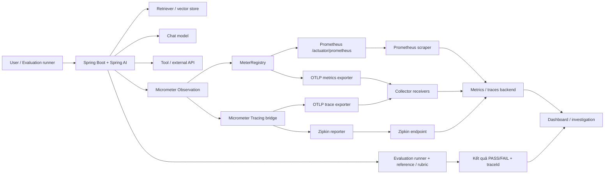

# Lựa chọn OTLP hoặc hệ thu thập được hỗ trợ

## 1. Tại sao phải lựa chọn hệ thu thập telemetry trước khi viết cấu hình?

Một ứng dụng Spring AI phục vụ hỏi đáp chính sách doanh nghiệp có thể sử dụng chat model, retriever/vector store, nhiều công cụ nghiệp vụ và các vòng gọi lại model. Khi thay prompt hoặc phiên bản pipeline, nhóm muốn biết chất lượng **relevance**, **fact checking**, tính chính xác của RAG/tool calling có thay đổi không; đồng thời muốn tìm nguyên nhân nếu **độ trễ, token hoặc chi phí** tăng.

Để theo dõi, nhóm cần gửi dữ liệu quan sát từ ứng dụng đến nơi có thể truy vấn. Nhưng các nền tảng không dùng cùng một kiểu thu thập:

- **Prometheus** thường lấy metrics định kỳ qua HTTP (*pull/scrape*).
- **OTLP** là giao thức truyền telemetry của OpenTelemetry, có thể mang traces, metrics và logs tới receiver phù hợp.
- **Zipkin** có giao thức nhận spans riêng, hữu ích khi tổ chức đã vận hành hạ tầng Zipkin.
- **OpenTelemetry Collector** đứng giữa ứng dụng và backend để nhận, xử lý và phân tuyến nhiều loại tín hiệu.
- **Backend quan sát** như hệ lưu traces hoặc time series mới là nơi dữ liệu được lưu, tìm kiếm và hiển thị lâu dài.

Việc lựa chọn sai có thể gây những hiểu nhầm nguy hiểm: metric xuất thành công nhưng trace không có, app gửi spans tới cổng metrics, collector nhận dữ liệu nhưng không có backend lưu, hoặc Actuator được mở ra Internet chỉ để một dashboard hoạt động.

Trong chương **Cấu hình telemetry** của module `SPRING_AI_EVALUATION_OBSERVABILITY`, bài học này hướng dẫn chọn **giao thức, hệ thu thập và đường truyền phù hợp với từng môi trường**, rồi kiểm tra hoạt động từ ứng dụng Spring AI đến nơi truy vấn cuối cùng.

### Kết quả học tập

Sau bài này, người học có thể:

1. Phân biệt *instrumentation*, *bridge*, *exporter*, *receiver*, *collector* và *backend*.
2. Hiểu OTLP/HTTP, OTLP/gRPC và đường dẫn của từng loại tín hiệu.
3. Chọn OTLP, Prometheus scrape hoặc Zipkin theo mục tiêu và hệ thống đang có.
4. Biết vì sao cách cấu hình Spring Boot 3.5 và 4.x không được trộn lẫn.
5. Thiết kế luồng metrics, traces và logs có bảo vệ secrets/PII.
6. Kiểm tra sampling, propagation, mất dữ liệu, tên service, phiên bản và cardinality.
7. Liên kết trace với ca đánh giá để phân tích hồi quy chất lượng, chi phí và độ trễ.

## 2. Thuật ngữ nền tảng: giao thức khác nơi lưu trữ

| Thành phần | Nhiệm vụ | Điều **không** nên hiểu nhầm |
|---|---|---|
| **Instrumentation** | Đánh dấu các operation, ghi timer/counter/span | Không tự bảo đảm dữ liệu đã được export |
| **Micrometer Observation** | Ghi nhận một operation để metrics/tracing handlers sử dụng | Không tự chấm chất lượng câu trả lời |
| **MeterRegistry** | Quản lý và xuất metrics theo registry cụ thể | Không phải trace backend |
| **Micrometer Tracing bridge** | Nối observations với OpenTelemetry hoặc Brave | Không phải chính hệ lưu spans |
| **Exporter/reporter** | Truyền telemetry đến receiver | Gửi thành công không bảo đảm backend đã lưu |
| **Receiver** | Điểm nhận dữ liệu theo protocol | Chưa chắc cung cấp giao diện truy vấn |
| **OpenTelemetry Collector** | Nhận → xử lý → xuất nhiều tín hiệu qua pipeline | Không mặc nhiên là kho lưu lâu dài |
| **Backend** | Lưu, lập chỉ mục, truy vấn, alert và hiển thị dữ liệu | Cần đúng receiver/giao thức hoặc một collector trung gian |
| **OTLP** | Giao thức trao đổi telemetry | Không phải sản phẩm backend hay dashboard |

Ba loại tín hiệu cũng không đồng nghĩa:

| Tín hiệu | Đơn vị điển hình | Mục tiêu phân tích | Nguồn phù hợp trong Spring AI |
|---|---|---|---|
| **Metrics** | Counter, timer, histogram, gauge | Xu hướng lỗi, throughput, p95 latency | Micrometer meters, model/tool timings khi được instrument |
| **Traces** | Trace, span, event, attributes | Bước nào của một request chậm hoặc lỗi? | HTTP → retriever → model → tool |
| **Logs** | Dòng sự kiện có timestamp và severity | Sự kiện/exceptions và thông điệp đã lọc | Log ứng dụng/SDK và hệ thống |

Ví dụ `/actuator/prometheus` là endpoint **expose metrics** để server scrape. Nó không phải endpoint tiếp nhận spans và không tự làm xuất hiện trang tra cứu trace. Tương tự, khi ứng dụng cấu hình OTLP metrics, chưa chắc đã có một tracing bridge nào hoạt động.

## 3. Kiến trúc tổng thể: luồng Spring AI đến công cụ quan sát

Một kiến trúc có cả metrics và traces:



Đây là sơ đồ **các đường lựa chọn**, không phải yêu cầu bật tất cả exporter cùng lúc. Ví dụ triển khai thực tế có thể chỉ dùng Prometheus cho metrics và OTLP cho traces, hoặc cùng OTLP cho cả hai nếu stack nhận hỗ trợ.

**Tách hai câu hỏi:**

1. *Ứng dụng tạo tín hiệu gì?* Phụ thuộc Spring AI/Boot version, instrumentation và provider.
2. *Tín hiệu đó đi đến đâu?* Phụ thuộc registry, exporter, đường mạng, receiver và backend.

Một ứng dụng có traces không có nghĩa traces có đủ spans của từng tool hoặc retriever. Một backend có dữ liệu không chứng minh đã thu đủ mọi request nếu sampling hay hàng đợi export đang loại bớt.

## 4. Lập yêu cầu trước khi chọn giao thức

Hãy viết một **telemetry contract** ngắn cho ứng dụng:

| Câu hỏi quyết định | Ví dụ yêu cầu |
|---|---|
| Muốn quan sát tín hiệu nào? | HTTP/model/tool latency, RAG retrieval, spans và lỗi; logs đã lọc |
| Hạ tầng đã có gì? | Prometheus, OpenTelemetry Collector, Zipkin hoặc nền tảng SaaS |
| Mạng cho phép chiều kết nối nào? | Scraper vào app hay app đẩy ra collector? |
| Mức độ chi tiết cần giữ? | p95 mỗi route; trace của các ca QA đã được phép |
| Chi phí/retention? | Số series, spans/giây, ngày giữ và sampling budget |
| Dữ liệu nào nhạy cảm? | Prompt, completion, tool payload, thông tin người dùng |
| Có điều kiện truy nguyên nào? | `service.name`, environment, version, `traceId` và run metadata |
| Ràng buộc phiên bản? | Spring Boot 3.5 hay 4.x? Spring AI và provider nào? |
| Có yêu cầu độc lập backend? | Muốn đổi vendor mà không sửa code nhiều lần? |

Khi chưa có các câu trả lời ấy, việc chọn OTLP chỉ vì “hiện đại” hoặc chọn Zipkin chỉ vì “dễ chạy” chưa chắc mang lại dữ liệu hữu ích.

### Ma trận chọn nhanh

| Điều kiện thực tế | Lựa chọn thường hợp lý | Điều phải xác minh |
|---|---|---|
| Chỉ test unit/logic meter | Registry in-memory | Không cần backend mạng |
| Đã có Prometheus và chỉ cần metrics | Prometheus registry + scrape | Exposure, auth, targets, series |
| Cần traces và đã có Collector | OTel bridge + OTLP traces | Receiver traces, exporter, backend |
| Cần metrics + traces đi qua Collector | OTLP registry metrics + OTLP trace exporter | Hai pipeline có hoạt động riêng |
| Đã có Zipkin/Brave | Brave bridge + Zipkin reporter | Compatibility, propagation, sampling |
| Stack vendor hỗ trợ OTLP | OTLP tới collector hoặc endpoint chính thức vendor | Các tín hiệu/transport thật sự hỗ trợ |
| Ràng buộc mạng chỉ cho outbound | Push tới receiver được phép (thí dụ OTLP) | TLS/auth và egress policy |
| Staging muốn quan sát đầy đủ | Collector local/staging + sampling có kiểm soát | Không dùng raw production data |

Đây là những **khuyến nghị kiến trúc theo nhu cầu**, không phải tuyên bố mọi backend tương thích với mọi exporter. Kiểm tra giao thức ingest của **phiên bản backend hoặc distribution** đang chạy.

## 5. OTLP là gì và điểm khác nhau giữa OTLP/HTTP và OTLP/gRPC

OTLP là **OpenTelemetry Protocol**. Hai phương thức truyền thông dụng:

| Thuộc tính | OTLP/HTTP | OTLP/gRPC |
|---|---|---|
| Cổng quy ước | `4318` | `4317` |
| Kiểu giao tiếp | HTTP request tới endpoint theo tín hiệu | gRPC service/method |
| Path thường gặp cho traces | `/v1/traces` | Không dùng HTTP path này như REST |
| Path thường gặp cho metrics | `/v1/metrics` | Không dùng HTTP path này như REST |
| Path thường gặp cho logs | `/v1/logs` | Không dùng HTTP path này như REST |
| Điểm kiểm tra | URL/path, TLS, content type, auth, HTTP status | Channel/port, TLS, gRPC status, auth |

**4317 và 4318 chỉ là cổng quy ước**, không phải bắt buộc. Kết nối thực tế tùy ingress, proxy, collector và cấu hình exporter. Không đổi mỗi `:4318` thành `:4317` mà giữ nguyên cấu hình HTTP rồi kỳ vọng gRPC hoạt động.

Ví dụ URL cho **OTLP/HTTP** khi dùng các thuộc tính định nghĩa endpoint **riêng cho tín hiệu**:

```text
https://otel.example.invalid:4318/v1/traces
https://otel.example.invalid:4318/v1/metrics
https://otel.example.invalid:4318/v1/logs
```

`example.invalid` là host minh họa, không phải dịch vụ thật.

### Base URL khác endpoint riêng của tín hiệu

Đặc biệt khi dùng biến môi trường OpenTelemetry hoặc cấu hình chung của Spring Boot mới, cần phân biệt:

- **Base OTLP endpoint**: ví dụ `https://collector.example.invalid:4318`. Một số cơ chế sẽ **tự thêm** `/v1/traces`, `/v1/metrics`, `/v1/logs` khi dùng HTTP.
- **Signal-specific endpoint**: ví dụ `https://collector.example.invalid:4318/v1/traces`. Giá trị này thường được dùng **nguyên vẹn**.

Nếu đưa `/v1/traces` vào base URL rồi framework tự nối thêm path, có thể sinh đường dẫn sai. Ngược lại, chỉ đặt hostname cho thuộc tính signal-specific có thể làm thiếu path. **Phải kiểm tra semantics của property trong phiên bản Spring Boot/OTel đang dùng**.

### OTLP không đồng nghĩa mọi backend nhận cả ba tín hiệu

Một nhà cung cấp có thể nhận OTLP traces nhưng không nhận logs, hoặc dùng URL/auth khác cho metrics. Collector có thể có receiver cho cả ba nhưng chỉ bật `traces` pipeline. Hãy kiểm tra **receiver + pipeline + exporter/backend** riêng cho metrics, traces, logs.

## 6. Chọn Collector hay gửi thẳng tới backend?

| Tiêu chí | Ứng dụng gửi trực tiếp backend nhận OTLP | Ứng dụng gửi qua Collector |
|---|---|---|
| Đơn giản ở hệ nhỏ | Ít thành phần | Thêm một dịch vụ/config |
| Đổi backend | Có thể phải sửa endpoint/auth trên nhiều app | Có thể đổi exporter trung tâm |
| Chuyển đổi/filter dữ liệu | Phụ thuộc khả năng SDK và vendor | Processors có thể chuẩn hóa/giảm dữ liệu |
| Chống bùng nổ traffic | Phụ thuộc exporter/client | Có thể cấu hình batch/queue/limits theo component |
| Theo dõi lỗi ingest | Phân tán trên mỗi app | Collector có telemetry pipeline riêng |
| Cô lập secrets backend | Ứng dụng có thể cần quyền vendor | Collector có thể giữ credential ở trung tâm |
| Vận hành | Ít hop, ít điểm lỗi | Thêm hop, cần sizing/HA/monitoring |

**Lựa chọn gửi trực tiếp** có thể phù hợp dịch vụ nhỏ khi backend hỗ trợ protocol chuẩn, auth an toàn và lưu lượng ít. **Collector** có ích khi nhiều dịch vụ/nhóm cần một tuyến trung tâm, nhiều backend, chuẩn hóa tags hoặc chính sách thu dữ liệu.

Collector không tự làm dữ liệu an toàn: nếu cấu hình `debug` exporter ra log, dữ liệu trong spans có thể bị sao chép không kiểm soát; nếu không giới hạn receiver, nó có thể nhận traffic từ bên ngoài. Cần có quyền mạng, TLS/auth, memory limits, queue, retention và đường theo dõi lỗi của collector.

### Các mô hình triển khai Collector

- **Agent/sidecar/node-local**: ứng dụng gửi tới collector gần mình, collector tiếp tục gửi lên gateway; thích hợp giảm độ phụ thuộc vào kết nối trực tiếp đến vendor.
- **Gateway tập trung**: nhiều app gửi tới một nhóm Collector, có thể scale và kiểm soát centrally; phải tránh single point of failure.
- **Collector ở staging**: dùng dữ liệu giả và exporter debug/trace backend nhỏ để xác minh pipeline trước production.

Không có một topology mặc định tốt cho mọi hệ. Bảo đảm endpoint `localhost` đúng **network namespace**: nếu app và collector ở hai containers khác nhau, `localhost` của app không trỏ tới collector.

## 7. Cấu hình Collector tối thiểu nhận OTLP để thử nghiệm

Ví dụ sau minh họa **collector local, không phải production**. Nó nhận **traces** và **metrics** qua OTLP/HTTP, xử lý batch, rồi đưa tới `debug` exporter để kiểm tra rằng dữ liệu đã đến. Không cấu hình logs pipeline vì bài thử chưa phát logs:

```yaml
receivers:
  otlp:
    protocols:
      http:
        endpoint: 127.0.0.1:4318

processors:
  batch: {}

exporters:
  debug:
    verbosity: basic

service:
  pipelines:
    traces:
      receivers: [otlp]
      processors: [batch]
      exporters: [debug]
    metrics:
      receivers: [otlp]
      processors: [batch]
      exporters: [debug]
```

Ý nghĩa: khai báo `otlp` receiver, `batch` processor, `debug` exporter và **tham chiếu chúng trong từng pipeline**. Một component được khai báo mà không nằm trong `service.pipelines` tương ứng sẽ không tự tham gia xử lý tín hiệu đó.

**Giới hạn của ví dụ:** địa chỉ `127.0.0.1:4318` chỉ hoạt động khi client nằm cùng network namespace với Collector. Nếu app và Collector chạy ở hai containers khác nhau, phải bind trên interface phù hợp và giới hạn bằng Docker/Kubernetes network policy. Không đổi sang `0.0.0.0` trên máy có cổng công khai mà thiếu firewall/ACL.

`debug` exporter ghi dữ liệu quan sát vào log, không phải kho lưu truy vấn lâu dài. **Chỉ dùng dữ liệu giả được phép**, không dùng để in raw prompt/tool payload thật. Với production, thay bằng exporter/backend đã được phê duyệt, kiểm tra loại component hiện diện trong collector distribution và xác minh metric/traces được **lưu ở backend cuối**.

### Collector không phải một file cấu hình “tự chạy”

YAML trên chỉ là nội dung để cấu hình một bản OpenTelemetry Collector tương thích. Muốn chạy cần binary/container tương ứng, port nội bộ, quyền mạng và process được quản lý. Các receiver/exporter/processor có thể thay đổi giữa **core** và **contrib distribution**; kiểm tra danh sách component mà bản triển khai thực tế hỗ trợ.

### Dấu hiệu pipeline đã chạy

Khi ứng dụng gọi model hoặc retriever với instrumentation, collector local có thể in những thông tin về spans/meter đã nhận. Tuy nhiên `debug` không xác nhận rằng Jaeger/Tempo/Prometheus đã lưu dữ liệu, vì chưa có exporter tới các backend ấy. **Thử đầy đủ phải kết thúc ở truy vấn backend thực**.

## 8. Tích hợp với Spring Boot 3.5: OTLP traces qua Micrometer Tracing

**Cấu hình Spring Boot phụ thuộc phiên bản.** Đừng lấy dependency Spring Boot 4.x ghép với property Spring Boot 3.5 mà chưa kiểm tra version compatibility. Ví dụ sau nhắm tới **Spring Boot 3.5** với cấu hình Micrometer Tracing và OTLP exporter thông dụng.

### Dependencies Gradle Groovy

```groovy
dependencies {
    implementation 'org.springframework.boot:spring-boot-starter-actuator'
    implementation 'io.micrometer:micrometer-tracing-bridge-otel'
    runtimeOnly 'io.opentelemetry:opentelemetry-exporter-otlp'
}
```

### Dependencies Maven

```xml
<dependency>
    <groupId>org.springframework.boot</groupId>
    <artifactId>spring-boot-starter-actuator</artifactId>
</dependency>
<dependency>
    <groupId>io.micrometer</groupId>
    <artifactId>micrometer-tracing-bridge-otel</artifactId>
</dependency>
<dependency>
    <groupId>io.opentelemetry</groupId>
    <artifactId>opentelemetry-exporter-otlp</artifactId>
    <scope>runtime</scope>
</dependency>
```

Đây là những dependency dùng cùng **Spring Boot dependency management/BOM tương thích**; không cố định phiên bản ngẫu nhiên cho Micrometer và OpenTelemetry.

### Ví dụ application-local.yml — Boot 3.5

```yaml
spring:
  application:
    name: spring-ai-evaluation-demo

management:
  tracing:
    sampling:
      probability: 1.0
  otlp:
    tracing:
      endpoint: http://localhost:4318/v1/traces
  endpoints:
    web:
      exposure:
        include: health,metrics
```

`management.otlp.tracing.endpoint` là property thuộc mô hình Spring Boot 3.x ở ví dụ này; `management.tracing.sampling.probability=1.0` giúp local có tỷ lệ lấy mẫu cao khi kiểm tra bằng dữ liệu giả. **Đừng copy sampling 100% lên production** khi chưa tính lượng spans, quyền riêng tư và ngân sách.

Nếu chuyển sang Collector không cùng container, thay `localhost` bằng tên service nội bộ thích hợp, thêm bảo mật transport/identity theo hạ tầng.

### Làm sao biết đã dùng đúng bridge?

Thực hiện một request AI giả lập rồi truy vấn Collector/trace backend. Phải thấy ít nhất span HTTP khi instrumentation có mặt, sau đó kiểm tra spans model/retrieval/tool **thực có**. Không tuyên bố setup hoàn thành chỉ vì app khởi động thành công.

## 9. Tích hợp với Spring Boot 4.x: dependency và thuộc tính đã thay đổi

Spring Boot 4.0 cung cấp một hướng cấu hình khác cho OpenTelemetry/OTLP traces. Theo tài liệu của dòng 4.0, có thể dùng **dedicated starter**:

```groovy
dependencies {
    implementation 'org.springframework.boot:spring-boot-starter-opentelemetry'
}
```

Một ví dụ cấu hình **dành riêng cho Boot 4.0**:

```yaml
spring:
  application:
    name: spring-ai-evaluation-demo

management:
  tracing:
    sampling:
      probability: 1.0
  opentelemetry:
    tracing:
      export:
        otlp:
          endpoint: http://localhost:4318/v1/traces
```

Ở đây thuộc tính traces là `management.opentelemetry.tracing.export.otlp.endpoint`, **khác** `management.otlp.tracing.endpoint` được dùng trong ví dụ Boot 3.5. Trước khi áp dụng cho Boot 4.1/4.2 hoặc dòng tương lai, kiểm tra property metadata và tài liệu **của chính version project**.

### Có thể dùng endpoint chung cho nhiều tín hiệu?

Một số dòng Spring Boot mới hỗ trợ cấu hình chung như `management.opentelemetry.otlp.endpoint` để dùng làm fallback. Nếu dùng HTTP, đường dẫn tín hiệu có thể được nối tự động khi dùng cấu hình chung, còn URL signal-specific có thể được dùng nguyên vẹn. Vì vậy:

- Nếu đặt `management.opentelemetry.otlp.endpoint=http://collector:4318`, phải hiểu quy tắc tự thêm path của phiên bản.
- Nếu đặt `management.opentelemetry.tracing.export.otlp.endpoint=http://collector:4318/v1/traces`, đã chỉ rõ đích của traces.
- Không khai báo cả hai một cách mâu thuẫn rồi đoán property nào thắng; kiểm tra ưu tiên cấu hình và endpoint thực.

**Không hiểu rằng starter tracing tự động xuất toàn bộ metrics và logs.** Dòng metrics của Spring Boot vẫn dựa trên Micrometer `MeterRegistry`; logs export có dependency/config riêng nếu được hỗ trợ. Cần kiểm tra từng tín hiệu.

## 10. Xuất metrics: Prometheus hay OTLP MeterRegistry?

### 10.1. Khi dùng Prometheus

Gradle:

```groovy
dependencies {
    implementation 'org.springframework.boot:spring-boot-starter-actuator'
    runtimeOnly 'io.micrometer:micrometer-registry-prometheus'
}
```

Cấu hình HTTP exposure ở môi trường **đã giới hạn mạng/quyền truy cập**:

```yaml
management:
  endpoints:
    web:
      exposure:
        include: health,metrics,prometheus
```

Sau đó Prometheus server có thể scrape:

```yaml
# Ví dụ prometheus.yml trên mạng nội bộ
scrape_configs:
  - job_name: spring-ai
    scrape_interval: 15s
    metrics_path: /actuator/prometheus
    static_configs:
      - targets: ["spring-ai.internal:8080"]
```

Prometheus dùng kiểu **pull**; app không cần gửi request OTLP chỉ để hệ thống này lấy metrics. Endpoint scrape phải được bảo vệ bằng network policy, xác thực hoặc proxy phù hợp, không mở công khai chỉ để dashboard có dữ liệu.

### 10.2. Khi dùng Micrometer OTLP metrics registry

Gradle:

```groovy
dependencies {
    implementation 'org.springframework.boot:spring-boot-starter-actuator'
    runtimeOnly 'io.micrometer:micrometer-registry-otlp'
}
```

Cấu hình thường dùng với Spring Boot hỗ trợ OTLP metrics registry:

```yaml
management:
  otlp:
    metrics:
      export:
        url: http://localhost:4318/v1/metrics
        step: 30s
  endpoints:
    web:
      exposure:
        include: health
```

Trên thực tế, URL và transport cần phù hợp Collector; production nên dùng TLS/auth, không để `localhost` nếu không cùng network namespace. `step` là chu kỳ xuất ví dụ, không phải thời gian mỗi request AI. Đừng nhầm `management.otlp.metrics.export.url` với **traces endpoint**.

### 10.3. Tại sao không nên luôn bật cả hai?

Spring Boot/Micrometer có thể quản lý nhiều registry. Nhưng khi Prometheus scrape và OTLP cùng gửi tới các nơi sau đó được hợp nhất, dữ liệu có thể bị đếm trùng hoặc tăng chi phí mà không cải thiện chẩn đoán. Chỉ bật song song khi migration hoặc yêu cầu cụ thể đã có chiến lược làm rõ nguồn chính.

**Nhắc lại:** metrics registry không tự bảo đảm có spans. Để có traces, vẫn cần tracing bridge/exporter và backend hỗ trợ.

## 11. Trường hợp đã có Zipkin: dùng hệ thu thập được hỗ trợ thay OTLP

Nếu tổ chức hiện dùng Zipkin và muốn giữ giao thức ingest hiện tại, có thể cấu hình Brave/Zipkin mà không bắt buộc phải cài OpenTelemetry Collector.

### Spring Boot 3.5 — Brave bridge + Zipkin reporter

```groovy
dependencies {
    implementation 'org.springframework.boot:spring-boot-starter-actuator'
    implementation 'io.micrometer:micrometer-tracing-bridge-brave'
    runtimeOnly 'io.zipkin.reporter2:zipkin-reporter-brave'
}
```

Ví dụ cấu hình 3.5:

```yaml
management:
  tracing:
    sampling:
      probability: 1.0
  zipkin:
    tracing:
      endpoint: http://localhost:9411/api/v2/spans
```

### Spring Boot 4.0 — starter chuyên dụng cho Zipkin

```groovy
dependencies {
    implementation 'org.springframework.boot:spring-boot-starter-zipkin'
}
```

Tên property Zipkin của dòng 4.0 được tổ chức dưới `management.tracing.export.zipkin.*`; kiểm tra metadata/version trước khi cấu hình URL:

```yaml
management:
  tracing:
    sampling:
      probability: 1.0
    export:
      zipkin:
        endpoint: http://localhost:9411/api/v2/spans
```

Đây là **hai biến thể theo version**, không phải hai cấu hình cần gộp vào một ứng dụng.

### Zipkin không thay cho metrics registry

Zipkin tập trung vào spans/traces, không thay thế Prometheus cho p95 HTTP hoặc bộ meter JVM. Dùng Zipkin cho traces và Prometheus cho metrics là một kiến trúc hoàn toàn hợp lý.

Nếu có backend như Jaeger hoặc Tempo, kiểm tra **cổng ingest và protocol được phiên bản đó hỗ trợ**. Có backend quản lý traces không có nghĩa endpoint của nó chấp nhận Zipkin, OTLP/HTTP và OTLP/gRPC cùng lúc. Collector có thể làm lớp trung gian khi cần chuyển đổi.

## 12. Ba phương án kiến trúc thực tế cho Spring AI

**Phương án A — Prometheus + Zipkin**

- App → `/actuator/prometheus` → Prometheus cho metrics.
- App với Brave tracing → Zipkin reporter → Zipkin cho traces.
- Evaluation runner lưu reference, PASS/FAIL và trace reference ở kho riêng.

Phù hợp khi hệ thống đã có Zipkin, không cần chuyển toàn bộ sang OTel ngay. Nhược điểm là hai đường telemetry và bảo mật/giám sát cần quản lý độc lập.

**Phương án B — Prometheus + OTLP traces qua Collector**

- App → Prometheus scrape cho metrics.
- App → OTLP trace exporter → Collector → trace backend.
- Logs đi theo pipeline log hiện có; không tự ép logs vào metrics/traces.

Phù hợp khi dashboard metrics đã vận hành bằng Prometheus nhưng muốn tăng khả năng truy vết xuyên dịch vụ. Đây là lựa chọn thường giúp chuyển đổi từng phần mà không thay đổi meter hiện có.

**Phương án C — OTLP metrics và traces qua Collector**

- App với Micrometer OTLP registry → Collector metrics receiver.
- App với OTel tracing exporter → Collector traces receiver.
- Collector route mỗi loại tới backend được cấp phép; kết quả evaluation lưu độc lập.

Phù hợp khi tổ chức có Collector tập trung và muốn quản trị endpoint, auth, routing tại một nơi. Cần bảo đảm **hai pipeline** hoạt động, không chỉ một.

### Không bắt buộc logs phải đi cùng OTLP

Logs có thể được thu bằng agent logging hoặc hệ thống hiện có. Nếu muốn xuất logs qua OTLP, phải xác minh library/appender/exporter, receiver và pipeline logs tương ứng; tránh gửi thừa raw prompt, user messages hoặc API secrets.

## 13. Bảo mật đường truyền, receiver và dữ liệu AI

Một Collector có thể nhận rất nhiều dữ liệu nhạy cảm nếu cấu hình instrumentation quá rộng. Với Spring AI, các nội dung đáng bảo vệ bao gồm:

| Bề mặt | Dữ liệu có thể xuất hiện | Cách hạn chế |
|---|---|---|
| Prompt/user message | Thông tin cá nhân, câu hỏi nhạy cảm | Không thu raw mặc định, giảm dữ liệu |
| Retrieval chunks | Tài liệu nội bộ, nội dung có quyền | Ghi source ID/version an toàn thay vì full text |
| Model completion | Dữ liệu do model tái tạo hoặc suy diễn | Chỉ lưu khi cần và có quyền/retention |
| Tool arguments/results | Mã đơn, địa chỉ, token, dữ liệu giao dịch | Chỉ ghi tool family/status/duration |
| HTTP headers | Cookie, Authorization, API key | Không cho vào span attributes/logs |
| Metrics labels | User ID, request ID, prompt text | Dùng tags cardinality thấp |
| Trace baggage | Metadata truyền qua nhiều service | Không truyền secrets hoặc thông tin riêng |
| Collector debug exporter | Span/event in ra stdout | Chỉ local dữ liệu giả |
| Backend/dashboards | Người xem quá rộng, lưu quá lâu | RBAC, TLS, audit, retention |

**OTLP không tự mã hóa hay ẩn danh tất cả dữ liệu**. Đường truyền phải dùng TLS khi phù hợp, receiver cần xác thực khi ở ranh giới không tin cậy, backend phải có quyền truy cập đúng và dữ liệu phải được giảm thiểu **trước khi xuất**.

Trong production, không nhúng bearer token trực tiếp trong YAML nguồn. Dùng secret manager, workload identity, mTLS hoặc cơ chế credential đã được tổ chức phê duyệt.

### Sampling không phải biện pháp bảo mật

Thu 10% traces thay vì 100% giúp giảm volume nhưng những spans được giữ vẫn có thể chứa dữ liệu riêng. Cần kiểm tra chính sách thu raw prompt, tool output và error strings; đồng thời điều tra xem dữ liệu đã bị sao chép vào log, cache hoặc exporter khác chưa.

## 14. Sampling, cardinality, retention và độ tin cậy của số đo

| Yếu tố | Ảnh hưởng | Khuyến nghị thiết kế |
|---|---|---|
| **Head sampling** | Giảm lượng span từ đầu, có thể bỏ lỡ lỗi hiếm | Chọn xác suất theo traffic và nhu cầu điều tra |
| **Tail sampling** | Có thể ưu tiên trace lỗi/chậm nếu Collector nhận đủ spans | Cần tài nguyên, routing và chính sách phù hợp |
| **Metrics aggregation** | Tạo count/rate/latency distribution | Đo ổn định với tags thấp cardinality |
| **Histogram buckets** | Giúp tính phân vị từ time series | Chỉ bật cho timers cần theo dõi, giới hạn series |
| **High-cardinality tags** | Tăng số series và chi phí backend | Không dùng raw IDs, request URLs hoặc prompts |
| **Retention** | Quyết định thời gian có thể xem lịch sử | Phân biệt metrics, traces, audit và results |
| **Exporter batching/queue** | Hấp thụ burst, có thể drop khi quá tải | Giám sát dropped/failed export và queue |

**Không dùng sampled traces để ước lượng trực tiếp p95 của toàn bộ traffic**, nhất là khi sampling ưu tiên request chậm/lỗi. Thay vào đó dùng metrics đã được thiết kế để phản ánh phân phối vận hành, rồi dùng traces để giải thích.

### Lỗi hiếm và chất lượng AI

Một lỗi tool ghi trái quyền có thể chỉ xuất hiện một lần trong hàng nghìn request. Không nên phụ thuộc vào xác suất trace được sample để phát hiện hard gate. Evaluation runner cần ghi **tool events và trạng thái fixture** cho mọi ca quan trọng, độc lập với exporter trace.

Một ca FAIL trên test suite không tương đương “tỷ lệ lỗi production” nếu tập ca được chọn có chủ đích từ các sự cố. Cần công bố loại dataset và số ca để diễn giải đúng.

## 15. Resource attributes, correlation ID và truy nguyên phiên bản

Khi dữ liệu đến backend, cần phân biệt **dịch vụ nào**, **môi trường nào** và **phiên bản nào** sinh số đo.

| Metadata | Mục đích | Ví dụ giả |
|---|---|---|
| `service.name` | Xác định dịch vụ | `spring-ai-quality-service` |
| `deployment.environment` / biến thể theo convention backend | Phân biệt local/staging/prod | `staging` |
| `service.version` | Xác định bản deploy | `2026.11.27-rc1` |
| `operation` | Nhóm bước được đo | `rag.retrieve`, `tool.read` |
| `traceId` | Truy dấu một request đã sample | Opaque ID, không phải token xác thực |
| `runId, caseId, attemptId` | Liên kết tới evaluation result | Chỉ trong kho có quyền, không làm metric labels |

Tên và cách đặt resource attributes phải khớp semantic conventions, framework/version và quy ước của backend. Tránh dùng nhãn tùy ý gần giống nhau ở nhiều dịch vụ khiến dashboard phải xử lý nhiều tên tương đương.

### Trace propagation

Nếu một request từ service A gọi service B để tra trạng thái đơn, trace có giá trị khi hai spans giữ được quan hệ cha–con. Các client HTTP được framework instrument thích hợp có thể mang `traceparent` (W3C Trace Context) hoặc định dạng như B3 theo cấu hình.

Nếu tool HTTP client tự tạo không được instrument, có thể thấy hai trace tách biệt. Kiểm tra client builder, propagation headers, async/thread context và quy tắc xuyên proxy. **Không dùng trace ID làm bằng chứng quyền truy cập đơn hàng.**

### Gắn với kết quả đánh giá

Một kết quả đánh giá có thể có cấu trúc minh họa:

```yaml
evaluationResult:
  runId: eval-prompt-b-2026-11-27
  caseId: rag-return-missing-source-014
  attemptId: 2
  datasetVersion: "1.4.0"
  rubricVersion: rubric-v5
  candidate:
    promptVersion: prompt-b
    modelVersion: model-config-v7
    indexVersion: kb-index-v3
  quality:
    factualCorrectness: 0.0
    hardGatePassed: false
  observability:
    traceId: "opaque-trace-id-if-available"
    latencyMs: 2250
    inputTokens: null
    outputTokens: null
    estimatedCost: null
```

Schema và số liệu chỉ là **minh họa**, không phải output có thật của Spring AI. `null` cho token/cost nghĩa là chưa đủ nguồn đo; không tự điền giá hoặc số token đoán từ độ dài chuỗi.

Lưu `traceId` trong result store được phân quyền có thể giúp mở trace để xem retrieval, model, tool. Nếu trace bị sampling loại, kết quả evaluation vẫn tồn tại và hard gate vẫn phải được chấm từ dữ liệu runner quan sát.

## 16. Kiểm chứng đầu-cuối: một checklist theo từng tầng

Đừng chỉ chạy app rồi kết luận “OTLP đã hoạt động”. Với request AI giả lập, cần kiểm chứng:

**Bước 1 — Xác định nhu cầu.** Đã chọn metrics/traces/logs nào, đang dùng Prometheus hay OTLP, có backend nào nhận chúng?

**Bước 2 — Xác định version.** Dự án dùng Spring Boot 3.5 hay 4.x? Dependencies và property tracing đúng dòng đó?

**Bước 3 — Khởi động receiver.** Collector/Zipkin/Prometheus hiện diện và network path đúng không?

**Bước 4 — Tạo một request có thể tái hiện.** Dùng dữ liệu giả của một ca RAG/tool-read; không gọi tool ghi trên dữ liệu thật.

**Bước 5 — Kiểm tra instrumentation.** Có meters/spans được tạo sau request không? Nếu không, chưa cần điều tra network.

**Bước 6 — Kiểm tra exporter.** Đúng protocol, endpoint, auth/TLS, batch và sampling?

**Bước 7 — Kiểm tra receiver.** Collector hoặc hệ nhận có ghi nhận **đúng tín hiệu** không?

**Bước 8 — Kiểm tra backend.** Truy vấn được time series/trace từ UI hoặc API đã được cấp phép, không chỉ thấy exporter thành công.

**Bước 9 — Kiểm tra tương quan.** Spans HTTP → retriever/model/tool có cùng trace không? Có `service.name` và environment đúng không?

**Bước 10 — Kiểm tra privacy.** Không có API key, raw user prompt, dữ liệu khách và access token trong thuộc tính/log xuất.

**Bước 11 — Nối ca đánh giá.** Kết quả PASS/FAIL có thể mở trace liên quan bằng ID an toàn, nhưng không để reference/gold answer xuất vào prompt hoặc metrics?

**Bước 12 — Kiểm tra khi lỗi.** Giả lập receiver timeout, collector restart, tool `NOT_FOUND` và xem exporter/backpressure có báo lỗi đúng không.

### Các lệnh khám phá local minh họa

Nếu Actuator đã được expose an toàn trên local:

```bash
curl -i http://localhost:8080/actuator/health
curl -i http://localhost:8080/actuator/metrics
curl -i http://localhost:8080/actuator/prometheus
```

Lệnh cuối chỉ có ý nghĩa khi có Prometheus registry và endpoint đã được expose. Với OTLP traces, không có một endpoint mặc định `/actuator/traces` để đọc toàn bộ spans; cần xem receiver/trace backend. Cũng không suy ra “HTTP 404 = exporter hỏng” khi app chủ đích không expose endpoint metrics qua web.

## 17. Xử lý lỗi thường gặp khi chọn OTLP hoặc collector

| Triệu chứng | Nguyên nhân cần kiểm tra | Biện pháp phù hợp |
|---|---|---|
| Metrics có, traces không có | Chỉ cấu hình MeterRegistry, thiếu tracing bridge/exporter | Cấu hình traces riêng |
| Traces có, metric AI không thấy | Chưa instrument, provider không cung cấp usage hoặc registry lỗi | Kiểm tra meters thực xuất hiện |
| OTLP/HTTP trả 404/405 | Sai path hoặc gửi HTTP vào cổng gRPC | Kiểm tra `/v1/traces`/`/v1/metrics` và transport |
| Receiver trả 401/403 | Thiếu identity/permission | Cấp quyền đúng, không tắt security |
| Connection refused từ container | `localhost` trỏ nhầm container | Dùng service DNS và network policy |
| Collector nhận trace nhưng UI không thấy | Chưa có exporter/backend hoặc query sai | Kiểm tra pipeline đến nơi lưu |
| Collector khai báo receiver nhưng không có dữ liệu | Component chưa được tham chiếu trong pipeline | Bật đúng `service.pipelines` |
| App gửi `/v1/traces/v1/traces` | Nhầm base endpoint với signal-specific endpoint | Kiểm tra ưu tiên/path semantics |
| Chỉ có HTTP spans, thiếu tool | Tool/advisor chưa instrument hoặc context đứt | Kiểm tra Spring AI version và client |
| Spans của hai service không cùng trace | Thiếu propagation qua HTTP/queue/thread | Kiểm tra W3C/B3, context |
| Trace quá ít để điều tra lỗi hiếm | Head sampling quá thấp | Điều chỉnh chiến lược có kiểm soát |
| Dashboard p95 khác xa từ sampled traces | Hai nguồn không đo cùng mẫu/phân phối | Dùng metrics tổng hợp cho p95 |
| Prometheus báo target DOWN | Scrape path/port/network/auth sai | Kiểm tra từ mạng scraper |
| Collector quá tải và drop telemetry | Queue/memory/bandwidth không đủ | Giám sát collector, sizing/limits/backpressure |
| Metric bị đếm hai lần | Song song Prometheus + OTLP tới cùng hệ tổng hợp | Xác định nguồn chính, bỏ double ingest |
| Trace có payload nhạy cảm | Raw capture, logs/debug exporter quá rộng | Ngăn phát sinh, lọc và xử lý bản đã lưu |

### Đừng thay nhiều thành phần cùng lúc

Nếu chuyển từ Zipkin sang OTLP đồng thời nâng Spring Boot, đổi Spring AI model provider và thay sampling, rất khó biết nguyên nhân span bị thiếu. Hãy tách từng thay đổi khi có thể và lưu version/configuration của mỗi lần chạy.

## 18. Kịch bản triển khai và chuyển đổi giữa backend

### Kịch bản A — Bắt đầu từ local

Nhóm chưa có backend quan sát. Dùng Collector local nhận OTLP traces từ app, dữ liệu tổng hợp, sampling cao để xác nhận spans; dùng registry in-memory/Prometheus local nếu cần xem metrics. Khi xong mới bổ sung backend lưu.

**Tiêu chí hoàn thành:** xác định được receiver nhận span, cây trace logic và không có secrets trong dữ liệu xuất.

### Kịch bản B — Đã có Prometheus và cần thêm traces

Giữ metrics ở Prometheus. Thêm tracing bridge và OTLP exporter đến Collector/trace backend. Không cần đổi tất cả metric sang OTLP chỉ để có span.

**Tiêu chí hoàn thành:** metric HTTP/JVM vẫn có; trace mới truy được theo `service.name` và `traceId`; endpoint quản trị được bảo vệ.

### Kịch bản C — Chuyển Zipkin sang OTLP

Lập inventory service đang dùng Brave/Zipkin, quyết định tracer implementation, propagation, endpoint và backend. Thử trên staging với một số request xuyên dịch vụ. So span parent–child và latency, không chỉ đếm số spans.

**Tiêu chí hoàn thành:** những luồng quan trọng đều có trace end-to-end; không có duplicate spans từ hai instrumentation; telemetry cost trong ngân sách. Kế hoạch rollback cần biết khôi phục reporter/cấu hình cũ và không làm mất logs/metrics đã có.

### Kịch bản D — Multi-vendor hoặc compliance cao

Collector có thể làm lớp định tuyến để nhiều dịch vụ không lưu credentials vendor. Tuy nhiên phải có policy bảo vệ span attributes, retention, RBAC, TLS/auth, data residency và kiểm tra từng pipeline. Không hứa “OTLP đảm bảo vendor-neutral” nếu backend vẫn có các phần mở rộng, tên metric riêng hoặc khả năng ingest không đồng nhất.

## 19. Bài tập thực hành: chọn hệ thu thập cho ba môi trường

Giả sử một trợ lý Spring AI có luồng **HTTP → RAG retriever → chat model → tool tra đơn → chat model**. Nhóm cần phát hiện lỗi sai chính sách, tool timeout, p95 tăng và token tăng khi đổi prompt.

Điều kiện:

- **Local:** không có backend lưu dài hạn; có thể chạy Collector thử nghiệm.
- **Staging:** đã có Prometheus và một hệ xem traces nhận OTLP qua Collector.
- **Production:** hạ tầng chỉ cho app đẩy telemetry tới gateway nội bộ; collector có pipeline metrics và traces, retention được phê duyệt.

**Yêu cầu:**

1. Vẽ ba sơ đồ signal flow cho local/staging/production, phân biệt metrics và traces.
2. Chọn Prometheus hoặc OTLP metrics ở từng môi trường; giải thích vì sao.
3. Chọn tracing bridge/exporter theo phiên bản Spring Boot của ứng dụng.
4. Viết cấu hình OTLP/HTTP cho Collector local với receiver traces; mở rộng metrics pipeline nếu có nhu cầu.
5. Cấu hình đúng URL `/v1/traces` và `/v1/metrics`, nêu khi nào chỉ dùng base endpoint.
6. Chạy một ca RAG với fixture policy và một ca tool `NOT_FOUND`, kiểm tra service name/span context.
7. Chấm factual correctness và tool correctness từ gold reference, **không chấm bằng việc trace có mặt**.
8. Thiết kế tags ít cardinality, danh sách thuộc tính cần ẩn và sampling cho từng môi trường.
9. Lưu `runId, caseId, attemptId, traceId` trong kho evaluation và thử mở trace từ một ca FAIL.
10. Giả lập exporter không kết nối được; mô tả cách phát hiện và rollback an toàn.

### Câu hỏi tự kiểm

**Câu 1.** App có `micrometer-registry-otlp` và Collector đã nhận metrics. Vậy distributed tracing đã xong chưa?

**Chưa.** Cần tracing bridge/exporter và traces receiver/pipeline.

**Câu 2.** Backend thu được spans nhưng không thấy chúng trong UI sau 24 giờ. Có thể kết luận app không gửi không?

**Không.** Kiểm tra collector exporter, storage retention, indexing, time range và quyền truy vấn.

**Câu 3.** Thay `http://collector:4318/v1/traces` thành `http://collector:4317/v1/traces` có tự chuyển sang gRPC không?

**Không.** Port không tự chuyển transport; phải cấu hình đúng exporter gRPC.

**Câu 4.** Một request chậm 20 giây có trace, nhưng factual correctness được chấm 0. Metric latency có đủ để giải thích lỗi không?

**Không.** Trace giúp điều tra các bước; evaluator phải đối chiếu nội dung với chứng cứ và rubric.

**Câu 5.** Khi trace bị sampling loại, có được tự cho ca QA là FAIL không?

**Không.** Kết quả đánh giá phải dựa trên input/output, evidence và tool events đã được runner lưu đúng hợp đồng.

## 20. Checklist nghiệm thu trước khi chọn cấu hình production

- [ ] Đã chốt mục tiêu của metrics, traces và logs, không coi chúng là cùng một loại dữ liệu.
- [ ] Xác định hệ nhận hiện có và protocol mà **phiên bản backend** hỗ trợ.
- [ ] Phân biệt OTLP protocol, Collector và nơi lưu/truy vấn lâu dài.
- [ ] Đã chọn phù hợp giữa Prometheus pull, OTLP push và Zipkin reporting.
- [ ] Spring Boot/Spring AI version được cố định; không trộn thuộc tính Boot 3.5 với Boot 4.x.
- [ ] Dependencies tracing bridge/exporter và metrics registry được khai báo cho đúng tín hiệu.
- [ ] Không có hai tracing bridge/instrumentation trùng gây duplicate spans không kiểm soát.
- [ ] URL OTLP/HTTP hoặc gRPC đúng port, transport và ngữ nghĩa base/signal-specific path.
- [ ] Collector thực sự khai báo **và bật** receiver, processor, exporter trong từng pipeline.
- [ ] Đã thử đường mạng app → receiver → backend và truy vấn được dữ liệu.
- [ ] Với Prometheus, endpoint scrape có registry, exposure và quyền truy cập phù hợp.
- [ ] Tracing propagation hoạt động xuyên dịch vụ và qua HTTP/async boundaries cần thiết.
- [ ] Sampling/retention/batching/queue có ngân sách và mục tiêu rõ.
- [ ] Không dùng sampled traces làm ước lượng p95 toàn bộ lưu lượng nếu có thiên lệch.
- [ ] Metric labels không chứa request ID, user ID, prompt hoặc giá trị tự do.
- [ ] Span attributes/logs không chứa raw PII/secrets/credentials ngoài phạm vi được phép.
- [ ] Receiver/backend có TLS/auth/RBAC, egress/network policy và giới hạn retention.
- [ ] Collector được giám sát lỗi nhận/export/drop/backpressure và khả năng phục hồi.
- [ ] Có metadata service, environment, version và correlation IDs an toàn.
- [ ] Evaluation runner giữ gold reference riêng, kết quả PASS/FAIL độc lập với sampling.
- [ ] Token và chi phí chỉ được tính khi có usage/bảng giá hợp lệ, không dùng số đoán.
- [ ] Có smoke tests sau deploy, ghi phiên bản pipeline và phương án rollback.

### Nguồn chính thức để đối chiếu theo phiên bản

Các cấu hình Spring Boot và Collector có thể phát triển theo phiên bản, vì vậy nên tham khảo tài liệu trùng với dependency đang sử dụng:

- Spring Boot 3.5 — Tracing: https://docs.spring.io/spring-boot/3.5/reference/actuator/tracing.html
- Spring Boot 4.0 — Tracing: https://docs.spring.io/spring-boot/4.0/reference/actuator/tracing.html
- Spring Boot — Metrics: https://docs.spring.io/spring-boot/reference/actuator/metrics.html
- Spring Boot — Observability/OTLP environment mappings: https://docs.spring.io/spring-boot/reference/actuator/observability.html
- OpenTelemetry Collector — Configuration: https://opentelemetry.io/docs/collector/configuration/

**Kết luận:** lựa chọn OTLP hay một hệ thu thập khác là quyết định về **giao thức, hạ tầng, chi phí, an toàn dữ liệu và mục tiêu chẩn đoán**, không phải cuộc so tài giữa hai tên sản phẩm. Prometheus phù hợp cho metrics kiểu scrape; OTLP giúp chuyển nhiều loại telemetry đến receiver/Collector; Zipkin tiếp tục hữu ích khi có hệ tracing tương thích. Với Spring AI, chỉ khi đường thu metrics/traces hoạt động thực sự, được bảo mật và liên kết với tập đánh giá có nguồn chứng cứ, nhóm mới phân biệt được lỗi của retrieval, model, tool hoặc hạ tầng và theo dõi chất lượng, chi phí, độ trễ qua từng phiên bản.
