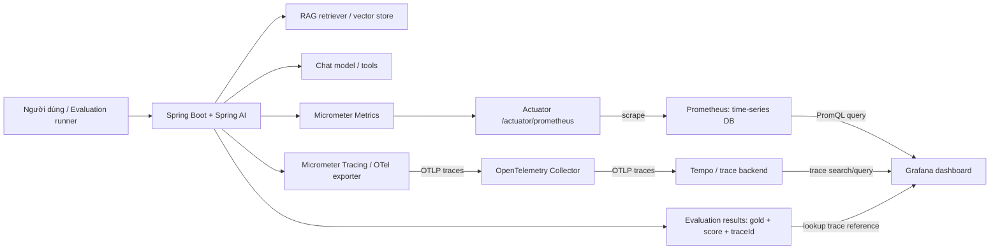

# Kết nối Prometheus, Grafana và hệ lưu trace theo kiến trúc

## 1. Mục tiêu: từ một lời gọi Spring AI đến dashboard có thể điều tra

Một ứng dụng Spring AI trả lời câu hỏi chính sách bằng RAG có thể gồm HTTP controller, retriever, vector store, chat model và công cụ đọc trạng thái đơn hàng. Sau khi thay prompt hoặc đổi cách chunk tài liệu, nhóm phát triển thấy **p95 latency tăng**, số token tiêu thụ nhiều hơn và điểm factual correctness trên bộ đánh giá giảm. Muốn hiểu nguyên nhân, không thể chỉ nhìn một log hoặc chỉ bật một dashboard.

Trong chương **Cấu hình telemetry** của module `SPRING_AI_EVALUATION_OBSERVABILITY`, ta cần thiết kế đường đi của dữ liệu quan sát:

- **Prometheus** thu và lưu metrics để theo dõi xu hướng request, lỗi, độ trễ, tài nguyên, các meter của model/RAG/tool nếu có.
- **Hệ lưu trace** như Grafana Tempo hoặc Jaeger nhận và cho phép tìm kiếm các spans thuộc một yêu cầu cụ thể.
- **Grafana** truy vấn các nguồn này qua **data sources** và giúp chuyển từ đồ thị tổng hợp đến lần gọi cần điều tra.
- **Evaluation runner** chấm relevance, fact checking, grounding và tool correctness trên tập ca có reference; lưu kết quả độc lập với telemetry sampling.

Ba hệ thống không thay thế nhau: **Grafana không mặc nhiên thu metrics hoặc lưu traces**; Prometheus không phải kho lưu span; Tempo/Jaeger không tự chấm đáp án đúng sai. Việc “kết nối thành công” có nghĩa là **đã đi được từ phát sinh tín hiệu đến backend lưu và truy vấn**, không phải chỉ cài cùng lúc ba phần mềm.

### Sau bài học, bạn có thể

1. Phân biệt ứng dụng, Actuator/Micrometer, Prometheus, OTLP Collector, trace storage và Grafana.
2. Chọn luồng Prometheus scrape và OTLP tracing phù hợp mạng local, staging, production.
3. Viết cấu hình mẫu Spring Boot, Prometheus, Collector và Grafana data sources.
4. Dùng PromQL để xem request rate, error ratio và p95 latency khi có histogram hợp lệ.
5. Hiểu cách gắn trace với đồ thị qua exemplar và trace-to-metrics mà không nhồi trace ID vào metric labels.
6. Liên kết một ca đánh giá Spring AI bị FAIL với trace, retrieved docs và tool events.
7. Thiết kế ranh giới bảo mật, retention, sampling, cardinality và kiểm thử đầu-cuối.

## 2. Vai trò từng thành phần: ai phát, ai thu, ai lưu, ai hiển thị?

| Thành phần | Chức năng | Dữ liệu tiêu biểu | Lưu ý |
|---|---|---|---|
| **Spring AI application** | Thực hiện RAG/model/tool và phát observations | Request timing, model/tool operation, lỗi | Không bảo đảm mọi provider có token usage |
| **Spring Boot Actuator + Micrometer** | Quản lý meters và expose endpoint | `/actuator/metrics`, `/actuator/prometheus` | Exposure chưa phải xác thực |
| **Prometheus server** | Định kỳ scrape các target và lưu time series | Counters, histograms, gauges | Cần scrape config và target reachable |
| **OpenTelemetry tracing bridge/exporter** | Tạo spans và gửi theo protocol tương ứng | Trace ID, span ID, duration, metadata an toàn | Cần sampling, propagation và exporter |
| **OpenTelemetry Collector** | Nhận, xử lý và chuyển tiếp telemetry | OTLP traces; có thể cả metrics/logs | Phải enable pipeline thực sự |
| **Trace backend (Tempo/Jaeger)** | Nhận/lưu/truy vấn trace | Span graph của một request | Cần storage/retention và query endpoint |
| **Grafana** | Truy vấn nguồn qua data sources, hiển thị và điều tra | Panels, Explore, links, alerts | Không tự sinh dữ liệu thiếu ở backend |
| **Evaluation result store** | Lưu ca, reference, rubric, score, traceRef | PASS/FAIL, hard gates, runId, caseId | Gold labels không vào prompt runtime |

Các quan hệ đặc biệt quan trọng:

- **Grafana → Prometheus API** để query metrics; không trỏ Grafana Prometheus datasource vào endpoint Actuator của app.
- **Grafana → Tempo HTTP query API** để tìm traces; không trỏ Grafana Tempo datasource vào cổng OTLP ingest `4317`/`4318`.
- **Ứng dụng → Collector/trace receiver** để gửi spans; không gửi spans tới địa chỉ Grafana web UI.
- **Prometheus → Actuator** để scrape metrics; Grafana không tự thay Prometheus thực hiện scrape trong kiến trúc này.

## 3. Sơ đồ tham chiếu: metrics và traces đi hai đường



**Luồng metrics:** Spring AI/Boot observations → Micrometer registry → Actuator Prometheus exposition → Prometheus server scrape → Grafana data source.

**Luồng traces:** Spring AI/Boot instrumentation → tracing bridge → OTLP exporter → Collector hoặc trace receiver → Tempo/Jaeger → Grafana trace data source.

**Luồng chất lượng:** runner dựng input/context/fixture → ứng dụng chạy → evaluator so với reference/rubric → result store ghi điểm và trace ID nếu thu được. Điểm PASS/FAIL không được quyết định bởi việc trace được sample.

Trong kiến trúc khác, metrics cũng có thể gửi OTLP qua Collector vào một metrics backend có chức năng query tương thích. Bài này dùng **Prometheus scrape cho metrics, OTLP/Tempo cho traces** làm ví dụ chính vì ranh giới trách nhiệm rõ, không phải vì các phương án khác không hợp lệ.

## 4. Quyết định kiến trúc trước khi cấu hình

Trước khi thêm dependency hoặc dựng container, hãy xác định:

| Câu hỏi | Quyết định cần ghi |
|---|---|
| Đang dùng Spring Boot/Spring AI phiên bản nào? | Nhằm chọn đúng dependency và property tracing |
| Có Prometheus và Grafana hiện hữu không? | Tránh dựng hệ thống thu trùng |
| Cần traces lưu bao lâu và ở đâu? | Tempo/Jaeger khác vai trò Collector |
| App và scraper/collector có kết nối được với nhau không? | Pull cần inbound tới app; push cần outbound tới receiver |
| Có những môi trường nào? | Local, staging, production và data classification |
| Metrics cần giám sát gì? | Request rate/error ratio, latency, provider/tool failures, resource usage |
| Traces cần mức chi tiết nào? | HTTP, model, retrieval, tool, retries và fallback |
| Đánh giá AI cần gì? | Dataset/rubric version, failure labels, trace correlation, chi phí/token |
| Có ràng buộc bảo mật nào? | Auth, TLS/mTLS, private ingress, secrets, data residency |
| Số series/span và retention trong ngân sách nào? | Sampling, buckets, scrape interval, storage |

### Ma trận lựa chọn

| Bối cảnh | Metrics | Traces | Hiển thị |
|---|---|---|---|
| Local học tập với dữ liệu giả | Prometheus local hoặc in-memory | Collector + Tempo local hay Jaeger local | Grafana local nếu cần |
| Staging gần production | Prometheus scrape qua mạng nội bộ | OTel/OTLP → Collector → trace backend | Grafana staging |
| Production Prometheus hiện hữu | Prometheus, có thể long-term store | Collector → Tempo/Jaeger theo hạ tầng | Grafana kèm RBAC |
| Production đã có OTLP gateway | OTLP metrics → collector → metrics backend tương thích | OTLP traces → collector → trace backend | Grafana gắn hai data sources |
| Tổ chức đang dùng Zipkin | Prometheus | Brave/Zipkin reporter → Zipkin | Grafana + data source phù hợp nếu có |

Trong production cần cân nhắc HA, giới hạn dữ liệu, mạng, retention, scaling, quota và recovery. **Ví dụ local đơn giản không phải blueprint production nguyên trạng.**

## 5. Bước một: chuẩn bị metrics trong Spring Boot ứng dụng Spring AI

Với một ứng dụng **Spring Boot 3.x dùng dependency management/BOM tương thích**, cấu hình cơ bản thường bắt đầu với:

```groovy
dependencies {
    implementation 'org.springframework.boot:spring-boot-starter-actuator'
    runtimeOnly 'io.micrometer:micrometer-registry-prometheus'
}
```

Nếu dùng Maven:

```xml
<dependency>
    <groupId>org.springframework.boot</groupId>
    <artifactId>spring-boot-starter-actuator</artifactId>
</dependency>
<dependency>
    <groupId>io.micrometer</groupId>
    <artifactId>micrometer-registry-prometheus</artifactId>
</dependency>
```

Ví dụ `application-staging.yml` **chỉ dùng khi Actuator metrics có bảo vệ mạng/quyền**:

```yaml
spring:
  application:
    name: spring-ai-quality-service

management:
  endpoints:
    web:
      exposure:
        include: health,metrics,prometheus
  endpoint:
    health:
      show-details: never
  metrics:
    tags:
      application: spring-ai-quality-service
      environment: staging
    distribution:
      percentiles-histogram:
        http.server.requests: true
```

Giải thích:

- `health` phục vụ kiểm tra sống/sẵn sàng theo health indicators, **không phải quality evaluator**.
- `metrics` giúp xem tên meter nội bộ khi có quyền.
- `prometheus` cung cấp định dạng để Prometheus server scrape.
- Hai nhãn `application` và `environment` có tập giá trị giới hạn, phù hợp tổng hợp.
- Cấu hình histogram cho `http.server.requests` tạo cơ sở tính phân vị từ buckets **khi meter/registry/version hỗ trợ và bucket thực sự xuất hiện**.

**Lưu ý phiên bản:** Spring Boot 4.x có các thay đổi ở starters/observability auto-configuration. Hãy dùng tài liệu của **chính phiên bản ứng dụng** để xác nhận dependency và property. Không lấy ngẫu nhiên một bộ property Boot 3.5 và một dependency Boot 4 rồi kỳ vọng chạy.

### Kiểm tra ngay trên ứng dụng

Trong môi trường local/staging có quyền:

```bash
curl -i http://localhost:8080/actuator/health
curl -i http://localhost:8080/actuator/metrics
curl -i http://localhost:8080/actuator/prometheus
```

Khi đọc `/actuator/prometheus`, cần thấy **text exposition** thay vì response từ Grafana hoặc Tempo. Một số meter (đặc biệt theo request AI) chỉ xuất hiện sau khi operation được thực thi. Không giả định mọi phiên bản Spring AI phát cùng một tên metric cho chat model hoặc tools.

## 6. Bước hai: cấu hình Prometheus scrape vào đúng ứng dụng

Prometheus lấy số liệu định kỳ bằng HTTP từ **địa chỉ có thể truy cập theo góc nhìn Prometheus**. Ví dụ cấu hình `prometheus.yml`:

```yaml
global:
  scrape_interval: 15s
  evaluation_interval: 15s

scrape_configs:
  - job_name: spring-ai
    metrics_path: /actuator/prometheus
    static_configs:
      - targets: ["spring-ai-app:8080"]
        labels:
          environment: staging
```

Các giá trị `spring-ai-app:8080` và `staging` là ví dụ của một mạng nội bộ. Với Docker Compose, hostname có thể là service name; với Kubernetes, cần Service hoặc service discovery thích hợp. Nếu Prometheus chạy trong container, `localhost:8080` là port **trong container Prometheus**, không tự chỉ tới app trên máy host.

### Ý nghĩa của `job_name`, `instance` và labels

| Thuộc tính | Dùng để làm gì? | Cảnh báo |
|---|---|---|
| `job="spring-ai"` | Gom các targets cùng công việc scrape | Không tự chứng minh có request AI |
| `instance` | Phân biệt scrape target | Có thể thay khi pod/host thay |
| `environment` | Phân biệt staging/production | Dùng danh mục giá trị cố định |
| `application` | Nhóm ứng dụng | Không dùng mã người dùng làm app label |
| `status`/`uri` khi meter có | Chẩn đoán HTTP requests | Tránh URI đầy đủ chứa ID thật |

Không đưa `promptText`, `userId`, `orderId`, `caseId` hay `traceId` cho từng request vào Prometheus labels. Cardinality tăng theo lưu lượng và có thể lộ dữ liệu nhạy cảm.

### Kiểm tra từ phía Prometheus

Quy trình:

1. Từ đúng network namespace của Prometheus, thử truy cập endpoint Actuator bằng danh tính được cấp phép.
2. Mở trang targets hoặc dùng API/CLI được phép; xác nhận target `UP` và thời điểm last scrape hợp lý.
3. Query `up{job="spring-ai"}`; giá trị 1 nghĩa là **scrape thành công tại thời điểm đó**, không chứng minh AI đạt chất lượng tốt.
4. Tìm series HTTP/JVM thực và chạy một request để xem chúng thay đổi.
5. Kiểm tra scrape errors, sample limit, timeout và cấu hình auth nếu target không UP.

**Bảo mật:** `management.endpoints.web.exposure.include` không phải cấu hình xác thực. Chỉ cho Prometheus hoặc hệ vận hành truy cập metrics qua network policy, proxy, TLS/mTLS hoặc security chain phù hợp. Không mở toàn bộ Actuator chỉ để scrape thành công.

## 7. Bước ba: viết PromQL có ý nghĩa, không đoán tên meter

Ví dụ sau **giả định** Prometheus thực sự có các series từ meter HTTP mang tên `http_server_requests_seconds_count` và `http_server_requests_seconds_bucket`. Tên series phải được xác minh ở server vì version/instrumentation có thể khác.

### 7.1. Kiểm tra scrape target

```promql
up{job="spring-ai"}
```

Giá trị 0 hoặc thiếu series là vấn đề scrape/discovery hoặc cấu hình giám sát, chưa đủ kết luận provider/model lỗi.

### 7.2. Tốc độ yêu cầu theo giây

```promql
sum(rate(http_server_requests_seconds_count{job="spring-ai"}[5m]))
```

Rate dựa vào **counter theo khoảng 5 phút**, không phải tổng số request. Cần có các samples đủ trong cửa sổ; ngay sau khi app khởi động có thể thiếu dữ liệu để rate ổn định.

### 7.3. Tỷ lệ lỗi HTTP 5xx

```promql
sum(rate(http_server_requests_seconds_count{job="spring-ai",status=~"5.."}[5m]))
/
clamp_min(sum(rate(http_server_requests_seconds_count{job="spring-ai"}[5m])), 1e-12)
```

Điều kiện `status=~"5.."` minh họa meter có nhãn status là mã HTTP. Nếu ứng dụng trả HTTP 200 cùng một nội dung AI sai hoặc tool lỗi bị fallback, tỷ lệ HTTP 5xx vẫn có thể thấp. Vì vậy phải có chỉ số chất lượng riêng.

### 7.4. Ước tính p95 HTTP latency từ histogram

```promql
histogram_quantile(
  0.95,
  sum by (le) (
    rate(http_server_requests_seconds_bucket{job="spring-ai"}[5m])
  )
)
```

Điều kiện quan trọng:

- Histogram buckets phải được instrument/export, không chỉ có timer tổng.
- Đây là **p95 ước tính từ buckets**, phụ thuộc cách đặt bucket và lượng mẫu.
- Biểu thức gộp nhiều instance; nếu muốn xem từng route/status, thêm các nhãn phân nhóm hợp lệ vào `sum by (...)`.
- **Không cộng durations của parent/child spans** để tính tổng latency; spans lồng nhau có thời gian trùng.
- Trong một số triển khai native histograms hoặc registry khác, biểu thức cần thay đổi; kiểm tra series thật trước.

### 7.5. Tránh nhầm dashboard kỹ thuật với chấm chất lượng

| Số liệu Prometheus | Kết luận có thể đưa ra | Điều không thể tự kết luận |
|---|---|---|
| HTTP throughput | Lưu lượng tăng/giảm | Câu trả lời có relevance cao hay không |
| 5xx error ratio | Lỗi HTTP server theo cách đã instrument | Model có hallucination hay không |
| p95 latency | Phân phối thời gian theo meter | Retriever hay model gây chậm nếu không có trace |
| JVM memory/GC | Áp lực tài nguyên | Gold answer của một ca đúng hay sai |
| Token usage tổng hợp, nếu có | Lượng sử dụng model đã báo/đo | Chi phí chính xác nếu chưa có bảng giá |

PromQL cần đi cùng traces và evaluation results để phân tích được cả **vận hành** lẫn **chất lượng**.

## 8. Bước bốn: tạo spans và gửi tới hệ lưu trace

Với **Spring Boot 3.x** có dependency management tương thích và dùng OpenTelemetry, một cấu hình tracing phổ biến:

```groovy
dependencies {
    implementation 'org.springframework.boot:spring-boot-starter-actuator'
    implementation 'io.micrometer:micrometer-tracing-bridge-otel'
    runtimeOnly 'io.opentelemetry:opentelemetry-exporter-otlp'
}
```

Ví dụ `application-local.yml`:

```yaml
spring:
  application:
    name: spring-ai-quality-service

management:
  tracing:
    sampling:
      probability: 1.0
  otlp:
    tracing:
      endpoint: http://otel-collector:4318/v1/traces
```

Trong ví dụ:

- `management.otlp.tracing.endpoint` là endpoint **OTLP/HTTP traces** theo cấu hình dòng Boot 3.x tương thích; không dùng đường này làm Prometheus datasource.
- `otel-collector` là tên service giả định trong cùng private network. Nếu chạy chung máy thực, địa chỉ có thể khác; container không tự nhìn thấy `localhost` của container khác.
- `sampling.probability: 1.0` phù hợp **local/staging có dữ liệu giả**, không phải lựa chọn mặc định cho production.
- Spring Boot **4.x** có thay đổi ở starter/property tracing, ví dụ dòng cấu hình `management.opentelemetry.tracing.export.otlp.endpoint`; phải tra tài liệu đúng bản đang chạy, không trộn version.

**OTLP/HTTP khác OTLP/gRPC:** HTTP thường dùng `4318/v1/traces`; gRPC thường dùng port `4317` và không thêm HTTP path theo cách đó. Đổi chỉ cổng mà không đổi protocol có thể gây 404, 405 hoặc lỗi kết nối.

### Mô hình span mong đợi khi ứng dụng có instrumentation

```text
HTTP POST /ask
  -> app.ai.answer
     -> rag.retrieve
        -> vector.search
     -> model.call
     -> tool.get_order_status
        -> HTTP client to order service
     -> model.call
```

Đây là **mẫu kiến trúc**, không phải cam kết Spring AI luôn phát đúng các tên span trên. Một số bước cần custom Observation, và số lượng spans còn phụ thuộc provider, loại advisor/tool, streaming, retries và cấu hình framework.

## 9. Bước năm: Collector chuyển tiếp traces tới Tempo/Jaeger

Với một stack ví dụ, ứng dụng gửi spans bằng OTLP/HTTP tới OpenTelemetry Collector; Collector gom batch rồi gửi vào **Tempo distributor OTLP receiver**. Cấu hình Collector minh họa cho **một phiên bản Collector hiện đại**:

```yaml
receivers:
  otlp:
    protocols:
      http:
        endpoint: 0.0.0.0:4318

processors:
  batch: {}

exporters:
  otlp_http/tempo:
    endpoint: http://tempo:4318

service:
  pipelines:
    traces:
      receivers: [otlp]
      processors: [batch]
      exporters: [otlp_http/tempo]
```

Điểm cần hiểu:

1. Collector **nhận** trên `4318` của chính nó; Tempo **nhận** trên cổng OTLP của Tempo. Hai cổng có thể cùng số nhưng ở **hai containers/hosts khác nhau**.
2. `otlp_http/tempo.endpoint` trong ví dụ là **base URL** của Tempo OTLP/HTTP receiver; exporter tự thêm `/v1/traces`. Không đưa lại `/v1/traces` vào base URL rồi thành đường dẫn lặp.
3. Tên component `otlp_http` dùng theo các tài liệu Collector hiện đại; các distribution/phiên bản cũ có thể còn dùng alias `otlphttp`. Kiểm tra binary thực tế.
4. Tempo phải **bật OTLP/HTTP receiver** ở phía distributor; không phải cứ có Tempo HTTP query port là đích ingest đã sẵn sàng.
5. Receiver và exporter chỉ chạy khi được **tham chiếu trong `service.pipelines.traces`**.
6. `0.0.0.0` chỉ nên dùng khi đã giới hạn private network/firewall. Local cùng process có thể bind loopback; production cần TLS/auth và ranh giới mạng phù hợp.

Đây là **mảnh cấu hình pipeline Collector**, không phải bộ triển khai Tempo production đầy đủ. Tempo cần cấu hình lưu trữ, ingestion limits và mode vận hành phù hợp version; với production phải cân nhắc HA, durable storage, index/retention, authentication proxy và sizing.

### Phân biệt Tempo ingest và Tempo query

| Kết nối | Đích | Ý nghĩa |
|---|---|---|
| App → Collector | `http://otel-collector:4318/v1/traces` | Export OTLP/HTTP |
| Collector → Tempo receiver | `http://tempo:4318` base endpoint trong ví dụ | Ingest spans |
| Grafana → Tempo | `http://tempo:3200` (HTTP query API thông dụng) | Truy vấn/tìm trace |

Địa chỉ có thể khác theo deployment và reverse proxy. **Không đặt `http://tempo:4318` làm Tempo datasource URL của Grafana** nếu đó chỉ là ingestion endpoint.

### Lựa chọn Jaeger

Jaeger là một trace backend thay thế hoặc bổ sung theo hệ thống có sẵn. Nếu muốn dùng Jaeger:

- Xác minh phiên bản Jaeger hỗ trợ ingest OTLP/HTTP, OTLP/gRPC hay reporter khác.
- Gửi Collector exporter đến **ingest port tương ứng**, không tới cổng web UI.
- Cấu hình Grafana data source/khả năng query thích hợp nếu cần xem traces trong Grafana.
- Giữ chính sách sampling, context propagation, quyền và retention tương tự.

Không coi collector, Jaeger và Tempo là ba tên khác nhau của cùng một process.

## 10. Bước sáu: tạo Grafana data sources cho Prometheus và Tempo

Grafana sử dụng **một data source cho metrics** và **một data source cho traces**. Có thể cấu hình qua UI hoặc provisioning file để version hóa.

Ví dụ `provisioning/datasources/observability.yml` trên một mạng Compose/Kubernetes nơi hostnames phân giải được:

```yaml
apiVersion: 1

datasources:
  - name: Prometheus
    uid: prom
    type: prometheus
    access: proxy
    url: http://prometheus:9090
    isDefault: true

  - name: Tempo
    uid: tempo
    type: tempo
    access: proxy
    url: http://tempo:3200
    isDefault: false
```

**Đây là cấu hình data sources, không tự dựng Prometheus hoặc Tempo.** Hai backend phải có sẵn, có dữ liệu và được Grafana server truy cập qua mạng. `access: proxy` nghĩa là truy vấn đi từ **Grafana server**, nên `localhost` ở đây là Grafana server/container chứ không phải máy người mở trình duyệt.

### Grafana UI: cách kiểm tra

1. Mở trang quản trị kết nối/data sources của Grafana.
2. Chọn **Prometheus** và thiết lập URL của Prometheus query API, ví dụ `http://prometheus:9090`.
3. Chọn **Tempo** và thiết lập URL query API, ví dụ `http://tempo:3200`.
4. Test connectivity bằng chức năng kiểm tra tương ứng.
5. Trong **Explore**, dùng Prometheus để query `up{job="spring-ai"}`; dùng Tempo để tìm trace của service và thời gian có request.
6. Nếu data source được provision từ YAML, chỉnh sửa bản cấu hình nguồn thay vì kỳ vọng UI cho ghi đè trực tiếp.

Tên menu Grafana có thể thay đổi theo phiên bản; cách kiểm tra cốt lõi vẫn là **Prometheus API trả metrics và Tempo query API trả traces**.

### Hai URL dễ nhầm

| Sai lầm | Hậu quả | Địa chỉ cần dùng |
|---|---|---|
| Grafana Prometheus datasource trỏ `/actuator/prometheus` | Grafana không có Prometheus query API | URL của **Prometheus server** |
| Grafana Tempo datasource trỏ `tempo:4318` | Đó thường là OTLP ingestion | URL **Tempo query API** |
| Collector traces exporter trỏ `grafana:3000` | Grafana UI không phải traces receiver | Tempo/Jaeger receiver đúng protocol |
| Prometheus scrape `grafana:3000` để lấy AI metrics | Không lấy được meters app cần đo | Actuator Prometheus của **ứng dụng** |

## 11. Từ dashboard đến trace: correlation không tự xuất hiện

Có hai chiều liên kết thường được nhắc đến:

1. **Metric → trace:** từ một datapoint trên đồ thị sang một trace cụ thể, thường thông qua **exemplars**.
2. **Trace → metric:** từ một span trong Tempo sang Prometheus panel/query cho service tương ứng.

Hai tính năng này phải được cấu hình, không tự có chỉ vì Prometheus và Tempo cùng xuất hiện trong Grafana.

### 11.1. Exemplars: điểm dữ liệu có tham chiếu trace

Một exemplar có thể gắn **trace ID** tới một observation riêng trong một chuỗi metrics, giúp mở trace liên quan. Muốn hoạt động cần đồng thời:

- Instrumentation và tracing context đủ để tạo exemplar khi meter được ghi.
- Registry và exposition hỗ trợ exemplars, thường cần **OpenMetrics** khi dùng Prometheus.
- Prometheus/server cùng pipeline scrape/ingest có giữ exemplars.
- Data source Prometheus trong Grafana có cấu hình **exemplar trace ID destination** trỏ tới Tempo hoặc trace datasource đúng.
- Trace tương ứng đã được **sample, xuất và lưu** ở backend.

**Không phải mọi datapoint đều có exemplar**, và không phải exemplar nào cũng trỏ tới trace còn tồn tại sau sampling/retention.

Ví dụ **bổ sung tùy chọn** vào cấu hình Prometheus data source trên khi platform hỗ trợ:

```yaml
jsonData:
  exemplarTraceIdDestinations:
    - datasourceUid: tempo
      name: traceID
```

Đây là **đoạn cấu hình lồng trong một Prometheus data source**, không phải file YAML đầy đủ độc lập. Nhãn `traceID` phải phù hợp exemplar labels thực; nếu hệ thống dùng tên khác, cần kiểm tra payload thay vì đoán.

**Lưu ý về bảo mật và cardinality:** trace IDs trong exemplars không tương đương gắn `traceId` làm một label thông thường của mọi chuỗi Prometheus. Không chuyển trace IDs vào meter tags để cố tạo liên kết bằng tay.

### 11.2. Trace → metrics

Trong Tempo datasource, Grafana có khả năng cấu hình **trace-to-metrics**: từ một span có thuộc tính `service.name` sang một truy vấn Prometheus đã biết. Cần:

1. Tempo datasource hoạt động.
2. Prometheus datasource hoạt động.
3. Tên service và metric labels khớp được qua quy tắc mapping.
4. Có meter tương ứng trong Prometheus.
5. Quyền Grafana cho phép cấu hình liên kết và truy vấn.

Không nhầm trace-to-metrics với **Tempo metrics generator**. Trace-to-metrics có thể liên kết tới metric đã có; metrics generator là một pipeline bổ sung có thể tạo span metrics/service graph từ trace data.

Nếu thấy liên kết nhưng query “No data”, kiểm tra **time range**, nhãn service, tên metric, phép mapping và sampling; không mặc định kết luận backend mất trace.

### 11.3. Trace → logs khi có Loki hoặc log backend

Nếu hệ thống thu logs, có thể mở rộng luồng đến **Loki** hoặc log datasource khác. Muốn liên kết hai chiều, logs phải có correlation data an toàn (thường trace ID) và Grafana cần cấu hình cả phía Tempo lẫn phía log datasource. Đây là **mở rộng tùy chọn**; bài học này không yêu cầu triển khai Loki.

Không thu raw user messages hoặc API secrets chỉ để có khả năng nhảy từ trace sang log.

## 12. Thiết kế dashboard theo câu hỏi điều tra, không theo số lượng panel

Một dashboard hữu ích nên trả lời câu hỏi **vận hành và chất lượng** có thể hành động:

| Panel hoặc chế độ xem | Nguồn | Câu hỏi được trả lời |
|---|---|---|
| Request rate và số request | Prometheus HTTP counters | Lưu lượng thay đổi ra sao? |
| Error ratio theo loại status | Prometheus | Có tăng lỗi hạ tầng hoặc provider? |
| p50/p95 request latency | Prometheus histogram/timer | Người dùng có chờ lâu hơn? |
| JVM/CPU/GC/memory | Prometheus/Actuator | Có nghẽn tài nguyên? |
| Retriever latency và số chunk | Micrometer/custom meters | Bước RAG nào tăng tải? |
| Model duration và token usage | Spring AI observations/usage nếu có | Model có chậm hoặc dùng nhiều tokens hơn? |
| Tool calls/errors/retries | Micrometer + tool events | Tool backend có bất ổn? |
| Trace waterfall | Tempo/Jaeger | Một request cụ thể bị chậm/khác thường ở đâu? |
| Quality PASS/FAIL, hard gates | Evaluation result store, dashboard riêng hoặc metrics tổng hợp | Thay prompt/model có regression nội dung? |

**Không tự tạo panel chi phí** chỉ bằng số characters trong prompt. Với provider trả token usage không đầy đủ, báo “chưa đo được” và xử lý nguyên nhân thiếu số liệu.

### Chọn labels có giá trị phân tích

Tập giá trị nhỏ, ví dụ `application`, `environment`, `operation=rag/tool`, `outcome=success/error`, `model_family` đã chuẩn hóa. Tránh những dimension mang dữ liệu người dùng hoặc tăng vô hạn.

### Độ trễ có nhiều lớp

HTTP p95 đo thời gian end-to-end của ứng dụng ở tầng HTTP đã instrument. Model call duration là một phần; retrieval và tool spans có thể lồng nhau hoặc chạy song song. Không cộng mọi span duration rồi kết luận đó là thời gian người dùng chờ.

Với streaming, nên phân biệt **time-to-first-token** và thời gian đến khi hoàn tất stream nếu hệ thống thực sự đo được các giá trị này.

## 13. Kết nối kết quả đánh giá Spring AI với metrics và traces

Prometheus và Tempo không tự biết **“reference answer”** của một ca kiểm thử. Evaluation runner phải giữ:

```yaml
evaluationResult:
  runId: eval-2026-11-27-prompt-b
  attemptId: attempt-0007
  caseId: rag-return-missing-time-014
  caseRevision: 2
  datasetVersion: "1.4.0"
  rubricVersion: "rubric-v3"
  candidate:
    promptVersion: prompt-b
    modelConfigVersion: model-config-9
    retrievalIndexVersion: policy-index-7
    toolFixtureVersion: fake-orders-v3
  quality:
    relevance: 0.92
    factualCorrectness: 0.0
    noUnsupportedClaim: false
    passed: false
  observability:
    traceId: "opaque-example-trace-id"
    latencyMs: 2430
    inputTokens: null
    outputTokens: null
    estimatedCost: null
```

**Toàn bộ giá trị ở trên là minh họa**, không phải bản ghi chạy thật. `null` nghĩa là không có nguồn đo để tính, không phải bằng 0. Schema là do dự án thiết kế, không phải một response mặc định của Spring AI.

**Các trường version quyết định độ tin cậy của so sánh.** Nếu prompt A chạy trên dataset 1.3.0 còn B chạy trên 1.4.0 đã sửa nhãn, chênh lệch PASS không phản ánh riêng chất lượng prompt. Cần chấm A/B trên cùng dataset, source snapshot, fixture và rubric khi muốn phân tích regression.

### Trình tự từ một ca FAIL sang trace

1. Mở kết quả ca `rag-return-missing-time-014`: `noUnsupportedClaim=false`.
2. Lấy trace ID từ result store **nếu trace đã được lưu**.
3. Mở Tempo/Jaeger trace trong Grafana.
4. Kiểm tra retriever trả nguồn nào và có đúng version policy không.
5. Kiểm tra tool `get_order_status` đã trả `deliveredAt=null` hay dữ liệu khác.
6. Kiểm tra model có khẳng định thời điểm giao ngoài chứng cứ không.
7. Xác định lỗi nằm ở retrieval, middleware biến đổi context, model hoặc tool adapter.
8. Sửa đúng thành phần rồi chạy lại **ca và ca đối chứng**; xem latency/tokens có tăng không.

Nếu trace không được sample hoặc đã hết retention, kết quả FAIL vẫn **có giá trị** nếu runner đã lưu output, retrieved evidence và tool events cần thiết. Không chấm một ca FAIL chỉ vì không có trace.

### Dữ liệu không nên đưa vào Prometheus

Không tạo metric tags với `runId`/`attemptId`/`caseId` của từng lần gọi để cố ghép với dashboard: số lượng giá trị rất lớn, có thể tăng lưu trữ và rò thông tin. Lưu liên kết này trong **result store và trace backend có quyền**, chỉ xuất tổng hợp theo task type/severity/outcome nếu có giá trị giám sát.

## 14. So sánh A/B: xác định trade-off giữa độ đúng và độ trễ

Giả sử cùng một bộ 100 ca đã khóa, ứng viên A dùng 4 chunk còn B dùng 10 chunk. Kết quả giả định:

| Chỉ tiêu | A | B | Phương pháp đo |
|---|---:|---:|---|
| Factual correctness | 89/100 | 94/100 | Evaluator dùng reference độc lập |
| Ca hard gate P0 FAIL | 0 | 0 | Tool events và điều kiện an toàn |
| p95 HTTP latency | 1,7 s | 3,0 s | Prometheus histogram đã kiểm chứng |
| Model calls trung bình | 1,2 | 1,5 | Trace/metrics theo luồng |
| Token input trung bình | 780 | 1.460 | Provider usage nếu có |
| Estimated cost | Chưa tính | Chưa tính | Thiếu bảng giá/usage đầy đủ |

**Các số trên chỉ minh họa kỹ thuật đọc kết quả.** Có thể B cải thiện grounding nhưng vượt SLA latency. Để quyết định, xem đồng thời quality, P0 hard gates, token/cost, latency và năng lực vận hành.

### Cách điều tra cụ thể

- **Prometheus:** xác nhận p95 tăng trên đúng route/service và trong khoảng thời gian so sánh.
- **Tempo:** xem traces của A/B cùng loại request, đếm tool retries, thời gian truy xuất và model.
- **Evaluation store:** xem ca FAIL→PASS và PASS→FAIL, nguồn chứng cứ, rubric và index versions.
- **Thực nghiệm có kiểm soát:** nếu prompt, model, topK và tool adapter thay cùng lúc thì không thể quy lỗi cho một thay đổi duy nhất.

Một dashboard đẹp chỉ hữu ích khi phép đo và nguồn chân lý có **định nghĩa rõ ràng**.

## 15. Bảo mật đường telemetry từ đầu đến cuối

Mỗi kết nối trong kiến trúc có rủi ro riêng:

| Kết nối/bề mặt | Rủi ro | Biện pháp |
|---|---|---|
| Prometheus → Actuator | Lộ endpoints quản trị khác | Chỉ expose `health/metrics/prometheus` cần thiết, auth + network ACL |
| App → Collector | Span chứa prompt/PII, token auth xuất ngoài | TLS/mTLS, hạn chế raw capture, egress policy |
| Collector → Tempo | Traces bị đọc trên đường truyền | TLS, receiver auth hoặc private channel |
| Grafana → Prometheus/Tempo | Datasource credentials, quyền truy vấn rộng | RBAC, secret provisioning, TLS, audit |
| Grafana UI | Người dùng xem toàn bộ metrics/traces | Tài khoản/role/team phù hợp, cảnh báo truy cập bất thường |
| Trace attributes | `userId`, `orderId`, raw tool response | Allowlist metadata; redaction trước export |
| Prometheus labels | User input, request IDs, cardinality vô hạn | Tags chuẩn hóa và quotas |
| Logs/Collector debug | Bản sao prompt/response hoặc headers | Không bật raw debug production |
| Evaluation result | Reference/gold answer bị đưa vào runtime | Chia vùng evaluator và application, phân quyền |

**Không mở Tempo ingestion port hoặc Prometheus/Grafana management endpoints công khai chỉ để kiểm tra kết nối.** Tempo self-managed không nên bị xem là tự có xác thực đầy đủ; kiến trúc production cần xác thực ở proxy/gateway và network layer.

### Dữ liệu AI cần xử lý riêng

Prompt, retrieved chunks, tool arguments/results và completion có thể chứa PII, secret hoặc dữ liệu hạn chế theo chính sách. Tốt nhất chỉ thu loại metadata cần cho chẩn đoán; nếu bắt buộc lưu raw content để điều tra, phải có quyền truy cập, mục đích và retention riêng.

**Sampling không phải biện pháp ẩn danh.** Dù chỉ giữ 1% traces, một span được giữ vẫn có thể lộ token hay thông tin người dùng.

### Quy tắc nhãn để tránh “cardinality explosion”

Nếu metric có `operation` 3 giá trị, `environment` 3 giá trị, `outcome` 4 giá trị thì đã có tối đa 36 tổ hợp trước khi xét instance và histogram buckets. Thêm `requestId` độc nhất hàng triệu giá trị sẽ làm số series tăng mạnh.

Metric labels nên có bộ giá trị hữu hạn được review; trace ID và case ID để ở công cụ lưu truy vấn theo request, không phải Prometheus time series.

## 16. Sampling, scrape interval, histogram và retention

| Cơ chế | Áp dụng cho | Mục tiêu | Lỗi thường gặp |
|---|---|---|---|
| **Prometheus scrape interval** | Metrics | Độ mới của time series | Quá thưa bỏ qua dao động ngắn; quá dày tăng tải |
| **Metric histogram buckets** | Timers/distributions | Tính p95 và SLO từ buckets | Quá nhiều bucket + labels |
| **Trace sampling** | Traces | Kiểm soát lưu lượng span | Bỏ lỡ request quan trọng hoặc thiên lệch mẫu |
| **Collector batch/queue** | Telemetry pipeline | Giảm overhead, hấp thụ burst | Drop khi quá tải hoặc cấu hình retry sai |
| **Metrics retention** | Prometheus/Mimir/... | Xu hướng lịch sử | Hết retention không còn so thời gian dài |
| **Trace retention** | Tempo/Jaeger | Điều tra request cụ thể | Trace ID cũ không còn trong storage |
| **Evaluation retention** | Result store | So bản phát hành/ca lỗi | Lưu dữ liệu riêng quá lâu hoặc thiếu provenance |

Không dùng **p95 của sampled traces** làm p95 production nếu sampling ưu tiên lỗi/chậm. Dùng metric histogram đã được instrument trên phân phối phù hợp cho SLO; traces giải thích những điểm cụ thể.

### Lưu ý khi dùng exemplars

Exemplars có thể chứa trace ID và giúp mở trace cụ thể, nhưng trace có thể bị drop hoặc hết hạn. Hãy thiết kế graceful fallback: dashboard vẫn hiển thị metric, và result store vẫn giữ kết quả QA dù liên kết trace không khả dụng.

## 17. Tách môi trường: local, staging và production

| Môi trường | Thiết lập phù hợp | Cách kiểm tra |
|---|---|---|
| **Local** | Một app giả lập, Prometheus, Grafana, Collector, Tempo local hoặc backend thử | Chạy 1 ca RAG + 1 ca tool, kiểm tra end-to-end |
| **Staging** | Gần với production, source/fixture synthetic, version có khóa | Kiểm tra scrape, data source, tracing propagation, security |
| **Production** | HA/retention, TLS, auth, private networks, alerts, sampling có ngân sách | SLO, lỗi exporter, alert và quyền truy cập |

Một môi trường production có thể sử dụng long-term storage metrics như một backend Prometheus-compatible và trace storage được quản lý. **Grafana không bắt buộc kết nối trực tiếp một server Prometheus duy nhất**; điều kiện là data source query API tương thích và được cấp quyền.

### Tính sẵn sàng của chính hệ giám sát

Nếu Collector hoặc Prometheus gặp sự cố, ứng dụng AI không nên mặc định dừng trả lời chỉ vì hệ quan sát tạm không sẵn sàng (trừ yêu cầu kiểm toán đặc biệt của sản phẩm). Thay vào đó:

- Giám sát tỷ lệ scrape/export failures, lag và dropped spans.
- Dùng queue/batch/timeouts phù hợp, tránh làm ảnh hưởng luồng request.
- Có alert cho target down, telemetry pipeline outage và storage hết dung lượng.
- Diễn giải dữ liệu trống trên Grafana là **chưa có telemetry xác minh**, không tự coi dịch vụ khỏe.

## 18. Quy trình kiểm thử đầu-cuối theo từng điểm nối

Đừng chỉ kiểm tra Grafana mở được trang chủ. Với **dữ liệu giả** và một ứng dụng đã instrument:

1. **App:** xác minh Actuator trả metrics text ở đúng host/port/path, không bị lộ nội dung nhạy cảm.
2. **Prometheus:** từ mạng scraper, xác minh target `UP` và query được HTTP/JVM meters.
3. **Grafana metrics datasource:** kiểm tra URL của Prometheus **server**, Test và Explore query `up{job="spring-ai"}`.
4. **App tracing:** xác minh có tracing bridge/exporter và sampling đủ cho request thử.
5. **Collector receiver:** xác minh app gửi OTLP đúng HTTP/gRPC, đúng port/path và Collector đã nhận spans.
6. **Collector exporter:** xác minh pipeline traces đã enable, không drop và gửi tới Tempo receiver.
7. **Tempo storage/query:** xác minh trace có thể tìm theo service/time/trace ID qua query API.
8. **Grafana Tempo datasource:** kiểm tra đúng URL Tempo query API và mở được trace.
9. **Correlation:** thử mở trace từ exemplar nếu có; hoặc tìm bằng trace ID lấy từ result store.
10. **Spring AI evaluation:** chạy một ca RAG hoặc tool test, so reference, lưu score và trace ID.
11. **Bảo mật:** dùng client không có quyền để kiểm tra không truy cập được metrics/traces nhạy cảm.
12. **Khả năng chịu lỗi:** giả lập scrape down/exporter timeout ở staging và xác minh cảnh báo, không làm app dừng bất thường.

### Kết quả cần ghi vào báo cáo smoke test

```yaml
telemetrySmokeTest:
  environment: staging
  application: spring-ai-quality-service
  appRelease: demo-release-01
  metrics:
    actuatorPrometheusEndpoint: reachable_authorized
    prometheusTarget: up
    grafanaPrometheusQuery: success
  traces:
    collectorReceiver: received
    tempoQuery: success
    grafanaTraceView: success
    tracePropagation: verified
  privacy:
    rawPromptInTags: false
    secretsInSpanAttributes: false
  evaluation:
    caseId: demo-rag-case-01
    scoreRecorded: true
    traceReferenceRecorded: true
```

Đây là **khuôn báo cáo minh họa**, không phải các kiểm tra đã được chạy thật. Trong thực tế, mỗi trạng thái `success/up/verified` phải được gắn bằng chứng chạy và người chịu trách nhiệm.

## 19. Bảng chẩn đoán khi dashboard thiếu dữ liệu hoặc liên kết lỗi

| Triệu chứng | Tầng có thể lỗi | Cần kiểm tra |
|---|---|---|
| `/actuator/prometheus` trả 404 | App/registry/exposure | Registry Prometheus, dependency, base path, port |
| `/actuator/prometheus` trả 401/403 | Security | Danh tính scrape, RBAC, proxy; không tắt auth |
| App có metrics nhưng target DOWN | Network/scrape | Prometheus nhìn đúng hostname/port/path/TLS chưa? |
| Prometheus có series nhưng Grafana No data | Grafana datasource/query | URL Prometheus, time range, query, labels |
| Grafana Prometheus datasource trỏ tới Actuator | Sai vai trò backend | Trỏ tới Prometheus query API |
| Prometheus không có metric AI | Instrumentation/usage | Request AI đã chạy? Framework/provider có meter đó không? |
| Grafana có metrics nhưng không có traces | Tracing pipeline | Bridge, exporter, sampling, collector, Tempo |
| Collector nhận spans nhưng Tempo không thấy | Exporter/receiver/storage | Tempo OTLP receiver, pipeline, network, retention |
| Grafana Tempo datasource nhận 404 | URL query sai | Không dùng OTLP ingest port làm query URL |
| Tool spans bị tách trace khác | Propagation | HTTP client, W3C `traceparent`, async/queue |
| Không có exemplar links | Instrumentation/format/Grafana | OpenMetrics exemplar, traceId labels, data source mapping |
| Có exemplar nhưng trace không mở được | Sampling/retention | Trace đã được giữ, backend còn lưu và RBAC? |
| p95 tăng nhưng trace được chọn nhanh | Sampling/độ đại diện | Xem histogram tổng và nhiều traces liên quan |
| Dòng metric tăng đột biến | Cardinality | Tags chứa request/user IDs hay prompt? |
| Token/cost panel trống | Usage/pricing | Provider có trả usage và giá tham chiếu không? |
| Grafana không kết nối từ container | DNS/network namespace | `localhost` trỏ đúng host chưa? |
| Dashboard nhận dữ liệu A và B đếm hai lần | Trùng exporters | Prometheus scrape + OTLP song song hợp nhất sai |

### Chiến lược điều tra một chiều

**Metrics:** app meter → Prometheus endpoint → scrape target → Prometheus query → Grafana panel.

**Traces:** app span → exporter → collector receiver → collector exporter → Tempo ingest/storage → Tempo query → Grafana trace view.

Đi theo đúng thứ tự và chỉ thay một biến cấu hình mỗi lần khi có thể. Sửa UI query sẽ không khắc phục được một exporter đang gửi sai protocol.

## 20. Bài tập thực hành: dựng luồng giám sát cho trợ lý RAG và tool

Giả sử có ứng dụng Spring AI với hai endpoint: hỏi chính sách hoàn trả bằng RAG và tra trạng thái đơn bằng tool `get_order_status` read-only. Bộ đánh giá có một ca câu hỏi thường gặp, một ca RAG không có chứng cứ và một ca tool `NOT_FOUND`.

**Yêu cầu kiến trúc:** staging dùng Prometheus scrape metrics, Collector nhận OTLP traces và gửi đến Tempo, Grafana hiển thị hai nguồn. Không có dữ liệu khách thật.

Thực hiện:

1. Vẽ luồng metrics/traces/evaluation theo sơ đồ ở mục 3, ghi rõ từng port/path.
2. Thêm Actuator và Prometheus registry vào ứng dụng; cấu hình endpoint có quyền truy cập.
3. Viết scrape config Prometheus chỉ tới instance app trong mạng nội bộ.
4. Thêm tracing bridge/exporter phù hợp Spring Boot version; cấu hình OTLP/HTTP đến Collector.
5. Dựng Collector có traces pipeline xuất sang Tempo receiver, xác nhận Tempo có storage/query.
6. Provision hai Grafana data sources với UIDs riêng; thử Explore metrics và trace search.
7. Tạo panel request rate, error ratio và p95 dựa trên meter/histogram thực sự có.
8. Gửi một ca test và mở trace; ghi nhận thực tế có bao nhiêu model/retrieval/tool spans.
9. Đặt một lỗi tool `NOT_FOUND` vào fixture; đánh giá từ tool events/reference, không chỉ từ HTTP 5xx.
10. Nếu có exemplar, bật link Prometheus → Tempo và xác nhận trace tồn tại; nếu không có, dùng trace ID từ evaluation result.
11. Chạy prompt A/B trên cùng dataset/rubric; so PASS/FAIL, hard gates, p95, tokens và trace bottlenecks.
12. Kiểm tra bảo mật từ client không có quyền, series cardinality và khả năng exporter không làm treo app khi Collector mất kết nối.

### Câu hỏi tự kiểm

**Câu 1:** Tại sao không cấu hình Grafana Prometheus data source là `http://app:8080/actuator/prometheus`?

**Vì** URL ấy trả exposition text để Prometheus scrape, không cung cấp Prometheus query API mà Grafana cần.

**Câu 2:** Tempo đã nhận traces ở port 4318; Grafana nên dùng `http://tempo:4318` làm query data source chứ?

**Không.** Cần URL query API của Tempo (ví dụ `http://tempo:3200` trong topology tương ứng).

**Câu 3:** Có metrics đầy đủ nhưng ca hỏi RAG sai chính sách. Prometheus có chấm factual correctness thay evaluator được không?

**Không.** Cần reference, bằng chứng và rubric; metrics chỉ nói tình trạng vận hành và một số hoạt động đã đo.

**Câu 4:** Exemplar có trace ID nhưng bấm vào bị 404. Có phải lỗi model?

**Không đủ cơ sở.** Kiểm tra mapping data source, sampling, retention, ingestion và quyền truy cập trace.

**Câu 5:** Một ca QA bị FAIL do gọi tool ghi trái quyền, nhưng trace đã bị sampling loại. Có đổi thành PASS không?

**Không.** Hard gate phải dựa trên observed tool events/state đã được runner lưu độc lập.

## 21. Checklist trước khi triển khai và phát hành

- [ ] Hiểu rõ Prometheus lưu **metrics**, Tempo/Jaeger lưu **traces**, Grafana **truy vấn** qua data sources.
- [ ] Xác định phiên bản Spring Boot/Spring AI và những instruments thực tế có sẵn.
- [ ] Prometheus registry và Actuator endpoint được enable/expose đúng, có bảo vệ truy cập.
- [ ] Prometheus scrape config trỏ tới đúng target app và metrics path.
- [ ] Target Prometheus UP; series HTTP/JVM và meter cần thiết xuất hiện sau request.
- [ ] Histogram p95 chỉ dùng nếu buckets/thời gian mẫu được kiểm chứng.
- [ ] Tracing bridge/exporter và sampling được cấu hình riêng, đúng protocol/receiver.
- [ ] Collector bật traces pipeline và chuyển tiếp đúng đến Tempo/Jaeger ingest.
- [ ] Tempo/trace backend có query/storage/retention và quyền truy cập phù hợp.
- [ ] Grafana Prometheus datasource trỏ tới Prometheus query URL, không trỏ Actuator.
- [ ] Grafana Tempo datasource trỏ tới Tempo query URL, không trỏ OTLP ingest.
- [ ] Có thể mở một trace end-to-end từ application/model/retriever/tool khi instrumentation hỗ trợ.
- [ ] Đã kiểm tra propagation qua service/thread/queue nếu ứng dụng sử dụng.
- [ ] Exemplars hoặc trace-to-metrics được cấu hình và kiểm chứng nếu cần tương quan nhanh.
- [ ] Không giả định mọi điểm metric đều có exemplar hoặc mọi trace ID đều còn lưu.
- [ ] Metric labels chỉ có các giá trị ít cardinality, không chứa dữ liệu người dùng.
- [ ] Raw prompt, model completion, RAG content, tool payload và secrets không xuất ra telemetry ngoài phạm vi được phép.
- [ ] Collector/Prometheus/Tempo/Grafana được giới hạn qua mạng, TLS/auth/RBAC và audit.
- [ ] Monitoring pipeline có cảnh báo về scrape/export failure, dropped spans và storage pressure.
- [ ] Evaluation PASS/FAIL/hard gates được lưu độc lập với sampling, có reference và provenance.
- [ ] Các kết quả so sánh prompt/model/RAG giữ cùng dataset/rubric/tool fixture version.
- [ ] Token usage và estimated cost chỉ được hiển thị khi có nguồn đo/bảng giá đáng tin.
- [ ] Local/staging/prod có cấu hình tách biệt, rollout/rollback và smoke test sau nâng cấp.

### Nguồn chính thức tham khảo

Đối chiếu cấu hình với đúng phiên bản sản phẩm đang triển khai:

- Spring Boot Actuator metrics và Prometheus: https://docs.spring.io/spring-boot/reference/actuator/metrics.html
- Prometheus scrape configuration: https://prometheus.io/docs/prometheus/latest/configuration/configuration/
- Grafana Prometheus data source: https://grafana.com/docs/grafana/latest/datasources/prometheus/configure/
- Grafana Tempo data source: https://grafana.com/docs/grafana/latest/datasources/tempo/configure-tempo-data-source/
- Grafana trace-to-metrics: https://grafana.com/docs/grafana/latest/datasources/tempo/configure-tempo-data-source/configure-trace-to-metrics/
- OpenTelemetry Collector configuration: https://opentelemetry.io/docs/collector/configuration/
- Collector chuyển tiếp tới Tempo: https://grafana.com/docs/tempo/latest/set-up-for-tracing/instrument-send/set-up-collector/otel-collector/

**Kết luận:** kết nối Prometheus, Grafana và một hệ lưu trace đúng kiến trúc là xây **hai luồng telemetry có thể kiểm chứng từ ứng dụng đến nơi truy vấn**, sau đó liên kết chúng với kết quả đánh giá Spring AI có nguồn chứng cứ. Prometheus giúp phát hiện xu hướng lỗi và độ trễ; Tempo/Jaeger giúp điều tra model, retriever và tool của request cụ thể; Grafana tổng hợp hai góc nhìn. Chỉ khi quyền truy cập, tags, sampling, retention và version của dataset được kiểm soát, nhóm mới có thể phân biệt suy giảm chất lượng thật với biến động vận hành hay lỗi quan sát khi đổi prompt, model hoặc RAG/tool pipeline.
