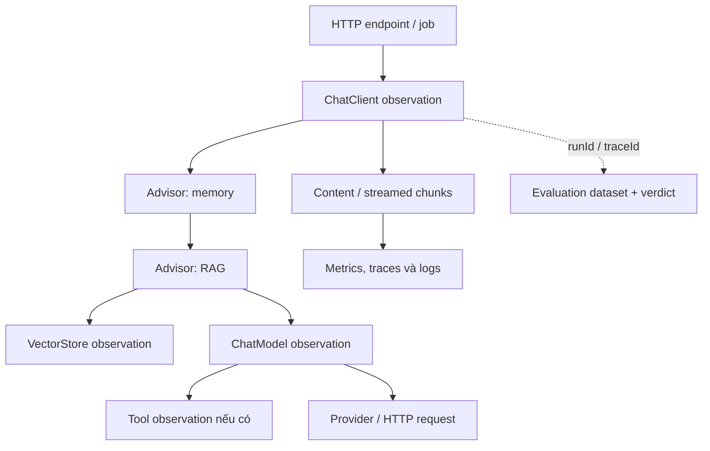

# Phép quan sát cho ChatClient call và stream

## 1. Vì sao phải quan sát cả call và stream?

Một ứng dụng Spring AI có hai cách trả lời phổ biến. Với `call()`, ứng dụng đợi câu trả lời rồi trả về toàn bộ nội dung. Với `stream()`, ứng dụng chuyển từng phần nội dung cho người dùng khi chúng đến. Cùng một model, cùng prompt và cùng advisor nhưng trải nghiệm vận hành có thể rất khác:

- `call()` mất 2 giây mới có câu trả lời đầy đủ.
- `stream()` có phần đầu tiên sau 300 ms, hoàn tất sau 3 giây.
- Một streaming client hủy kết nối sau 500 ms; người dùng thấy vài phần nội dung nhưng cả lượt chưa hoàn tất.
- RAG advisor truy xuất vector store chậm khiến cả `call()` và `stream()` bị trễ trước khi model bắt đầu.
- Một tool được gọi nhiều lần làm tăng token, chi phí và độ trễ nhưng chỉ nhìn ChatClient timer không chỉ ra nguyên nhân.

**Observability** giúp trả lời ba câu hỏi: *lượt gọi đang diễn ra điều gì, ở bước nào và tốn bao nhiêu thời gian/tài nguyên?* Nó không tự kết luận câu trả lời có đúng hay không.

Bài học thuộc chương **ChatClient và advisor** của module **SPRING_AI_EVALUATION_OBSERVABILITY**. Trong phạm vi module, cần kết hợp phép quan sát với dataset và các phép đánh giá relevance, fact checking, RAG/tool flow để phát hiện suy giảm chất lượng và chi phí qua các phiên bản prompt, model, advisor và pipeline.

Sau bài, bạn có thể:

1. Phân biệt observation ở tầng `ChatClient`, advisor, model, vector store và tool.
2. Đọc đúng đặc điểm quan sát của `call()` và `stream()`, kể cả thời điểm subscription và hủy luồng.
3. Cấu hình Spring Boot/Micrometer để có metrics và traces; tránh tạo ChatClient làm mất cấu hình observability.
4. Đọc các tag cardinality thấp/cao và tránh ghi prompt hoặc dữ liệu nhạy cảm ngoài chủ đích.
5. Bổ sung chỉ số thời gian có chunk đầu tiên, tổng thời gian stream và trạng thái complete/error/cancel.
6. Liên kết traces với dữ liệu đánh giá để phân tích chất lượng, token usage, chi phí và độ trễ.

> Ví dụ và tên observation lấy tài liệu Spring AI **2.1.0** làm mốc. API, thuộc tính, tên metric xuất khẩu hoặc cách truyền trace context có thể thay đổi theo phiên bản Spring AI, Spring Boot, Micrometer và provider. Luôn kiểm tra dependency cùng tài liệu tương ứng.

## 2. Observation là gì trong Spring AI?

Spring AI dựa trên cơ chế **Micrometer Observation** của hệ sinh thái Spring để biểu diễn một thao tác được theo dõi. Tùy cấu hình, một observation có thể sinh:

- **Metric**: giá trị thống kê có thể tổng hợp theo thời gian, ví dụ số lượt gọi, thời gian trung bình hoặc số token.
- **Trace/span**: dấu vết một lượt xử lý có quan hệ cha–con giữa các thành phần.
- **Log liên kết trace**: sự kiện và lỗi dùng trace ID/span ID để mở đúng lượt thực thi, khi logging/tracing đã được cấu hình.

**Observation không đồng nghĩa logger.** `SimpleLoggerAdvisor` có thể ghi request/response để debug nhưng không thay thế observability ở nhiều tầng. Ngược lại, metrics/traces có thể hoạt động mà không cần xuất nguyên văn câu hỏi và câu trả lời.

Cấu trúc thường gặp của một lượt RAG:



Sơ đồ mô tả **quan hệ logic** chứ không cam kết mọi exporter luôn vẽ đúng các span theo hình. Trong streaming, phần xử lý reactive hoặc SDK có thể đi qua thread khác; cần kiểm chứng context propagation bằng trace thật.

## 3. Các tầng observation phải phân biệt

Theo tài liệu Observability của Spring AI 2.1.0:

| Tầng | Tên observation | Đo điều gì? | Không tự chứng minh điều gì? |
|---|---|---|---|
| `ChatClient` | `spring.ai.chat.client` | Thao tác ChatClient `call()/stream()` và truyền trace context | Mọi chi phí đều thuộc một lần model call |
| Advisor | `spring.ai.advisor` | Thời gian thực thi advisor, **bao gồm thời gian của các advisor bên trong** | Advisor nào chậm nếu chỉ cộng tổng tất cả timer |
| ChatModel | `gen_ai.client.operation` | Lượt gọi model/provider | Toàn bộ pipeline RAG chỉ có một lượt model |
| Token usage | `gen_ai.client.token.usage` | Token do provider báo cáo cho model calls | Giá tiền thực tế nếu thiếu bảng giá hoặc usage |
| Tool calling | `spring.ai.tool` | Thời gian/lỗi và metadata của công cụ được gọi | Tool đã chọn đúng với yêu cầu nghiệp vụ |
| VectorStore | `db.vector.client.operation` | Truy vấn/thao tác vector store | Context truy xuất đã đúng hoặc đủ |

**Quan trọng về độ trễ:** một timer ở `ChatClient` có thể bao phủ advisor và model, timer advisor có thể bao phủ advisor bên trong, còn model timer nằm trong đường thực thi đó. **Không cộng thời gian của các tầng** để tính latency đầu cuối, vì sẽ đếm lặp khoảng thời gian lồng nhau.

Một lượt `ChatClient` cũng có thể kích hoạt nhiều lần gọi ChatModel (query rewrite, tool loop, fallback) hoặc không gọi model nếu advisor trả lời sớm; vì vậy số lượng ChatClient operations không nhất thiết bằng số model operations.

### 3.1. Metric và trace khác nhau ở cardinality

Trong tài liệu Spring AI, **low-cardinality keys** được thêm vào metrics và traces; **high-cardinality keys** chỉ nên xuất hiện trong traces.

- Low cardinality: tập giá trị hữu hạn, thích hợp tổng hợp, như loại thao tác hoặc cờ streaming.
- High cardinality: có thể có nhiều giá trị, như conversation ID hoặc tên các advisor/tool; cần quản lý vì dễ tăng chi phí lưu trữ và lộ dữ liệu.
- Dữ liệu người dùng như full prompt, full completion, tool arguments và tài liệu nội bộ còn có nguy cơ nhạy cảm, không nên đưa vào metric label.

Các quy ước này là một phần quan trọng khi thiết kế dashboard cho nhiều dự án và môi trường.

## 4. Vòng đời của ChatClient call: khi nào bắt đầu quan sát?

Cách gọi đồng bộ:

```java
String answer = chatClient.prompt()
    .user("Tóm tắt chính sách hoàn tiền trong 2 câu.")
    .call()
    .content();
```

Theo tài liệu ChatClient, `call()` chọn **cách xử lý đồng bộ** nhưng không phải lúc nào bản thân việc gọi `call()` đã kích hoạt yêu cầu model. Lệnh thực hiện xảy ra khi lấy kết quả bằng phương thức terminal như `content()`, `chatResponse()` hoặc `responseEntity(...)`.

Vì vậy, đoạn đo sai:

```java
long started = System.nanoTime();
var spec = chatClient.prompt()
    .user("Nêu chính sách hoàn tiền")
    .call();
long elapsed = System.nanoTime() - started;
// elapsed chỉ đo việc xây spec, không phải toàn bộ lời gọi model.
```

Đo ở thời điểm terminal mới phản ánh lượt xử lý:

```java
long started = System.nanoTime();

String answer = chatClient.prompt()
    .user("Nêu chính sách hoàn tiền")
    .call()
    .content();

long elapsedNanos = System.nanoTime() - started;
```

Phép đo `System.nanoTime()` của caller hữu ích để kiểm tra nhanh, nhưng **không thay thế** tracing/metrics chính thức. Nó có thể gồm công việc khác xung quanh lời gọi, còn span model/advisor giúp nhìn sâu hơn.

### 4.1. Lấy ChatResponse khi cần metadata

```java
import org.springframework.ai.chat.model.ChatResponse;

ChatResponse response = chatClient.prompt()
    .user("Thời hạn hoàn tiền?")
    .call()
    .chatResponse();

if (response != null && response.getResult() != null) {
    String content = response.getResult().getOutput().getText();
    // response còn mang metadata theo provider/phiên bản.
}
```

`ChatResponse` có thể chứa model metadata và usage. Không nên nhầm metadata của model với trace ID hoặc kết quả đánh giá chất lượng; mỗi loại thông tin cần nơi lưu riêng.

## 5. Vòng đời của ChatClient stream: subscription, chunk và kết thúc

Cách gọi streaming:

```java
import reactor.core.publisher.Flux;

Flux<String> output = chatClient.prompt()
    .user("Giải thích ngắn gọn chính sách hoàn tiền.")
    .stream()
    .content();
```

`stream().content()` trả `Flux<String>`. Trong cách sử dụng reactive thông thường, **tạo Flux không có nghĩa đã nhận đủ phản hồi**; quá trình xử lý diễn ra khi có subscriber, chẳng hạn web framework subscribe để gửi dữ liệu hoặc code gọi `subscribe()`.

Ví dụ dùng trong một service:

```java
import reactor.core.publisher.Flux;
import org.springframework.ai.chat.client.ChatClient;
import org.springframework.stereotype.Service;

@Service
public class ChatAnswerService {

    private final ChatClient chatClient;

    public ChatAnswerService(ChatClient chatClient) {
        this.chatClient = chatClient;
    }

    public String answerOnce(String question) {
        return chatClient.prompt()
            .user(question)
            .call()
            .content();
    }

    public Flux<String> answerStream(String question) {
        return chatClient.prompt()
            .user(question)
            .stream()
            .content();
    }
}
```

Trong web endpoint reactive, nên **trả `Flux` cho framework** để framework quản lý subscription và gửi dữ liệu, thay vì tự gọi `subscribe()` rồi đánh mất điều khiển lỗi và hủy luồng. Cũng không nên dùng `block()` trên event-loop vì có thể làm nghẽn luồng xử lý.

### 5.1. Một stream có nhiều mốc thời gian

Một lần streaming có thể có:

1. **Request accepted**: ứng dụng nhận yêu cầu người dùng.
2. **Subscription**: luồng bắt đầu được tiêu thụ.
3. **First chunk**: phần nội dung đầu tiên được đưa đến subscriber.
4. **Completion**: luồng kết thúc bình thường.
5. **Error**: luồng kết thúc do lỗi.
6. **Cancel**: subscriber hủy trước khi hoàn tất (người dùng đóng trình duyệt, timeout upstream, `take(n)` ...).

Từ đó có các chỉ số:

| Chỉ số | Cách diễn giải |
|---|---|
| Time to first chunk | Từ subscription đến phần nội dung đầu tiên mà ứng dụng nhận |
| Total stream duration | Từ subscription tới complete/error/cancel |
| Stream cancellation rate | Tỷ lệ luồng bị hủy, cần phân tích theo tình huống |
| Stream error rate | Tỷ lệ lỗi thực thi khi đang stream |
| Chunk count / bytes | Số chunk hoặc dữ liệu chuyển qua, **không phải số token** |
| Token usage | Số token model/provider báo cáo khi có dữ liệu |

**Không gọi “chunk đầu tiên” là “token đầu tiên” một cách máy móc.** Một chunk có thể chứa nhiều token, một phần token hoặc dữ liệu đã qua buffer/transformation. Nếu báo cáo TTFT (time-to-first-token), phải xác minh độ chính xác của phép đo theo provider. Trong code ứng dụng, tên *time to first chunk* phản ánh điều thực sự được đo hơn.

### 5.2. Streaming không nên tạo một phép đo cho từng ký tự

Observation `spring.ai.chat.client` nhận diện **thao tác stream** ở mức lời gọi, không phải một observation riêng cho mỗi ký tự được phát. Nếu tạo metric label chứa từng chunk hoặc câu trả lời, bạn sẽ làm tăng cardinality và rò rỉ nội dung.

Thời điểm observation kết thúc và xử lý hủy luồng phụ thuộc phiên bản/reactive implementation. Khi xây yêu cầu SLA, cần đo và kiểm thử các nhánh complete, error, cancel ở đúng phiên bản Spring AI đang dùng.

## 6. Những tag của spring.ai.chat.client

Tài liệu Spring AI 2.1.0 liệt kê các **low-cardinality keys**:

| Key | Giá trị hoặc ý nghĩa |
|---|---|
| `gen_ai.operation.name` | `framework` |
| `gen_ai.system` | `spring_ai` |
| `spring.ai.chat.client.stream` | `true` hoặc `false` |
| `spring.ai.kind` | `chat_client` |

Và những **high-cardinality keys** trong trace:

| Key | Ý nghĩa |
|---|---|
| `spring.ai.chat.client.advisors` | Các advisor được cấu hình trên ChatClient |
| `spring.ai.chat.client.conversation.id` | Định danh hội thoại khi dùng memory |
| `spring.ai.chat.client.tool.names` | Tên công cụ được truyền vào ChatClient |

Cờ `spring.ai.chat.client.stream` là dấu hiệu dễ dùng để so sánh **call và stream** với nhau. Nhưng để đánh giá hai chế độ công bằng, cần đảm bảo phân phối câu hỏi, chiều dài đầu ra, model và pipeline gần tương đương.

**Không đưa `conversation.id` hoặc văn bản câu hỏi vào low-cardinality tag do ứng dụng tự tạo.** Điều đó có thể tạo hàng triệu chuỗi metric và làm lộ thông tin cá nhân.

### 6.1. Trước và sau khi export tên metric có thể khác

Tên observation thường dùng dấu chấm như `spring.ai.chat.client`. Một backend như Prometheus có thể biến tên metric, đơn vị và nhãn sang dạng gạch dưới theo quy tắc registry/exporter. Vì vậy, khi viết dashboard:

1. Xem danh sách metric thực tế trong Actuator hoặc backend.
2. Xác nhận tên đã export và đơn vị.
3. Kiểm tra nhãn `spring.ai.chat.client.stream` sau khi backend chuẩn hóa.
4. Chỉ so sánh cùng metric semantics giữa các phiên bản.

Không giả định tên span, tên timer và tên series Prometheus sẽ luôn giống hệt nhau.

## 7. Quan sát riêng từng advisor

Spring AI ghi `spring.ai.advisor` khi một advisor thực thi. Các thuộc tính chính được công bố:

| Nhóm | Key | Ý nghĩa |
|---|---|---|
| Low-cardinality | `gen_ai.operation.name` | `framework` |
| Low-cardinality | `gen_ai.system` | `spring_ai` |
| Low-cardinality | `spring.ai.advisor.name` | Tên advisor |
| Low-cardinality | `spring.ai.kind` | `advisor` |
| High-cardinality | `spring.ai.advisor.order` | Vị trí/thứ tự trong advisor chain |

Các advisor trong Spring AI được sắp theo `getOrder()`; **giá trị nhỏ hơn được chạy trước theo chiều request và chạy sau theo chiều response**. Mỗi advisor có thể thay prompt, đọc memory, thực hiện retrieval, chặn lời gọi tiếp theo hoặc điều chỉnh response.

Một advisor observation đo thời gian xử lý **bao gồm cả phần advisor nội bộ**. Hình dung:

```text
ChatClient
  └─ MemoryAdvisor        1200 ms
      └─ RAGAdvisor       1100 ms
          ├─ VectorStore   100 ms
          └─ ChatModel     900 ms
```

Nếu cộng `1200 + 1100 + 100 + 900` sẽ có số lớn hơn thời gian thực tế do **đếm lặp các span lồng nhau**. Trên trace viewer, hãy xem self-time/exclusive-time (nếu có) hoặc xem thời gian từng con để biết advisor làm gì.

### 7.1. Advisor phục vụ quan sát khác với advisor phục vụ thay đổi nội dung

- `SimpleLoggerAdvisor` dùng để xem request/response ở mức log; cần cân nhắc PII và volume.
- Advisor RAG tạo truy vấn/tài liệu hỗ trợ và có thể làm tăng latency của một lượt ChatClient.
- Memory advisor có thể lấy thêm lịch sử hội thoại, làm prompt dài hơn và tăng token input.
- Tool calling advisor có thể gây nhiều lượt ChatModel và tool execution trong một thao tác.

Không coi việc có `spring.ai.advisor` timer là bằng chứng RAG retrieval đúng hay không hallucinate. Muốn kiểm tra nội dung phải dùng dataset, provenance và evaluator theo tiêu chí.

## 8. Bật metrics và traces bằng Spring Boot

Một ứng dụng Spring Boot có Spring AI thường nhận `ChatClient.Builder` qua auto-configuration. Để thu được observability, cần có **ObservationRegistry** và các observation handler/exporter thích hợp. Cách phổ biến:

1. Spring Boot Actuator để cung cấp endpoint metrics/health và hạ tầng Micrometer.
2. Micrometer MeterRegistry phù hợp để lưu/đưa metrics lên backend.
3. Micrometer Tracing bridge, exporter và collector nếu muốn distributed tracing.
4. Provider/model starter và thành phần Spring AI sử dụng trong ứng dụng.

Ví dụ phụ thuộc Maven dưới đây minh họa hai nhóm chính, không phải một `pom.xml` hoàn chỉnh:

```xml
<dependencies>
    <dependency>
        <groupId>org.springframework.boot</groupId>
        <artifactId>spring-boot-starter-actuator</artifactId>
    </dependency>

    <dependency>
        <groupId>io.micrometer</groupId>
        <artifactId>micrometer-registry-prometheus</artifactId>
    </dependency>
</dependencies>
```

Nếu dùng Maven/BOM theo Spring Boot 4.x, cần xác minh tên starter/bridge và tương thích version từ hướng dẫn Boot phù hợp. Hai dependency trên đủ để minh họa hướng đi với **metrics**, nhưng **không có nghĩa distributed traces tự động được xuất**: còn cần tracing bridge, exporter và cấu hình backend.

### 8.1. Cấu hình dành cho môi trường phát triển có kiểm soát

Ví dụ `application.yml` có thể sử dụng trực tiếp với các dependency và phiên bản phù hợp:

```yaml
management:
  endpoints:
    web:
      exposure:
        include: health,info,metrics,prometheus
  tracing:
    sampling:
      probability: 1.0

spring:
  ai:
    chat:
      client:
        observations:
          log-prompt: false
          log-completion: false
      observations:
        log-prompt: false
        log-completion: false
```

Trong YAML, cần ghép đúng hai nhóm property `spring.ai.chat.client.observations` và `spring.ai.chat.observations` dưới cùng một khóa `chat`; không tạo hai khóa `chat` trùng nhau trong cùng một map. Sampling `1.0` chỉ nên dùng ở môi trường kiểm thử nhỏ, vì ghi mọi trace trong production có thể tốn chi phí lưu trữ; tỷ lệ sampling thực tế phải cân đối yêu cầu điều tra và tài nguyên.

Với endpoint `/actuator/prometheus`, cần registry Prometheus và cấu hình exposure phù hợp. Không mở public các endpoint quan sát chứa thông tin nội bộ; nên dùng mạng quản trị, xác thực và phân quyền.

### 8.2. Tạo ChatClient đúng cách để không mất observation

Trong Spring Boot, ưu tiên **builder được auto-configure**:

```java
import org.springframework.ai.chat.client.ChatClient;
import org.springframework.context.annotation.Bean;
import org.springframework.context.annotation.Configuration;

@Configuration(proxyBeanMethods = false)
public class ChatClientConfig {

    @Bean
    ChatClient chatClient(ChatClient.Builder builder) {
        return builder.build();
    }
}
```

Tài liệu Spring AI lưu ý nếu tự dùng `ChatClient.create(chatModel)` hoặc `ChatClient.builder(chatModel)` thay vì builder auto-configured, bạn có thể **bỏ qua observability và các ChatClientBuilderCustomizer** do Spring Boot thiết lập.

Trong ứng dụng nhiều model, cần dùng `ChatClientBuilderConfigurer` hoặc xây builder với `ObservationRegistry` và các convention/customizer tương ứng. Ví dụ theo cấu trúc API nhánh 2.1:

```java
import io.micrometer.observation.ObservationRegistry;
import org.springframework.ai.chat.client.ChatClient;
import org.springframework.ai.chat.model.ChatModel;
import org.springframework.ai.model.chat.client.autoconfigure.ChatClientBuilderConfigurer;
import org.springframework.beans.factory.annotation.Qualifier;
import org.springframework.context.annotation.Bean;
import org.springframework.context.annotation.Configuration;

@Configuration(proxyBeanMethods = false)
public class MultiModelChatClientConfig {

    @Bean
    ChatClient judgeChatClient(
            @Qualifier("judgeChatModel") ChatModel judgeModel,
            ObservationRegistry registry,
            ChatClientBuilderConfigurer configurer) {

        ChatClient.Builder builder = ChatClient.builder(
            judgeModel, registry, null, null, null
        );

        return configurer.configure(builder).build();
    }
}
```

Ở đây `judgeChatModel` phải là bean do ứng dụng định nghĩa; API factory và package auto-configurer cần kiểm tra với dependency thực tế. Việc dùng `ChatClientBuilderConfigurer` giúp giữ các customizer quan trọng thay vì tạo một client rời rạc, không được theo dõi.

## 9. Ví dụ ChatClient call trong một service quan sát được

Giả sử Spring Boot đã cấu hình `ChatClient` và `MeterRegistry`. Service gọi model:

```java
import org.springframework.ai.chat.client.ChatClient;
import org.springframework.stereotype.Service;

@Service
public class PolicyAnswerService {

    private final ChatClient client;

    public PolicyAnswerService(ChatClient client) {
        this.client = client;
    }

    public String answer(String question) {
        return client.prompt()
            .system("Chỉ trả lời từ chính sách đã được cung cấp.")
            .user(question)
            .call()
            .content();
    }
}
```

Khi thực thi thành công và hạ tầng observability được bật, có thể xem:

- Timer/trace của `spring.ai.chat.client` với `spring.ai.chat.client.stream=false`.
- Advisor observations nếu client có advisor.
- Model operation và token usage nếu model/provider được instrument.
- Trace ID/span ID giúp liên hệ một câu trả lời với retrieval và tool calls liên quan.

Một lần gọi có thể thất bại vì provider, cấu hình hoặc advisor. Observability giúp thấy **loại lỗi vận hành**; muốn biết câu trả lời có phù hợp chính sách, vẫn cần đánh giá nội dung.

## 10. Ví dụ ChatClient stream và các phép đo bổ sung

Spring AI cung cấp các dữ liệu quan sát ở tầng client/model. Nhưng nếu dashboard cần biết người dùng **thấy chunk đầu tiên sau bao lâu**, nên đo bổ sung ở phía ứng dụng. Ví dụ dùng Reactor và Micrometer:

```java
import java.util.concurrent.TimeUnit;
import java.util.concurrent.atomic.AtomicBoolean;

import io.micrometer.core.instrument.MeterRegistry;
import io.micrometer.core.instrument.Timer;
import org.springframework.ai.chat.client.ChatClient;
import org.springframework.stereotype.Service;
import reactor.core.publisher.Flux;
import reactor.core.publisher.SignalType;

@Service
public class MeasuredStreamingService {

    private final ChatClient client;
    private final MeterRegistry meters;

    public MeasuredStreamingService(
            ChatClient client,
            MeterRegistry meters) {
        this.client = client;
        this.meters = meters;
    }

    public Flux<String> stream(String question) {
        // defer: khởi tạo đồng hồ cho MỖI subscription.
        return Flux.defer(() -> {
            long started = System.nanoTime();
            AtomicBoolean firstSeen = new AtomicBoolean(false);

            return client.prompt()
                .user(question)
                .stream()
                .content()
                .doOnNext(chunk -> {
                    if (firstSeen.compareAndSet(false, true)) {
                        Timer.builder("app.ai.stream.first.chunk")
                            .description("Time to first observed chunk")
                            .register(meters)
                            .record(
                                System.nanoTime() - started,
                                TimeUnit.NANOSECONDS
                            );
                    }
                })
                .doFinally(signal -> {
                    String outcome = switch (signal) {
                        case ON_COMPLETE -> "complete";
                        case ON_ERROR -> "error";
                        case CANCEL -> "cancel";
                        default -> "other";
                    };

                    Timer.builder("app.ai.stream.total")
                        .description("Duration until stream termination")
                        .tag("outcome", outcome)
                        .register(meters)
                        .record(
                            System.nanoTime() - started,
                            TimeUnit.NANOSECONDS
                        );
                });
        });
    }
}
```

Giải thích cách đo:

- `Flux.defer(...)` tạo `started` và `firstSeen` riêng cho mỗi subscription; không dùng chung trạng thái giữa người dùng.
- `doOnNext` đo **lần đầu có chunk**, không đo số token và không ghi lại nội dung chunk.
- `doFinally` chạy cho các nhánh complete/error/cancel; tag outcome có tập giá trị hữu hạn.
- Nếu subscriber hủy trước chunk đầu tiên, timer `first.chunk` có thể không có bản ghi cho lần ấy. Phải báo song song số luồng và tỷ lệ có first chunk.
- Nếu cùng một Flux bị subscribe nhiều lần, có thể tạo **nhiều lần gọi model**, do đó ứng dụng cần kiểm soát subscription.
- Đây là metric **tự định nghĩa** với prefix `app.ai.*`, không phải tên metric Spring AI mặc định.
- Timer ở phía ứng dụng bao gồm các yếu tố lên lịch/buffer/reactive khác, nên không được hiểu là thời gian xử lý nội bộ của model.

### 10.1. Có thể trả stream từ controller

Một mẫu Spring WebFlux đơn giản:

```java
import org.springframework.http.MediaType;
import org.springframework.web.bind.annotation.GetMapping;
import org.springframework.web.bind.annotation.RequestParam;
import org.springframework.web.bind.annotation.RestController;
import reactor.core.publisher.Flux;

@RestController
class ChatStreamController {

    private final MeasuredStreamingService service;

    ChatStreamController(MeasuredStreamingService service) {
        this.service = service;
    }

    @GetMapping(
        value = "/api/answers/stream",
        produces = MediaType.TEXT_EVENT_STREAM_VALUE
    )
    Flux<String> stream(@RequestParam String question) {
        return service.stream(question);
    }
}
```

Framework sẽ subscribe và chuyển các phần nội dung cho client theo cấu hình transport. Ở thực tế, nên kiểm tra cách đóng gói sự kiện SSE, proxy buffering, timeout và tín hiệu client disconnect. Chuỗi trả về ở ví dụ chỉ minh họa; với dữ liệu nhạy cảm hoặc yêu cầu xác thực, phải áp dụng cơ chế bảo vệ endpoint phù hợp.

### 10.2. Vì sao không đo bằng collectList() rồi mới báo streaming nhanh?

Nếu viết:

```java
String fullAnswer = chatClient.prompt()
    .user("Giải thích chính sách")
    .stream()
    .content()
    .collectList()
    .map(parts -> String.join("", parts))
    .block();
```

thì caller vẫn phải đợi **luồng hoàn tất** mới có toàn bộ câu trả lời. Đây là cách tổng hợp stream trong test/ứng dụng đồng bộ; nó không còn mang lợi ích UI nhận nội dung dần. Không báo thời gian hoàn tất của đoạn này là time to first chunk.

Trong môi trường reactive, hạn chế dùng `block()` trên event-loop và bảo đảm timeout phù hợp nếu phải chuyển sang luồng đồng bộ.

## 11. Phân tích traces khi call và stream qua các thread

Streaming thường chạy qua Reactor, scheduler hoặc SDK async. Một số vấn đề khi chuyển thread:

- Trace context được giữ đúng ở phần ChatClient nhưng bị mất khi callback của thư viện chạy ngoài Reactor context.
- Span model/HTTP không còn cùng nhánh cha–con trong trace viewer.
- Lỗi client disconnect không được ghi với nhãn cancel.
- Một advisor chỉ có nhánh `adviseCall()` nhưng thiếu xử lý streaming tương ứng ở API advisor tùy bản.
- Code tự dùng `subscribe()` trong service làm mất mối liên hệ với HTTP request hoặc khiến error không được xử lý.

**Cách tiếp cận tốt:** ưu tiên Spring Boot autoconfiguration, tracing bridge và adapter/reactive integration được hỗ trợ cho phiên bản đang chạy. Không tự sao chép `ThreadLocal` trace ID qua `publishOn()` hoặc `subscribeOn()` mà thiếu cơ chế context propagation. Khi thêm custom scheduler, kiểm thử trace thực tế.

### 11.1. Lưu ý có giới hạn theo provider trong Spring AI 2.1.0

Tài liệu Observability của Spring AI 2.1.0 mô tả: các model OpenAI và Anthropic có HTTP-layer observations; nhưng với **OpenAI streaming**, HTTP span có thể được ghi mà **không nằm dưới span chat-model** do luồng async của SDK đi qua một thread pool không giữ observation context ở điểm đó. Với non-streaming và Anthropic streaming, tài liệu mô tả quan hệ lồng span đầy đủ hơn, đồng thời nêu ngoại lệ riêng khi dùng Anthropic async client tự cấu hình.

Điều này nghĩa là **trace bị thiếu quan hệ cha–con không tự chứng minh không có HTTP request**, và không nên áp đặt hành vi một provider cho tất cả provider. Khi nâng cấp SDK/Spring AI, kiểm tra lại limitation hiện hành và dùng trace cụ thể để xác nhận.

### 11.2. Triển khai custom advisor phải tính cả call và stream

Spring AI 2.1.x dùng các interface liên quan đến `CallAdvisor` / `CallAdvisorChain` và `StreamAdvisor` / `StreamAdvisorChain`. Nếu tự viết advisor để xử lý request hoặc quan sát log:

1. Xác định advisor hỗ trợ đồng bộ, streaming hay cả hai.
2. Trong `adviseCall(...)`, gọi next chain đúng một lần theo thiết kế.
3. Trong `adviseStream(...)`, xử lý publisher/reactive lifecycle, không gọi blocking tùy tiện.
4. Giữ ngữ cảnh tracing qua đường reactive theo framework.
5. Phân biệt lỗi và hủy luồng với hoàn tất bình thường.
6. Đừng log raw prompt/response theo mặc định.

Nhiều built-in advisor đã được instrument; không cần tự thêm một timer trùng mục đích cho cùng lớp nếu không có chỉ số nghiệp vụ bổ sung rõ ràng.

## 12. Logging prompt, completion và dữ liệu nhạy cảm

Tài liệu Spring AI 2.1.0 nêu hai thuộc tính ở **ChatClient**:

| Thuộc tính | Mặc định | Ý nghĩa |
|---|---|---|
| `spring.ai.chat.client.observations.log-prompt` | `false` | Có log nội dung prompt qua cơ chế quan sát không |
| `spring.ai.chat.client.observations.log-completion` | `false` | Có log nội dung completion không |

Và những thuộc tính riêng cho **ChatModel**:

| Thuộc tính | Mặc định |
|---|---|
| `spring.ai.chat.observations.log-prompt` | `false` |
| `spring.ai.chat.observations.log-completion` | `false` |
| `spring.ai.chat.observations.include-error-logging` | `false` |

Bật logging nội dung có thể làm lộ PII, bí mật, prompt hệ thống, tài liệu RAG hoặc câu trả lời chứa thông tin nhạy cảm. Chỉ bật trong môi trường có quyền truy cập và quy trình xóa/ẩn dữ liệu phù hợp.

### 12.1. SimpleLoggerAdvisor không phải giải pháp miễn phí về bảo mật

`SimpleLoggerAdvisor` hữu ích khi debug, nhưng có thể ghi nội dung request/response. Nếu bật log debug của package advisor, cần biết bản ghi vào đâu, người nào đọc được, lưu trong bao lâu và có áp dụng redaction hay không.

Một quy tắc vận hành nên ưu tiên:

- Dùng counters/timers và trace tags hữu hạn cho quan sát đại trà.
- Chỉ trích nội dung khi thực sự cần điều tra và được phép lưu.
- Ẩn thông tin cá nhân, khóa bí mật, câu hỏi nhạy cảm và kết quả công cụ.
- Không đưa full prompt hoặc completion vào metric labels.
- Khi có thể, lưu nguồn tham chiếu bằng ID/version đã được kiểm soát truy cập thay vì sao chép toàn văn.

### 12.2. Không đưa toàn bộ conversation ID thành label

`spring.ai.chat.client.conversation.id` có thể xuất hiện ở trace theo quy ước high-cardinality. Nhưng nếu tự gắn giá trị này vào custom counter sẽ sinh nhiều series metric. Muốn khoanh vùng từng ca, lưu correlation ID ở logs/traces hoặc một bảng kết quả có chính sách truy cập phù hợp.

## 13. Cách đọc metrics và xác định điểm nghẽn

Một dashboard thiết thực nên có các nhóm sau:

| Nhóm | Chỉ số | Ý nghĩa |
|---|---|---|
| ChatClient | Lượt `call`/`stream`, duration, error rate | Tổng quan tương tác ứng dụng |
| Advisor | Duration theo tên advisor | Bộ nhớ, RAG, cache hoặc tool orchestration |
| Model | Số lượt model, duration, token usage | Latency và tài nguyên provider |
| Retrieval | Vector store query duration, số tài liệu | Phát hiện truy xuất chậm hoặc thiếu dữ kiện |
| Tool | Tool duration, error rate | Chẩn đoán lỗi hoặc bottleneck tool |
| Stream UX | Time to first chunk, total duration, cancel rate | Trải nghiệm người dùng khi nhận dần kết quả |
| Quality | Relevance/factuality pass rate, judge errors | Phát hiện lỗi nội dung, không chỉ lỗi vận hành |

Các giá trị như number of retrieved documents, first chunk time, quality verdict là **metric tùy biến của ứng dụng** nếu Spring AI không xuất sẵn cho mục tiêu đó.

### 13.1. Phân biệt latency trung bình với P95

- **Mean** cho biết xu hướng tổng thể nhưng có thể che các trường hợp rất chậm.
- **P95/P99** cho biết tail latency; cần bộ histogram/quantile được cấu hình đúng.
- **Time to first chunk** quan trọng với UX streaming, nhưng không thay total completion time.
- **Cancel rate** cao có thể do người dùng thoát, timeout proxy, mạng kém hoặc câu trả lời không hữu ích; cần nhìn thêm context mới kết luận nguyên nhân.

Ví dụ số giả định:

| Chế độ | First chunk | Tổng thời gian | Token đầu ra |
|---|---:|---:|---:|
| Call | Không áp dụng | 2,4 s | 180 |
| Stream | 0,3 s | 3,1 s | 180 |

Không thể nói stream “nhanh hơn toàn diện”: nó **hiển thị sớm hơn** nhưng hoàn tất muộn hơn trong ví dụ. Muốn quyết định dùng call hay stream, cần xét UX, chi phí vận hành, lỗi/hủy luồng và tính chất tác vụ.

### 13.2. Token usage không phải chi phí

Metric `gen_ai.client.token.usage` phụ thuộc token mà provider báo cáo. Trong backend Prometheus, tài liệu Spring AI 2.1.0 mô tả metric `gen_ai_client_token_usage_total` và nhãn `gen_ai_token_type` với giá trị `input`, `output` hoặc `total`.

**Không cộng input + output + total** để tính tổng vì `total` thường đã bao gồm hai loại kia. Khi provider không báo usage, giá trị đếm có thể không tăng, không đồng nghĩa model chưa xử lý gì.

Chi phí cần được tính riêng từ:

```text
estimatedCost =
    inputTokens × pricePerInputToken
    + outputTokens × pricePerOutputToken
    + (các phí tool/embedding/rerank khác nếu có)
```

Bảng giá còn phụ thuộc model, provider, thời điểm và đơn vị tính. Không lấy `getScore()` từ `EvaluationResponse` làm chi phí. Trong streaming bị hủy hoặc lỗi, usage có thể thiếu hoặc chỉ là ước tính, phải ghi trạng thái completeness của usage.

## 14. Quan sát ChatClient trong RAG

Giả sử yêu cầu hỏi về chính sách hoàn tiền:

```text
User
  → ChatClient
  → Retrieval advisor
  → VectorStore search
  → Context assembly
  → ChatModel
  → Output / Stream
```

Phép quan sát giúp trả lời:

1. **Retrieval chậm?** Xem vector store span và phần xử lý advisor liên quan.
2. **Prompt dài hơn?** Xem model token usage (không cần log toàn bộ prompt).
3. **Model mất thời gian sinh?** Xem model duration; streaming có thể hiển thị chunk đầu nhanh hơn tổng thời gian.
4. **Tool làm tăng vòng gọi?** Kiểm tra tool spans và số model operations.
5. **Bộ chấm mất nhiều thời gian?** Tách trace judge/evaluation khỏi trace generation để không gán nhầm latency.

Nhưng một RAG pipeline có retrieval nhanh **không đồng nghĩa** tài liệu đúng. Cần so với gold document IDs, kiểm tra phiên bản nguồn và đánh giá answer groundedness.

### 14.1. Liên kết observability với EvaluationRequest

Khi có dataset gồm câu hỏi, context và câu trả lời, nên lưu:

| Trường | Nguồn |
|---|---|
| `caseId` | Dataset đánh giá |
| `runId` / trace ID | Orchestration/tracing |
| `userText` | Câu hỏi gốc |
| `dataList` | Context thực sự được cấp cho model |
| `responseContent` | Câu trả lời được chấm |
| `promptVersion`, `modelVersion`, `retrieverVersion` | Run metadata |
| `judgeModel`, `rubricVersion` | Cấu hình evaluator |
| `isPass()`, `feedback` | EvaluationResponse |
| Latency, token, cost | Metrics/provider telemetry |

`EvaluationRequest` không tự có trace ID, và `EvaluationResponse` không tự đo latency/chi phí. Muốn điều tra một case trượt relevance hoặc fact checking, phải có **định danh liên kết** giữa báo cáo chất lượng và các span/metrics.

### 14.2. Khi đo chất lượng call và stream

Hai chế độ có thể tạo ra khác biệt về cách gom câu trả lời:

- Với call: thường có toàn bộ `responseContent` ngay sau terminal.
- Với stream: các chunk phải được tổng hợp **sau khi luồng kết thúc bình thường** nếu muốn chấm văn bản hoàn chỉnh.
- Nếu stream bị hủy giữa chừng, không được coi phần văn bản còn thiếu là câu trả lời hoàn tất và đánh giá chất lượng như một output đầy đủ mà không gắn nhãn.
- Nếu stream bị lỗi sau khi đã phát một số chunk, lưu trạng thái **partial/error** và xử lý theo rubric/dataset riêng.

Một bộ so sánh chất lượng công bằng cần cùng câu hỏi, cùng nguồn, prompt và cấu hình model ở mức có thể kiểm soát; không trộn partial output với full completion.

## 15. Mẫu báo cáo ghép chất lượng và vận hành

Ví dụ bản ghi do ứng dụng tự thiết kế:

```json
{
  "caseId": "refund-policy-001",
  "runId": "run-2026-11-27-001",
  "traceId": "trace-example-001",
  "mode": "stream",
  "streamStatus": "complete",
  "chatClientDurationMs": 3150,
  "timeToFirstChunkMs": 340,
  "modelDurationMs": 2810,
  "retrievalDurationMs": 140,
  "inputTokens": 780,
  "outputTokens": 190,
  "usageSource": "provider",
  "promptVersion": "p12",
  "modelVersion": "provider-model-v2",
  "retrieverVersion": "index-v5",
  "quality": {
    "criterion": "factual-support",
    "evaluatorVersion": "judge-rubric-v3",
    "status": "EVALUATED_PASS",
    "pass": true
  }
}
```

Đây là **schema minh họa**, không phải output tự động của Spring AI hoặc dữ liệu thật. Những con số là ví dụ; muốn dùng production phải xây quy trình thu thập, đối soát đơn vị thời gian, xác nhận completeness của usage và bảo vệ trace IDs.

Nếu cùng một run có nhiều lần model call do tool/fallback, `modelDurationMs` cần được định nghĩa rõ là tổng, critical path hay từng lượt; **không mặc định cộng mọi span lồng nhau**.

## 16. Kiểm thử có quan sát cho call và stream

Với JUnit/Spring Boot, có thể tạo integration test dùng model provider test, local model hoặc model giả lập phù hợp. Mục tiêu khác nhau phải được kiểm riêng:

| Loại test | Điều kiểm tra |
|---|---|
| Unit test service/reactive metrics | Custom timer first chunk/total duration ghi đúng |
| Integration test ChatClient call | Observation có cờ `stream=false` và kết thúc |
| Integration test ChatClient stream | Có subscriber, nhận chunk, observation/cancellation được ghi |
| Test advisor | Thứ tự chain, trace span advisor, dữ liệu không bị thay đổi bất ngờ |
| Test provider | Token usage, errors, HTTP span đúng khả năng provider |
| Dataset evaluation | Output cuối đúng theo relevance/factuality, không nhầm với instrumentation |

### 16.1. Kịch bản kiểm thử thủ công trong môi trường phát triển

1. Bật Spring Boot Actuator và registry metric.
2. Gọi endpoint `call()` một lần; xem `spring.ai.chat.client` có cờ streaming `false`.
3. Gọi endpoint streaming và **đợi stream hoàn tất**; xem cờ `true`, timer custom first chunk và total.
4. Hủy client giữa chừng; kiểm tra timer `outcome=cancel` và signal trên HTTP server.
5. Mô phỏng provider lỗi; kiểm tra span/error và phân biệt với `EvaluationResponse.isPass()==false`.
6. Thêm RAG advisor; so thời gian ChatClient, advisor, VectorStore và ChatModel, tránh cộng timer lồng nhau.
7. Kiểm tra trace có liên kết HTTP/model/provider theo khả năng SDK và cấu hình.
8. Đọc lại log để chắc chắn không xuất nội dung nhạy cảm ngoài chủ đích.

**Không dùng test hủy stream để xác nhận nội dung cuối:** tác vụ đã bị hủy không có full completion đáng tin. Nên lưu riêng số trường hợp stream bị hủy.

### 16.2. Khi viết assertion cho timer

Tên metric, tags và handler phụ thuộc phiên bản. Một integration test muốn kiểm `spring.ai.chat.client` bằng `MeterRegistry` phải có registry + ObservationHandler ghi metric, và phải **hoàn tất thao tác** trước khi đọc timer. Tạo Flux mà không subscribe hoặc đọc meter ngay khi stream đang chạy có thể khiến assertion sai.

Ngoài ra, timer không chứng minh model sinh đúng. Nếu cần chất lượng, gọi evaluator trên output đã hoàn tất theo một dataset độc lập.

## 17. Các sai lầm phổ biến

| Sai lầm | Vì sao sai? | Cách khắc phục |
|---|---|---|
| Cho rằng `.call()` một mình đã gọi model | Terminal method mới thực sự yêu cầu kết quả | Đo quanh `content()/chatResponse()` |
| Tạo `Flux` rồi đọc metric trước subscription | Chưa chắc có thao tác stream được thực thi | Subscribe/return Flux cho framework và đợi kết thúc |
| Coi first chunk là first token tuyệt đối | Chunk không đồng nghĩa token | Đặt tên metric chính xác và nêu cách đo |
| Không phân biệt complete/error/cancel | Total duration có thể chứa partial stream | Dùng `doFinally` hoặc tín hiệu tương đương |
| Tạo ChatClient bằng builder thủ công bỏ auto-config | Có thể thiếu observation/customizers | Ưu tiên builder auto-configured hoặc configurer |
| Cộng timer ChatClient + Advisor + Model | Double counting span lồng nhau | Xem waterfall/self-time theo trace |
| Dùng số lượt ChatClient như số model calls | Tool loop, RAG và fallback tạo nhiều lời gọi | Đo riêng model operations |
| Dùng `getScore()` làm chỉ số latency/token | Score thuộc rubric đánh giá | Lấy telemetry từ model/usage/timer |
| Cho rằng streaming luôn có HTTP span đúng cha–con | SDK/provider có giới hạn context propagation | Kiểm tra theo provider/version |
| Bật log prompt/completion toàn cục | Lộ PII, secrets, context RAG | Mặc định tắt; redaction và quyền truy cập |
| Gắn mỗi conversation ID vào metric label | Cardinality rất cao | Chỉ gắn vào trace/report phù hợp |
| So pass rate call với partial stream | Dữ liệu đánh giá không tương đương | Chỉ chấm output hoàn chỉnh hoặc phân nhóm riêng |
| Chạy judge chung với serving mà không tách metric | Chi phí và latency bị quy nhầm | Phân biệt generation và evaluation spans |
| Đọc metric `total` rồi cộng thêm `input + output` | Đếm token hai lần | Chọn một cách tổng hợp nhất quán |

## 18. Bài tập thực hành

### Bài 1 — Chọn observation đúng

Ứng dụng gọi `ChatClient.stream()`, người dùng nhận chunk đầu rất muộn. Bạn thấy `ChatClient` timer chậm. Cần kiểm thêm những observation nào?

**Gợi ý:** xem advisor spans, VectorStore query, ChatModel duration, các tool calls và custom time-to-first-chunk. Đừng tự cho model là nguyên nhân khi RAG có thể chiếm phần lớn thời gian trước khi model sinh.

### Bài 2 — Vì sao timer không xuất hiện?

Một developer viết:

```java
Flux<String> result = chatClient.prompt()
    .user("Xin chào")
    .stream()
    .content();

// Chưa trả Flux, chưa subscribe, nhưng đã truy vấn metric.
```

**Đáp án:** Luồng reactive chưa được tiêu thụ; không nên giả định hoạt động model và observation đã hoàn tất. Phải subscribe hoặc để framework quản lý subscriber, chờ terminal signal rồi kiểm tra.

### Bài 3 — Chẩn đoán stream bị hủy

Một lần stream có first chunk 200 ms, sau 900 ms bị client đóng kết nối. Có nên đưa câu trả lời còn thiếu vào bộ đánh giá factuality như một answer hoàn chỉnh?

**Đáp án:** Không mặc định. Gắn trạng thái partial/cancel, lưu riêng thông tin vận hành. Nếu muốn đánh giá hành vi với output bị cắt, phải có rubric riêng.

### Bài 4 — Kiểm tra advisor timing

Advisor A báo 1,4 giây, advisor B nằm trong A báo 1,2 giây, model nằm trong B báo 1,0 giây. Tổng latency của lượt gọi có phải 3,6 giây?

**Đáp án:** Không. Những timer lồng nhau; cộng sẽ đếm lặp. Xem waterfall và self-time để xác định từng bước.

### Bài 5 — Observability và chất lượng

Prompt v2 tăng tỷ lệ relevance pass nhưng cũng tăng token usage và P95 latency. Có thể kết luận v2 tốt hơn không?

**Đáp án:** Cần dùng cùng dataset và judge/rubric, kiểm tra factuality, độ tin cậy của kết quả, tail latency và chi phí. Đây là quyết định trade-off dựa trên ngưỡng chất lượng/chi phí của sản phẩm, không phải chỉ một số.

### Bài 6 — Trace không có quan hệ parent–child

Spring AI 2.1.0 với một cấu hình OpenAI streaming có HTTP span nhưng không nằm dưới model span. Có phải HTTP request không chạy?

**Đáp án:** Không. Tài liệu nêu giới hạn context propagation ở đường async streaming. Kiểm tra tài liệu provider/version, tracing bridge, trace ID và thực tế network trước khi kết luận.

## 19. Checklist khi triển khai thực tế

- [ ] Đã xác định Spring AI, Boot, Micrometer và provider version đang dùng?
- [ ] ChatClient lấy từ builder auto-configured hoặc được cấu hình `ObservationRegistry` đúng cách?
- [ ] Hệ thống có `MeterRegistry`/tracing bridge/exporter cần thiết?
- [ ] Đã quan sát cả `spring.ai.chat.client.stream=true/false`?
- [ ] Có đo first chunk/total duration riêng, phân loại complete/error/cancel?
- [ ] Có tránh subscribe nhiều lần vào cùng một publisher ngoài ý muốn?
- [ ] Đã phân biệt ChatClient, Advisor, ChatModel, VectorStore và Tool observations?
- [ ] Đã tránh cộng số liệu của các span lồng nhau?
- [ ] Có kiểm tra trace context qua Reactor/provider async theo phiên bản?
- [ ] Đã giữ log prompt/completion tắt nếu không có nhu cầu được phê duyệt?
- [ ] Không đưa prompt, conversation ID hoặc trace ID vào metric labels tùy biến?
- [ ] Đã liên kết run ID/trace ID với báo cáo relevance/fact checking?
- [ ] Đã tách latency/usage của generation, retrieval/tool và judge?
- [ ] Dashboard có coverage/error rate cùng quality pass rate?
- [ ] Đã bảo vệ Actuator/Prometheus endpoints và retention của traces/logs?

## 20. Tổng kết và tài liệu tham khảo

`ChatClient.call()` và `ChatClient.stream()` đều được Spring AI quan sát, nhưng mang trải nghiệm thời gian khác nhau. **Call** cần thời gian đến toàn bộ kết quả; **stream** có thể hiển thị sớm hơn, đồng thời có các trạng thái subscription, chunk, hoàn tất, lỗi và hủy. Phân biệt tầng ChatClient, advisor, model, vector store và tool giúp điều tra hiệu năng mà không cộng sai các khoảng thời gian lồng nhau. Liên kết observability với evaluation dataset giúp xác định chất lượng thay đổi do retrieval, generation, judge hay phần điều phối.

Nguồn chính thức để tra cứu:

1. [Spring AI 2.1.0 — Observability](https://docs.spring.io/spring-ai/reference/observability/): tên `spring.ai.chat.client`, `spring.ai.advisor`, low/high cardinality tags, cấu hình log nội dung và model/tool/vector observations.
2. [Spring AI 2.1.0 — Chat Client API](https://docs.spring.io/spring-ai/reference/api/chatclient.html): semantics `call()`, `stream()`, terminal methods, các dạng response và lưu ý builder auto-configured.
3. [Spring AI 2.1.0 — Advisors API](https://docs.spring.io/spring-ai/reference/api/advisors.html): advisor chain, order, `CallAdvisor`, `StreamAdvisor` và khả năng observability.
4. [Spring AI 2.1 — ChatClientBuilderConfigurer Javadoc](https://docs.spring.io/spring-ai/docs/2.1.x/api/org/springframework/ai/model/chat/client/autoconfigure/ChatClientBuilderConfigurer.html): cấu hình builder khi có nhiều model.
5. [Spring AI 2.1 — ChatClient Javadoc](https://docs.spring.io/spring-ai/docs/2.1.x/api/org/springframework/ai/chat/client/ChatClient.html): factory và các phương thức builder.
6. [Spring AI — OpenAI Chat Observability](https://docs.spring.io/spring-ai/reference/api/chat/openai-chat.html): lớp HTTP/model và giới hạn nesting ở đường streaming.
7. [Spring AI — Anthropic Chat Observability](https://docs.spring.io/spring-ai/reference/api/chat/anthropic-chat.html): HTTP spans và lưu ý khi dùng client async riêng.
8. [Spring Boot — Metrics](https://docs.spring.io/spring-boot/reference/actuator/metrics.html) và [Tracing](https://docs.spring.io/spring-boot/reference/actuator/tracing.html): cấu hình hạ tầng Micrometer/Actuator, exporters và sampling.
9. [Spring AI 2.1 — Metrics Reference](https://docs.spring.io/spring-ai/reference/2.1-SNAPSHOT/observability/metrics.html): token usage và Prometheus examples; **cần đối chiếu** với release đang dùng vì URL chứa snapshot.

*Ví dụ có tính hướng dẫn, không phải một dự án Spring Boot đầy đủ. Để áp dụng, xác nhận dependency và hạ tầng exporter/tracing, không bật ghi dữ liệu nhạy cảm ngoài chủ đích, và chạy test thật với call, stream, error và cancel trên phiên bản Spring AI/provider mà dự án dùng.*
