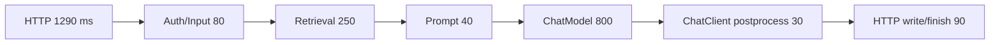

# Phân biệt thời gian toàn yêu cầu và thời gian gọi mô hình

## 1. Một câu trả lời mất 2 giây có nghĩa model mất 2 giây?

Giả sử ứng dụng trợ lý chính sách dùng Spring AI nhận câu hỏi: “Tôi có thể yêu cầu hoàn tiền trong bao lâu?”. Đồng hồ từ lúc server nhận HTTP request đến lúc phản hồi xong là **1.290 ms**, trong khi trace cho biết một lượt gọi ChatModel mất **800 ms**.

Chênh lệch 490 ms không tự động là “Spring AI chậm”. Khoảng đó có thể gồm kiểm tra quyền, truy vấn cơ sở dữ liệu, retrieval, tạo prompt, xử lý phản hồi, tuần tự hóa JSON và thời gian ghi dữ liệu ra HTTP. Ngược lại, một luồng gọi công cụ có nhiều lần gọi model khiến **tổng thời gian các model spans** có thể lớn hơn một model span đơn lẻ; nếu xử lý song song, cộng toàn bộ spans thậm chí có thể **lớn hơn thời gian thực của yêu cầu**.

Bài học này thuộc chương **ChatClient và advisor** trong module **SPRING_AI_EVALUATION_OBSERVABILITY**. Module tập trung đánh giá chất lượng Spring AI bằng dataset, relevance, fact checking, kiểm thử RAG/tool calling và đo metrics, traces, token, chi phí, độ trễ để phân tích regression theo prompt/model/pipeline.

**Mục tiêu học tập:**

1. Định nghĩa rõ *request latency*, *ChatClient latency*, *ChatModel latency*, *provider HTTP latency* và *time to first chunk*.
2. Đọc đúng các observation của Spring AI, biết vì sao các khoảng thời gian lồng nhau không cộng được.
3. Tạo phép đo tại ranh giới HTTP/service và đối chiếu với ChatClient, advisor, model, vector store, tool spans.
4. Phân tích thời gian call và stream, kể cả subscription, buffer, cancel và partial response.
5. Đo P95/P99, so sánh theo phiên bản và liên hệ chất lượng/chi phí mà không quy sai nguyên nhân.

> Các tên observation đối chiếu theo tài liệu **Spring AI 2.1.0**, còn tên time series trong Prometheus phụ thuộc registry, version và configuration. Các ví dụ thời gian là số liệu giả định để học cách phân tích, không phải benchmark của Spring AI.

## 2. Định nghĩa ranh giới đo trước khi đọc con số

“Latency” chỉ có ý nghĩa khi hai mốc **bắt đầu** và **kết thúc** được xác định. Trong một ứng dụng web có gọi model, thường có các đồng hồ sau:

| Phép đo | Điểm bắt đầu | Điểm kết thúc | Bao gồm những gì? |
|---|---|---|---|
| **Client-observed latency** | Trình duyệt/client gửi yêu cầu | Client nhận đủ phản hồi | Mạng hai chiều, proxy, server và tải xuống |
| **HTTP server request duration** | HTTP server bắt đầu xử lý request | Server hoàn thành vòng đời response theo instrumentation | Routing, auth, ứng dụng, gửi/hoàn tất response ở server |
| **Application service latency** | Vào phương thức dịch vụ | Ra khỏi phương thức | Logic trong service được đo, có thể gồm ChatClient |
| **ChatClient invocation duration** | Spring AI bắt đầu thực thi `ChatClient` terminal operation | Invocation/luồng ChatClient kết thúc theo implementation | Advisor chain, gọi model, xử lý ở client |
| **Advisor duration** | Advisor bắt đầu | Advisor trả kết quả/kết thúc luồng | Thời gian advisor **và các bước bên trong** |
| **ChatModel operation duration** | Thao tác `ChatModel.call/stream` bắt đầu | Thao tác model hoàn thành theo instrumentation | Đường model/provider của một lượt, có thể gồm mạng |
| **Provider HTTP duration** | Client HTTP thực sự gửi/nhận request từ provider | HTTP exchange hoàn tất theo SDK/instrumentation | Mạng, chờ provider, transfer và một số xử lý ở HTTP layer |
| **Time to first chunk** | Thời điểm subscribe luồng | Chunk đầu đến subscriber đo | Tiền xử lý, có thể gồm retrieval và chờ model gửi dữ liệu |
| **Full stream duration** | Subscribe | Complete/error/cancel | Toàn bộ vòng đời stream phía caller đo |

**Không đồng nhất các phép đo:** latency của model **không** phải chỉ thời gian “GPU tính token”; nó có thể bao gồm chờ provider, mạng và adapter/SDK. HTTP server duration **không** nhất thiết là thời gian người dùng nhìn thấy dữ liệu trên màn hình vì còn network/proxy/browser buffering.

### 2.1. Ranh giới của Spring AI và Micrometer

Theo Spring AI 2.1.0:

- `spring.ai.chat.client`: observation cho thao tác `ChatClient.call()/stream()`.
- `spring.ai.advisor`: observation mỗi advisor, **bao gồm thời gian của advisor nằm trong nó**.
- `gen_ai.client.operation`: observation lượt gọi `ChatModel`; cũng được dùng bởi các loại model khác với nhãn operation phù hợp.
- `db.vector.client.operation`: observation thao tác vector store.
- `spring.ai.tool`: observation chạy công cụ.
- `gen_ai.client.token.usage`: counter token khi provider hỗ trợ usage.

Chính quan hệ lồng nhau này tạo ra sự khác biệt giữa **wall-clock duration** và **tổng duration của các spans**.

### 2.2. Các thuật ngữ không nên dùng thay nhau

- *Response time* của endpoint: có thể bao gồm toàn bộ quá trình HTTP.
- *Generation latency*: thời gian tạo phản hồi; cần nói rõ là model call hay toàn pipeline RAG.
- *Inference latency*: đôi khi chỉ thời gian tại server nhà cung cấp, nhưng caller thường **không có phép đo riêng** cho xử lý nội bộ ấy.
- *Time to first token (TTFT)*: theo định nghĩa provider; **chunk đầu** của `Flux<String>` không nhất thiết là một token.
- *Throughput*: số yêu cầu hoặc token/giây; không phải độ trễ một yêu cầu.

## 3. Ví dụ dòng thời gian của một yêu cầu đồng bộ

Giả định một HTTP request diễn ra theo các bước tuần tự:

| Mốc | Sự kiện | Đồng hồ |
|---|---|---:|
| t=0 | HTTP server bắt đầu nhận/xử lý | 0 ms |
| t=80 | Xác thực + kiểm tra input xong, bắt đầu ChatClient | 80 ms |
| t=330 | Truy xuất tài liệu RAG xong | 330 ms |
| t=370 | Xây prompt/context xong | 370 ms |
| t=1.170 | Một lời gọi ChatModel xong | 1.170 ms |
| t=1.200 | ChatClient xử lý hậu kỳ xong | 1.200 ms |
| t=1.290 | HTTP server hoàn thành phản hồi | 1.290 ms |

Suy ra, **với chính ví dụ tuần tự này**:

```text
HTTP server request duration  = 1290 ms
ChatClient duration           = 1200 - 80   = 1120 ms
Model operation duration      = 1170 - 370  = 800 ms
Retrieval duration            = 330 - 80    = 250 ms
Prompt assembly duration      = 370 - 330   = 40 ms
Postprocess trong ChatClient  = 1200 - 1170 = 30 ms
Pre-ChatClient application    = 80 ms
Post-ChatClient HTTP handling = 90 ms
```

Phân rã hợp lệ trong trường hợp **không chồng lấp**:

\[
T_{\text{server}}=80+250+40+800+30+90=1290\ \text{ms}
\]

Và:

\[
T_{\text{server}}-T_{\text{model}}=490\ \text{ms}
\]

Chênh lệch 490 ms **không** có nghĩa “ChatClient overhead = 490 ms”: nó gồm retrieval, xác thực và các bước ngoài ChatClient. Để kết luận thời gian nào là overhead thật sự, cần biết mỗi span nằm trong đâu.

### 3.1. Đọc nhanh hình thác nước



Sơ đồ minh họa **chuỗi tuần tự giả định**, không phải khẳng định Spring AI luôn chạy theo thứ tự đó. Ứng dụng có thể dùng cache, tool loop, fallback hoặc các nhánh song song.

## 4. Span lồng nhau: vì sao không được cộng mọi timer?

Một trace Spring AI có thể có cấu trúc:

```text
HTTP server request                          1290 ms
└─ ChatClient                                1120 ms
   └─ MemoryAdvisor                          1100 ms
      └─ RetrievalAdvisor                    1070 ms
         ├─ VectorStore query                 250 ms
         ├─ Prompt/context assembly            20 ms
         └─ ChatModel operation               800 ms
```

Ở đây `MemoryAdvisor=1100 ms` có thể **bao phủ** toàn bộ `RetrievalAdvisor=1070 ms` và những span model, vector store nằm bên trong. Tổng:

```text
1120 + 1100 + 1070 + 250 + 20 + 800
= 4360 ms   // SAI nếu coi là request latency
```

đã đếm cùng một khoảng thời gian nhiều lần.

**Quy tắc đọc trace:**

1. Span cha cho biết *elapsed wall time* của đoạn được bao phủ.
2. Span con chỉ ra hoạt động gì diễn ra **trong** span cha.
3. Nếu cần biết phần tự xử lý của span cha, dùng **exclusive/self time** khi backend có hỗ trợ, hoặc phân tích khoảng thời gian không bị span con chiếm.
4. Các span con có thể chạy **song song**, không luôn trừ trực tiếp được theo tổng duration.
5. Nếu thiếu span do sampling, context propagation hoặc instrumentation, không tự gán khoảng trống là CPU overhead.

### 4.1. Thời gian model có thể nằm trong advisor

Một RAG advisor thường lấy tài liệu rồi gọi next chain để model sinh câu trả lời. Vì vậy thời gian advisor **gồm** thời gian model nếu nó bao quanh lời gọi next. Chỉ nhìn hai timer advisor/model:

```text
RagAdvisor = 1250 ms
ChatModel  = 900 ms
```

không đủ để nói bản thân retrieval mất 350 ms. 350 ms còn có thể gồm xử lý prompt, response, các advisor khác, mạng nội bộ, queue hoặc các phần chưa instrument.

Muốn biết retrieval mất bao lâu, hãy nhìn `db.vector.client.operation` hoặc timer retrieval tự thiết kế.

## 5. Xử lý song song và đường găng (critical path)

Nhiều pipeline tìm kiếm song song qua vector store và keyword search. Giả định:

```text
t0         ────────────── 0 ms
Vector     [300 ms]
Keyword    [220 ms]
Merge+rank              [50 ms]
Model                       [700 ms]
```

Nếu hai nhánh retrieval khởi động cùng lúc và model chỉ bắt đầu khi cả hai hoàn tất, thời gian lý tưởng của phần retrieval song song gần:

\[
\max(300,220)=300\text{ ms}
\]

không phải `300 + 220 = 520 ms`.

Nếu cộng các span và dùng tổng ấy làm latency, sẽ **đếm chồng** 220 ms. Thời gian trên **đường găng** (critical path) mới quyết định khi nào kết quả được trả; với các nhánh phải cùng hoàn thành trước model, đường găng thường chạy qua nhánh chậm nhất.

Ngược lại, nếu pipeline gọi model hai lần **tuần tự**, hai model durations có thể cộng thành phần của tổng wall time. Kết luận phụ thuộc **quan hệ thời gian trong trace**, không phụ thuộc tên span.

### 5.1. Một con số “non-model time” dễ gây hiểu nhầm

Với một request mà model chỉ được gọi một lần và nằm trọn trong total span, có thể tính:

\[
T_{\text{outside-model}}=T_{\text{request}}-T_{\text{model}}
\]

Đây là **phần wall time không nằm trong đúng model span đó**, không phải tổng duration của từng bước độc lập. Công thức **không tự mở rộng** thành `T_total - sum(all model spans)` khi có đồng thời nhiều model calls, overlaps, retries hoặc tool loop.

Nếu phải phân rã chính xác, lấy các đoạn trên timeline theo `startTime/endTime` và nhóm chúng theo quan hệ cha–con.

## 6. Call và stream: định nghĩa thời gian nào phù hợp?

`ChatClient.call()` thường dùng để nhận **toàn bộ kết quả**, còn `ChatClient.stream()` trả một `Flux` để tiêu thụ dần.

| Chỉ số | Call | Stream |
|---|---|---|
| Thời gian nhận câu trả lời hoàn chỉnh | Đo quan trọng nhất | Đo từ subscribe đến complete |
| Time to first chunk | Không có chunk riêng ở API call | Đo từ subscribe đến `onNext` đầu |
| Trạng thái hủy giữa chừng | Thường ở tầng HTTP/client | Cần phân biệt `CANCEL` với `ON_COMPLETE` |
| Chunk count | Không phù hợp | Dùng cho vận hành, **không phải token count** |
| Chất lượng câu trả lời | Chấm full output | Chấm full output khi stream đã hoàn tất |
| Bảo toàn trace | Thường đường đồng bộ | Cần chú ý reactive context và SDK async |

Ví dụ hai lượt cùng sinh 150 token:

```text
call:
  full answer:   2.3 s

stream:
  first chunk:   0.35 s
  full response: 2.8 s
```

Với người dùng, stream có thể **cho cảm giác nhanh** do dữ liệu xuất hiện sớm hơn, dù **tổng thời gian hoàn thành lâu hơn** trong ví dụ. Vì vậy, không kết luận “stream nhanh hơn” nếu mới so `firstChunk` với `call full response` — đó là hai phép đo khác ranh giới.

### 6.1. Lưu ý thời điểm thực thi

Spring AI mô tả `call()` như lựa chọn nhánh đồng bộ; phần thực sự lấy phản hồi diễn ra ở terminal như `content()` hoặc `chatResponse()`.

```java
// Không đo quanh .call() rồi kết luận đã đo inference.
var callSpec = chatClient.prompt()
    .user("Hạn hoàn tiền?")
    .call();

// Lượt xử lý thực tế được kích hoạt khi gọi:
String answer = callSpec.content();
```

Với streaming:

```java
Flux<String> parts = chatClient.prompt()
    .user("Hạn hoàn tiền?")
    .stream()
    .content();

// Flux được tiêu thụ khi subscriber đăng ký.
```

Không dùng thời điểm **tạo Flux** làm mốc chắc chắn rằng model đã bắt đầu; trong mô hình reactive thông thường, đồng hồ đo ở `subscription` phản ánh lần tiêu thụ cụ thể hơn.

### 6.2. Khi streaming bị ngắt

Nếu client hủy sau chunk thứ năm:

- Không có câu trả lời hoàn chỉnh để đưa thẳng vào phép đánh giá factuality như một full answer.
- Timer phải phân loại là **cancel**, không gộp với complete.
- Token usage từ provider có thể thiếu ở lượt bị hủy.
- Model hoặc SDK có thể còn chạy một đoạn ngắn sau khi client mất kết nối; đo và xác định chính xác theo implementation.
- Time-to-first-chunk thành công không chứng minh trải nghiệm hoàn chỉnh thành công.

## 7. Đo thời gian toàn HTTP và thời gian ChatClient khác nhau ra sao?

Trong ứng dụng Spring Boot, HTTP server có observation riêng (theo convention có thể tên `http.server.requests` hoặc `http.server.request.duration`). Đây là ranh giới gần với **thời gian xử lý yêu cầu tại server** hơn so với ChatClient timer.

Ví dụ:

```java
import org.springframework.ai.chat.client.ChatClient;
import org.springframework.web.bind.annotation.GetMapping;
import org.springframework.web.bind.annotation.RequestParam;
import org.springframework.web.bind.annotation.RestController;

@RestController
public class PolicyController {

    private final ChatClient chatClient;

    public PolicyController(ChatClient.Builder builder) {
        this.chatClient = builder.build();
    }

    @GetMapping("/api/policy")
    public String policy(@RequestParam String question) {
        // HTTP server observation đã bao quanh tầng route/handler
        // nếu instrumentation được cấu hình.
        return chatClient.prompt()
            .user(question)
            .call()
            .content();
    }
}
```

Dùng `ChatClient.Builder` được auto-configure giúp giữ customizers/observability do Spring Boot áp dụng. Nếu tự tạo builder thủ công mà thiếu `ObservationRegistry` hoặc customizer, có thể không thấy span mong đợi.

**Phạm vi đo khác nhau:**

- HTTP server duration đo hành trình request tại tầng server.
- ChatClient duration chỉ bao quanh thao tác ChatClient.
- ChatModel duration nằm trong một hoặc nhiều lượt model.
- Client-observed duration còn có mạng, proxy và cách client đọc dữ liệu.

Đối với response streaming, ranh giới hoàn tất HTTP phụ thuộc cách framework và transport quản lý publisher. Vì vậy hãy xác minh thời điểm kết thúc theo instrumentation đang dùng, không suy đơn giản từ thời điểm controller trả về `Flux`.

## 8. Đo service latency bằng Micrometer, không giả làm HTTP latency

Nếu muốn có timer của tầng nghiệp vụ *xử lý yêu cầu trong service*, có thể thêm một phép đo riêng:

```java
import io.micrometer.core.instrument.MeterRegistry;
import io.micrometer.core.instrument.Timer;
import org.springframework.ai.chat.client.ChatClient;
import org.springframework.stereotype.Service;

@Service
public class PolicyAnswerService {

    private final ChatClient chatClient;
    private final MeterRegistry meterRegistry;

    public PolicyAnswerService(
            ChatClient.Builder builder,
            MeterRegistry meterRegistry) {

        this.chatClient = builder.build();
        this.meterRegistry = meterRegistry;
    }

    public String answer(String question) {
        Timer.Sample sample = Timer.start(meterRegistry);

        try {
            return chatClient.prompt()
                .user(question)
                .call()
                .content();
        }
        finally {
            sample.stop(Timer.builder("app.ai.policy.answer")
                .description("Service processing duration")
                .tag("mode", "call")
                .register(meterRegistry));
        }
    }
}
```

`app.ai.policy.answer` là **metric tự đặt**. Vì Timer được bắt đầu **ngay khi vào service**, nó có thể bao gồm gọi ChatClient và logic khác trong phương thức, nhưng **không đo** routing, authentication ở controller filter, network hoặc browser rendering nằm ngoài service.

Không gọi nó là “total HTTP latency” trên dashboard. Đặt tên đúng phạm vi, ví dụ `service duration`, và sử dụng HTTP server observation để đo toàn yêu cầu phía server.

### 8.1. Không dùng exception làm nhãn tùy ý

Ví dụ trên dừng timer ở `finally` kể cả khi gọi model ném exception, nhưng không tự ghi outcome. Nếu cần phân biệt success/error, hãy dùng tag **tập hữu hạn** hoặc observation chuẩn có exception; không đưa `exception.getMessage()`, question text hay response vào metric label.

Có thể tách success/error bằng logic có kiểm soát:

```java
String outcome = "success";
Timer.Sample sample = Timer.start(registry);

try {
    return performCall();
}
catch (RuntimeException exception) {
    outcome = "error";
    throw exception;
}
finally {
    sample.stop(Timer.builder("app.ai.service.duration")
        .tag("outcome", outcome)
        .register(registry));
}
```

Đây là **đoạn code minh họa trong phương thức có `registry` và `performCall()` được định nghĩa**, không phải một class độc lập. Các tag `success/error` hữu hạn, giúp so sánh mà không tạo hàng triệu series.

## 9. Đo first chunk và tổng stream một cách nhất quán

Với streaming, dùng `Flux.defer(...)` để mỗi subscription có một đồng hồ riêng. Mẫu sau ghi first-chunk và total-duration:

```java
import java.util.concurrent.TimeUnit;
import java.util.concurrent.atomic.AtomicBoolean;

import io.micrometer.core.instrument.MeterRegistry;
import io.micrometer.core.instrument.Timer;
import org.springframework.ai.chat.client.ChatClient;
import org.springframework.stereotype.Service;
import reactor.core.publisher.Flux;

@Service
public class StreamingPolicyService {

    private final ChatClient chatClient;
    private final MeterRegistry meters;

    public StreamingPolicyService(
            ChatClient.Builder builder, MeterRegistry meters) {
        this.chatClient = builder.build();
        this.meters = meters;
    }

    public Flux<String> streamAnswer(String question) {
        return Flux.defer(() -> {
            long subscriptionStart = System.nanoTime();
            AtomicBoolean firstChunkSeen = new AtomicBoolean();

            return chatClient.prompt()
                .user(question)
                .stream()
                .content()
                .doOnNext(chunk -> {
                    if (firstChunkSeen.compareAndSet(false, true)) {
                        Timer.builder("app.ai.stream.first.chunk")
                            .description("Time to first emitted chunk")
                            .register(meters)
                            .record(
                                System.nanoTime() - subscriptionStart,
                                TimeUnit.NANOSECONDS);
                    }
                })
                .doFinally(signal -> {
                    String outcome = switch (signal) {
                        case ON_COMPLETE -> "complete";
                        case ON_ERROR -> "error";
                        case CANCEL -> "cancel";
                        default -> "other";
                    };

                    Timer.builder("app.ai.stream.total")
                        .tag("outcome", outcome)
                        .register(meters)
                        .record(
                            System.nanoTime() - subscriptionStart,
                            TimeUnit.NANOSECONDS);
                });
        });
    }
}
```

**Cách hiểu:**

- `Flux.defer` bảo đảm một thời điểm bắt đầu và một cờ first-chunk cho **mỗi subscription**.
- `doOnNext` đo lúc chunk đầu đến consumer trong pipeline này; nó **không đo** khi byte đầu tới trình duyệt.
- `doFinally` ghi thời gian khi complete/error/cancel; nếu chưa có chunk mà đã bị hủy, chỉ timer `total` được ghi.
- `chunk` không nhất thiết bằng một token.
- Đo từ subscription có thể bao gồm retrieval/advisor/model setup; không được gọi nó là “model TTFT” nếu chưa đo từ thời điểm model request thực sự bắt đầu.
- Luồng bị subscriber subscribe nhiều lần có thể tạo nhiều invocation; cần kiểm soát ở endpoint.

Để đo *request-to-first-chunk* từ lúc HTTP server nhận request, cần một mốc ngoài Flux (và cơ chế lưu mốc qua reactive context phù hợp), hoặc tracing theo toàn bộ pipeline. Không dùng phép đo từ `Flux.defer` rồi đặt tên “HTTP time to first byte” nếu các bước xác thực/routing diễn ra trước subscription.

### 9.1. Trả Flux cho framework, không subscribe thủ công trong controller

```java
import org.springframework.http.MediaType;
import org.springframework.web.bind.annotation.GetMapping;
import org.springframework.web.bind.annotation.RequestParam;
import org.springframework.web.bind.annotation.RestController;
import reactor.core.publisher.Flux;

@RestController
class PolicyStreamController {

    private final StreamingPolicyService service;

    PolicyStreamController(StreamingPolicyService service) {
        this.service = service;
    }

    @GetMapping(
        value = "/api/policy/stream",
        produces = MediaType.TEXT_EVENT_STREAM_VALUE
    )
    Flux<String> stream(@RequestParam String question) {
        return service.streamAnswer(question);
    }
}
```

Framework sẽ quản lý subscription và quá trình ghi response. Trong thực tế cần cấu hình bảo mật, timeout, giới hạn kích thước yêu cầu và chính sách tài nguyên. **Không** gọi `.block()` trong luồng reactive của server để chờ toàn bộ nội dung rồi tuyên bố endpoint đó là streaming tới trình duyệt.

## 10. Một trace có nhiều model calls: tool, retry và fallback

Một yêu cầu người dùng có thể trải qua:

```text
ChatClient (tổng 2.450 ms)
├─ ChatModel#1: 600 ms  → yêu cầu gọi công cụ
├─ Tool lookupOrder: 400 ms
├─ ChatModel#2: 700 ms  → trả lời người dùng
└─ Phần khác: advisor/prompt/postprocess/network
```

Ở đây có **hai model operations** trong một tác vụ ChatClient. Nếu hệ thống báo “model time = 700 ms” vì chỉ nhìn lời gọi cuối, sẽ bỏ sót 600 ms của vòng trước. Nếu báo “generation = 1.300 ms” bằng tổng hai model spans tuần tự, đó là tổng thời gian model nằm trong đường xử lý, nhưng vẫn cần kiểm tra overlaps và thời gian khác trước khi phân rã total.

Các tình huống đặc biệt:

- **Tool loop:** số model calls có thể nhiều hơn một, tool execution ở giữa có thể chiếm thời gian lớn.
- **Retry provider:** cùng yêu cầu có thể tạo nhiều HTTP attempts, nhưng observation model/provider có thể bao bọc nhiều attempts hoặc mỗi attempt tùy SDK.
- **Fallback model:** model A thất bại rồi chuyển model B; chỉ nhìn span thành công của B sẽ bỏ quên thời gian lỗi của A.
- **Cache hit:** một advisor có thể trả lời mà không gọi model; ChatClient duration vẫn có thể khác 0 trong khi không có model span.
- **Query rewrite:** pipeline có thể gọi LLM để viết lại truy vấn trước lượt gọi model trả lời chính.
- **Parallel calls:** tổng model durations của nhiều nhánh có thể lớn hơn wall time.

Không giả định số lượng `ChatClient` observations luôn bằng số lượng `gen_ai.client.operation` có `gen_ai.operation.name=chat`.

## 11. Cách đo trong Spring AI bằng observation chính thức

Tài liệu Spring AI 2.1.0 công bố các tên observation:

| Tên gốc | Tầng | Ý nghĩa của duration |
|---|---|---|
| `spring.ai.chat.client` | ChatClient | Thao tác đồng bộ/streaming ở client, gồm advisors |
| `spring.ai.advisor` | Advisor | Advisor, bao gồm các advisor bên trong |
| `gen_ai.client.operation` | ChatModel và một số model khác | Một lần gọi model theo instrumented operation |
| `db.vector.client.operation` | VectorStore | Query/add/upsert/delete tùy thao tác |
| `spring.ai.tool` | Tool execution | Thời gian thực thi một tool |

Để phân biệt call và stream, `spring.ai.chat.client` có nhãn low-cardinality `spring.ai.chat.client.stream` nhận `true/false`. Với model observations, `gen_ai.operation.name` có thể là `chat` hoặc tên thao tác model khác.

### 11.1. Truy vấn metric theo exporter thực tế

Tên observation **không luôn bằng** tên series sau khi export. Ví dụ với Prometheus, một timer có các series `_seconds_sum`, `_seconds_count`, `_seconds_max`, và có thể có active timers. Các tài liệu metrics Spring AI nhánh 2.1 liệt kê prefix như:

```text
spring_ai_chat_client_seconds_sum
spring_ai_chat_client_seconds_count

spring_ai_advisor_seconds_sum
spring_ai_advisor_seconds_count

gen_ai_client_operation_seconds_sum
gen_ai_client_operation_seconds_count

db_vector_client_operation_seconds_sum
db_vector_client_operation_seconds_count
```

Các series trên là **dạng tên ví dụ của backend Prometheus**, phụ thuộc Spring AI/Micrometer version và naming convention. Khi cấu hình dashboard, kiểm tra endpoint `/actuator/metrics`, `/actuator/prometheus` và backend thực tế; đừng dán query mà không xác nhận tên/nhãn tồn tại.

### 11.2. Tính mean latency từ timer

Nếu hệ thống đã có hai series tổng thời gian và số lượt hoàn thành, có thể tính average trên một cửa sổ:

\[
\operatorname{meanLatency}=
\frac{\Delta(\text{duration sum})}{\Delta(\text{duration count})}
\]

Ví dụ PromQL minh họa mean model latency cho chat model, lọc trên các series đã được xác nhận:

```promql
sum(rate(gen_ai_client_operation_seconds_sum{gen_ai_operation_name="chat"}[5m]))
/
sum(rate(gen_ai_client_operation_seconds_count{gen_ai_operation_name="chat"}[5m]))
```

Kết quả có đơn vị **giây/lượt**, không phải tổng thời gian tất cả các lượt. Cần chú ý mẫu số bằng 0 khi chưa có dữ liệu, điều kiện label và lỗi exporter.

Để đo mean ChatClient latency cùng cửa sổ:

```promql
sum(rate(spring_ai_chat_client_seconds_sum[5m]))
/
sum(rate(spring_ai_chat_client_seconds_count[5m]))
```

**Không tự trừ hai mean rồi gọi là “mean time ngoài model”** nếu hai tập lời gọi không khớp one-to-one: một ChatClient call có thể gọi 0, 1 hoặc nhiều model calls, timeout và cache có thể thay đổi mẫu số. Khi muốn phân tích phân rã theo từng yêu cầu, dùng trace hoặc dữ liệu liên kết theo run ID.

## 12. P95/P99: đừng trừ các percentile để tìm thời gian dư

Một sai lầm phổ biến:

```text
P95(request) = 3.2 s
P95(model)   = 2.0 s

"Suy ra P95 của retrieval + application overhead = 1.2 s"
```

Kết luận **không đúng về mặt thống kê**. Percentile là hàm phi tuyến:

\[
P_{95}(T_{\text{request}}-T_{\text{model}})
\ne P_{95}(T_{\text{request}})-P_{95}(T_{\text{model}})
\]

nói chung. Hai giá trị P95 có thể đến từ **những lượt gọi khác nhau**, và việc lấy hiệu không cho biết phân phối phần còn lại.

**Cách đúng:**

1. Với mỗi run có trace đủ dữ liệu, tạo khoảng đo đúng ranh giới cần nghiên cứu (ví dụ request wall time ngoài một model span).
2. Chỉ sau đó mới tính P95/P99 trên **phân phối các giá trị per-run** đã được định nghĩa đúng.
3. Với nhiều model calls song song, tính theo timeline/critical path, không lấy tổng thời gian các spans.
4. Công bố kích thước mẫu, phân nhóm endpoint/model/prompt và chính sách xử lý lỗi/cancel.

### 12.1. Histogram và tail latency

P95 từ Prometheus thường cần **histogram buckets**, không thể tính trực tiếp chỉ từ `_sum` và `_count`. Spring Boot/Micrometer có thể cấu hình percentiles histogram cho timer.

Ví dụ với một tên meter đã xác nhận:

```properties
management.metrics.distribution.percentiles-histogram.gen_ai.client.operation=true
```

Sau khi có series `_bucket`, ví dụ PromQL:

```promql
histogram_quantile(
  0.95,
  sum by (le, gen_ai_system) (
    rate(gen_ai_client_operation_seconds_bucket{
      gen_ai_operation_name="chat"
    }[5m])
  )
)
```

Đây là một cách tính P95 **trên các model operations được ghi nhận**, không phải P95 của toàn HTTP request. Phải kiểm tra tên series trong registry hiện hành và tránh lấy percentile trên quá ít mẫu. Ở production, histogram có chi phí lưu trữ và cardinality cần được quản lý.

## 13. Vì sao ChatModel duration không phải thuần “thời gian tính toán token”?

Một lượt `ChatModel` có thể bao gồm:

- Chuyển đổi `Prompt` và model options sang request provider.
- Chờ hàng đợi hoặc rate limit do client/provider áp dụng.
- Mở/duy trì kết nối, truyền input tới provider.
- Thời gian provider xử lý và sinh token.
- Truyền dữ liệu phản hồi về client.
- Parse, chuyển đổi cấu trúc và gắn metadata.

Tùy SDK, provider và giới hạn instrumentation, một phần có thể nằm trong span model, HTTP child span hoặc span khác. Do đó:

**ChatModel latency ở caller ≠ thời gian GPU xử lý thuần.**

Nếu provider xuất thêm metrics riêng như queue time hoặc server processing time, có thể kết hợp chúng với client-side spans. Nhưng không tự suy con số nội bộ từ phép đo phía Spring AI khi chưa có nguồn đó.

### 13.1. Provider HTTP span và bẫy ở streaming

Tài liệu Spring AI 2.1.0 nêu OpenAI và Anthropic có HTTP observations như `okhttp.requests`. Với OpenAI streaming ở nhánh được mô tả, HTTP span được ghi nhưng **có thể không lồng dưới chat-model span** do SDK chạy async qua thread pool không giữ observation context. Với các đường gọi khác, quan hệ trace có thể khác.

Vì vậy, một trace thiếu quan hệ cha–con không chứng minh rằng không có HTTP request hoặc rằng ChatModel không hoạt động. Khi phân tích các provider khác nhau, kiểm tra phiên bản SDK, sampling và khả năng propagating context. Không gán một kết luận chung cho mọi model.

## 14. Chẩn đoán theo loại hiện tượng

| Hiện tượng | Điều cần xem đầu tiên | Không nên kết luận ngay |
|---|---|---|
| HTTP request chậm, model span nhanh | Routing/auth, retrieval, postprocess, network, tool | “Model chậm” |
| ChatClient chậm, model nhanh | Advisor spans, vector store, tool loop, queue | “ChatClient có overhead cao” |
| Một model span chậm | Provider latency, HTTP span, input/output tokens, retries | “CPU Spring AI bận” |
| TTFC nhanh, full stream chậm | Output dài, provider streaming speed, buffer, client read | “Người dùng luôn thấy hoàn tất nhanh” |
| Model spans nhiều hơn ChatClient | Tool loop, rewrite, fallback, retries, direct model calls | “Hệ thống đo sai” |
| Timer advisor dài bằng ChatClient | Advisor bao phủ model/inner advisor | “Advisor tự xử lý hết thời gian ấy” |
| Nhiều cancel | Client disconnect, proxy timeout, người dùng dừng | “Provider lỗi” |
| HTTP chậm mà không có ChatClient span | Cache, request bị chặn trước model, instrumentation thiếu | “Không có logic AI” |

### 14.1. Ưu tiên điều tra theo luồng

1. Xác định ca cụ thể bằng `runId` hoặc trace ID.
2. Kiểm tra request server duration và response status.
3. Mở ChatClient span, đối chiếu start/end, stream flag.
4. Xác định model spans, số lượt, thời gian và lỗi.
5. Mở advisor, vector store, tool spans để tìm critical path.
6. Đối chiếu token usage, prompt/model version và context kích thước.
7. Nếu cần, xem HTTP provider spans/SDK telemetry.
8. Chỉ sau đó mới quyết định tối ưu retrieval, prompt, model, tool hay tầng web.

## 15. Liên hệ độ trễ với chất lượng đánh giá

Mục tiêu của **SPRING_AI_EVALUATION_OBSERVABILITY** không chỉ là nhanh hơn, mà là nhanh hơn **mà vẫn đáp ứng chất lượng**.

Ví dụ:

| Pipeline | Relevance pass rate | Fact checking pass rate | HTTP P95 | Model P95 | Chi phí ước tính/lượt |
|---|---:|---:|---:|---:|---:|
| RAG v1 | 92% | 90% | 2,8 s | 1,6 s | $0.004 |
| RAG v2 | 93% | 84% | 2,1 s | 1,4 s | $0.003 |

Các số chỉ minh họa. RAG v2 nhanh hơn nhưng có thể đã cắt context quá mạnh hoặc retrieval sai nguồn, khiến fact checking giảm. Một quyết định tối ưu chỉ dựa vào latency có thể làm sản phẩm kém tin cậy hơn.

**Để so sánh đúng:**

- Dùng cùng dataset và chính sách lấy mẫu.
- Lưu prompt, generation model, retriever/index, advisor configuration, judge model và rubric version.
- Báo tỷ lệ pass **theo từng tiêu chí** cùng độ phủ/lỗi judge.
- Tách thời gian generation với thời gian judge: judge thường chạy **sau hoặc ngoài** phục vụ người dùng.
- Với streaming, phân nhóm complete/error/cancel; không chấm partial output như câu trả lời đầy đủ nếu không có rubric riêng.

### 15.1. Không dùng EvaluationResponse làm timer

`EvaluationResponse.getScore()` biểu diễn điểm do evaluator quy định, **không phải duration**. Một score của `FactCheckingEvaluator` không thể thay thế chỉ số token/latency của ChatModel.

Để chẩn đoán regression, lưu quality verdict trong báo cáo dataset và liên kết tới traces, metrics, cost bằng ID của lần chạy; tránh đưa câu hỏi hoặc trace ID duy nhất thành nhãn metric.

## 16. Token và chi phí: liên quan latency nhưng không phải latency

Token usage của model có thể giúp giải thích vì sao một lượt lâu hơn:

- Prompt dài do nhiều tài liệu RAG hoặc memory có thể tăng input tokens.
- Câu trả lời dài có thể tăng output tokens và full stream duration.
- Tool loop nhiều vòng có thể tăng số model calls và tổng chi phí.
- Prompt caching hoặc output streaming có thể làm quan hệ token–latency thay đổi.

Spring AI cung cấp `gen_ai.client.token.usage` khi provider báo cáo usage. Tên series Prometheus thường là `gen_ai_client_token_usage_total`, có tag `gen_ai_token_type=input/output/total`.

**Không cộng** `input + output + total` vì `total` đã đại diện tổng. Nếu provider không trả usage ở một lượt, counter có thể không tăng; không suy ra lượt ấy miễn phí hoặc không có token.

Ước tính chi phí cần bảng giá có version:

\[
\text{Cost}=
N_{\text{input}}\times p_{\text{input}}+
N_{\text{output}}\times p_{\text{output}}+
\text{phí retrieval/tool/embedding nếu có}
\]

Trong một phép đo streaming hủy giữa chừng, usage có thể thiếu; nên ghi `usageCompleteness` và phân biệt chi phí **ước tính** với hóa đơn provider.

## 17. Kiểm thử ranh giới đo và số liệu

### 17.1. Unit test cho custom timer

Có thể kiểm tra timer không cần model thật, dùng `SimpleMeterRegistry` và một đoạn xử lý mô phỏng:

```java
import io.micrometer.core.instrument.Timer;
import io.micrometer.core.instrument.simple.SimpleMeterRegistry;
import org.junit.jupiter.api.Test;

import static org.junit.jupiter.api.Assertions.assertEquals;
import static org.junit.jupiter.api.Assertions.assertTrue;

class ServiceTimerTest {

    @Test
    void recordsOneServiceOperation() {
        try (SimpleMeterRegistry registry = new SimpleMeterRegistry()) {
            Timer.Sample sample = Timer.start(registry);

            try {
                // Mô phỏng logic dịch vụ không gọi model.
                String result = "30 ngày";
                assertEquals("30 ngày", result);
            }
            finally {
                sample.stop(Timer.builder("app.ai.service.duration")
                    .tag("outcome", "success")
                    .register(registry));
            }

            Timer timer = registry.find("app.ai.service.duration")
                .tag("outcome", "success")
                .timer();

            assertTrue(timer != null);
            assertEquals(1L, timer.count());
        }
    }
}
```

Test này chỉ chứng minh metric tùy biến ghi một lượt, **không kiểm chứng tên metric của Spring AI**. Với ChatClient hoặc advisor observation, cần có instrumentation và `ObservationRegistry`/handler thật hoặc môi trường Spring Boot Test phù hợp.

### 17.2. Integration test cần cả call và stream

Một kịch bản integration:

1. Bật Actuator, metrics registry và tracing bridge phù hợp.
2. Gửi một HTTP request sử dụng `call().content()`, đợi hoàn tất.
3. Kiểm tra có HTTP server observation, ChatClient stream flag `false` và model operation khi provider được instrument.
4. Gửi request `stream().content()`, subscribe, nhận ít nhất một chunk và đợi complete.
5. Kiểm tra ChatClient stream flag `true`, custom time-to-first-chunk và total duration.
6. Gửi request khác rồi hủy subscriber, xác nhận nhánh cancel được đếm riêng.
7. Thêm RAG và tool calling; kiểm tra các model/vector/tool spans để tìm critical path.
8. So sánh timer theo cùng dữ liệu và bảo đảm không lấy tổng các timer nested.
9. Kiểm tra sampling và quyền truy cập vào trace, metric, logs.

Test với model thật có thể tốn token, thay đổi latency theo tải provider và không deterministic. Nên tách deterministic unit tests khỏi integration/dataset evaluation có chi phí.

### 17.3. Kiểm thử lỗi

Mô phỏng các trường hợp:

- Model timeout hoặc quota vượt hạn.
- Vector store không sẵn sàng.
- Tool gọi thất bại rồi fallback.
- Streaming hủy sau chunk đầu hoặc trước chunk đầu.
- Advisor trả lời từ cache, không gọi model.
- Không có model span do instrumentation chưa bật.

Nếu một bước lỗi, xác minh **timer đã dừng, trạng thái được gắn đúng và report không ghi partial response thành success**.

## 18. Checklist vận hành và những lỗi thường gặp

| Sai lầm | Hậu quả | Cách khắc phục |
|---|---|---|
| Gọi ChatModel duration là HTTP request latency | Bỏ qua retrieval, auth, serialization | Đo đúng ranh giới server/client |
| Cộng ChatClient + advisor + model duration | Đếm lặp span lồng nhau | Dùng trace waterfall/critical path |
| Lấy hiệu P95 request và P95 model | Sai về thống kê | Tính độ chênh theo từng run rồi lấy P95 |
| Đo quanh `.call()` mà chưa gọi terminal | Đo nhầm thời gian xây spec | Đo quanh `.content()` hoặc `.chatResponse()` |
| Bắt đầu stream timer lúc tạo Flux | Không đo từ subscription | Dùng `Flux.defer()` hoặc lifecycle phù hợp |
| Coi chunk đầu là token đầu tiên | TTFT báo sai | Gọi rõ time-to-first-chunk |
| Dùng response partial như full output | Sai phép chấm relevance/factuality | Gắn nhãn partial/cancel/error |
| Coi số model calls = số HTTP requests | Bỏ qua tool loop/cache/retry | Đếm và liên kết model operations riêng |
| Gộp lỗi judge với lỗi generation | Chi phí/latency bị gán sai | Phân tách spans của evaluation |
| Gắn full prompt hoặc run ID vào metric label | Cardinality lớn và lộ dữ liệu | Chỉ tag hữu hạn, chi tiết ở traces/report |
| Không bật histogram nhưng hỏi P95 từ Prometheus | Không có bucket để tính | Bật histogram hợp lý và kiểm tra series |
| Đọc metric ngay khi stream chưa kết thúc | Thiếu số liệu completed operations | Chờ terminal signal hoặc xem active timer |
| Cộng token input/output/total cùng lúc | Đếm token gấp đôi | Chỉ chọn tổng hoặc input+output |

Checklist trước khi kết luận một model/prompt “chậm hơn”:

- [ ] Đã định nghĩa mốc bắt đầu/kết thúc của từng phép đo?
- [ ] Đã dùng đúng version Spring AI/Boot/Micrometer/provider?
- [ ] Đã kiểm tra trace parent–child và trường hợp song song?
- [ ] Đã tách số model calls, retrieval, tool, cache và retries?
- [ ] Đã phân nhóm synchronous/stream, complete/error/cancel?
- [ ] Đã có đủ mẫu cho P95 và cách xử lý percentile?
- [ ] Đã lưu model, prompt, pipeline/index, dataset và judge version?
- [ ] Đã báo cả quality pass rate, coverage, latency và chi phí?
- [ ] Đã bảo vệ nội dung prompt, response, context và logs?

## 19. Bài tập tự kiểm tra

**Câu 1.** HTTP server duration 1.800 ms, một model span 1.100 ms. Có thể kết luận retrieval mất 700 ms không?

**Đáp án:** Không. Chênh lệch còn bao gồm auth, preprocessing, advisor, tool, serialization và những bước ngoài model. Cần trace retrieval/vector store.

**Câu 2.** ChatClient 2.100 ms, Advisor A 2.050 ms, Advisor B 2.000 ms và ChatModel 1.400 ms. Có phải request mất 7.550 ms?

**Đáp án:** Không. Các span có thể lồng nhau; tổng cộng như vậy đếm lặp thời gian của con bên trong cha.

**Câu 3.** Một request gọi hai model song song, mỗi model mất 900 ms. Tổng wall time riêng cho nhánh song song tối thiểu là bao nhiêu nếu cả hai bắt đầu cùng lúc và phải hoàn tất?

**Đáp án:** Khoảng 900 ms, cộng overhead xử lý khác. Không phải 1.800 ms chỉ vì tổng duration của hai model spans bằng 1.800 ms.

**Câu 4.** Streaming có first chunk ở 200 ms, hoàn tất ở 3 giây. Call hoàn tất ở 2,5 giây. Chế độ nào “nhanh hơn”?

**Đáp án:** Stream có nội dung đầu sớm hơn; call hoàn tất sớm hơn ở ví dụ. Cần nêu chính xác chỉ số khi so sánh.

**Câu 5.** P95 HTTP latency là 2,8 s; P95 model là 1,9 s. Có thể suy ra P95 thời gian ngoài model là 0,9 s?

**Đáp án:** Không. Các P95 có thể lấy từ những requests khác nhau; phải tính hiệu theo từng request và chỉ dùng phép tính hợp lệ trên spans sau đó mới lấy percentile.

**Câu 6.** Vì sao một request RAG có ChatClient span nhưng không có ChatModel span?

**Đáp án:** Có thể cache/short-circuit, lỗi trước model, instrumentation thiếu, trace bị sampling hoặc context mất. Không tự kết luận model chưa được gọi nếu chưa kiểm tra luồng thực thi và logs.

**Câu 7.** Khi thay prompt, model duration giảm 15% nhưng fact checking pass rate giảm 12 điểm phần trăm. Có thể khẳng định bản mới tốt hơn không?

**Đáp án:** Không. Cần trade-off theo tiêu chí nghiệp vụ, dataset đủ tin cậy, cùng judge/rubric và so sánh retrieval context, token, chi phí, độ trễ.

## 20. Tổng kết và tài liệu tham khảo

**Thời gian toàn yêu cầu** đo hành trình từ ranh giới người dùng/server xác định tới lúc phản hồi kết thúc, trong khi **thời gian gọi mô hình** chỉ đo một hoặc nhiều hoạt động model/provider ở bên trong. `ChatClient` và advisor spans có thể bao trùm các bước retrieval, tool và model; **không được cộng duration của các spans lồng nhau**, cũng không được lấy hiệu hai P95 để suy ra P95 phần dư.

Với streaming, cần phân biệt **first chunk**, **full completion** và **cancel/error**. Kết hợp trace từng run, histogram metrics, token usage, chi phí và đánh giá chất lượng trên dataset sẽ giúp xác định liệu bản prompt/model/pipeline mới thật sự cải thiện hệ thống hay chỉ chuyển gánh nặng sang bước khác.

**Tài liệu chính thức:**

1. [Spring AI 2.1.0 — Observability](https://docs.spring.io/spring-ai/reference/observability/): `spring.ai.chat.client`, `spring.ai.advisor`, `gen_ai.client.operation`, tool, vector và token usage.
2. [Spring AI 2.1 — Metrics Reference](https://docs.spring.io/spring-ai/reference/2.1-SNAPSHOT/observability/metrics.html): timer nesting, tên Prometheus, `_sum/_count/_bucket`, histogram và token counter. URL snapshot cần đối chiếu với bản đang chạy.
3. [Spring AI — Chat Client API](https://docs.spring.io/spring-ai/reference/api/chatclient.html): semantics của `call()`, `stream()` và các terminal operations.
4. [Spring AI — Advisors API](https://docs.spring.io/spring-ai/reference/api/advisors.html): vòng đời advisor, thứ tự chain và quan hệ với ChatModel.
5. [Spring Framework — Observability Support](https://docs.spring.io/spring-framework/reference/integration/observability.html): HTTP server observations trong Servlet/WebFlux.
6. [Spring Boot — Metrics](https://docs.spring.io/spring-boot/reference/actuator/metrics.html): timers, histogram và cách xuất metrics.
7. [Spring Boot — Tracing](https://docs.spring.io/spring-boot/reference/actuator/tracing.html): Micrometer tracing bridges, sampling và trace exporter.
8. [Spring AI — OpenAI Chat](https://docs.spring.io/spring-ai/reference/api/chat/openai-chat.html) và [Anthropic Chat](https://docs.spring.io/spring-ai/reference/api/chat/anthropic-chat.html): quan sát lớp HTTP và lưu ý context ở streaming.

*Các sơ đồ, phép tính và metric tùy biến `app.ai.*` trong bài là ví dụ giảng dạy. Để phân tích production, xác nhận ranh giới đo, exporter và đặc tính provider/version trước khi đưa số liệu vào quyết định hiệu năng hoặc chất lượng.*
