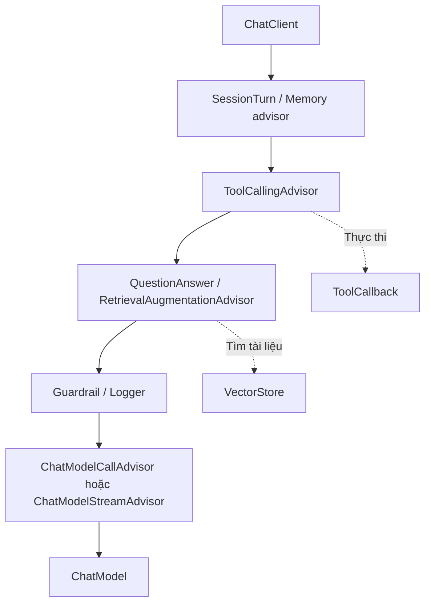
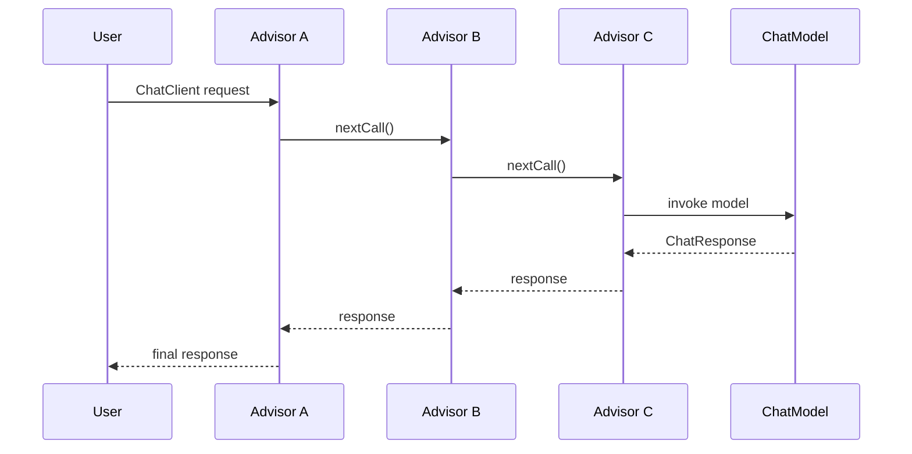

# Quan sát từng advisor trong chuỗi xử lý

## 1. Vấn đề: ChatClient chậm, nhưng advisor nào gây ra?

Một trợ lý Spring AI trả lời câu hỏi về chính sách hoàn tiền. Ứng dụng sử dụng session memory, RAG, tool calling và kiểm tra định dạng đầu ra. Trên dashboard, thao tác `ChatClient` mất 2,8 giây. Nếu chỉ nhìn chỉ số tổng, lập trình viên có thể vội kết luận “model phản hồi chậm”, trong khi phần lớn thời gian có thể nằm ở retrieval, bộ nhớ, gọi công cụ hoặc nhiều vòng kiểm tra định dạng.

Để tìm nguyên nhân, phải hiểu **advisor chain** và cách Spring AI đo từng advisor. Đặc biệt, một observation của advisor **bao gồm cả thời gian chạy các advisor ở phía trong nó**. Vì vậy không thể cộng mọi advisor duration rồi gọi đó là thời gian request, và cũng không thể lấy nguyên duration của RAG advisor để kết luận retrieval mất chừng ấy.

Bài thuộc chương **ChatClient và advisor** trong module **SPRING_AI_EVALUATION_OBSERVABILITY**. Module tập trung đánh giá chất lượng ứng dụng Spring AI bằng dataset, relevance, fact checking và kiểm thử RAG/tool calling; song song là metrics, traces, chi phí và độ trễ để xác định chất lượng suy giảm khi thay prompt, model hoặc pipeline.

**Kết quả mong đợi sau bài học:**

1. Vẽ và đọc được thứ tự thực thi advisor ở chiều request và response.
2. Nhận diện observation `spring.ai.advisor` cùng tên, order và quan hệ với ChatClient/model/vector store/tool.
3. Phân biệt **inclusive duration** của advisor với **self/exclusive time** của chính logic advisor.
4. Hiểu advisor bên ngoài/bên trong vòng `ToolCallingAdvisor` ảnh hưởng đến số lần quan sát.
5. Quan sát riêng các nhánh `call()` và `stream()`, kể cả error/cancel.
6. Xây một advisor đo thời gian có giới hạn mục đích, kiểm thử nó và không để instrumentation thay đổi hành vi.
7. Liên kết traces với dataset và kết quả factuality/relevance để phân tích regression chất lượng–độ trễ–chi phí.

> Bài sử dụng tài liệu Spring AI **2.1.0** làm mốc. Các tên quan sát và API được trích từ tài liệu phát hành ổn định; khi dự án dùng 1.x, 2.0.x, 2.1.x hoặc snapshot khác, cần xác minh Javadoc/dependency tương ứng.

## 2. Advisor thực sự làm gì trong ChatClient?

Advisor không chỉ là một callback nhỏ trước khi gọi model. Mỗi advisor có thể:

- Đọc hoặc thay đổi yêu cầu: thêm lịch sử hội thoại, tài liệu RAG, guardrail, prompt bổ sung.
- Gọi advisor tiếp theo để tiếp tục chuỗi.
- Đọc hoặc thay đổi phản hồi trên đường quay về.
- Trả lời sớm mà **không gọi model** (cache hoặc guardrail).
- Gọi chuỗi phía sau **nhiều lần**, chẳng hạn tool loop hoặc thử lại sinh JSON.

Trong Spring AI 2.1.0, các giao diện cơ bản nằm ở package `org.springframework.ai.chat.client.advisor.api`:

```java
// Chữ ký cốt lõi, lược bớt nội dung khai báo khác.
public interface Advisor extends org.springframework.core.Ordered {
    String getName();
}

public interface CallAdvisor extends Advisor {
    ChatClientResponse adviseCall(
        ChatClientRequest request,
        CallAdvisorChain chain
    );
}

public interface StreamAdvisor extends Advisor {
    reactor.core.publisher.Flux<ChatClientResponse> adviseStream(
        ChatClientRequest request,
        StreamAdvisorChain chain
    );
}
```

Đây là **bản lược thuật hợp đồng API**, không phải nguyên văn toàn bộ mã nguồn. Hai phương thức chuyển tiếp:

```java
ChatClientResponse nextCall(ChatClientRequest request);
Flux<ChatClientResponse> nextStream(ChatClientRequest request);
```

thuộc các interface chain tương ứng. Mỗi advisor muốn thực hiện các bước phía sau cần gọi method thích hợp, trừ khi nó có chủ đích dừng/short-circuit chuỗi.

### 2.1. Hình dung chuỗi như những lớp lồng nhau



Sơ đồ là **ví dụ quan hệ logic**; thứ tự thật được quyết định bằng `getOrder()` của từng advisor, các advisor đã đăng ký, và phiên bản đang chạy. Trong Spring AI 2.1.0, `ChatClient` tự thêm advisor gọi model ở cuối và thường tự đăng ký `ToolCallingAdvisor` nếu chưa có, trừ khi bị vô hiệu hóa.

Dấu vết quan sát giúp biết các phần thực sự chạy; nó không chứng minh tài liệu RAG đúng hoặc tham số tool hợp lệ. Các nhận định về chất lượng cần kiểm thử nội dung riêng.

## 3. Thứ tự getOrder() quyết định observation nào bao ngoài

Mỗi advisor cung cấp một `getOrder()`. **Số nhỏ hơn thực thi trước ở chiều request, và thực thi sau ở chiều response**.

Giả sử ba advisor lần lượt có order:

| Advisor | `getOrder()` | Chiều request | Chiều response |
|---|---:|---:|---:|
| A — Session | -100 | 1 | 3 |
| B — Retrieval | 0 | 2 | 2 |
| C — Logging | 100 | 3 | 1 |

Vòng đời tương đương:

```text
Request
  A.before
    B.before
      C.before
        ChatModel
      C.after
    B.after
  A.after
Response
```

Vì A bao quanh phần chạy của B, C và model, một `spring.ai.advisor` span của A có thể dài gần bằng toàn bộ ChatClient span. Điều đó **không có nghĩa** logic xử lý riêng của A tốn từng ấy thời gian.

Nếu hai advisor có cùng order, **không có bảo đảm thứ tự giữa chúng**; không dựa vào thứ tự vô tình quan sát được ở một lần chạy để làm hợp đồng nghiệp vụ.

### 3.1. Phân biệt order số âm và hằng số Ordered

Spring dùng:

```java
Ordered.HIGHEST_PRECEDENCE == Integer.MIN_VALUE
Ordered.LOWEST_PRECEDENCE  == Integer.MAX_VALUE
```

Giá trị gần `HIGHEST_PRECEDENCE` cho ưu tiên cao hơn; giá trị gần `LOWEST_PRECEDENCE` cho ưu tiên thấp hơn.

**Đừng nhầm “order cao” theo lời nói với giá trị số lớn.** Trong Spring, giá trị số *càng thấp* thì thứ tự request *càng sớm*.

### 3.2. Một số order mặc định ở Spring AI 2.1.0

Theo tài liệu advisor của nhánh 2.1:

| Nhóm advisor | Order tiêu biểu | Ý nghĩa về vòng gọi |
|---|---|---|
| `SessionTurnAdvisor` hoặc memory/cache đời trước | `HIGHEST_PRECEDENCE + 200` | Bên ngoài vòng tool |
| `ToolCallingAdvisor` | `HIGHEST_PRECEDENCE + 300` | Điều phối vòng gọi tool |
| `SessionMemoryAdvisor` | `HIGHEST_PRECEDENCE + 1000` | Phía trong vòng tool |
| `QuestionAnswerAdvisor` và `RetrievalAugmentationAdvisor` | `0` | Phía trong vòng tool theo cấu hình mặc định |
| `SimpleLoggerAdvisor` và `SafeGuardAdvisor` | `0` | Có thể chạy ở từng vòng |
| `StructuredOutputValidationAdvisor` | `LOWEST_PRECEDENCE - 2000` | Gần model, có thể lặp để sửa output |
| `ChatModelCallAdvisor` / `ChatModelStreamAdvisor` | `LOWEST_PRECEDENCE` | Cuối chuỗi, gửi yêu cầu tới model |

**Đây là mặc định cho phiên bản đã tra, không phải điều bất biến.** Các builder hoặc cấu hình có thể đổi order. Một số advisor cùng order 0, vì vậy không được khẳng định thứ tự giữa chúng chỉ từ bảng trên.

## 4. Observation tích hợp spring.ai.advisor

Spring AI 2.1.0 ghi nhận một observation mang tên:

```text
spring.ai.advisor
```

khi một advisor được thực thi. Theo tài liệu, observation này đo thời gian của advisor **bao gồm các advisor bên trong**, đồng thời truyền trace context qua đường xử lý.

### 4.1. Các low-cardinality keys

| Key | Ý nghĩa |
|---|---|
| `gen_ai.operation.name` | Giá trị `framework` |
| `gen_ai.system` | Giá trị `spring_ai` |
| `spring.ai.advisor.name` | Tên advisor, lấy từ `getName()` |
| `spring.ai.kind` | Giá trị `advisor` |

Low-cardinality tags được dùng cho **metrics và traces**. Để tổng hợp theo advisor, `spring.ai.advisor.name` là chiều lọc quan trọng: ví dụ so sánh thời gian của RAG và session memory advisor.

### 4.2. High-cardinality key

| Key | Ý nghĩa |
|---|---|
| `spring.ai.advisor.order` | Vị trí advisor trong chuỗi, thường ở trace |

Tài liệu phân loại `spring.ai.advisor.order` là high-cardinality ở tầng trace; không tự gắn request ID, tên tài liệu truy xuất hoặc câu hỏi người dùng vào metric labels để “tiện debug”.

Một span advisor có thể mang tên và order nhưng vẫn cần **parent/child relationship** trong trace để biết nó bao quanh thành phần nào.

### 4.3. Những observation liên quan

| Observation | Thành phần | Câu hỏi trả lời |
|---|---|---|
| `spring.ai.chat.client` | Toàn thao tác ChatClient | Bao lâu cho `call()` hoặc `stream()`? |
| `spring.ai.advisor` | Một advisor | Khoảng thời gian **bao gồm downstream** là bao nhiêu? |
| `gen_ai.client.operation` | ChatModel | Mỗi lượt model/provider mất bao lâu? |
| `db.vector.client.operation` | VectorStore | Truy vấn tài liệu mất bao lâu? |
| `spring.ai.tool` | Tool calling | Tool execution thành công/chậm/lỗi thế nào? |
| `gen_ai.client.token.usage` | Usage của model | Số input/output tokens khi provider cung cấp? |

Một `ChatClient` invocation có thể sinh 0, 1 hoặc nhiều model operations. Quan hệ này đặc biệt quan trọng khi có cache, guardrail, tool loop hoặc validation retry.

## 5. Inclusive time khác exclusive/self time

**Inclusive duration** là khoảng tường (wall-clock) từ lúc advisor bắt đầu đến lúc kết thúc, bao gồm công việc của các advisor và model được gọi bên trong nó.

**Exclusive/self time** là phần thời gian mà chính advisor dành cho logic của nó, *không tính phần thời gian của những bước con đã đo được*. Đây là khái niệm phân tích từ trace, **không phải meter self-time mặc định mà Spring AI cam kết xuất cho mọi advisor**.

Ví dụ trace có cấu trúc:

```text
ChatClient                          1800 ms
└─ SessionTurnAdvisor               1770 ms
   └─ ToolCallingAdvisor            1740 ms
      └─ RetrievalAugmentationAdvisor 1600 ms
         ├─ VectorStore query        220 ms
         └─ ChatModel operation     1150 ms
```

**Không được cộng**:

```text
1770 + 1740 + 1600 + 220 + 1150 = 6480 ms   // Sai
```

để kết luận request mất 6,48 giây. Các span lồng nhau chia sẻ phần lớn khoảng thời gian.

Để biết retrieval tự xử lý chậm hay không, hãy xem trực tiếp `VectorStore query` hoặc các bước cụ thể trong `RetrievalAugmentationAdvisor`. Nếu chỉ có duration advisor 1600 ms và model 1150 ms, hiệu 450 ms **còn chứa** retrieval, sửa prompt, reranking, chuyển đổi tài liệu và các khoảng chưa instrument.

### 5.1. Exclusive time trong trace không luôn là phép trừ đơn giản

Nếu một advisor có một span con nằm trọn bên trong, không có nhánh song song, có thể xấp xỉ:

\[
T_{\text{self}} \approx T_{\text{advisor}}-T_{\text{child}}
\]

Nhưng khi có nhiều child spans chồng lấn hoặc chạy song song, **không được lấy tổng durations con** rồi trừ. Cần xác định hợp các khoảng thời gian con trên timeline hoặc dùng chức năng exclusive-time của trace backend.

Nếu một bước bên trong không được instrument, phần “self” tính từ trace có thể chứa cả bước đó. Vì thế self-time cao là **gợi ý điều tra**, không đủ để kết luận code Java của advisor chiếm CPU.

## 6. Trace advisor hoạt động như một ngăn xếp

Với thứ tự A→B→C→Model:



Khi mở một trace, hãy kiểm tra:

1. Advisor nào là span cha, advisor nào là span con?
2. Các mốc start/end có bao trùm nhau không?
3. Có spans VectorStore, tool, model nằm trong advisor không?
4. Có cùng tên advisor xuất hiện nhiều lần không?
5. Có bước short-circuit khiến model span không tồn tại không?
6. Có dấu hiệu error/cancel hoặc mất trace context do reactive/SDK không?

**Một span advisor dài không đủ để chứng minh advisor ấy chậm.** Mục tiêu của traces là phân tích luồng thực thi, không phải xếp hạng ngây thơ các duration.

## 7. Quan sát vòng tool: vị trí advisor quyết định số lần xuất hiện

Trong Spring AI 2.1.0, `ToolCallingAdvisor` là advisor **recursive**. Khi model yêu cầu tool, nó có thể gọi phần còn lại của chuỗi một lần nữa sau khi thực thi công cụ.

Giả sử một lượt hỏi “Đơn A123 đang giao đến đâu?” cần hai vòng model:

```text
ChatClient (1 yêu cầu người dùng)
  SessionTurnAdvisor (1 lượt)
    ToolCallingAdvisor (1 vòng điều phối)
      Round 1:
        RetrievalAugmentationAdvisor
        ChatModel → yêu cầu lookupOrder(A123)
        Tool lookupOrder
      Round 2:
        RetrievalAugmentationAdvisor
        ChatModel → trả lời cuối
```

Tùy vị trí và đường code, trace có thể cho thấy **hai observations RAG advisor** nhưng **một observation session-turn advisor**. Đây có thể là hành vi hoàn toàn đúng, không phải duplication bug.

### 7.1. Quy tắc vị trí theo getOrder

- Advisor có order **nhỏ hơn** `ToolCallingAdvisor.DEFAULT_ORDER` thường được đặt **trước vòng tool**, chạy một lần cho một ChatClient call.
- Advisor có order **lớn hơn** default order ấy nằm **bên trong vòng tool**, có thể chạy lại cho mỗi model round.
- Recursive advisor khác như validation-retry cũng có thể làm lặp các advisor phía sau nó.
- Hai vòng recursive lồng nhau có thể khiến số lần chạy downstream tăng theo tích số vòng.

Vì vậy, **số advisor spans khác số yêu cầu HTTP** và khác số message do người dùng gửi.

### 7.2. Câu hỏi thiết kế quan trọng

| Mục đích | Vị trí thường phù hợp |
|---|---|
| Đếm một lần gọi của người dùng | Trước các advisor recursive |
| Thấy mỗi lượt model bên trong tool loop | Sau ToolCallingAdvisor |
| Ghi một session turn duy nhất | Ngoài vòng tool |
| Cập nhật memory với kết quả tool qua từng vòng | Trong vòng tool theo thiết kế memory |
| Chỉ retry model khi JSON sai | Đặt validation advisor gần model |
| Đo total time của cả vòng tool | Timer bên ngoài vòng |
| Đo từng model round | Observation bên trong vòng/tool hoặc ChatModel |

Không tự thay order của memory/tool advisor chỉ để “trace đẹp hơn”; việc đổi vị trí còn **thay đổi hành vi hội thoại**. Khi điều chỉnh thứ tự, phải có kiểm thử chất lượng và tool flow tương ứng.

## 8. Short-circuit: tại sao có advisor span mà không có model span?

Một advisor có thể trả response mà không gọi `nextCall()` hoặc `nextStream()`:

- Semantic cache tìm được câu trả lời cũ.
- Guardrail chặn yêu cầu hoặc trả refusal.
- Một custom advisor áp điều kiện nghiệp vụ và trả kết quả sớm.
- Lỗi được xử lý/biến đổi trước khi request tới model, tùy thiết kế.

Ví dụ:

```text
ChatClient
└─ SemanticCacheAdvisor
   └─ cached response returned
// Không có ChatModel operation trong nhánh này.
```

Đây **không nhất thiết là lỗi thiếu instrumentation**. Cần kiểm tra có short-circuit hợp lệ hay không.

Điều ngược lại cũng quan trọng: thấy ChatModel span không chứng minh RAG đã chạy; một advisor RAG có thể bị bỏ qua, không được đăng ký hoặc không tham gia call mode hiện tại. Muốn xác minh, kiểm tra advisor chain thực tế và dữ liệu context.

## 9. Quan sát call() khác quan sát stream() ở đâu?

Spring AI dùng `CallAdvisor` cho thao tác `call()` và `StreamAdvisor` cho `stream()`. Một class chỉ triển khai `CallAdvisor` **không mặc nhiên** có logic tương đương trong chế độ streaming.

| Khía cạnh | call() | stream() |
|---|---|---|
| Interface advisor | `CallAdvisor` | `StreamAdvisor` |
| Dữ liệu trả về từ chain | Một `ChatClientResponse` | `Flux<ChatClientResponse>` |
| Điểm bắt đầu đo hợp lý | Khi thực sự gọi terminal như `content()` | Tại subscription của publisher |
| Kết thúc bình thường | Có response đầy đủ | `onComplete` |
| Lỗi | Exception | `onError` |
| Hủy giữa chừng | Có thể là client disconnect/tầng HTTP | `cancel` từ subscriber |
| Phản hồi nội dung | Toàn văn | Một chuỗi chunks, có thể bị cắt giữa chừng |

Nếu chỉ instrument đoạn code chạy lúc tạo `Flux` mà không chờ subscriber, số đo có thể chỉ phản ánh **thời gian dựng publisher**, không phải thời gian thực thi streaming.

### 9.1. BaseAdvisor giúp gì?

`BaseAdvisor` trong Spring AI 2.1.x giúp triển khai logic trước/sau mà không tự viết hai chuỗi call/stream:

```java
public interface BaseAdvisor extends CallAdvisor, StreamAdvisor {
    ChatClientRequest before(
        ChatClientRequest request,
        AdvisorChain chain
    );

    ChatClientResponse after(
        ChatClientResponse response,
        AdvisorChain chain
    );
}
```

Đây là **hình thức API rút gọn**. `BaseAdvisor` thực tế cung cấp các default methods quản lý next chain.

Trong streaming, cách xử lý `after(...)` gắn với **chunk kết thúc có finish reason**, không nhất thiết chạy với mọi chunk. Nếu stream bị hủy, không nên dựa vào `after(...)` để bảo đảm thu thập trạng thái `CANCEL`. Muốn đo complete/error/cancel cần dùng reactive lifecycle thích hợp.

## 10. Cấu hình Spring Boot để có observations

Chỉ thêm advisor vào ChatClient **chưa bảo đảm có metrics/traces hiển thị ở backend**. Spring AI cần `ObservationRegistry` có observation handler và exporter phù hợp.

Các lớp thường có:

- Spring Boot Actuator cung cấp hạ tầng metrics/health.
- Micrometer MeterRegistry lưu hoặc xuất metrics tới Prometheus hay backend khác.
- Micrometer Tracing bridge + trace exporter/collector cho distributed traces.
- Provider/model starter và advisor/vector store dependencies của dự án.

Ví dụ khai báo Maven ở mức ý tưởng:

```xml
<dependencies>
    <dependency>
        <groupId>org.springframework.boot</groupId>
        <artifactId>spring-boot-starter-actuator</artifactId>
    </dependency>
    <dependency>
        <groupId>io.micrometer</groupId>
        <artifactId>micrometer-registry-prometheus</artifactId>
    </dependency>
</dependencies>
```

Đây chưa phải POM hoàn chỉnh. Cần dependency management đúng Spring Boot/Spring AI version, provider starter và tracing bridge nếu cần spans. Hai dependency trên **không tự làm trace xuất sang một collector**.

### 10.1. Một application.yml tối thiểu

```yaml
management:
  endpoints:
    web:
      exposure:
        include: health,metrics,prometheus
  tracing:
    sampling:
      probability: 0.10

spring:
  ai:
    chat:
      client:
        observations:
          log-prompt: false
          log-completion: false
      observations:
        log-prompt: false
        log-completion: false
```

Property `spring.ai.chat.client.observations.*` và `spring.ai.chat.observations.*` điều khiển nội dung được log, **không phải công tắc bảo đảm tracing luôn hoạt động**. Sampling `0.10` ở đây là ví dụ cấu hình; môi trường test có thể chọn tỷ lệ khác, nhưng cần xem tải, chi phí và yêu cầu điều tra.

Không công khai endpoint metrics/traces chứa thông tin vận hành ra Internet. Áp dụng xác thực, mạng quản trị và retention hợp lý.

### 10.2. Dùng builder auto-configured

Trong ứng dụng Spring Boot, ưu tiên injection `ChatClient.Builder` đã được framework cấu hình:

```java
import org.springframework.ai.chat.client.ChatClient;
import org.springframework.context.annotation.Bean;
import org.springframework.context.annotation.Configuration;

@Configuration(proxyBeanMethods = false)
public class ChatClientConfig {

    @Bean
    ChatClient chatClient(ChatClient.Builder builder) {
        return builder.build();
    }
}
```

Nếu tự gọi `ChatClient.builder(chatModel)` từ đầu, ứng dụng có thể bỏ qua ObservationRegistry và các `ChatClientBuilderCustomizer` do Boot áp dụng. Khi nhiều model cần client riêng, phải cấu hình builder/registry/customizer tương ứng với version thay vì đoán nó sẽ tự được instrument.

## 11. Đăng ký advisor và quan sát trace của RAG

Ví dụ sau đăng ký một advisor RAG và một advisor đo bổ sung, giữ `ChatClient.Builder` đã auto-configure:

```java
import io.micrometer.core.instrument.MeterRegistry;

import org.springframework.ai.chat.client.ChatClient;
import org.springframework.ai.chat.client.advisor.vectorstore.QuestionAnswerAdvisor;
import org.springframework.ai.vectorstore.VectorStore;
import org.springframework.context.annotation.Bean;
import org.springframework.context.annotation.Configuration;
import org.springframework.core.Ordered;

@Configuration(proxyBeanMethods = false)
public class RagChatClientConfig {

    @Bean
    ChatClient ragChatClient(
            ChatClient.Builder builder,
            VectorStore vectorStore,
            MeterRegistry meters) {

        return builder
            .defaultAdvisors(
                new AdvisorBoundaryTimer(
                    meters, Ordered.HIGHEST_PRECEDENCE + 100
                ),
                QuestionAnswerAdvisor.builder(vectorStore).build()
            )
            .build();
    }
}
```

Vì `AdvisorBoundaryTimer` có order rất thấp (ưu tiên cao), nó nằm **bên ngoài** `ToolCallingAdvisor` mặc định trong Spring AI 2.1.0 và dự kiến chạy một lần cho một ChatClient invocation, trừ khi cấu hình chuỗi được thay đổi.

Hãy kiểm tra trace để biết:

- Có `spring.ai.advisor` mang tên `AdvisorBoundaryTimer` và `QuestionAnswerAdvisor` không?
- Advisor RAG có nằm trong vòng tool và chạy nhiều lần không?
- Có span vector store tương ứng truy xuất tài liệu không?
- Có model span là bước gọi cuối không?
- Span có kết thúc với error, còn stream bị hủy có được ghi nhận không?

**Không nhầm ví dụ custom timer ở phần sau với cơ chế observation tích hợp.** Nếu chỉ cần inclusive advisor duration theo tên, Spring AI đã cung cấp `spring.ai.advisor`. Custom timer chỉ hữu ích khi muốn một KPI khác đã xác định rõ, ví dụ outcome của stream hoặc boundary riêng.

## 12. Ví dụ custom advisor đo downstream cho call và stream

Ta xây một advisor **không sửa nội dung request/response**, chỉ đo thời gian xử lý **từ điểm của nó xuống chuỗi phía sau** bằng Micrometer. Mục tiêu là minh họa vị trí gắn đo, không thay thế `spring.ai.advisor` tích hợp.

```java
import java.util.concurrent.TimeUnit;

import io.micrometer.core.instrument.MeterRegistry;
import io.micrometer.core.instrument.Timer;
import org.springframework.ai.chat.client.advisor.api.CallAdvisor;
import org.springframework.ai.chat.client.advisor.api.CallAdvisorChain;
import org.springframework.ai.chat.client.advisor.api.ChatClientRequest;
import org.springframework.ai.chat.client.advisor.api.ChatClientResponse;
import org.springframework.ai.chat.client.advisor.api.StreamAdvisor;
import org.springframework.ai.chat.client.advisor.api.StreamAdvisorChain;
import reactor.core.publisher.Flux;

public final class AdvisorBoundaryTimer
        implements CallAdvisor, StreamAdvisor {

    private final MeterRegistry meters;
    private final int order;

    public AdvisorBoundaryTimer(MeterRegistry meters, int order) {
        this.meters = java.util.Objects.requireNonNull(meters);
        this.order = order;
    }

    @Override
    public String getName() {
        return "AdvisorBoundaryTimer";
    }

    @Override
    public int getOrder() {
        return order;
    }

    @Override
    public ChatClientResponse adviseCall(
            ChatClientRequest request,
            CallAdvisorChain chain) {

        long started = System.nanoTime();
        String outcome = "complete";

        try {
            return chain.nextCall(request);
        }
        catch (RuntimeException exception) {
            outcome = "error";
            throw exception;
        }
        finally {
            record("call", outcome, started);
        }
    }

    @Override
    public Flux<ChatClientResponse> adviseStream(
            ChatClientRequest request,
            StreamAdvisorChain chain) {

        return Flux.defer(() -> {
            long started = System.nanoTime();

            return chain.nextStream(request)
                .doFinally(signal -> {
                    String outcome = switch (signal) {
                        case ON_COMPLETE -> "complete";
                        case ON_ERROR -> "error";
                        case CANCEL -> "cancel";
                        default -> "other";
                    };

                    record("stream", outcome, started);
                });
        });
    }

    private void record(String mode, String outcome, long started) {
        Timer.builder("app.ai.advisor.downstream")
            .description("Inclusive downstream time at an advisor boundary")
            .tag("advisor", getName())
            .tag("mode", mode)
            .tag("outcome", outcome)
            .register(meters)
            .record(
                System.nanoTime() - started,
                TimeUnit.NANOSECONDS
            );
    }
}
```

**Các đặc tính quan trọng:**

1. `CallAdvisorChain.nextCall(request)` tiếp tục phần chain bên trong. Timer đo **toàn bộ downstream**, không đo riêng CPU của advisor này.
2. Với `call()`, `finally` ghi timer dù trả response bình thường hoặc ném `RuntimeException`.
3. Với `stream()`, `Flux.defer()` tạo đồng hồ riêng cho mỗi subscription; không ghi thời gian đơn thuần xây dựng `Flux`.
4. `doFinally(...)` phân biệt complete/error/cancel. Một stream bị hủy không được tính là complete.
5. `advisor`, `mode`, `outcome` đều thuộc tập giá trị hữu hạn trong ví dụ, thích hợp cho metric label.
6. Class không log prompt, chunk hoặc response, tránh lộ nội dung.
7. Code không dùng state chia sẻ theo request trong field của singleton advisor.
8. Nếu một publisher được subscribe nhiều lần ngoài dự kiến, chain có thể không được thiết kế để chạy lặp; phải quản lý subscriber tại tầng web.
9. Một lần gọi Spring AI có thể bao gồm **nhiều rounds** sau ToolCallingAdvisor. Số lần timer chạy phụ thuộc order của advisor.
10. Metric `app.ai.advisor.downstream` **do ứng dụng tự định nghĩa**, không phải tên metric mặc định của Spring AI.

*Lưu ý Java:* Các ví dụ cần dependency Spring AI, Reactor và Micrometer đúng phiên bản. Không nên nhân đôi bộ đo trong production nếu không có mục đích KPI cụ thể.

### 12.1. Khi cần đo logic trước và sau, thay vì downstream

Nếu mục tiêu là thời gian **tự xử lý** trong `before(...)` hoặc `after(...)`, hãy đặt timer trực tiếp trong đúng khối xử lý ấy.

```java
long started = System.nanoTime();
try {
    return enrichRequestWithMetadata(request);
}
finally {
    recordBeforeTime(System.nanoTime() - started);
}
```

Đây là **pseudocode nằm trong method của một custom advisor**, không phải hàm độc lập đã đầy đủ import. Nó khác với timer bao quanh `nextCall(...)`, vì timer sau bao gồm toàn bộ chain phía sau và model.

Không dùng `spring.ai.advisor` inclusive duration làm số đo retrieval-only hay memory-only mà không tách các công việc con.

## 13. Dùng BaseAdvisor với context theo từng lượt

Một ví dụ khác là `BaseAdvisor`: thay vì giữ `started` trong field của singleton bean (dễ bị ghi đè giữa các request), lưu dữ liệu **trong context của lượt chạy**:

```java
import java.util.concurrent.TimeUnit;

import io.micrometer.core.instrument.MeterRegistry;
import org.springframework.ai.chat.client.advisor.api.AdvisorChain;
import org.springframework.ai.chat.client.advisor.api.BaseAdvisor;
import org.springframework.ai.chat.client.advisor.api.ChatClientRequest;
import org.springframework.ai.chat.client.advisor.api.ChatClientResponse;
import org.springframework.core.Ordered;

public final class ContextTimingAdvisor implements BaseAdvisor {

    private static final String START =
        ContextTimingAdvisor.class.getName() + ".startNanos";

    private final MeterRegistry registry;

    public ContextTimingAdvisor(MeterRegistry registry) {
        this.registry = registry;
    }

    @Override
    public ChatClientRequest before(
            ChatClientRequest request,
            AdvisorChain chain) {

        return request.mutate()
            .context(START, System.nanoTime())
            .build();
    }

    @Override
    public ChatClientResponse after(
            ChatClientResponse response,
            AdvisorChain chain) {

        Object value = response.context().get(START);

        if (value instanceof Long started) {
            registry.timer("app.ai.advisor.context.timing")
                .record(
                    System.nanoTime() - started,
                    TimeUnit.NANOSECONDS
                );
        }

        return response;
    }

    @Override
    public int getOrder() {
        return Ordered.HIGHEST_PRECEDENCE + 100;
    }
}
```

Ở nhánh API mà `BaseAdvisor` cung cấp default `getName()`, tên advisor mặc định là tên class đơn giản; khi cần một tên cố định riêng, có thể override `getName()`.

**Quan trọng với stream:** theo tài liệu Spring AI 2.1, `BaseAdvisor.after(...)` dùng phản hồi kết thúc có finish reason, không bảo đảm gọi cho mỗi chunk; khi stream bị cancel hoặc lỗi trước chunk cuối, metric trong `after(...)` có thể **không được ghi**. Nếu yêu cầu đếm cả cancel/error, dùng cách `StreamAdvisor`/`doFinally` như phần trước.

**Quan trọng với tool loop:** context dùng để truyền trạng thái trong một round; recursive advisor có thể xây request mới cho round sau. Không dựa vào một khóa context ở round trước sẽ luôn hiện diện ở round kế tiếp. Dữ liệu cần sống qua nhiều lần người dùng gọi phải được lưu trong session/store phù hợp, không phải field của advisor.

## 14. Kiểm thử advisor đo thời gian mà không cần model thật

Ta có thể kiểm thử việc advisor chuyển tiếp `nextCall(...)` đúng một lần và ghi timer, không cần ChatModel hay API key. Ví dụ dùng JUnit 5, Mockito và `SimpleMeterRegistry`:

```java
import io.micrometer.core.instrument.Timer;
import io.micrometer.core.instrument.simple.SimpleMeterRegistry;
import org.junit.jupiter.api.Test;
import org.springframework.ai.chat.client.advisor.api.CallAdvisorChain;
import org.springframework.ai.chat.client.advisor.api.ChatClientRequest;
import org.springframework.ai.chat.client.advisor.api.ChatClientResponse;

import static org.junit.jupiter.api.Assertions.assertEquals;
import static org.junit.jupiter.api.Assertions.assertNotNull;
import static org.junit.jupiter.api.Assertions.assertSame;
import static org.mockito.Mockito.mock;
import static org.mockito.Mockito.verify;
import static org.mockito.Mockito.when;

class AdvisorBoundaryTimerTest {

    @Test
    void recordsOneCompletedCallWithoutChangingResponse() {
        try (SimpleMeterRegistry meters = new SimpleMeterRegistry()) {
            var request = mock(ChatClientRequest.class);
            var response = mock(ChatClientResponse.class);
            var chain = mock(CallAdvisorChain.class);

            when(chain.nextCall(request)).thenReturn(response);

            var advisor = new AdvisorBoundaryTimer(meters, -100);
            var actual = advisor.adviseCall(request, chain);

            assertSame(response, actual);
            verify(chain).nextCall(request);

            Timer timer = meters.find("app.ai.advisor.downstream")
                .tag("advisor", "AdvisorBoundaryTimer")
                .tag("mode", "call")
                .tag("outcome", "complete")
                .timer();

            assertNotNull(timer);
            assertEquals(1L, timer.count());
        }
    }
}
```

Đây là unit test cho **custom advisor**. Nó chứng minh mã đo timer được gọi và response không bị thay đổi; không chứng minh Spring AI framework đã tạo `spring.ai.advisor` observation khi chạy thật.

### 14.1. Những test cần thêm ở ứng dụng thực

- Khi `nextCall(...)` ném exception: outcome error được ghi, lỗi vẫn nổi lên.
- Với `nextStream(...)`: stream hoàn tất → complete; stream lỗi → error; subscriber hủy → cancel.
- Advisor được thêm trong `defaultAdvisors(...)` xuất hiện trong trace thật khi ChatClient chạy.
- Khi tool loop lặp hai vòng, kiểm tra số lượt advisor trước và sau ToolCallingAdvisor theo order.
- Khi cache short-circuit, xác nhận không có model span và vẫn nhận response hợp lệ.
- Khi advisor thay prompt, xác minh nội dung đúng và không có lỗi truyền context giữa các request đồng thời.

Với streaming, có thể dùng Reactor `StepVerifier` và `reactor-test` để chủ động tạo cancel/error signals. Cần kiểm tra timer sau terminal signal; `doFinally` chạy sau callback kết thúc nên tránh assertion có điều kiện race trong test bất đồng bộ.

## 15. RAG: kết nối advisor duration và retrieval evidence

Ví dụ `RetrievalAugmentationAdvisor` hoặc `QuestionAnswerAdvisor` tạo câu trả lời có nguồn. Muốn chẩn đoán một ca chậm/lạc đề cần phân biệt:

| Dữ liệu | Nguồn | Dùng để kết luận |
|---|---|---|
| Advisor inclusive duration | `spring.ai.advisor` | Đường thực thi qua RAG advisor mất bao lâu gồm downstream |
| Vector search duration | `db.vector.client.operation` | Query vector store mất bao lâu |
| Retriever candidates / rank | Pipeline/retrieval trace do ứng dụng lưu | Có lấy đúng tài liệu cần thiết không |
| Final generation context | Prompt/context snapshot | Model thực sự thấy dữ liệu gì |
| Model duration và tokens | `gen_ai.client.operation` / usage | Chi phí và độ trễ của model |
| Factuality verdict | Evaluator trên output + context | Câu trả lời có được context hỗ trợ không |

Giả sử sau khi đổi RAG advisor từ phiên bản A sang B:

```text
A:
  RAG advisor duration  1,5 s
  VectorStore duration  0,5 s
  ChatModel duration    0,9 s
  Factuality pass rate  92%

B:
  RAG advisor duration  1,1 s
  VectorStore duration  0,2 s
  ChatModel duration    0,8 s
  Factuality pass rate  79%
```

Đây là **số liệu minh họa**, không phải benchmark. B nhanh hơn có thể do retrieval lấy ít tài liệu hơn, filter khác hoặc context bị cắt; chất lượng factuality giảm đòi kiểm tra **document IDs, version và nội dung snapshot**, không chỉ timer. Advisor nhanh không đồng nghĩa retrieval chính xác.

### 15.1. Phân tích regression theo từng case

Một quy trình thực hành:

1. Giữ cùng dataset có `caseId` và expected behavior.
2. Lưu prompt version, model version, retriever/index version, cấu hình advisor và judge/rubric version.
3. Chạy pipeline, gắn `runId`/trace ID với câu hỏi, context và output.
4. Chấm relevance, factuality hoặc retrieval metrics theo tiêu chí riêng.
5. So case từ pass sang fail và mở trace từng run.
6. Xác định nguồn sai nằm ở retrieval, prompt assembly, model, tool hay evaluator.
7. Chỉ kết luận nguyên nhân sau khi đối chiếu nội dung và timing.

`EvaluationRequest` không tự có `traceId`, `runId` hoặc các metrics; phải giữ chúng ở tầng orchestration/report.

## 16. Tool calling: số advisor spans và chi phí qua mỗi round

Một yêu cầu có thể gọi model, tool và model lại nhiều lần. Nếu advisor RAG nằm **sau** ToolCallingAdvisor, nó có thể chạy trước mỗi model round. Điều đó kéo theo:

- Nhiều vector queries cho cùng một câu hỏi người dùng.
- Nhiều lần tạo prompt/context.
- Nhiều ChatModel operations và token usage.
- Advisor spans lặp tên nhưng thuộc các rounds khác nhau.
- Tăng latency/chi phí dù chỉ có **một** HTTP request và một final answer.

Để quan sát đầy đủ, cần giữ ít nhất:

```json
{
  "runId": "eval-tool-001",
  "userTurn": 1,
  "advisor": "RetrievalAugmentationAdvisor",
  "round": 2,
  "modelCallIndex": 2,
  "toolCallCount": 1,
  "retrievalDocumentIds": ["policy-v3-section-2"],
  "outcome": "complete"
}
```

Đây là **schema minh họa do ứng dụng tự thiết kế**, không phải nội dung mặc định của `spring.ai.advisor`. `round` và document IDs cần được lấy từ logic tool/retrieval thật và lưu trong dataset/traces có bảo vệ. Không tự coi số lần span lặp bằng số tool calls vì các recursive advisor khác cũng có thể gây lặp.

### 16.1. Dùng spans để thấy tool lỗi chứ không kết luận tool correctness

`spring.ai.tool` giúp theo dõi thời gian và lỗi của tool execution. Nó **không tự cho biết** công cụ có đúng tên, tham số hay nghiệp vụ mong đợi của người dùng không.

Để đánh giá tool correctness cần dữ liệu từ actual tool calls, expected calls và tool result:

```text
Expected: lookupOrder(orderId="A123")
Actual:   lookupOrder(orderId="A132")
```

Một câu trả lời cuối vô tình đúng vẫn có thể che lỗi arguments. Tool-use evaluator riêng phải chấm sự khác biệt này; advisor timing chỉ giúp tìm **chi phí/độ trễ** và vị trí sự cố.

## 17. Tạo dashboard theo tên advisor

Để so sánh advisor trong nhiều lần chạy, đặt tên ổn định bằng `getName()` và dùng tag `spring.ai.advisor.name`. Một dashboard nên có:

| Biểu đồ / tín hiệu | Ý nghĩa | Cảnh báo diễn giải |
|---|---|---|
| Count observations theo advisor | Advisor được thực thi bao nhiêu lần | Tool loop có thể nhân số lần chạy |
| Mean duration theo advisor | Inclusive time trung bình | Không bằng self-time |
| P95/P99 duration theo advisor | Tail latency của đường qua advisor | Cần histogram và đủ mẫu |
| Error rate theo advisor | Lỗi xuất hiện tại ranh giới quan sát | Lỗi có thể phát sinh ở advisor downstream |
| Model calls trên mỗi ChatClient call | Phát hiện tool/retry loops | Hai tập count cần liên kết theo run |
| Vector queries trên một câu hỏi | Chi phí retrieval | Nhiều query không mặc định là sai |
| Cache hit rate | Short-circuit, tránh model call | Cần custom metric nếu không có sẵn |
| Quality pass rate theo cấu hình advisor | Ảnh hưởng tới câu trả lời | Không suy nhân quả chỉ từ tương quan |

Một câu hỏi thường gặp: “P95 của RAG advisor lớn hơn P95 ChatModel, vậy RAG tự xử lý chênh lệch bao nhiêu?”. **Không được lấy hiệu hai P95** để suy ra P95 retrieval/overhead: percentile là phép toán phi tuyến và có thể lấy từ các tập ca khác nhau.

Nếu muốn đo phần thời gian ngoài model, phải dựng **phân rã theo từng run/trace** có quan hệ start-end rồi tính percentile trên phân phối mới.

### 17.1. Ví dụ PromQL sau khi xác minh tên series

Với Prometheus, tên meter `spring.ai.advisor` có thể xuất thành các series như:

```text
spring_ai_advisor_seconds_sum
spring_ai_advisor_seconds_count
```

Trên các series thực tế có tag advisor đã được chuẩn hóa, tính mean inclusive duration:

```promql
sum by (spring_ai_advisor_name) (
  rate(spring_ai_advisor_seconds_sum[5m])
)
/
sum by (spring_ai_advisor_name) (
  rate(spring_ai_advisor_seconds_count[5m])
)
```

Đây là **truy vấn minh họa**. Hãy xác nhận tên series và nhãn qua `/actuator/prometheus` hoặc backend; cách đặt tên phụ thuộc Micrometer registry/phiên bản. Khi chưa có denominator, cần xử lý trường hợp chia cho 0.

P95 theo advisor chỉ tính từ histogram nếu đã bật buckets:

```promql
histogram_quantile(
  0.95,
  sum by (le, spring_ai_advisor_name) (
    rate(spring_ai_advisor_seconds_bucket[5m])
  )
)
```

Không giả định buckets có sẵn nếu ứng dụng chưa bật histogram cho meter phù hợp. Histogram tăng số time series; chỉ bật cho những metric cần thiết.

### 17.2. Số lần advisor gọi khác số lượt người dùng

Nếu số `spring.ai.advisor` observations tăng sau khi bật tool calling, phải so thêm:

- Số ChatClient calls thực tế.
- Số model rounds trong từng call.
- Vị trí advisor theo order.
- Số retry/validation loops.
- Tỷ lệ cache hit.

Đừng dùng tổng count advisor để tính số người dùng hoặc số câu hỏi đã phục vụ.

## 18. Bảo mật, cardinality và tác động của instrumentation

Quan sát advisor không cần ghi full prompt. Dữ liệu từ RAG và tool có thể chứa PII, bí mật của người dùng và chính sách nội bộ.

**Nguyên tắc:**

- Giữ `spring.ai.chat.client.observations.log-prompt=false` và `log-completion=false` nếu không có chủ đích và kiểm soát phù hợp.
- Không đặt toàn văn câu hỏi, phản hồi, retrieved documents hoặc tool arguments làm metric tags.
- Dùng mã criterion/advisor/outcome thuộc tập hữu hạn để tạo dashboard.
- Lưu `caseId`, trace ID và document IDs trong báo cáo hoặc traces có phân quyền khi cần điều tra.
- Chỉ bật log nội dung trong môi trường có redaction, retention và audit.
- Không tự log mọi chunk streaming; volume lớn và có thể tiết lộ dữ liệu nhạy cảm.
- Nếu một custom advisor ghi log/metric, đảm bảo nó không vô tình đổi prompt/response hoặc nuốt exception.

### 18.1. Tránh nhân đôi observation

Spring AI đã instrument `spring.ai.advisor`. Nếu custom advisor chỉ bắt đầu một timer ngay trước `nextCall(...)` và dừng ngay sau, số đo gần tương đương inclusive observation hiện có. Việc đó tạo thêm chi phí telemetry mà không tăng giá trị.

Chỉ thêm custom meter khi có **khoảng đo hoặc nhãn nghiệp vụ cụ thể**, ví dụ:

- Thời gian xử lý riêng trước khi chuyển tiếp.
- Cache hit/miss.
- Số tài liệu thực sự đưa vào prompt.
- Số validation attempts.
- Outcome stream complete/error/cancel ở một boundary riêng.

Đánh giá overhead của instrumentation ở hệ thống tải cao, dùng sampling và histogram có kiểm soát.

## 19. Các lỗi thường gặp và cách khắc phục

| Lỗi | Hệ quả | Cách khắc phục |
|---|---|---|
| Cộng thời gian mọi advisor | Double-count các span lồng nhau | Xem waterfall và critical path |
| Coi duration RAG advisor là retrieval time | Gồm model và downstream advisors | Xem vector store span/timer retrieval riêng |
| Coi số advisor spans là số user requests | Tool loop, retries, validation lặp advisor | Gắn run ID và tách round |
| Đổi order chỉ để dashboard gọn | Có thể thay memory/tool behavior | Kiểm thử lại toàn bộ pipeline |
| Hai advisor cùng order, giả định thứ tự cố định | Kết quả phụ thuộc implementation | Đặt order khác nhau nếu thứ tự bắt buộc |
| Chỉ instrument `adviseCall()` | Bỏ sót streaming | Triển khai StreamAdvisor/BaseAdvisor đúng phiên bản |
| Đo stream từ lúc dựng Flux | Thời gian không phản ánh subscription | Dùng Flux.defer hoặc lifecycle phù hợp |
| Xem chunk bị cancel là completion | Sai SLA và sai đánh giá nội dung | Tách complete/error/cancel |
| Lưu thời điểm từng request trong field singleton | Race giữa các yêu cầu đồng thời | Dùng local variable hoặc request context |
| Dùng `BaseAdvisor.after()` để chắc chắn đếm cancel | After có thể không chạy khi stream dở dang | Sử dụng doFinally ở stream |
| Không thấy model span rồi kết luận instrumentation hỏng | Cache/guardrail có thể short-circuit | Đối chiếu luồng thực thi |
| Đọc source trên nhánh main cho release cũ | Khác API và default order | Tra docs/source đúng version |
| Đưa question/document ID vào metric label | Cardinality cao và lộ dữ liệu | Tag hữu hạn; chi tiết trong traces/report |
| Không tách judge và generation spans | Quy nhầm chi phí/độ trễ | Đo riêng pipeline sinh và evaluator |
| Cho rằng advisor nhanh thì câu trả lời đúng | Metrics không đo factuality | Chấm theo nguồn và dataset |

## 20. Bài tập tự kiểm tra

### Bài 1 — Tại sao ba advisor đều có timer dài?

Một trace ghi: Session advisor 1.600 ms, RAG advisor 1.400 ms, ChatModel 1.000 ms, tất cả cùng trong một request 1.700 ms.

**Đáp án:** các spans nằm lồng nhau, nên duration advisor bao gồm downstream. Không cộng thành 4.000 ms. Xem vector store span để xác định riêng retrieval.

### Bài 2 — Một ChatClient call nhưng RAG advisor có ba spans

Ứng dụng dùng tool calling. Advisor RAG nằm sau ToolCallingAdvisor và xuất hiện ba lần trong trace, trong khi HTTP chỉ có một request.

**Đáp án:** các vòng tool có thể gọi lại downstream chain. Kiểm tra các model rounds, vị trí order và tool spans trước khi kết luận có lỗi nhân đôi.

### Bài 3 — Advisor A cần ghi một kết quả cho mỗi lượt người dùng

Advisor A dùng để đếm user turns. Nên đặt nó trước hay sau ToolCallingAdvisor?

**Đáp án:** thông thường **trước** advisor recursive để chạy một lần cho mỗi ChatClient invocation. Đặt order thấp hơn ToolCallingAdvisor và kiểm tra behavior trên dependency thực tế.

### Bài 4 — Vì sao không có model observation?

Trace có SemanticCacheAdvisor trả dữ liệu và không có ChatModel span.

**Đáp án:** có thể cache short-circuit nên không gọi model. Đây không nhất thiết là lỗi observability.

### Bài 5 — BaseAdvisor bỏ sót cancellation

Một custom BaseAdvisor ghi duration trong `after()`. Khi người dùng hủy stream giữa chừng, không có bản ghi.

**Đáp án:** `after()` trong chế độ stream thường chạy với response kết thúc/finish reason; hủy trước khi có response cuối có thể bỏ qua `after()`. Dùng StreamAdvisor + `doFinally` nếu cần ghi complete/error/cancel.

### Bài 6 — Chỉ số chất lượng giảm dù advisor nhanh hơn

Sau khi thay cấu hình RAG, thời gian RAG advisor giảm 20% nhưng factuality pass rate cũng giảm.

**Đáp án:** không thể kết luận cải tiến. So sánh document IDs, final context, index version và output. Có thể retrieval đã giảm số nguồn cần thiết hoặc thay đổi cách lọc/rerank.

### Bài 7 — P95 có thể trừ cho nhau?

P95 của advisor là 2,8 giây, P95 của model là 1,9 giây. Có suy ra P95 self-time của advisor là 0,9 giây không?

**Đáp án:** không. Hai percentile không nhất thiết đến từ cùng các ca và phép trừ percentile thường không hợp lệ. Cần phân tích per-run timing rồi tính phân phối mới.

### Bài 8 — Chọn đúng tool dữ liệu

Tool `lookupOrder("A132")` bị gọi nhầm trong khi người dùng hỏi A123. Timer của ToolCallingAdvisor bình thường. Có nghĩa tool flow đúng không?

**Đáp án:** không. Timer chỉ xác nhận thời gian thực thi. Cần kiểm tra actual/expected tool arguments, tool result và quy tắc nghiệp vụ bằng test riêng.

## 21. Checklist triển khai

- [ ] Biết đúng version Spring AI/Boot/Micrometer/provider đang dùng.
- [ ] Dùng ChatClient.Builder auto-configured hoặc cấu hình ObservationRegistry đầy đủ.
- [ ] Có MeterRegistry/tracing bridge/exporter phù hợp mục tiêu.
- [ ] Đọc `spring.ai.advisor.name` và `spring.ai.advisor.order` trong trace.
- [ ] Hiểu advisor order, vị trí trước/sau ToolCallingAdvisor và những recursive advisors khác.
- [ ] Không cộng durations lồng nhau hoặc lấy hiệu P95 sai cách.
- [ ] Tách ChatClient, advisor, VectorStore, ChatModel và Tool spans.
- [ ] Phân biệt cache/guardrail short-circuit và lỗi thiếu model span.
- [ ] Có kiểm thử cho `call()` và `stream()`, complete/error/cancel.
- [ ] Không giữ state của từng request trong field singleton advisor.
- [ ] Custom timers đo khoảng khác có ý nghĩa, không trùng metric tích hợp vô ích.
- [ ] Không dùng prompt, completion, document ID, run ID làm metric label tùy biến.
- [ ] Gắn trace/run ID với dataset, prompt/model/index/judge version.
- [ ] Chấm relevance/factuality/tool correctness riêng với metrics vận hành.
- [ ] Có kiểm thử phiên bản mới trước khi dựa vào order hoặc stream semantics cũ.

## 22. Tổng kết và tài liệu tham khảo

**Quan sát từng advisor** không đơn giản là đọc một cột thời gian theo tên. `spring.ai.advisor` đo **inclusive duration** qua advisor chain, vì vậy cần xem thứ tự `getOrder()`, các spans lồng nhau và khả năng thực thi nhiều vòng của recursive advisor. Khi có RAG, memory, cache hoặc tool calling, một HTTP request có thể tạo nhiều lượt advisor/model khác nhau; chỉ traces liên kết đúng run mới cho biết điều gì đã xảy ra.

Khi đo streaming, thời gian nên bắt đầu ở subscription và kết thúc theo complete/error/cancel; không suy rằng một callback cuối luôn chạy nếu subscriber hủy giữa chừng. Kết quả quan sát cần được kết hợp với dataset, nguồn RAG và phép đánh giá relevance/fact checking để xác định một tối ưu hiệu năng có làm chất lượng suy giảm hay không.

**Tài liệu chính thức:**

1. [Spring AI 2.1.0 — Observability](https://docs.spring.io/spring-ai/reference/observability/): `spring.ai.advisor`, low/high-cardinality keys, `ChatClient`, `ChatModel`, VectorStore và tool observations.
2. [Spring AI 2.1.0 — Advisors API](https://docs.spring.io/spring-ai/reference/api/advisors.html): order, chain lifecycle, `CallAdvisor`/`StreamAdvisor`, memory/RAG/tool advisors.
3. [Spring AI — Writing an Advisor](https://docs.spring.io/spring-ai/reference/2.1-SNAPSHOT/advisors/custom.html): custom `BaseAdvisor`, context, streaming lifecycle. URL snapshot cần kiểm tra nếu ứng dụng dùng release ổn định.
4. [Spring AI — Recursive Advisors](https://docs.spring.io/spring-ai/reference/api/advisors-recursive.html): vòng tool và cách tái thực thi downstream.
5. [Spring AI — Chat Client API](https://docs.spring.io/spring-ai/reference/api/chatclient.html): đăng ký advisor, `defaultAdvisors(...)`, cách gọi ChatClient.
6. [Spring AI 2.1 — BaseAdvisor Javadoc](https://docs.spring.io/spring-ai/docs/2.1.x/api/org/springframework/ai/chat/client/advisor/api/BaseAdvisor.html): chữ ký before/after và default implementations.
7. [Spring Boot — Metrics](https://docs.spring.io/spring-boot/reference/actuator/metrics.html) và [Tracing](https://docs.spring.io/spring-boot/reference/actuator/tracing.html): cấu hình Micrometer, timer/histogram và exporter.
8. [Spring AI — Tool Calling](https://docs.spring.io/spring-ai/reference/api/tools.html): vòng gọi công cụ và các quan sát liên quan.

*Các mã trạng thái, tên metric `app.ai.*`, bảng timeline và dataset minh họa trong bài do ứng dụng đặt ra. Không thay thế việc kiểm tra dependency, trace thật và tính đúng của rubric trên môi trường mà dự án sử dụng.*
