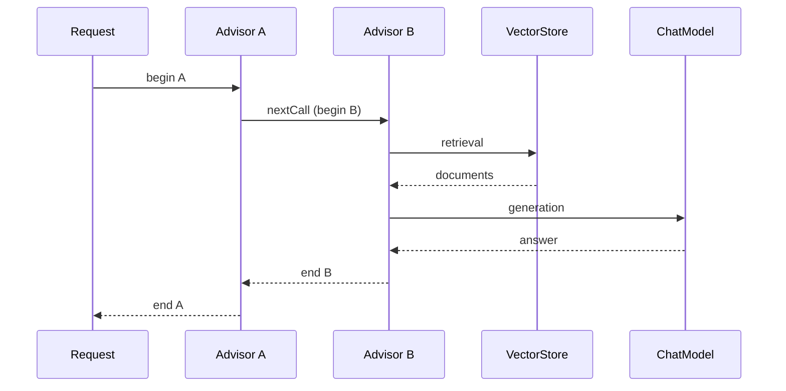
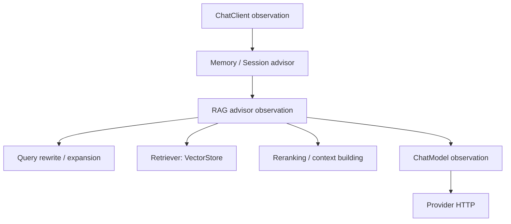

# Thời gian advisor bao gồm các bước nằm bên trong

## 1. Khi một advisor mất 1,5 giây, điều đó có nghĩa gì?

Một ứng dụng hỏi đáp nội bộ dùng Spring AI có ba bước: lấy lịch sử hội thoại, truy xuất tài liệu RAG, rồi gọi model tạo câu trả lời. Khi xem metrics, nhóm phát triển thấy:

| Observation | Thời gian giả định |
|---|---:|
| `spring.ai.chat.client` | 1.600 ms |
| `spring.ai.advisor` — memory | 1.570 ms |
| `spring.ai.advisor` — RAG | 1.480 ms |
| `db.vector.client.operation` | 260 ms |
| `gen_ai.client.operation` — chat | 1.040 ms |

Nếu cộng tất cả các số, ta được **5.950 ms**, trong khi người dùng chỉ chờ khoảng 1.600 ms tại tầng ChatClient. Có phải Spring AI đo sai? **Không.** Những observation này chủ yếu nằm **lồng nhau**: thời gian của advisor memory đã chứa thời gian của RAG và model; thời gian của RAG đã chứa thời gian truy xuất và model.

**Quy tắc trung tâm của bài học: thời gian advisor là thời gian *inclusive*, tức là bao gồm công việc của các bước nằm bên trong nó.**

Bài thuộc chương **ChatClient và advisor** của module **SPRING_AI_EVALUATION_OBSERVABILITY**. Mục tiêu của module là đánh giá chất lượng ứng dụng Spring AI theo dataset, relevance, fact checking, luồng RAG/tool calling, đồng thời đo metrics, traces, chi phí và độ trễ để phát hiện nguyên nhân suy giảm chất lượng qua phiên bản prompt, model và pipeline.

Sau bài, bạn cần có thể đọc chính xác một trace lồng nhau, phân biệt inclusive time với self time, tính thời gian không được các span con bao phủ, hiểu các trường hợp tool loop/streaming và xây báo cáo chất lượng–hiệu năng mà không cộng trùng.

## 2. Spring AI định nghĩa observation của advisor như thế nào?

Tài liệu Observability Spring AI 2.1.0 nêu:

- Mỗi khi một advisor thực thi, Spring AI có thể ghi observation tên `spring.ai.advisor`.
- Observation mang thông tin tên advisor và order trong chuỗi.
- **Thời gian được đo bao gồm thời gian của các advisor bên trong**.
- Tracing context được chuyển tiếp để các hoạt động bên trong có thể xuất hiện dưới dạng span con.
- Muốn thấy metrics/traces trong backend, ứng dụng cần hạ tầng Micrometer Observation, registry/handler và exporter phù hợp.

Các thuộc tính chính:

| Key | Cardinality theo tài liệu | Ý nghĩa |
|---|---|---|
| `gen_ai.operation.name` | Thấp | `framework` |
| `gen_ai.system` | Thấp | `spring_ai` |
| `spring.ai.kind` | Thấp | `advisor` |
| `spring.ai.advisor.name` | Thấp | Tên advisor |
| `spring.ai.advisor.order` | Cao | Vị trí advisor trong chuỗi |

Thuộc tính có cardinality thấp phù hợp làm chiều nhóm metrics. Thuộc tính có cardinality cao thường dành cho traces; không tự thêm câu hỏi người dùng hoặc nguyên văn tài liệu vào metric labels.

**Lưu ý:** một observation không phải là phép đo sử dụng CPU thuần. Duration là **thời gian tường (wall-clock elapsed time)**, có thể chứa mạng, I/O, chờ model, xử lý tool, bộ đệm, retry và các bước downstream.

Tài liệu chính thức: [Spring AI Observability](https://docs.spring.io/spring-ai/reference/observability/).

## 3. Tại sao advisor có thể bao quanh advisor khác?

Mỗi advisor được sắp xếp trong chain theo `getOrder()`. Ở chiều **request**, số order nhỏ hơn chạy trước; ở chiều **response**, chính advisor ấy chạy sau cùng.

Hình dung ba advisor A, B, C:

```text
request
  A.before
    B.before
      C.before
        ChatModel.call()
      C.after
    B.after
  A.after
response
```

Nếu A được instrument quanh toàn bộ phần thực thi từ `before` đến `after`, đồng hồ A vẫn chạy khi B, C hoặc ChatModel đang hoạt động. Tương tự đồng hồ B vẫn chạy trong lúc C và model xử lý.

Đây là một **ngăn xếp lời gọi** chứ không phải danh sách các bước nối tiếp mà mỗi timer chỉ đo một việc riêng.

### 3.1. Quan hệ order và quyền bao ngoài

| Advisor | Order minh họa | Vị trí trong chain | Thời gian có thể bao gồm |
|---|---:|---|---|
| A — Session | -100 | Ngoài cùng | B, C, model, response processing |
| B — RAG | 0 | Bên trong A | C, retrieval, model, postprocessing |
| C — Guardrail | 100 | Bên trong B | Model hoặc kết quả trả sớm |
| ChatModel advisor | Cuối chuỗi | Trong cùng | Model call/provider path |

Các giá trị -100, 0, 100 trong bảng **chỉ minh họa thứ tự**, không mô tả default order của mọi advisor tích hợp.

Hai advisor có cùng `getOrder()` **không được bảo đảm thứ tự tương đối**. Nếu việc bao ngoài/bên trong là yêu cầu bắt buộc của instrumentation hoặc nghiệp vụ, hãy đặt order phân biệt và kiểm tra trace thực tế.

### 3.2. Sơ đồ chiều gọi và các vùng thời gian



Trong sơ đồ này:

- Thời gian A bao gồm **B + retrieval + model**.
- Thời gian B bao gồm **retrieval + model**.
- VectorStore và ChatModel đo các bước chuyên biệt bên trong B.
- Nếu model trả lỗi, observation A và B vẫn có thể kết thúc với lỗi; duration của chúng không trở thành “thời gian xử lý riêng của advisor”.

## 4. Phân biệt inclusive, exclusive và critical path

Ba khái niệm nên được ghi rõ trong tài liệu và dashboard:

| Khái niệm | Định nghĩa | Tình huống sử dụng |
|---|---|---|
| **Inclusive duration** | Khoảng thời gian từ bắt đầu đến kết thúc một span, bao gồm phần việc trong nó | Hiểu một boundary/chain mất bao lâu |
| **Exclusive/self time ước tính** | Phần của khoảng span cha không nằm trong **hợp khoảng thời gian** của các span con trực tiếp đã quan sát được | Tìm các khoảng chưa được gán cho child spans |
| **Critical path** | Đường phụ thuộc có tổng thời gian quyết định thời điểm hoàn tất | Tìm bottleneck trong xử lý song song |

**Exclusive/self time suy ra từ traces không đồng nghĩa CPU time của Java.** Khoảng không được span con bao phủ có thể gồm I/O chưa instrument, queue, lock, serialization, bộ nhớ, scheduling hoặc công việc bất đồng bộ chưa nối trace.

Trong tài liệu Spring AI, `spring.ai.advisor` trực tiếp mô tả **inclusive duration**; không có nghĩa Spring AI luôn cung cấp sẵn một metric `advisor.self.duration`.

### 4.1. Công thức với một span cha và các span con

Gọi:

- \(P=[s_P,e_P)\) là khoảng thời gian span cha.
- \(C_i=[s_i,e_i)\) là khoảng thời gian các span con trực tiếp, được cắt theo biên của P.

Khi đó:

\[
T_{\mathrm{inclusive}}=e_P-s_P
\]

\[
T_{\mathrm{uncovered}}
=T_{\mathrm{inclusive}}
-\left|\bigcup_i(C_i\cap P)\right|
\]

Ký hiệu \(\left|\bigcup_i(C_i\cap P)\right|\) là **độ dài hợp của các khoảng**, không phải tổng độ dài các khoảng.

Chỉ với những span con tuần tự, không giao nhau, ta mới có thể viết đơn giản:

\[
T_{\mathrm{uncovered}}
=T_{\mathrm{parent}}-\sum_i T_{\mathrm{child},i}
\]

Nếu children chồng lấn, phép trừ tổng durations sẽ sai.

## 5. Ví dụ thời gian: cùng một request, nhiều span lồng nhau

Giả sử trace có các mốc sau (đơn vị ms, cùng clock của trace):

| Span | Bắt đầu | Kết thúc | Inclusive |
|---|---:|---:|---:|
| ChatClient | 0 | 1.600 | 1.600 |
| SessionAdvisor | 20 | 1.580 | 1.560 |
| RagAdvisor | 50 | 1.500 | 1.450 |
| VectorStore query | 100 | 360 | 260 |
| ChatModel chat | 410 | 1.450 | 1.040 |

Cấu trúc là:

```text
ChatClient       [0................................1600] 1600 ms
 SessionAdvisor    [20.............................1580] 1560 ms
  RagAdvisor         [50........................1500]   1450 ms
   Vector query          [100..360]                     260 ms
   ChatModel                         [410..........1450] 1040 ms
```

Trong giả định này, VectorStore và ChatModel đều là child spans trực tiếp của RagAdvisor, không chồng lấn nhau.

### 5.1. Những phép tính hợp lệ

Tổng thời gian RagAdvisor không bị hai child spans này bao phủ:

\[
1450-260-1040=150\ \text{ms}
\]

**150 ms không nhất thiết là thời gian logic retrieval-advisor tự tính toán.** Nó có thể chứa các đoạn chuẩn bị prompt, chuyển đổi tài liệu, scheduling, giao tiếp với một dependency chưa instrument hoặc công việc khác.

Thời gian SessionAdvisor không nằm trong **span RagAdvisor trực tiếp** là:

\[
1560-1450=110\ \text{ms}
\]

Nhưng nếu muốn biết tổng thời gian ngoài model của *toàn yêu cầu*, phải xét **các span đúng cấp** hoặc các khoảng trên timeline; không cộng 150 + 110 với toàn bộ thời gian RagAdvisor như thể chúng là các request khác nhau.

### 5.2. Phép tính sai

```text
ChatClient + SessionAdvisor + RagAdvisor + VectorStore + ChatModel
= 1600 + 1560 + 1450 + 260 + 1040
= 5910 ms

=> KHÔNG PHẢI thời gian một request!
```

Con số 5.910 ms là tổng durations của nhiều vùng **đè lên nhau**. Nó có thể hữu ích cho thống kê tổng lượng thời gian ghi nhận ở các loại span khác nhau, nhưng **không phải latency đầu cuối**.

## 6. Khi các bước con song song, không được lấy tổng durations để trừ

Giả định một advisor có span cha:

```text
Parent      [0--------------------------------1000] 1000 ms
Child A        [100--------------700]            600 ms
Child B              [400--------------900]      500 ms
```

Child A và B chồng nhau trong khoảng `[400,700)` dài 300 ms.

Vì vậy:

\[
T_A+T_B=600+500=1100\ \text{ms}
\]

nhưng:

\[
T_{A\cup B}=600+500-300=800\ \text{ms}
\]

Phần cha chưa được các span con trực tiếp bao phủ:

\[
T_{\mathrm{uncovered}}=1000-800=200\ \text{ms}
\]

Nếu trừ ngây thơ `1000 - 1100`, nhận **-100 ms** — một kết quả vô nghĩa cho thời gian chưa được bao phủ.

### 6.1. Không nhầm tổng công việc với thời gian chờ

Hai truy vấn chạy song song:

- Vector retrieval A mất 350 ms.
- Search keyword B mất 200 ms.
- Cả hai khởi động cùng lúc và phải hoàn tất trước reranker.

Bỏ qua overhead, thời gian chờ của phần song song gần:

\[
\max(350,200)=350\ \text{ms}
\]

không phải 550 ms. **Tổng 550 ms** có thể biểu thị tổng thời gian hoạt động của hai task, nhưng không phải wall-clock latency mà request phải chờ trước reranker.

Để tối ưu, tìm nhánh **nằm trên critical path** thay vì chỉ tìm loại span có tổng durations lớn nhất.

## 7. Ví dụ Java: tính phần thời gian chưa được child spans bao phủ

Với dữ liệu trace đã được thu thập theo **cùng một hệ tọa độ thời gian**, có thể tính độ dài hợp của các khoảng child và trừ khỏi parent.

```java
import java.util.Comparator;
import java.util.List;
import java.util.Objects;

public final class SpanWindowMath {

    private SpanWindowMath() {}

    // Đơn vị thời gian do caller quyết định: nano hoặc microseconds.
    public record Window(long start, long end) {
        public Window {
            if (end < start) {
                throw new IllegalArgumentException(
                    "end không được nhỏ hơn start"
                );
            }
        }

        public long duration() {
            return end - start;
        }
    }

    /**
     * Chỉ truyền các child spans TRỰC TIẾP của parent.
     * Trả phần thời gian parent không nằm trong bất kỳ child nào.
     */
    public static long uncovered(
            Window parent,
            List<Window> immediateChildren) {

        Objects.requireNonNull(parent);
        Objects.requireNonNull(immediateChildren);

        List<Window> clipped = immediateChildren.stream()
            .peek(Objects::requireNonNull)
            .filter(child ->
                child.end() > parent.start()
                && child.start() < parent.end())
            .map(child -> {
                return new Window(
                    Math.max(parent.start(), child.start()),
                    Math.min(parent.end(), child.end())
                );
            })
            .filter(child -> child.end() > child.start())
            .sorted(Comparator.comparingLong(Window::start))
            .toList();

        long covered = 0L;
        long rightmost = parent.start();

        for (Window child : clipped) {
            if (child.end() > rightmost) {
                long start = Math.max(rightmost, child.start());
                covered += child.end() - start;
                rightmost = child.end();
            }
        }

        return parent.duration() - covered;
    }
}
```

**Giới hạn của hàm:** caller phải cung cấp **immediate child spans** chứ không lặp cả con, cháu và chắt (sẽ làm phân tích parent-child bị sai nghĩa). Những khoảng con bị cắt về biên parent. Ví dụ này giả định start/end đã được chuẩn hóa về **cùng clock và cùng đơn vị**; không được lấy `System.nanoTime()` từ hai máy khác nhau rồi so trực tiếp.

### 7.1. Unit test cho ví dụ overlap

```java
import java.util.List;

import org.junit.jupiter.api.Test;
import static org.junit.jupiter.api.Assertions.assertEquals;

class SpanWindowMathTest {

    @Test
    void usesUnionWhenChildrenOverlap() {
        var parent = new SpanWindowMath.Window(0, 1000);

        var children = List.of(
            new SpanWindowMath.Window(100, 700),
            new SpanWindowMath.Window(400, 900)
        );

        assertEquals(
            200,
            SpanWindowMath.uncovered(parent, children)
        );
    }

    @Test
    void noChildMeansEntireParentUncovered() {
        var parent = new SpanWindowMath.Window(0, 1000);

        assertEquals(
            1000,
            SpanWindowMath.uncovered(parent, List.of())
        );
    }

    @Test
    void clipsOrSkipsChildrenOutsideParent() {
        var parent = new SpanWindowMath.Window(100, 900);

        var children = List.of(
            new SpanWindowMath.Window(0, 200),
            new SpanWindowMath.Window(800, 1200),
            new SpanWindowMath.Window(1500, 1800)
        );

        // Hợp của các phần nằm trong parent dài 200 ms.
        assertEquals(
            600,
            SpanWindowMath.uncovered(parent, children)
        );
    }
}
```

Đây là test deterministic của **phép tính khoảng thời gian**, không cần model hoặc Spring Boot. Nó không chứng minh toàn bộ trace của một ứng dụng là đầy đủ hoặc các spans có chung parent đúng; việc đó phải kiểm tra ở backend tracing.

### 7.2. Tại sao không dùng output này làm “CPU time”?

Hàm chỉ tính phần khoảng tường cha chưa được **các child spans đã đưa vào** bao phủ. Nếu truy vấn mạng không instrument, 200 ms đó có thể chứa 150 ms chờ mạng. Vì vậy nên đặt tên chỉ số là `uncoveredDuration` hoặc `residualWallTime`, không gọi `advisorCpuTime`.

Muốn đo CPU thật phải dùng CPU profiling hoặc công cụ đo CPU chuyên biệt.

## 8. Các tầng thời gian của một pipeline RAG

Một pipeline có thể gồm:



**RAG advisor duration không phải retrieval latency thuần.** Nó có thể bao gồm:

1. Biến đổi câu hỏi hoặc thêm lịch sử hội thoại.
2. Một hay nhiều truy vấn search/vector store.
3. Reranking, lọc nguồn, gom context và định dạng prompt.
4. Gọi downstream advisor và ChatModel.
5. Xử lý response hoặc đính kèm metadata.
6. Retry/loop do advisor ở phía trong gây ra.

Do đó, câu “RAG advisor chậm 2 giây” không xác định được vector store mất 2 giây. Cần trace VectorStore, reranker, query rewrite hoặc custom stage timers.

### 8.1. Ví dụ chẩn đoán có số liệu

```text
RagAdvisor inclusive:       1800 ms
  Query rewrite model:       220 ms
  VectorStore:               150 ms
  Reranker:                   90 ms
  Generation ChatModel:     1050 ms
  Phần còn lại/overhead:     290 ms
```

Các số chỉ cộng được như ví dụ khi bốn nhánh **không giao nhau** và đều nằm trọn bên trong advisor, với phân rã đã xác minh trên timeline. Nếu một model call xảy ra **bên trong một child advisor khác**, không nên đếm cả child advisor và model span thêm một lần nữa.

### 8.2. Retrieval đúng quan trọng hơn chỉ nhanh

Cùng một RAG advisor có thể nhanh hơn sau khi giảm `topK` từ 8 xuống 3, nhưng câu trả lời thiếu chứng cứ. Để quyết định thay đổi có tốt không, ngoài timings còn phải theo dõi:

- ID/version của tài liệu truy xuất thực tế.
- Chất lượng retrieval trên gold documents (ví dụ recall@k).
- Context cuối cùng được cấp cho model.
- Kết quả factuality/relevance trên dataset.
- Token, chi phí và P95 latency sau khi đổi pipeline.

Observation chỉ cho biết **đã mất bao lâu**, còn evaluation cho biết **có đáp ứng tiêu chí không**.

## 9. Khi có ToolCallingAdvisor, cùng một advisor có thể chạy nhiều lần

Trong Spring AI 2.1, `ToolCallingAdvisor` là một **recursive advisor**: sau khi model yêu cầu gọi công cụ, nó có thể gọi lại phần chain nằm sau nó để model xử lý kết quả công cụ.

Giả sử một lượt:

```text
ChatClient (một câu hỏi người dùng)
└─ SessionTurnAdvisor (ngoài vòng tool, chạy một lần)
   └─ ToolCallingAdvisor (điều phối hai vòng)
      ├─ Round 1: RagAdvisor → ChatModel → Tool lookupOrder
      └─ Round 2: RagAdvisor → ChatModel → final answer
```

Trên trace, RagAdvisor có thể xuất hiện **hai spans**, còn SessionTurnAdvisor có thể xuất hiện **một span bao trùm cả vòng**.

Đây không phải bug tạo observation trùng. Số lần chạy phụ thuộc vị trí `getOrder()`:

- Order **nhỏ hơn** ToolCallingAdvisor: advisor nằm **ngoài** vòng, thường chạy một lần cho một lượt ChatClient.
- Order **lớn hơn**: advisor nằm **trong** vòng, có thể chạy mỗi model round.
- Recursive advisor khác (như structured-output validation) cũng có thể lặp phần downstream.
- Nếu một advisor trả kết quả sớm, số model calls có thể bằng 0.

**Không suy từ tổng số advisor observations ra số người dùng, số câu hỏi hay số HTTP requests.**

### 9.1. Thời gian recursive advisor không nên nhân hoặc cộng bừa

Giả sử:

| Hoạt động | Thời gian |
|---|---:|
| ToolCallingAdvisor (bao cả vòng) | 2.200 ms |
| Round 1 RagAdvisor | 800 ms |
| Round 1 ChatModel | 600 ms |
| Tool execution | 300 ms |
| Round 2 RagAdvisor | 1.000 ms |
| Round 2 ChatModel | 800 ms |

Không cộng `2.200 + 800 + 600 + 300 + 1.000 + 800` thành một “tool request duration”. Model spans nằm trong các round, và các round nằm trong ToolCallingAdvisor.

Trong một pipeline thực sự tuần tự, tổng thời gian của hai **round spans không giao nhau** có thể là thước đo tổng thời gian của chính hai rounds. Nhưng cần xem liệu tool execution được tính trong round nào và có span nào chồng lấn không.

### 9.2. Tool correctness khác thời gian tool

Tool span có thể cho biết `lookupOrder` chạy 300 ms và trả HTTP thành công. Nó **không chứng minh** tham số `orderId` đúng. Muốn kiểm tra luồng gọi công cụ, cần dữ liệu expected/actual tool selection, arguments, result và nhãn của dataset.

## 10. Call và stream: duration inclusive được đo theo vòng đời khác nhau

Với synchronous call, thường có lời gọi:

```java
String answer = chatClient.prompt()
    .user("Thời hạn hoàn tiền là bao lâu?")
    .call()
    .content();
```

Đoạn thực thi cần quan sát là thời gian lấy kết quả từ terminal operation, không chỉ thời gian dựng request/spec.

Với streaming:

```java
import reactor.core.publisher.Flux;

Flux<String> chunks = chatClient.prompt()
    .user("Thời hạn hoàn tiền là bao lâu?")
    .stream()
    .content();
```

Việc có `Flux` chưa đồng nghĩa một stream đã được xử lý xong. Trong cách dùng reactive thông thường, publisher được tiêu thụ khi có subscription. Duration của observation streaming cần được hiểu theo lifecycle của framework/provider, bao gồm complete, error và có thể cancel theo implementation.

| Tình huống | Ý nghĩa duration |
|---|---|
| `call()` thành công | Thời gian từ khi operation thực thi đến khi kết quả hoàn chỉnh |
| `stream()` complete | Từ phần thực thi stream đến terminal completion theo instrumentation |
| `stream()` error | Khoảng thời gian chạy trước khi phát lỗi |
| `stream()` cancel | Khoảng chạy trước khi subscriber hủy, cần kiểm tra bản hiện dùng có ghi nhận đúng |
| Stream có chunk đầu sớm | Cho UX nhanh hơn; không nhất thiết giảm total duration |

**Không gọi thời gian của advisor streaming là “thời gian gửi token đầu tiên”**. Nó có thể bao gồm tất cả các chunks, tool calls và xử lý downstream cho đến khi stream kết thúc.

### 10.1. First chunk và full duration là hai KPI khác nhau

Ví dụ:

```text
RAG preparation:    400 ms
First model chunk:  200 ms sau khi model bắt đầu
Complete stream:   1400 ms sau khi model bắt đầu

Time-to-first-chunk từ đầu RAG ≈ 600 ms
Total RAG+stream duration       ≈ 1800 ms
```

Các con số chỉ minh họa cho đường tuần tự. User có thể thấy chữ đầu sau 600 ms nhưng toàn bộ câu trả lời vẫn cần 1.800 ms. Muốn biết model chậm hay retrieval chậm, đo thêm thời điểm model call bắt đầu và VectorStore duration; chỉ quan sát advisor inclusive không đủ.

### 10.2. Hủy stream không phải completion

Nếu client ngắt sau 700 ms, advisor span có thể kết thúc với cancel hoặc bị xử lý đặc biệt tùy phiên bản/reactive context. Một câu trả lời chỉ có 3 chunks không nên được đưa vào bộ fact checking như **full output** nếu không gắn nhãn partial.

Khi viết custom streaming instrumentation, `doFinally` hoặc cơ chế tương đương giúp phân biệt `ON_COMPLETE`, `ON_ERROR` và `CANCEL`. Không tự gọi `subscribe()` trong service rồi cho rằng HTTP response và trace đã được quản lý đúng.

## 11. Phép quan sát của ChatClient, Advisor và ChatModel là ba mức khác nhau

Tài liệu Spring AI mô tả các operation:

| Metric/observation | Đo ranh giới nào? | Không nên hiểu là |
|---|---|---|
| `spring.ai.chat.client` | Một ChatClient invocation, bao gồm advisor chain | Thuần model inference |
| `spring.ai.advisor` | Một advisor invocation, bao gồm downstream | Self CPU time của advisor |
| `gen_ai.client.operation` | Một model operation được instrument | Toàn latency của một yêu cầu RAG |
| `db.vector.client.operation` | Một thao tác vector store | RAG correctness |
| `spring.ai.tool` | Một lượt gọi công cụ | Tool selection correctness |
| `gen_ai.client.token.usage` | Token usage khi provider trả dữ liệu | Chi phí USD đã thanh toán |

Với một request có nhiều model rounds, số lượng `gen_ai.client.operation` có thể lớn hơn số lượng `spring.ai.chat.client`.

### 11.1. Sự khác biệt giữa model timer và provider processing time

Model timer đo hoạt động model ở phía ứng dụng. Nó có thể bao gồm network, SDK, queue, parsing và các bước liên quan. Không tự gọi con số ấy là “GPU inference time”, bởi phần xử lý nội bộ provider không nhất thiết được tách riêng cho caller.

Trong một số luồng streaming async, trace provider HTTP có thể mất quan hệ cha–con với model span do giới hạn context propagation. Không tự suy từ việc thiếu một HTTP child span rằng provider không được gọi.

## 12. Xem metrics advisor theo tên mà không cộng trùng

Từ Micrometer Observation, backend metrics có thể xuất timer cho:

```text
spring.ai.advisor
```

Theo ví dụ Prometheus của tài liệu Spring AI 2.1, series có thể mang prefix:

```text
spring_ai_advisor_seconds_count
spring_ai_advisor_seconds_sum
```

Cách đặt tên phụ thuộc exporter/version; phải xác nhận qua `/actuator/prometheus` hoặc truy vấn backend.

### 12.1. Mean inclusive duration cho mỗi advisor

Ví dụ PromQL:

```promql
sum by (spring_ai_advisor_name) (
  rate(spring_ai_advisor_seconds_sum[5m])
)
/
sum by (spring_ai_advisor_name) (
  rate(spring_ai_advisor_seconds_count[5m])
)
```

Giá trị trả về là **mean elapsed time** của những invocation đã hoàn tất trong cửa sổ, **theo tên advisor**. Nó không phải tự động là self time, và một advisor recursive có thể có nhiều invocation trên mỗi user request.

Cần lọc theo môi trường, model/pipeline version và status khi thật sự có nhãn tương ứng. Không dùng trường danh tính người dùng hoặc từng prompt làm label để phân tích.

### 12.2. P95/P99 phải có histogram

Timer `_sum` và `_count` chỉ đủ tính mean, không đủ tính percentile. Muốn P95 ở Prometheus cần histogram buckets hoặc cơ chế percentile có hỗ trợ.

Ví dụ cấu hình Micrometer/Boot minh họa:

```properties
management.metrics.distribution.percentiles-histogram.spring.ai.advisor=true
```

Sau khi có series `_bucket`, có thể dùng:

```promql
histogram_quantile(
  0.95,
  sum by (le, spring_ai_advisor_name) (
    rate(spring_ai_advisor_seconds_bucket[5m])
  )
)
```

Phải kiểm tra tên series, histogram buckets, số lượng mẫu và cấu hình exporter thực tế. Không bật histogram cho mọi metric một cách mù quáng vì có chi phí lưu trữ.

### 12.3. Không trừ mean hoặc P95 từ hai tập khác nhau

Ví dụ:

```text
P95 RagAdvisor = 2.2 s
P95 ChatModel  = 1.4 s
```

Không thể kết luận **P95 retrieval = 0.8 s**. Hai P95 có thể đến từ những lần gọi khác nhau, và percentile không tuyến tính:

\[
P_{95}(R-M)\ne P_{95}(R)-P_{95}(M)
\]

nói chung.

Nếu cần `R - M`, phải ghép **cùng run**, kiểm tra interval của model nằm trong interval RAG, xử lý nhiều/overlapping model spans và tính đại lượng mới **theo từng ca**. Sau đó mới lấy P95 của phân phối ấy.

## 13. Khi nào nên thêm custom timer bên cạnh spring.ai.advisor?

Spring AI đã đo inclusive advisor duration. Đừng viết thêm một custom timer **cùng ranh giới** rồi lưu hai series có cùng ý nghĩa, trừ khi phục vụ nhu cầu cụ thể.

Các tình huống custom timer có giá trị:

- Đo riêng việc biến đổi prompt **trước khi** gọi downstream.
- Đo riêng postprocessing **sau khi** downstream trả lời.
- Đo cache lookup và cache hit/miss.
- Đo reranking không có observation riêng.
- Đo thời gian chờ bắt đầu nhận chunk đầu, phân biệt với full stream duration.
- Ghi outcome cancel/error của một luồng với ngữ nghĩa ứng dụng rõ ràng.

### 13.1. Ví dụ: tách các pha của một custom CallAdvisor

Giả sử một advisor cần ghi vào context phiên bản chính sách trước khi chuyển tiếp. Ta đo riêng **phần code trong before** và **phần nextCall** bằng hai timer có tên khác nhau:

```java
import java.util.concurrent.TimeUnit;

import io.micrometer.core.instrument.MeterRegistry;
import io.micrometer.core.instrument.Timer;
import org.springframework.ai.chat.client.ChatClientRequest;
import org.springframework.ai.chat.client.ChatClientResponse;
import org.springframework.ai.chat.client.advisor.api.CallAdvisor;
import org.springframework.ai.chat.client.advisor.api.CallAdvisorChain;
import org.springframework.core.Ordered;

public final class PolicyContextTimingAdvisor implements CallAdvisor {

    private final MeterRegistry meters;

    public PolicyContextTimingAdvisor(MeterRegistry meters) {
        this.meters = meters;
    }

    @Override
    public String getName() {
        return "PolicyContextTimingAdvisor";
    }

    @Override
    public int getOrder() {
        return Ordered.HIGHEST_PRECEDENCE + 100;
    }

    @Override
    public ChatClientResponse adviseCall(
            ChatClientRequest request,
            CallAdvisorChain chain) {

        long beforeStart = System.nanoTime();

        ChatClientRequest enriched = request.mutate()
            .context("app.policy.version", "v3")
            .build();

        record("before", System.nanoTime() - beforeStart);

        long downstreamStart = System.nanoTime();

        try {
            return chain.nextCall(enriched);
        }
        finally {
            // Đo cả vector/tool/model/advisors bên trong.
            record("downstream",
                System.nanoTime() - downstreamStart);
        }
    }

    private void record(String phase, long durationNanos) {
        Timer.builder("app.ai.policy.advisor.phase")
            .tag("advisor", getName())
            .tag("phase", phase)
            .register(meters)
            .record(durationNanos, TimeUnit.NANOSECONDS);
    }
}
```

**Cách hiểu:**

- `phase=before` đo phần rất nhỏ của việc tạo request có context mới.
- `phase=downstream` đo **toàn bộ thời gian `nextCall(...)`**, bao gồm các advisor và model phía sau.
- Cả hai không phải mặc định là toàn `spring.ai.advisor` duration, vì observation tích hợp còn có thể bao gồm việc khác ở ranh giới framework.
- Ví dụ chỉ triển khai `CallAdvisor`, **không xử lý streaming**. Nếu ứng dụng dùng cả `stream()`, cần bổ sung `StreamAdvisor` với đo từ subscription đến terminal signal.
- Dữ liệu context ví dụ dùng khóa do ứng dụng đặt; không có nghĩa model tự hiểu phiên bản chính sách v3 nếu advisor khác không đưa thông tin ấy vào prompt.

**Giới hạn:** nếu logic before trả exception trước khi gọi `record(...)`, timer before không được ghi. Trong production có thể dùng `try/finally` cho pha before và gắn outcome/error riêng. Đo `System.nanoTime()` trong cùng JVM thích hợp cho duration; không dùng để so thời điểm trên nhiều máy.

### 13.2. Vì sao không dùng phase=downstream làm CPU time?

`chain.nextCall(...)` có thể chờ nhiều lần gọi model qua mạng và vector store. Timer này đo elapsed time của **đường phía sau**, không chỉ thời gian Java xử lý bên trong advisor.

Nếu cần CPU profiling, dùng công cụ khác. Nếu cần đo prompt assembly, đặt timer trực tiếp quanh phần assembly, không quanh next chain.

## 14. Quan sát streaming mà không đo nhầm lúc dựng Flux

Với `StreamAdvisor`, phần downstream trả publisher reactive. Mục tiêu là đo từ **subscription** tới complete/error/cancel, không chỉ lúc gọi hàm tạo `Flux`.

Một đoạn minh họa trong custom advisor:

```java
import java.util.concurrent.TimeUnit;

import io.micrometer.core.instrument.Timer;
import reactor.core.publisher.Flux;

// Trong StreamAdvisor.adviseStream(request, chain):
return Flux.defer(() -> {
    long started = System.nanoTime();

    return chain.nextStream(request)
        .doFinally(signal -> {
            String outcome = switch (signal) {
                case ON_COMPLETE -> "complete";
                case ON_ERROR -> "error";
                case CANCEL -> "cancel";
                default -> "other";
            };

            Timer.builder("app.ai.advisor.stream.downstream")
                .tag("advisor", getName())
                .tag("outcome", outcome)
                .register(meters)
                .record(
                    System.nanoTime() - started,
                    TimeUnit.NANOSECONDS
                );
        });
});
```

Đây là **đoạn nằm trong một class** có `meters`, `getName()` và `chain` đã được khai báo. Nó minh họa lifecycle của Reactor chứ không phải file Java tự biên dịch độc lập.

Chú ý:

- `Flux.defer` tạo đồng hồ riêng cho từng subscription.
- `doFinally` chạy với `ON_COMPLETE`, `ON_ERROR` hoặc `CANCEL`.
- Một subscriber cancel sớm không có full answer; không đưa partial content vào evaluator như full answer trừ khi dataset có rubric riêng.
- Trace context propagation qua scheduler, SDK/provider hoặc cross-thread cần được kiểm tra bằng trace thật.
- Timer streaming đo **downstream inclusive duration**, không phải CPU hay first-token latency.

## 15. Diễn giải các trường hợp bất thường

| Hiện tượng | Giải thích có thể có | Cần kiểm tra |
|---|---|---|
| Advisor A ~ ChatClient duration | A bao ngoài phần lớn chain | Order và nested spans |
| RagAdvisor chậm nhưng VectorStore nhanh | Model hoặc reranking/logic bên trong chậm | Model spans và self gaps |
| RagAdvisor nhanh nhưng retrieval sai | Nguồn sai/thiếu nhưng truy vấn nhanh | Gold document IDs và factuality |
| Model span không tồn tại | Cache/guardrail short-circuit hoặc instrumentation thiếu | Trace, advisor logic, sampling |
| Một tên advisor xuất hiện 3 lần | Tool loop, validation retry, nhiều invocation | Order, round và parent spans |
| Tổng model spans lớn hơn ChatClient wall time | Model calls song song hoặc spans chồng lấn | Start/end và critical path |
| Advisor P95 tăng nhưng model P95 không đổi | Có thể tăng retrieval, tool, retries hoặc tập ca thay đổi | Traces per-run và version |
| Span cha ngắn hơn span con | Context sai, clock skew hoặc span boundaries không khớp | Trace consistency, SDK/exporter |
| First chunk nhanh nhưng advisor stream dài | Stream tiếp tục sinh nhiều nội dung | Total duration, chunk count, tokens |
| Lỗi judge làm pipeline evaluation chậm | Judge là phép chấm riêng, không phải serving | Tách span generation và judge |

### 15.1. Điều tra từ một trace cụ thể

Bắt đầu bằng một ca trượt SLA, thay vì suy luận từ một bảng aggregate:

1. Xác nhận trace thuộc endpoint, prompt/model/pipeline version nào.
2. Xem thời gian HTTP server và ChatClient spans, xác định phần nào nằm ngoài ChatClient.
3. Tìm chuỗi `spring.ai.advisor` theo thứ tự order.
4. Mở child spans và kiểm tra khoảng start/end; xác định chúng tuần tự hay song song.
5. Mở VectorStore, ChatModel và Tool spans cho từng round.
6. Xác định cache hit, retries, tool loop hoặc short-circuit.
7. Nếu thiếu spans, kiểm tra sampling, context propagation và provider limitation.
8. Gắn kết quả với câu trả lời, nguồn và quality verdict để biết tối ưu cần thực hiện ở đâu.

Không giả định khoảng trống lớn giữa spans là “Advisor CPU overhead” khi chưa có instrumentation chi tiết.

## 16. Kết hợp đo duration với đánh giá relevance và fact checking

Trong module **SPRING_AI_EVALUATION_OBSERVABILITY**, tăng tốc một advisor chỉ là cải thiện nếu ứng dụng vẫn đáp ứng chất lượng cần thiết.

Giả sử một nhóm tối ưu RAG:

| Phiên bản | RAG inclusive mean | VectorStore mean | Factuality pass rate | Judge coverage |
|---|---:|---:|---:|---:|
| v1 | 1.800 ms | 400 ms | 92% | 99% |
| v2 | 1.300 ms | 180 ms | 79% | 99% |

Các số minh họa. Có thể v2 đã đổi `topK`, filter, index hoặc cách cắt context để truy xuất nhanh hơn, nhưng bỏ sót chứng cứ quan trọng.

Cần phân tích:

- Nguồn nào đã được retrieval ở mỗi phiên bản?
- Context cuối cùng model thật sự được cấp là gì?
- Model/embedding/reranker có đổi không?
- Judge và rubric đánh giá có giữ nguyên không?
- Các ca chuyển từ pass sang fail có chung nguyên nhân nào?
- Độ trễ generation, tool và judge có bị gộp nhầm vào advisor timer không?

**Không thay chất lượng bằng duration.** `spring.ai.advisor` trả lời “đường xử lý mất bao lâu”; `EvaluationResponse.isPass()` trả lời “câu trả lời có đạt tiêu chí đã chọn không”, còn `getScore()` phụ thuộc implementation.

### 16.1. Manifest dùng cho so sánh có thể tái lập

Một bản ghi do ứng dụng thiết kế:

```json
{
  "runId": "eval-2026-11-27-004",
  "caseId": "refund-deadline-007",
  "promptVersion": "prompt-v9",
  "modelId": "model-generation-a",
  "retrieverVersion": "retrieval-v4",
  "advisorConfigVersion": "advisor-config-v2",
  "judgeModel": "judge-b",
  "rubricVersion": "fact-v3",
  "traceId": "trace-example-007",
  "ragAdvisorInclusiveMs": 1300,
  "vectorQueryMs": 180,
  "factualityPass": false
}
```

Đây **không** phải JSON tự sinh từ Spring AI. Trong hệ thống thật, lưu `runId/traceId`, version và kết quả ở báo cáo/test store. Đừng đưa ID duy nhất này vào low-cardinality metric label. Có thể cần thêm `generationLatency`, usage tokens và chi phí riêng theo model.

## 17. Tách chi phí và token khỏi inclusive duration

Một advisor rất chậm không nhất thiết dùng nhiều tokens. Ngược lại, một advisor truy xuất nhanh có thể thêm hàng chục tài liệu vào prompt, làm tăng token input của ChatModel.

Theo Spring AI:

- `gen_ai.client.token.usage` đo token được provider báo cáo.
- `gen_ai.client.operation` đo lượt model operation.
- `spring.ai.advisor` đo thời gian advisor **bao gồm các operations bên trong**.

Không dùng duration advisor để tính giá tiền trực tiếp. Chi phí có thể ước tính bằng:

\[
C_{\mathrm{model}}=
N_{\mathrm{input}}\times p_{\mathrm{input}}+
N_{\mathrm{output}}\times p_{\mathrm{output}}
\]

cộng phí embedding, reranking, tool hoặc retrieval nếu có. Phải giữ đơn vị giá (thường theo triệu token), phiên bản bảng giá, provider và dữ liệu usage thực tế. Một retry hoặc tool loop có thể tạo nhiều model calls trong **một** advisor observation.

Nếu provider không trả usage cho stream bị hủy, cần ghi trạng thái thiếu dữ liệu thay vì coi chi phí bằng 0.

### 17.1. Không cộng token input/output/total ba lần

Metric Prometheus có thể xuất `gen_ai_client_token_usage_total` với `gen_ai_token_type=input`, `output` và `total`. Nếu `total` đã bao gồm hai thành phần, không cộng cả ba. Dùng **total** hoặc **input + output**, tùy dữ liệu có sẵn và mục tiêu báo cáo.

## 18. Kiểm thử quan hệ lồng nhau và khả năng quan sát

Bài toán cần ít nhất ba cấp test:

| Cấp | Mục tiêu | Có cần model thật? |
|---|---|---|
| Unit test phép tính time windows | Đảm bảo hợp khoảng chồng lấn tính đúng | Không |
| Unit test custom advisor | Đảm bảo tiếp tục chain một lần, không sửa response | Không, có thể dùng mock |
| Integration test Spring AI observations | Kiểm tra spans advisor/model/vector thực sự xuất hiện | Có thể dùng model giả lập và registry/tracing test |
| Test RAG/tool end-to-end | Đo pipeline thật và bảo toàn chất lượng | Tùy hạ tầng test, thường có provider |
| Dataset regression | So sánh pass rate và duration theo version | Tùy judge, có thể tốn token |

### 18.1. Kiểm thử custom advisor không gọi model thật

Nếu dùng `PolicyContextTimingAdvisor` trong mục 13, có thể kiểm tra nó chuyển tiếp request với context mới và giữ nguyên response qua Mockito và SimpleMeterRegistry.

```java
import io.micrometer.core.instrument.Timer;
import io.micrometer.core.instrument.simple.SimpleMeterRegistry;
import org.junit.jupiter.api.Test;
import org.mockito.ArgumentCaptor;
import org.springframework.ai.chat.client.ChatClientRequest;
import org.springframework.ai.chat.client.ChatClientResponse;
import org.springframework.ai.chat.client.advisor.api.CallAdvisorChain;
import org.springframework.ai.chat.prompt.Prompt;

import static org.junit.jupiter.api.Assertions.assertEquals;
import static org.junit.jupiter.api.Assertions.assertNotNull;
import static org.junit.jupiter.api.Assertions.assertSame;
import static org.mockito.ArgumentMatchers.any;
import static org.mockito.Mockito.mock;
import static org.mockito.Mockito.verify;
import static org.mockito.Mockito.when;

class PolicyContextTimingAdvisorTest {

    @Test
    void recordsSeparateBeforeAndDownstreamTimers() {
        try (SimpleMeterRegistry registry = new SimpleMeterRegistry()) {
            ChatClientRequest request = new ChatClientRequest(
                new Prompt("Thời hạn hoàn tiền?"),
                java.util.Map.of()
            );
            ChatClientResponse response = mock(ChatClientResponse.class);
            CallAdvisorChain chain = mock(CallAdvisorChain.class);

            when(chain.nextCall(any(ChatClientRequest.class)))
                .thenReturn(response);

            var advisor = new PolicyContextTimingAdvisor(registry);
            ChatClientResponse actual = advisor.adviseCall(request, chain);

            assertSame(response, actual);

            var captured = ArgumentCaptor.forClass(
                ChatClientRequest.class
            );
            verify(chain).nextCall(captured.capture());
            assertEquals(
                "v3",
                captured.getValue().context().get("app.policy.version")
            );

            Timer before = registry.find("app.ai.policy.advisor.phase")
                .tag("phase", "before")
                .timer();
            Timer downstream = registry.find("app.ai.policy.advisor.phase")
                .tag("phase", "downstream")
                .timer();

            assertNotNull(before);
            assertNotNull(downstream);
            assertEquals(1L, before.count());
            assertEquals(1L, downstream.count());
        }
    }
}
```

Test này gọi thật `adviseCall(...)` trên advisor tự viết, nhưng dùng `CallAdvisorChain` giả lập để không gọi model. Nó kiểm tra request được chuyển tiếp với context mới, response được giữ nguyên và hai timer được ghi mỗi cái một lượt. Test **không chứng minh** Spring AI đã xuất `spring.ai.advisor` mặc định trong môi trường Spring Boot; việc đó cần integration test có `ObservationRegistry` và handler phù hợp.

### 18.2. Những case cần có trong suite thật

- Outer advisor bao được inner advisor và model; các spans có quan hệ cha–con đúng.
- Advisor chỉ chạy một lần khi nằm trước tool loop, nhiều lần khi nằm sau tool loop.
- Retrieval/cache short-circuit khiến model span không xuất hiện nhưng không gây lỗi trace.
- Lỗi next chain làm timer của outer advisor kết thúc đúng với outcome/error.
- Streaming complete/error/cancel được phân nhóm.
- Khi tracing sampling bật thấp, không phải request nào cũng có trace; metric counts có thể vẫn đầy đủ.
- Các chỉ số được xuất đúng tên/đơn vị ở backend.
- Không có prompt, PII, secrets hoặc tool args xuất hiện trong tags ngoài chủ đích.

## 19. Lỗi thường gặp và cách sửa

| Sai lầm | Vì sao sai | Cách sửa |
|---|---|---|
| Cộng tất cả thời gian advisor | Span cha chứa span con | Xem nested waterfall |
| Coi RAG advisor duration là thời gian VectorStore | RAG còn chứa model và processing | Đo riêng vector query |
| Lấy tổng child duration để trừ khi các child song song | Đếm chồng overlap | Tính hợp các khoảng |
| Coi residual wall time là CPU của advisor | Có uninstrumented work, waiting | Dùng profiler nếu cần CPU |
| Trừ P95 advisor và P95 model | Hai phân phối có thể lệch ca | Tính per-run rồi lấy P95 |
| Nhân count advisor thành count người dùng | Tool loop/retry làm lặp | Gắn correlation ID và round |
| Đổi order chỉ để span có vẻ đẹp | Có thể làm đổi memory/tool semantics | Test lại hành vi |
| Lấy thời gian tạo Flux làm stream duration | Chưa có subscription | Đo theo reactive lifecycle |
| Chấm partial stream như full answer | Thiếu dữ liệu phản hồi | Gắn partial/cancel, chấm riêng |
| Tạo metric riêng trùng với spring.ai.advisor | Tăng telemetry cost vô ích | Chỉ đo phase khác biệt có ích |
| Dùng model timer làm “GPU time” | Có mạng, SDK, queue | Xem provider metrics nếu có |
| Dùng trace ID hoặc nội dung câu hỏi làm tag metric | Cardinality và rò rỉ PII | Tag hữu hạn, chi tiết ở trace/report |
| Tối ưu advisor duration mà không đo chất lượng | Có thể bỏ chứng cứ RAG | Chấm factuality/relevance song song |

## 20. Bài tập thực hành

### Bài 1 — Tính thời gian lồng nhau

Một ChatClient mất 1.200 ms; MemoryAdvisor mất 1.150 ms; RagAdvisor mất 1.000 ms; ChatModel mất 750 ms. Có thể cộng thành 4.100 ms không?

**Đáp án:** Không. Đây là các khoảng lồng nhau; request vẫn khoảng 1.200 ms tại ranh giới ChatClient. Không thể suy riêng retrieval mất 250 ms khi còn nhiều công việc khác ở RagAdvisor.

### Bài 2 — Hai child spans giao nhau

Span cha [0,1000], child A [100,700], child B [400,900]. Phần cha chưa được child bao phủ là bao nhiêu?

**Đáp án:** Hợp child là [100,900], dài 800; phần còn lại 200 ms. Không dùng tổng 600 + 500 để trừ.

### Bài 3 — P95 không thể trừ trực tiếp

Advisor P95 = 2,1 s, model P95 = 1,4 s. Có thể khẳng định P95 phần ngoài model = 0,7 s không?

**Đáp án:** Không. Cần ghép theo run, xử lý các span con và tính percentile trên giá trị per-run đã xây dựng.

### Bài 4 — Tool loop làm tăng count

Một người gửi một câu hỏi, ToolCallingAdvisor chạy hai rounds và RagAdvisor nằm phía trong vòng. Bao nhiêu lượt RagAdvisor có thể xuất hiện?

**Đáp án:** Có thể hai, hoặc khác tùy đường loop và short-circuit thực tế. Không dùng count RagAdvisor để thay count user requests.

### Bài 5 — Khi nào truy vấn vector không phải nguyên nhân?

RagAdvisor = 1,8 s, VectorStore query = 70 ms, model = 1,5 s. Có thể coi vector store là bottleneck lớn nhất không?

**Đáp án:** Không có cơ sở từ các con số này. Model chiếm phần lớn elapsed time được quan sát; cần mở trace các khoảng còn lại và kiểm tra context.

### Bài 6 — Stream bị hủy

Subscriber nhận hai chunks rồi hủy. Vì sao duration của advisor không thể thay thế đánh giá chất lượng câu trả lời?

**Đáp án:** Duration đo thời gian thực thi; output bị cắt không phải câu trả lời hoàn chỉnh. Cần phân loại cancel và chỉ dùng rubric riêng cho partial output nếu muốn chấm.

### Bài 7 — Tối ưu RAG nhưng pass rate giảm

Sau khi giảm thời gian RAG advisor từ 1,5 s xuống 0,9 s, factuality pass rate giảm từ 95% còn 82%. Việc tối ưu có thành công không?

**Đáp án:** Không thể kết luận chỉ từ latency. Cần kiểm tra nguồn thực tế truy xuất, context final, dataset, rubric, judge version và các ca regression.

## 21. Checklist trước khi công bố một biểu đồ advisor latency

- [ ] Đã xác nhận phiên bản Spring AI/Boot/Micrometer và tên metric thực tế?
- [ ] Có hiểu `spring.ai.advisor` là inclusive time, không phải self CPU?
- [ ] Biết `getOrder()` và cấu trúc parent-child của chain?
- [ ] Không cộng spans nested hay child spans chồng lấn?
- [ ] Không trừ hai P95 để suy P95 phần dư?
- [ ] Có kiểm tra recursive advisors và số vòng model/tool?
- [ ] Có phân biệt ChatClient vs ChatModel vs VectorStore vs Tool observations?
- [ ] Với stream, có phân biệt subscription, complete, error và cancel?
- [ ] Đã xử lý các trace thiếu span, sampling hoặc lost context?
- [ ] Nếu dùng custom timer, ranh giới có rõ và không trùng vô ích?
- [ ] Có giữ cùng dataset/versions trước khi so sánh hiệu năng?
- [ ] Có đánh giá relevance/factuality/tool correctness cùng độ trễ?
- [ ] Có tách usage/cost của model generation và judge?
- [ ] Metrics tags có tập giá trị hữu hạn và không chứa PII?
- [ ] Có bảo vệ Prometheus/Actuator và trace/log của ứng dụng?

## 22. Tổng kết và tài liệu tham khảo

Điểm phải nhớ khi đọc Spring AI observability là **thời gian của một advisor bao gồm các bước chạy phía trong nó**. Advisor memory có thể bao phủ RAG; RAG có thể bao phủ truy xuất vector và gọi model; tool loop có thể gọi lại một phần chuỗi. Do vậy, những con số từ nhiều observations **không độc lập để cộng** thành tổng latency.

Để phân tích đúng, bắt đầu từ trace theo từng run, kiểm tra parent/child, khoảng start/end và overlap; đo riêng các bước quan trọng như VectorStore, ChatModel, tool, reranker và xử lý prompt. Với streaming, phân biệt complete/error/cancel và phần nội dung chưa hoàn tất. Cuối cùng, liên kết kết quả quan sát với các tiêu chí chất lượng và chi phí để tránh tối ưu “nhanh nhưng sai”.

**Nguồn chính thức:**

1. [Spring AI 2.1.0 — Observability](https://docs.spring.io/spring-ai/reference/observability/): khẳng định observation `spring.ai.advisor` tính cả inner advisors; thuộc tính name/order, model, tool và vector observations.
2. [Spring AI 2.1.0 — Advisors API](https://docs.spring.io/spring-ai/reference/api/advisors.html): advisor chain, `getOrder()`, quan hệ trước/sau và cách viết advisor.
3. [Spring AI — Metrics Reference](https://docs.spring.io/spring-ai/reference/2.1-SNAPSHOT/observability/metrics.html): timer naming, mean, histogram và metric token usage. Đường dẫn snapshot phải đối chiếu bản ổn định đang triển khai.
4. [Spring AI — Recursive Advisors](https://docs.spring.io/spring-ai/reference/api/advisors-recursive.html): `ToolCallingAdvisor`, `copy(after)` và vòng gọi downstream.
5. [Spring AI — Writing an Advisor](https://docs.spring.io/spring-ai/reference/2.1-SNAPSHOT/advisors/custom.html): custom `CallAdvisor` / `StreamAdvisor` / `BaseAdvisor` và request context.
6. [Spring AI — Chat Client API](https://docs.spring.io/spring-ai/reference/api/chatclient.html): terminal operations, streaming và cấu hình advisor.
7. [Spring Boot — Metrics](https://docs.spring.io/spring-boot/reference/actuator/metrics.html) và [Tracing](https://docs.spring.io/spring-boot/reference/actuator/tracing.html): Micrometer, tracing/exporter, histogram và sampling.

*Các bảng thời gian, biểu đồ, công thức áp dụng trên khoảng mẫu và các metric `app.ai.*` trong bài là ví dụ giảng dạy. Khi vận hành production phải xác minh boundaries, tính đầy đủ của traces, dữ liệu token/chi phí và chất lượng trên dataset thật trước khi ra quyết định.*
