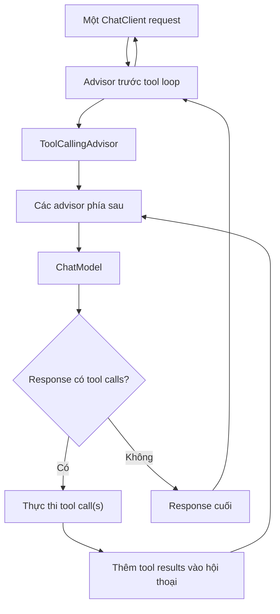

# Ảnh hưởng của thứ tự advisor và vòng lặp gọi công cụ

## 1. Một câu hỏi người dùng có thể tạo ra nhiều vòng xử lý

Giả sử người dùng hỏi: “Đơn hàng A123 đã giao đến đâu?”. Ứng dụng Spring AI có các advisor: memory để lấy lịch sử hội thoại, RAG để truy xuất dữ liệu, ToolCallingAdvisor để thực thi công cụ tra cứu đơn hàng và một advisor kiểm tra cấu trúc câu trả lời.

Model có thể cần gọi công cụ rồi mới trả lời:

1. Model nhận câu hỏi và yêu cầu gọi lookupOrder("A123").
2. Ứng dụng thực thi công cụ và nhận kết quả đơn hàng.
3. Kết quả công cụ được đưa lại cho model.
4. Model tạo câu trả lời cuối cùng.

Đây vẫn là **một lượt ChatClient của người dùng**, nhưng có thể có hai hoặc nhiều model calls. Advisor nằm trước vòng gọi công cụ có thể chỉ chạy một lần; advisor nằm sau vòng gọi công cụ có thể chạy lại ở mỗi vòng model.

Vị trí của advisor quyết định không chỉ thứ tự xử lý mà còn:

- Một advisor chạy một lần hay nhiều lần.
- RAG truy xuất lại tài liệu ở mỗi vòng hay chỉ một lần.
- Memory nhìn thấy yêu cầu ban đầu hay cả tool transcript trung gian.
- Timer, log, metrics và side effects được ghi một lần hay nhiều lần.
- Token, chi phí và latency thay đổi thế nào.
- Dữ liệu nào được đưa vào từng lần gọi model và kết quả đánh giá có còn đúng ngữ cảnh không.

Bài thuộc chương **ChatClient và advisor** của module **SPRING_AI_EVALUATION_OBSERVABILITY**. Module hướng tới đánh giá chất lượng ứng dụng Spring AI bằng dataset, relevance, fact checking, kiểm thử RAG/tool calling; đồng thời đo metrics, traces, chi phí và độ trễ để phát hiện regression theo phiên bản prompt, model và pipeline.

Sau bài, bạn có thể giải thích thứ tự advisor, dự đoán advisor nào bị lặp trong tool loop, cấu hình RAG/memory đúng vị trí, tránh side effects trùng, kiểm thử số vòng thực thi và liên kết trace với chất lượng câu trả lời.

## 2. Advisor chain hoạt động như một ngăn xếp

Mỗi advisor có tên qua **getName()** và thứ tự qua **getOrder()**. Spring AI sắp xếp các advisor theo order:

- Giá trị order **nhỏ hơn** được chạy trước ở chiều request.
- Advisor chạy trước ở request sẽ xử lý response sau cùng.
- Giá trị order **lớn hơn** chạy sau ở chiều request và xử lý response sớm hơn.
- Các advisor có cùng order không được bảo đảm thứ tự tương đối.

Ví dụ:

| Advisor | Order | Chiều request | Chiều response |
|---|---:|---:|---:|
| A — Session | -100 | 1 | 3 |
| B — RAG | 0 | 2 | 2 |
| C — Guardrail | 100 | 3 | 1 |
| ChatModel advisor | Cuối chain | Cuối | Đầu |

Mô hình ngăn xếp:

\[
Request \rightarrow A \rightarrow B \rightarrow C \rightarrow Model
\]

\[
Response \leftarrow A \leftarrow B \leftarrow C \leftarrow Model
\]

Một advisor có thể thay đổi request, gọi advisor tiếp theo rồi xử lý response khi chain trả về. Nó cũng có thể short-circuit, không gọi phần chain còn lại, hoặc gọi phần chain phía sau nhiều lần.

### 2.1. Vì sao thứ tự ảnh hưởng đến hành vi?

Giả sử advisor A ghi thời điểm bắt đầu, advisor B truy xuất tài liệu và advisor C ghi log response.

Nếu A nằm ngoài B và C:

- A nhận request gốc.
- B và C xử lý ở bên trong A.
- Khi model trả lời, C xử lý trước, rồi B, cuối cùng A.
- Duration inclusive của A có thể bao gồm toàn bộ B, C và model.

Nếu đảo order, A có thể nhận request đã được B làm giàu hoặc xử lý response trước B. Thay đổi order do đó có thể thay đổi **dữ liệu advisor nhìn thấy**, không chỉ thay đổi trace.

### 2.2. Các hằng số của Spring Ordered

```java
Ordered.HIGHEST_PRECEDENCE == Integer.MIN_VALUE
Ordered.LOWEST_PRECEDENCE  == Integer.MAX_VALUE
```

Số càng nhỏ thì độ ưu tiên càng cao. Nên sử dụng hằng số thay vì tự chép số âm rất lớn vào code.

Nếu hai advisor có cùng order, đừng dựa vào thứ tự tình cờ ở một lần chạy. Khi thứ tự có ý nghĩa nghiệp vụ, hãy đặt giá trị khác nhau và viết test xác nhận.

## 3. ToolCallingAdvisor là một recursive advisor

ToolCallingAdvisor điều phối vòng gọi công cụ bên trong advisor chain. Model có thể trả về một response chứa tool calls. Advisor thực thi các tool, ghép kết quả vào request tiếp theo rồi gọi lại phần chain phía sau nó. Quá trình tiếp tục cho đến khi model không còn yêu cầu tool, hoặc một điều kiện kết thúc khác được áp dụng.

Sơ đồ:



Điểm quan trọng là khi lặp, ToolCallingAdvisor gọi lại **phần chain phía sau nó**, không chạy lại advisor đứng trước nó. Cơ chế recursive dùng bản sao sub-chain, chẳng hạn CallAdvisorChain.copy(this) ở nhánh call.

Pseudo-code để hiểu ý tưởng:

```text
response = downstreamChain(request)

while response có tool calls và được phép thực thi:
    toolResults = execute(response.toolCalls)
    nextRequest = appendToolResults(request/history, toolResults)
    response = downstreamChain(nextRequest)

return response
```

Đây là pseudo-code giải thích vòng đời, không phải nguyên văn implementation. API thực tế còn quản lý tool execution, conversation history, metadata và response.

### 3.1. Một vòng model không đồng nghĩa một tool call

Một response của model có thể chứa nhiều tool calls. Ví dụ model yêu cầu tra đơn hàng và kiểm tra trạng thái vận chuyển trong cùng một lượt. Tool manager có thể thực thi nhiều tool calls trước khi gửi kết quả trở lại model.

Cần phân biệt:

| Khái niệm | Ý nghĩa |
|---|---|
| User turn | Một lượt yêu cầu của người dùng |
| ChatClient invocation | Một lần thực thi ChatClient cho lượt đó |
| Model round | Một lần downstream chain gọi model trong vòng điều phối |
| Tool call | Một lời gọi công cụ cụ thể |
| Tool execution batch | Nhóm tool calls được xử lý từ một response |
| Advisor invocation | Một lần advisor thực sự chạy |

Ví dụ:

```text
User turn: 1
ChatClient invocation: 1

Model round 1:
  ChatModel call #1
  Tool calls: lookupOrder, lookupShipment

Model round 2:
  ChatModel call #2
  Tool calls: none
  Final answer
```

Ở đây có một user turn, một ChatClient invocation, hai model rounds và hai tool calls. Advisor nằm bên trong vòng tool có thể chạy hai lần; advisor nằm ngoài vòng có thể chỉ chạy một lần.

Không dùng các số đếm này thay thế cho nhau trong dashboard.

### 3.2. Return-direct có thể kết thúc vòng sớm

Một tool có thể được cấu hình để trả kết quả trực tiếp cho caller (returnDirect) thay vì gửi kết quả ấy trở lại model để viết câu trả lời tiếp. Khi đó, vòng tool có thể kết thúc ngay sau tool execution.

Nếu model yêu cầu nhiều tool calls trong cùng một lượt, behavior return-direct còn phụ thuộc metadata của tất cả các tool trong lượt ấy. Hãy kiểm tra điều kiện trong tài liệu và release đang dùng; không giả định chỉ một tool được đánh dấu là đủ để kết thúc vòng.

Theo behavior được mô tả cho ToolCallingAdvisor, khi một response chứa nhiều tool calls, return-direct chỉ được áp dụng nếu **tất cả** các tool trong lượt đó đều được đánh dấu return-direct.

Vì vậy, không giả định mọi tool call luôn kéo theo một model call tiếp theo. Khi phân tích trace, kiểm tra cấu hình tool, response và điều kiện kết thúc thực tế.

## 4. Advisor trước và sau vòng tool có số lần chạy khác nhau

ToolCallingAdvisor có order mặc định:

```java
ToolCallingAdvisor.DEFAULT_ORDER
    == Ordered.HIGHEST_PRECEDENCE + 300
```

Đây là mốc quan trọng để xác định advisor nằm ngoài hay bên trong vòng tool.

- Advisor có order **nhỏ hơn** ToolCallingAdvisor.DEFAULT_ORDER nằm trước vòng tool: thường chạy một lần cho mỗi ChatClient invocation.
- Advisor có order **lớn hơn** ToolCallingAdvisor.DEFAULT_ORDER nằm sau vòng tool: chạy lại mỗi khi vòng tool gọi lại downstream chain.
- Advisor có cùng order không có vị trí tương đối được bảo đảm; không dùng cùng giá trị nếu cần một quan hệ trước/sau cụ thể.

Ví dụ:

```text
Order nhỏ hơn ToolCallingAdvisor
  SessionTurnAdvisor
  └─ ToolCallingAdvisor
       └─ RAGAdvisor
            └─ ChatModel

Order lớn hơn ToolCallingAdvisor
```

Trong cấu hình thứ hai, RAG nằm bên trong vòng tool và có thể truy xuất lại ở mỗi model round.

### 4.1. Sơ đồ hai vị trí

```mermaid
flowchart TB
    subgraph OUT["RAG ở ngoài vòng tool"]
      A1["RAG advisor — một lần"] --> T1["ToolCallingAdvisor"]
      T1 --> M1["Model round 1"]
      M1 --> X1["Tool execution"]
      X1 --> M2["Model round 2"]
    end

    subgraph IN["RAG ở trong vòng tool"]
      T2["ToolCallingAdvisor"] --> A2["RAG advisor — round 1"]
      A2 --> N1["Model round 1"]
      N1 --> X2["Tool execution"]
      X2 --> A3["RAG advisor — round 2"]
      A3 --> N2["Model round 2"]
    end
```



Cả hai đều có thể là cấu hình đúng. Chọn vị trí theo việc retrieval cần chạy một lần hay cần cập nhật ở mỗi vòng.

### 4.2. ToolCallingAdvisor được đăng ký tự động

Trong cấu hình ChatClient mặc định, DefaultChatClient tự đăng ký ToolCallingAdvisor nếu chain chưa có tool advisor và auto-registration chưa bị tắt. Cơ chế này cho phép một advisor khác thêm tools trong lúc xử lý request mà vòng thực thi công cụ vẫn được quản lý.

Không thêm một ToolCallingAdvisor thứ hai hoặc một ToolAdvisor khác vào cùng chain nếu chưa có chủ đích thay thế. DefaultChatClient duy trì invariant chỉ có một tool advisor để tránh thực thi công cụ hai lần. Nếu cần thay implementation, hãy dùng cơ chế thay thế/auto-configuration phù hợp với release.

Có thể điều chỉnh vị trí tool loop bằng property:

```properties
spring.ai.chat.client.tool-calling.advisor-order=100
```

Trong ví dụ này, RAG advisor mặc định order 0 sẽ nằm trước tool loop; advisor có order lớn hơn 100 sẽ nằm trong loop. Nếu nhiều advisor cần thứ tự riêng, hãy đặt order phân biệt thay vì để trùng nhau. Property chỉ thay đổi vị trí của tool advisor; nó không tự đổi order của các advisor còn lại.

Nếu tắt auto-registration bằng property `spring.ai.chat.client.tool-calling.enabled=false`, tool definitions vẫn có thể được gửi tới model nhưng ứng dụng phải tự quản lý việc thực thi tool calls và gửi kết quả trở lại model. Chỉ tắt khi đã có user-controlled tool loop hoặc một cơ chế thay thế tương ứng.

## 5. RAG mặc định thường nằm bên trong tool loop

Trong Spring AI 2.1.x, các advisor RAG như QuestionAnswerAdvisor và RetrievalAugmentationAdvisor có order mặc định 0. Order mặc định của ToolCallingAdvisor là HIGHEST_PRECEDENCE + 300, một số rất nhỏ so với 0.

Do đó, RAG advisor mặc định thường nằm **sau ToolCallingAdvisor**, tức là bên trong vòng tool.

Khi model gọi tool nhiều lần, RAG có thể chạy lại ở mỗi model round:

```text
ChatClient
└─ ToolCallingAdvisor
   ├─ Round 1
   │  └─ RAG advisor → VectorStore → ChatModel
   │                    ↓ tool call
   └─ Round 2
      └─ RAG advisor → VectorStore → ChatModel
                       ↓ final answer
```

Điều này hữu ích nếu mỗi round cần truy xuất tài liệu theo thông tin mới từ tool result. Nhưng nó cũng có thể:

- Tạo nhiều vector queries cho một câu hỏi.
- Tăng latency và chi phí retrieval/reranking.
- Đưa các context khác nhau vào các model rounds.
- Tạo nhiều spring.ai.advisor observations cùng tên trong một trace.
- Làm tăng token input nếu mỗi round thêm tài liệu vào prompt.

### 5.1. Khi muốn truy xuất một lần cho mỗi ChatClient invocation

Đặt RAG advisor **trước** vòng tool bằng cách chọn order nhỏ hơn ToolCallingAdvisor.DEFAULT_ORDER.

Ví dụ với QuestionAnswerAdvisor:

```java
import org.springframework.ai.chat.client.advisor.ToolCallingAdvisor;
import org.springframework.ai.chat.client.advisor.vectorstore.QuestionAnswerAdvisor;
import org.springframework.ai.vectorstore.VectorStore;

QuestionAnswerAdvisor ragOnce = QuestionAnswerAdvisor
    .builder(vectorStore)
    .order(ToolCallingAdvisor.DEFAULT_ORDER - 50)
    .build();
```

Sau đó đăng ký vào ChatClient:

```java
ChatClient client = chatClientBuilder
    .defaultAdvisors(ragOnce)
    .build();
```

Các biến chatClientBuilder và vectorStore phải được cấu hình sẵn trong ứng dụng. Với advisor RAG khác, kiểm tra builder API của phiên bản đang dùng; không giả định mọi builder có cùng method.

### 5.2. Khi muốn truy xuất lại ở mỗi vòng

Đặt order lớn hơn:

```java
QuestionAnswerAdvisor ragEachRound = QuestionAnswerAdvisor
    .builder(vectorStore)
    .order(ToolCallingAdvisor.DEFAULT_ORDER + 50)
    .build();
```

Khi đó RAG chạy bên trong vòng tool. Đây là lựa chọn hợp lý nếu tool result thay đổi câu hỏi tìm kiếm hoặc model cần chứng cứ mới sau mỗi bước.

**Lưu ý:** chỉ đặt RAG bên trong vòng không tự bảo đảm truy vấn sử dụng đúng tool result. Cần kiểm tra advisor nhận request nào ở từng round và cách nó tạo search query. Ở các round sau, message cuối có thể là tool result; không mặc định message cuối luôn là câu hỏi gốc của người dùng.

### 5.3. Cân nhắc chi phí khi retrieval lặp

Giả sử mỗi vector query mất 120 ms và một user turn có ba model rounds:

| Vị trí RAG | Số lần truy xuất giả định | Tổng vector-query time tuần tự |
|---|---:|---:|
| Ngoài tool loop | 1 | 120 ms |
| Trong tool loop | 3 | 360 ms |

Đây là phép tính minh họa khi truy xuất tuần tự. Trong hệ thống thực tế, cache, truy vấn song song và các bước khác có thể làm thay đổi wall-clock duration.

RAG chạy một lần tiết kiệm truy vấn nhưng context có thể cũ hoặc không phù hợp với kết quả tool mới. RAG chạy mỗi vòng linh hoạt hơn nhưng tốn tài nguyên hơn. Cần đo cả retrieval metrics và factuality trước khi chọn.

## 6. Memory ngoài vòng và trong vòng tool

Memory advisor cũng cần được đặt đúng vị trí.

### 6.1. Memory ở ngoài vòng tool

Một memory advisor có order nhỏ hơn ToolCallingAdvisor.DEFAULT_ORDER thường chạy một lần ở đầu user turn và một lần khi response cuối quay về.

Ưu điểm:

- Lưu một lượt hội thoại ở ranh giới user turn.
- Tránh ghi lịch sử nhiều lần cho từng model round.
- Phù hợp khi tool loop tự quản lý transcript trung gian.

Giới hạn:

- Advisor memory bên ngoài có thể không nhìn thấy từng intermediate tool request/response.
- Nếu ứng dụng cần lưu tool transcript chi tiết, phải xác định nơi ToolCallingAdvisor quản lý lịch sử và cách lấy dữ liệu đó.

Trong Spring AI 2.1, MessageChatMemoryAdvisor và API ChatMemory cũ đã được đánh dấu deprecated để chuyển sang session memory. Khi áp dụng vào dự án mới, hãy dùng API memory được khuyến nghị cho release hiện tại và kiểm tra order của advisor đó.

### 6.2. Memory ở bên trong vòng tool

Một memory advisor với order lớn hơn ToolCallingAdvisor.DEFAULT_ORDER có thể chạy ở mỗi round. Điều này hữu ích khi model cần nhìn thấy lịch sử các tool calls và tool results ở những vòng tiếp theo.

Tuy nhiên, phải tránh ghi trùng cùng một lượt hội thoại. Khi dùng ToolCallingAdvisor auto-registered, DefaultChatClient có thể nhận biết MemoryAdvisor nằm trong loop và điều chỉnh internal conversation history để tránh hai nơi cùng quản lý lịch sử. Nếu tự tạo ToolCallingAdvisor, phải cấu hình conversation history phù hợp theo Javadoc của version.

Ví dụ cấu hình ToolCallingAdvisor tự tạo để memory advisor trong loop quản lý lịch sử:

```java
import org.springframework.ai.chat.client.advisor.ToolCallingAdvisor;

ToolCallingAdvisor toolLoop = ToolCallingAdvisor.builder()
    .disableInternalConversationHistory()
    .advisorOrder(ToolCallingAdvisor.DEFAULT_ORDER)
    .build();
```

Cần kiểm tra method disableInternalConversationHistory() trong đúng phiên bản đang dùng. Nếu dùng auto-registered advisor, không tự tạo thêm một tool advisor thứ hai chỉ để đổi order; dùng property hoặc cơ chế cấu hình được hỗ trợ.

### 6.3. Chọn memory placement theo mục tiêu

| Nhu cầu | Vị trí gợi ý |
|---|---|
| Ghi một user turn duy nhất | Ngoài tool loop |
| Xem từng tool request/result trong mỗi model round | Trong tool loop |
| Tránh lặp ghi memory | Chọn một nơi sở hữu history, không ghi cùng dữ liệu ở hai nơi |
| Giữ tool transcript cho model round tiếp theo | Dùng history của tool loop hoặc memory trong loop theo cấu hình |
| Đánh giá trace từng round | Lưu run/round identifiers và các message cần thiết |

Không giữ request-specific state trong field của advisor singleton. Dùng advisor context, message history hoặc store có phạm vi session phù hợp.

## 7. Các recursive advisors khác cũng có thể lặp chain

Tool calling không phải dạng recursive duy nhất. Một advisor có thể gọi phần chain phía sau nhiều lần để:

- Retry khi output rỗng.
- Kiểm tra structured output và yêu cầu model sửa khi schema không hợp lệ.
- Đánh giá câu trả lời rồi yêu cầu sinh lại.
- Thử lại với prompt hoặc tham số được điều chỉnh.

CallAdvisorChain.copy(this) tạo sub-chain chứa các advisor nằm sau advisor recursive hiện tại. Với streaming có cơ chế tương ứng StreamAdvisorChain.copy(this).

Nguyên tắc:

- Advisor trước recursive advisor chạy một lần trong lần gọi đó.
- Advisor sau recursive advisor có thể chạy lại ở mỗi iteration.
- Advisor recursive lồng nhau có thể làm tăng số lần downstream theo tích số vòng.
- Mỗi vòng phải dùng request mà recursive advisor truyền vào sub-chain; không giả định mọi thay đổi ở downstream round trước tự động xuất hiện ở round sau.

### 7.1. Hai vòng lặp có thể nhân số lần chạy

Giả sử tool loop có ba model rounds và một structured-output advisor bên trong cần tối đa hai lần thử ở mỗi round. Một advisor nằm sau cả hai có thể chạy tối đa:

\[
3 \times 2 = 6 \text{ lần}
\]

Đây là **giới hạn minh họa** khi cả hai vòng đều đạt số lần tối đa. Thực tế có thể ít hơn vì một số vòng kết thúc sớm, không có tool call hoặc output hợp lệ ngay lần đầu.

Không lấy số lần advisor lặp làm số lần người dùng gửi yêu cầu.

### 7.2. Chọn vị trí khi có nhiều recursive advisors

Khi có nhiều advisor recursive, vẽ thứ tự trước khi viết code:

```text
ChatClient
└─ UserTurnAdvisor                 (once)
   └─ ToolCallingAdvisor           (tool rounds)
      └─ StructuredOutputAdvisor  (validation retries)
         └─ RAGAdvisor
            └─ ChatModel
```

Trong sơ đồ này, RAG có thể chạy lại ở mỗi tool round và mỗi validation retry. Nếu một tool round có ba lần validation, RAG có thể chạy ba lần trong round ấy. Nếu RAG đắt, hãy cân nhắc cache hoặc thay đổi vị trí theo mục tiêu, nhưng phải kiểm tra context của mỗi round.

## 8. Side effects: nguy cơ lớn nhất khi advisor bị chạy lại

Một advisor nằm sau recursive advisor có thể chạy nhiều lần cho một user turn. Nếu nó gửi email, ghi database, tăng số dư, phát notification hoặc tạo audit record không có kiểm soát, vòng lặp có thể gây side effect lặp.

Ví dụ không an toàn:

```java
@Override
public ChatClientResponse adviseCall(
        ChatClientRequest request,
        CallAdvisorChain chain) {

    notificationService.send("Đang xử lý yêu cầu");
    return chain.nextCall(request);
}
```

Nếu advisor này nằm bên trong tool loop, thông báo có thể được gửi ở mỗi model round.

### 8.1. Đặt thao tác chỉ được làm một lần ở ngoài vòng

Nếu mục tiêu là một notification cho mỗi user turn, hãy đặt advisor trước ToolCallingAdvisor hoặc thực hiện tại tầng service trước khi gọi ChatClient.

Nếu buộc phải nằm trong vòng, cần idempotency key theo user turn và lưu trạng thái đã thực hiện ở một nơi sống lâu hơn một invocation.

Ví dụ thiết kế:

```text
idempotencyKey = conversationId + userTurnId + actionType

if actionStore.markIfAbsent(idempotencyKey):
    sendNotification()
else:
    skipDuplicate()
```

Đây là pseudo-code mô tả ý tưởng; markIfAbsent cần thao tác nguyên tử để chống hai round hoặc hai request đồng thời cùng thực hiện side effect.

### 8.2. Tool có side effect phải có idempotency riêng

Tool tạo đơn, cập nhật đơn hoặc thanh toán có thể được model yêu cầu nhiều lần. Không dựa vào việc “model thường chỉ gọi một lần”.

Cần:

- Xác thực người dùng và quyền trên từng tool invocation.
- Kiểm tra arguments trước khi thực thi.
- Dùng idempotency key/transaction guard cho thao tác có tác dụng phụ.
- Lưu tool call ID, user turn ID và kết quả thực thi.
- Phân biệt retry kỹ thuật với một tool call mới do model yêu cầu.
- Không thực thi lại chỉ vì client timeout khi chưa biết thao tác trước đã hoàn tất hay chưa.

Advisor order không phải cơ chế bảo mật. Việc đặt advisor ngoài vòng không thay thế authorization ở service/tool.

## 9. Advisor cần repeatable và an toàn khi chạy nhiều lần

Một advisor nằm trong recursive chain phải được thiết kế để chạy nhiều lần với các request khác nhau.

Các nguyên tắc:

1. Không giả định message cuối cùng luôn là user message; ở vòng sau nó có thể là tool result.
2. Tính request mutation từ request nhận được ở round hiện tại.
3. Không lưu state theo request trong field của singleton advisor.
4. Dùng context hoặc dữ liệu hội thoại để truyền state có phạm vi phù hợp.
5. Những thao tác chỉ được thực hiện một lần phải có idempotency hoặc đặt ngoài vòng.
6. Không dùng biến đếm static để quyết định logic cho nhiều request đồng thời.
7. Nếu advisor cần truy cập thông tin gốc, lưu user turn hoặc correlation ID rõ ràng thay vì suy từ message cuối.

### 9.1. Ví dụ advisor chỉ đo số lần invocation

Một counter có thể giúp kiểm tra advisor bị chạy lại bao nhiêu lần:

```java
import java.util.concurrent.atomic.LongAdder;

import org.springframework.ai.chat.client.advisor.api.CallAdvisor;
import org.springframework.ai.chat.client.advisor.api.CallAdvisorChain;
import org.springframework.ai.chat.client.advisor.api.ChatClientRequest;
import org.springframework.ai.chat.client.advisor.api.ChatClientResponse;

public final class InvocationCountingAdvisor implements CallAdvisor {

    private final LongAdder invocations = new LongAdder();
    private final int order;

    public InvocationCountingAdvisor(int order) {
        this.order = order;
    }

    @Override
    public String getName() {
        return "InvocationCountingAdvisor";
    }

    @Override
    public int getOrder() {
        return order;
    }

    @Override
    public ChatClientResponse adviseCall(
            ChatClientRequest request,
            CallAdvisorChain chain) {

        invocations.increment();
        return chain.nextCall(request);
    }

    public long totalInvocations() {
        return invocations.sum();
    }
}
```

Đây là **counter tổng hợp cho mục đích minh họa**, không phải cách đếm user turns trong production. LongAdder thread-safe nhưng giá trị là tổng toàn bộ advisor invocations trên instance, không phân biệt từng request. Muốn đếm theo user turn, hãy gắn correlation ID vào traces hoặc ghi sự kiện theo run ở tầng điều phối.

Ví dụ đăng ký advisor:

```java
var outsideCounter = new InvocationCountingAdvisor(
    ToolCallingAdvisor.DEFAULT_ORDER - 100
);

var insideCounter = new InvocationCountingAdvisor(
    ToolCallingAdvisor.DEFAULT_ORDER + 100
);
```

Trong một integration test với model giả lập hai tool rounds, counter ngoài loop dự kiến tăng một; counter trong loop tăng theo số downstream model rounds thực tế. Không thể xác nhận số lần lặp chỉ bằng unit test gọi advisor một lần.

## 10. Quan sát advisor order và tool loop bằng traces

Spring AI có observation cho:

| Observation | Vai trò |
|---|---|
| spring.ai.chat.client | Một ChatClient invocation |
| spring.ai.advisor | Một advisor invocation |
| gen_ai.client.operation | Một model operation |
| spring.ai.tool | Tool execution |
| db.vector.client.operation | Vector store operation |
| gen_ai.client.token.usage | Token usage nếu provider báo cáo |

Khi advisor nằm trong tool loop, có thể thấy nhiều spans cùng tên advisor trong một ChatClient trace. Điều đó không nhất thiết là duplicate instrumentation; nó có thể là nhiều lần advisor được gọi theo recursive chain.

### 10.1. Đếm đúng đơn vị

Một dashboard nên phân biệt:

| Metric do ứng dụng thiết kế | Đơn vị đếm |
|---|---|
| app.ai.user.turns | User turns |
| app.ai.chatclient.invocations | ChatClient invocations |
| app.ai.model.rounds | Model rounds |
| app.ai.tool.executions | Tool executions |
| app.ai.advisor.invocations | Advisor invocations |
| app.ai.rag.retrievals | Retrieval executions |
| app.ai.evaluation.cases | Evaluation dataset cases |

Các tên app.ai.* là metric tùy biến, không phải mặc định Spring AI. Không dùng spring.ai.advisor observation count làm số câu hỏi người dùng.

### 10.2. Dùng trace để xác định advisor nào bị lặp

Một trace giả định:

```text
ChatClient invocation #1
└─ UserTurnAdvisor                    (1)
   └─ ToolCallingAdvisor
      ├─ RAGAdvisor                    (1)
      │  └─ ChatModel operation #1
      ├─ Tool lookupOrder              (1)
      ├─ RAGAdvisor                    (2)
      │  └─ ChatModel operation #2
      └─ Final response
```

Cần xem:

- Span cha của từng RAG observation có phải cùng ToolCallingAdvisor không?
- Mỗi model operation thuộc round nào?
- Tool span xảy ra giữa hai model calls nào?
- Có advisor validation/retry khác đang tạo thêm vòng không?
- Có cache short-circuit hoặc return-direct khiến vòng kết thúc sớm không?

Tên advisor giống nhau không đủ để kết luận hai spans thuộc cùng một lần chạy; dùng parent/child, start/end và correlation IDs.

### 10.3. Không cộng duration của các span lồng nhau

Advisor span có thể bao gồm thời gian của model và tool phía trong. Không cộng:

```text
ToolCallingAdvisor duration
+ RAGAdvisor duration
+ ChatModel duration
+ Tool duration
```

rồi gọi kết quả là request latency. Đây là các khoảng có thể lồng nhau. Xem waterfall/critical path và phân biệt inclusive duration với self time.

## 11. Ảnh hưởng tới latency, token và chi phí

Vòng tool nhiều bước làm tăng số model calls. Nếu RAG advisor nằm trong loop, mỗi model round có thể tạo thêm retrieval.

Giả sử:

| Thành phần | Mỗi lần | Số lần | Tổng |
|---|---:|---:|---:|
| ChatModel | 700 ms | 3 | 2.100 ms model elapsed nếu tuần tự |
| VectorStore | 100 ms | 3 | 300 ms query elapsed nếu tuần tự |
| Tool | 250 ms | 2 | 500 ms tool elapsed nếu tuần tự |

Nếu các bước trên thực sự tuần tự, thời gian đường xử lý gần tổng các khoảng cộng overhead khác. Nếu có các nhánh song song, không thể cộng như bảng; phải dùng trace timeline.

Token usage cũng có thể tăng vì:

- Mỗi model round gửi lại conversation/tool transcript.
- Memory advisor thêm lịch sử.
- RAG thêm context vào mỗi prompt.
- Model gọi tool nhiều lần trước khi tạo câu trả lời cuối.
- Structured-output advisor yêu cầu sinh lại.

**Một user turn có thể tốn nhiều model operations và nhiều lần retrieval.** Để tính chi phí, cộng usage của từng model operation theo loại input/output và model tương ứng; không chỉ lấy token usage của model call cuối.

### 11.1. Cumulative token usage

Một số đường tool calling tổng hợp usage qua các model rounds để ChatResponse cuối phản ánh usage tích lũy. Nhưng khi xây báo cáo, hãy kiểm tra semantics của phiên bản và provider:

- Nếu response cuối đã có cumulative usage, không cộng thêm từng round lần nữa.
- Nếu provider chỉ trả usage từng operation, hãy tổng hợp các operation có cùng run ID.
- Không cộng input + output + total nếu total đã bao gồm input và output.
- Ghi rõ usage thiếu khi stream bị hủy hoặc provider không báo token.

### 11.2. Trade-off: retrieval một lần hay mỗi round?

| Tiêu chí | RAG ngoài loop | RAG trong loop |
|---|---|---|
| Số lần truy xuất | Thường một lần | Có thể một lần mỗi model round |
| Độ mới của context | Context giữ theo lượt ban đầu | Có thể lấy dữ liệu theo tool result mới |
| Latency/chi phí retrieval | Thấp hơn khi nhiều rounds | Có thể tăng theo số rounds |
| Khả năng thích ứng | Hạn chế nếu câu hỏi thay đổi qua tool result | Linh hoạt hơn |
| Nguy cơ context cũ | Cao hơn nếu dữ liệu thay đổi | Có thể thấp hơn nếu query cập nhật |
| Phù hợp | Context tĩnh, chính sách chung | Retrieval phụ thuộc trạng thái/round |

Không có vị trí tối ưu cho mọi hệ thống. Quyết định phải dựa trên nhu cầu dữ liệu ở mỗi round, chất lượng retrieval và budget latency/cost.

## 12. Streaming và vòng gọi công cụ

ToolCallingAdvisor hỗ trợ call và stream. Với streaming, cần hiểu:

- Model có thể phát các phần của tool-call arguments theo nhiều chunks.
- Một chunk chứa phần arguments chưa hoàn chỉnh; không được thực thi tool khi arguments chưa hoàn tất/được xác nhận.
- Tool execution và model re-entry có thể tạo nhiều nhánh xử lý trong một publisher.
- ToolCallingAdvisor xử lý tool-call response trong vòng lặp. Một số đường streaming có thể phát các argument deltas tới subscriber; đây là các mảnh dữ liệu, không phải tool invocation hoàn chỉnh.
- Advisor StreamAdvisor đặt bên trong vòng tool có thể quan sát từng iteration, kể cả response trung gian; publisher trả về caller có thể lọc một số tool-call chunks. Hãy xác minh behavior của provider và version đang dùng.
- Subscriber có thể cancel trước khi vòng tool hoàn tất.

Không đồng nhất chunk với một tool call hoàn chỉnh. Một tool call cần định danh, tên và arguments đã được ráp/validate theo contract trước khi thực thi.

### 12.1. Khi nào UI nhận được kết quả tool trung gian?

Nếu ứng dụng muốn UI hiển thị tiến trình “đang tra đơn hàng”, hãy dùng advisor/event stream phù hợp để phát trạng thái có kiểm soát. Đừng giả định stream().content() luôn phát đầy đủ tool calls, arguments hoặc tool results theo cùng cách giữa mọi provider.

Khi cancel, tool có side effect có thể đã bắt đầu. Hủy stream phía client không tự rollback thao tác nghiệp vụ. Tool phải có transaction/idempotency và status riêng.

## 13. Giới hạn vòng lặp và an toàn khi thực thi tool

Model có thể tiếp tục yêu cầu tool nếu kết quả không đủ hoặc prompt không rõ. Vòng lặp không nên được coi là có thể chạy vô hạn mà không tốn tài nguyên.

Các lớp bảo vệ cần thiết:

1. Timeout tổng cho ChatClient invocation.
2. Giới hạn số model/tool rounds ở tầng điều phối phù hợp với API và phiên bản.
3. Giới hạn số tool calls và thời gian thực thi cho từng tool.
4. Kiểm tra arguments, schema, quyền truy cập và tenant/user scope.
5. Phân loại tool errors để model không lặp lại một thao tác vô ích vô hạn.
6. Dùng idempotency cho tool có side effects.
7. Theo dõi token, chi phí và số vòng cho từng run.
8. Dừng vòng khi response không còn tool calls hoặc điều kiện kết thúc được xác nhận.

ToolCallingAdvisor có ToolExecutionEligibilityChecker để quyết định response có cần đi tiếp vào vòng tool hay không; mặc định thường dựa trên chatResponse.hasToolCalls(). Nếu thay checker theo provider/ứng dụng, phải bảo đảm nó không bỏ qua tool calls hợp lệ và cũng không lặp khi response đã kết thúc.

Không giả định mọi bản Spring AI có một thuộc tính maxIterations giống nhau. Nếu cần giới hạn vòng rõ ràng, kiểm tra builder API của release đang dùng hoặc bọc luồng điều phối bằng cơ chế có budget cụ thể.

### 13.1. Tool authorization vẫn phải kiểm tra ở phía server

Không dựa vào prompt hoặc advisor order để quyết định model được quyền làm gì. Mỗi tool call phải xác minh:

- Người dùng hiện tại có quyền trên tài nguyên đó không?
- ID/tenant trong arguments có thuộc phạm vi người dùng không?
- Thao tác có được phép ở trạng thái hiện tại không?
- Có cần xác nhận bổ sung trước khi thực hiện side effect không?
- Nếu request lặp lại, có idempotency key để tránh ghi trùng không?

Model output là input không đáng tin cậy; validate và authorize tại lớp service/tool.

## 14. Kiểm thử advisor order và số lần chạy

Để kiểm thử đúng vị trí, không chỉ assert rằng ChatClient trả về câu trả lời. Cần kiểm tra:

1. Order của advisor so với ToolCallingAdvisor.DEFAULT_ORDER.
2. Một custom advisor trước loop chạy một lần.
3. Advisor sau loop chạy lại theo từng downstream model round.
4. RAG retrieval count đúng với mục tiêu một lần hay mỗi round.
5. Tool arguments và tool results chính xác.
6. Side effects không bị lặp ngoài ý muốn.
7. Stream complete/error/cancel được phân loại riêng.

### 14.1. Unit test cho quan hệ order

Ví dụ với QuestionAnswerAdvisor:

```java
import org.junit.jupiter.api.Test;
import org.springframework.ai.chat.client.advisor.ToolCallingAdvisor;
import org.springframework.ai.chat.client.advisor.vectorstore.QuestionAnswerAdvisor;
import org.springframework.ai.vectorstore.VectorStore;

import static org.junit.jupiter.api.Assertions.assertTrue;
import static org.mockito.Mockito.mock;

class AdvisorOrderTest {

    @Test
    void ragCanBePlacedOutsideToolLoop() {
        VectorStore vectorStore = mock(VectorStore.class);

        var rag = QuestionAnswerAdvisor.builder(vectorStore)
            .order(ToolCallingAdvisor.DEFAULT_ORDER - 50)
            .build();

        assertTrue(
            rag.getOrder() < ToolCallingAdvisor.DEFAULT_ORDER
        );
    }

    @Test
    void ragCanBePlacedInsideToolLoop() {
        VectorStore vectorStore = mock(VectorStore.class);

        var rag = QuestionAnswerAdvisor.builder(vectorStore)
            .order(ToolCallingAdvisor.DEFAULT_ORDER + 50)
            .build();

        assertTrue(
            rag.getOrder() > ToolCallingAdvisor.DEFAULT_ORDER
        );
    }
}
```

Test này xác minh order được cấu hình đúng. Nó **không chạy tool loop**, nên không chứng minh số lần advisor thực sự chạy.

### 14.2. Integration test với model có kịch bản cố định

Để xác minh số lần chạy, tạo một test fixture có ChatModel giả lập trả về chuỗi response:

```text
Response 1: tool call lookupOrder("A123")
Tool result: status = SHIPPED

Response 2: final answer "Đơn hàng đã được gửi."
```

Đăng ký một advisor đếm invocation trước và sau ToolCallingAdvisor. Chạy một ChatClient request có tool callback giả lập, rồi kiểm tra:

```text
outsideAdvisorCount == 1
insideAdvisorCount  == numberOfDownstreamModelRounds
toolExecutionCount  == expectedToolCalls
```

Đây là **kịch bản kiểm thử**, không phải một class JUnit hoàn chỉnh vì cách tạo mock ChatModel/ToolCallingManager phụ thuộc provider và API phiên bản. Dùng tool callback deterministic để test không gọi dịch vụ thật.

### 14.3. Kiểm thử side effect

Tạo một fake notification service hoặc repository và đếm số lần gọi:

- Advisor ngoài loop: một notification cho user turn.
- Advisor trong loop: nếu chủ đích ghi mỗi round, count phải bằng số rounds.
- Nếu side effect chỉ được phép một lần dù advisor ở trong loop, kiểm tra idempotency key ngăn duplicate.
- Khi retry tool do timeout, xác minh không tạo hai giao dịch.

Test cần kiểm tra cả số lần gọi lẫn dữ liệu thực sự được ghi.

## 15. Quan sát từng vòng và liên kết với dataset

Trong module **SPRING_AI_EVALUATION_OBSERVABILITY**, cần đo số vòng không chỉ để biết ứng dụng chậm mà còn để giải thích câu trả lời thay đổi.

Một bản ghi run do ứng dụng thiết kế có thể gồm:

```json
{
  "runId": "run-order-001",
  "caseId": "order-status-012",
  "userTurn": 1,
  "advisorConfigVersion": "advisor-v3",
  "toolLoopRound": 2,
  "modelCallIndex": 2,
  "advisor": "QuestionAnswerAdvisor",
  "retrievalDocumentIds": ["shipping-policy-v4"],
  "toolNames": ["lookupOrder"],
  "toolCallCount": 1,
  "promptVersion": "p12",
  "generationModel": "model-a",
  "judgeModel": "judge-b",
  "rubricVersion": "fact-v2",
  "evaluationStatus": "EVALUATED_PASS"
}
```

Đây là schema do ứng dụng tự định nghĩa, không phải output mặc định của Spring AI. Không đưa runId, caseId, câu hỏi hoặc document IDs thành metric labels nếu chúng tạo cardinality cao hoặc tiết lộ dữ liệu.

### 15.1. Chấm RAG theo context từng round

Nếu RAG advisor chạy nhiều lần, một user turn có thể có nhiều context snapshots. Để chấm factuality:

- Lưu context thực sự được cấp cho từng model round.
- Lưu document IDs/version và thứ tự tài liệu.
- Xác định câu trả lời cuối dựa trên những context/tool results nào.
- Đưa đúng context cuối cùng hoặc tập bằng chứng hợp lệ vào evaluator.
- Nếu muốn chấm retrieval ở từng round, dùng criterion riêng và gold documents cho từng truy vấn.

Không lấy tài liệu của round 1 để chấm câu trả lời sinh ở round 2 nếu round 2 đã truy xuất nguồn khác. Cũng không dùng final answer pass làm bằng chứng rằng tool arguments đúng; tool selection/arguments cần evaluator hoặc assertions riêng.

### 15.2. So sánh advisor order giữa các phiên bản

| Chỉ số | Trước | Sau |
|---|---|---|
| ChatClient invocations | Theo user turns | Theo user turns |
| RAG advisor invocations | Thường 1/turn | Có thể nhiều/turn |
| Vector queries | Thường 1/turn | Có thể nhiều/turn |
| Model operations | 1 hoặc nhiều | Có thể nhiều hơn |
| Tool executions | Theo tool calls | Theo tool calls |
| Factuality/relevance | Dataset result | Dataset result |
| Latency/token/cost | Per run | Per run |

Đảm bảo cùng dataset, model, prompt, index, judge và rubric khi có thể. Nếu đổi nhiều biến cùng lúc, không thể quy nguyên nhân cho order advisor.

## 16. Các lỗi thường gặp

| Sai lầm | Hậu quả | Cách sửa |
|---|---|---|
| Nghĩ advisor nào cũng chạy một lần | Bỏ qua recursive downstream | Xác định order so với recursive advisor |
| Nghĩ order số lớn hơn là chạy sớm hơn | Đảo nhầm chain | Số nhỏ chạy trước ở request |
| Đặt RAG order 0 nhưng tưởng nằm ngoài tool loop | Retrieval có thể lặp mỗi round | So với ToolCallingAdvisor.DEFAULT_ORDER |
| Coi mỗi tool call là một model round | Đếm sai khi một response có nhiều tools | Đếm tool calls và model rounds riêng |
| Đếm advisor spans thành user turns | Dashboard sai đơn vị | Gắn run/turn IDs trong trace/report |
| Ghi notification trong advisor nằm trong loop | Gửi trùng thông báo | Đặt ngoài loop hoặc idempotency |
| Cập nhật DB từ advisor lặp mà không guard | Duplicate side effects | Idempotency/transaction guard |
| Dùng request cuối như user question gốc | Ở round sau có thể là tool result | Lưu user turn/query gốc riêng |
| Cho rằng thay đổi downstream tự truyền sang round sau | Request mới do recursive advisor tạo có thể khác | Kiểm tra request/history được truyền vào mỗi round |
| Đặt memory ở trong và ngoài loop cùng ghi | Lưu trùng hội thoại | Chọn một cơ chế sở hữu history |
| Không giới hạn tool loop | Tăng latency, token, chi phí | Timeout, eligibility, round budget |
| Cho rằng returnDirect luôn gọi model lần nữa | Có thể vòng kết thúc ngay sau tool | Kiểm tra cấu hình tool |
| Đánh giá final answer mà bỏ qua tool arguments | Bỏ sót gọi sai công cụ | Assert expected/actual tool calls |
| So metrics khi đổi cả judge và advisor order | Không biết nguồn regression | Cố định version hoặc tách thí nghiệm |

## 17. Bài tập thực hành

### Bài 1 — Xác định vị trí RAG

ToolCallingAdvisor.DEFAULT_ORDER là HIGHEST_PRECEDENCE + 300. RAG advisor có order 0. Nó nằm trong hay ngoài tool loop?

**Đáp án:** 0 lớn hơn giá trị Integer.MIN_VALUE + 300, nên RAG nằm sau ToolCallingAdvisor và chạy trong loop theo cấu hình mặc định.

### Bài 2 — Đổi RAG để chỉ chạy một lần

Muốn RAG truy xuất một lần cho mỗi ChatClient invocation, nên chọn order thế nào?

**Đáp án:** Chọn order nhỏ hơn ToolCallingAdvisor.DEFAULT_ORDER, ví dụ DEFAULT_ORDER - 50, rồi kiểm tra builder API và trace thực tế.

### Bài 3 — Đếm model rounds

Model gọi hai tool trong cùng response, tool manager thực thi cả hai, sau đó model trả lời cuối. Có bao nhiêu tool calls và model rounds?

**Đáp án:** Hai tool calls, hai model rounds (lượt model ban đầu yêu cầu tools và lượt model tiếp theo trả final answer), với một tool-execution batch nếu cả hai được xử lý cùng đợt.

### Bài 4 — Advisor đếm user turns bị tăng ba lần

Advisor counter có order lớn hơn ToolCallingAdvisor. Một user request tạo ba model rounds. Vì sao counter tăng ba?

**Đáp án:** Advisor nằm trong downstream recursive chain, nên được gọi ở mỗi model round. Đặt counter trước ToolCallingAdvisor nếu mục tiêu là đếm một lần mỗi user turn.

### Bài 5 — Memory bị ghi trùng

Một memory advisor nằm trong loop và ToolCallingAdvisor cũng giữ conversation history. Điều gì cần kiểm tra?

**Đáp án:** Tránh hai nơi cùng quản lý/ghi cùng tool transcript. Kiểm tra cơ chế phát hiện MemoryAdvisor trong loop và tùy chọn history của ToolCallingAdvisor theo version thực tế.

### Bài 6 — Tool timeout sau khi đã tạo giao dịch

Client timeout rồi model yêu cầu gọi tool thêm lần nữa. Làm sao tránh tạo giao dịch hai lần?

**Đáp án:** Dùng idempotency key và tra cứu trạng thái giao dịch trước khi tạo mới; không coi timeout là bằng chứng thao tác trước chưa xảy ra.

### Bài 7 — RAG nhanh hơn nhưng factuality giảm

Chuyển RAG ra ngoài tool loop làm số truy vấn giảm, latency tốt hơn nhưng câu trả lời dùng kết quả tool mới mà không có context tương ứng. Cần làm gì?

**Đáp án:** Kiểm tra context được giữ qua các rounds. Nếu dữ liệu phụ thuộc tool result mới, có thể cần retrieval trong loop hoặc một bước truy xuất có điều kiện sau tool execution. Đo lại factuality và chi phí.

### Bài 8 — Hai recursive advisors

Tool loop tạo ba model rounds; structured-output advisor bên trong cần tối đa hai lần thử mỗi round. Advisor nằm sau cả hai có thể chạy tối đa bao nhiêu lần?

**Đáp án:** Tối đa sáu lần trong trường hợp cả ba rounds đều cần hai lần thử; số thực tế phụ thuộc điều kiện dừng.

## 18. Checklist trước khi thay đổi advisor order

- [ ] Đã xác định ToolCallingAdvisor.DEFAULT_ORDER của dependency đang dùng?
- [ ] Đã so sánh order của từng advisor, không dựa vào thứ tự khai báo?
- [ ] Đã quyết định advisor cần chạy một lần hay mỗi round?
- [ ] Đã phân biệt user turn, ChatClient invocation, model round, tool call và advisor invocation?
- [ ] RAG có cần truy xuất lại theo tool result mới không?
- [ ] Memory có đang quản lý lịch sử trùng với ToolCallingAdvisor không?
- [ ] Custom advisors có side effects hoặc trạng thái singleton không an toàn khi chạy lại?
- [ ] Tool có validate arguments, authorization và idempotency không?
- [ ] Có timeout/round budget/điều kiện kết thúc cho loop?
- [ ] Đã test call và stream trên model/tool fixture xác định?
- [ ] Traces có thể chỉ ra từng round và các spans lặp?
- [ ] Đã đo retrieval count, model operations, tool executions, token và chi phí?
- [ ] Đã đánh giá relevance/factuality/tool correctness trên cùng dataset?
- [ ] Đã giữ prompt/model/index/judge/rubric versions khi so sánh?

## 19. Tài liệu tham khảo

1. [Spring AI — Advisors API](https://docs.spring.io/spring-ai/reference/api/advisors.html): advisor chain, getOrder(), thứ tự request/response và các advisor tích hợp.
2. [Spring AI — Recursive Advisors](https://docs.spring.io/spring-ai/reference/api/advisors-recursive.html): CallAdvisorChain.copy(this), sub-chain và quy tắc advisor trước/sau recursive advisor.
3. [Spring AI — ToolCallingAdvisor](https://docs.spring.io/spring-ai/reference/api/tools/tool-calling-advisor.html): order mặc định, builder, tool loop, return-direct và conversation history.
4. [Spring AI — Tool Calling](https://docs.spring.io/spring-ai/reference/api/tools.html): cách tool calls và tool results đi qua hội thoại.
5. [Spring AI — ChatClient API](https://docs.spring.io/spring-ai/reference/api/chatclient.html): tự động đăng ký ToolCallingAdvisor và cấu hình order.
6. [Spring AI — RAG](https://docs.spring.io/spring-ai/reference/api/retrieval-augmented-generation.html): QuestionAnswerAdvisor, RetrievalAugmentationAdvisor và order liên quan tool loop.
7. [Spring AI — Advisors and Memory](https://docs.spring.io/spring-ai/reference/2.1-SNAPSHOT/chatclient/advisors.html): memory placement trong/ngoài vòng tool; kiểm tra lại snapshot so với release ổn định đang dùng.

*Ví dụ order, số vòng và chi phí trong bài nhằm giải thích nguyên lý. API builder, auto-registration, memory behavior và tool execution có thể thay đổi theo phiên bản Spring AI. Trước khi triển khai, hãy đối chiếu Javadoc/release notes của dependency, chạy integration test với tool fixture và kiểm tra traces của từng round.*
