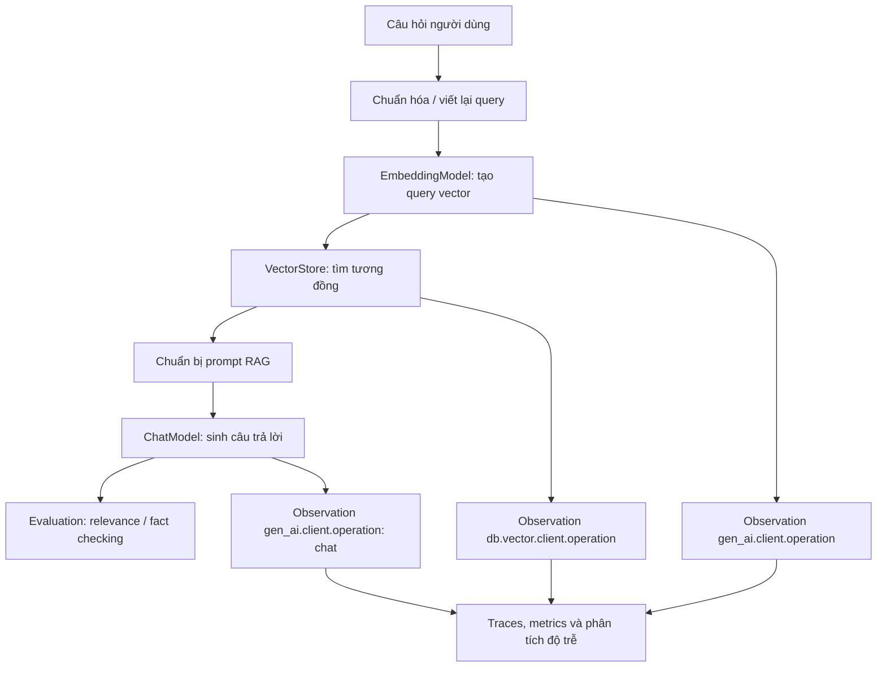
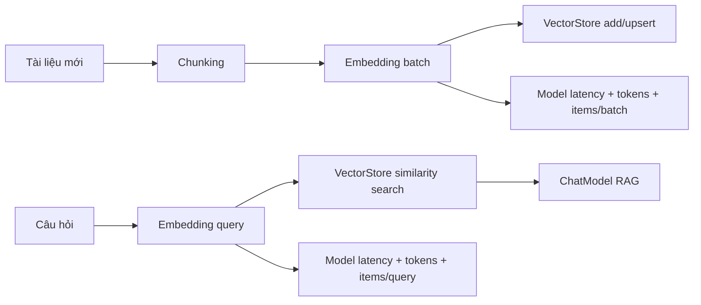
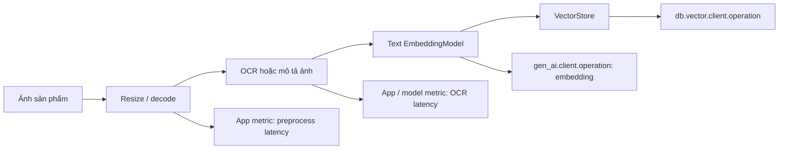

# Quan sát thời gian và mức sử dụng của EmbeddingModel

## 1. Vì sao cần quan sát embedding, không chỉ quan sát ChatModel?

Khi xây dựng ứng dụng RAG bằng Spring AI, chúng ta thường tập trung vào thời gian mô hình chat tạo câu trả lời. Tuy nhiên, trước khi trả lời, ứng dụng phải **biến văn bản thành vector** (embedding) để tìm tài liệu phù hợp. Tương tự, mỗi lần nạp tài liệu mới vào vector store, pipeline có thể tạo hàng trăm hoặc hàng nghìn vector.

Ví dụ một lần người dùng hỏi về chính sách hoàn tiền:

1. Ứng dụng nhận câu hỏi.
2. `EmbeddingModel` chuyển câu hỏi thành vector truy vấn.
3. Vector store tìm các đoạn tài liệu liên quan.
4. `ChatModel` tạo câu trả lời từ những đoạn đã tìm thấy.
5. Bộ đánh giá relevance hoặc fact checking đo mức độ phù hợp và bám nguồn.

Nếu tổng độ trễ tăng từ 900 ms lên 1.700 ms sau khi đổi embedding provider, chỉ nhìn thời gian của `ChatModel` sẽ không đủ để kết luận phần nào chậm. Cần biết **embedding mất bao lâu, mỗi lượt có bao nhiêu token, có bao nhiêu input trong batch, xảy ra bao nhiêu lỗi và chi phí ước tính thay đổi thế nào**.

Đây là nội dung của chương **Embedding và đa phương thức** trong module **SPRING_AI_EVALUATION_OBSERVABILITY**: đánh giá ứng dụng Spring AI bằng tập dữ liệu, relevance, fact checking và các luồng RAG/tool calling; đồng thời dùng metrics, traces, chi phí và độ trễ để phát hiện nguyên nhân suy giảm chất lượng qua từng phiên bản prompt, model và pipeline.

**Mục tiêu học tập:** sau bài này, bạn có thể phân biệt observation của `EmbeddingModel` với observation của `VectorStore`; đọc metric thời gian và token đúng cách; cấu hình Micrometer/Actuator; bổ sung đo lường ở tầng ứng dụng mà không ghi lộ nội dung; và thiết kế thí nghiệm so sánh các embedding model.

## 2. EmbeddingModel làm gì và phép đo đặt ở đâu?

Embedding là vector số biểu diễn ngữ nghĩa của dữ liệu. Trong Spring AI, `EmbeddingModel` cung cấp API tổng quát để biến **văn bản** thành vector. Các đường gọi thông dụng gồm:

| API | Đầu vào | Đầu ra | Khi nào dùng |
| --- | --- | --- | --- |
| `embed(String text)` | Một chuỗi văn bản | `float[]` | Một truy vấn hoặc một đoạn ngắn |
| `embed(Document document)` | Một `Document` | `float[]` | Nhúng nội dung tài liệu |
| `embed(List<String> texts)` | Nhiều chuỗi | `List<float[]>` | Batch embedding |
| `embedForResponse(List<String> texts)` | Nhiều chuỗi | `EmbeddingResponse` | Cần cả vector và metadata của response |
| `call(EmbeddingRequest request)` | Request và tùy chọn model | `EmbeddingResponse` | Sử dụng API chính của model |

Các phương thức tiện ích thường đi qua `call(EmbeddingRequest)`. Trong pipeline có nhiều lớp, cần tách **thời gian xử lý nghiệp vụ** với **thời gian của một lời gọi model**.



Một phép gọi `VectorStore.similaritySearch(...)` có thể kích hoạt cả embedding câu hỏi và truy vấn cơ sở dữ liệu, tùy implementation. Vì vậy:

- **Embedding latency**: thời gian thực hiện phép gọi embedding, theo observation của `EmbeddingModel`.
- **Vector search latency**: thời gian thao tác với vector store, có thể bao gồm phần công việc khác tùy lớp đo và cách implementation gọi model.
- **End-to-end RAG latency**: thời gian từ khi ứng dụng nhận request tới khi trả câu trả lời.

Không được cộng thời gian các span **lồng nhau** rồi mặc định đó là tổng thời gian người dùng chờ, vì các phép đo có thể bao hàm nhau hoặc chạy song song.

### Đa phương thức không đồng nghĩa mọi EmbeddingModel đều nhúng ảnh

Các mô hình embedding và provider có thể hỗ trợ văn bản, ảnh, âm thanh hoặc những dạng input khác nhau. Tuy nhiên, **giao diện `EmbeddingModel` thông dụng của Spring AI lấy văn bản làm trọng tâm**. Không nên suy từ cụm “embedding đa phương thức” rằng mọi implementation đều chấp nhận `Image` hoặc `Resource` làm input qua `embed(...)`.

Nếu một pipeline lấy ảnh → OCR → văn bản → text embedding, bạn cần đo riêng **OCR**, **embedding văn bản** và **vector store**. Nếu dùng một model embedding đa phương thức thật sự với API riêng của provider, phải kiểm tra loại input, đơn vị usage và cơ chế quan sát mà adapter đó hỗ trợ; không tự áp mọi metric token của text embedding cho ảnh/video.

## 3. Observation mặc định trong Spring AI

Spring AI tích hợp với **Micrometer Observation** để ghi metrics và tracing cho các thành phần được hỗ trợ, trong đó có `EmbeddingModel`.

Theo tài liệu Spring AI 2.1.0, hai nhóm tín hiệu quan trọng của embedding gồm:

| Observation / metric | Đo điều gì? | Cách sử dụng |
| --- | --- | --- |
| `gen_ai.client.operation` | Thời gian hoàn thành lời gọi model và ngữ cảnh tracing liên quan | Số lần gọi, tổng thời gian, trung bình, phần trăm vị, lỗi |
| `gen_ai.client.token.usage` | Số token **được provider báo cáo** cho lời gọi model | Theo dõi mức sử dụng token theo provider/model |

Tại thời điểm tài liệu 2.1.0 được công bố, phần observability của `EmbeddingModel` được ghi nhận hỗ trợ rõ cho **OpenAI, Ollama và Mistral AI**. Với các implementation hoặc provider khác, cần xác minh tài liệu và kiểm tra metric thực tế; **không mặc định mọi `EmbeddingModel` đều phát đủ dữ liệu**.

### Các thuộc tính cần hiểu

Spring AI phân biệt **low-cardinality** và **high-cardinality**:

| Thuộc tính | Loại trong tài liệu | Ý nghĩa |
| --- | --- | --- |
| `gen_ai.operation.name` | Low | Loại thao tác, với embedding thường là `embedding` |
| `gen_ai.system` | Low | Provider hoặc hệ thống được instrumentation nhận diện |
| `gen_ai.request.model` | Low | Tên model yêu cầu |
| `gen_ai.response.model` | Low | Tên model đã trả response, nếu được báo cáo |
| `gen_ai.request.embedding.dimensions` | High | Số chiều vector yêu cầu/trả về |
| `gen_ai.usage.input_tokens` | High | Token đầu vào theo dữ liệu usage |
| `gen_ai.usage.total_tokens` | High | Tổng token của lượt trao đổi, khi có |

**Low-cardinality** thường dùng làm tag metrics và span. **High-cardinality** được dùng ở trace thay vì thêm hàng loạt giá trị vào label của metric. Lý do: nếu gắn `userId`, nội dung truy vấn hoặc `documentId` làm metric tag, số lượng time series có thể bùng nổ.

Một số thuộc tính có thể không xuất hiện khi provider không trả giá trị. Cần kiểm tra **dữ liệu quan sát thực tế**, không suy rằng thiếu một trường là model đã sử dụng 0 token.

## 4. Từ observation tới metric Prometheus

Trong Prometheus, tên Micrometer có dấu chấm thường chuyển sang dấu gạch dưới và thêm hậu tố. Tài liệu metrics của nhánh Spring AI 2.1 liệt kê các series tiêu biểu:

| Metric Prometheus | Ý nghĩa |
| --- | --- |
| `gen_ai_client_operation_seconds_count` | Số lượt model call đã hoàn thành |
| `gen_ai_client_operation_seconds_sum` | Tổng số giây của những lượt đã hoàn thành |
| `gen_ai_client_operation_seconds_max` | Giá trị lớn nhất trong cửa sổ thời gian gần đây |
| `gen_ai_client_operation_active_seconds_count` | Số operation đang thực thi |
| `gen_ai_client_operation_active_seconds_sum` | Tổng thời gian đã chạy của các operation đang mở |
| `gen_ai_client_token_usage_total` | Counter số token được provider báo cáo |

**Chọn đúng operation bằng tag**:

```promql
gen_ai_client_operation_seconds_count{gen_ai_operation_name="embedding"}
```

Nếu chỉ nhìn toàn bộ `gen_ai_client_operation_seconds_count`, bạn có thể trộn thời gian embedding với chat model, image model hoặc các model khác.

Cũng cần phân biệt: metric `gen_ai.client.token.usage` khi xuất qua Prometheus là `gen_ai_client_token_usage_total`. Đây là **counter** tích lũy token theo report của provider, không phải một gauge “token còn lại”.

### Bộ đếm và trung bình theo một khoảng thời gian

Tốc độ gọi embedding trong 5 phút:

```promql
sum by (gen_ai_request_model) (
  rate(gen_ai_client_operation_seconds_count{
    gen_ai_operation_name="embedding"
  }[5m])
)
```

Độ trễ trung bình mỗi lời gọi embedding:

```promql
sum by (gen_ai_request_model) (
  rate(gen_ai_client_operation_seconds_sum{
    gen_ai_operation_name="embedding"
  }[5m])
)
/
sum by (gen_ai_request_model) (
  rate(gen_ai_client_operation_seconds_count{
    gen_ai_operation_name="embedding"
  }[5m])
)
```

Đơn vị của kết quả thứ hai là **giây trên một lời gọi**. Khi mẫu số bằng 0 (không có lời gọi trong cửa sổ) cần hiển thị “không có dữ liệu”, không diễn giải thành 0 ms.

Ví dụ: trong 5 phút có 200 lượt embedding, tổng thời gian của các lời gọi là 50 giây. Độ trễ trung bình = `50 / 200 = 0,25 giây/lượt`. Đây chỉ là trung bình theo model call, không phải độ trễ toàn bộ request RAG.

## 5. p95 latency cần histogram

Trung bình che khuất những request chậm nhất. Nếu 95% lượt embedding hoàn thành nhanh nhưng 5% còn lại chờ provider quá lâu, trải nghiệm người dùng và SLA vẫn có thể suy giảm.

Để tính phần trăm vị trong Prometheus, cần có **histogram bucket**. Tài liệu Spring AI 2.1.x hướng dẫn bật histogram cho timer:

```properties
management.metrics.distribution.percentiles-histogram.gen_ai.client.operation=true
```

Sau đó, ví dụ p95 embedding theo model:

```promql
histogram_quantile(
  0.95,
  sum by (le, gen_ai_request_model) (
    rate(gen_ai_client_operation_seconds_bucket{
      gen_ai_operation_name="embedding"
    }[5m])
  )
)
```

Nếu series `_bucket` không có, hãy kiểm tra cấu hình histogram, registry và việc model call đã phát observation. Không thể tính p95 đáng tin từ riêng `_sum` và `_count`.

Những điều cần chú ý:

- p95 là thời gian mà khoảng **95% lượt được quan sát** không vượt quá, trong cửa sổ và tập nhãn đang chọn.
- Histogram mang tính xấp xỉ theo bucket; chất lượng ước lượng phụ thuộc cấu hình bucket và lưu lượng.
- So p95 theo **cùng model, khối lượng, batch size, độ dài đầu vào**; đổi các yếu tố này đồng thời sẽ khó quy kết nguyên nhân.
- Phân phối latency ở giai đoạn **indexing theo batch** có thể khác nhiều với **query embedding một câu**. Nếu cần, ghi thêm một metric nghiệp vụ riêng có tag `workload=ingestion/query`, không đặt giá trị này vào metric mặc định khi chưa được xác thực.

## 6. Theo dõi token usage đúng cách

Text embedding thường tạo vector thay vì sinh câu trả lời dài. Vì thế, chi phí và mức sử dụng hay tập trung vào **token đầu vào**. Tuy nhiên, bộ đo chung của Spring AI có thể phân loại usage bằng `gen_ai_token_type` = `input`, `output` hoặc `total` tùy thông tin provider trả.

Một truy vấn Prometheus cho tổng token đầu vào mỗi phút:

```promql
sum by (gen_ai_request_model) (
  rate(gen_ai_client_token_usage_total{
    gen_ai_operation_name="embedding",
    gen_ai_token_type="input"
  }[5m])
) * 60
```

Có những trường hợp provider chỉ báo **total** mà không báo **input**. Khi đó series được lọc `input` có thể trống; hãy kiểm tra các token type thực sự hiện diện và hợp đồng của provider.

**Không cộng đúp:** nếu provider phát cả `input` và `total`, phép cộng tất cả token type sẽ tính cùng lượng token nhiều lần. Muốn tổng token, ưu tiên loại `total` **hoặc** cộng `input + output` theo ngữ nghĩa và mức độ đầy đủ của provider; không cộng cả ba nhãn.

### Usage bị thiếu không có nghĩa là miễn phí

Tài liệu metrics ghi rõ: **nếu provider không trả usage cho một lời gọi, bộ đếm token sẽ không tăng**. Vì vậy:

- `no data` khác với `0 tokens`;
- `0` quan sát được cũng không chứng minh hóa đơn provider bằng 0;
- token đếm bằng cách ước lượng offline không mặc nhiên bằng token được provider tính phí;
- usage của ảnh/âm thanh phụ thuộc cơ chế model, không phải cứ quy thành token text.

Khi cần kiểm soát chi phí, ưu tiên **usage/billing chính thức từ provider** để đối chiếu, ghi phương pháp tính và đánh dấu rõ các lượt không có số liệu.

## 7. Đọc usage trực tiếp từ EmbeddingResponse

Với Spring AI 2.1.x, `EmbeddingModel.embedForResponse(List<String>)` trả `EmbeddingResponse`, giúp lấy vector và metadata thay vì chỉ nhận `float[]`. `EmbeddingResponseMetadata` có `getModel()` và `getUsage()`.

Ví dụ Java sau minh họa việc thu **dữ liệu trả về** của một lời gọi embedding. `embeddingModel` được Spring Boot và provider tương ứng cấu hình sẵn.

```java
import java.util.List;

import org.springframework.ai.embedding.EmbeddingModel;
import org.springframework.ai.embedding.EmbeddingResponse;
import org.springframework.ai.embedding.EmbeddingResponseMetadata;
import org.springframework.ai.chat.metadata.Usage;

public final class EmbeddingUsageReader {

    private final EmbeddingModel embeddingModel;

    public EmbeddingUsageReader(EmbeddingModel embeddingModel) {
        this.embeddingModel = embeddingModel;
    }

    public void inspectBatch(List<String> inputs) {
        if (inputs == null || inputs.isEmpty()) {
            throw new IllegalArgumentException("Cần ít nhất một đoạn text");
        }

        EmbeddingResponse response =
                embeddingModel.embedForResponse(inputs);

        int resultCount = response.getResults().size();

        int vectorDimensions = response.getResults().isEmpty()
                ? 0
                : response.getResults().get(0).getOutput().length;

        EmbeddingResponseMetadata metadata = response.getMetadata();
        String model = metadata == null ? null : metadata.getModel();
        Usage usage = metadata == null ? null : metadata.getUsage();

        System.out.println("inputItems = " + inputs.size());
        System.out.println("embeddingResults = " + resultCount);
        System.out.println("dimensions = " + vectorDimensions);
        System.out.println("responseModel = " + model);

        if (usage != null) {
            System.out.println(
                    "reportedTotalTokens = " + usage.getTotalTokens());
        }
        else {
            System.out.println("reportedTotalTokens = UNKNOWN");
        }
    }
}
```

**Đọc đúng kết quả:**

- `inputItems` là số chuỗi **ứng dụng đưa vào batch**; không phải token.
- `embeddingResults` là số vector trả về; cần đối chiếu với số input và xử lý lỗi thiếu vector.
- `dimensions` là độ dài vector; không phải số token hoặc dấu hiệu vector “chất lượng 100%”.
- `reportedTotalTokens` đến từ metadata nếu provider hỗ trợ; không phải mô hình nào cũng cung cấp.
- Không ghi toàn bộ nội dung `inputs` hoặc vector vào log vận hành, vì có thể tiết lộ dữ liệu và tạo log rất lớn.

Nếu `Usage.getTotalTokens()` trả giá trị không có ý nghĩa trong một provider cụ thể, cần tra hợp đồng provider và đối chiếu hóa đơn; không gán giá trị 0 thành `UNKNOWN` một cách thiếu kiểm soát khi API thật sự báo 0.

### Tại sao không gọi `dimensions()` mỗi request?

Trong một số đường triển khai, truy vấn kích thước có thể liên quan đến việc gọi mô hình nhúng một chuỗi mẫu. Vì vậy, không nên giả định `dimensions()` hoàn toàn miễn phí hoặc không phát sinh latency. Nếu model có kích thước vector cố định, hãy ghi nhận và kiểm tra một lần trong quá trình khởi tạo/test cấu hình. Còn trong ví dụ trên, đọc chiều dài vector **đã trả về** không phát sinh model call bổ sung.

## 8. Cấu hình Actuator, registry và tracing

Trong ứng dụng Spring Boot, để quan sát được metrics của Spring AI, cần có hạ tầng Micrometer phù hợp. Những dependency phổ biến gồm:

- `spring-boot-starter-actuator` để cung cấp endpoint quản trị/metrics;
- `micrometer-registry-prometheus` khi muốn scrape Prometheus;
- một tracing bridge như `micrometer-tracing-bridge-otel` và exporter phù hợp khi muốn gửi trace tới backend observability.

Các dependency cụ thể và cách auto-configuration thay đổi giữa Spring Boot/Spring AI; phải kiểm tra đúng BOM và starter của dự án. Chỉ có `EmbeddingModel` trong code **không bảo đảm** Prometheus hoặc tracing backend đã được kết nối.

Một ví dụ cấu hình cho **môi trường phát triển nội bộ**:

```properties
management.endpoints.web.exposure.include=health,info,metrics,prometheus
management.metrics.distribution.percentiles-histogram.gen_ai.client.operation=true
management.tracing.sampling.probability=1.0
```

Sau khi gọi embedding thực sự, có thể kiểm tra (khi ứng dụng và endpoint đã cấu hình):

```text
GET /actuator/metrics
GET /actuator/metrics/gen_ai.client.operation
GET /actuator/prometheus
```

Không phải mọi endpoint mặc định đều được public. Chỉ bật những endpoint cần thiết và có cơ chế xác thực/mạng phù hợp. **Không dùng sampling 100% một cách mặc định ở production** nếu lưu lượng, chi phí lưu trữ hoặc chính sách bảo mật không cho phép.

### Quan hệ giữa metrics và traces

- **Metric** giúp thấy xu hướng: số request, trung bình, p95, token per minute, error rate.
- **Trace** giúp giải thích một request cụ thể: embedding nằm trước hay sau retrieval, model nào, span nào chậm, vector store có lỗi hay không.
- **Log có correlation ID** bổ sung ngữ cảnh chẩn đoán nhưng cần tránh lưu dữ liệu nhạy cảm.

Quan sát một trace RAG cho phép tách **embedding query** khỏi **vector DB query** và **chat generation**, miễn là các thành phần có instrumentation và context trace được truyền xuyên các boundary.

## 9. Gắn chỉ số nghiệp vụ bổ sung khi metric mặc định chưa đủ

Observation mặc định của `EmbeddingModel` trả lời câu hỏi model call dài bao lâu và provider báo usage bao nhiêu. Nó không nhất thiết cho biết:

- đây là embedding **query** hay embedding **tài liệu indexing**;
- batch có bao nhiêu văn bản, kích thước tổng theo ký tự hoặc số byte;
- bao nhiêu tài liệu bị chia thành chunk;
- mỗi tài liệu bị lỗi validation hay phải retry;
- số vector đã được lưu thành công vào vector store;
- cache hit/miss của tầng ứng dụng.

Có thể tạo metric nghiệp vụ riêng với **tag hữu hạn và có ý nghĩa ổn định**, ví dụ `stage=query/indexing`. Không gắn nguyên `documentId`, `queryText`, `userId` hoặc `traceId` làm tag Prometheus.

### Ví dụ Timer ở tầng ứng dụng

```java
import java.util.List;

import io.micrometer.core.instrument.MeterRegistry;
import io.micrometer.core.instrument.Timer;
import org.springframework.ai.embedding.EmbeddingModel;
import org.springframework.stereotype.Service;

@Service
public class ObservedEmbeddingService {

    private final EmbeddingModel embeddingModel;
    private final MeterRegistry registry;

    public ObservedEmbeddingService(
            EmbeddingModel embeddingModel,
            MeterRegistry registry) {
        this.embeddingModel = embeddingModel;
        this.registry = registry;
    }

    public List<float[]> embedForIndexing(List<String> chunks) {
        if (chunks == null || chunks.isEmpty()) {
            return List.of();
        }

        Timer.Sample sample = Timer.start(registry);
        String outcome = "success";

        try {
            return embeddingModel.embed(chunks);
        }
        catch (RuntimeException ex) {
            outcome = "error";
            throw ex;
        }
        finally {
            sample.stop(Timer.builder("app.embedding.batch.duration")
                    .description("Batch embedding at the application boundary")
                    .tag("stage", "indexing")
                    .tag("outcome", outcome)
                    .register(registry));
        }
    }
}
```

Đây là **metric bổ sung do ứng dụng tự định nghĩa**. Nó đo thời gian của lời gọi ở boundary service, vốn có thể gần trùng thời gian model call. Không cộng giá trị `app.embedding.batch.duration` vào `gen_ai.client.operation` để tính end-to-end latency, vì có thể đang đo hai lớp bao nhau.

Nếu muốn đo **input count** hoặc **batch-size distribution**, tạo riêng distribution summary hoặc metric theo nhóm batch-size được kiểm soát cardinality. Tránh dùng kích thước batch làm một nhãn riêng cho mọi số nguyên nếu có quá nhiều giá trị.

## 10. Tách hai loại workload: indexing và query embedding

Một pipeline RAG thường có **hai dòng embedding** khác nhau:

**Indexing / ingestion**

1. Nhận tài liệu mới.
2. Tách thành nhiều chunk.
3. Tạo embedding cho các chunk, thường theo batch.
4. Lưu vector và metadata vào vector store.

**Query**

1. Nhận câu hỏi.
2. Chuẩn hóa hoặc viết lại query.
3. Tạo một hoặc vài query embedding.
4. Tìm top-K tài liệu liên quan.
5. Đưa context cho ChatModel.



Tại sao cần phân nhóm?

| Đặc điểm | Indexing | Query |
| --- | --- | --- |
| Số lượng input | Nhiều chunk | Thường ít text |
| Batch size | Có thể lớn | Thường nhỏ |
| Chi phí | Tập trung lúc nạp/cập nhật tài liệu | Phát sinh theo request người dùng |
| SLA | Throughput và tổng thời gian job | Latency p95 của từng request |
| Lỗi đáng chú ý | Lỗi một phần batch, quota, retry, duplicate | Timeout tác động trực tiếp trải nghiệm |
| Ảnh hưởng chất lượng | Chất lượng vector trong index | Độ phù hợp truy xuất tức thời |

Nếu chỉ dùng metric model call gộp chung mà không ghi loại workload, một đợt indexing lớn có thể khiến biểu đồ token và latency tăng, dù độ trễ query của người dùng không đổi.

## 11. Ước tính chi phí một cách có kiểm soát

Không nên hardcode kết luận “một lần embedding có giá cố định”. Chi phí có thể phụ thuộc **provider, model, số token đầu vào, phương thức batch, phiên bản giá, hạ tầng self-hosted và cách tính phí theo loại dữ liệu**.

Một công thức minh họa cho provider tính theo triệu input token:

```text
estimatedCost =
    reportedInputTokens / 1,000,000
    × pricePerMillionInputTokens
```

Ví dụ **giả định hoàn toàn**: một đợt indexing dùng 500.000 input tokens và đơn giá của model trong bài toán giả định là 0,10 USD cho 1 triệu input tokens. Chi phí ước tính = `500.000 / 1.000.000 × 0,10 = 0,05 USD`. Đây **không phải báo giá của provider thực**.

Khi nhà cung cấp trả usage theo tổng token hoặc cách tính ảnh khác với text, cần chuyển đổi theo bảng giá cụ thể; không áp công thức text token một cách máy móc.

Một record chi phí nên có:

| Trường | Ý nghĩa |
| --- | --- |
| `provider` / `model` | Ai tính phí và model nào |
| `usageType` | `input_tokens`, `total_tokens` hoặc đơn vị provider khác |
| `usageValue` | Số lượng provider thực báo cáo |
| `priceVersion` | Bảng giá đang áp dụng |
| `estimatedCost` | Giá trị ước tính theo công thức |
| `billingReconciled` | Đã đối chiếu hóa đơn hay chưa |
| `status` | `KNOWN`, `ESTIMATED`, `UNAVAILABLE` |

Một request không có usage phải có `status=UNAVAILABLE` hoặc trạng thái tương tự; **không tự gán chi phí 0** để dashboard có vẻ đẹp hơn.

## 12. Chẩn đoán khi latency và usage tăng

Đặt câu hỏi “embedding có chậm hơn không?” chưa đủ; cần phân biệt **độ dài input**, **số lượng call**, **batch size**, **provider delay** và **thời gian vector store**.

| Dấu hiệu | Giả thuyết | Dữ liệu cần kiểm tra |
| --- | --- | --- |
| Token tăng, số call không đổi | Text/chunk dài hơn hoặc số input mỗi batch lớn hơn | Input length, items per batch, chunking version |
| Số call tăng, token/call gần như giữ nguyên | Retry, query expansion hoặc chia batch nhỏ hơn | Request trace, retry count, pipeline version |
| p95 model call tăng nhưng token không đổi | Provider/network bị chậm, quota hoặc tải tăng | Model/provider, lỗi, trạng thái hạ tầng, thời điểm |
| End-to-end retrieval chậm nhưng embedding ổn | Vector store query/index chậm | `db.vector.client.operation`, top-K, DB health |
| Embedding model đổi, độ dài vector khác | Dimension/model configuration khác | Model version, dimensions, collection schema |
| Token metrics trống | Provider không báo usage hoặc instrumentation thiếu | Response metadata, provider docs, registry |
| Chi phí tăng nhưng token gần như giữ nguyên | Model/bảng giá khác hoặc tính phí theo đơn vị khác | Price version, provider, billing |
| Query latency ổn nhưng job ingest chậm | Batch nhiều chunk hoặc DB write bottleneck | Index batch timings, add/upsert operations |

**Đặt kết quả vào cùng trace:** nếu `gen_ai.client.operation` cho embedding ổn định 80 ms nhưng `db.vector.client.operation` tăng từ 30 ms lên 400 ms, nên điều tra vector store trước. Ngược lại, nếu phần embedding tăng lớn mà thời gian DB giữ nguyên, cần kiểm tra provider, batch và model.

Chú ý: thời gian span của VectorStore có thể bao trùm cả thao tác phụ thuộc; phải xem **quan hệ parent–child** trước khi tính tổng hoặc xác định bottleneck.

## 13. Embedding đa phương thức: đo riêng từng bước

Dù tiêu đề chương nói về embedding và đa phương thức, không nên giả định một metric text embedding thể hiện toàn bộ thời gian xử lý ảnh hoặc tài liệu hỗn hợp.

Ví dụ pipeline ảnh sản phẩm:



Trong trường hợp này, `gen_ai.client.operation{embedding}` chỉ phản ánh embedding văn bản **sau OCR**, không bao gồm toàn bộ thời gian xử lý ảnh. Nếu hệ thống dùng model vector đa phương thức có API riêng, cần bổ sung observation theo provider hoặc app layer và kiểm tra:

- loại input (text, image, video...), số item và dung lượng;
- kích thước, số frame, độ phân giải hoặc các giới hạn khác của model;
- đơn vị usage/billing của provider;
- thời gian tiền xử lý, gọi model và lưu vector;
- vector cùng **không gian biểu diễn** hay khác nhau giữa các model;
- cách đo chất lượng truy xuất cross-modal bằng bộ test riêng.

Đừng so cosine similarity của vector từ hai embedding model khác nhau như thể chúng mặc nhiên thuộc cùng một embedding space. Khi thay đổi model hoặc kích thước vector, thường cần cân nhắc **re-embedding dữ liệu**, collection/schema mới và kiểm thử retrieval regression.

## 14. Một thử nghiệm so sánh embedding model công bằng

Giả sử muốn so sánh model A và model B cho một hệ thống RAG chính sách. Thiết kế thí nghiệm:

1. **Cố định dataset:** giữ cùng tập document, câu hỏi và nhãn tài liệu liên quan.
2. **Cố định chunking:** cùng cách tách đoạn và metadata, trừ khi mục tiêu là so sánh riêng thuật toán chunking.
3. **Dùng index tương thích từng model:** không tìm vector của model B trong index embedding do model A tạo.
4. **Giữ retrieval policy:** top-K, filter và cách rerank cố định khi đo ảnh hưởng của embedding.
5. **Ghi latency và usage:** p50/p95, số call, token báo cáo, batch size, chi phí.
6. **Đo chất lượng retrieval:** Recall@K, MRR, nDCG nếu có bộ nhãn chuẩn; fact checking hoặc relevance ở bước trả lời RAG.
7. **Tách performance theo workload:** indexing throughput và query p95.
8. **Ghi phiên bản:** provider, model, dimensions, deployment, price version, chunker và vector store.

Nếu model B nhanh hơn 30% nhưng Recall@5 giảm đáng kể, không nên chọn chỉ dựa vào latency. Mục tiêu cuối là cân bằng **chất lượng retrieval, độ trễ và chi phí**, không chỉ tối ưu một biểu đồ.

### Ví dụ bảng kết quả giả định

| Chỉ số | Model A | Model B |
| --- | ---: | ---: |
| Query embedding p95 | 120 ms | 75 ms |
| Input token báo cáo / 1.000 query | 52.000 | 53.000 |
| Recall@5 trên gold dataset | 0,91 | 0,83 |
| Embedding dimensions | 1.536 | 768 |
| Estimated embedding cost / 1.000 query | 0,020 USD | 0,012 USD |
| Lỗi API / 1.000 call | 2 | 3 |

**Tất cả giá trị trên đều giả định.** Chúng minh họa việc model B có thể giảm độ trễ và giá nhưng kém chất lượng retrieval hơn. Không thể xem kích thước vector lớn hơn luôn có chất lượng tốt hơn.

## 15. Kiểm thử cấu hình observability và kiểm tra thực tế

Khi kiểm tra trên môi trường có model/provider thật, có thể thực hiện quy trình:

1. **Chuẩn bị:** bật Actuator, Prometheus registry và tracing exporter phù hợp. Xác minh các endpoint chỉ truy cập trong vùng tin cậy.
2. **Tạo tải đã biết:** gọi embedding 10–20 chuỗi mẫu ngắn, rồi một batch nhiều chuỗi; không dùng dữ liệu nhạy cảm.
3. **Xem metric:** xác nhận series `gen_ai_client_operation_seconds_count` có tag `gen_ai_operation_name="embedding"` và tăng sau các lượt gọi.
4. **Xem usage:** kiểm tra `gen_ai_client_token_usage_total` theo token type; nếu vắng mặt, xem response metadata/provider support, không tự suy là không tốn token.
5. **Xem trace:** kiểm tra embedding span có tương quan với trace của request ingest hoặc RAG.
6. **Kiểm tra lỗi:** cố tình dùng test stub lỗi hoặc môi trường thử để xem error rate, không tác động endpoint production.
7. **So với app metrics:** đối chiếu items/batch và service duration để phát hiện trường hợp nhiều model call cho cùng một request.
8. **Báo cáo:** ghi model version, provider, dimensions, input pattern, concurrency, sample size, p50/p95 và trạng thái dữ liệu usage.

Một số test có thể chạy mà không gọi provider, như kiểm tra tên metric ứng dụng tự định nghĩa hoặc logic đo `Timer`. Nhưng để kết luận **embedding instrumentation và usage từ provider hoạt động**, phải thực hiện một lượt gọi thật hoặc dùng môi trường integration được cấu hình tương đương. Bài này không tuyên bố đã chạy những kiểm thử đó.

## 16. Những nhầm lẫn dễ dẫn đến dashboard sai

**Nhầm embedding latency với vector search latency.** Hai thao tác có thể nằm trong cùng một request hoặc được lồng nhau. Phải xem span và tag cụ thể.

**Không lọc `gen_ai_operation_name="embedding"`.** Như vậy các lời gọi chat có thể xuất hiện trong số liệu “embedding model”.

**Tính p95 từ tổng/thống kê trung bình.** Muốn có phần trăm vị từ Prometheus histogram phải bật bucket phù hợp.

**Cộng `input`, `output` và `total`.** Có thể đếm token hai lần. Chọn một cách tổng hợp nhất quán với dữ liệu provider.

**Coi token usage trống là 0.** Nhà cung cấp không báo usage không đồng nghĩa không có hóa đơn hoặc không có chi phí.

**Dùng embedding dimensions làm proxy chất lượng.** Vector nhiều chiều không bảo đảm truy xuất chính xác hơn trên tập dữ liệu của mình.

**Gắn query text hoặc userId vào metric tag.** Vừa làm tăng cardinality vừa rò rỉ dữ liệu; nên dùng trace ID cho correlation trong hệ thống bảo mật thích hợp, không dùng làm nhãn time series.

**Cộng thời gian các span lồng nhau.** Điều đó có thể cộng đúp thời gian, nhất là khi vector store tự gọi embedding hoặc pipeline có thao tác đồng thời.

**Cho rằng mọi EmbeddingModel hỗ trợ multimodal.** Cần kiểm tra API và provider cụ thể. Text embedding sau OCR không phải cùng loại với image embedding trực tiếp.

**Không ghi lại phiên bản.** Khi model, chunking hoặc embedding dimensions thay đổi, chỉ số latency và token nếu không có version sẽ rất khó so sánh công bằng.

## 17. Bài tập thực hành

1. **Đọc metric:** Prometheus ghi 400 lời gọi embedding với tổng thời gian 120 giây trong một khoảng. Tính latency trung bình mỗi lời gọi và giải thích tại sao đó không phải p95.
2. **Truy vấn PromQL:** viết biểu thức tính số lời gọi embedding mỗi giây theo `gen_ai_request_model`, không trộn chat operation.
3. **Token counting:** provider xuất `input=1.200` và `total=1.200` token cho một batch. Vì sao tổng usage không phải 2.400 token?
4. **Batching:** cách đo nào giúp biết 10 lượt batch mỗi lượt 50 chunk khác với 500 lượt embedding đơn lẻ? Nêu dữ liệu model call và app metric cần thu.
5. **Tracing RAG:** embedding query p95 giữ 90 ms, nhưng vector query tăng từ 50 ms lên 400 ms. Bạn sẽ điều tra thành phần nào trước và vì sao?
6. **Usage bị thiếu:** không thấy `gen_ai_client_token_usage_total` dù `gen_ai_client_operation_seconds_count` tăng. Nêu ít nhất ba khả năng và hướng xác minh.
7. **Chi phí:** với 800.000 input tokens và giá giả định 0,12 USD/1 triệu input tokens, tính chi phí ước tính. Những biến nào có thể khiến nó khác hóa đơn thực?
8. **Đa phương thức:** pipeline ảnh → OCR → text embedding → vector store có latency tăng. Hãy đề xuất spans/metrics để tìm giai đoạn chậm nhất.
9. **Regression:** sau thay embedding model, p95 giảm 40% nhưng Recall@5 cũng giảm 8 điểm phần trăm. Nêu những thước đo và tiêu chí cần xem trước khi release.
10. **Quản trị metrics:** vì sao không nên gắn `documentId` làm label của timer? Hãy đề xuất cách lưu correlation giữa một lỗi cụ thể và tài liệu gốc mà không làm metric cardinality tăng.

## Tài liệu tham khảo

- [Spring AI 2.1.0 – Observability](https://docs.spring.io/spring-ai/reference/observability/index.html): observations `EmbeddingModel`, `gen_ai.client.operation`, `gen_ai.client.token.usage` và các thuộc tính low/high cardinality.
- [Spring AI 2.1.x – Metrics Reference](https://docs.spring.io/spring-ai/reference/2.1-SNAPSHOT/observability/metrics.html): tên series Prometheus, timer, token counter, histogram và ví dụ PromQL; chú ý trang nhánh snapshot có thể thay đổi.
- [Spring AI 2.1.0 – Embeddings Model API](https://docs.spring.io/spring-ai/reference/api/embeddings.html): `EmbeddingModel`, `embedForResponse`, `EmbeddingRequest` và `EmbeddingResponse`.
- [Spring AI 2.1.x – EmbeddingResponseMetadata Javadoc](https://docs.spring.io/spring-ai/docs/2.1.x/api/org/springframework/ai/embedding/EmbeddingResponseMetadata.html): `getModel()` và `getUsage()`.
- [Spring AI – Vector Store API](https://docs.spring.io/spring-ai/reference/api/vectordbs.html): các thao tác vector store trong luồng indexing/retrieval.
- [Spring Boot – Production-ready Metrics](https://docs.spring.io/spring-boot/reference/actuator/metrics.html): Micrometer, Actuator và cấu hình distribution/histogram.
- [Spring Boot – Tracing](https://docs.spring.io/spring-boot/reference/actuator/tracing.html): cấu hình tracing và correlation.

> **Lưu ý phiên bản và phạm vi:** Ví dụ dùng cách gọi Spring AI 2.1.x và tên metric theo tài liệu Spring AI 2.1.x, cần đối chiếu đúng dependency/provider đang triển khai. Khả năng phát observation và usage phụ thuộc implementation/model; các con số hiệu năng, chi phí và bảng so sánh trong bài chỉ là **giả định học thuật**. Bài trình bày cách đo và kiểm tra, chưa báo cáo một lượt chạy benchmark thực tế.
