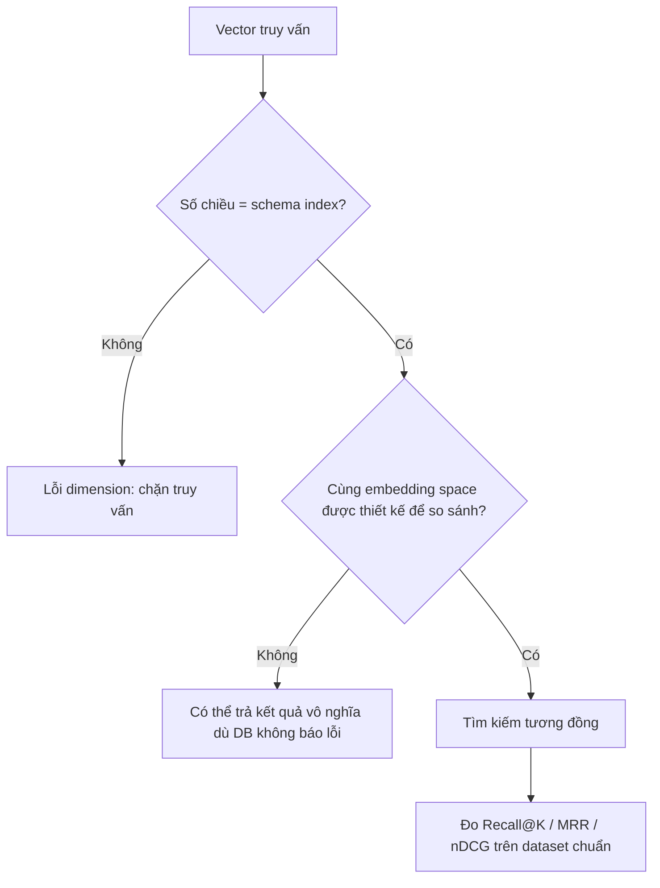
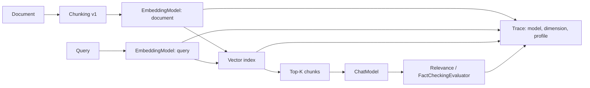
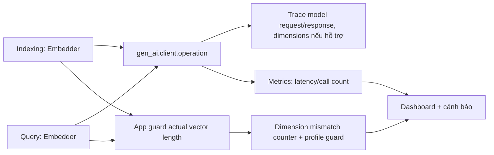
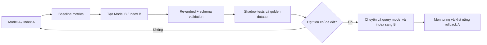

# Theo dõi kích thước vector và mô hình embedding

## 1. Khi vector có cùng kích thước nhưng tìm kiếm vẫn sai

Một hệ thống RAG sử dụng Spring AI lưu tài liệu chính sách dưới dạng embedding trong vector store. Sau một lần triển khai, đội phát triển đổi `EmbeddingModel` để giảm độ trễ. Ứng dụng vẫn chạy, không có lỗi kiểu dữ liệu và mỗi vector vẫn gồm 768 số. Nhưng tìm kiếm “điều kiện hoàn tiền Premium” lại trả những đoạn tài liệu không liên quan.

Điều gì đã xảy ra? Có thể các vector của tài liệu được tạo bằng **model A** trong khi vector câu hỏi đến từ **model B**. Dù cả hai đều dài 768 phần tử, chúng không nhất thiết ở cùng một *không gian biểu diễn* (*embedding space*). Cơ sở dữ liệu có thể tính khoảng cách hợp lệ về mặt số học nhưng kết quả không còn có ý nghĩa ngữ nghĩa.

Đây là lý do cần theo dõi **hai thông tin độc lập**:

1. **Kích thước vector (dimension/width):** mỗi embedding có bao nhiêu phần tử?
2. **Danh tính và cấu hình model embedding:** vector được tạo bởi model, phiên bản, tùy chọn và quy trình tiền xử lý nào?

Bài thuộc chương **Embedding và đa phương thức** của module **SPRING_AI_EVALUATION_OBSERVABILITY**. Module hướng đến đánh giá ứng dụng Spring AI bằng tập dữ liệu, relevance, fact checking, kiểm thử RAG và gọi công cụ; đồng thời đo metrics, traces, chi phí và độ trễ để phát hiện suy giảm chất lượng theo phiên bản prompt, model và pipeline.

**Kết quả cần đạt:** biết kiểm tra vector thực tế, đối chiếu schema index, ghi đúng thông tin model, phát hiện thay đổi nguy hiểm khi triển khai và đo xem thay đổi embedding ảnh hưởng thế nào đến retrieval và chất lượng câu trả lời.

## 2. Kích thước vector là gì?

Embedding thường được biểu diễn bằng mảng số thực:

```text
embedding = [0.14, -0.02, 0.35, 0.11]
dimension = 4
```

Với `float[]` trong Java, kích thước được đọc bằng `vector.length`. Trong thực tế, một model có thể trả hàng trăm hoặc hàng nghìn phần tử. **Mỗi phần tử không phải một từ hoặc một nhãn mà con người có thể trực tiếp giải thích.**

| Thuật ngữ | Ý nghĩa | Không có nghĩa là |
| --- | --- | --- |
| `dimension` | Số phần tử trong một vector | Số token đầu vào |
| `embedding model` | Model ánh xạ dữ liệu thành vector | Một thuật toán tìm kiếm có sẵn |
| `embedding space` | Hệ tọa độ ngữ nghĩa do model và cấu hình xác định | Không gian dùng chung cho mọi model cùng dimension |
| `distance metric` | Quy tắc tính độ gần, ví dụ cosine hoặc Euclidean | Một thước đo chất lượng độc lập với dữ liệu |
| `vector store schema` | Định dạng/kích thước cột hoặc index lưu vector | Bảo đảm kết quả retrieval luôn liên quan |
| `model profile` | Bộ thông tin xác định model, phiên bản và lựa chọn biểu diễn | Chỉ một tên model chung chung |

Ví dụ 768 và 1.024 là hai kích thước khác nhau. Đa số vector store cần biết hoặc có thể suy ra chiều vector để lưu và tìm kiếm. Một index được tạo cho 1.024 chiều **không tự chuyển đổi** vector 768 chiều thành hợp lệ.

**Dimension lớn hơn không đồng nghĩa chất lượng cao hơn.** Chất lượng phụ thuộc model, dữ liệu huấn luyện, miền sử dụng, preprocessing, vector store, metric khoảng cách và bộ test retrieval. Model 768 chiều có thể đạt Recall@5 tốt hơn một model 1.536 chiều trên một tập câu hỏi chuyên ngành.

## 3. Hai điều kiện tương thích phải cùng đúng

Kiểm tra đơn giản `queryVector.length == storedVector.length` chỉ bảo vệ **kích thước**. Muốn so sánh ngữ nghĩa, cần thêm điều kiện **cùng không gian embedding** hoặc một phép ánh xạ được mô hình hỗ trợ.



| Tình huống | Dimension | Không gian ngữ nghĩa | Kết quả kỳ vọng |
| --- | --- | --- | --- |
| Model A tạo vector tài liệu và query với cấu hình phù hợp | Cùng | Tương thích | Có thể tìm kiếm; vẫn phải benchmark |
| A tạo tài liệu 768 chiều, B tạo query 1.024 chiều | Khác | Không xác định | Thường bị chặn ở schema/query |
| A và B đều 768 chiều nhưng khác họ model | Cùng | Không có bảo đảm | **Rủi ro âm thầm**: tìm kiếm trả kết quả nhưng relevance thấp |
| A được cập nhật phiên bản nhưng giữ 768 chiều | Cùng | Có thể đổi | Cần kiểm tra tương thích/đánh giá lại |
| Model đa phương thức nhúng ảnh và văn bản vào một space chung được hỗ trợ | Cùng theo thiết kế | Có thể tương thích | Có thể search ảnh bằng text nếu đúng cấu hình |

Với model hỗ trợ các chế độ riêng như `search_document` và `search_query`, hai đường nhúng có thể dùng **cấu hình khác nhau nhưng được thiết kế để so sánh với nhau**. Không suy rằng bắt buộc mọi tham số trên hai đường phải giống hệt; điều cần đảm bảo là **cặp chế độ đó được provider khuyến nghị là tương thích**.

### Ba giá trị cần lưu ở cả indexing và query

- **Dimension**: số chiều thực tế của vector đã sinh.
- **Model identity**: provider, tên/deployment model, phiên bản hoặc snapshot nếu có.
- **Profile xử lý**: tùy chọn dimensions, modality, task type, preprocessing/chunking, normalization và phiên bản của adapter.

Tên model chỉ là một phần của danh tính. Một deployment alias có thể được đổi sang model mới mà tên alias không đổi. Khi cần kiểm toán, lưu mã phiên bản triển khai và thay đổi cấu hình bên cạnh tên do provider trả về.

## 4. Vị trí đo trong pipeline RAG

Một ứng dụng có hai luồng tạo vector chính:

**Indexing:** tài liệu → chunking → embedding tài liệu → lưu vector và metadata vào index.

**Query:** câu hỏi → embedding truy vấn → vector search → lấy context → mô hình sinh câu trả lời.



Cần ghi tối thiểu tại ba điểm:

| Điểm | Điều cần ghi | Loại lỗi có thể phát hiện |
| --- | --- | --- |
| Sau khi tạo embedding tài liệu | Actual dimension, model profile, số document/chunk, lỗi vector | Model trả kích thước bất ngờ, lỗi input |
| Trước khi upsert vào vector store | Expected index dimension, tên collection, profile của index | Index cũ không tương thích |
| Trước khi similarity search | Query dimension, query profile, profile của index đang đọc | Query dùng sai model hoặc sai namespace |

Nếu chỉ đo khi tạo vector nhưng không lưu version của index, sau vài tháng sẽ không biết index đang chứa vector từ model nào. Ngược lại, nếu chỉ đo dimension của index mà không ghi model sinh, hai model khác nhau nhưng cùng số chiều có thể bị trộn.

## 5. Spring AI EmbeddingModel cung cấp dữ liệu nào?

Spring AI 2.1.x có giao diện `org.springframework.ai.embedding.EmbeddingModel` với các API quen thuộc:

```java
float[] vector = embeddingModel.embed("Điều kiện hoàn tiền Premium");
int actualDimensions = vector.length;

EmbeddingResponse response = embeddingModel.embedForResponse(
    List.of("Cách tính phí dịch vụ", "Chính sách hoàn tiền"));
```

| API | Giá trị nhận được | Mục đích quan sát |
| --- | --- | --- |
| `embed(String)` | `float[]` | Biết chính xác `vector.length` của lượt gọi |
| `embed(List<String>)` | `List<float[]>` | Xác minh mọi vector trong batch cùng dimension |
| `embedForResponse(List<String>)` | `EmbeddingResponse` | Nhận vector cùng metadata của response |
| `EmbeddingResponse.getResults()` | Danh sách `Embedding` | Xem output vector và số item |
| `Embedding.getOutput()` | `float[]` | Đọc dimension thực tế |
| `EmbeddingResponseMetadata.getModel()` | Tên model phản hồi, nếu có | Ghi nhận model provider báo cáo |
| `EmbeddingResponseMetadata.getUsage()` | Usage nếu provider có | Theo dõi token/chi phí, không phải dimension |
| `EmbeddingModel.dimensions()` | Số chiều mà implementation báo cáo | Tra cấu hình, **có thể phát sinh lời gọi model** |

**Lưu ý về `dimensions()`:** Javadoc cho biết implementation mặc định có thể nhúng một chuỗi thử nghiệm để lấy chiều vector. Vì thế không gọi `dimensions()` lặp lại trong mỗi request chỉ để kiểm tra shape; có thể phát sinh network latency, chi phí hoặc lỗi nếu provider không sẵn sàng. Khi đã có output, dùng `vector.length` để đo trực tiếp.

`EmbeddingResponseMetadata.getModel()` có thể thiếu hoặc chỉ mang tên alias. Một response không có model name **không có nghĩa nó cùng model đã cấu hình**; ứng dụng cần tự lưu profile/deployment version được gán khi tạo index và khi gọi query.

## 6. Java: kiểm tra dimension và tính hợp lệ của vector

Trước khi lưu hoặc đưa vector vào search, nên chặn vector rỗng, sai chiều, chứa `NaN` hoặc vô cực. Kiểm tra này xác định và không cần một judge model.

```java
public final class EmbeddingShapeGuard {

    private EmbeddingShapeGuard() {
    }

    public static void requireValid(
            float[] vector,
            int expectedDimensions) {

        if (expectedDimensions <= 0) {
            throw new IllegalArgumentException(
                    "expectedDimensions phải dương");
        }
        if (vector == null || vector.length != expectedDimensions) {
            int actual = vector == null ? -1 : vector.length;
            throw new IllegalArgumentException(
                    "Vector dimension mismatch: expected="
                    + expectedDimensions + ", actual=" + actual);
        }

        for (float value : vector) {
            if (!Float.isFinite(value)) {
                throw new IllegalArgumentException(
                        "Vector có NaN hoặc Infinity");
            }
        }
    }
}
```

Sử dụng:

```java
float[] queryVector =
        embeddingModel.embed("Điều kiện hoàn tiền Premium");

EmbeddingShapeGuard.requireValid(queryVector, 1024);

// Vượt kiểm tra này mới chứng minh vector có 1024 giá trị hữu hạn.
// Chưa chứng minh vector cùng space với index hoặc phù hợp về ngữ nghĩa.
```

Đây là **bộ kiểm tra ở tầng ứng dụng**, không phải API có sẵn của Spring AI. Với cách ghi vector tự cung cấp qua `EmbeddedDocument` trong Spring AI 2.1, bản thân record đó cũng kiểm tra vector rỗng hoặc giá trị không hữu hạn, và vector store có thể kiểm tra index width khi xác định được. Tuy nhiên, lớp kiểm tra riêng giúp cung cấp thông báo lỗi rõ ràng **trước bước ghi DB** và hỗ trợ các đường pipeline khác nhau.

### Không chỉ kiểm tra vector đầu tiên của batch

Một batch trả về bốn vector mà ba vector dài 1.024, một vector dài 768 là lỗi hợp đồng; không nên chỉ đo `results.get(0).length` rồi xem cả batch hợp lệ.

```java
import java.util.List;

public final class BatchEmbeddingGuard {

    public static void requireValidBatch(
            List<float[]> vectors,
            int expectedCount,
            int expectedDimensions) {

        if (vectors == null || vectors.size() != expectedCount) {
            throw new IllegalArgumentException(
                    "Sai số lượng vector trả về");
        }

        for (int i = 0; i < vectors.size(); i++) {
            try {
                EmbeddingShapeGuard.requireValid(
                        vectors.get(i), expectedDimensions);
            }
            catch (IllegalArgumentException ex) {
                throw new IllegalArgumentException(
                        "Vector lỗi tại index " + i, ex);
            }
        }
    }
}
```

**Thứ tự vector** cũng quan trọng: cần kiểm tra hợp đồng provider để ghép chính xác output với document gốc. Cùng số lượng và kích thước chưa đảm bảo vector của tài liệu A không bị gán nhầm cho tài liệu B.

## 7. Java: đọc profile từ một lượt embedding thật

Ví dụ sau sử dụng `EmbeddingResponse` để quan sát số chiều thực tế và tên model response. `EmbeddingModel` đã được cấu hình trước qua Spring Boot/provider.

```java
import java.util.List;

import org.springframework.ai.embedding.EmbeddingModel;
import org.springframework.ai.embedding.EmbeddingResponse;
import org.springframework.ai.embedding.EmbeddingResponseMetadata;

public final class EmbeddingProbe {

    private final EmbeddingModel model;

    public EmbeddingProbe(EmbeddingModel model) {
        this.model = model;
    }

    public EmbeddingProbeResult inspect(
            List<String> texts, int expectedDimensions) {

        if (texts == null || texts.isEmpty()) {
            throw new IllegalArgumentException(
                    "Danh sách text không được rỗng");
        }

        EmbeddingResponse response = model.embedForResponse(texts);
        var results = response.getResults();

        if (results == null || results.size() != texts.size()) {
            throw new IllegalStateException(
                    "Số embedding output khác số input");
        }

        for (var item : results) {
            EmbeddingShapeGuard.requireValid(
                    item.getOutput(), expectedDimensions);
        }

        EmbeddingResponseMetadata metadata = response.getMetadata();

        String reportedModel =
                metadata == null ? null : metadata.getModel();

        Integer reportedTokens =
                metadata == null || metadata.getUsage() == null
                ? null : metadata.getUsage().getTotalTokens();

        return new EmbeddingProbeResult(
                texts.size(), expectedDimensions,
                reportedModel, reportedTokens);
    }

    public record EmbeddingProbeResult(
            int inputItems,
            int actualDimensions,
            String responseModel,
            Integer reportedTotalTokens) {
    }
}
```

**Ý nghĩa các trường:**

- `actualDimensions` ở record là giá trị đã được xác minh khi **mọi output vector đều có đúng expectedDimensions**; code sẽ ném lỗi nếu có vector khác.
- `responseModel` là tên model mà provider/trình tích hợp báo cáo; có thể `null`, không luôn là snapshot hay phiên bản bất biến.
- `reportedTotalTokens` là usage nếu có. Không được dùng token count thay cho vector dimension.
- Số input bằng số output là điều kiện cần; cần thêm kiểm tra mapping item–document nếu provider có index của từng embedding.

Đây là code minh họa chưa biên dịch/chạy với một provider cụ thể. Tính sẵn có của metadata và quy ước model alias cần được kiểm thử trong môi trường thực tế.

## 8. Theo dõi model identity như một hợp đồng dữ liệu

Một vector nên được gắn với **profile** tại thời điểm tạo. Đề xuất schema:

```json
{
  "profileId": "emb-text-v3-1024",
  "provider": "provider-A",
  "requestedModel": "embedding-model-v3",
  "deploymentVersion": "deploy-2026-11-15",
  "actualDimensions": 1024,
  "inputModality": "text",
  "taskProfile": "retrieval-document",
  "preprocessingVersion": "chunker-v2",
  "normalization": "provider-default",
  "createdAt": "2026-11-27T13:00:00+07:00",
  "vectorCollection": "policy_vectors_v3"
}
```

Các trường trên là **thiết kế tự đề xuất của ứng dụng**, không phải dữ liệu Spring AI tự động ghi vào vector store.

Thông tin nào nên là bất biến?

| Thuộc tính | Vì sao quan trọng? |
| --- | --- |
| Model/provider và snapshot/deployment version | Cùng tên alias có thể trỏ sang mô hình khác |
| Output dimensions | Phải phù hợp với index schema |
| Input modality | Vector ảnh không mặc nhiên so sánh được với text |
| Task profile | Model có thể dùng chế độ khác nhau cho document và query |
| Preprocessing/chunking | Chuỗi thực tế được nhúng có thể thay đổi dù model không đổi |
| Normalization/distance metric | Ảnh hưởng phép tính similarity và cách so score |
| Index/namespace version | Tránh lẫn vector của hai pipeline trong một collection |

**Không thể xác minh embedding space chỉ từ một cái tên**. Một “profile ID” có ý nghĩa khi được quản lý bằng quy tắc cấu hình và triển khai: cùng ID phải ứng với cùng cách tạo vector hoặc một sự tương thích đã được kiểm chứng. Khi model thực sự thay đổi, tạo version/profile mới và đánh giá lại.

### Gắn profile vào metadata của Document

Khi dùng document để nạp vào index, có thể lưu metadata:

```java
import java.util.Map;

import org.springframework.ai.document.Document;

Document doc = new Document(
    "Premium có thể yêu cầu hoàn tiền trong 7 ngày.",
    Map.of(
        "sourceVersion", "refund-v3",
        "embeddingProfile", "emb-text-v3-1024",
        "embeddingModel", "embedding-model-v3",
        "embeddingDimensions", 1024
    )
);
```

Đây là metadata do ứng dụng cung cấp. Khi vector store hỗ trợ lưu metadata, các trường này giúp truy nguyên nguồn và kế hoạch reindex; **không chứng minh** dữ liệu thực sự đã được nhúng bởi model đó. Muốn kiểm toán, ingestion job phải gắn profile từ **cấu hình thực đang chạy** và chặn trường hợp profile không tương thích.

## 9. Cấu hình dimension nhất quán với PGvector

Một ví dụ Spring Boot dùng OpenAI-compatible embedding model và PGvector, với dimension **1.024**:

```yaml
spring:
  ai:
    model:
      embedding: openai
    openai:
      embedding:
        model: text-embedding-3-small
        dimensions: 1024
    vectorstore:
      pgvector:
        dimensions: 1024
        initialize-schema: false
```

Trong Spring AI 2.1.0, `spring.ai.openai.embedding.dimensions` cho phép yêu cầu số chiều đầu ra **với các model thuộc họ text-embedding-3 hoặc mới hơn có hỗ trợ tùy chọn đó**. Không dùng option này với model không cho đổi số chiều và mặc định rằng provider sẽ tự chấp nhận.

`spring.ai.vectorstore.pgvector.dimensions` định nghĩa **kích thước tương thích của index/table**, không điều khiển model sinh vector. Hai cấu hình phải được đối chiếu, và cần kiểm tra **actualDimensions** từ output thật.

### Khi table đã tồn tại thì sao?

Nếu PGvector đã tạo cột:

```sql
CREATE TABLE vector_store (
    id uuid PRIMARY KEY,
    content text,
    metadata json,
    embedding vector(1024)
);
```

Cột trên được định nghĩa cho vector 1.024 chiều. Nếu chỉ đổi cấu hình model sang 768 chiều hoặc đổi thuộc tính `dimensions` trong application mà không thay schema, **table hiện có không tự đổi theo**. Các thao tác insert/search có thể thất bại do mismatch.

**Không bật tùy tiện tính năng xóa table để sửa nhanh dimension.** Table vector store có thể đang chứa toàn bộ embedding và metadata. Phương án an toàn là thiết kế **index/collection/table mới**, re-embed dữ liệu, kiểm thử và chuyển traffic có kiểm soát.

Với PGvector, cách dùng HNSW/IVFFlat và giới hạn chiều còn phụ thuộc phiên bản extension. Tài liệu Spring AI PGvector khuyến cáo kiểm tra cấu hình index phù hợp khi thay số chiều; không nên suy rằng một kích thước bất kỳ luôn hợp lệ với mọi phương án indexing.

## 10. Vấn đề nguy hiểm hơn: cùng dimension nhưng khác model

Giả sử:

- `model-A` tạo vector tài liệu: 768 chiều;
- `model-B` tạo vector truy vấn: 768 chiều;
- PGvector index lưu và tìm kiếm đều chấp nhận 768 chiều.

Cơ sở dữ liệu **không có cách chung** để biết hai vector đến từ những embedding space không tương thích. Nó chỉ thực hiện toán học trên các mảng số. Kết quả gần đúng về khoảng cách có thể trông bình thường nhưng lựa chọn top-K sai.

```text
Schema check:
    768 == 768           -> PASS

Embedding-space check:
    model-A vs model-B   -> UNKNOWN / INCOMPATIBLE
                            trừ khi nhà cung cấp xác nhận tương thích

Retrieval quality:
    Recall@5 giảm       -> phát hiện bằng bộ test có nhãn chuẩn
```

Đây là lỗi có thể **không ném exception**, nên không thể chỉ dựa vào log lỗi, số chiều hoặc metric latency. Cần có một lớp kiểm tra **profile**, và kiểm thử chất lượng retrieval sau các lần nâng cấp model.

### Quy tắc với truy vấn văn bản trong VectorStore

Trong Spring AI, `similaritySearch(SearchRequest)` với query dạng text thường dùng `EmbeddingModel` được cấu hình cho store để nhúng query. Nếu index chứa vector từ model khác, query có thể không còn tương thích.

Trong nhánh 2.1.x, một số vector store có hỗ trợ `similaritySearch(float[], SearchRequest)` để ứng dụng cung cấp **query vector đã tự tính**, và `upsert(List<EmbeddedDocument>)` để cung cấp **vector lúc ghi**. Những API này là **opt-in tùy implementation**, không nên coi mọi store đều hỗ trợ. Chúng giúp kiểm soát đường nhúng nhưng **không tự phát hiện sai embedding space**.

### Ví dụ upsert vector đã được kiểm tra

```java
import java.util.List;
import java.util.Map;

import org.springframework.ai.document.Document;
import org.springframework.ai.embedding.EmbeddingModel;
import org.springframework.ai.vectorstore.EmbeddedDocument;
import org.springframework.ai.vectorstore.VectorStore;

public final class GuardedVectorWriter {

    private final EmbeddingModel model;
    private final VectorStore store;

    public GuardedVectorWriter(EmbeddingModel model, VectorStore store) {
        this.model = model;
        this.store = store;
    }

    public void write(String text) {
        float[] vector = model.embed(text);
        EmbeddingShapeGuard.requireValid(vector, 1024);

        Document document = new Document(text, Map.of(
                "embeddingProfile", "emb-text-v3-1024",
                "embeddingDimensions", 1024));

        // Chỉ dùng với store thực sự hỗ trợ upsert trong Spring AI 2.1.x.
        store.upsert(List.of(new EmbeddedDocument(document, vector)));
    }
}
```

Trong production, cần ID ổn định cho document, retry an toàn, kiểm soát transactional semantics và xác thực profile của **index đích** trước khi upsert. Ví dụ cố tình ngắn để cho thấy thứ tự **embed → verify → ghi**. Nếu `upsert` chưa được hỗ trợ, implementation có thể ném `UnsupportedOperationException`; lúc đó phải dùng đường API phù hợp với store hoặc kiểm thử `add(List<Document>)` cùng cấu hình model tương ứng.

## 11. Observability: Spring AI đã cung cấp gì?

Spring AI sử dụng Micrometer Observation để theo dõi `EmbeddingModel` và các thành phần khác. Trong tài liệu Spring AI 2.1.0, `gen_ai.client.operation` được tạo cho các lời gọi embedding của những provider được hỗ trợ, cùng các thuộc tính như:

| Key | Vai trò | Cardinality theo tài liệu |
| --- | --- | --- |
| `gen_ai.operation.name` | Loại operation (embedding) | Low |
| `gen_ai.system` | Hệ thống/provider | Low |
| `gen_ai.request.model` | Model được yêu cầu | Low |
| `gen_ai.response.model` | Model trả response nếu có | Low |
| `gen_ai.request.embedding.dimensions` | Kích thước embedding được yêu cầu/ghi nhận | **High** (trace) |

Observation hiện được tài liệu mô tả hỗ trợ cho một số provider như OpenAI, Ollama, Mistral AI; với các provider khác cần kiểm tra instrumentation thực tế.

**Điểm cần nhớ:** `gen_ai.request.embedding.dimensions` là **thuộc tính observability**. Không giả định nó chắc chắn có mặt trong mọi trace, hoặc chính là actual width của **mọi vector** trong batch. Để bảo đảm index không nhận vector sai, vẫn cần kiểm tra `float[].length` và schema thực tế.



### Đọc số lần embedding theo model

Một ví dụ PromQL khi xuất metric sang Prometheus:

```promql
sum by (gen_ai_request_model) (
  rate(gen_ai_client_operation_seconds_count{
    gen_ai_operation_name="embedding"
  }[5m])
)
```

Truy vấn trên đếm **tốc độ gọi embedding theo model request**, không hiển thị dimension thực tế của vector. Tên tag cụ thể phụ thuộc exporter/phiên bản; cần kiểm tra `/actuator/prometheus` trong ứng dụng trước khi dùng biểu thức vào dashboard.

Nếu cần cảnh báo sai chiều, tạo **custom counter** ở tầng ứng dụng khi guard phát hiện mismatch. Tránh thêm `documentId`, text truy vấn, trace ID hoặc dimension tùy ý làm label metrics vì dễ tăng cardinality và rò rỉ dữ liệu. Thông số chi tiết nên lưu trong trace/log bảo mật có correlation ID.

## 12. Ví dụ Java: báo metric khi vector sai chiều

Đoạn code sau cho phép đếm lỗi bằng Micrometer mà không đưa giá trị kích thước thực tế vào label:

```java
import io.micrometer.core.instrument.MeterRegistry;

public final class ObservedShapeGuard {

    private final MeterRegistry registry;
    private final int expected;

    public ObservedShapeGuard(
            MeterRegistry registry, int expected) {
        this.registry = registry;
        this.expected = expected;
    }

    public void verifyQuery(float[] vector) {
        try {
            EmbeddingShapeGuard.requireValid(vector, expected);
        }
        catch (IllegalArgumentException ex) {
            registry.counter(
                    "app.embedding.dimension.mismatch",
                    "stage", "query")
                .increment();
            throw ex;
        }
    }
}
```

Tên `app.embedding.dimension.mismatch` là metric **tự định nghĩa**, không phải metric mặc định Spring AI. Tag `stage=query` có tập giá trị nhỏ, ổn định; muốn đo indexing thì có thể thêm một method ghi `stage=indexing`.

Một log có kiểm soát tương ứng:

```json
{
  "traceId": "rag-emb-208",
  "event": "EMBEDDING_DIMENSION_MISMATCH",
  "stage": "query",
  "expectedDimensions": 1024,
  "actualDimensions": 768,
  "expectedProfile": "emb-text-v3-1024",
  "configuredModel": "model-B",
  "vectorCollection": "policy_vectors_v3"
}
```

Đây là schema log minh họa. Không ghi nguyên vector hoặc text của người dùng, và không đưa các thuộc tính có cardinality cao thành metric tags. Tại nhiều hệ thống, dữ liệu vector có thể tiết lộ thông tin nhạy cảm nên không được coi là “không cần bảo vệ” chỉ vì nó không phải văn bản dễ đọc.

## 13. Kiểm thử hợp đồng embedding trước khi triển khai

Một kiểm thử đơn vị không cần gọi provider có thể xác minh logic guard:

```java
import static org.junit.jupiter.api.Assertions.*;

import org.junit.jupiter.api.Test;

class EmbeddingShapeGuardTest {

    @Test
    void rejectsWrongDimension() {
        float[] vector = {0.1f, 0.2f, 0.3f};

        assertThrows(
                IllegalArgumentException.class,
                () -> EmbeddingShapeGuard.requireValid(vector, 4));
    }

    @Test
    void rejectsNonFiniteValue() {
        float[] vector = {0.1f, Float.NaN, 0.3f};

        assertThrows(
                IllegalArgumentException.class,
                () -> EmbeddingShapeGuard.requireValid(vector, 3));
    }

    @Test
    void acceptsFiniteVectorWithExpectedWidth() {
        float[] vector = {0.1f, 0.2f, 0.3f};

        assertDoesNotThrow(
                () -> EmbeddingShapeGuard.requireValid(vector, 3));
    }
}
```

**Đây chỉ là test shape.** Nó không chứng minh chất lượng embedding, cùng không gian vector, provider availability hoặc khả năng truy xuất. Kiểm thử tích hợp cần thêm một lượt embedding **thực** với model/deployment đã cấu hình, xác minh response metadata và actual vector width; sau đó kiểm tra index schema.

Một test tích hợp hợp lý nên thất bại sớm khi:

- provider trả kích thước khác số đã công bố;
- `responseModel` đột ngột đổi (nếu provider có cam kết ID ổn định);
- query profile không khớp index profile;
- schema index đang là 1.536 trong khi model mới trả 1.024;
- batch có vector null, rỗng hoặc không hữu hạn.

Nếu provider chỉ trả alias, không nên assert bằng cách so tên raw cứng nhắc rồi gây false alarm; hãy dùng version được hệ thống quản lý và phép kiểm tra phù hợp với hợp đồng provider.

## 14. Kế hoạch đổi embedding model an toàn

Ví dụ cần nâng từ model A (768 chiều) sang model B (1.024 chiều). Không đổi một dòng cấu hình rồi để toàn bộ RAG dùng ngay index cũ. Thực hiện theo giai đoạn:

1. **Chụp trạng thái hiện tại:** lưu model/provider/version, dimensions, preprocessing, index schema, metric distance và kết quả benchmark trên tập truy vấn chuẩn.
2. **Tạo profile B:** xác minh model B trả 1.024 chiều và cấu hình model có hiệu lực; lưu profile dưới version mới.
3. **Tạo index/collection B:** dùng schema 1.024 chiều, tách biệt index A; không xóa index cũ.
4. **Re-embedding:** chạy lại toàn bộ tài liệu nguồn theo model B và đúng pipeline chunking. Ghi số tài liệu, số vector, lỗi, chi phí, thời gian.
5. **Kiểm thử:** xác minh vector count, dimensions, profile, Recall@K, MRR, độ trễ RAG và kết quả đánh giá câu trả lời.
6. **Shadow queries:** chạy query với model/index B song song với A trên dữ liệu được phép, chưa ảnh hưởng trả lời người dùng; đo chênh lệch.
7. **Chuyển traffic có kiểm soát:** đổi cả query embedding route và index alias sang B **như một đơn vị tương thích**.
8. **Giữ đường rollback:** giữ index A và query model A cho tới khi B ổn định; không dùng model A truy vấn index B khi rollback.
9. **Quan sát:** theo dõi tỷ lệ mismatch, số truy vấn lỗi, retrieval relevance, RAG fact checking, latency p95, token/chi phí.
10. **Dọn tài nguyên có kiểm soát:** sau khi hoàn tất xác minh mới ngừng đường cũ; tránh xóa dữ liệu trước khi đảm bảo khả năng phục hồi.



**Nếu A và B cùng 768 chiều, quy trình tương thích vẫn cần thiết.** Cùng dimension không chứng minh cùng embedding space, nên không bỏ qua reindex/benchmark. Trong một số hệ thống, nhà cung cấp có bảo đảm tương thích giữa phiên bản model; khi đó phải có tài liệu và kiểm thử riêng trước khi quyết định có cần re-embed hay không.

### Tránh thay đổi schema phá hủy dữ liệu

Với PGvector, cấu hình `dimensions` thường ảnh hưởng cách tạo bảng hoặc index, không tự sửa cột đã có. Đừng bật tùy chọn xóa table và khởi tạo lại trên môi trường dữ liệu thật chỉ để khắc phục mismatch. Dùng migration có bản sao lưu, đường rollback và quyền kiểm soát rõ.

## 15. Theo dõi chất lượng retrieval khi model vẫn trả vector hợp lệ

Không thể đo chất lượng model chỉ từ dimension, lỗi API và p95. Cần một **golden dataset** gồm câu hỏi và đoạn tài liệu liên quan đã được xác nhận.

| Chỉ số | Ý nghĩa |
| --- | --- |
| `Recall@K` | Trong các tài liệu liên quan, bao nhiêu tài liệu được lấy trong top-K? |
| `MRR` | Hạng của kết quả liên quan đầu tiên |
| `nDCG@K` | Chất lượng thứ hạng khi tài liệu có mức liên quan khác nhau |
| `No-result rate` | Tỷ lệ query không lấy được nguồn đạt tiêu chí |
| `Fact-check pass rate` | Câu trả lời cuối có được context hỗ trợ hay không; phụ thuộc judge và generation |
| `Retrieval latency p95` | Tốc độ tìm nguồn |
| `Embedding token usage` | Mức sử dụng model, cần dữ liệu từ provider |
| `Reindex cost` | Chi phí xây dựng lại toàn bộ vector index |

Ví dụ số liệu **giả định**:

| Chỉ số | Model A (768) | Model B (1.024) |
| --- | ---: | ---: |
| Query embedding p95 | 90 ms | 65 ms |
| Recall@5 | 0,92 | 0,86 |
| MRR | 0,83 | 0,74 |
| RAG fact-check pass rate | 91% | 84% |
| Chi phí ước tính / 1.000 query | 0,015 USD | 0,011 USD |
| Dimension mismatch | 0 | 0 |

Model B nhanh và rẻ hơn, **không bị mismatch**, nhưng chất lượng retrieval giảm. Đây là trường hợp mà kiểm tra số chiều không đủ để bảo vệ người dùng. Quyết định chuyển model phải dựa trên mục tiêu chất lượng, ngân sách, độ trễ và ảnh hưởng thực tế.

Để so sánh công bằng, cố định bộ câu hỏi, tập tài liệu, chunking, top-K, filter, cách đánh giá và các thành phần khác. Nếu đổi model, chunking và reranker cùng lúc, khó biết nguyên nhân chênh lệch.

## 16. Đặc thù embedding đa phương thức

Trong tìm kiếm ảnh bằng văn bản, cùng dimension vẫn chưa đủ. Cần mô hình hoặc tổ hợp model **được thiết kế để nhúng text và ảnh vào cùng không gian so sánh**.

Ví dụ một catalog đồ nội thất:

- **Indexing:** nhúng ảnh chiếc ghế xanh bằng model đa phương thức; lưu vector và tham chiếu ảnh.
- **Query:** nhúng câu “ghế nhung xanh chân gỗ” bằng **đường text của cùng model đa phương thức tương thích**.
- **Retrieval:** so vector query với vector ảnh trong index.
- **Observability:** ghi modality, model/profile, dimension, vector index, latency của tiền xử lý và model call.

Spring AI 2.1 có đường `VectorStore.upsert(List<EmbeddedDocument>)` cho vector tự cung cấp và đường truy vấn từ `float[]` cho một số store. Điều đó hữu ích khi vector được tạo qua API đa phương thức riêng, nhưng không đồng nghĩa mọi `EmbeddingModel.embed(String)` đều hỗ trợ ảnh. Phải kiểm tra tài liệu của model đa phương thức cụ thể.

| Yếu tố | Text embedding | Multimodal embedding |
| --- | --- | --- |
| Input | Văn bản | Văn bản, ảnh hoặc phương thức model hỗ trợ |
| Metadata cần thêm | Task type, chunker, language | Modality, preprocess, kích thước ảnh/frame, phiên bản |
| Kiểm tra dimension | `float[].length` | `float[].length` ở mỗi modality |
| Kiểm tra space | Model/profile của index và query | Có **cross-modal compatibility** được model thiết kế |
| Kiểm thử chất lượng | Truy vấn–đoạn text liên quan | Text–image, image–image hoặc cross-modal golden dataset |
| Chi phí | Token theo provider nếu có | Có thể tính theo ảnh, frame, token hoặc đơn vị riêng |

**Không trộn vector ảnh từ model X với vector text từ model Y chỉ vì chúng đều 1.024 chiều.** Không có một phép đo cosine tổng quát nào đảm bảo hai space đó tương thích.

## 17. Playbook chẩn đoán sự cố

| Triệu chứng | Khả năng nguyên nhân | Kiểm tra đầu tiên |
| --- | --- | --- |
| Insert thất bại với dimension mismatch | Vector và cột/index khác chiều | Actual vector length, PGvector schema, config |
| Query lỗi sai chiều ngay khi chuyển model | Query model đã đổi, index cũ chưa đổi | Query profile và index profile |
| DB không lỗi, top-K kém đi | Model khác nhưng cùng dimension, sai task profile | Model/version metadata, golden retrieval test |
| Chỉ một số tài liệu có kết quả sai | Index trộn model profiles hoặc chunk mới/cũ | Thống kê metadata theo profile |
| Dimension thay đổi giữa các lượt | Runtime override, alias, provider option không nhất quán | Request options, response model, output length |
| `responseModel` rỗng | Provider không báo metadata | Cấu hình deployment và actual output |
| Dimension metric không xuất hiện | Instrumentation chưa hỗ trợ hoặc là trace-only | Kiểm tra span, provider, registry |
| Index dùng 1.024 nhưng app cấu hình 768 | Config/schema drift | Read-only schema inspection và startup guard |
| Đổi index alias nhưng không đổi model query | Cutover thiếu đồng bộ | Routing/feature flag của hai thành phần |
| Truy vấn ảnh bằng text trả kết quả lạ | Hai modality không ở cùng space | Tài liệu model và benchmark cross-modal |

### Một quy trình điều tra hiệu quả

1. Lấy trace ID của request lỗi.
2. Xác định query model/provider/profile, actual query dimension và collection được truy vấn.
3. Xác minh index dimension và profile của vector đã lưu.
4. Nếu sai chiều, sửa routing/schema bằng migration; **không đệm số 0 hoặc cắt vector để ép cho vừa** nếu model không hỗ trợ phép biến đổi đó.
5. Nếu cùng chiều nhưng profile khác, dừng trộn dữ liệu, khôi phục đường query/index tương thích.
6. Nếu profile phù hợp, kiểm tra chunking, task-specific configuration, distance metric, top-K, metadata filter và chất lượng dữ liệu.
7. Replay bộ query chuẩn, so Recall@K/MRR và ảnh hưởng đến câu trả lời RAG.
8. Ghi lại thay đổi, metric và quyết định rollback hoặc khắc phục.

Việc **padding/truncation tùy tiện** có thể biến một lỗi rõ ràng thành lỗi ngữ nghĩa âm thầm. Chỉ đổi số chiều bằng tính năng được chính model/provider hỗ trợ và xây dựng lại index phù hợp.

## 18. Checklist vận hành và bảo mật

Trước khi triển khai:

- [ ] Xác định model/provider, version/deployment và tùy chọn dimensions.
- [ ] Xác minh output thực tế của một lượt embed, không chỉ giá trị cấu hình.
- [ ] Kiểm tra tất cả vector trong batch cùng kích thước và hữu hạn.
- [ ] Kiểm tra dimension của index hiện có; không tự xóa bảng để thay schema.
- [ ] Bảo đảm query profile tương thích với profile dùng lúc indexing.
- [ ] Lưu metadata model/profile/version cho tài liệu và collection.
- [ ] Có metric mismatch và trace đủ để tìm đúng request bị lỗi.
- [ ] Không đưa text riêng tư, vector thô hoặc user ID vào metric tags.
- [ ] Đo chất lượng retrieval trên golden dataset, không dùng dimension làm điểm chất lượng.
- [ ] Có đường migration và rollback khi model đổi, kể cả lúc dimension không đổi.

Trong production, nên ghi nguồn gốc cấu hình model theo **kênh deployment được quản lý**, không để input của người dùng tự quyết định tên collection, model hoặc profile để tránh thao tác trái quyền. Nếu logger và trace exporter đi ra hệ thống ngoài, cần giới hạn dữ liệu theo chính sách bảo vệ thông tin của ứng dụng.

## 19. Bài tập thực hành

1. **Dimension cơ bản:** một vector `float[]` gồm 1.024 phần tử. Nó biểu thị bao nhiêu token? Tại sao câu trả lời “1.024 token” là sai?
2. **Khác chiều:** index PGvector chứa `vector(1536)`, model query trả 768 phần tử. Nêu lỗi dự kiến và ba cách kiểm tra cấu hình/schema.
3. **Cùng chiều:** model A và B cùng trả 768 phần tử. Vì sao SQL query vẫn chạy nhưng Recall@5 có thể giảm?
4. **API:** viết một method dùng `EmbeddingModel.embedForResponse(...)` để xác nhận mọi output vector có 1.024 chiều mà không gọi `dimensions()` ở mỗi request.
5. **Model metadata:** tại sao chỉ lưu `model=text-embedding-model` chưa đủ để tái hiện một vector? Hãy thiết kế profile gồm phiên bản, options và input profile.
6. **OpenAI/Pgvector:** dùng cấu hình OpenAI text-embedding-3 với 1.024 chiều; bạn phải đặt và đối chiếu hai property dimensions nào?
7. **Thử nghiệm:** model B nhanh hơn 30% nhưng Recall@10 kém hơn 5 điểm phần trăm. Nêu thước đo và tiêu chí để quyết định rollout.
8. **Migration:** lập kế hoạch chuyển từ model 768 chiều sang 1.024 chiều mà không làm gián đoạn search và vẫn có rollback.
9. **Multimodal:** ảnh và text đều tạo vector 1.408 chiều. Điều kiện nào cần thỏa trước khi dùng text query để search vector ảnh?
10. **Prometheus:** viết truy vấn tính tốc độ embedding call theo model, rồi giải thích vì sao metric này không tự phát hiện model–index space mismatch.
11. **Tracing:** một số tài liệu có metadata profile khác index. Đề xuất một trace/log schema đủ để điều tra mà không lộ nội dung.
12. **Ngăn lỗi:** vì sao không nên thêm số 0 cho vector 768 chiều để lưu vào index 1.024 chiều chỉ nhằm hết exception?

## Tài liệu tham khảo

- [Spring AI 2.1.0 – Embeddings Model API](https://docs.spring.io/spring-ai/reference/api/embeddings.html): `EmbeddingModel`, `embed(...)`, `embedForResponse(...)` và `dimensions()`.
- [Spring AI Javadoc 2.1.x – EmbeddingModel](https://docs.spring.io/spring-ai/docs/2.1.x/api/org/springframework/ai/embedding/EmbeddingModel.html): chi tiết phương thức dimensions và lưu ý có thể gọi remote endpoint.
- [Spring AI Javadoc 2.1.x – EmbeddingResponseMetadata](https://docs.spring.io/spring-ai/docs/2.1.x/api/org/springframework/ai/embedding/EmbeddingResponseMetadata.html): `getModel()` và `getUsage()`.
- [Spring AI 2.1.0 – Observability](https://docs.spring.io/spring-ai/reference/observability/index.html): `gen_ai.client.operation`, các key về model và dimension trong tracing.
- [Spring AI 2.1.0 – OpenAI Embeddings](https://docs.spring.io/spring-ai/reference/api/embeddings/openai-embeddings.html): property model và dimensions theo provider.
- [Spring AI 2.1.0 – PGvector](https://docs.spring.io/spring-ai/reference/api/vectordbs/pgvector.html): schema, index và cấu hình dimensions của vector store.
- [Spring AI 2.1 – VectorStore API](https://docs.spring.io/spring-ai/reference/2.1-SNAPSHOT/api/vectordbs.html): `add`, `upsert`, truy vấn vector tự cung cấp và tính tương thích model/index.
- [Spring Blog 28/10/2026 – Using Your Own Embeddings in Spring AI 2.1](https://spring.io/blog/2026/10/28/spring-ai-upsert-own-embeddings/): lưu ý về dimension, embedding space và đường ghi vector tự cung cấp.

> **Ghi chú phiên bản:** Ví dụ dựa trên API và tài liệu Spring AI 2.1.x, trong đó một số API như `VectorStore.upsert(...)` phụ thuộc phiên bản và implementation. Các tên profile, model giả định, dimensions, bảng số liệu và metrics tự định nghĩa chỉ phục vụ học tập; chưa phải kết quả benchmark hay biên dịch trong một dự án. Khi triển khai thực tế, cần đối chiếu version của thư viện, vector store và provider rồi chạy kiểm thử tích hợp.
