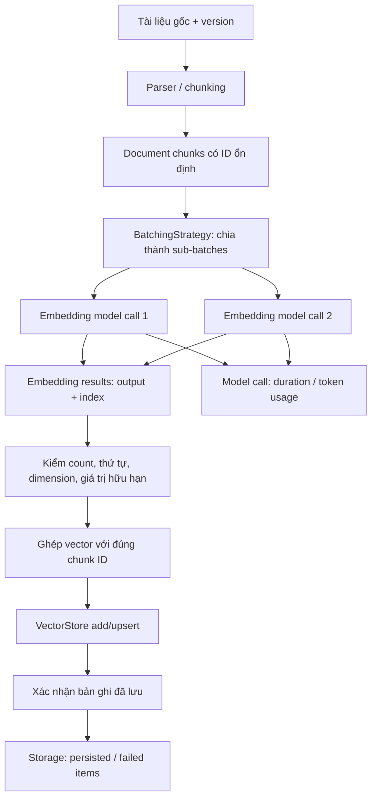
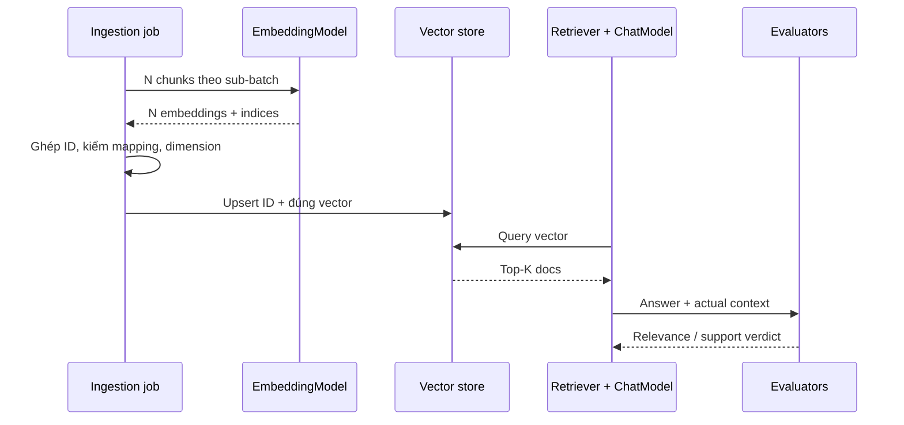

# Phân biệt một lô embedding với từng tài liệu bên trong

## 1. Bài toán: batch thành công nhưng tài liệu vẫn có thể bị gắn sai vector

Trong ứng dụng RAG, ta có ba đoạn nguồn:

| Vị trí trong input | Chunk ID | Nội dung |
| ---: | --- | --- |
| 0 | `policy-premium-01` | Premium được yêu cầu hoàn tiền trong 7 ngày. |
| 1 | `policy-standard-02` | Standard không áp dụng chính sách hoàn tiền. |
| 2 | `shipping-status-03` | Trạng thái SHIPPED không xác nhận đã giao. |

Một lời gọi `EmbeddingModel` nhận cả ba chuỗi và trả ba vector. Nếu ứng dụng ghép vector của vị trí 1 cho `policy-premium-01`, **batch vẫn trả đủ số lượng** nhưng index sẽ chứa quan hệ sai giữa nội dung và biểu diễn số. Truy vấn sau đó có thể đưa nhầm nguồn vào prompt, làm giảm relevance và khiến câu trả lời bị fact checking đánh dấu không có căn cứ.

Do đó, cần quan sát **hai cấp dữ liệu khác nhau**:

- **Batch/model call:** số input, tổng thời gian, token usage do provider báo cáo, số lần gọi, retry và lỗi của lời gọi.
- **Document/chunk bên trong:** ID, nội dung dùng để nhúng, vị trí trong lô, vector tương ứng, kích thước, phiên bản model, metadata nguồn và kết quả ghi vào vector store.

Bài này thuộc chương **Embedding và đa phương thức** của module **SPRING_AI_EVALUATION_OBSERVABILITY**. Module hướng tới đánh giá chất lượng Spring AI bằng tập dữ liệu, relevance, fact checking và luồng RAG/tool calling; đồng thời theo dõi metrics, traces, chi phí, độ trễ để nhận diện suy giảm chất lượng qua phiên bản prompt, model và pipeline.

**Nguyên tắc xuyên suốt:** một batch không phải một tài liệu; một kết quả vector không phải toàn bộ batch; hoàn thành lời gọi model không đồng nghĩa toàn bộ vector đã được lưu thành công.

## 2. Bốn khái niệm cần tách biệt

| Khái niệm | Ví dụ | Ý nghĩa |
| --- | --- | --- |
| **Source document** | File PDF 20 trang `refund-policy-v3.pdf` | Nguồn để kiểm toán và gắn citation |
| **Chunk/Document để nhúng** | `refund-policy-v3#chunk-07` | Đơn vị văn bản trở thành vector |
| **Logical batch** | Nhóm 100 chunk của một job ingest | Đơn vị nghiệp vụ do ứng dụng lập kế hoạch |
| **Physical model sub-batch** | 10–25 input trong một request provider | Một lời gọi embedding thật sự được đo thời gian và usage |

Một source document có thể bị tách thành nhiều chunk; một batch có thể chứa chunk từ nhiều nguồn. Nếu file chính sách được chia thành 12 chunk và provider nhận tối đa bốn chunk/lần gọi theo token budget, kết quả có thể là **3 model calls và 12 embedding vectors**, không phải 3 vector.

```text
Nguồn PDF A -> chunks A0, A1, A2, A3, A4
Nguồn PDF B -> chunks B0, B1, B2

Logical batch: 8 chunks
  Model sub-batch #1: A0, A1, A2
  Model sub-batch #2: A3, A4, B0
  Model sub-batch #3: B1, B2

Kỳ vọng: 8 vector riêng biệt, giữ đúng ID chunk.
```

Mỗi đơn vị dùng một ID riêng:

- `jobId`: phiên nạp/tái tạo index;
- `sourceId`: tài liệu gốc và phiên bản;
- `chunkId` hoặc `Document.getId()`: đơn vị lưu vector;
- `batchId`: nhóm nghiệp vụ;
- `subBatchId` / `requestId`: lời gọi provider;
- `ordinal`: vị trí của input trong đúng sub-batch;
- `modelProfile`: model, phiên bản, dimensions, preprocessing và modality.

Những ID này là **quy ước tầng ứng dụng**, không phải mọi trường đều được Spring AI sinh sẵn.

## 3. Bản đồ xử lý và các điểm quan sát



Phải có ba phép đo riêng:

**Embedding operation** — một request gọi model tốn bao nhiêu thời gian, provider dùng bao nhiêu token và có thành công không.

**Item mapping** — mỗi input mang ID nào, vector có đủ hay bị gán nhầm, vector có kích thước phù hợp không.

**Persistence** — ID nào đã được ghi thành công vào vector store, lỗi nào chưa xử lý xong, retry có tạo trùng dữ liệu không.

Khi một job có 100 input, trả đủ 100 vector, nhưng chỉ 97 ID lưu thành công, ta chỉ có thể báo **100 vector đã tạo** và **97 entry đã xác nhận lưu**, không báo job hoàn tất 100%.

## 4. EmbeddingModel: một input và danh sách input

Spring AI 2.1.x công bố các đường API:

| Phương thức | Input | Output |
| --- | --- | --- |
| `embed(String)` | Một chuỗi | Một `float[]` |
| `embed(Document)` | Một `Document` | Một `float[]` |
| `embed(List<String>)` | Một batch text | `List<float[]>` |
| `embedForResponse(List<String>)` | Một batch text | `EmbeddingResponse` với nhiều results |
| `embed(List<Document>, EmbeddingOptions, BatchingStrategy)` | Nhiều document, có chiến lược chia lô | `List<float[]>` kỳ vọng theo thứ tự document |
| `call(EmbeddingRequest)` | Request model với inputs và options | `EmbeddingResponse` |

Ví dụ:

```java
import java.util.List;
import org.springframework.ai.embedding.EmbeddingModel;

List<String> inputs = List.of(
    "Premium yêu cầu hoàn tiền trong 7 ngày.",
    "Standard không áp dụng chính sách hoàn tiền.",
    "SHIPPED chưa đồng nghĩa DELIVERED.");

List<float[]> vectors = embeddingModel.embed(inputs);
if (vectors.size() != inputs.size()) {
    throw new IllegalStateException("Sai số lượng output");
}

// vectors.get(0) là vector của input 0,
// không phải vector tổng hợp của cả batch.
```

Danh sách input có thể mang nhiều kiểu văn bản nhưng **API embedding text không tự nhúng ảnh/video**. Với ảnh hoặc video phải dùng model/adapter hỗ trợ modality đó, hoặc bước chuyển đổi thành văn bản (OCR, caption, transcript) trước khi gọi text embedding.

### Text nhúng có nhất thiết giống Document.getText()?

`EmbeddingModel.getEmbeddingContent(Document)` mặc định trả `Document.getText()`, nhưng implementation hỗ trợ `MetadataMode` có thể đưa một phần metadata vào nội dung được nhúng. Vì vậy muốn tái hiện vector phải biết **text thực gửi tới provider**, cách format metadata và phiên bản preprocessing/chunking.

Không được giả định metadata của `Document` luôn xuất hiện trong input embedding, cũng không tự ghi câu hỏi người dùng vào metadata như một nguồn chứng cứ.

## 5. Logical batch có thể bị chia thành nhiều lời gọi model

Spring AI có `BatchingStrategy`:

```java
public interface BatchingStrategy {
    List<List<Document>> batch(List<Document> documents);
}
```

`TokenCountBatchingStrategy` ước lượng số token rồi chia danh sách thành các sub-batch phù hợp giới hạn. Một input quá lớn có thể gây exception khi vượt cấu hình. Chia batch giúp hạn chế quá tải request và sử dụng API có hiệu quả hơn.

Ví dụ:

```text
Ingest job: 240 chunks
Logical batches của ứng dụng: 4 batch x 60 chunks
Sau TokenCountBatchingStrategy: 15 physical sub-batches
Thực tế: 15 lời gọi provider (nếu không có retry)
Expected output vectors: 240
```

Hai điều quan trọng trong hợp đồng:

1. `BatchingStrategy.batch(...)` cần **giữ thứ tự document** để ghép output đúng input.
2. `EmbeddingModel.embed(List<Document>, options, strategy)` kỳ vọng danh sách vector trả về **cùng thứ tự** với danh sách `Document` ban đầu.

Một lần đếm `gen_ai.client.operation` thường là **một model call**, không phải một document. Nếu job chia thành 15 physical calls, số operation 15 không có nghĩa chỉ 15 chunk được xử lý.

## 6. EmbeddingResponse chứa phần chung và phần riêng

Cấu trúc khái niệm:

```text
EmbeddingResponse
  +-- metadata: EmbeddingResponseMetadata
  |     +-- model: tên model trong response, khi có
  |     +-- usage: số token của model response, khi có
  |
  +-- results: List<Embedding>
        +-- item 0: getOutput() = float[], getIndex()
        +-- item 1: getOutput() = float[], getIndex()
        +-- item 2: getOutput() = float[], getIndex()
```

| Thuộc tính | Phạm vi dữ liệu | Lưu ý |
| --- | --- | --- |
| `EmbeddingResponse.getMetadata()` | Toàn model response | Không mặc nhiên là metadata của từng tài liệu |
| `EmbeddingResponseMetadata.getUsage()` | Mức gọi model/provider | Thường là token count **toàn batch**, không phân theo item |
| `EmbeddingResponse.getResults()` | Nhiều kết quả vector | Số result cần khớp số input |
| `Embedding.getOutput()` | Một result | Vector `float[]` ứng với input |
| `Embedding.getIndex()` | Một result | Vị trí trong danh sách nếu có, **không phải document ID** |
| `Embedding.getMetadata()` | Một result | Không mặc định chứa `sourceId` hoặc `chunkId` |
| `Document.getId()` | Một document | ID do nguồn/ứng dụng gán |
| `Document.getMetadata()` | Một document | Chứa nguồn, version, chunk hay các trường ứng dụng định nghĩa |

**Index không đồng nghĩa document ID.** Hai batch khác nhau đều có thể có item với index 0. Muốn truy ngược đúng vector, cần ghép `subBatchId + index → chunkId`.

Một số provider/adapter có thể không điền `Embedding.getIndex()`. Không được mặc định trường này luôn có giá trị; phải kiểm thử hợp đồng về thứ tự output của provider.

## 7. Java: nhúng Document và ghép kết quả theo thứ tự

Ví dụ này dùng overload nhận `List<Document>` cùng `BatchingStrategy`, vì Spring AI 2.1.x nêu rõ kết quả kỳ vọng theo thứ tự của document.

```java
import java.util.ArrayList;
import java.util.List;

import org.springframework.ai.document.Document;
import org.springframework.ai.embedding.BatchingStrategy;
import org.springframework.ai.embedding.EmbeddingModel;

record ChunkEmbedding(
        String chunkId,
        int ordinal,
        float[] vector) {
}

public final class DocumentBatchEmbedder {

    private final EmbeddingModel model;
    private final BatchingStrategy batchingStrategy;

    public DocumentBatchEmbedder(
            EmbeddingModel model,
            BatchingStrategy batchingStrategy) {
        this.model = model;
        this.batchingStrategy = batchingStrategy;
    }

    public List<ChunkEmbedding> embedDocuments(
            List<Document> documents, int expectedDimensions) {

        if (documents == null || documents.isEmpty()) {
            return List.of();
        }

        List<float[]> vectors =
                model.embed(documents, null, batchingStrategy);

        if (vectors.size() != documents.size()) {
            throw new IllegalStateException(
                    "Số output không khớp số document");
        }

        List<ChunkEmbedding> result = new ArrayList<>();
        for (int i = 0; i < documents.size(); i++) {
            float[] vector = vectors.get(i);
            if (vector == null ||
                    vector.length != expectedDimensions) {
                throw new IllegalStateException(
                        "Dimension mismatch tại item " + i);
            }
            for (float value : vector) {
                if (!Float.isFinite(value)) {
                    throw new IllegalStateException(
                            "Vector có NaN/Infinity tại item " + i);
                }
            }
            result.add(new ChunkEmbedding(
                    documents.get(i).getId(), i, vector));
        }

        return List.copyOf(result);
    }
}
```

Các bất biến được kiểm tra: số vector, số chiều, giá trị hữu hạn và gắn lại ID theo vị trí. **Chưa thể chứng minh vector có đúng ngữ nghĩa của text hay không** bằng shape check; cần kiểm thử integration và retrieval trên dữ liệu có nhãn.

Dùng ID chunk ổn định khi ghi vector store. `ordinal` chỉ có giá trị trong batch hiện tại; nếu chia lại batch hay retry, ordinal có thể đổi.

## 8. Java: align các Embedding result theo index

Khi gọi `embedForResponse(List<String>)` và nhận `EmbeddingResponse`, một số provider trả index cho từng result. Có thể dùng index để kiểm tra và dựng đúng thứ tự.

Quy tắc an toàn:

- Nếu **toàn bộ** result có index trong khoảng hợp lệ, dùng index để căn chỉnh.
- Nếu **không result nào** có index, dùng thứ tự trả về **chỉ khi adapter đã được kiểm thử giữ thứ tự input**.
- Nếu index có giá trị ở một số result nhưng không ở số còn lại, hoặc index bị trùng, coi là dữ liệu không nhất quán.
- Luôn kiểm số lượng result trước khi ghép document ID.

```java
import java.util.Arrays;
import java.util.List;

import org.springframework.ai.embedding.Embedding;

public final class BatchResultMapper {

    private BatchResultMapper() {
    }

    public static List<Embedding> align(
            List<Embedding> results, int expectedCount) {

        if (results == null || results.size() != expectedCount) {
            throw new IllegalStateException(
                    "Result count không khớp input count");
        }

        boolean allIndexed = results.stream().allMatch(
                x -> x != null && x.getIndex() != null);
        boolean noneIndexed = results.stream().allMatch(
                x -> x != null && x.getIndex() == null);

        if (noneIndexed) {
            // Chỉ tin thứ tự khi hợp đồng provider đã được kiểm tra.
            return List.copyOf(results);
        }
        if (!allIndexed) {
            throw new IllegalStateException(
                    "Response trộn indexed/non-indexed");
        }

        Embedding[] ordered = new Embedding[expectedCount];
        for (Embedding item : results) {
            int i = item.getIndex();
            if (i < 0 || i >= expectedCount || ordered[i] != null) {
                throw new IllegalStateException(
                        "Index bị trùng hoặc ngoài phạm vi: " + i);
            }
            ordered[i] = item;
        }

        if (Arrays.stream(ordered).anyMatch(x -> x == null)) {
            throw new IllegalStateException("Thiếu index");
        }
        return List.copyOf(Arrays.asList(ordered));
    }
}
```

Cách gọi:

```java
import org.springframework.ai.embedding.Embedding;
import org.springframework.ai.embedding.EmbeddingResponse;

List<String> inputs = List.of(
    "Premium được hoàn tiền trong 7 ngày.",
    "Standard không áp dụng chính sách hoàn tiền.");

EmbeddingResponse response =
        embeddingModel.embedForResponse(inputs);

List<Embedding> aligned =
        BatchResultMapper.align(response.getResults(), inputs.size());

for (int i = 0; i < aligned.size(); i++) {
    float[] vector = aligned.get(i).getOutput();
    // Map tới chunkId tương ứng inputs.get(i).
}
```

Nếu provider sử dụng cách đánh chỉ số khác, phải tuân thủ tài liệu provider/adapter; không tự coi một index có nghĩa giống nhau ở mọi dịch vụ.

## 9. JUnit kiểm tra các lỗi mapping trước khi gọi provider

Unit test mapper hoạt động mà không cần network, chi phí hay API key:

```java
import static org.junit.jupiter.api.Assertions.*;

import java.util.List;

import org.junit.jupiter.api.Test;
import org.springframework.ai.embedding.Embedding;

class BatchResultMapperTest {

    @Test
    void alignsOutOfOrderResults() {
        Embedding second = new Embedding(
                new float[]{0.3f, 0.4f}, 1);
        Embedding first = new Embedding(
                new float[]{0.1f, 0.2f}, 0);

        List<Embedding> mapped = BatchResultMapper.align(
                List.of(second, first), 2);

        assertSame(first, mapped.get(0));
        assertSame(second, mapped.get(1));
    }

    @Test
    void rejectsDuplicateIndexes() {
        Embedding a = new Embedding(new float[]{0.1f}, 0);
        Embedding b = new Embedding(new float[]{0.2f}, 0);

        assertThrows(IllegalStateException.class,
                () -> BatchResultMapper.align(List.of(a, b), 2));
    }

    @Test
    void rejectsMissingOutputs() {
        Embedding a = new Embedding(new float[]{0.1f}, 0);

        assertThrows(IllegalStateException.class,
                () -> BatchResultMapper.align(List.of(a), 2));
    }

    @Test
    void rejectsMixedIndexAvailability() {
        Embedding a = new Embedding(new float[]{0.1f}, 0);
        Embedding b = new Embedding(new float[]{0.2f}, null);

        assertThrows(IllegalStateException.class,
                () -> BatchResultMapper.align(List.of(a, b), 2));
    }
}
```

Bộ test này chỉ kiểm tra thuật toán căn chỉnh. Với provider trả `getIndex() == null`, cần thêm **integration test** có các chuỗi khác nhau rõ ràng, xác nhận output giữ đúng input order và theo dõi mapping qua vector store.

## 10. Usage và latency thuộc model call, không mặc nhiên thuộc từng tài liệu

Spring AI tích hợp Micrometer Observation cho một số implementation `EmbeddingModel`. Tài liệu nêu các tên:

| Tín hiệu | Ý nghĩa |
| --- | --- |
| `gen_ai.client.operation` | Thời gian và số lần gọi embedding model |
| `gen_ai.client.token.usage` | Token do provider báo cáo cho model call |
| `gen_ai.request.model` / `gen_ai.response.model` | Model ở mức lời gọi |
| `gen_ai.request.embedding.dimensions` | Thuộc tính dimension ở trace khi có |
| `EmbeddingResponseMetadata.getUsage()` | Usage của response, không mặc nhiên chia theo result |

Một model call có 20 input, trả 20 vector, vẫn có thể tạo **một observation thời gian** và một usage tổng. Nếu `BatchingStrategy` tách thành ba sub-batch, tổng số lời gọi có thể là ba.

Ví dụ PromQL đếm tốc độ **model call** embedding theo model:

```promql
sum by (gen_ai_request_model) (
  rate(gen_ai_client_operation_seconds_count{
    gen_ai_operation_name="embedding"
  }[5m])
)
```

Biểu thức trên **không** cho biết số document đã nhúng mỗi giây. Để đo item throughput, tạo counter riêng tại boundary ứng dụng.

### Token usage của cả lô không phải token từng item

Nếu provider báo 900 input tokens cho ba document, không thể tự chia đều thành 300 token/document rồi ghi đây là số liệu chính thức.

Một cách phân bổ **ước tính** khi phải tính chi phí theo tài liệu là dùng tokenizer phù hợp để ước lượng token của từng item:

```text
estimatedItemTokens_i =
    reportedBatchTokens
    × estimatedTokens_i / sum(estimatedTokens_j)
```

Với các giá trị 100, 300, 500 và tổng batch là 900, tỷ lệ ước tính tương ứng cho mỗi item là 100, 300, 500. Nhưng tokenizer, metadata formatting và overhead có thể khiến cách phân bổ khác số provider tính. Hãy đặt tên `estimatedItemTokens`, không ghi là `providerReportedItemTokens`.

Nếu provider **không trả usage**, kết quả là **không có dữ liệu**, không chứng minh đã dùng 0 token hoặc hoàn toàn miễn phí. Nếu provider trả cả `input` và `total`, không cộng chúng như hai khoản riêng.

### Không chia latency đơn giản thành per-item latency thực đo

Một batch 20 item mất 400 ms không có nghĩa từng item mất 20 ms để được xử lý. Đó chỉ là **chi phí thời gian bình quân hóa** theo số item trong một lô, không phải thời gian độc lập của mỗi item.

Để so hiệu năng, lưu `batchSize`, tổng token, concurrency, p50/p95 model call, số retry và throughput items/s. Cũng không cộng timer bao ngoài ở application với timer model call khi hai phép đo chồng nhau.

## 11. Audit record: job, sub-batch, item

Một lược đồ quan sát có ba record độc lập:

**Job ingest:**

```json
{
  "jobId": "ingest-20261127-03",
  "sourceFiles": 3,
  "plannedChunks": 120,
  "embeddingProfile": "emb-v3",
  "state": "RUNNING"
}
```

**Lời gọi provider/sub-batch:**

```json
{
  "jobId": "ingest-20261127-03",
  "batchId": "batch-02",
  "subBatchId": "provider-call-07",
  "attempt": 1,
  "inputItems": 20,
  "outputItems": 20,
  "reportedInputTokens": 2400,
  "durationMs": 410,
  "executionStatus": "SUCCESS"
}
```

**Một document/chunk trong sub-batch:**

```json
{
  "jobId": "ingest-20261127-03",
  "subBatchId": "provider-call-07",
  "ordinal": 5,
  "sourceId": "refund-policy-v3",
  "chunkId": "refund-policy-v3#05",
  "vectorDimensions": 1024,
  "embeddingStatus": "READY",
  "storageStatus": "PENDING"
}
```

Các giá trị và trường là **schema tự đề xuất**, không phải dữ liệu Spring AI tự động ghi. Ý nghĩa `ordinal` chỉ đúng **trong subBatchId tương ứng**. Không đặt `chunkId` hay `jobId` thành label của Prometheus metrics; các ID có cardinality cao phù hợp hơn với log/trace có kiểm soát truy cập.

## 12. Một bộ metrics riêng cho document throughput

| Metric gợi ý (tự định nghĩa) | Đơn vị | Cách dùng |
| --- | --- | --- |
| `app.embedding.batch.calls` | Calls | Số lần gọi ở boundary ứng dụng |
| `app.embedding.batch.failed` | Calls | Lượt gọi không có kết quả hợp lệ |
| `app.embedding.items.submitted` | Items | Số item gửi embedding theo **attempt** |
| `app.embedding.items.validated` | Items | Số vector đã kiểm count/index/shape |
| `app.embedding.items.persisted` | Items | Số entry được xác nhận ghi vào store |
| `app.embedding.items.retry` | Items | Số lần xử lý lại |
| `app.embedding.batch.size` | Items/call | Phân phối kích thước lô |
| `app.embedding.mapping.errors` | Events | Sai index, trùng ID, thiếu output |
| `app.embedding.dimension.errors` | Events | Vector sai chiều, NaN, Infinity |

Không đếm `submitted` theo attempt thành số chunk duy nhất. Nếu retry, số lượng submit có thể lớn hơn `uniqueChunks`. Trạng thái item cũng cần tách:

```text
PLANNED -> SUBMITTED -> EMBEDDED -> VALIDATED -> PERSISTED
                         |             |
                         +-- ERROR ----+
                                       |
                                  RETRY / REVIEW
```

Đừng tự điền `PERSISTED` ngay khi model đã trả vector. Còn một bước ghi vector store và xác nhận kết quả. Tương tự, count kết quả bằng input count **chưa đủ** để đánh dấu `VALIDATED` nếu chưa kiểm tra mapping và dimension.

## 13. Java: ghi nhận submitted và validated ở mức item

Ví dụ Micrometer sau chỉ minh họa **boundary embedding**, không tự lưu vector:

```java
import java.util.List;

import io.micrometer.core.instrument.Counter;
import io.micrometer.core.instrument.DistributionSummary;
import io.micrometer.core.instrument.MeterRegistry;
import org.springframework.ai.embedding.EmbeddingModel;
import org.springframework.ai.embedding.EmbeddingResponse;

public final class ObservedBatchEmbedding {

    private final EmbeddingModel model;
    private final Counter submitted;
    private final Counter validated;
    private final Counter batchFailed;
    private final DistributionSummary batchSizes;

    public ObservedBatchEmbedding(
            EmbeddingModel model, MeterRegistry meters) {
        this.model = model;
        this.submitted = meters.counter(
                "app.embedding.items.submitted", "stage", "indexing");
        this.validated = meters.counter(
                "app.embedding.items.validated", "stage", "indexing");
        this.batchFailed = meters.counter(
                "app.embedding.batch.failed", "stage", "indexing");
        this.batchSizes = DistributionSummary
                .builder("app.embedding.batch.size")
                .tag("stage", "indexing")
                .register(meters);
    }

    public EmbeddingResponse embed(List<String> texts) {
        if (texts == null || texts.isEmpty()) {
            throw new IllegalArgumentException("Batch rỗng");
        }

        submitted.increment(texts.size());
        batchSizes.record(texts.size());

        try {
            EmbeddingResponse response =
                    model.embedForResponse(texts);

            var results = BatchResultMapper.align(
                    response.getResults(), texts.size());

            for (var item : results) {
                float[] vector = item.getOutput();
                if (vector == null || vector.length == 0) {
                    throw new IllegalStateException("Vector rỗng");
                }
                for (float value : vector) {
                    if (!Float.isFinite(value)) {
                        throw new IllegalStateException(
                                "Vector chứa NaN/Infinity");
                    }
                }
            }

            // Hợp đồng provider về ordering khi index null
            // và chiều vector/index cần kiểm tra thêm ở production.
            validated.increment(results.size());
            return response;
        }
        catch (RuntimeException ex) {
            batchFailed.increment();
            throw ex;
        }
    }
}
```

Đây là metric do ứng dụng định nghĩa. Cần quyết định rõ `validated` có nghĩa tới đâu: ví dụ trên đã kiểm count/index và tính hữu hạn, nhưng **chưa biết profile có tương thích index lưu trữ** hay chưa. Muốn đo `persisted` phải đặt sau bước ghi và xác minh.

Tag `stage=indexing` có cardinality thấp. Không đưa text, user ID, chunk ID hoặc trace ID vào metric tags.

## 14. Phân biệt model call thành công với VectorStore ghi thành công

Spring AI có hai đường:

```java
// VectorStore tự tạo embedding qua model được cấu hình.
vectorStore.add(documents);

// Với những store hỗ trợ API Spring AI 2.1.x,
// ứng dụng có thể cung cấp vector đã tính trước.
vectorStore.upsert(List.of(
    new EmbeddedDocument(document, validatedVector)));
```

`VectorStore.upsert(List<EmbeddedDocument>)` có semantics thay thế bản ghi theo ID ở implementation hỗ trợ; một số store vẫn chưa hỗ trợ và default method có thể ném `UnsupportedOperationException`.

Javadoc của `upsert` còn lưu ý **lỗi ở một entry có thể xảy ra sau khi backend đã ghi một phần batch**. Do vậy:

- Không giả định một lần `upsert` ném exception nghĩa là **không có entry nào được lưu**.
- Không đánh dấu toàn bộ item là `PERSISTED` cho tới khi operation thành công hoặc đã đối chiếu backend.
- Dùng ID ổn định để retry an toàn nếu store hỗ trợ semantics upsert idempotent.
- Nếu trạng thái một phần chưa rõ, ghi `PERSISTENCE_UNKNOWN`, sau đó reconciliation theo ID.
- Đối với `add(List<Document>)`, cách xử lý ID trùng phụ thuộc implementation; không tự giả định retry sẽ thay thế bản ghi.

`EmbeddedDocument` xác nhận vector không rỗng và hữu hạn, và một số store kiểm tra width. Nhưng những kiểm tra đó không tự chứng minh vector **được ghép với đúng document** hay **cùng embedding space** với query vector.

## 15. Hai loại lỗi: shape và mapping

**Lỗi shape**: vector có 768 chiều nhưng index yêu cầu 1.024; vector chứa NaN/Infinity; số output khác số input. Có thể bắt bằng validation trực tiếp.

**Lỗi mapping**: danh sách input IDs `[A,B,C]`, output đúng ra `[vA,vB,vC]` nhưng ứng dụng lưu `[vA,vC,vB]`. **Không có lỗi số chiều hoặc thiếu output**, nhưng tìm kiếm bị sai.

```text
input IDs       = [A,  B,  C]
returned vector = [vA, vC, vB]
count check     = PASS
dimension check = PASS
ID-vector map   = FAIL
```

Vì vậy test cần có cả: uniqueness của document IDs; count; index; order; dimension; model profile; input text thực gửi và trạng thái lưu theo ID.

Không thể chứng minh mapping chính xác bằng một lần gọi `float[].length`. Với provider không có index, nên thử một bộ fixture có các nội dung rất khác nhau, nhúng theo batch kích thước khác nhau và kiểm tra retrieval.

## 16. Ứng dụng RAG và fact checking sẽ bị ảnh hưởng thế nào?

Khi một document nhận nhầm vector:

1. Retriever dùng vector truy vấn và tính khoảng cách đến các vector bị gắn ID sai.
2. Top-K có thể trả document không đúng chủ đề.
3. ChatModel nhận context sai hoặc thiếu điều kiện quan trọng.
4. `RelevancyEvaluator` có thể thấy nguồn không liên quan câu hỏi.
5. `FactCheckingEvaluator` có thể thấy claim không được context hỗ trợ.
6. Dashboard chỉ nhìn điểm fact checking có thể quy sai nguyên nhân cho prompt sinh, trong khi lỗi bắt đầu từ **batch mapping lúc indexing**.



Để điều tra, giữ bản ghi `indexProfile`, `ingestJobId`, `sourceId`, `chunkId` và `batchId`. So sánh một bộ truy vấn vàng trước/sau khi thay batching strategy sẽ cho biết có vấn đề ghép vector hay thay chất lượng model thực sự.

## 17. Đa phương thức: item không luôn là một file

Với dữ liệu hình ảnh, video, âm thanh hoặc PDF scan, “tài liệu” có thể bị biến đổi nhiều lần trước khi nhúng:

| Nguồn | Đơn vị item có thể nhúng | Metadata quan trọng |
| --- | --- | --- |
| PDF scan | Text OCR theo trang/đoạn | Source ID, page, OCR version |
| Ảnh sản phẩm | Caption text hoặc vector ảnh trực tiếp | Image ID, modality, preprocessing |
| Video | Frame, clip, caption hoặc transcript segment | Video ID, timestamp, frame range |
| Audio | Transcript segment hoặc vector audio | Audio ID, start/end, ASR version |
| Tài liệu web | Đoạn text theo heading | URL/source version, section/chunk ID |

Ví dụ một PDF chứa 5 trang và 12 ảnh **không nhất thiết tạo ra 17 vectors**. Số item phụ thuộc chunking, extraction và model được dùng. Với một model đa phương thức nhúng trực tiếp ảnh, phải kiểm tra API/provider tương ứng; `EmbeddingModel` dạng text không mặc nhiên nhận ảnh.

Nếu muốn tìm ảnh bằng truy vấn text, cần model hoặc cấu hình **được thiết kế để so vector của hai modality trong cùng không gian**. Cùng dimension nhưng khác embedding space vẫn có thể gây kết quả vô nghĩa.

## 18. Bộ kiểm thử hồi quy đúng cấp

Đề xuất fixture:

| Chunk | Nội dung | Query nên lấy |
| --- | --- | --- |
| `refund-01` | Premium có thể yêu cầu hoàn tiền trong 7 ngày. | “Hoàn tiền Premium” |
| `shipping-02` | SHIPPED nghĩa là đã gửi, chưa xác nhận giao. | “Trạng thái SHIPPED” |
| `support-03` | Tổng đài hỗ trợ từ 08:00 đến 18:00. | “Giờ tổng đài” |

Kiểm thử:

1. Nạp fixture vào collection riêng, không chạm production.
2. Nhúng bằng batch size 1 rồi batch size 3, giữ cùng model profile và dữ liệu.
3. Kiểm số lượng, index, ID, dimension, vector hữu hạn.
4. Đối chiếu mapping thực tế ở storage theo chunk ID.
5. Truy vấn mỗi chủ đề và kiểm top-K bằng expected ID.
6. Thử đảo output index hoặc trộn mapping có kiểm soát để xem test phát hiện.
7. Thử lỗi một sub-batch và retry với ID ổn định.
8. So throughput, số operation, token nếu provider có báo cáo, và số unique entry đã lưu.
9. Kiểm tra RelevancyEvaluator/FactCheckingEvaluator trong luồng RAG với actual context, không dùng nguồn truy xuất lại sau khi sinh.
10. Ghi phiên bản chunking, embedding model, index, query model và evaluator để so sánh giữa các release.

Nếu retrieval test fail, trước tiên xác nhận mapping và tương thích model/index, rồi mới quy kết chất lượng embedding model. Một kết quả retrieval sai chưa tự chứng minh mapping bị đảo; model có thể thực sự kém về ngữ nghĩa trên dataset.

## 19. Playbook sự cố và checklist

| Hiện tượng | Giả thuyết | Bước kiểm đầu tiên |
| --- | --- | --- |
| 20 lời gọi, 400 chunks | Nhầm operation với item | So counts theo sub-batch và unique chunk |
| Đủ 30 output nhưng citation sai | Ghép sai ID, profile hoặc thứ tự | Kiểm index → chunk ID |
| 900 token cho 3 item | Gán usage cả batch cho mỗi item | Xem response-level usage |
| Embedding API thành công, index thiếu 2 vector | Lỗi persistence hoặc retry | Reconcile IDs với store |
| Sau retry, item count tăng gấp đôi | Đếm theo attempt như unique item | Tách attempt/unique |
| `getIndex()` null | Provider không cung cấp index | Kiểm hợp đồng ordering |
| Batch đổi kích thước, retrieval xấu | Mapping/ordering hoặc model drift | Replay fixture, kiểm profiles |
| Một source có 40 vectors | File bị tách 40 chunk | Theo dõi source→chunk lineage |
| Model đổi nhưng dimension giữ nguyên | Sai embedding space âm thầm | Re-index/so model profile |
| Latency/call tăng khi batch lớn | Nhiều token/input hơn, tải provider | Ghi items/call, token, p95 |

Checklist trước khi release:

- [ ] Phân biệt source file, chunk, logical batch, physical sub-batch.
- [ ] Có ID ổn định cho mỗi chunk và model profile rõ ràng.
- [ ] Kiểm response count, index/order, dimension và vector hữu hạn.
- [ ] Không dùng ordinal làm ID toàn cục.
- [ ] Không gán token/latency cả batch thành số đo riêng từng tài liệu.
- [ ] Không coi “embedded” đồng nghĩa “persisted”.
- [ ] Retry và partial failures có quy tắc reconciliation.
- [ ] Không đưa user ID, document ID hay text làm metric labels.
- [ ] Có golden dataset để kiểm tra retrieval và RAG sau thay đổi.
- [ ] Có tracing kết nối ingest job → batch → chunk → index → query.

## 20. Bài tập thực hành

1. Một job có 4 file nguồn, chia thành 60 chunk và 5 physical model calls. Hãy chỉ ra số file, chunk, model call và vector kỳ vọng.
2. Batch có 8 input nhưng chỉ 7 result. Hãy đề xuất trạng thái kỹ thuật, cơ chế retry và dữ liệu cần log.
3. Input ID `[A,B,C]` nhưng response index `[2,0,1]`. Hãy xây dựng mapping đúng khi index là vị trí input.
4. Provider trả toàn bộ `getIndex() == null`. Khi nào dùng thứ tự output là hợp lệ? Integration test nào cần có?
5. Provider báo tổng 1.200 tokens cho bốn item. Vì sao không được viết “300 token/item thực đo”?
6. Model call trả 20 vectors, `upsert` ném exception. Vì sao không thể nói chắc rằng cả 20 ID đều chưa được lưu?
7. Viết unit test cho `BatchResultMapper` với index ngoài phạm vi và item trùng index.
8. Một batch mất 400 ms cho 20 item. Đây có phải thời gian 20 ms của từng document? Giải thích.
9. Xây dựng record chứa `jobId`, `subBatchId`, `ordinal`, `chunkId`, `embeddingStatus` và `storageStatus`.
10. Sau thay đổi batching, `FactCheckingEvaluator` đánh giá nhiều câu fail hơn. Hãy nêu đường trace giúp phân biệt lỗi mapping với lỗi generation.
11. Một PDF có 10 trang và 3 ảnh được OCR. Vì sao số vector có thể khác 13? Đơn vị item ở pipeline đó là gì?
12. Viết PromQL cho tốc độ embedding model call rồi nêu metric bổ sung cần tạo để tính document throughput.
13. Cần phân bổ chi phí 0,008 USD của một batch cho từng chunk. Bạn sẽ dùng phương pháp gì và phải nêu giới hạn nào?
14. Giải thích tại sao hai mô hình cùng output 1.024 chiều vẫn có thể làm retrieval không đúng nếu một model nhúng tài liệu và model khác nhúng query.

## Tài liệu tham khảo

- [Spring AI – Embeddings Model API 2.1.x](https://docs.spring.io/spring-ai/reference/2.1-SNAPSHOT/models/embeddings.html): `EmbeddingModel`, `EmbeddingResponse` và phương thức batch.
- [Spring AI Javadoc – EmbeddingModel](https://docs.spring.io/spring-ai/docs/2.1.x/api/org/springframework/ai/embedding/EmbeddingModel.html): chữ ký `embed(List<Document>, options, strategy)` và thứ tự output.
- [Spring AI Javadoc – Embedding](https://docs.spring.io/spring-ai/docs/2.1.x/api/org/springframework/ai/embedding/Embedding.html): `getOutput()`, `getIndex()` và metadata từng result.
- [Spring AI Javadoc – BatchingStrategy](https://docs.spring.io/spring-ai/docs/2.1.x/api/org/springframework/ai/embedding/BatchingStrategy.html): cách chia lô và yêu cầu bảo toàn thứ tự.
- [Spring AI – Batching and Schema Initialization](https://docs.spring.io/spring-ai/reference/2.1-SNAPSHOT/rag/vector-store/batching.html): `TokenCountBatchingStrategy` và giới hạn token.
- [Spring AI – Observability](https://docs.spring.io/spring-ai/reference/observability/index.html): embedding model observations, token usage và tracing.
- [Spring AI Javadoc – VectorStore](https://docs.spring.io/spring-ai/docs/2.1.x/api/org/springframework/ai/vectorstore/VectorStore.html): `add`, `upsert`, retry và partial write semantics.
- [Spring AI Javadoc – EmbeddedDocument](https://docs.spring.io/spring-ai/docs/2.1.x/api/org/springframework/ai/vectorstore/EmbeddedDocument.html): cặp document–vector tự cung cấp.

> **Ghi chú phiên bản và kiểm thử:** Bài dựa trên Spring AI 2.1.x. Chức năng batch, metadata, index và upsert phụ thuộc provider/implementation; phải đối chiếu Javadoc và thực nghiệm với cấu hình dự án. Mọi tên metric bổ sung, ID, chi phí và kết quả minh họa là dữ liệu học tập, chưa phải kết quả chạy Gradle hoặc benchmark thực tế.
