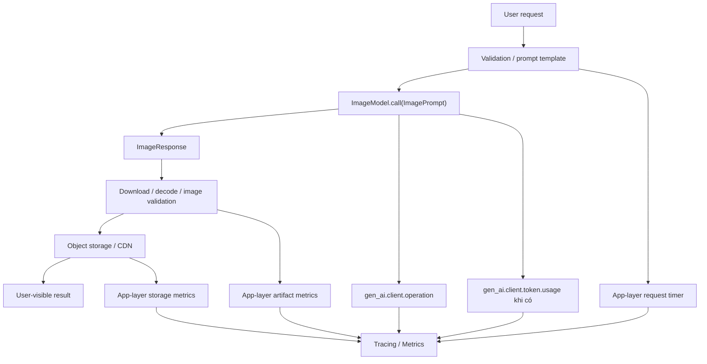
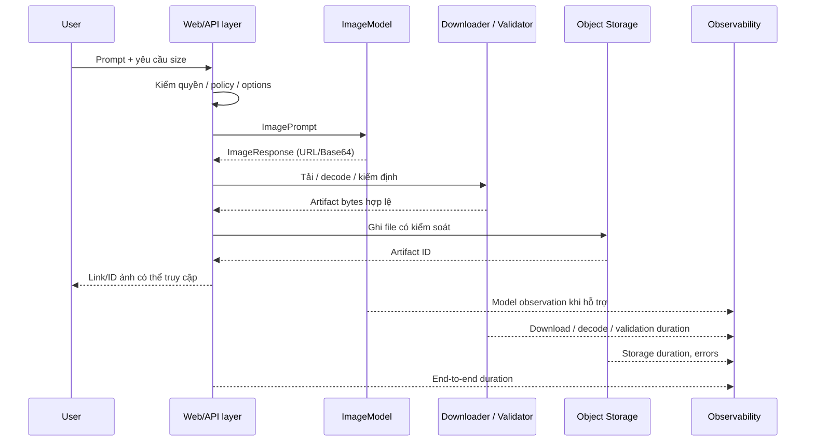

# Quan sát ImageModel theo phạm vi instrumentation hỗ trợ

## 1. Vì sao ImageModel cần observability riêng?

Trong hệ thống dùng Spring AI, một yêu cầu tạo ảnh có thể chạy qua nhiều công đoạn: nhận prompt, gọi nhà cung cấp mô hình, nhận URL hoặc dữ liệu ảnh, tải ảnh nếu cần, kiểm tra định dạng, lưu đối tượng và hiển thị cho người dùng. Một giao diện chỉ hiện “Đang xử lý” khi mất 15 giây sẽ không cho biết thời gian nằm ở model hay ở bước tải/lưu ảnh.

Ví dụ người dùng yêu cầu:

> Tạo một ảnh minh họa sản phẩm, nền trắng, kích thước 1024×1024.

Ứng dụng có thể thực hiện:

1. Kiểm tra nội dung và quyền truy cập của request.
2. Gọi `ImageModel.call(ImagePrompt)`.
3. Nhận `ImageResponse` gồm một hoặc nhiều kết quả `ImageGeneration`.
4. Lấy URL hoặc dữ liệu Base64 của ảnh.
5. Tải/giải mã, kiểm tra MIME, kích thước và dung lượng.
6. Lưu file ảnh tại object storage có kiểm soát quyền truy cập.
7. Trả đường dẫn hợp lệ cho người dùng.

Trong bước 2, **observation của `ImageModel` chỉ phản ánh phạm vi lời gọi model đã được instrumentation**, không mặc nhiên bao trùm thời gian tải ảnh, lưu trữ, xử lý nội dung hay thời gian người dùng thực sự thấy ảnh.

Bài **“Quan sát ImageModel theo phạm vi instrumentation hỗ trợ”** thuộc chương **Embedding và đa phương thức** trong module **SPRING_AI_EVALUATION_OBSERVABILITY**. Module tập trung đánh giá ứng dụng Spring AI bằng tập dữ liệu, relevance, fact checking, kiểm thử RAG/tool calling; đồng thời dùng metrics, traces, chi phí và độ trễ để phát hiện nguyên nhân suy giảm chất lượng qua từng phiên bản prompt, model và pipeline.

**Mục tiêu:** đọc đúng tài liệu về provider được hỗ trợ; phân biệt observation có sẵn với đo lường bổ sung; theo dõi latency, số ảnh trả về và token usage theo điều kiện; xây dựng tracing từ lời gọi model đến artifact; thiết kế kiểm thử instrumentation và theo dõi regression một cách có thể kiểm toán.

## 2. ImageModel là gì, và không phải là gì?

Spring AI `org.springframework.ai.image.ImageModel` là giao diện cho **mô hình tạo ảnh**. Chữ ký cốt lõi ở nhánh 2.1.x:

```java
@FunctionalInterface
public interface ImageModel extends Model<ImagePrompt, ImageResponse> {

    ImageResponse call(ImagePrompt request);
}
```

Các kiểu liên quan:

| Kiểu | Vai trò | Điều cần quan sát |
| --- | --- | --- |
| `ImagePrompt` | Chứa yêu cầu tạo ảnh, các `ImageMessage` và `ImageOptions` | Số yêu cầu, model, size, style, định dạng đầu ra |
| `ImageModel` | Gọi provider tạo ảnh | Thời gian gọi, lỗi provider, trace |
| `ImageResponse` | Kết quả một lời gọi model | Số `ImageGeneration`, metadata khi có |
| `ImageGeneration` | Một kết quả tạo ảnh | Có đầu ra ảnh hợp lệ hay không |
| `Image` | Đầu ra ảnh | URL hoặc Base64 khi provider/format hỗ trợ |
| `ImageResponseMetadata` | Metadata chung của response | Thời điểm tạo, usage nếu có |

**Không đồng nhất `ImageModel` với `EmbeddingModel`.** Embedding model biểu diễn văn bản hoặc modality được hỗ trợ thành vector để tìm kiếm; ImageModel của Spring AI dùng cho tạo ảnh. Quan sát `ImageModel` không tự đo chất lượng vector truy xuất, OCR, image captioning hoặc toàn bộ quy trình hiểu ảnh.

Tùy provider, tính năng có thể hỗ trợ tạo ảnh từ text, dùng ảnh tham chiếu, chỉnh sửa ảnh hoặc lựa chọn định dạng. Không phải mọi implementation đều nhận cùng loại input hoặc cùng một bộ options; cần kiểm tra cụ thể từng provider và phiên bản.

### Một request không nhất thiết tạo đúng một ảnh

Một `ImagePrompt` có thể yêu cầu `n` ảnh nếu provider/model hỗ trợ. `ImageResponse.getResults()` có thể trả nhiều `ImageGeneration`. Vì vậy:

```text
Model calls          = 1
Requested images     = 4
Returned generations = 4  (kỳ vọng minh họa)
Usable image outputs = 3  (nếu một kết quả trống/hỏng)
Persisted artifacts  = 2  (nếu một upload thất bại)
```

Bốn đơn vị này khác nhau. Không được coi một `gen_ai.client.operation` là một ảnh đã lưu, hoặc cứ HTTP 200 là tất cả ảnh đều hợp lệ.

## 3. Phạm vi instrumentation Spring AI 2.1.0 hỗ trợ

Theo **Spring AI Reference 2.1.0 – Observability**, phần `Image Model` liệt kê observability được hỗ trợ cho các implementation của:

- **OpenAI ImageModel**;
- **Stability AI ImageModel**.

Tài liệu cũng ghi các provider khác có thể được hỗ trợ ở bản phát hành sau. Trong khi đó, trang **Image Model API** liệt kê các implementation tạo ảnh như OpenAI, Stability AI và **Google GenAI**.

Hai danh sách phản ánh **hai năng lực khác nhau**:

| Provider / loại triển khai | Có ImageModel API? | Có thể mặc nhiên chờ ImageModel observation theo tài liệu 2.1.0? |
| --- | --- | --- |
| OpenAI | Có | Có trong phạm vi được tài liệu liệt kê; vẫn phải kiểm tra cấu hình |
| Stability AI | Có | Có trong phạm vi được tài liệu liệt kê; vẫn phải kiểm tra telemetry thực tế |
| Google GenAI | Có | **Chưa được liệt kê trong danh sách hỗ trợ observability ImageModel** của trang 2.1.0 |
| Provider tự viết adapter | Tùy ứng dụng | Không tự động; phải tự kiểm chứng hoặc bổ sung instrumentation |
| Provider khác trong tương lai | Có thể | Phải xem tài liệu đúng bản Spring AI/adapter đang chạy |

**Điều quan trọng:** một model có API gọi được không đồng nghĩa Spring AI đã tạo đầy đủ metrics và spans cho model đó. Ngược lại, tài liệu chưa liệt kê không chứng minh provider tuyệt đối không có HTTP tracing hoặc các chỉ số tự đo ở tầng khác.

Danh sách hỗ trợ **có tính phiên bản**. Đừng dùng thông tin của Spring AI 1.0, 2.0 hoặc snapshot để khẳng định một thuộc tính là mặc định trong 2.1.0. Khi nâng cấp, phải kiểm tra chính xác phiên bản Spring AI, provider starter và observation handler đang chạy.

### Ba trạng thái cần phân biệt

1. **SUPPORTED_BY_REFERENCE:** provider/implementation nằm trong phạm vi tính năng tài liệu nêu.
2. **OBSERVED_IN_RUNTIME:** đã gọi model thật và nhìn thấy metric/span với các key phù hợp.
3. **USAGE_AVAILABLE:** provider trả số liệu usage hợp lệ và hệ thống đã ghi nhận chúng.

Một provider có thể đạt trạng thái 1 và 2 nhưng **không có token usage** do API không báo dữ liệu. Một ứng dụng tự đo Timer có thể tạo metric runtime dù adapter chưa có built-in observation của Spring AI.

## 4. Observation tích hợp thực sự đo gì?

Theo tài liệu Spring AI:

- `gen_ai.client.operation` được ghi khi thực hiện lời gọi `ImageModel` ở implementation được hỗ trợ, đo **thời gian hoàn thành method model call** và truyền thông tin tracing.
- `gen_ai.client.token.usage` có thể đo số token input/output do provider báo cho một model call.



**Ranh giới đo:**

| Thành phần | Bắt đầu/kết thúc khi nào? | Có phải metric ImageModel built-in? |
| --- | --- | --- |
| Model call | Bao quanh lời gọi `ImageModel.call(...)` | Có, với implementation hỗ trợ |
| Chuẩn hóa prompt / policy | Trước khi gọi model | Không; instrumentation riêng |
| Download URL ảnh | Sau response nếu provider trả URL | Không mặc nhiên |
| Giải mã Base64 / kiểm ảnh | Sau response | Không mặc nhiên |
| Upload ảnh sang storage | Sau khi tạo ảnh | Không mặc nhiên |
| Hiển thị ảnh trên trình duyệt | CDN/network/client | Không |
| Chất lượng hình ảnh | Phù hợp prompt, bố cục, an toàn | Không phải thuộc tính mặc định của `gen_ai.client.operation` |

Nếu p95 thời gian trả ảnh là 18 giây, nhưng p95 model call 7 giây, việc tối ưu model chưa đủ. Cần xem bước tải/giải mã/lưu trữ và thời gian mạng của client.

Không cộng tất cả thời gian của các span lồng nhau thành tổng end-to-end. Một span tầng ứng dụng có thể bao quanh span model call; phép cộng sẽ đếm trùng cùng một thời gian.

## 5. Các thuộc tính observation và cardinality

Tài liệu Spring AI 2.1.0 công bố:

| Key | Cardinality | Vai trò |
| --- | --- | --- |
| `gen_ai.operation.name` | Low | Loại operation, ví dụ image |
| `gen_ai.system` | Low | Hệ thống/provider theo client instrumentation |
| `gen_ai.request.model` | Low | Model được yêu cầu |
| `gen_ai.request.image.response_format` | High | Định dạng trả ảnh, khi có |
| `gen_ai.request.image.size` | High | Kích thước yêu cầu, ví dụ 1024×1024 |
| `gen_ai.request.image.style` | High | Style yêu cầu, khi có |
| `gen_ai.usage.input_tokens` | High | Input tokens do provider báo, khi có |
| `gen_ai.usage.output_tokens` | High | Output tokens do provider báo, khi có |
| `gen_ai.usage.total_tokens` | High | Total tokens do provider báo, khi có |

Theo quy ước, **low-cardinality keys** phù hợp làm nhãn metrics và traces; **high-cardinality keys** chỉ dành cho traces. Không tự cho rằng mọi thuộc tính high-cardinality đều đã xuất hiện trong thực tế.

Một số tùy chọn không được mọi model hỗ trợ. Ví dụ có model không nhận width/height tùy ý mà nhận aspect ratio, quality hoặc size dạng tập giá trị. Khi đó metric không có `gen_ai.request.image.size` có thể là **do adapter không đặt thông tin**, không phải luôn do sai cấu hình.

### Vì sao không biến prompt thành metric label?

Một prompt là chuỗi gần như duy nhất cho mỗi request. Đưa text prompt, user ID, URL ảnh, Base64 hoặc request ID vào metric tags có thể:

- làm bùng nổ số lượng time series;
- tăng tài nguyên và chi phí của hệ thống quan sát;
- vô tình lưu dữ liệu cá nhân hoặc thông tin bí mật;
- khó tổng hợp biểu đồ theo model và provider.

Nên dùng **tag hữu hạn** như `stage=generation/persistence`, `outcome=success/error` và profile do ứng dụng quản lý; trace ID dùng để nối bản ghi trong hệ thống tracing, không thành một tag của mọi metric.

## 6. Thiết lập Spring Boot Actuator và registry

Để thu metrics và traces, ứng dụng cần hạ tầng Micrometer, Actuator và exporter thích hợp. Những dependency thường dùng:

- `spring-boot-starter-actuator`;
- `micrometer-registry-prometheus` nếu xuất Prometheus;
- tracing bridge như `micrometer-tracing-bridge-otel` và exporter phù hợp nếu cần distributed tracing.

Cần kiểm tra sự tương thích giữa Spring Boot BOM, Spring AI BOM, provider starter và Micrometer.

Ví dụ cấu hình cho **môi trường kiểm thử nội bộ**:

```properties
management.endpoints.web.exposure.include=health,info,metrics,prometheus
management.metrics.distribution.percentiles-histogram.gen_ai.client.operation=true
management.tracing.sampling.probability=1.0

# Giữ mặc định bảo vệ nội dung prompt:
spring.ai.image.observations.log-prompt=false
```

Nếu dùng môi trường production, chỉ mở những endpoint thật sự cần; bảo vệ xác thực và mạng, cân nhắc giảm tracing sampling rate để tránh quá tải và rò rỉ thông tin.

Sau một **lượt tạo ảnh có thật**, kiểm tra:

```text
GET /actuator/metrics
GET /actuator/metrics/gen_ai.client.operation
GET /actuator/prometheus
```

Nếu metric không xuất hiện, không kết luận ngay provider không được hỗ trợ. Cần kiểm tra đã tạo request hay chưa, bean nào được gọi, adapter có instrumentation không, MeterRegistry có được tạo không, endpoint có bật không, và bản Spring AI đang dùng.

**Không nên bật `log-prompt=true` chỉ vì muốn có trace.** Tracing có thể hoạt động với metadata mà không xuất nội dung prompt; cấu hình log prompt có mục đích khác và mặc định là `false` để bảo vệ dữ liệu.

## 7. Đọc metric Prometheus cho ImageModel

Tên observation `gen_ai.client.operation` khi qua Prometheus thường được xuất thành các series timer:

| Tên Prometheus | Ý nghĩa |
| --- | --- |
| `gen_ai_client_operation_seconds_count` | Số lời gọi model đã hoàn tất |
| `gen_ai_client_operation_seconds_sum` | Tổng thời gian tính bằng giây |
| `gen_ai_client_operation_seconds_max` | Thời gian tối đa trong cửa sổ quan sát của registry |
| `gen_ai_client_operation_seconds_bucket` | Các histogram buckets khi bật histogram |
| `gen_ai_client_token_usage_total` | Counter token usage do provider báo, nếu có |

**Các series là chung cho nhiều model operation**, không dành riêng cho ImageModel. Phải lọc theo nhãn operation/provider/model đã có trong runtime.

Ví dụ với một hệ thống xuất `gen_ai_operation_name="image"`:

```promql
sum by (gen_ai_system, gen_ai_request_model) (
  rate(gen_ai_client_operation_seconds_count{
    gen_ai_operation_name="image"
  }[5m])
)
```

Kết quả là **số model calls/giây**, không phải số ảnh/giây. Khi triển khai, hãy xem giá trị `gen_ai_operation_name` xuất thực tế từ `/actuator/prometheus`; không dùng một truy vấn rỗng làm bằng chứng chưa có instrumentation nếu label khác.

Thời gian trung bình của model call:

```promql
sum by (gen_ai_system, gen_ai_request_model) (
  rate(gen_ai_client_operation_seconds_sum{
    gen_ai_operation_name="image"
  }[5m])
)
/
sum by (gen_ai_system, gen_ai_request_model) (
  rate(gen_ai_client_operation_seconds_count{
    gen_ai_operation_name="image"
  }[5m])
)
```

Đơn vị là **giây/lời gọi**, không phải giây/ảnh hoàn tất, vì một lần gọi có thể trả nhiều kết quả. Khi không có call, mẫu số bằng 0; cần hiển thị trạng thái **NO_DATA**.

### p95 phải có histogram

Sau khi cấu hình histogram, ví dụ:

```promql
histogram_quantile(
  0.95,
  sum by (le, gen_ai_system, gen_ai_request_model) (
    rate(gen_ai_client_operation_seconds_bucket{
      gen_ai_operation_name="image"
    }[5m])
  )
)
```

Nếu `_bucket` không có, cần xác minh histogram đã được bật, registry export đầy đủ và có lưu lượng. Không thể tính p95 chính xác chỉ từ `_sum` và `_count`.

p95 model call không giống **p95 end-to-end**; muốn đo người dùng chờ bao lâu tới khi ảnh thực sự dùng được, cần timer riêng bao cả download, validation, upload và delivery.

## 8. Token usage: có trong API không đồng nghĩa provider luôn báo

Tài liệu Spring AI 2.1.0 nêu `gen_ai.client.token.usage` cho ImageModel. Tuy nhiên, model tạo ảnh có thể tính chi phí theo **ảnh, kích thước, chất lượng, độ phân giải, token hoặc đơn vị riêng** của provider.

Với các provider hỗ trợ token usage, có thể thấy các token type:

- `input`: token đầu vào được model/provider đếm;
- `output`: token đầu ra được model/provider đếm;
- `total`: tổng token được provider báo cáo.

Ví dụ truy vấn xem input token/giây nếu đã có series:

```promql
sum by (gen_ai_request_model) (
  rate(gen_ai_client_token_usage_total{
    gen_ai_operation_name="image",
    gen_ai_token_type="input"
  }[5m])
)
```

**Không có dữ liệu** không đồng nghĩa đã dùng **0 token**, và càng không đồng nghĩa provider miễn phí. Nếu provider xuất cả `input`, `output` lẫn `total`, không cộng tất cả ba nhãn vì có thể đếm đôi.

Các trường usage phụ thuộc việc provider trả dữ liệu và adapter có chuyển chúng vào metadata/observation. Nếu provider không báo usage, metric token có thể không được tăng và sẽ không giúp tính hóa đơn.

### Đọc metadata response khi có

Javadoc `ImageResponseMetadata` ở nhánh 2.1.x có các phương thức như `getCreated()` và `getUsage()`. Nhưng không phải mọi response đều điền usage.

```java
import org.springframework.ai.image.ImageModel;
import org.springframework.ai.image.ImagePrompt;
import org.springframework.ai.image.ImageResponse;
import org.springframework.ai.image.ImageResponseMetadata;
import org.springframework.ai.chat.metadata.Usage;

public final class ImageUsageInspector {

    private final ImageModel imageModel;

    public ImageUsageInspector(ImageModel imageModel) {
        this.imageModel = imageModel;
    }

    public void inspect() {
        ImageResponse response = imageModel.call(
                new ImagePrompt("Minh họa một chiếc cốc trên nền trắng"));

        ImageResponseMetadata metadata = response.getMetadata();

        Usage usage = metadata == null
                ? null : metadata.getUsage();

        System.out.println(
                "generations = " + response.getResults().size());

        if (usage == null) {
            System.out.println("reportedTokens = UNAVAILABLE");
        }
        else {
            System.out.println(
                    "reportedTotalTokens = " + usage.getTotalTokens());
        }
    }
}
```

Đây là ví dụ **đọc trường đã được trả về**, không tự yêu cầu provider phải có token. Không in `ImageResponse` nguyên vẹn hoặc nội dung ảnh vào log.

## 9. Số request, số ảnh được tạo và số artifact dùng được

Một lời gọi có thể trả nhiều `ImageGeneration`. Để đo chất lượng vận hành, nên phân biệt:

| Chỉ số | Mẫu số hoặc đơn vị | Ý nghĩa |
| --- | --- | --- |
| `image_model_calls` | Calls | Số lời gọi image model |
| `requested_images` | Images | Tổng ảnh ứng dụng yêu cầu, nếu request có `n` |
| `returned_generations` | Generations | Số phần tử trong response |
| `usable_images` | Images | Số kết quả có thông tin ảnh hợp lệ theo quy tắc ứng dụng |
| `downloaded_images` | Files | Số ảnh URL đã tải thành công |
| `persisted_images` | Files | Số artifact được object storage xác nhận lưu |
| `delivered_images` | Files | Số ảnh ứng dụng trả kết quả dùng được cho người dùng |

Một model call thành công nhưng không có ảnh hợp lệ là một **lỗi nghiệp vụ đầu ra** chứ không nhất thiết là exception của provider.

### URL và Base64 có ngữ nghĩa khác nhau

`Image.getUrl()` có thể trả địa chỉ ảnh do provider lưu tạm. URL có thể cần quyền truy cập, có thời hạn hoặc không đảm bảo bền vững; kiểm tra chính sách provider trước khi sử dụng.

`Image.getB64Json()` chứa dữ liệu Base64 theo định dạng mà API cung cấp. Chỉ vì chuỗi có nội dung không chứng minh ảnh giải mã thành công, MIME đúng hoặc kích thước ảnh đúng như yêu cầu.

Cần thiết kế các bước:

1. Xác minh có URL hoặc dữ liệu Base64 theo response format dự kiến.
2. Nếu URL: tải bằng cơ chế hạn chế SSRF, domain allowlist khi phù hợp, timeout, giới hạn dung lượng và quyền truy cập.
3. Nếu Base64: decode an toàn và giới hạn kích thước.
4. Xác minh định dạng thực tế bằng cách đọc header ảnh, không chỉ dựa vào đuôi file.
5. Chuyển vào storage do ứng dụng kiểm soát và lưu định danh artifact.
6. Chỉ khi đã có artifact hợp lệ mới báo thành công end-to-end.

Các bước này **không phải tính năng mà `gen_ai.client.operation` tự đo**.

## 10. Java: kiểm tra số kết quả mà không log ảnh nhạy cảm

Ví dụ sau đếm **thông tin mô tả kết quả**, không lưu URL, dữ liệu Base64 hoặc prompt vào metrics.

```java
import java.util.List;

import org.springframework.ai.image.Image;
import org.springframework.ai.image.ImageGeneration;
import org.springframework.ai.image.ImageModel;
import org.springframework.ai.image.ImagePrompt;
import org.springframework.ai.image.ImageResponse;

public final class ImageOutputInspector {

    private final ImageModel model;

    public ImageOutputInspector(ImageModel model) {
        this.model = model;
    }

    public ImageOutputCount generate(String instruction) {
        if (instruction == null || instruction.isBlank()) {
            throw new IllegalArgumentException("Prompt rỗng");
        }

        ImageResponse response = model.call(
                new ImagePrompt(instruction));
        if (response == null || response.getResults() == null) {
            throw new IllegalStateException("Thiếu ImageResponse");
        }

        List<ImageGeneration> results = response.getResults();
        int usable = 0;

        for (ImageGeneration generation : results) {
            if (generation == null) {
                continue;
            }
            Image image = generation.getOutput();
            if (image == null) {
                continue;
            }
            boolean urlAvailable = image.getUrl() != null
                    && !image.getUrl().isBlank();
            boolean base64Available = image.getB64Json() != null
                    && !image.getB64Json().isBlank();
            if (urlAvailable || base64Available) {
                usable++;
            }
        }

        return new ImageOutputCount(results.size(), usable);
    }

    public record ImageOutputCount(
            int returnedGenerations,
            int outputsWithLocationOrPayload) {
    }
}
```

**Giới hạn kiểm tra:** `outputsWithLocationOrPayload` mới là số kết quả **có trường dữ liệu**, chưa chứng minh URL có thể tải, Base64 decode được, nội dung đáp ứng prompt hoặc artifact đã lưu. Khi triển khai, nên tách một bước `validatedImages` sau khi kiểm file thực sự.

Code dùng cấu trúc API Spring AI 2.1.x, nhưng chưa được biên dịch/chạy với model thật. Phải kiểm tra provider options, quyền gọi và cách trả định dạng của implementation cụ thể.

## 11. Khi built-in instrumentation thiếu, bổ sung quan sát ở application boundary

Với provider chưa được liệt kê trong phạm vi ImageModel observation, hoặc khi cần đo **thời gian từ request đến khi response model trở về** độc lập với instrumentation mặc định, có thể dùng Micrometer Timer ở service ứng dụng.

```java
import io.micrometer.core.instrument.MeterRegistry;
import io.micrometer.core.instrument.Timer;
import io.micrometer.core.instrument.Counter;
import org.springframework.ai.image.ImageModel;
import org.springframework.ai.image.ImagePrompt;
import org.springframework.ai.image.ImageResponse;
import org.springframework.stereotype.Service;

@Service
public final class ObservedImageGenerationService {

    private final ImageModel model;
    private final MeterRegistry meters;

    public ObservedImageGenerationService(
            ImageModel model, MeterRegistry meters) {
        this.model = model;
        this.meters = meters;
    }

    public ImageResponse generate(String prompt) {
        if (prompt == null || prompt.isBlank()) {
            throw new IllegalArgumentException("Prompt rỗng");
        }

        Timer.Sample sample = Timer.start(meters);
        String outcome = "success";

        try {
            ImageResponse response = model.call(
                    new ImagePrompt(prompt));

            if (response == null || response.getResults() == null
                    || response.getResults().isEmpty()) {
                outcome = "empty_output";
                throw new IllegalStateException("Không có ảnh trả về");
            }

            meters.summary("app.image.generations.returned",
                    "stage", "model_response")
                    .record(response.getResults().size());

            return response;
        }
        catch (RuntimeException ex) {
            if ("success".equals(outcome)) {
                outcome = "error";
            }
            throw ex;
        }
        finally {
            sample.stop(Timer.builder("app.image.model.boundary")
                    .description("Image model call at app boundary")
                    .tag("outcome", outcome)
                    .tag("stage", "generation")
                    .register(meters));
        }
    }
}
```

Đây là **Timer và DistributionSummary tự định nghĩa**, không phải metric do Spring AI cung cấp. Chúng dùng tag hữu hạn và **không lưu prompt**. Với hệ thống thật, cần phân loại lỗi theo exception provider, timeout, quota, invalid response, policy refusal và cơ chế retry phù hợp.

Nếu model đã có `gen_ai.client.operation`, timer `app.image.model.boundary` sẽ **đo một lớp chồng lên** khoảng thời gian model call. Không cộng hai timer như hai chi phí thời gian độc lập; thay vào đó so chênh lệch hoặc chọn một nguồn đo thống nhất.

**Không lấy exception rate của service làm chính xác error rate của provider** khi service còn thực hiện validation response. Lỗi `empty_output` khác lỗi network hoặc token/quota.

## 12. Bổ sung span cho pipeline tạo ảnh hoàn chỉnh

Một pipeline phổ biến gồm:



Các span/metric tự định nghĩa nên đo:

| Giai đoạn | Mục đích | Tag thấp cardinality gợi ý |
| --- | --- | --- |
| `request_validation` | Policy, quyền, giới hạn n/size | `outcome` |
| `image_model_call` | Provider/model call | `provider`, `model_profile` đã kiểm soát |
| `artifact_download` | Tải URL ảnh | `outcome`, `transport=url` |
| `artifact_decode` | Giải mã Base64 | `outcome`, `transport=base64` |
| `artifact_validation` | MIME, width/height, dung lượng | `outcome`, `format_family` |
| `artifact_persistence` | Lưu object storage | `outcome`, `storage_backend` |
| `image_request_end_to_end` | Toàn bộ thời gian yêu cầu | `outcome`, `request_type` |

**Không đưa URL ảnh, Base64, prompt, tên file tùy ý hoặc image ID thành metric tag.** Nếu cần truy nguyên một request, lưu correlation ID ở trace/log có quyền truy cập, không phải nhãn thời gian series.

Khi có thể, dùng Micrometer Observation API để giữ trace context xuyên các giai đoạn. Với công việc async, queue hoặc storage SDK có thread hopping, phải kiểm tra trace context có được truyền đúng hay không.

## 13. Chi phí: token usage chỉ là một phần

Nhiều dịch vụ tạo ảnh tính phí theo **số ảnh, kích thước, chất lượng, model, cách thức tạo ảnh hoặc token**, tùy nhà cung cấp và thời kỳ. Vì vậy không được tính giá từ `gen_ai.client.token.usage` mà chưa hiểu chính sách giá.

| Đơn vị đo | Có thể có ở nguồn nào? | Cách diễn giải |
| --- | --- | --- |
| Provider-reported tokens | Response metadata/metric khi có | Lượng token provider báo, không nhất thiết đủ cho billing |
| Requested image count | `ImageOptions.getN()` nếu được đặt và provider hỗ trợ | Số ảnh muốn tạo, không phải số thực tạo |
| Returned generation count | `ImageResponse.getResults().size()` | Kết quả response, chưa xác minh file |
| Validated artifact count | App validation | File dùng được, không phải số image units provider tính phí |
| Size/quality/style | Request/provider-specific options | Thành phần có thể ảnh hưởng giá |
| Provider invoice | Hóa đơn/usage API chính thức | Nguồn để đối chiếu chi phí thực |

Ví dụ một phép tính giả định:

```text
modelCalls                 = 10
requestedImagesPerCall     = 2
returnedGenerations       = 20
validatedArtifacts        = 19
assumedUnitPrice          = 0.05 USD / requested image
estimatedProviderCost     = 20 × 0.05 = 1.00 USD
```

Các số trên **được bịa cho mục đích minh họa phép tính**, không phải giá hiện hành của OpenAI, Stability AI hoặc provider khác. Provider có thể tính phí theo số ảnh thực tạo, số request, quality tier hoặc token; công thức phải dựa trên quy tắc và bảng giá áp dụng.

Nếu ảnh chưa lưu được do lỗi storage, **chi phí provider có thể đã phát sinh**. Tỷ lệ image delivery thành công và chi phí model là hai biến riêng; không tính chi phí bằng 0 chỉ vì người dùng không nhận được ảnh.

### Phân loại trạng thái chi phí

Gợi ý record:

```json
{
  "provider": "provider-A",
  "modelProfile": "image-v3",
  "billingBasis": "image_units",
  "reportedTokens": null,
  "requestedImages": 2,
  "returnedImages": 2,
  "priceVersion": "pricing-2026-11",
  "estimatedCostUsd": 0.10,
  "billingReconciled": false,
  "usageStatus": "TOKEN_USAGE_UNAVAILABLE"
}
```

Đây là schema tự thiết kế; không phải dữ liệu Spring AI tự trả. Khi đối chiếu billing, cần ghi currency, pricing effective date, số lần retry và cách provider tính phí cho failed calls.

## 14. Bảo mật của image prompt, URL và output

Tài liệu Spring AI nêu rõ prompt tạo ảnh có thể **lớn và chứa dữ liệu nhạy cảm**, nên mặc định không được xuất log.

Cấu hình liên quan:

```properties
spring.ai.image.observations.log-prompt=false
```

Bật `true` có thể giúp debug nhưng cũng có nguy cơ ghi lại tên khách hàng, sản phẩm chưa công bố, thông tin cá nhân, nội dung ảnh tham chiếu hoặc yêu cầu nhạy cảm. Với production, ưu tiên giữ `false` và dùng mã case, loại yêu cầu hoặc hash có quản lý.

Quy tắc bảo vệ:

- Không lưu URL ảnh có token ký tên hoặc query credentials trong metric labels.
- Không log Base64 ảnh; kích thước lớn, tốn lưu trữ và có thể tiết lộ nội dung.
- Nếu phải lưu ảnh để QA, dùng bucket và IAM chuyên dụng, encryption, retention policy và quy trình xóa.
- Giới hạn URL download để tránh SSRF và rủi ro tải file từ host không tin cậy.
- Phân biệt nội dung prompt của người dùng với instructions đáng tin cậy của ứng dụng.
- Giữ quyền truy cập artifact nhất quán với người tạo hoặc tổ chức sở hữu.
- Đảm bảo không xuất nội dung response thô từ provider sang log ngoài ý muốn thông qua exception hoặc debug logger.

**Không suy rằng tắt `log-prompt` có nghĩa mọi log khác đã an toàn.** HTTP client debug, exception stack trace hoặc code tự log vẫn có thể vô tình xuất prompt và URL. Cần xem toàn bộ cấu hình logging/tracing/exporter.

## 15. Thiết kế kiểm thử instrumentation có bằng chứng

Muốn xác nhận “ImageModel đang được quan sát”, phải kiểm chứng theo từng lớp:

### A. Unit test cho logic đo tự bổ sung

Không cần provider thật: mock/stub `ImageModel` để trả response hoặc ném exception, rồi kiểm tra timer/counter tự tạo và cách phân loại response. Ví dụ:

- 1 response có 2 generation → metric count theo thiết kế tăng hoặc summary nhận giá trị 2.
- `ImageResponse` trống → `outcome=empty_output`.
- Provider throw exception → `outcome=error`.
- Prompt rỗng → validator chặn trước model call và không ghi là model failure.

Unit test **không chứng minh built-in Spring AI observation đã hoạt động**.

### B. Integration test có model provider thật

Trong môi trường kiểm thử có API key hợp lệ, giới hạn quota và dữ liệu mẫu vô hại:

1. Xác nhận phiên bản Spring AI và provider starter.
2. Chọn provider được tài liệu phiên bản liệt kê (ví dụ OpenAI/Stability AI) để kiểm tra built-in instrumentation.
3. Bật Actuator/Micrometer và, nếu cần, tracing exporter.
4. Đọc số lượng model observation trước khi gọi.
5. Thực hiện một `ImageModel.call(new ImagePrompt(...))` hợp lệ.
6. Đọc lại `/actuator/metrics/gen_ai.client.operation`, tìm `gen_ai.operation.name`, `gen_ai.system` và model.
7. Kiểm tra span trong tracing backend với cùng thời gian request.
8. Kiểm tra token usage: nếu không có, ghi `UNAVAILABLE`, không đánh dấu test thất bại trừ khi provider/documentation bắt buộc có.
9. Kiểm tra URL/Base64 và kết quả lưu artifact ở tầng ứng dụng nếu luồng bao gồm storage.
10. Lưu ảnh/ID/trace trong phạm vi test, dọn tài nguyên và ghi chi phí phát sinh nếu có.

Phải chạy **model call thực** mới có cơ sở nói đã kiểm chứng instrumentation tự động. Không ghi “integration test passed” nếu chỉ xem tài liệu hoặc biên dịch một class.

### C. Test provider chưa được liệt kê

Đối với implementation chưa được tài liệu nêu có built-in observation:

- Chạy một request thử và kiểm tra xem telemetry nào thực sự xuất hiện.
- Nếu thiếu model-level timer, thêm service-level Timer/Observation.
- Nếu đã có HTTP-layer spans, ghi nhận đúng đó là **HTTP observation**, không tự gọi nó là `gen_ai.client.operation`.
- Không giả định field `gen_ai.request.image.size` hoặc token usage tự có.
- Xác minh hoạt động của fallback bằng unit/integration test riêng.

## 16. Kiểm thử hồi quy theo phiên bản model và request options

Cùng một prompt có thể tạo ảnh rất khác nhau giữa các lượt. Vì thế benchmark phải đánh giá song song **hiệu năng**, **chi phí** và **chất lượng**, không dựa vào một ảnh đẹp hoặc một request nhanh.

Ví dụ bộ đánh giá:

| Trường hợp | Prompt mục tiêu | Thuộc tính cần kiểm |
| --- | --- | --- |
| Product on white background | Ảnh sản phẩm, nền trắng | Nền, vật thể, kích thước |
| Multi-object composition | Hai sản phẩm đặt bên cạnh nhau | Đủ đối tượng, không lẫn số lượng |
| Vietnamese text in image | Poster có tiêu đề tiếng Việt | Độ chính xác chữ, lỗi chính tả |
| Brand-safe illustration | Không dùng logo người khác | Tuân thủ brand/legal policy |
| Style consistency | Bộ ảnh cùng phong cách | Mức ổn định phong cách |
| Response format | Yêu cầu URL/Base64 | Có dữ liệu hợp lệ sau parse/download |
| Size boundary | Size model hỗ trợ và không hỗ trợ | Kiểm tra validation và lỗi rõ ràng |

Đo:

- **Model call latency p50/p95**, error rate và request throughput;
- **usable/delivered images per request**, tỷ lệ decode/download/storage failure;
- **estimated provider cost** theo model, size, quality, n;
- **quality score** từ bộ tiêu chí riêng, đánh giá người/vision judge nếu phù hợp và kiểm soát độ tin cậy;
- **prompt template version**, provider, model, deployment và seed/options nếu có.

`FactCheckingEvaluator` được thiết kế để kiểm tra **claim văn bản với tài liệu**; không được coi nó là bộ chấm điểm trực tiếp chất lượng ảnh. Nếu hệ thống dùng vision judge để đánh giá hình, đó là một bước riêng và phải có bộ dữ liệu/tiêu chí kiểm chuẩn.

## 17. Ma trận chẩn đoán khi metric không khớp kỳ vọng

| Hiện tượng | Khả năng nguyên nhân | Kiểm tra |
| --- | --- | --- |
| Không thấy `gen_ai.client.operation` | Provider/adapter chưa hỗ trợ, bean không instrumented, registry/exporter thiếu | Version, bean, provider support, endpoint |
| Có model call nhưng token counter trống | Provider không báo usage hoặc adapter chưa chuyển usage | Response metadata, API contract, provider docs |
| Token counter tăng nhưng chi phí không khớp hóa đơn | Giá tính theo ảnh/quality hoặc đơn vị khác | Price version, invoice, requested n/size |
| `seconds_count=1` nhưng có 4 ảnh | Một lời gọi trả nhiều generation | Đếm `getResults()` riêng |
| Image model p95 ổn nhưng người dùng chờ lâu | Download, storage, decode hoặc client/CDN | End-to-end trace và app timers |
| Một số URL hết hạn khi xem lại | URL do provider trả có thời hạn | Lưu artifact vào storage do ứng dụng quản lý |
| `log-prompt=false` nhưng vẫn thấy prompt ở log | App log hoặc HTTP debug tự ghi | Rà soát logger, exception, exporter |
| p95 không có `_bucket` | Histogram chưa bật hoặc chưa phát data | Distribution config và registry |
| Model call success nhưng file lỗi | Base64 invalid, MIME khác, download fail | Artifact validation |
| Một provider phát metrics, provider khác không | Khác mức instrumentation | So danh sách hỗ trợ và instrumentation fallback |
| Số ảnh delivered thấp hơn requested | Model trả thiếu, validation hoặc storage fail | Phân tách từng trạng thái item |
| Giai đoạn tạo ảnh ổn nhưng chi phí tăng | Model/quality/size/n hoặc bảng giá đổi | Phiên bản options và pricing |

### Playbook điều tra

1. Lấy request/trace ID, model profile và thời điểm.
2. Kiểm provider và phiên bản thư viện; xác định built-in observation có được tài liệu hỗ trợ không.
3. Phân biệt mô hình trả lỗi, output rỗng hay bước artifact thất bại.
4. Xem model call duration và end-to-end duration trong cùng trace.
5. Kiểm count model calls, requested n, returned results, validated/persisted images.
6. Kiểm usage theo token type và trạng thái thiếu dữ liệu.
7. Kiểm thay đổi về prompt template, model, size/quality, response format và storage.
8. Replay một bộ test cố định, ghi metrics và cải thiện thành phần bị lỗi.

## 18. Bài tập thực hành

1. **Phạm vi hỗ trợ:** vì sao một `GoogleGenAiImageModel` có thể tạo ảnh thành công nhưng bạn không nên tự khẳng định nó có built-in ImageModel telemetry giống OpenAI trong tài liệu 2.1.0?
2. **Tính độ trễ:** 100 model calls có tổng thời gian 650 giây. Tính trung bình/lượt và giải thích vì sao không thể suy ra p95.
3. **Một request, nhiều ảnh:** một call yêu cầu 4 ảnh, response có 3 generation, chỉ 2 ảnh upload thành công. Hãy đặt tên bốn chỉ số khác nhau.
4. **Thiếu usage:** `gen_ai_client_operation_seconds_count` tăng nhưng `gen_ai_client_token_usage_total` không tăng. Liệt kê ba khả năng và nguồn cần đối chiếu.
5. **PromQL:** viết biểu thức tính request rate và average duration cho operation `image` theo `gen_ai_system`.
6. **Histogram:** nêu property cần bật để Prometheus xuất bucket cho `gen_ai.client.operation`; tại sao chỉ có sum/count chưa đủ để tính p95?
7. **Chi phí:** 20 ảnh có đơn giá giả định 0,07 USD/ảnh, một lần upload thất bại. Tính provider cost giả định và giải thích tại sao lỗi storage không làm chi phí provider bằng 0.
8. **Trace:** model call mất 7 giây, download 4 giây, upload 3 giây, request end-to-end mất 15 giây. Vì sao không nên cộng timer bao ngoài và timer model call như hai phần độc lập?
9. **Security:** điều gì có thể bị rò rỉ nếu bật `spring.ai.image.observations.log-prompt=true` ở production? Nêu giải pháp thay thế để debug.
10. **Provider fallback:** thiết kế một `ObservedImageGenerationService` bọc adapter chưa được document là instrumented, đo timeout và số output.
11. **Regression:** model B nhanh hơn nhưng tạo ít ảnh dùng được hơn. Bạn sẽ theo dõi các metric và rubric nào trước khi quyết định rollout?
12. **Output validation:** vì sao `image.getB64Json() != null` chưa chứng minh file hợp lệ? Cần những phép kiểm tra tiếp theo?
13. **Đa phương thức:** phân biệt việc tạo ảnh với embedding ảnh, OCR và vision-based image understanding. Observation của model nào cần đo ở mỗi bước?
14. **Nguồn sự thật:** có thể dùng `getUsage()` để xác nhận hóa đơn ảnh không? Vì sao cần kiểm pricing model và số ảnh thực tế?

## 19. Checklist vận hành

Trước khi đưa chức năng tạo ảnh vào môi trường thật:

- [ ] Biết phiên bản Spring AI, provider và ImageModel adapter cụ thể.
- [ ] Đã đối chiếu provider với **phạm vi observability của đúng bản tài liệu**.
- [ ] Có evidence trong runtime về `gen_ai.client.operation` hoặc fallback app timer.
- [ ] Có tag provider/model/operation theo quy tắc cardinality an toàn.
- [ ] Đã xác minh whether token usage có được provider báo hay không.
- [ ] Không suy token usage trống thành 0 hoặc thành miễn phí.
- [ ] Tách model calls, requested images, returned generations, validated artifacts và delivered images.
- [ ] Có tracing cho download, decode, validate, storage và end-to-end khi cần.
- [ ] Không log prompt, URL ký tên, Base64 hay dữ liệu ảnh nhạy cảm ra metrics.
- [ ] Đã có timeout, retry có giới hạn và phân loại error theo giai đoạn.
- [ ] Tính chi phí theo chính sách billing của provider, lưu phiên bản bảng giá.
- [ ] Có benchmark các prompt, kích thước và quality tier thực sự được hỗ trợ.
- [ ] Có dashboard về latency p95, error rate, chi phí và tỷ lệ artifact dùng được.
- [ ] Có kiểm thử tích hợp với provider thật trước khi khẳng định instrumentation hoạt động.

## Tài liệu tham khảo

- [Spring AI 2.1.0 – Observability](https://docs.spring.io/spring-ai/reference/observability/index.html): phần `Image Model`, provider được liệt kê hỗ trợ, `gen_ai.client.operation`, `gen_ai.client.token.usage`, cardinality và `log-prompt`.
- [Spring AI 2.1.0 – Image Model API](https://docs.spring.io/spring-ai/reference/api/imageclient.html): `ImageModel`, `ImagePrompt`, `ImageResponse`, `ImageGeneration` và các implementation.
- [Spring AI Javadoc 2.1.x – ImageModel](https://docs.spring.io/spring-ai/docs/2.1.x/api/org/springframework/ai/image/ImageModel.html): giao diện và phương thức `call(ImagePrompt)`.
- [Spring AI Javadoc 2.1.x – ImageResponse](https://docs.spring.io/spring-ai/docs/2.1.x/api/org/springframework/ai/image/ImageResponse.html): `getResults()`, `getResult()`, `getMetadata()`.
- [Spring AI Javadoc 2.1.x – ImageResponseMetadata](https://docs.spring.io/spring-ai/docs/2.1.0-M1/api/org/springframework/ai/image/ImageResponseMetadata.html): `getCreated()` và `getUsage()`.
- [Spring AI Javadoc 2.1.x – Image](https://docs.spring.io/spring-ai/docs/2.1.x/api/org/springframework/ai/image/Image.html): `getUrl()` và `getB64Json()`.
- [Spring AI 2.1-SNAPSHOT – Metrics Reference](https://docs.spring.io/spring-ai/reference/2.1-SNAPSHOT/observability/metrics.html): Prometheus timer/token metric names, histogram và quy tắc token type; bản snapshot có thể thay đổi.
- [Spring Boot – Actuator Metrics](https://docs.spring.io/spring-boot/reference/actuator/metrics.html): cấu hình Micrometer, Prometheus và histogram.
- [Spring Boot – Tracing](https://docs.spring.io/spring-boot/reference/actuator/tracing.html): tracing bridge, sampling và xuất spans.

> **Giới hạn phiên bản và kiểm chứng:** Bài đối chiếu Spring AI Reference 2.1.0 tại thời điểm soạn. Việc provider được nêu trong danh sách support, loại span, thuộc tính image, token usage và các options phụ thuộc bản Spring AI/model cụ thể. Ví dụ Java, PromQL, số liệu chi phí và quy trình quan sát là minh họa kỹ thuật; **chưa khẳng định đã chạy model provider, Gradle, benchmark hoặc Content QA chuyên môn trong dự án**.
