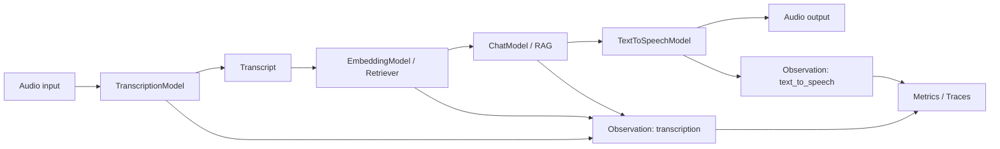
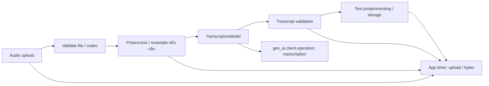
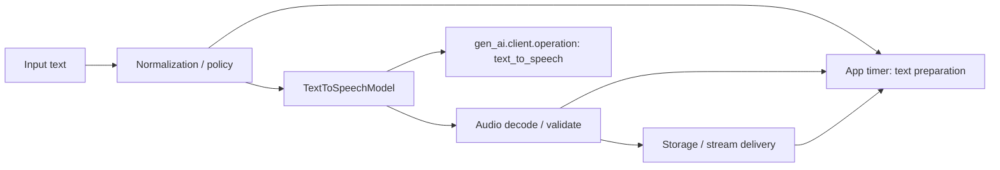
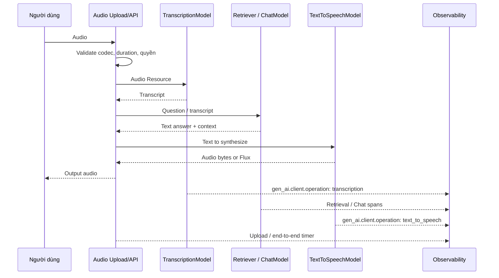

# Đánh giá khả năng quan sát các thao tác âm thanh theo phiên bản

## 1. Bài toán: hệ thống xử lý âm thanh chạy được nhưng chưa chắc quan sát được

Giả sử một ứng dụng dùng Spring AI cung cấp hai tính năng:

- **Speech-to-Text (STT, transcription):** nhận tệp ghi âm cuộc gọi và chuyển thành văn bản.
- **Text-to-Speech (TTS, speech synthesis):** nhận một đoạn văn bản và phát lại thành tiếng nói.

Sau khi nâng cấp Spring AI hoặc đổi provider, người dùng phản ánh rằng việc chuyển giọng nói sang văn bản chậm hơn, trong khi hệ thống giám sát không còn biểu đồ token usage cho một provider. Cần trả lời ít nhất bốn câu hỏi khác nhau:

1. **API hoạt động không?** `TranscriptionModel` hoặc `TextToSpeechModel` có thực sự xử lý được request?
2. **Instrumentation có được hỗ trợ không?** Spring AI tại phiên bản và provider đang dùng có tạo `gen_ai.client.operation` không?
3. **Dữ liệu đã xuất ra hệ thống quan sát chưa?** Prometheus/tracing backend có nhận đúng series/span hay chưa?
4. **Dữ liệu đo có đầy đủ và đúng ngữ nghĩa không?** Token usage có được provider báo không? Streaming span đo toàn bộ phiên hay chỉ phản hồi đầu tiên? Độ trễ tải lên/tải về có được tính trong tổng thời gian không?

**“Có API” ≠ “Có built-in observation” ≠ “Có metric ở backend” ≠ “Có thông tin chi phí đầy đủ”.**

Bài **“Đánh giá khả năng quan sát các thao tác âm thanh theo phiên bản”** nằm trong chương **Embedding và đa phương thức** của module **SPRING_AI_EVALUATION_OBSERVABILITY**. Module hướng tới đánh giá ứng dụng Spring AI bằng tập dữ liệu, relevance, fact checking và kiểm thử RAG/tool calling; đồng thời đo metrics, traces, chi phí và độ trễ để phát hiện nguyên nhân suy giảm chất lượng qua các phiên bản prompt, model và pipeline.

**Sau bài này**, bạn có thể xây ma trận khả năng quan sát cho từng phiên bản/provider, kiểm tra metric thực tế, phân biệt TTS với STT và streaming, bổ sung instrumentation an toàn, kiểm thử hồi quy và báo cáo rõ những số liệu chưa có.

## 2. Hai loại thao tác âm thanh khác nhau

Spring AI cung cấp giao diện model cho hai chiều xử lý:

| Đặc điểm | Transcription / STT | Text-to-Speech / TTS |
| --- | --- | --- |
| Đầu vào chính | Âm thanh, thường qua `Resource` | Văn bản và các tùy chọn giọng đọc |
| Đầu ra chính | Transcript văn bản | Dữ liệu âm thanh, thường `byte[]` |
| Giao diện chung | `TranscriptionModel` | `TextToSpeechModel` |
| Operation name trong observation | `transcription` | `text_to_speech` |
| Ví dụ chất lượng | WER/CER, nhận diện ngôn ngữ, tên riêng | Phát âm, độ rõ, tốc độ, giọng, mức tự nhiên |
| Ví dụ hiệu năng | Thời gian chuyển một phút ghi âm | Time to first audio chunk và tổng thời gian sinh |
| Ví dụ chi phí | Phút audio, token hoặc đơn vị provider | Ký tự, token, giây audio hoặc đơn vị provider |

TTS **không phải** `ImageModel`; STT **không phải** `EmbeddingModel`. Nếu pipeline nhận một audio clip, tạo transcript rồi embedding transcript để RAG tìm tài liệu, phải quan sát **cả transcription và embedding**, không coi hai phép gọi là một operation.



Trong sơ đồ, một câu trả lời tổng thể có thể chậm vì STT, retrieval, ChatModel hoặc TTS. Chỉ xem tổng latency của request sẽ không đủ để biết giai đoạn nào gây nghẽn.

## 3. Ma trận theo phiên bản: API và observation không luôn xuất hiện cùng lúc

Tài liệu Spring AI phải được đọc theo **đúng phiên bản**. Dưới đây là những mốc có ý nghĩa với observability âm thanh:

| Nhánh/mốc | Nội dung có căn cứ từ tài liệu | Cần làm khi triển khai |
| --- | --- | --- |
| Các nhánh cũ trước mốc 2.0.2 | Một số API âm thanh và class provider-specific tồn tại, nhưng không được suy rằng đã có toàn bộ audio model observations mới. | Xem tài liệu và kiểm runtime của version thực tế. |
| **Spring AI 2.0.2** | Upgrade notes ghi nhận observation mới cho **OpenAI TTS và transcription**, **ElevenLabs TTS**; `gen_ai.client.operation` dùng tên `text_to_speech` và `transcription` khi có `ObservationRegistry`. | Kiểm tra registry/exporter; dự kiến có thêm metric series và spans sau nâng cấp. |
| **Spring AI 2.1.0** | Observability reference ghi **TTS: OpenAI, ElevenLabs, Google GenAI**; **transcription: OpenAI, Google GenAI**. | Dùng danh sách version-specific và kiểm bằng model call thật. |
| **2.1.x snapshot / phiên bản tiếp theo** | Tài liệu và API streaming có thể bổ sung hoặc thay đổi; snapshot chưa chắc là hợp đồng của bản stable đang chạy. | Không sao chép hành vi snapshot vào production khi dependency là stable khác. |

**Không đánh đồng danh sách provider của API với danh sách provider có observability.** Ví dụ các tài liệu 2.1.x có liệt kê implementation STT/TTS chạy cục bộ qua Qxotic jinfer, nhưng danh sách built-in observability tại trang Spring AI **2.1.0** không đưa implementation này vào nhóm provider hỗ trợ. Một adapter có thể chạy tốt mà không tự phát span theo đúng tên của Spring AI.

### Phải kiểm tra cả phiên bản class và cấu hình

Trong một dự án nâng cấp, có thể gặp ví dụ cũ dùng `SpeechModel` hoặc `SpeechPrompt` thuộc package riêng của OpenAI. Hướng dẫn migration của Spring AI chuyển sang các giao diện chung:

- `org.springframework.ai.audio.tts.TextToSpeechModel`;
- `org.springframework.ai.audio.tts.TextToSpeechPrompt`;
- `org.springframework.ai.audio.transcription.TranscriptionModel`.

Với TTS, tài liệu migration nêu tham số tốc độ đã đổi từ `Float` sang `Double` trong shared API. Khi một đoạn code cũ không biên dịch, đó là **vấn đề tương thích API**, không thể dùng sự cố đó để suy rằng observability hỏng.

**Phiên bản phải ghi trong báo cáo:** Spring AI artifact/BOM, Spring Boot, provider starter, tên implementation model, model ID/deployment, chế độ call/stream, Micrometer/tracing exporter và phiên bản cấu hình liên quan.

## 4. Instrumentation của TTS trong Spring AI 2.1.0

Tài liệu observability 2.1.0 nêu các implementation `TextToSpeechModel` của **OpenAI**, **ElevenLabs** và **Google GenAI** nằm trong phạm vi hỗ trợ.

- `gen_ai.client.operation` đo lời gọi model.
- Với streaming, **một lần stream được quan sát như một operation**, từ khi đăng ký nhận dữ liệu (*subscription*) cho tới khi stream kết thúc.
- `gen_ai.client.token.usage` biểu thị token usage cho một model call **khi provider trả dữ liệu usage phù hợp**.

Các key:

| Key | Cardinality trong tài liệu | Ý nghĩa |
| --- | --- | --- |
| `gen_ai.operation.name` | Low | Giá trị `text_to_speech` |
| `gen_ai.system` | Low | Provider được instrumentation nhận diện |
| `gen_ai.request.model` | Low | Model mà request yêu cầu |
| `gen_ai.request.audio.voice` | High | Voice được chỉ định khi có |
| `gen_ai.request.audio.response_format` | High | Định dạng âm thanh trả về |
| `gen_ai.request.audio.speed` | High | Tốc độ phát âm khi được cấu hình |
| `gen_ai.request.stream` | High | Chỉ xuất hiện khi streaming và giá trị `true` |

**Không tự đưa `voice` hay `speed` thành metric tags có cardinality không giới hạn.** Theo tài liệu, các trường high-cardinality được dùng ở traces; không nên tự thay đổi nguyên tắc này khi xây dashboard.

**Không mặc định mọi field đều có.** Một provider có thể không cho chọn voice, speed hoặc format như một provider khác. Một model có thể không cung cấp token count; vì vậy dù timer tồn tại, usage series có thể không.

## 5. Instrumentation của transcription trong Spring AI 2.1.0

Tài liệu observability 2.1.0 liệt kê **OpenAI** và **Google GenAI** cho `TranscriptionModel`.

| Key | Cardinality | Ý nghĩa |
| --- | --- | --- |
| `gen_ai.operation.name` | Low | Giá trị `transcription` |
| `gen_ai.system` | Low | Provider của model |
| `gen_ai.request.model` | Low | Model được yêu cầu |
| `gen_ai.request.stream` | High | Có khi gọi stream, chỉ xuất hiện nếu `true` |

Trong trường hợp này, **nội dung audio input không được observation handler đọc hoặc diễn giải**, bởi dữ liệu có thể là một stream chỉ có thể đọc một lần và có thể chứa thông tin nhạy cảm. Hệ thống quan sát mặc định cũng không xuất transcript.

Đây là thiết kế an toàn, không phải lỗi thiếu thông tin. Nếu cần đo độ dài audio, sample rate hoặc số kênh, hãy lấy từ metadata tin cậy **ở ranh giới upload/decoder của ứng dụng**, không ép observation handler đọc lại audio stream rồi làm hỏng việc model tiêu thụ dữ liệu.

### Một lưu ý quan trọng về streaming theo version

Tài liệu observability nói về `call` và `stream` ở tầng instrumentation. Tuy nhiên, **chữ ký interface, tính năng stream và cách từng provider thực hiện stream có thể khác theo bản API và adapter**. Vì vậy:

1. Xem đúng Javadoc của dependency Spring AI đang chạy.
2. Xác định provider đã implement streaming hay chưa.
3. Kiểm thử subscription, data emission, completion, cancellation và lỗi.
4. Không lấy việc có method trong interface làm bằng chứng provider hỗ trợ thực thi mọi chế độ.

Ví dụ trên 2.1.x, tài liệu TTS trình bày `stream(String)` trả `Flux<byte[]>`. Đối với STT, có các trang tài liệu/Javadoc nhánh khác nhau thể hiện chi tiết `StreamingTranscriptionModel` khác nhau; cần đối chiếu theo **binary version thực** thay vì khẳng định mọi backend có cùng streaming semantics.

## 6. Bốn mức xác minh observability

Với từng cặp **(version, provider, model, operation, mode)**, hãy kiểm tra đủ bốn mức:

| Mức | Câu hỏi | Bằng chứng phù hợp |
| --- | --- | --- |
| **API_SUPPORTED** | Có thực hiện được STT/TTS không? | Lời gọi API thành công với đầu vào hợp lệ |
| **INSTRUMENTED** | Model adapter có tạo Micrometer Observation không? | Span/timer với tên `gen_ai.client.operation` đúng operation |
| **EXPORTED** | Registry và exporter có truyền dữ liệu tới backend không? | Prometheus series hoặc trace trong backend |
| **USAGE_AVAILABLE** | Provider có trả token/dữ liệu sử dụng không? | Response metadata/counter token có dữ liệu và đúng ngữ nghĩa |

Tùy mục tiêu còn cần một mức thứ năm: **ACTIONABLE**, nghĩa là telemetry đủ để nhóm kỹ thuật xác định vấn đề (latency model, tải audio, tải output, retry, lỗi format, streaming cancel).

Một ví dụ:

```text
Spring AI: 2.1.0
Provider: OpenAI
Operation: transcription
Mode: synchronous

API_SUPPORTED       = PASS
INSTRUMENTED        = PASS
EXPORTED            = PASS
USAGE_AVAILABLE     = UNKNOWN (chưa thấy provider usage)
ACTIONABLE          = PARTIAL (thiếu audio duration ở app layer)
```

Đây là **mẫu báo cáo**, không phải kết quả thực nghiệm đã chạy. Dòng `UNKNOWN` là cách ghi đúng khi thiếu dữ liệu để kết luận, không phải một lỗi mặc định của Spring AI hay OpenAI.

## 7. Quan sát model call khác với quan sát pipeline âm thanh

Một lời gọi audio có thể có nhiều công đoạn bên ngoài model:

**Luồng STT:**



**Luồng TTS:**



Vì vậy cần phân biệt:

- **model latency:** thời gian Spring AI observation đo cho model call;
- **upload/preprocess latency:** thời gian đưa audio về định dạng provider chấp nhận;
- **storage/postprocess latency:** thời gian lưu transcript hoặc phát/tải audio;
- **end-to-end latency:** thời gian người dùng chờ nhận nội dung dùng được.

Không cộng một timer bao ngoài và các span con như những khoảng thời gian độc lập; có thể bị **đếm trùng**, đặc biệt khi model call nằm trong service timer hoặc có async execution.

### Streaming: thời gian phát byte đầu tiên khác thời gian kết thúc

Với streaming TTS, ít nhất hai phép đo có ích:

- **Time to first audio chunk (TTFC):** từ lúc subscribe/call tới byte audio đầu tiên được phát.
- **Total stream duration:** từ subscribe cho tới complete/error/cancel.

Một stream có TTFC = 450 ms nhưng tổng thời gian = 9 s có thể tạo cảm giác bắt đầu phát nhanh. Một operation timer đo **toàn stream** sẽ không tự phản ánh TTFC; phải bổ sung phép đo ở app boundary.

Nếu stream bị cancel vì người dùng ngừng nghe, cần ghi `CANCELLED` riêng; không đồng nhất cancel với model failure hoặc một stream đã phát đủ toàn bộ âm thanh.

## 8. Java: gọi STT và TTS qua shared interfaces

Ví dụ Spring AI 2.1.x sau sử dụng giao diện chung để tránh gắn code ứng dụng vào một provider.

```java
import org.springframework.ai.audio.transcription.TranscriptionModel;
import org.springframework.ai.audio.tts.TextToSpeechModel;
import org.springframework.core.io.Resource;

public final class AudioOperations {

    private final TranscriptionModel transcriptionModel;
    private final TextToSpeechModel ttsModel;

    public AudioOperations(
            TranscriptionModel transcriptionModel,
            TextToSpeechModel ttsModel) {
        this.transcriptionModel = transcriptionModel;
        this.ttsModel = ttsModel;
    }

    public String transcribe(Resource audioResource) {
        if (audioResource == null) {
            throw new IllegalArgumentException("Audio resource rỗng");
        }

        String transcript = transcriptionModel.transcribe(audioResource);
        if (transcript == null || transcript.isBlank()) {
            throw new IllegalStateException("Transcript trống");
        }
        return transcript;
    }

    public byte[] synthesize(String text) {
        if (text == null || text.isBlank()) {
            throw new IllegalArgumentException("Text đầu vào rỗng");
        }

        byte[] audio = ttsModel.call(text);
        if (audio == null || audio.length == 0) {
            throw new IllegalStateException("Không có audio output");
        }
        return audio;
    }
}
```

**Lưu ý:**

- `Resource` có thể đại diện một luồng chỉ đọc một lần; không gọi `getInputStream()` để log hoặc hash tùy tiện trước khi chuyển cho model.
- Trả `byte[]` không đảm bảo codec, duration và định dạng phát được; ứng dụng phải validate output theo hợp đồng provider.
- Một transcript không rỗng không đảm bảo nhận diện đúng; cần tập audio có bản phiên âm chuẩn để đo WER/CER.
- Mã không khởi tạo provider và chưa được chạy; cần dependency, API key hoặc hạ tầng model phù hợp.

**Nếu provider không có built-in observation:** các method trên vẫn có thể hoạt động. Muốn đo `gen_ai.client.operation` thì phải có instrumentation tương thích, hoặc tự đo bằng Timer/Observation ở tầng service.

## 9. Java: fallback instrumentation cho provider chưa được hỗ trợ

Đối với adapter chưa phát audio model observation, có thể bổ sung timer ở **application boundary**. Ví dụ sau không log audio, transcript hay nội dung văn bản.

```java
import io.micrometer.core.instrument.MeterRegistry;
import io.micrometer.core.instrument.Timer;

import org.springframework.ai.audio.transcription.TranscriptionModel;
import org.springframework.ai.audio.tts.TextToSpeechModel;
import org.springframework.core.io.Resource;

public final class ObservedAudioOperations {

    private final TranscriptionModel transcription;
    private final TextToSpeechModel speech;
    private final MeterRegistry meters;

    public ObservedAudioOperations(
            TranscriptionModel transcription,
            TextToSpeechModel speech,
            MeterRegistry meters) {
        this.transcription = transcription;
        this.speech = speech;
        this.meters = meters;
    }

    public String transcribe(Resource audio) {
        if (audio == null) {
            throw new IllegalArgumentException("NO_AUDIO");
        }

        Timer.Sample sample = Timer.start(meters);
        String outcome = "success";

        try {
            String result = transcription.transcribe(audio);
            if (result == null || result.isBlank()) {
                outcome = "empty_transcript";
                throw new IllegalStateException("EMPTY_TRANSCRIPT");
            }
            return result;
        }
        catch (RuntimeException ex) {
            if ("success".equals(outcome)) {
                outcome = "error";
            }
            throw ex;
        }
        finally {
            sample.stop(Timer.builder("app.audio.model.boundary")
                    .tag("operation", "transcription")
                    .tag("outcome", outcome)
                    .register(meters));
        }
    }

    public byte[] synthesize(String text) {
        if (text == null || text.isBlank()) {
            throw new IllegalArgumentException("EMPTY_TEXT");
        }

        Timer.Sample sample = Timer.start(meters);
        String outcome = "success";

        try {
            byte[] result = speech.call(text);
            if (result == null || result.length == 0) {
                outcome = "empty_audio";
                throw new IllegalStateException("EMPTY_AUDIO");
            }
            meters.summary("app.audio.tts.bytes.returned")
                    .record(result.length);
            return result;
        }
        catch (RuntimeException ex) {
            if ("success".equals(outcome)) {
                outcome = "error";
            }
            throw ex;
        }
        finally {
            sample.stop(Timer.builder("app.audio.model.boundary")
                    .tag("operation", "text_to_speech")
                    .tag("outcome", outcome)
                    .register(meters));
        }
    }
}
```

Đây là metric **tự định nghĩa** `app.audio.model.boundary`, **không phải** `gen_ai.client.operation` do Spring AI sinh. Nó đo service wrapper, không bảo đảm phần model nội bộ được instrumented. Cũng không tự thu token usage của provider.

**Không cộng thời gian wrapper với thời gian built-in model call** nếu adapter đã hỗ trợ; chúng có thể đo các đoạn trùng nhau. Nên dùng metric wrapper khi cần ranh giới nghiệp vụ hoặc fallback, và model observation khi cần phân tích provider/model.

Các tag `operation` và `outcome` có tập giá trị nhỏ. Không dùng filename, user ID, transcript text hoặc audio URL làm tag metrics.

## 10. Streaming: đo TTFC và thời gian hoàn tất riêng

Spring AI TTS 2.1.x có thể stream byte audio theo `Flux<byte[]>`. Một wrapper nên tạo số liệu **khi có subscription**, không phải ngay lúc trả về một `Flux` chưa được tiêu thụ.

```java
import java.util.Locale;
import java.util.concurrent.TimeUnit;
import java.util.concurrent.atomic.AtomicBoolean;

import io.micrometer.core.instrument.MeterRegistry;
import org.springframework.ai.audio.tts.TextToSpeechModel;
import reactor.core.publisher.Flux;

public final class ObservedStreamingTts {

    private final TextToSpeechModel model;
    private final MeterRegistry meters;

    public ObservedStreamingTts(
            TextToSpeechModel model, MeterRegistry meters) {
        this.model = model;
        this.meters = meters;
    }

    public Flux<byte[]> stream(String text) {
        if (text == null || text.isBlank()) {
            return Flux.error(
                    new IllegalArgumentException("EMPTY_TEXT"));
        }

        return Flux.defer(() -> {
            final long started = System.nanoTime();
            final AtomicBoolean receivedFirst = new AtomicBoolean();

            return model.stream(text)
                    .doOnNext(chunk -> {
                        if (chunk != null && chunk.length > 0
                                && receivedFirst.compareAndSet(
                                        false, true)) {
                            meters.timer(
                                    "app.audio.tts.time.to.first.chunk")
                                .record(
                                    System.nanoTime() - started,
                                    TimeUnit.NANOSECONDS);
                        }
                    })
                    .doFinally(signal -> {
                        String outcome =
                                signal.name().toLowerCase(Locale.ROOT);
                        meters.timer(
                                "app.audio.tts.stream.duration",
                                "signal", outcome)
                            .record(
                                System.nanoTime() - started,
                                TimeUnit.NANOSECONDS);
                    });
        });
    }
}
```

Đoạn code minh họa **TTFC của chunk đầu tiên có byte** và thời gian stream tới tín hiệu kết thúc. `doFinally` chạy cả khi complete, error và cancel. Nếu stream không phát chunk nào, timer TTFC **không có mẫu**; đó là thông tin cần thể hiện riêng, không gán “TTFC = 0”.

Đây là số liệu của **consumer-facing stream** ở tầng ứng dụng. Nếu thêm buffering, queue hoặc transport tới browser, TTFC người dùng thực thấy có thể khác TTFC server nhận được.

Một `Flux` có thể bị subscribe nhiều lần, mỗi subscription có một phép đo riêng. Không gọi một publisher chưa subscribe là “đã có model call” nếu implementation thực hiện lười (lazy); hãy kiểm tra thực tế trên phiên bản provider.

## 11. Cấu hình Actuator, Prometheus và tracing

Để quan sát được model operations, Spring Boot cần Micrometer infrastructure. Các dependency phổ biến gồm:

- `spring-boot-starter-actuator`;
- `micrometer-registry-prometheus` nếu export sang Prometheus;
- tracing bridge và exporter tương ứng nếu cần distributed trace.

Tùy Spring Boot/ Spring AI BOM, tên dependency và auto-configuration cụ thể có thể thay đổi. Không mở rộng quyền truy cập endpoint actuator chỉ để kiểm thử.

Ví dụ `application.properties` cho **môi trường kiểm thử nội bộ**:

```properties
management.endpoints.web.exposure.include=health,info,metrics,prometheus
management.metrics.distribution.percentiles-histogram.gen_ai.client.operation=true
management.tracing.sampling.probability=1.0

spring.ai.audio.speech.observations.log-text=false
spring.ai.audio.transcription.observations.log-transcript=false
```

Hai property logging là **tùy chọn bảo mật**, không phải công tắc bật/tắt model observation. Chúng đều mặc định `false` trong tài liệu Spring AI 2.1.0.

Thực hiện một request TTS/STT có kết quả rõ ràng, sau đó kiểm tra:

```text
GET /actuator/metrics
GET /actuator/metrics/gen_ai.client.operation
GET /actuator/prometheus
```

Để thấy trace, phải có tracer, sampling và exporter hoạt động. Một metric trong Actuator không tự bảo đảm trace đã tới Jaeger/Tempo/OTel collector.

**Tại production**, cần giảm sampling phù hợp lưu lượng, cấu hình access control cho endpoint và tránh xuất transcript/âm thanh ra hệ thống observability ngoài phạm vi được phép.

## 12. Prometheus: lọc đúng operation và đọc số đo

Với Spring AI observation, các series timer phổ biến khi export Prometheus:

| Series | Ý nghĩa |
| --- | --- |
| `gen_ai_client_operation_seconds_count` | Số model operations đã hoàn thành |
| `gen_ai_client_operation_seconds_sum` | Tổng thời gian gọi model đã hoàn thành |
| `gen_ai_client_operation_seconds_max` | Thời gian tối đa trong cửa sổ quan sát |
| `gen_ai_client_operation_seconds_bucket` | Histogram buckets nếu được bật |
| `gen_ai_client_token_usage_total` | Counter token usage nếu provider báo |

**Tốc độ lời gọi STT** theo provider và model:

```promql
sum by (gen_ai_system, gen_ai_request_model) (
  rate(gen_ai_client_operation_seconds_count{
    gen_ai_operation_name="transcription"
  }[5m])
)
```

**Tốc độ lời gọi TTS**:

```promql
sum by (gen_ai_system, gen_ai_request_model) (
  rate(gen_ai_client_operation_seconds_count{
    gen_ai_operation_name="text_to_speech"
  }[5m])
)
```

**Latency trung bình của TTS trong 5 phút**:

```promql
sum by (gen_ai_system, gen_ai_request_model) (
  rate(gen_ai_client_operation_seconds_sum{
    gen_ai_operation_name="text_to_speech"
  }[5m])
)
/
sum by (gen_ai_system, gen_ai_request_model) (
  rate(gen_ai_client_operation_seconds_count{
    gen_ai_operation_name="text_to_speech"
  }[5m])
)
```

Đơn vị của phép chia là **giây/model call**, không phải giây/phút audio. Khi mẫu số bằng 0, nên hiển thị `NO_DATA` thay vì ghi latency bằng 0.

**Không gộp `transcription` và `text_to_speech`** khi đo một loại workload; hai model có input size, đầu ra, độ trễ và cách tính phí khác nhau.

### p95 latency cần histogram

Bật:

```properties
management.metrics.distribution.percentiles-histogram.gen_ai.client.operation=true
```

Sau khi có bucket, ví dụ p95 của STT:

```promql
histogram_quantile(
  0.95,
  sum by (le, gen_ai_system, gen_ai_request_model) (
    rate(gen_ai_client_operation_seconds_bucket{
      gen_ai_operation_name="transcription"
    }[5m])
  )
)
```

Nếu không có `_bucket`, không thể suy p95 từ riêng `_sum` và `_count`. Kiểm tra cấu hình histogram, registry, model đã có request và nhãn exporter. Một model call streaming được tính tới lúc stream kết thúc; vì vậy p95 stream có thể lớn hơn p95 non-streaming ngay cả khi người dùng nghe được âm thanh sớm.

## 13. Token usage không nhất thiết tương ứng chi phí âm thanh

Tài liệu Spring AI mô tả `gen_ai.client.token.usage` có thể xuất số input/output token cho một model call. Nhưng audio provider có thể tính tiền theo:

- thời lượng âm thanh đầu vào (giây/phút);
- ký tự hoặc token văn bản sinh speech;
- token audio/đơn vị xử lý đặc thù;
- model, chất lượng đầu ra, độ dài generated audio;
- batch/streaming mode hoặc các quy định pricing khác.

Ví dụ PromQL (chỉ có kết quả khi series thật tồn tại):

```promql
sum by (gen_ai_request_model) (
  rate(gen_ai_client_token_usage_total{
    gen_ai_operation_name="transcription",
    gen_ai_token_type="input"
  }[5m])
)
```

**Ba cảnh báo:**

1. Nếu provider không trả usage, metric token có thể **không tăng**. Không diễn giải thành 0 token hoặc miễn phí.
2. Nếu provider trả cả `input`, `output` và `total`, không cộng cả ba giá trị vì có thể tính trùng.
3. Nếu provider tính theo phút audio, lấy token count làm toàn bộ chi phí có thể thiếu hoặc sai.

Một phép tính chi phí giả định:

```text
Transcription total duration = 120 minutes
Assumed price               = 0.006 USD/minute
Estimated STT model cost    = 120 × 0.006 = 0.72 USD
```

Các mức giá trên **chỉ là số ví dụ học tập**, không phải báo giá của provider hiện hành. Khi tính thực, phải ghi `provider`, `modelVersion`, `priceVersion`, `billingUnit` và đối chiếu hóa đơn chính thức.

Đặc biệt, **thời lượng audio = 60 giây không đồng nghĩa TTS provider sẽ nhận 60 giây đầu vào**; TTS đầu vào là văn bản và thời lượng đầu ra tùy giọng, tốc độ, dấu câu. Cần đo riêng duration của audio output nếu nghiệp vụ quan tâm.

## 14. Metric bổ sung để quan sát chất lượng audio workflow

Observation model call rất hữu ích nhưng không tự trả lời các câu hỏi: tệp audio dài bao lâu, đã decode thành công chưa, transcript có đúng không, audio TTS đã phát được chưa?

Có thể thiết kế các metric ứng dụng có cardinality thấp:

| Metric ứng dụng tự định nghĩa | Đơn vị | Mục đích |
| --- | --- | --- |
| `app.audio.stt.upload.bytes` | Bytes | Kích thước file nhận |
| `app.audio.stt.input.duration` | Giây | Thời lượng audio đã xác định |
| `app.audio.stt.transcript.chars` | Ký tự | Kích thước transcript, không phải nội dung |
| `app.audio.stt.empty.results` | Events | Kết quả STT rỗng |
| `app.audio.tts.output.bytes` | Bytes | Dung lượng audio tạo ra |
| `app.audio.tts.output.duration` | Giây | Thời lượng audio sau decode |
| `app.audio.tts.first.chunk` | Giây | TTFC của stream |
| `app.audio.tts.stream.cancelled` | Events | Stream bị hủy |
| `app.audio.pipeline.duration` | Giây | End-to-end pipeline latency |
| `app.audio.processing.errors` | Events | Lỗi decode, validation, storage |
| `app.audio.provider.cost.estimated` | Đơn vị tiền | Chi phí ước tính theo giá và usage hợp lệ |

Đây là **tên gợi ý**, không phải danh sách metric Spring AI tự sinh. Một số hệ thống có thể không muốn xuất `transcript.chars` do yêu cầu riêng tư; cần chính sách dữ liệu phù hợp.

**Đo duration audio bằng decoder/metadata hợp lệ**, không bằng số byte chia cho một hằng số tùy tiện. Audio nén (MP3, Opus...) có bitrate thay đổi, độ dài file không cho biết chính xác duration.

**Không đọc audio từ `Resource` lần thứ hai** chỉ để thu metric nếu stream chỉ đọc một lần. Tốt hơn là đo metadata ở khâu upload/ingestion rồi chuyển `Resource` nguyên vẹn tới model.

## 15. Đánh giá chất lượng: latency tốt chưa đủ

Observability của model không đồng nghĩa quality evaluation. Hai hướng đánh giá cần có tiêu chí riêng:

**STT – kiểm tra transcript**

- **WER (Word Error Rate):** tính số từ thay thế, bỏ sót, thêm mới so với bản transcript chuẩn, chia tổng số từ chuẩn.
- **CER (Character Error Rate):** tương tự trên đơn vị ký tự, hữu ích cho trường hợp phân tách từ đặc thù.
- **Tên riêng/số liệu:** mã đơn, số tiền, ngày tháng, tên sản phẩm thường cần kiểm tra bổ sung.
- **Diarization:** nếu model hỗ trợ phân đoạn người nói, đo độ chính xác gán speaker và timestamp riêng.
- **Đa ngôn ngữ/tiếng Việt:** có thể cần normalization quy tắc dấu câu, số viết bằng chữ và chữ số trước khi so sánh.

**TTS – kiểm tra âm thanh phát ra**

- Có file hợp lệ, phát được, đúng sample rate/codec đầu ra.
- Phát âm tiếng Việt, dấu thanh, tên riêng, ký hiệu, số tiền.
- Mức tự nhiên và độ rõ qua người đánh giá hoặc bộ test phù hợp.
- Không cắt câu, không chèn âm không mong muốn, không lỗi cuối stream.
- Độ trễ TTFC, tổng duration và trải nghiệm phát audio liên tục.

```text
Example STT reference: "Gói Premium được hoàn tiền trong bảy ngày."
STT candidate:          "Gói Premium được hoàn tiền trong ba ngày."

Audio model call: success
Transcript non-empty: yes
Factual content: WRONG (bảy -> ba)
```

Một `gen_ai.client.operation` không thể phát hiện lỗi nghĩa của transcript trên. Nếu câu nói STT sai rồi đi vào RAG hoặc tool calling, chất lượng phản hồi cuối cũng có thể suy giảm dù các span đều không có exception.

## 16. Tracing cho cả STT → RAG → TTS

Một pipeline giọng nói hoàn chỉnh có thể được mô tả:



Khi so sánh latency, hãy tách:

| Giai đoạn | Metric quan trọng | Trường hợp lỗi |
| --- | --- | --- |
| Upload/decode | Bytes, duration, decode failure | Audio không đọc được |
| Transcription | Model latency, API error, WER trên test | Transcript sai hoặc trống |
| Retrieval | Query embedding, vector store latency, relevance | Context thiếu |
| Chat | Chat latency, token và groundedness | Trả lời không bám nguồn |
| TTS | Model latency, TTFC, format và byte output | Không phát được audio |
| Delivery | Network/upload/storage latency | Model thành công nhưng người dùng không nghe được |

Với tracing, nếu STT chiếm 3 giây, RAG 1 giây và TTS 2 giây, tổng trải nghiệm có thể lớn hơn 6 giây do upload, postprocess và delivery; cũng có trường hợp các bước overlap. Không xác định tổng latency bằng việc cộng tùy tiện mọi span vì có thể lồng nhau.

## 17. Bảo mật: mặc định không xuất âm thanh hoặc transcript

Audio và transcript thường chứa thông tin nhạy cảm: giọng nói, tên riêng, số điện thoại, số tài khoản hoặc nội dung cuộc họp.

Theo tài liệu Spring AI 2.1.0:

```properties
# Nội dung text dùng để tạo tiếng nói (TTS):
spring.ai.audio.speech.observations.log-text=false

# Văn bản chuyển từ audio (STT):
spring.ai.audio.transcription.observations.log-transcript=false
```

Cả hai mặc định là `false`. Spring AI nêu rõ audio input của transcription **không được mô tả bằng filename** và observation handler **không đọc nội dung audio**; audio output của TTS cũng không được xuất nguyên bản theo instrumentation mặc định.

**Không bật `log-transcript=true` hoặc `log-text=true` trên production chỉ để có số liệu latency.** Đây là các cấu hình log nội dung, không phải điều kiện để Timer hoạt động.

Khuyến nghị:

- Không đặt transcript, tên file, đường dẫn máy người dùng, audio URL hay dữ liệu binary vào metric tags.
- Dùng correlation ID trong trace/log có phân quyền và thời gian lưu trữ được kiểm soát.
- Kiểm tra logger tự viết, HTTP debug và exception có vô tình in dữ liệu ra ngoài hay không.
- Nếu cần lưu mẫu audio để QA, phải có quyền hợp lệ, bảo mật, chính sách retention và xóa dữ liệu.
- Với dữ liệu từ nhiều tổ chức/tenant, bảo đảm log không làm lộ nội dung giữa các tenant.
- Tránh đưa file path vào span attribute nếu không cần, vì có thể tiết lộ cấu trúc thiết bị hoặc danh tính.

## 18. Kiểm thử khả năng quan sát theo phiên bản

Một bộ kiểm thử khả thi nên tách **contract test**, **integration test** và **end-to-end test**.

### Test A – Contract test không gọi provider

Kiểm tra wrapper đo dữ liệu khi model trả thành công hoặc lỗi:

- Stub `TranscriptionModel` trả một transcript.
- Stub `TextToSpeechModel` trả vài byte giả để kiểm code đếm bytes.
- Kiểm `app.audio.model.boundary` ghi `operation` và `outcome` đúng.
- Kiểm validation chặn input rỗng trước model call.

Ví dụ JUnit 5 + Mockito cho TTS wrapper đã trình bày ở mục 9:

```java
import static org.junit.jupiter.api.Assertions.assertEquals;
import static org.mockito.Mockito.*;

import io.micrometer.core.instrument.simple.SimpleMeterRegistry;
import org.junit.jupiter.api.Test;
import org.springframework.ai.audio.transcription.TranscriptionModel;
import org.springframework.ai.audio.tts.TextToSpeechModel;

class ObservedAudioOperationsTest {

    @Test
    void countsSuccessfulTtsBoundary() {
        TextToSpeechModel model = mock(TextToSpeechModel.class);
        TranscriptionModel stt = mock(TranscriptionModel.class);
        when(model.call("Xin chào"))
                .thenReturn(new byte[]{1, 2, 3, 4});

        try (SimpleMeterRegistry meters =
                     new SimpleMeterRegistry()) {
            var service = new ObservedAudioOperations(
                    stt, model, meters);

            byte[] audio = service.synthesize("Xin chào");
            assertEquals(4, audio.length);

            var timer = meters.find("app.audio.model.boundary")
                    .tag("operation", "text_to_speech")
                    .tag("outcome", "success")
                    .timer();
            assertEquals(1L, timer.count());
        }
    }
}
```

Đây là **test cho code instrumentation tự viết**, không chứng minh Spring AI provider built-in đã phát `gen_ai.client.operation`.

### Test B – Integration test có provider thật

1. Xác định version Spring AI/BOM và model implementation.
2. Bật Micrometer/Actuator, sampling/exporter cần thiết.
3. Dùng một mẫu audio **không chứa thông tin cá nhân** và một câu TTS đơn giản.
4. Gọi `transcribe(...)` và `call(...)` với input hợp lệ.
5. Xác nhận đã có output nghiệp vụ nhưng giữ riêng kết luận “API success”.
6. Kiểm `gen_ai.client.operation` cho `transcription`/`text_to_speech` ở Actuator và Prometheus.
7. Kiểm spans và trace context; đối chiếu model/provider tags thực tế.
8. Xem token usage có xuất không; nếu không, ghi `USAGE_UNAVAILABLE` thay vì fail cả test.
9. Kiểm logging mặc định không chứa transcript và TTS text.
10. Ghi phiên bản, cấu hình, độ dài audio, latency, kết quả telemetry, chi phí và lỗi.

### Test C – Streaming

- Chạy với provider có hỗ trợ stream ở phiên bản đang dùng.
- Xác nhận có subscription mới phát operation.
- Đo TTFC và tổng duration; kiểm streaming span không kết thúc ngay tại chunk đầu.
- Gửi cancel từ phía client; kiểm span/timer hoàn tất theo tín hiệu và tài nguyên kết nối được giải phóng.
- Kiểm trường `gen_ai.request.stream` xuất hiện với `true` khi có support.
- Không kết luận một model có streaming chỉ vì shared interface công bố method.

### Mẫu ma trận kiểm thử

| Version | Provider | Operation | Mode | API | Observation | Export | Usage | Notes |
| --- | --- | --- | --- | --- | --- | --- | --- | --- |
| 2.0.2 | OpenAI | TTS | call | Chưa kiểm | Tài liệu nêu hỗ trợ | Chưa kiểm | Chưa kiểm | Mốc thêm observation |
| 2.0.2 | ElevenLabs | TTS | call | Chưa kiểm | Tài liệu nêu hỗ trợ | Chưa kiểm | Chưa kiểm | Kiểm export thực tế |
| 2.1.0 | Google GenAI | TTS | call | Chưa kiểm | Tài liệu nêu hỗ trợ | Chưa kiểm | Chưa kiểm | Kiểm model options |
| 2.1.0 | Google GenAI | STT | call | Chưa kiểm | Tài liệu nêu hỗ trợ | Chưa kiểm | Chưa kiểm | Kiểm audio format |
| 2.1.0 | Qxotic jinfer | STT | call | Chưa kiểm | Không được nêu trong danh sách obs | Chưa kiểm | Chưa kiểm | Cần đo app layer nếu thiếu |
| 2.1.x snapshot | Tùy provider | STT | stream | Chưa kiểm | Phụ thuộc implementation | Chưa kiểm | Chưa kiểm | Không mặc định tương thích stable |

**Bảng này là kế hoạch kiểm thử minh họa, chưa phải kết quả.** Phải thay “Chưa kiểm” bằng `PASS/FAIL/NOT_SUPPORTED/UNKNOWN` **sau khi có log/metric/span thật**. Không tự suy kết quả từ tài liệu mà chưa gọi model.

## 19. Regression: khi nâng Spring AI hoặc đổi provider

Ví dụ một hệ thống dùng Spring AI 2.0.2 và OpenAI TTS, sau đó nâng lên 2.1.0 và bổ sung Google GenAI STT. Nếu số lượng audio operation trên dashboard tăng, đó có thể do **phạm vi instrumentation đã rộng hơn**, không phải lưu lượng người dùng hoặc lỗi hệ thống tăng.

Những thay đổi cần kiểm tra riêng:

| Thay đổi | Hiệu ứng có thể có | Cách phân biệt |
| --- | --- | --- |
| Spring AI version | Phát thêm series hoặc đổi cách đo | So changelog, version và output metric |
| Provider adapter | Khác telemetry và usage availability | Gắn provider/model, chạy benchmark giống nhau |
| Model/deployment | Khác latency, accuracy, token | Giữ dataset/options nhất quán |
| Audio codec/duration | Đổi độ dài input và thời gian decode | Ghi duration/format ở app layer |
| TTS voice/speed | Đổi thời lượng audio output | Phân tầng benchmark theo voice/options |
| Streaming mode | Timer kéo dài tới completion/cancel | Ghi mode, TTFC, total stream duration |
| Exporter/sampling | Dữ liệu xuất hiện/biến mất | Kiểm registry, endpoint, sampling |
| Request retries | Tăng số model calls/chi phí | Ghi attempts và logical request IDs |

### Ví dụ số liệu giả định

| Chỉ số | Pipeline A | Pipeline B |
| --- | ---: | ---: |
| STT p95 model latency | 2,4 s | 2,0 s |
| STT WER trên bộ test chuẩn | 11% | 14% |
| TTS TTFC | 600 ms | 350 ms |
| TTS total stream duration | 5,3 s | 6,1 s |
| Token usage completeness | 80% calls | 45% calls |
| Estimated cost per 100 requests | 0,75 USD | 0,90 USD |

Tất cả số liệu đều **giả định**. Pipeline B có thể cho âm thanh sớm hơn nhưng chất lượng STT giảm và chi phí tăng; không nên đánh giá chỉ bằng một p95 hoặc số lượng span.

Một phương pháp so sánh đúng: giữ cùng audio fixture, text input, ngôn ngữ, noise level, options, concurrency và điều kiện tải; đo riêng chất lượng, model latency, TTFC, end-to-end và tỷ lệ có usage. Nếu đổi version và provider đồng thời, hãy chạy đối chứng từng thay đổi để truy nguyên nguyên nhân.

## 20. Playbook chẩn đoán sự cố observability âm thanh

| Hiện tượng | Giả thuyết | Bước kiểm đầu tiên |
| --- | --- | --- |
| STT trả transcript nhưng không có `transcription` span | Provider không instrumented hoặc exporter lỗi | Version/provider, registry và /actuator/metrics |
| TTS model call có span, token usage trống | Provider không báo token hoặc adapter chưa chuyển usage | Response metadata, billing và API docs |
| TTS có âm thanh nhưng `seconds_count` ít hơn số chunk | Một stream là một operation | Đếm subscriptions, không đếm chunk |
| p95 TTS cao dù âm đầu nghe nhanh | Timer đo hết stream | Đo TTFC riêng |
| STT nhanh nhưng người dùng đợi lâu | Upload/codec decode hoặc storage chậm | End-to-end trace, upload timer |
| Token usage tăng sau upgrade | Thay semantics hoặc provider | So version và token type, không cộng đúp |
| Không thấy transcript trong trace | Logging nội dung mặc định off | Đây là lựa chọn bảo mật, không phải lỗi |
| Có nhiều HTTP spans nhưng thiếu GenAI span | HTTP instrumentation ≠ model instrumentation | Kiểm model bean/adapter |
| STT WER tăng nhưng latency giảm | Model nhanh hơn nhưng nhận sai từ | Đo trên bộ audio chuẩn |
| Streaming cancel có nhiều errors | Cancel bị phân loại thành failure | Tách CANCELLED khỏi ERROR |
| Số calls tăng sau version upgrade | Observation mới được phát hoặc retry tăng | So logical requests, provider attempts |
| Usage không có nhưng chi phí vẫn tăng | Tính theo duration/characters hoặc metric thiếu | Provider invoice và app usage |

**Quy trình ngắn:**

1. Lấy request/trace ID và phiên bản Spring AI/provider/model.
2. Xác nhận API success, output hợp lệ và chế độ call/stream.
3. Kiểm instrumentation support trong tài liệu đúng phiên bản.
4. Kiểm runtime metric/span và trạng thái exporter.
5. So thời gian model với upload/preprocess/postprocess/delivery.
6. Kiểm usage có hay không và đơn vị billing.
7. Đối chiếu chất lượng transcript/audio với golden dataset.
8. Đánh dấu nguyên nhân `PROVIDER / APPLICATION / EXPORT / QUALITY / UNKNOWN` và theo dõi sau khắc phục.

## 21. Bài tập thực hành

1. **Phạm vi hỗ trợ:** vì sao một provider có thể triển khai `TextToSpeechModel` nhưng không có `gen_ai.client.operation` do Spring AI phát?
2. **So sánh phiên bản:** từ mốc 2.0.2 đến 2.1.0, những provider audio nào được tài liệu nêu hỗ trợ observation? Làm thế nào kiểm chứng trên runtime?
3. **PromQL:** viết query đếm tốc độ STT requests theo provider, không trộn TTS, chat hoặc embedding.
4. **Streaming:** một TTS stream bắt đầu phát audio sau 300 ms nhưng kết thúc sau 8 s. Metric nào phản ánh “nghe được sớm”, metric nào phản ánh tổng thời gian?
5. **Usage:** provider không trả token counter cho STT nhưng hóa đơn vẫn tính theo phút. Vì sao không được kết luận miễn phí?
6. **Privacy:** vì sao mặc định `log-transcript=false` và `log-text=false` là phù hợp? Nêu cách debug không cần lưu nội dung.
7. **Tính toán:** một job có 180 phút audio, giá giả định 0,004 USD/phút. Tính chi phí giả định và mô tả những yếu tố có thể khiến hóa đơn thực khác.
8. **Tracing:** xây sơ đồ các spans từ upload audio → STT → RAG → TTS → delivery. Những span nào thuộc model instrumentation và những span nào cần ứng dụng đo thêm?
9. **Chất lượng STT:** một transcript chứa sai số tiền “7 triệu” thành “70 triệu”. Vì sao model call success không chứng minh output đúng?
10. **TTS output:** vì sao `byte[]` không rỗng vẫn chưa đảm bảo audio play được và đúng voice/codec?
11. **Regression:** phiên bản B có STT nhanh hơn nhưng WER kém hơn. Hãy đề xuất tiêu chí chấp nhận release.
12. **Test matrix:** thiết kế bảng version × provider × STT/TTS × call/stream × metrics/usage. Nhãn nào nên dùng khi chưa kiểm thử?
13. **Cancellation:** một stream bị client cancel ở giây thứ 2. Có nên ghi là provider error và tổng duration 8 s không? Vì sao?
14. **Cardinality:** vì sao không dùng `audioFilePath`, transcript hoặc request ID làm metric label?
15. **Instrumentation fallback:** viết một unit test mock TTS trả 10 byte, kiểm app timer được ghi mà không khẳng định model GenAI observation đã hoạt động.

## Tài liệu tham khảo

- [Spring AI 2.1.0 – Observability](https://docs.spring.io/spring-ai/reference/observability/index.html): phạm vi provider TTS/STT, `gen_ai.client.operation`, `gen_ai.client.token.usage`, streaming và các property logging an toàn.
- [Spring AI – Upgrade Notes: 2.0.2](https://docs.spring.io/spring-ai/reference/upgrade-notes.html): mốc bổ sung observations cho OpenAI TTS/STT và ElevenLabs TTS.
- [Spring AI 2.1.0 – Audio Transcription API](https://docs.spring.io/spring-ai/reference/api/audio/transcriptions.html): `TranscriptionModel`, `AudioTranscriptionPrompt` và `AudioTranscriptionResponse`.
- [Spring AI 2.1.0 – Text-to-Speech API](https://docs.spring.io/spring-ai/reference/api/audio/speech.html): `TextToSpeechModel`, response, options, provider và streaming.
- [Spring AI – Migration to shared TTS interfaces](https://docs.spring.io/spring-ai/reference/2.1-SNAPSHOT/upgrading/text-to-speech.html): chuyển class cũ sang `TextToSpeechModel` và lưu ý chữ ký options.
- [Spring AI 2.1.x – Metrics Reference](https://docs.spring.io/spring-ai/reference/2.1-SNAPSHOT/observability/metrics.html): Prometheus timer/counter names và cách chia tag operation.
- [Spring Boot – Actuator Metrics](https://docs.spring.io/spring-boot/reference/actuator/metrics.html): MeterRegistry, Prometheus export và histogram.
- [Spring Boot – Tracing](https://docs.spring.io/spring-boot/reference/actuator/tracing.html): tracing, sampling và correlation.

> **Ghi chú phiên bản và kết quả:** Bài viết dựa vào tài liệu Spring AI 2.1.0 và đối chiếu mốc nâng cấp 2.0.2; các trang snapshot chỉ được dùng để giải thích nguy cơ khác biệt API và streaming giữa phiên bản. Code Java, dữ liệu audio giả định, bảng chi phí và metric tự định nghĩa chưa được biên dịch/chạy với provider thật. Để xác nhận instrumentation hoạt động trong dự án, phải chạy integration test có model, registry và exporter tương ứng; Content QA chuyên môn thuộc bước riêng của quy trình.
