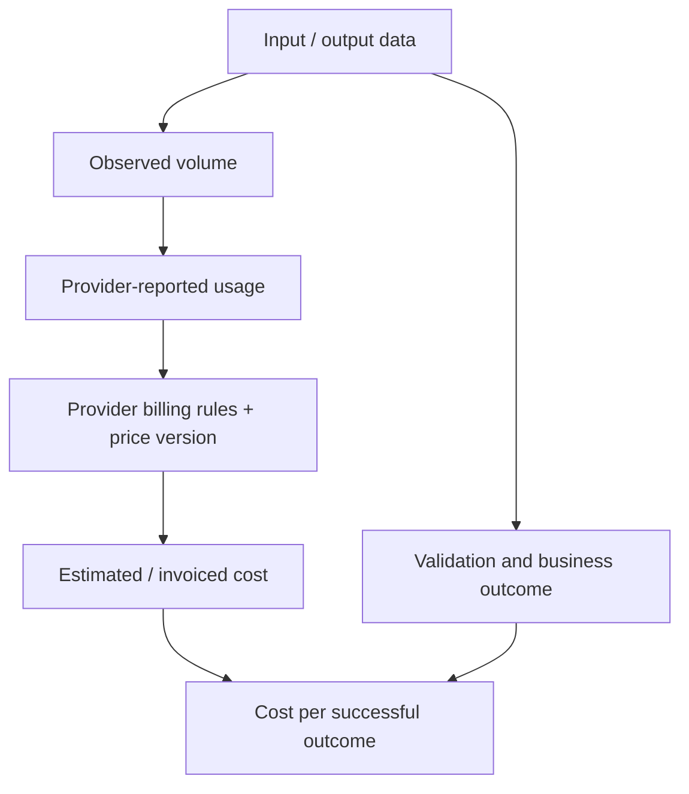

# Phân biệt số token, ảnh, thời lượng âm thanh và đơn vị tính phí

## 1. Vì sao không thể dùng một con số usage cho mọi loại dữ liệu?

Một ứng dụng Spring AI có thể thực hiện nhiều loại công việc trong cùng một request:

- Gửi văn bản vào ChatModel để tạo câu trả lời.
- Gửi một hoặc nhiều ảnh để model phân tích.
- Tạo ảnh mới từ prompt.
- Chuyển âm thanh thành văn bản (transcription/STT).
- Chuyển văn bản thành tiếng nói (TTS).
- Nhúng văn bản thành vector để tìm kiếm.

Nhóm vận hành nhìn dashboard thấy **usage = 12.000** và hỏi: “12.000 là token, ảnh hay giây audio?”. Nếu hệ thống đã cộng mọi con số vào một counter chung, câu trả lời có thể không còn khả năng khôi phục.

**Token, số ảnh và thời lượng âm thanh là những đơn vị khác nhau.** Một triệu token văn bản không thể so trực tiếp với một nghìn ảnh hoặc 60 phút audio. Ngay cả khi provider quy đổi một số modality thành token nội bộ, điều đó không có nghĩa mọi API và mọi bảng giá đều tính tiền theo cùng một cách.

Bài **“Phân biệt số token, ảnh, thời lượng âm thanh và đơn vị tính phí”** thuộc chương **Embedding và đa phương thức** của module **SPRING_AI_EVALUATION_OBSERVABILITY**. Module hướng đến đánh giá chất lượng ứng dụng Spring AI bằng tập dữ liệu, tiêu chí relevance, fact checking và kiểm thử RAG hoặc tool calling; đồng thời theo dõi metrics, traces, chi phí và độ trễ để phát hiện suy giảm qua từng phiên bản prompt, model và pipeline.

Sau bài này, bạn có thể:

1. Phân biệt đơn vị đầu vào/đầu ra theo modality.
2. Đọc usage từ response/observation mà không suy diễn quá mức.
3. Ánh xạ usage vào đơn vị tính phí thực tế của provider.
4. Tạo cost ledger có phiên bản bảng giá và trạng thái dữ liệu.
5. Thiết kế metrics, traces và kiểm thử để tránh tính trùng hoặc bỏ sót chi phí.

## 2. Bốn lớp khái niệm: dữ liệu, usage, billing và outcome

Trước khi tính tiền, hãy tách bốn lớp:

| Lớp | Câu hỏi | Ví dụ |
| --- | --- | --- |
| **Input/output volume** | Ứng dụng đã gửi hoặc nhận bao nhiêu dữ liệu? | 4 ảnh, file audio 90 giây, 2.000 ký tự |
| **Provider-reported usage** | Provider báo đã sử dụng đơn vị nào? | 3.200 input tokens, 90 audio seconds, 4 image units |
| **Billing basis** | Hóa đơn tính theo đơn vị nào và mức giá nào? | USD/1M tokens, USD/phút, USD/ảnh theo size |
| **Business outcome** | Công việc có hoàn thành và dùng được không? | Transcript đạt chuẩn, ảnh lưu thành công, câu trả lời grounded |

Các lớp này liên quan nhưng không thay thế nhau.

Ví dụ một file audio 90 giây có thể được gửi thành một request STT. Provider có thể trả usage theo giây audio hoặc audio tokens; ứng dụng có thể đo file size theo byte. **90 giây, số byte và audio tokens không phải ba cách viết của cùng một đại lượng.**

Tương tự, một request yêu cầu tạo bốn ảnh có thể trả ba ảnh; trong số đó hai ảnh tải và lưu thành công. Billing có thể dựa trên số ảnh được tạo, số request hoặc một cách tính riêng. Không thể suy hóa đơn từ số file cuối cùng mà người dùng nhận.



Một hệ thống observability tốt phải giữ được quan hệ từ **request → provider call → usage → billing calculation → kết quả nghiệp vụ**, thay vì lưu một trường usage không có đơn vị.

## 3. Token là đơn vị của tokenizer, không phải số từ hay ký tự

Token là đơn vị mà một model/tokenizer dùng để biểu diễn nội dung. Một token có thể tương ứng một từ, một phần của từ, dấu câu hoặc một chuỗi ký tự. Vì thế:

- 1.000 ký tự không nhất thiết là 1.000 token.
- 1.000 từ không nhất thiết là 1.000 token.
- Cùng một đoạn text có thể có token count khác nhau giữa model/tokenizer.
- Thay đổi nội dung format, metadata, system prompt hoặc tool schema có thể thay đổi token đầu vào.

Trong một lời gọi text model, các loại usage thường gặp:

| Đơn vị | Ý nghĩa |
| --- | --- |
| **input_tokens / prompt_tokens** | Token đầu vào theo cách provider định nghĩa |
| **output_tokens / completion_tokens** | Token được sinh ra |
| **total_tokens** | Tổng token theo hợp đồng response |
| **cached_tokens** | Một phần input được provider xử lý theo cơ chế cache, nếu có |
| **reasoning_tokens** | Token thuộc loại reasoning nếu provider công bố |
| **audio_tokens** | Token gắn với xử lý âm thanh nếu API/provider dùng đơn vị này |
| **image_tokens** | Token biểu diễn phần ảnh nếu API/provider báo loại usage này |

Tên field và cách tính có thể khác nhau giữa provider/model. Không giả định response nào cũng có đủ các trường trên.

**Không cộng total_tokens với input_tokens và output_tokens** nếu total đã bao gồm hai phần đó. Cũng không cộng cached tokens thêm lần nữa nếu provider đã tính chúng trong input total; cần đọc định nghĩa usage cụ thể.

### Token count có thể là số provider báo hoặc số ứng dụng ước lượng

Hai nguồn cần được gắn nhãn khác nhau:

- **Provider-reported:** được lấy từ response metadata hoặc usage API của provider.
- **Locally estimated:** ứng dụng đếm bằng tokenizer/ước lượng trước khi gửi request.

Một phép ước lượng hữu ích cho giới hạn context không tự động trở thành số token tính phí. Nếu lưu cả hai, hãy đặt field khác nhau như **reportedInputTokens** và **estimatedInputTokens**, không ghi đè lên nhau.

## 4. Ảnh: đếm file chưa đủ để biết lượng xử lý hoặc chi phí

Với ảnh đầu vào, các thuộc tính ứng dụng có thể đo gồm:

- số ảnh được gửi;
- kích thước pixel (width × height);
- định dạng file và dung lượng byte;
- số ảnh được model chấp nhận;
- mức chi tiết/resolution hoặc chế độ xử lý nếu API hỗ trợ.

Nhưng **một ảnh không nhất thiết tương ứng một đơn vị billing cố định**. Tùy model và provider, ảnh có thể được tính theo:

- số ảnh;
- mức phân giải hoặc tier chất lượng;
- số crop/patch/tile nội bộ;
- image tokens hoặc token tương đương;
- số request hoặc tổ hợp nhiều yếu tố.

Một ảnh 256×256 và một ảnh 4.000×3.000 pixel có thể tạo khối lượng xử lý khác nhau. Một API có thể chuẩn hóa/resize ảnh trước khi model nhận; API khác có thể chia ảnh thành nhiều vùng để xử lý. Chỉ đếm **input_images = 1** không phản ánh hết lượng sử dụng.

### Ảnh đầu vào và ảnh được tạo ra là hai loại workload

| Loại | Hướng dữ liệu | Ví dụ chỉ số |
| --- | --- | --- |
| **Image understanding** | Ứng dụng gửi ảnh cho model | input_images, pixel, image tokens nếu provider báo |
| **Image generation** | Model tạo ảnh cho ứng dụng | requested_images, returned_generations, size, quality |
| **Image editing** | Ứng dụng gửi ảnh nguồn và yêu cầu sửa | source_images, generated_outputs, mask/reference inputs nếu có |

Không cộng ảnh đầu vào với ảnh đầu ra rồi đặt tên **images_processed** nếu không định nghĩa rõ. Với một thao tác chỉnh sửa ảnh, có thể có một ảnh đầu vào và một ảnh được tạo; chúng có vai trò và cách tính phí khác nhau.

### Ví dụ

Người dùng gửi ba ảnh sản phẩm. API trả một response thành công và model usage báo **image_tokens = 2.400**. Ứng dụng ghi nhận:

- input_images = 3;
- input_bytes = tổng dung lượng file;
- reported_image_tokens = 2.400 nếu provider thật sự báo;
- model_calls = 1.

Không được ghi **2.400 tokens per image** nếu response chỉ báo tổng batch. Cũng không được chia đều 800 token/ảnh rồi gọi đó là usage thực đo.

## 5. Âm thanh: duration, audio tokens và text tokens

Âm thanh thường có ít nhất hai dạng dữ liệu:

1. **Waveform/audio payload:** file hoặc stream chứa âm thanh.
2. **Text liên quan:** transcript đầu vào/đầu ra, hoặc văn bản đưa vào TTS.

Một API có thể tính theo thời lượng audio (giây/phút), audio tokens, text tokens, ký tự hoặc đơn vị khác. TTS và STT có thể có billing basis khác nhau.

| Công việc | Input | Output | Các đơn vị có thể cần theo dõi |
| --- | --- | --- | --- |
| STT / transcription | Audio | Transcript | Input audio seconds, audio tokens, transcript chars/tokens |
| TTS / speech generation | Text | Audio | Input text chars/tokens, output audio seconds/audio tokens |
| Realtime audio | Audio stream và/hoặc text | Audio/text stream | Input/output audio duration, tokens, session duration |
| Audio understanding | Audio | Text/labels/summary | Audio duration, audio tokens, output text tokens |

**File size không bằng thời lượng.** Audio nén có bitrate thay đổi, sample rate và codec khác nhau. Không thể lấy số byte chia cho một hằng số tùy ý để kết luận chính xác audio dài bao nhiêu giây.

Để đo duration, dùng metadata/decoder phù hợp với codec, sample rate, channel count và frame count. Nếu audio là stream, cần định nghĩa duration theo thời gian audio thực được nhận/xử lý, không mặc định bằng thời gian người dùng mở kết nối.

### STT và TTS cần giữ hướng usage riêng

- STT thường quan tâm **audio input duration** và usage đầu vào của provider.
- TTS thường quan tâm **text input** và **audio output duration/bytes**.
- Một realtime session có thể có cả audio input và output; phải giữ hai trường riêng.

Nếu dashboard chỉ có **audio_seconds**, người xem sẽ không biết đó là số giây âm thanh người dùng gửi hay số giây tiếng nói model tạo ra.

## 6. Các đơn vị ứng dụng nên thu thập trước khi tính billing

Một schema volume tổng quát có thể chứa các field độc lập:

| Trường | Đơn vị | Ví dụ |
| --- | --- | --- |
| input_text_chars | ký tự | 4.500 |
| reported_input_tokens | token | 1.200 |
| reported_output_tokens | token | 600 |
| input_images | ảnh | 3 |
| input_image_pixels | pixel | tổng pixel theo định nghĩa ứng dụng |
| output_images_requested | ảnh | 4 |
| output_images_returned | ảnh | 3 |
| input_audio_duration_ms | mili giây | 90.000 |
| output_audio_duration_ms | mili giây | 45.000 |
| audio_bytes_uploaded | byte | 1.800.000 |
| audio_bytes_returned | byte | 900.000 |
| model_calls | lần gọi | 1 |
| successful_artifacts | artifact | 2 |

Những trường này không phải tất cả đều có sẵn trong Spring AI response. Một số phải được đo tại API upload, decoder, image processing, response validation hoặc storage layer.

**Quy ước đơn vị phải rõ ràng:** dùng milliseconds cho duration nội bộ nếu cần độ chính xác; khi tính tiền theo phút, quy đổi sang phút theo đúng quy tắc làm tròn của provider. Dùng byte hoặc MiB nhất quán; không dùng chữ “MB” mà không nêu quy ước thập phân hay nhị phân nếu phép đo cần chính xác.

## 7. Provider-reported usage trong Spring AI: đọc đúng giới hạn

Spring AI cung cấp các abstraction cho chat, image, audio và embedding, nhưng **không có một trường usage chung đảm bảo mọi modality và provider trả đủ cùng loại đơn vị**.

Ví dụ:

- Chat response có thể cung cấp usage theo token qua metadata của model.
- Embedding response có thể có usage nếu provider hỗ trợ.
- Image response có thể có metadata usage, nhưng không mặc định mọi provider báo token hoặc image units.
- Audio model có thể phát observation về operation; usage token hoặc duration còn tùy API/provider.
- Một provider có thể báo billing usage qua API riêng hoặc hóa đơn sau đó.

Tài liệu observability Spring AI có nhóm observation **gen_ai.client.operation** và **gen_ai.client.token.usage**. Tên token usage **không có nghĩa mọi ảnh/audio đều phải được biểu diễn bằng token**. Nếu provider không báo token usage, counter có thể không tăng. Nếu provider báo duration hoặc số ảnh ở API riêng, cần bổ sung adapter/app instrumentation để thu dữ liệu đó.

### Đừng nhầm generic Usage với mọi billing unit

Một kiểu Usage có promptTokens, completionTokens, totalTokens chỉ có ý nghĩa theo hợp đồng của API đã trả nó. Không thể lấy totalTokens để suy:

- ảnh đầu vào đã dùng bao nhiêu ảnh;
- TTS tạo bao nhiêu giây audio;
- STT đã xử lý bao nhiêu phút audio;
- chi phí storage hoặc network;
- tổng số artifact đã lưu.

Hãy dùng metadata đúng model response và provider usage API tương ứng. Nếu chưa có, đánh dấu **UNAVAILABLE** hoặc **NOT_REPORTED**.

## 8. Billing basis: provider tính tiền theo điều gì?

Một provider có thể công bố nhiều mức giá cho cùng một model hoặc cùng một modality. Billing basis có thể là:

| Billing basis | Đơn vị giá minh họa | Phù hợp với |
| --- | --- | --- |
| Input tokens | USD / 1 triệu input tokens | Text hoặc tokenized multimodal input |
| Output tokens | USD / 1 triệu output tokens | Text generation |
| Cached input tokens | USD / 1 triệu cached tokens | Khi provider có mức giá cache riêng |
| Image units | USD / ảnh | Image generation hoặc một số API ảnh |
| Resolution/quality tier | USD / ảnh theo tier | Image generation |
| Audio duration | USD / phút hoặc giây | STT/TTS khi provider tính theo thời lượng |
| Audio/text tokens | USD / triệu tokens | Model audio dùng token billing |
| Characters | USD / 1 triệu ký tự | Một số dịch vụ speech |
| Request/session | USD / request hoặc session | Dịch vụ tính phí theo lần gọi/thời gian phiên |
| Storage/egress | USD / GB hoặc request | Chi phí lưu và truyền artifact, không phải model usage |

Đây là **các dạng đơn vị có thể gặp**, không khẳng định một provider cụ thể đang áp dụng tất cả.

Bảng giá có thể đổi theo ngày, khu vực, model snapshot, batch mode, service tier, cache, chất lượng, kích thước hoặc loại tài khoản. Vì vậy, mỗi cost record phải ghi **pricing version hoặc effective date**.

### Không áp dụng bảng giá của modality này cho modality khác

Không dùng giá text token để tính ảnh tokens nếu provider có giá riêng. Không dùng giá TTS theo ký tự để tính STT theo phút. Không dùng giá model để cộng cả object storage hoặc bandwidth. Tách các dòng chi phí để có thể đối chiếu hóa đơn.

## 9. Công thức ước tính chi phí có đơn vị

Một công thức chỉ hợp lệ khi **usage unit và price unit khớp nhau**.

Nếu giá theo triệu token:

```text
Cost =
    ReportedTokens / 1,000,000
    * PricePerMillionTokens
```

Nếu giá theo phút audio:

```text
Cost =
    BillableAudioSeconds / 60
    * PricePerMinute
```

Nếu giá theo ảnh:

```text
Cost =
    BillableImageCount
    * PricePerImage
```

Nếu giá theo ký tự:

```text
Cost =
    BillableCharacters / 1,000,000
    * PricePerMillionCharacters
```

**Không tự quyết định làm tròn** trước khi xem provider tính phí theo từng giây, từng phút bắt đầu, block thời gian, hay duration thực. Ví dụ 61 giây có thể được tính 61/60 phút, hoặc được làm tròn lên hai phút theo quy tắc của một dịch vụ cụ thể. Hai cách cho kết quả khác nhau.

### Ví dụ số liệu giả định

Các giá trị dưới đây chỉ minh họa phép tính, **không phải giá hiện hành của nhà cung cấp**:

| Công việc | Usage giả định | Đơn giá giả định | Chi phí ước tính |
| --- | --- | --- | ---: |
| Text input | 800.000 tokens | 0,30 USD / 1M | 0,24 USD |
| Text output | 120.000 tokens | 1,20 USD / 1M | 0,144 USD |
| Image generation | 12 billable images | 0,04 USD / ảnh | 0,48 USD |
| STT | 90 phút audio | 0,006 USD / phút | 0,54 USD |
| TTS | 30 phút audio output | 0,012 USD / phút | 0,36 USD |

Không cộng năm dòng trên thành “tổng token usage”. Có thể cộng **chi phí tiền tệ** sau khi quy đổi cùng currency và cùng khoảng thời gian, nhưng vẫn nên giữ breakdown theo modality và billing basis.

## 10. Ví dụ cost ledger: một record cho một provider call

Một event nên ghi rõ đơn vị:

```json
{
  "eventId": "usage-20261127-001",
  "traceId": "trace-audio-204",
  "provider": "provider-A",
  "model": "model-v3",
  "operation": "transcription",
  "modality": "audio",
  "usage": {
    "unit": "audio_seconds",
    "quantity": 90.0,
    "source": "provider_reported"
  },
  "billing": {
    "basis": "per_audio_minute",
    "priceVersion": "pricing-2026-11",
    "unitPrice": 0.006,
    "priceUnit": "USD/minute",
    "currency": "USD",
    "estimatedCost": 0.009
  },
  "executionStatus": "SUCCESS",
  "billingStatus": "ESTIMATED"
}
```

Record là **schema do ứng dụng tự thiết kế**, không phải JSON mặc định của Spring AI. Ví dụ dùng 90 giây, đơn giá 0,006 USD/phút, nên chi phí là 1,5 phút × 0,006 = 0,009 USD nếu provider tính theo giây thực. Nếu provider làm tròn theo block phút thì phải áp dụng quy tắc khác.

Các trường tối thiểu nên có:

- ID duy nhất cho event, request/trace và attempt.
- Provider, model, operation, modality.
- Usage quantity, unit và source (provider reported/local estimate).
- Billing basis, price version, currency và giá đơn vị.
- Estimated cost và trạng thái đối chiếu hóa đơn.
- Execution status, retry count và thời điểm phát sinh.

Nếu một request có nhiều model calls (ví dụ STT → ChatModel → TTS), mỗi provider call có record riêng. Một request nghiệp vụ có thể tổng hợp cost của các event con, nhưng không làm mất breakdown.

## 11. Java: mô hình hóa usage có đơn vị rõ ràng

Tránh dùng một số usage không có đơn vị. Một kiểu record do ứng dụng tự định nghĩa có thể như sau:

```java
import java.math.BigDecimal;
import java.util.Currency;

public record UsageAmount(
        String modality,
        String unit,
        BigDecimal quantity,
        String source) {

    public UsageAmount {
        if (modality == null || modality.isBlank()) {
            throw new IllegalArgumentException("Thiếu modality");
        }
        if (unit == null || unit.isBlank()) {
            throw new IllegalArgumentException("Thiếu unit");
        }
        if (quantity == null || quantity.signum() < 0) {
            throw new IllegalArgumentException("Usage không hợp lệ");
        }
        if (source == null || source.isBlank()) {
            throw new IllegalArgumentException("Thiếu nguồn usage");
        }
    }
}

public record PriceRate(
        String unit,
        BigDecimal pricePerUnit,
        Currency currency,
        String priceVersion) {
}

public final class CostCalculator {

    private CostCalculator() {
    }

    public static BigDecimal estimate(
            UsageAmount usage, PriceRate price) {

        if (!usage.unit().equals(price.unit())) {
            throw new IllegalArgumentException(
                    "Usage unit không khớp billing unit");
        }
        if (price.pricePerUnit().signum() < 0) {
            throw new IllegalArgumentException("Giá không hợp lệ");
        }

        return usage.quantity()
                .multiply(price.pricePerUnit());
    }
}
```

Đây là mô hình tối giản cho **một usage unit và một đơn giá cùng đơn vị**. Khi provider tính theo triệu tokens hoặc phút, hãy lưu giá theo đơn vị chuẩn hóa đã ghi (ví dụ USD/token hoặc USD/second) hoặc bổ sung một bước quy đổi có test. Không để CostCalculator tự đoán cách làm tròn hay đổi đơn vị.

Trong dự án Java, mỗi public top-level type trong ví dụ (UsageAmount, PriceRate và CostCalculator) được đặt ở file riêng; code block ghép chúng lại để dễ đọc quan hệ giữa các kiểu.

Trong hệ thống thực tế, UsageAmount còn nên có provider, model, operation, requestId, attempt, observedAt và priceVersion; record trên chỉ minh họa nguyên tắc kiểu hóa đơn vị.

### Quy tắc an toàn khi quy đổi

- Chỉ chuyển giây sang phút khi đã xác định billing basis.
- Dùng BigDecimal cho tiền và quy tắc scale/rounding đã công bố.
- Không chuyển ảnh thành token nếu provider không có mapping chính thức.
- Không chuyển byte thành audio seconds bằng bitrate giả định.
- Không đổi UNAVAILABLE thành quantity 0.
- Không nhân giá khi unit chưa khớp.

## 12. Đo usage theo modality ở tầng ứng dụng

Các metrics gợi ý:

| Metric do ứng dụng định nghĩa | Unit/label hợp lệ | Mục đích |
| --- | --- | --- |
| app.ai.usage.text.tokens | Counter token | Usage token nếu có nguồn đáng tin |
| app.ai.usage.images.input | Counter ảnh | Số ảnh đầu vào |
| app.ai.usage.images.output | Counter ảnh | Số ảnh model trả |
| app.ai.usage.audio.input.seconds | Counter giây | Thời lượng audio đầu vào |
| app.ai.usage.audio.output.seconds | Counter giây | Thời lượng audio đầu ra |
| app.ai.usage.audio.input.bytes | Counter byte | Dung lượng file audio nhận |
| app.ai.usage.audio.output.bytes | Counter byte | Dung lượng audio trả |
| app.ai.cost.estimated | Counter tiền theo currency đã tách | Chi phí ước tính |
| app.ai.cost.unavailable | Counter events | Không đủ dữ liệu tính tiền |
| app.ai.usage.missing | Counter events | Provider không báo usage kỳ vọng |

Tên trên là **metric ứng dụng đề xuất**, không phải metric mặc định Spring AI. Cần xác định counter là cộng theo provider call hay theo logical request, đặc biệt khi có retry.

### Cardinality và bảo vệ dữ liệu

Metric tags nên là những giá trị có tập hữu hạn, ví dụ:

- modality=text/image/audio;
- operation=chat/embedding/image_generation/transcription/text_to_speech;
- usage_source=provider_reported/estimated/unavailable;
- outcome=success/error/cancelled.

Không đưa userId, traceId, prompt, transcript, URL ảnh, filename hoặc document ID vào metric labels. Các định danh duy nhất phù hợp hơn với trace/log có phân quyền.

Không tạo một metric app.ai.usage.total rồi cộng token, ảnh, giây và byte vào cùng một số. Nếu muốn có một chỉ số tổng hợp, phải nêu rõ nó là **chi phí tiền tệ đã quy đổi**, hoặc một chỉ số business riêng có định nghĩa.

## 13. Prometheus: theo dõi từng đơn vị, không trộn chúng

Giả sử ứng dụng export counter theo từng modality. Các truy vấn sau là ví dụ:

**Số ảnh đầu vào mỗi phút:**

```promql
sum by (provider, model) (
  rate(app_ai_usage_images_input_total[5m])
) * 60
```

**Số giây audio đầu vào mỗi phút:**

```promql
sum by (provider, model) (
  rate(app_ai_usage_audio_input_seconds_total[5m])
) * 60
```

**Token text đầu vào mỗi phút:**

```promql
sum by (provider, model) (
  rate(app_ai_usage_text_input_tokens_total[5m])
) * 60
```

Các tên Prometheus thực tế có thể được chuẩn hóa từ tên Micrometer theo registry. Ví dụ chỉ dùng các label provider và model nếu chúng được quản lý với tập giá trị đủ ổn định; nếu deployment ID có cardinality cao, hãy dùng profile label giới hạn hoặc trace.

Không cộng ba kết quả thành một số “units/minute”. Có thể đặt ba biểu đồ cùng dashboard để thấy tải, nhưng trục đơn vị phải giữ riêng.

### Theo dõi dữ liệu thiếu

Một counter usage_missing_total hữu ích khi provider lẽ ra phải báo usage theo hợp đồng của adapter nhưng không có. Tuy nhiên, trước khi cảnh báo cần phân biệt:

- provider không hỗ trợ usage;
- provider hỗ trợ nhưng response lần này thiếu;
- instrumentation không chuyển usage vào metric;
- exporter/registry chưa scrape;
- request chưa hoàn tất hoặc bị hủy.

Một dashboard tốt thể hiện **coverage** (tỷ lệ call có usage) bên cạnh tổng usage. Nếu usage coverage giảm sau nâng cấp adapter, chi phí ước tính từ metric có thể bị thiếu dù lưu lượng không giảm.

## 14. Retry, batch, cache và partial failure ảnh hưởng cách tính

Chi phí phải gắn với **provider call attempt**, không chỉ request nghiệp vụ.

Ví dụ một STT request timeout sau khi provider đã nhận file. Ứng dụng retry và lần hai thành công. Tùy provider, attempt đầu có thể đã bị tính phí hoặc chưa. Không được giả định mọi timeout đều miễn phí.

| Trường hợp | Điều cần lưu |
| --- | --- |
| Retry sau timeout | Mỗi attempt, trạng thái provider và khả năng bị tính phí |
| Batch nhiều input | Usage ở cấp call; mapping item cần riêng |
| Cache hit | Có model call mới hay dùng kết quả đã lưu? |
| Partial output | Số item/ảnh/audio chunk trả về và số artifact hợp lệ |
| Client cancel | Stream đã tiêu thụ tới đâu, provider có tính phí không |
| Storage failure | Model cost có thể đã phát sinh dù artifact chưa giao |
| Provider không trả usage | Trạng thái unavailable, đối chiếu API billing riêng |

**Không đếm lại cùng một provider usage event hai lần.** Nếu event được gửi qua message queue và consumer retry, cần eventId duy nhất và cơ chế idempotency ở cost ledger.

Với batch, không chia token/image usage của cả batch thành từng item rồi lưu như số liệu provider-reported nếu provider không cung cấp breakdown. Có thể phân bổ ước tính theo tỷ trọng, nhưng phải ghi nguồn estimated và phương pháp phân bổ.

## 15. Từ usage sang cost per successful outcome

Đội vận hành không chỉ cần biết chi phí tổng, mà còn cần biết **chi phí để hoàn thành một tác vụ dùng được**.

Ví dụ pipeline tạo ảnh:

- 100 model calls;
- 180 ảnh được provider trả;
- 170 ảnh qua validation;
- 160 ảnh lưu thành công;
- chi phí provider đối chiếu là 12 USD;
- storage/egress là 1,50 USD.

Khi đó:

- Provider cost / generated image = 12 / 180 = 0,0667 USD.
- Provider cost / persisted image = 12 / 160 = 0,075 USD.
- Total cost / persisted image = (12 + 1,50) / 160 = 0,084375 USD.

Đây là **ví dụ giả định**. Cần định nghĩa rõ mẫu số: requested, returned, validated hay persisted. Nếu lấy requestedImages làm mẫu số, số ảnh lỗi vẫn được tính vào hiệu suất; nếu lấy persistedImages, phản ánh chi phí để tạo ra một artifact dùng được.

Tương tự với STT:

- cost / audio minute processed;
- cost / transcript accepted;
- cost / minute of accurate transcription (theo ngưỡng WER/CER).

Với TTS:

- cost / generated audio minute;
- cost / playable audio artifact;
- cost / successful spoken response.

Đơn vị outcome phải phản ánh mục tiêu nghiệp vụ. Một transcript sai nghiêm trọng không nên được tính như một tác vụ STT thành công chỉ vì model trả chuỗi không rỗng.

## 16. Java: ghi nhận trạng thái usage không có dữ liệu

Không nên dùng số 0 cho cả “không dùng gì” và “không biết đã dùng bao nhiêu”. Có thể mô hình hóa:

```java
import java.math.BigDecimal;

public record ReportedUsage(
        String unit,
        BigDecimal quantity,
        UsageState state) {

    public enum UsageState {
        REPORTED,
        ESTIMATED,
        UNAVAILABLE
    }

    public static ReportedUsage unavailable(String unit) {
        return new ReportedUsage(unit, null, UsageState.UNAVAILABLE);
    }
}
```

Khi lưu record:

- REPORTED: provider/API đã báo quantity;
- ESTIMATED: ứng dụng tính bằng tokenizer, metadata hoặc quy tắc ước lượng;
- UNAVAILABLE: không có dữ liệu đáng tin;
- giá trị 0 chỉ dùng khi nguồn thực sự báo usage bằng 0 theo hợp đồng.

Nếu cần cost estimate mà usage unavailable, có thể tạo một estimate khác từ dữ liệu ứng dụng (ví dụ duration đã đo) **chỉ khi bảng giá có billing basis phù hợp**. Không ghi đè provider-reported usage bằng estimate.

## 17. Kiểm thử cost calculator và usage ingestion

Một bộ test cần bao gồm:

| Test case | Kỳ vọng |
| --- | --- |
| Token count và price per token cùng unit | Cost được tính đúng |
| Audio seconds và price per minute | Có quy đổi 60 giây/phút chính xác |
| Image count và price per image | Cost theo số ảnh billable |
| Unit mismatch | Reject thay vì tính ra số tiền sai |
| Usage unavailable | Không biến thành 0 |
| Retry cùng event ID | Không cộng ledger hai lần |
| Price version thay đổi | Dùng đúng giá tại thời điểm event |
| Provider báo total và input/output | Không cộng trùng |
| Partial image output | Phân biệt requested/returned/persisted |
| Audio duration rounding | Tuân thủ quy tắc của provider, không tự làm tròn |
| Cache hit | Không ghi một model call mới nếu không có |
| Currency khác nhau | Không cộng trực tiếp trước khi quy đổi |

Ví dụ JUnit cho quy tắc đơn vị:

```java
import static org.junit.jupiter.api.Assertions.*;

import java.math.BigDecimal;
import java.util.Currency;

import org.junit.jupiter.api.Test;

class CostCalculatorTest {

    @Test
    void calculatesUsageWithMatchingUnit() {
        UsageAmount usage = new UsageAmount(
                "audio", "minute",
                new BigDecimal("1.5"), "provider_reported");

        PriceRate price = new PriceRate(
                "minute", new BigDecimal("0.006"),
                Currency.getInstance("USD"), "price-v1");

        assertEquals(
                new BigDecimal("0.0090"),
                CostCalculator.estimate(usage, price));
    }

    @Test
    void rejectsMismatchedUnits() {
        UsageAmount usage = new UsageAmount(
                "audio", "second",
                new BigDecimal("90"), "provider_reported");

        PriceRate price = new PriceRate(
                "image", new BigDecimal("0.04"),
                Currency.getInstance("USD"), "price-v1");

        assertThrows(IllegalArgumentException.class,
                () -> CostCalculator.estimate(usage, price));
    }
}
```

Đây là test logic thuần cho calculator minh họa. Hệ thống thực tế cần thêm test về rounding, idempotency, currency conversion, pricing effective dates và dữ liệu usage thật từ adapter. Test này không chứng minh provider tính tiền đúng như estimate; cần đối chiếu billing report/invoice.

## 18. Quy trình đối chiếu hóa đơn và xử lý chênh lệch

Một quy trình cost governance có thể thực hiện:

1. Ghi usage event theo từng provider call, giữ ID và attempt.
2. Lưu giá áp dụng, currency và effective date tại thời điểm phát sinh.
3. Tính estimated cost theo đúng billing basis và rounding rule.
4. Thu thập billing export/API usage hoặc hóa đơn chính thức.
5. Đối chiếu theo provider, model, ngày, operation và đơn vị.
6. Ghi delta giữa estimated và invoiced cost.
7. Điều tra retry, cache, batch, tier, region, failed requests hoặc usage thiếu.
8. Cập nhật pricing version có kiểm soát; không sửa lịch sử cost event cũ mà không audit.

Schema reconciliation gợi ý:

```json
{
  "provider": "provider-A",
  "period": "2026-11",
  "model": "model-v3",
  "operation": "text_to_speech",
  "estimatedCost": 42.50,
  "invoicedCost": 45.10,
  "currency": "USD",
  "delta": 2.60,
  "status": "REVIEW_REQUIRED",
  "investigation": "usage coverage, retries and pricing tier"
}
```

Đây là cấu trúc ứng dụng tự định nghĩa, không phải chuẩn chung của Spring AI. Với currency khác nhau, cần quy đổi bằng tỷ giá có nguồn và thời điểm rõ ràng; không cộng USD và VND như cùng một đại lượng.

## 19. Những lỗi tư duy thường gặp

**“Mọi usage đều là token.”** Sai: image count, audio duration, characters, requests và storage bytes có thể là đơn vị riêng.

**“Một ảnh luôn có cùng chi phí.”** Sai: kích thước, quality, model, crop/patch hoặc pricing tier có thể ảnh hưởng.

**“Audio file 10 MB là 10 phút.”** Sai: codec và bitrate làm quan hệ byte–duration thay đổi.

**“Không có token usage tức 0.”** Sai: có thể provider không trả usage, adapter không chuyển metadata hoặc exporter không nhận dữ liệu.

**“Tổng token = input + output + cached + total.”** Có thể đếm trùng; phải đọc định nghĩa field.

**“Model call thành công thì artifact thành công.”** Sai: download, decode, validate và storage có thể thất bại sau khi provider đã tính phí.

**“Retry không tốn thêm tiền.”** Không có bảo đảm chung; phụ thuộc provider nhận request tới đâu và chính sách billing.

**“Chi phí dựa trên số output cuối cùng.”** Không luôn đúng; provider có thể tính phí request/usage dù output không lưu được.

**“Có thể cộng token, ảnh và giây audio để ra tổng usage.”** Không có ý nghĩa vật lý hoặc billing nếu chưa quy đổi bằng một quy tắc chính thức. Có thể cộng **cost** cùng currency, không cộng raw quantities khác đơn vị.

**“Một số estimate giống invoice.”** Estimate là phép tính theo thông tin có sẵn; invoice/provider billing là nguồn đối chiếu cuối cùng.

## 20. Playbook điều tra khi dashboard usage và chi phí lệch nhau

| Triệu chứng | Nguyên nhân có thể | Bước xác minh |
| --- | --- | --- |
| Token counter giảm nhưng invoice tăng | Provider tính theo audio/image unit hoặc usage không được xuất | Billing basis, provider usage API |
| Ảnh input tăng nhưng image token không đổi | Resolution/processing thay đổi hoặc token field không có | Image metadata, provider response |
| Audio duration cao nhưng token thấp | Provider billing theo phút hoặc adapter thiếu audio usage | Duration decoder, billing export |
| Cost estimate thấp hơn invoice | Retry, tier, cache, price version, missing usage | Call attempts và pricing history |
| Cost estimate cao hơn invoice | Cache discount, batch discount, free tier, failed request không tính | Provider invoice và policy |
| Một request bị tính hai lần | Queue redelivery hoặc retry consumer | Event ID và idempotency |
| Cost per successful outcome tăng | Tỷ lệ artifact/transcript dùng được giảm | Outcome counts, quality metrics |
| Model latency ổn nhưng chi phí tăng | Size/quality/duration/token input thay đổi | Request options và usage unit |
| Usage = 0 sau đổi adapter | Mapping metadata bị mất | Response metadata và exporter |
| Tổng usage vô lý | Cộng raw units hoặc cộng total với component | Định nghĩa schema và aggregation |

Khi điều tra, không sửa số liệu lịch sử chỉ để biểu đồ khớp invoice. Hãy lưu **estimate ban đầu, invoice thực tế, delta và nguyên nhân** để lần sau có thể cải thiện calculator.

## 21. Bài tập thực hành

1. **Token vs character:** một request có 3.000 ký tự nhưng tokenizer báo 820 input tokens. Vì sao không thể dùng 3.000 làm token billing?
2. **Ảnh đầu vào:** người dùng gửi hai ảnh có độ phân giải khác nhau. Hãy nêu các trường volume và usage cần giữ riêng.
3. **Ảnh đầu ra:** request yêu cầu 4 ảnh, model trả 3, storage lưu 2. Đặt các counter đúng tên và giải thích mẫu số cho cost per artifact.
4. **Audio duration:** file audio 8 MB không có metadata codec. Có thể suy duration không? Cần công cụ/metadata nào?
5. **STT/TTS:** vì sao cần hai metric audio.input.seconds và audio.output.seconds thay vì một audio.seconds?
6. **Đơn vị billing:** 90 giây audio, giá giả định 0,006 USD/phút. Tính cost nếu provider tính theo giây thực; nêu kết quả sẽ thay đổi thế nào nếu provider làm tròn lên phút.
7. **Usage unavailable:** provider không trả token usage. Thiết kế trạng thái và nguồn dữ liệu thay thế nếu billing theo audio duration.
8. **Retry:** một provider call timeout và ứng dụng retry. Những dữ liệu nào cần lưu để biết attempt đầu có thể đã phát sinh phí?
9. **Double counting:** provider báo input=100, output=20, total=120. Vì sao không cộng thành 240?
10. **Cost per successful outcome:** tổng cost 15 USD, 200 artifact được yêu cầu, 180 được tạo, 150 được lưu. Tính cost/requested, cost/generated và cost/persisted.
11. **Thiết kế schema:** tạo JSON event cho một request STT có audio_seconds, provider_reported và billing basis theo phút.
12. **Prometheus:** đề xuất ba biểu đồ riêng cho text tokens, input images và audio seconds. Vì sao không cộng chúng?
13. **Invoice reconciliation:** estimated cost 42,50 USD, invoice 45,10 USD. Nêu ít nhất năm nguyên nhân cần điều tra.
14. **Quality-aware cost:** STT rẻ hơn 20% nhưng WER tăng gấp đôi. Hãy đề xuất cách báo cáo chi phí trên một transcript đạt chuẩn.
15. **Spring AI abstraction:** vì sao Usage.getTotalTokens() không đủ để tính mọi chi phí ImageModel/AudioModel?
16. **Bảo mật:** trường nào không nên làm Prometheus label hoặc ghi log công khai khi quan sát audio/image?

## Tài liệu tham khảo

- [Spring AI – Observability](https://docs.spring.io/spring-ai/reference/observability/index.html): model operation observations, token usage và các giới hạn phụ thuộc provider.
- [Spring AI – Chat Models](https://docs.spring.io/spring-ai/reference/api/chatmodel.html): request/response và metadata usage của chat model.
- [Spring AI – Image Model API](https://docs.spring.io/spring-ai/reference/api/imageclient.html): image request, response và các implementation tạo ảnh.
- [Spring AI – Audio Transcription](https://docs.spring.io/spring-ai/reference/api/audio/transcriptions.html): transcription model và audio input.
- [Spring AI – Text-to-Speech](https://docs.spring.io/spring-ai/reference/api/audio/speech.html): TTS model, options và audio output.
- [Spring AI – Embeddings](https://docs.spring.io/spring-ai/reference/api/embeddings.html): embedding request/response và usage khi provider hỗ trợ.
- [Spring Boot – Actuator Metrics](https://docs.spring.io/spring-boot/reference/actuator/metrics.html): Micrometer, counter, timer, distribution summary và Prometheus.
- [OpenAI API Pricing](https://openai.com/api/pricing/): ví dụ về việc đơn giá phụ thuộc model và loại usage; luôn kiểm tra giá tại thời điểm triển khai.
- [Google AI Pricing](https://ai.google.dev/gemini-api/docs/pricing): tham khảo cách đơn vị tính phí có thể khác theo model và modality.

> **Lưu ý về giá và phiên bản:** Các mức giá và ví dụ số trong bài là giả định để minh họa phép tính, không phải báo giá hiện hành. Đơn vị tính phí, usage metadata và quy tắc làm tròn thay đổi theo provider, model, khu vực và thời điểm. Spring AI cung cấp abstraction và instrumentation trong phạm vi được implementation hỗ trợ; ứng dụng phải kiểm tra response thực tế, tài liệu billing của provider và hóa đơn để xác nhận. Bài này là tài liệu hướng dẫn, chưa phải kết quả benchmark hoặc đối chiếu invoice thực tế.
