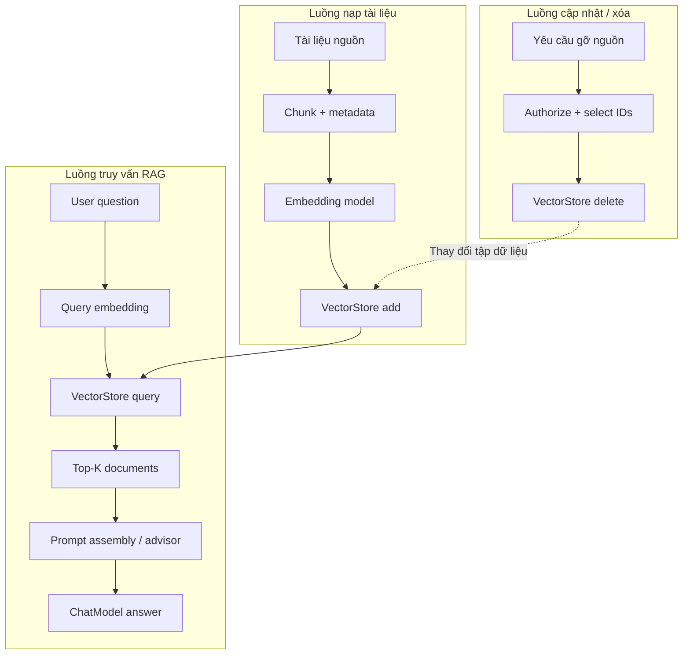

# Phép quan sát thêm, truy vấn và xóa dữ liệu vector

> **Chương:** Quan sát VectorStore  
> **Module:** `SPRING_AI_EVALUATION_OBSERVABILITY` — đánh giá chất lượng ứng dụng Spring AI bằng dataset, relevance, fact checking, kiểm thử RAG/tool calling, đồng thời đo metrics, traces, chi phí và độ trễ để phát hiện suy giảm giữa các phiên bản prompt, model và pipeline.

## Mục tiêu học tập

Sau bài này, bạn có thể:

1. Phân biệt hoạt động **thêm dữ liệu (`add`)**, **tìm kiếm tương đồng (`similaritySearch` / `query`)** và **xóa (`delete`)** ở tầng VectorStore.
2. Giải thích Spring AI sử dụng Micrometer Observation để ghi nhận thời gian, loại thao tác và trace cho VectorStore; đọc đúng tên observation, metric và nhãn.
3. Tạo ứng dụng Java/Spring AI thực hiện ba thao tác và liên kết chúng với span ở tầng nghiệp vụ mà không đo trùng vô tội vạ.
4. Tách **lỗi hạ tầng** khỏi **chất lượng kết quả retrieval**: tìm kiếm nhanh chưa chắc lấy đúng tài liệu, xóa thành công chưa chắc đã kiểm chứng trạng thái sau xóa.
5. Thiết kế dashboard, cảnh báo, dataset retrieval và quy trình điều tra độ trễ, lỗi, khối lượng dữ liệu, embedding model, bộ lọc metadata và quyền truy cập.
6. Giữ an toàn cho dữ liệu khi quan sát câu truy vấn, tài liệu trả về, ID, metadata và hoạt động xóa.

## 1. VectorStore nằm ở đâu trong chuỗi RAG?

Trong Spring AI, `VectorStore` là giao diện trừu tượng cho nhiều hệ quản trị vector (ví dụ PGvector, Redis, Qdrant, Elasticsearch, Chroma hoặc các hệ tương thích). Nó cho phép ứng dụng ghi `Document`, tìm các tài liệu tương tự và xóa bản ghi. Các hoạt động này ảnh hưởng trực tiếp đến chất lượng câu trả lời RAG, nhưng **không đồng nhất** với chất lượng trả lời của ChatModel.



Khi giám sát, cần đặt ba câu hỏi riêng:

- **Thao tác có thực thi ổn định?** Tỷ lệ lỗi, thời gian gọi, số thao tác đang hoạt động, timeout và retry.
- **Dữ liệu có đúng không?** Sau khi add có thể tìm được tài liệu mong muốn? Truy vấn có lọc đúng tenant và nguồn có hiệu lực? Xóa có loại tài liệu cần gỡ khỏi lần đọc tiếp theo?
- **RAG có tạo câu trả lời tốt không?** Relevance, retrieval recall, groundedness/fact checking, citation và hành vi tool trong toàn pipeline.

**Một metric latency thấp không chứng minh retrieval có chất lượng cao.** Tương tự, `add()` kết thúc không ném exception cũng chưa chứng minh mọi document đã được index theo đúng version và có thể tìm thấy ngay lập tức.

## 2. Ba thao tác chính và ngữ nghĩa cần quan sát

| Thao tác Java | Vai trò | Tên thao tác trong observation | Điều muốn biết |
|---|---|---|---|
| `vectorStore.add(documents)` | Ghi document, thông thường embedding nội dung trước khi lưu | `add` | Bao nhiêu tài liệu được gửi, batch lớn cỡ nào, thành công/lỗi, latency và embedding cost |
| `vectorStore.similaritySearch(request)` | Tìm tài liệu gần với câu truy vấn theo `topK`, ngưỡng và bộ lọc | `query` | Trả bao nhiêu tài liệu, độ trễ, relevance/recall, filter đúng chưa |
| `vectorStore.delete(ids)` | Xóa bản ghi theo danh sách document ID | `delete` | Xóa có lỗi không, scope ID hợp lệ không, hậu kiểm ra sao |
| `vectorStore.delete(filter)` | Xóa theo điều kiện metadata (nếu implementation hỗ trợ) | `delete` | Phạm vi filter có đủ chặt và tránh xóa rộng hay không |
| `vectorStore.upsert(...)` | Ghi vector đã tính sẵn ở phiên bản/implementation hỗ trợ | `upsert` | Dữ liệu vector có cùng embedding space/dimension không |

Tài liệu Spring AI mô tả observation tên **`db.vector.client.operation`** với `db.operation.name` thuộc `add`, `upsert`, `delete` và `query`. Vì vậy **tên phương thức `similaritySearch` không phải tên giá trị metric `db.operation.name`**: trong telemetry truy vấn thường là `query`.

### 2.1. Những điều observation mặc định không tự chứng minh

Micrometer ghi nhận thời gian và trạng thái thực thi ở ranh giới instrumented VectorStore; nó không tự cấp:

- Nhãn relevance của từng document so với câu hỏi.
- Danh sách gold documents để tính retrieval recall@K.
- Mức độ đầy đủ của index so với nguồn dữ liệu gốc.
- Bằng chứng rằng một lệnh delete có tác động đến đúng mọi document mong muốn.
- Việc tài liệu tìm thấy **thực sự được đưa vào prompt** sau bước rerank/truncate.
- Tỷ lệ fact checking hoặc chất lượng câu trả lời ChatModel.

Những điều trên cần thêm test harness, dữ liệu nghiệp vụ, bằng chứng RAG và các evaluator khác. Không nên gộp số lỗi truy vấn VectorStore với `groundedness_fail` như một thước đo duy nhất.

## 3. Tên observation và metric chính thức trong Spring AI

Spring AI tích hợp Micrometer để cung cấp metrics và distributed traces cho các triển khai VectorStore. Trong tài liệu tham khảo, observation có tên:

```text
db.vector.client.operation
```

Các phép quan sát đo thời gian dành cho `add`, `upsert`, `delete`, `query` và truyền thông tin tracing liên quan. Tùy backend, cách tích hợp và cấu hình export, bạn sẽ thấy các time series/spans tương ứng.

### 3.1. Low-cardinality keys

| Key | Ý nghĩa | Ví dụ |
|---|---|---|
| `db.operation.name` | Loại thao tác | `add`, `query`, `delete`, `upsert` |
| `db.system` | Hệ lưu trữ vector được instrument | `pg_vector`, `redis`, `qdrant`, `chroma` |
| `spring.ai.kind` | Phân loại thành phần Spring AI | `vector_store` |

Các key trên có tập giá trị tương đối hữu hạn, phù hợp để nhóm biểu đồ. Nên kiểm tra nhãn thực tế trên môi trường đang chạy thay vì tự tạo giá trị `db.system` từ tên sản phẩm hoặc nhầm định dạng `pg_vector` với `pgvector`.

### 3.2. High-cardinality keys

| Key | Nội dung có thể ghi | Lưu ý |
|---|---|---|
| `db.collection.name` | Collection/table/container | Có thể nhạy cảm theo tenant |
| `db.namespace` | Namespace/database | Không công khai nếu phản ánh hạ tầng nội bộ |
| `db.search.similarity_metric` | Cosine/dot-product hoặc metric tương ứng | Không quy đổi score giữa các hệ tùy tiện |
| `db.vector.dimension_count` | Số chiều embedding | Dùng để phát hiện sai dimension/migration |
| `db.vector.field_name` | Tên trường vector | Ghi theo schema |
| `db.vector.query.content` | Nội dung query text | Có thể chứa PII/bí mật |
| `db.vector.query.filter` | Filter metadata | Có thể lộ tenant hoặc thông tin người dùng |
| `db.vector.query.response.documents` | Dữ liệu document trả về (tùy chọn) | Kích thước lớn, có thể chứa dữ liệu nhạy cảm |
| `db.vector.query.similarity_threshold` | Ngưỡng tương đồng | Có ích khi giải thích số kết quả |
| `db.vector.query.top_k` | K yêu cầu | Không nhất thiết bằng số tài liệu thực trả |

**Low cardinality** thường phù hợp làm metric labels; **high cardinality** thích hợp hơn trong trace có kiểm soát, hoặc không xuất nếu nhạy cảm. Không chuyển query text, document IDs, traceId, userId, raw filter hoặc contents thành tags của Prometheus.

### 3.3. Metric time series trong Prometheus

Theo quy ước tên Micrometer/Prometheus được Spring AI mô tả, timer có các series như:

```text
db_vector_client_operation_seconds_count
db_vector_client_operation_seconds_sum
db_vector_client_operation_seconds_max
db_vector_client_operation_active_count
```

Ý nghĩa:

- `_seconds_count`: số phép đo timer đã hoàn tất trong chu kỳ thống kê.
- `_seconds_sum`: tổng thời gian các phép đo đã hoàn tất, đơn vị giây.
- `_seconds_max`: độ trễ lớn nhất trong cửa sổ registry/scrape tương ứng, không nên mặc định là p95.
- `_active_count`: số thao tác đang hoạt động tại thời điểm quan sát, hữu ích khi truy vấn backlog/concurrency.

Ví dụ truy vấn PromQL theo hoạt động:

```promql
sum by (db_operation_name) (
  rate(db_vector_client_operation_seconds_count[5m])
)
```

Và latency trung bình (giây) của từng loại thao tác:

```promql
sum by (db_operation_name) (
  rate(db_vector_client_operation_seconds_sum[5m])
)
/
sum by (db_operation_name) (
  rate(db_vector_client_operation_seconds_count[5m])
)
```

Đây là cú pháp PromQL minh họa khi tên series/label được exporter tạo đúng như tài liệu Spring AI. Kiểm tra `/actuator/prometheus` hoặc backend metrics của ứng dụng để xác nhận. Khi mẫu số bằng 0 trong cửa sổ đo, không diễn giải kết quả như latency bằng 0.

**p95 không bằng `_max`.** Muốn xem p95 theo cửa sổ, cần cấu hình timer histograms hoặc một cơ chế phân vị phù hợp với exporter, rồi mới sử dụng `histogram_quantile` trên bucket nếu bucket có tồn tại.

```promql
histogram_quantile(
  0.95,
  sum by (le, db_operation_name) (
    rate(db_vector_client_operation_seconds_bucket[5m])
  )
)
```

Nếu không bật/phát ra `_bucket`, truy vấn trên không có dữ liệu; đừng tự kết luận p95 bằng 0. Cũng cần hiểu histogram là ước lượng và kiểm tra số mẫu trước khi so sánh các phiên bản.

## 4. Cấu hình observability và nguyên tắc bảo mật

Đối với Spring Boot, thông thường cần Spring Boot Actuator, registry metrics (ví dụ Prometheus) và cấu hình exporter/collector tracing phù hợp nếu muốn xem trace bên ngoài JVM. Ví dụ dependency Gradle (không cố định version vì được quản lý bởi BOM/dự án):

```gradle
dependencies {
    implementation("org.springframework.boot:spring-boot-starter-actuator")
    runtimeOnly("io.micrometer:micrometer-registry-prometheus")
    // Khi cần distributed tracing:
    // implementation("io.micrometer:micrometer-tracing-bridge-otel")
    // runtimeOnly("io.opentelemetry:opentelemetry-exporter-otlp")
}
```

Ví dụ `application.yml` trong môi trường phát triển:

```yaml
management:
  endpoints:
    web:
      exposure:
        include: health, info, prometheus
  tracing:
    sampling:
      probability: 1.0 # Chỉ minh họa cho lab; production dùng sampling phù hợp

spring:
  ai:
    vectorstore:
      observations:
        log-query-response: false
```

Trong Spring AI, cấu hình `spring.ai.vectorstore.observations.log-query-response` có giá trị mặc định `false`. Bật ghi toàn bộ tài liệu tìm thấy chỉ khi có lý do điều tra rõ, quyền truy cập phù hợp và chính sách giữ/xóa dữ liệu; thông tin trả về có thể lớn và chứa nội dung riêng tư. Không nên bật bừa trên hệ thống production.

**Lưu ý về cấu hình:**

- Việc bật Actuator và Prometheus không tự động tạo hệ thống tracing phân tán hoàn chỉnh; cần tracer/collector/exporter và cấu hình sampling.
- Các endpoint quan sát có thể làm lộ thông tin hệ thống; bảo vệ bằng mạng, authentication và ACL, chỉ mở những endpoint cần thiết.
- Tùy phiên bản Spring AI/Spring Boot, tên meter hoặc thành phần truy vết có thể thay đổi; dùng tài liệu và dependency của dự án để đối chiếu.
- Không coi `log-query-response: false` là bảo đảm rằng **mọi** query/filter luôn bị xóa khỏi mọi trace/logger: phải đánh giá cấu hình high-cardinality attributes và các hệ thống thu thập khác.

## 5. Java: thực hiện thêm, truy vấn, xóa và gắn observation nghiệp vụ

Ví dụ dưới đây dùng `VectorStore` và `SearchRequest`, đồng thời thêm một span/timer ở tầng workflow để liên kết các tác vụ ứng dụng. Các lời gọi VectorStore đã được Spring AI instrument; **không tạo thêm một bản sao metric `db.vector.client.operation`**.

### 5.1. Một dịch vụ thao tác VectorStore

```java
import java.util.List;
import java.util.Objects;

import io.micrometer.core.instrument.DistributionSummary;
import io.micrometer.core.instrument.MeterRegistry;
import io.micrometer.observation.Observation;
import io.micrometer.observation.ObservationRegistry;
import org.springframework.ai.document.Document;
import org.springframework.ai.vectorstore.SearchRequest;
import org.springframework.ai.vectorstore.VectorStore;
import org.springframework.stereotype.Service;

@Service
public final class ObservedVectorWorkflow {

    private final VectorStore vectorStore;
    private final ObservationRegistry observationRegistry;
    private final DistributionSummary retrievedCount;

    public ObservedVectorWorkflow(
            VectorStore vectorStore,
            ObservationRegistry observationRegistry,
            MeterRegistry meterRegistry) {
        this.vectorStore = Objects.requireNonNull(vectorStore);
        this.observationRegistry = Objects.requireNonNull(observationRegistry);
        this.retrievedCount = DistributionSummary
                .builder("app.rag.retrieved.documents")
                .description("Số document VectorStore trả về mỗi lần truy vấn")
                .tag("stage", "vectorstore")
                .register(meterRegistry);
    }

    public void ingest(List<Document> documents) {
        // Không đưa nội dung tài liệu hoặc ID vào low-cardinality tag.
        Observation.createNotStarted("app.rag.vector.workflow",
                        observationRegistry)
                .lowCardinalityKeyValue("workflow", "ingest")
                .observe(() -> vectorStore.add(documents));
    }

    public List<Document> search(String question) {
        // Filter 'demo' là fixture: production phải dùng tenant từ
        // security context đã xác thực và filter builder an toàn.
        SearchRequest request = SearchRequest.builder()
                .query(question)
                .topK(5)
                .similarityThreshold(0.70)
                .filterExpression("tenant == 'demo'")
                .build();

        return Observation.createNotStarted("app.rag.vector.workflow",
                        observationRegistry)
                .lowCardinalityKeyValue("workflow", "retrieve")
                .observe(() -> {
                    List<Document> result =
                            vectorStore.similaritySearch(request);
                    retrievedCount.record(result.size());
                    return result;
                });
    }

    public void deleteByIds(List<String> documentIds) {
        // Phân quyền, tenant scope và audit phải được kiểm tra
        // trước khi gọi hàm này trong ứng dụng thực.
        Observation.createNotStarted("app.rag.vector.workflow",
                        observationRegistry)
                .lowCardinalityKeyValue("workflow", "delete")
                .observe(() -> vectorStore.delete(documentIds));
    }
}
```

Trong trace, có thể thấy span `app.rag.vector.workflow` bao quanh hoạt động và span `db.vector.client.operation` ở tầng VectorStore. Dạng cây span cụ thể còn tùy tracing context, SDK, sampling và implementation; không nên khẳng định một trace luôn có đủ mọi span.

Thống kê `app.rag.retrieved.documents` là **chỉ số do ứng dụng định nghĩa**, không phải meter mặc định của Spring AI. Nó đo **số kết quả trả về**, không đo recall, mức độ đúng của nội dung hay số document được đưa vào prompt.

### 5.2. Gọi ba thao tác với dữ liệu minh họa

```java
import java.util.List;
import org.springframework.ai.document.Document;

Document policy = Document.builder()
        .id("refund-policy-v3")
        .text("Yêu cầu hoàn tiền được xử lý trong 7 ngày làm việc.")
        .metadata("tenant", "demo")
        .metadata("policyVersion", "v3")
        .build();

// Nạp: store sẽ tạo embedding nếu dùng add theo hợp đồng chung.
workflow.ingest(List.of(policy));

// Tìm: tập kết quả có thể 0..5 document theo ngưỡng và filter.
List<Document> found = workflow.search(
        "Thời hạn xử lý yêu cầu hoàn tiền là bao lâu?");
System.out.println(found.stream().map(Document::getId).toList());

// Xóa theo đúng ID; không suy ra số record thực bị xóa từ list.size().
workflow.deleteByIds(List.of(policy.getId()));
```

Trong snippet này, `workflow` là Bean `ObservedVectorWorkflow` đã được Spring khởi tạo và inject vào lớp gọi. Đây là ví dụ lab, không dùng `deleteByIds` trên dữ liệu thật khi chưa có xác nhận/phân quyền phù hợp.

### 5.3. Vì sao gắn span nghiệp vụ nếu đã có span VectorStore?

Span ở tầng VectorStore thường nói "đã gọi `query` trên backend X, mất bao lâu". Span nghiệp vụ bổ sung câu trả lời "truy vấn này phục vụ bước `retrieve` của RAG nào?".

Ví dụ mô hình quan sát:

```text
HTTP request / evaluation-run
└── app.rag.retrieve
    ├── query rewrite (nếu có)
    ├── db.vector.client.operation [db.operation.name=query]
    ├── rerank
    └── prompt assembly
        └── ChatModel generation
```

Đo độ trễ từng bước giúp phân biệt sự chậm trễ do vector database, embedding query, reranker, network hay ChatModel. Tránh ghi **trùng cùng một latency** vào hai metric được đặt tên như thể đo cùng đơn vị: một metric có thể đo toàn workflow, metric còn lại chỉ đo lời gọi ở tầng VectorStore.

## 6. Quan sát quá trình `add`: nạp liệu, embedding và index

`VectorStore.add(List<Document>)` thường sử dụng EmbeddingModel tương ứng để tính vector cho nội dung tài liệu trước khi ghi. Các bước có thể gồm parse/chunk, embedding, lưu và cập nhật index; tùy cách chia dịch vụ, một phần nằm **ngoài** phương thức `add()`.

### 6.1. Bảng tín hiệu cần theo dõi

| Tín hiệu | Cần biết | Gợi ý thu thập |
|---|---|---|
| `db.operation.name=add` | Tần suất, thời gian và lỗi của lời gọi VectorStore | Spring AI/Micrometer observations |
| `documentBatchSize` | Số document **gửi vào** mỗi batch | DistributionSummary ứng dụng |
| `sourceDocumentVersion` | Dữ liệu nạp đến từ phiên bản nào | Audit/index manifest có phân quyền |
| `embeddingModelVersion` | Vector được tính từ embedding space nào | Index manifest/metadata có kiểm soát |
| `vectorDimension` | Có khớp schema/index không | Index schema, telemetry dimension |
| `indexingLag` | Độ trễ từ lúc cập nhật nguồn đến khi tài liệu tìm được | Đo workflow và hậu kiểm |
| `duplicateOrStaleDocuments` | Nạp lặp hoặc bản cũ còn tồn tại | Dataset/index integrity checks |
| `embeddingTokensAndCost` | Chi phí embedding đầu vào | Usage/cost record nếu provider hỗ trợ |

**`documents.size()` là số document yêu cầu ghi, không tự động là số record đã được lưu thành công.** Nếu backend hoặc pipeline cho phép partial write, cần lấy thông tin xác thực từ backend hoặc cơ chế kiểm tra hậu kỳ, không đơn giản báo số thành công bằng kích thước batch.

### 6.2. Các kiểu lỗi khi nạp vector

- **Embedding request timeout/429:** lỗi ở provider embedding có thể làm `add` thất bại; xem trace của embedding và hoạt động VectorStore.
- **Sai dimension:** vector do model mới tạo có độ dài không phù hợp index; có thể bị API hoặc backend từ chối.
- **Sai embedding space dù cùng dimension:** model ghi và model query khác nhau có thể tạo kết quả không liên quan mà không ném exception.
- **Metadata thiếu trường filter:** tài liệu vừa nạp sẽ không xuất hiện khi tìm với điều kiện tenant/loại nguồn.
- **Index chưa đồng bộ:** thao tác ghi được xác nhận nhưng truy vấn ngay có thể có kết quả khác nhau tùy cơ chế nhất quán của backend.
- **Retry batch không idempotent:** cùng nguồn bị nạp nhiều lần dưới ID khác, làm sai phân bố dữ liệu và chất lượng retrieval.

Ghi riêng số retry, thời gian embedding, thời gian vector write nếu có, trạng thái job nạp và ID/version của tài liệu. Với `upsert` nhận vector đã tính sẵn, cần kiểm tra model tạo vector, width và không gian embedding; `upsert` có thể chỉ được hỗ trợ ở một số implementation/phiên bản.

### 6.3. Kiểm tra sau ghi

Một kiểm thử sau nạp có thể:

1. Dùng ID/version cố định từ fixture.
2. Ghi document vào collection **riêng cho test**.
3. Chờ trạng thái index theo hợp đồng backend, có deadline và số lần thử giới hạn.
4. Truy vấn câu hỏi đại diện với filter đúng scope.
5. Kiểm tra document kỳ vọng có mặt trong kết quả; ghi rank và topK.
6. Xóa tài liệu test và xác nhận hậu kiểm.

Việc xuất hiện trong topK là bằng chứng chức năng đối với một truy vấn cụ thể, **không** chứng minh mọi truy vấn hoặc mọi tenant đều đúng. Không chạy phép thử có write/delete trên collection production không dành cho kiểm thử.

## 7. Quan sát `similaritySearch`: latency, số kết quả và relevance

Đối với API:

```java
SearchRequest request = SearchRequest.builder()
        .query("Chính sách đổi trả là gì?")
        .topK(5)
        .similarityThreshold(0.7)
        .filterExpression("tenant == 'demo'")
        .build();

List<Document> results = vectorStore.similaritySearch(request);
```

Phép quan sát VectorStore dùng `db.operation.name=query`. Nên theo dõi riêng:

- **Request config:** `topK`, ngưỡng tương đồng, filter, index/schema version, embedding model version.
- **Outcome kỹ thuật:** thành công/lỗi/timeout, latency, backend, active concurrency.
- **Result set:** số document thực tế trả, score/rank (nếu có và được định nghĩa), tỷ lệ zero-result, trùng/chunk cũ.
- **Độ đúng theo dataset:** recall@K, precision@K, MRR, nguồn có hiệu lực và kiểm soát tenant.
- **Hậu kỳ RAG:** bao nhiêu document được rerank/chọn để đưa vào prompt; answer relevance và fact checking.

### 7.1. `topK` là yêu cầu, không phải cam kết kết quả

Với `topK = 5`, backend có thể trả ít hơn năm kết quả khi filter hoặc threshold loại phần lớn candidates. Một zero-result query có thể là:

1. Hành vi **đúng** vì chưa có tài liệu phù hợp/được cấp quyền.
2. Sai cấu hình filter/tenant khiến mọi document bị loại.
3. Sai không gian embedding hoặc index không đồng bộ.
4. Ngưỡng similarity quá cao.
5. Câu hỏi không được biểu diễn đúng trong truy vấn do query rewrite kém.

**Không gọi mọi truy vấn trả rỗng là lỗi hạ tầng.** Nếu API trả danh sách rỗng hợp lệ, observation có thể ghi operation thành công; muốn phân loại chất lượng, cần biết case có gold documents hay không.

### 7.2. Sự khác biệt giữa latency và chất lượng

Một câu hỏi "Thời hạn hoàn tiền?" trả về tài liệu có score tương đồng cao nhưng nội dung nói về **chính sách đổi trả** có thể vẫn không trả lời được câu hỏi. Backend query nhanh, có kết quả, thậm chí nhiều document — nhưng retrieval relevance thấp.

Trong dataset có gắn nhãn, tính:

\[
\operatorname{Recall@K}=
\frac{\#\{\text{gold relevant documents xuất hiện trong top K}\}}
{\#\{\text{gold relevant documents của case}\}}.
\]

\[
\operatorname{Precision@K}=
\frac{\#\{\text{document liên quan trong top K}\}}{K}.
\]

Ở đây chọn quy ước Precision@K chia cho K cố định; các framework có thể dùng mẫu số khác khi số kết quả trả về ít hơn K. Cần công bố quy ước và cách xử lý case không có gold relevant documents.

Ví dụ:

- Tập gold: `{refund-policy-v3, refund-faq-v2}`.
- `K = 5`, kết quả: `{refund-policy-v3, returns-policy, shipping-guide, login-faq, contact-us}`.
- Số gold tìm thấy: 1/2 ⇒ **Recall@5 = 0.5**.
- Số tài liệu liên quan theo nhãn: 1/5 ⇒ **Precision@5 = 0.2**.

Đây là chỉ số **đánh giá dữ liệu RAG**, không phải metrics tự động của Spring AI VectorStore. Phải lưu `datasetVersion`, nhãn gold, ID kết quả và retrieval config để so sánh baseline/candidate.

### 7.3. Mất tài liệu giữa retrieval và prompt

Nếu retrieval trả 5 chunk, reranker chọn 3 nhưng prompt assembly chỉ còn chỗ cho 2, thì:

- `retrievedCandidates`: 5 ID, phục vụ đánh giá retriever.
- `selectedAfterRerank`: 3 ID, phục vụ đánh giá reranker.
- `providedContext`: 2 ID thực tế gửi model, phục vụ citation/fact checking.

Không dùng 5 candidate IDs để tự cho PASS khi model trích dẫn chunk chưa được cấp. Trace và evidence snapshot nên phân biệt các giai đoạn, vì vấn đề có thể do truncation, không phải do vector search.

## 8. Quan sát `delete`: tác động, scope và kiểm chứng

`VectorStore.delete(List<String> ids)` được dùng để xóa theo document IDs. Một số phiên bản/implementation còn hỗ trợ xóa theo `Filter.Expression` hoặc chuỗi filter. **Không suy rằng "xóa thành công" nghĩa là đã xóa đúng số bản ghi bằng độ dài danh sách ID**: API xóa theo ID thường trả `void` và ID không tồn tại có thể bị bỏ qua.

### 8.1. Xóa bằng ID và xóa bằng filter

```java
// Khi đã xác thực quyền và biết chính xác ID cần xóa:
vectorStore.delete(List.of("refund-policy-v2"));

// Khi cần xóa theo metadata, dùng filter đã được kiểm soát:
// Chỉ nên gọi nếu store/phiên bản hỗ trợ và phạm vi đã được duyệt.
vectorStore.delete("tenant == 'demo' && policyVersion == 'v2'");
```

Đây là ví dụ **thao tác có tác động đến dữ liệu**; không chạy trên môi trường thật khi chưa có quyền và kế hoạch hậu kiểm. Trong sản phẩm, dùng Filter.Expression/builder thay vì ghép filter string từ đầu vào người dùng. Mọi lệnh xóa nhiều bản ghi nên có xác nhận, audit, giới hạn phạm vi và cơ chế phục hồi khi phù hợp.

### 8.2. Những chỉ số cần thu thập

| Tín hiệu | Mục đích | Cạm bẫy |
|---|---|---|
| `db.operation.name=delete` | Latency/tần suất/lỗi thao tác | Không có sẵn số record thực bị xóa |
| `requestedIdCount` | Số ID được gửi vào xóa | Có thể có ID trùng hoặc không tồn tại |
| `deleteScope` | Xóa ID, filter, theo dataset/source/version | Không đưa raw filter/tenant nhạy cảm vào metric tags |
| `authorized` / `confirmed` | Quyền và phê duyệt | Không lấy từ lời tự thuật của mô hình |
| `deletedRecordCount` | Số bản ghi thực bị xóa nếu backend trả được | Không tự gán bằng requestedIdCount |
| `postDeleteVerification` | Tài liệu cần xóa có còn được tìm thấy không? | Similarity search có thể không chứng minh absence toàn cục |
| `timeToDisappear` | Độ trễ giữa yêu cầu và trạng thái không còn đọc được | Phụ thuộc consistency, cache và index |

**Xóa thành công không đồng nghĩa đáp ứng ngay yêu cầu hủy/loại bỏ dữ liệu ở mọi tầng**. Có thể còn cache, snapshot, backup hoặc bản ghi trong nguồn khác. Phạm vi và nghĩa vụ xóa phải được định nghĩa theo hệ thống thực tế và quy định áp dụng.

### 8.3. Đánh giá hậu kiểm xóa

Đối với môi trường thử nghiệm riêng:

1. Trước khi xóa, xác nhận target ID tồn tại bằng API đọc chính xác (nếu backend cung cấp) hoặc index query phù hợp.
2. Ghi `deleteRequestId`, scope đã được duyệt, danh sách ID đã chuẩn hóa và snapshot nguồn.
3. Gọi `delete` một lần qua service đã kiểm quyền.
4. Nếu cần, đợi theo hợp đồng consistency của backend.
5. Dùng phương thức xác minh trạng thái theo ID/filter được backend hỗ trợ; đừng chỉ dựa vào kết quả similarity search không thấy ID.
6. Ghi outcome và thời điểm hậu kiểm; nếu quá deadline mà chưa chắc chắn, đánh dấu trạng thái chưa xác minh, không báo thành công hoàn toàn.

Trường hợp chưa thấy document trong topK **không chứng minh** document đã bị xóa: nó có thể còn tồn tại nhưng không xếp hạng trong topK. Hậu kiểm cần phương thức chính xác hơn hoặc bằng chứng từ backend/index và chính sách consistency.

## 9. Luồng trace để tìm nguyên nhân suy giảm RAG

Giả sử một bản nâng cấp prompt B có groundedness giảm. Trước khi đổi model, xem chuỗi:

```text
evaluation case refund-017
  ├── retrieval query rewrite: "đổi trả" (thay vì "hoàn tiền")
  ├── db.vector.client.operation [query, 42 ms, pg_vector]
  ├── retrieved candidates: 5 docs
  ├── rerank / truncate: provided context 2 docs
  ├── ChatModel: "Hoàn tiền trong 14 ngày."
  └── Fact checking: FAIL — nguồn chuẩn ghi 7 ngày
```

Ở đây vector query chỉ 42 ms và operation thành công. **Nguyên nhân khả dĩ** lại là query rewrite sai, nguồn bị loại khi rerank, hoặc model suy diễn sai. Cần xem evidence thực tế và version của từng thành phần.

| Triệu chứng | Dữ liệu kiểm tra | Giả thuyết có thể thử |
|---|---|---|
| `query` p95 tăng | Timer/spans VectorStore, DB CPU/network, filter/topK | Query plan xấu, index lớn, backend quá tải |
| `add` p95 tăng | Embedding spans, batch size, index update | Model embedding chậm hoặc batch quá lớn |
| `delete` tăng lỗi | Backend errors, quyền, scope/filter | Backend từ chối, sai điều kiện hoặc rate limit |
| Zero-result tăng sau deploy | Filter, threshold, index version, query embedding | Tenant filter sai hoặc thay embedding space |
| Recall@K giảm, query latency giữ nguyên | Gold IDs, topK results, retriever version | Index/ranking/data drift |
| Citation FAIL nhưng Recall@K ổn định | ProvidedContext và output citation IDs | Truncation, ID mapping, model dẫn nguồn sai |
| Latency serving tăng, VectorStore ổn định | ChatModel/tool/rerank spans | Model sinh chậm hoặc gọi tool nhiều vòng |
| Chi phí tăng sau reindex | Embedding usage, số tài liệu, retry | Nạp lặp/chunk quá nhỏ/embedding model đổi |

**Kết luận nguyên nhân chỉ được đưa ra khi đối chiếu đúng trace, version và bằng chứng.** Metric tương quan không tự chứng minh quan hệ nhân quả.

## 10. Dashboard và cảnh báo có ý nghĩa

Một dashboard VectorStore không nên chỉ có một đồ thị latency toàn bộ. Tối thiểu nên phân chia theo loại thao tác:

| Nhóm | Chỉ số | Gợi ý quyết định |
|---|---|---|
| Query performance | RPS, p50/p95, active operations, timeout/error rate | Truy vấn vượt SLA hay backend bị nghẽn? |
| Ingest performance | Số batch, batch size, p95 add, indexing lag | Pipeline nạp có theo kịp cập nhật nguồn? |
| Delete safety | Số yêu cầu, failed operations, xác nhận hậu kiểm | Có nguy cơ xóa thiếu/xóa quá phạm vi? |
| Retrieval utility | Zero-result rate, recall@K, precision@K theo dataset | Kết quả tìm có hữu ích cho RAG? |
| Data integrity | Mismatch embedding model/dimension, stale versions | Index có nhất quán với nguồn và query encoder? |
| Pipeline costs | Embedding tokens/cost, reindex cost, judge cost | Chi phí có tăng vì nạp lặp hoặc chấm lại? |
| End-to-end quality | Relevance, groundedness, citation pass rate | Thao tác hạ tầng tốt có chuyển thành câu trả lời tốt? |

### 10.1. Chọn ngưỡng cảnh báo

Ví dụ giả định cho môi trường kiểm thử:

- `query p95 > 250 ms` trong 10 phút và có đủ số mẫu → cảnh báo latency.
- `query error rate > 2%` trong 5 phút → cảnh báo availability; lỗi nên đo bằng metric/outcome đáng tin.
- `zeroResultRate > 30%` trên nhóm câu hỏi có gold documents → điều tra chất lượng retrieval.
- `Recall@5 < 0.90` trên dataset cố định → chặn thay đổi retriever nếu release policy yêu cầu.
- `postDeleteVerificationFailed > 0` trong ca có yêu cầu gỡ nguồn bắt buộc → chặn pipeline xóa.

Đây chỉ là **ngưỡng minh họa**, không phải SLA mặc định của Spring AI. Cần dựa trên workload, hệ vector thực tế, số mẫu, rủi ro nghiệp vụ và chi phí false alarms. Không dùng một mức ngưỡng cố định cho cả ingest, query và delete — mục đích và thời gian các thao tác khác nhau.

### 10.2. Phân biệt lỗi hạ tầng với lỗi chất lượng

| Tình huống | Nhóm cần báo | Hướng xử lý |
|---|---|---|
| Lời gọi `query` ném exception/timeout | Operation ERROR | Điều tra backend, network, rate limit, client |
| `query` trả 0 document đúng hợp đồng | Operation SUCCESS, có thể retrieval quality FAIL | Kiểm dataset, filter, embedding, threshold |
| `query` trả top5 nhưng không có gold ID | Operation SUCCESS, retrieval recall FAIL | Cải thiện index/query/rerank |
| `add` được gọi nhưng nạp sai embedding space | Có thể operation SUCCESS, data integrity FAIL | Kiểm model/version và index manifest |
| `delete` kết thúc nhưng chưa xác minh target biến mất | Operation SUCCESS, post-delete status UNKNOWN | Hậu kiểm theo ID/backend |
| Judge fact checking bị timeout | Evaluation ERROR | Không đánh thành lỗi chất lượng của VectorStore |

Một dashboard tốt hiển thị **chất lượng và khả năng quan sát (evaluation coverage) song song**. Nếu evaluator không chạy được, không tự đặt relevance/groundedness về 0 hoặc cho PASS.

## 11. Dataset kiểm thử khả năng quan sát và chất lượng retrieval

Có thể xây dựng dataset để đánh giá tính đúng của workflow và phát hiện hồi quy:

```yaml
datasetVersion: vectorstore-observability-v1
indexVersion: support-index-v4
embeddingModelVersion: embed-model-a
cases:
  - caseId: refund-query-001
    operation: query
    query: "Thời hạn xử lý hoàn tiền?"
    topK: 5
    similarityThreshold: 0.70
    tenant: demo
    goldDocumentIds: [refund-policy-v3]
    expectedMinRecallAt5: 1.0
    tags: [rag, positive]

  - caseId: no-source-query-002
    operation: query
    query: "Một quy định không có trong kho tri thức"
    topK: 5
    similarityThreshold: 0.85
    tenant: demo
    goldDocumentIds: []
    expectedBehavior: no_unsupported_claim
    tags: [rag, abstention]

  - caseId: ingest-fixture-003
    operation: add
    documentIds: [fixture-policy-003]
    expectedBehavior: query_after_index_ready_returns_target
    tags: [ingest, sandbox_only]

  - caseId: delete-fixture-004
    operation: delete
    documentIds: [fixture-policy-004]
    expectedBehavior: backend_confirms_absent_after_delete
    tags: [delete, sandbox_only]
```

Đây là YAML **do bài học tự định nghĩa**, không phải định dạng dataset mặc định của Spring AI. Trường `expectedBehavior` cần test runner triển khai thành assertion có thể kiểm tra được; không coi chuỗi mô tả tự động là phép chấm.

### 11.1. Bài kiểm thử nên tách hai cấp

**Unit/integration test của instrumentation:**

- Gọi `add`, `query`, `delete` trên implementation test hoặc vector store sandbox.
- Xác nhận observation/timer được phát ra đúng operation name khi instrumentation được bật.
- Kiểm lỗi backend được phản ánh qua exception/trace và metric tùy exporter.
- Xác minh không có raw query text/PII trong metric tags.
- Kiểm rằng `query` trả ít hơn topK không tự động bị ghi thành operation error.

**Evaluation test của RAG:**

- Dùng dataset có gold documents/chunks và nhãn relevance.
- Đo recall@K, precision@K, zero-result, filter fidelity và nguồn có hiệu lực.
- Chạy ChatClient/advisor để biết retrieved documents nào **đã vào prompt**.
- Chấm câu trả lời bằng `RelevancyEvaluator`, `FactCheckingEvaluator` hoặc rubric có nhãn người đánh giá.
- So theo `datasetVersion`, `promptVersion`, `modelVersion`, `pipelineVersion` và index/embedding version.

### 11.2. Kiểm tra số liệu và độ trễ theo lần chạy

Ví dụ bản ghi kết quả:

```json
{
  "runId": "eval-vector-001",
  "caseId": "refund-query-001",
  "operation": "query",
  "vectorStoreSystem": "pg_vector",
  "indexVersion": "support-index-v4",
  "embeddingModelVersion": "embed-model-a",
  "topK": 5,
  "returnedCount": 4,
  "goldRelevantCount": 1,
  "relevantRetrievedCount": 1,
  "recallAt5": 1.0,
  "vectorStoreLatencyMs": 85,
  "pipelineLatencyMs": 290,
  "traceId": "example-trace-id",
  "status": "EVALUATED"
}
```

Các con số là ví dụ. `vectorStoreLatencyMs` phải đo bằng thời gian lời gọi VectorStore tương ứng; `pipelineLatencyMs` đo toàn bước hoặc workflow được định nghĩa, không lấy tổng hai chỉ số nếu các thời gian bao nhau. `recallAt5` ở đây dùng một gold document và đã tìm thấy document đó, vì thế bằng 1.0 dù `returnedCount = 4`.

## 12. Bảo mật, tenant isolation và quan sát có trách nhiệm

VectorStore thường chứa embeddings và metadata của tài liệu nghiệp vụ. Bản thân vector hoặc metadata có thể gián tiếp làm lộ thông tin về người dùng và nguồn. Vì vậy:

1. **Phân quyền trước mọi write/delete:** xác thực actor, tenant và phạm vi ID/filter tại ranh giới service, không tin model/tool argument như quyết định quyền.
2. **Dùng filter thuộc security context:** không ghép `tenant` từ chuỗi người dùng không xác thực vào filter.
3. **Giảm mức chi tiết telemetry:** chỉ lưu `db.operation.name`, `db.system` và nhóm nhãn đã kiểm soát trong metric tags.
4. **Bảo vệ traces/logs:** query text, filter và document contents có thể chứa PII; kiểm soát sampler/exporter, redaction, retention và quyền đọc.
5. **Không lưu raw document output mặc định:** `log-query-response` nên để `false` trừ khi điều tra hợp lệ.
6. **Ghi audit cho thao tác xóa:** actor, scope, phiên bản chính sách, kết quả hậu kiểm và bằng chứng phê duyệt, không công khai ID nhạy cảm trên dashboard.
7. **Tách test data khỏi production:** thêm/xóa ở lab dùng collection hoặc namespace riêng có hạn chế quyền, không dùng dataset khách hàng.
8. **Tính cả dữ liệu ngoài VectorStore:** backups, caches, object store và index replicas có thể chịu chính sách xóa khác.

**Metric high cardinality không chỉ gây chi phí giám sát; nó còn có thể gây rủi ro riêng tư.** Traces phục vụ điều tra cần đường dẫn đến evidence store có ACL thay vì nhồi toàn bộ context vào span attributes.

## 13. Bài thực hành tự luyện

**Bối cảnh:** Một trợ lý Spring AI trả lời chính sách vận chuyển và hoàn tiền bằng RAG, lưu tài liệu trong PGvector hoặc VectorStore sandbox. Nhóm nghi ngờ bản nâng cấp embedding/model làm tỷ lệ câu trả lời không đủ căn cứ tăng.

Yêu cầu:

1. Tạo `Document` với ID/tenant/sourceVersion rõ ràng, dùng `vectorStore.add(...)` để nạp vào **môi trường test**.
2. Gọi `similaritySearch(SearchRequest)` với `topK=3` và `topK=5`, thử hai ngưỡng similarity và cùng filter tenant; lưu số document, ID và thứ hạng.
3. Quan sát metric `db.vector.client.operation`, kiểm tra `db.operation.name` được ghi là `add`/`query`/`delete`, không phải tên method Java.
4. Dùng một span `app.rag.vector.workflow` để liên kết bước ingest và retrieval; giải thích vì sao latency của outer workflow không nhất thiết bằng timer VectorStore.
5. Tạo ít nhất 10 case với gold document IDs: truy vấn đúng, sai chính sách, filter không khớp, ngưỡng quá cao, index thiếu nguồn, embedding model khác và truy vấn không có gold.
6. Tính Recall@3, Recall@5 và Precision@5 theo một quy ước được công bố; giải thích tại sao query nhanh vẫn có thể retrieval FAIL.
7. Xóa tài liệu fixture bằng ID, hậu kiểm bằng API backend phù hợp; ghi outcome riêng cho operation và outcome hậu kiểm.
8. Tạo dashboard query RPS, p95, zero-result rate, Recall@K, ingestion lag, delete verification failure, embedding cost và groundedness pass rate.
9. So sánh baseline A và candidate B trên cùng dataset với metadata về `indexVersion`, `embeddingModelVersion`, `promptVersion` và `pipelineVersion`.
10. Kiểm tra không có raw query/filter/document contents hoặc tenant ID nhạy cảm trong metric labels.

**Câu hỏi tự kiểm tra:**

- Vì sao `similaritySearch` được ghi thành `db.operation.name=query`?
- Nếu `query` trả mảng rỗng không có exception, có thể kết luận backend bị lỗi không?
- Khi `topK=5` nhưng trả 2 tài liệu, điều đó có nhất thiết là lỗi?
- Tại sao latency `add` tăng có thể liên quan embedding model hoặc batch size chứ không chỉ DB?
- Nếu `delete(ids)` chạy không lỗi, có chắc toàn bộ IDs đã tồn tại và được xóa không?
- Vì sao một tài liệu không nằm trong topK sau delete chưa đủ chứng minh nó không tồn tại?
- Khi retrieval recall giảm mà query latency không đổi, cần xem những phiên bản và bằng chứng nào?

## 14. Checklist triển khai

- [ ] Phân biệt các operation `add`, `query`, `delete` (và `upsert` nếu dùng).
- [ ] Kiểm tra Spring AI VectorStore observation và tên meter/labels thực tế sau export.
- [ ] Dashboard có count/rate, average, p95 có histogram, active operations và lỗi.
- [ ] Không lấy `_max` thay p95; không suy số kết quả từ `topK`.
- [ ] Ghi batch size, embedding model/index version, indexing lag ở luồng ingest.
- [ ] Ghi query configuration, returnedCount, zero-result và dataset gold IDs ở luồng retrieval.
- [ ] Đo recall/precision riêng với latency; không xem query SUCCESS là retrieval quality PASS.
- [ ] Phân biệt retrieved candidates, reranked results và provided context thật sự gửi model.
- [ ] Xóa theo ID/filter có kiểm quyền, scope rõ và hậu kiểm theo backend.
- [ ] Không suy `deletedCount = requestedIdCount` và không dùng vắng mặt trong topK làm bằng chứng tuyệt đối.
- [ ] Khóa version của dataset, prompt, model, pipeline, vector index và embedding model khi so A/B.
- [ ] Giữ raw query/documents khỏi metric labels và không bật response logging rộng rãi.
- [ ] Kết hợp traces VectorStore với ChatModel/advisor/tool để định vị bottleneck hoặc lỗi chất lượng.
- [ ] Báo riêng chi phí embedding/reindex, pipeline serving và pipeline evaluation.

## Tổng kết

Trong Spring AI, ba thao tác quan trọng của VectorStore được quan sát dưới `db.vector.client.operation` với `db.operation.name` tương ứng `add`, `query` và `delete`. Metrics cho biết độ trễ, lưu lượng và sức khỏe thao tác; tracing liên kết chúng với bước ingest hoặc retrieval; các chỉ số do ứng dụng tự định nghĩa bổ sung số document, batching, indexing lag, zero-result và hậu kiểm xóa. Tuy nhiên, **observability của VectorStore không tự đảm bảo chất lượng retrieval/RAG**. Cần dataset có nhãn, Recall@K/Precision@K, bằng chứng tài liệu thực sự cấp cho model, fact checking và điều kiện quyền để kết luận vì sao một phiên bản prompt/model/pipeline tốt hay kém. Mọi quá trình phải giữ metadata và logs đúng phạm vi bảo mật.

## Tài liệu tham khảo

- [Spring AI — Observability, Vector Stores](https://docs.spring.io/spring-ai/reference/observability/): `db.vector.client.operation`, low/high-cardinality keys và cấu hình logging query response.
- [Spring AI — Vector Databases](https://docs.spring.io/spring-ai/reference/api/vectordbs.html): `VectorStore`, `add`, `upsert`, `similaritySearch`, `delete`, metadata filter và các yêu cầu dimension.
- [Spring AI — Evaluation Testing](https://docs.spring.io/spring-ai/reference/api/testing.html): đánh giá relevance/fact checking song song với retrieval.
- [Spring AI — RAG/Advisors](https://docs.spring.io/spring-ai/reference/api/retrieval-augmented-generation.html): xây dựng luồng retrieval và đưa tài liệu vào prompt.
- [Micrometer — Observation](https://docs.micrometer.io/micrometer/reference/observation.html): quan sát và liên kết timers/traces.
- [Spring Boot — Actuator Metrics](https://docs.spring.io/spring-boot/reference/actuator/metrics.html): cấu hình registry, histogram và export metrics.
- [OpenTelemetry — Traces](https://opentelemetry.io/docs/concepts/signals/traces/): các span, trace context và phân tích nguyên nhân latency.
