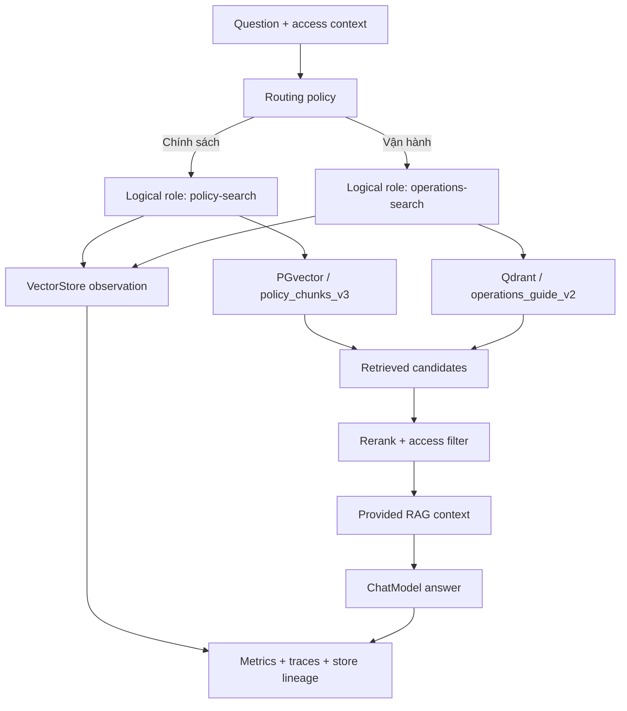

# Định danh hệ lưu trữ, collection và namespace

> **Chương:** Quan sát VectorStore  
> **Module:** `SPRING_AI_EVALUATION_OBSERVABILITY` — đánh giá chất lượng ứng dụng Spring AI bằng dataset, relevance, fact checking và kiểm thử RAG/tool calling; dùng metrics, traces, chi phí và độ trễ để tìm nguyên nhân suy giảm qua các phiên bản prompt, model và pipeline.

## Mục tiêu học tập

Sau khi hoàn thành bài học, bạn có thể:

1. Phân biệt **hệ lưu trữ vector**, **collection/index/table**, **namespace/partition** và **vai trò nghiệp vụ của kho** trong một ứng dụng Spring AI.
2. Hiểu các thuộc tính observation `db.system`, `db.collection.name`, `db.namespace` và `db.operation.name`: khi nào xuất hiện, cách sử dụng và những điều không thể suy ra từ chúng.
3. Thiết kế bộ định danh kho có phiên bản để truy vết đúng nguồn RAG qua những lần thay index, embedding model, collection và pipeline.
4. Dùng Micrometer Observation cùng Spring AI VectorStore để quan sát thao tác truy vấn mà không nhân đôi metric hoặc đưa tên tenant, ID khách hàng và query text vào nhãn độ biến thiên cao.
5. Phân tích lỗi **định tuyến sai collection/namespace** khác với lỗi backend, lỗi retrieval relevance hoặc lỗi model tạo câu trả lời.
6. Xây dựng dataset, checklist và dashboard kiểm tra tính đúng đắn của truy vấn đa kho, đa tenant, migration và phiên bản prompt/model.

## 1. Vì sao danh tính VectorStore quan trọng trong observability?

Giả sử một trợ lý Spring AI phục vụ hai nhóm câu hỏi:

- **Chính sách hoàn tiền:** tìm tài liệu trong kho `policy-search`.
- **Hướng dẫn vận hành đơn hàng:** tìm tài liệu trong kho `operations-search`.

Hai kho có thể cùng dùng PGvector nhưng ở hai collection/table khác nhau, hoặc một kho dùng PGvector còn kho kia dùng Qdrant. Người dùng hỏi: "Hoàn tiền được xử lý trong bao lâu?". Truy vấn thực thi nhanh, không ném lỗi, nhưng kết quả lại lấy từ tài liệu hướng dẫn vận hành; ChatModel trả lời sai.

Nếu dashboard chỉ ghi "VectorStore query success, 36 ms", đội phát triển khó biết:

- Có gọi **đúng hệ lưu trữ** không?
- Ứng dụng đã định tuyến đến **đúng collection** chưa?
- Namespace/partition thuộc **đúng phạm vi được phép** chưa?
- Đang tìm trong **index phiên bản mới** hay index cũ?
- Model embedding dùng tạo vector truy vấn có tương thích với vector đã lưu?
- Lỗi ở bước query, rerank, prompt assembly hay generation?

Vì thế, khi quan sát VectorStore phải biết **"đang thao tác với tập dữ liệu nào"** chứ không chỉ **"thao tác có nhanh và thành công không"**.

### 1.1. Ba lớp danh tính cần nhận diện

| Lớp | Câu hỏi | Ví dụ | Ý nghĩa |
|---|---|---|---|
| **Hệ lưu trữ** (*backend/system*) | VectorStore dùng công nghệ nào? | PGvector, Qdrant, Redis, Elasticsearch | Phân loại độ trễ, khả năng, lỗi và cấu hình theo backend |
| **Collection/index/table** | Dữ liệu vector thuộc tập chứa nào? | `policy_chunks_v3`, `operations_guide_v2` | Phân biệt các corpus hoặc thế hệ index |
| **Namespace/partition** | Dữ liệu được phân vùng/đặt tên trong phạm vi nào? | `support`, `region-apac` hoặc một namespace thật của backend | Phân biệt một tầng định tuyến hoặc phân vùng nếu backend hỗ trợ |

Ngoài ba lớp này, ứng dụng cần một **định danh logic ổn định** như `policy-search` hoặc `order-knowledge`. Tên vật lý có thể đổi từ `policy_chunks_v3` sang `policy_chunks_v4` khi reindex, nhưng vai trò "kho chính sách" vẫn giữ nguyên.

### 1.2. Luồng có nhiều VectorStore



Trong thực tế, **access filter phải được thực thi trước khi dữ liệu không được phép rời ranh giới bảo vệ**, không đợi đến bước hậu kiểm rerank. Sơ đồ chỉ tách các tầng xử lý để phục vụ học; nó không ngụ ý rằng phân quyền có thể chỉ áp dụng sau retrieval.

## 2. Các thuộc tính observation của Spring AI

Spring AI tích hợp Micrometer để quan sát hoạt động của VectorStore. Tên observation cho các phép toán vector được mô tả trong tài liệu là:

```text
db.vector.client.operation
```

Giá trị `db.operation.name` thường là `add`, `upsert`, `delete` hoặc `query`. Ví dụ phương thức Java `similaritySearch(...)` tương ứng thao tác quan sát `query`.

### 2.1. Low-cardinality và high-cardinality

| Key | Nhóm | Diễn giải |
|---|---|---|
| `db.operation.name` | Low cardinality | Thao tác `add`, `query`, `delete`, `upsert` |
| `db.system` | Low cardinality | Họ công nghệ lưu trữ vector được ghi bởi instrumentation |
| `spring.ai.kind` | Low cardinality | Nhóm thành phần Spring AI, chẳng hạn VectorStore |
| `db.collection.name` | High cardinality | Tên collection/index/table nếu implementation cung cấp |
| `db.namespace` | High cardinality | Namespace hoặc phạm vi định danh nếu implementation cung cấp |

**Low cardinality** nghĩa là tập giá trị của tag tương đối nhỏ và ổn định, thích hợp cho việc tổng hợp timer/counter. **High cardinality** là thuộc tính có thể tạo nhiều giá trị: thông thường phù hợp hơn với span/trace cần kiểm soát lưu trữ, không nên tự chuyển thành metric tags.

Các backend có cách biểu diễn collection/namespace khác nhau. Vì vậy:

- Không mặc định `db.collection.name` và `db.namespace` **luôn có**.
- Không mặc định hai key này **có nghĩa như nhau** ở mọi backend.
- Không tự suy tên collection từ câu hỏi, tên Bean Java hoặc đường dẫn nguồn dữ liệu.
- Không tự ghi tên tenant thật vào metric label chỉ vì ứng dụng gọi đó là "namespace".
- Cần xác nhận các thuộc tính được xuất thực tế ở phiên bản Spring AI và VectorStore implementation đang dùng.

### 2.2. Một span quan sát minh họa

```text
name: db.vector.client.operation
attributes:
  db.operation.name: query
  db.system: pg_vector
  spring.ai.kind: vector_store
  db.collection.name: policy_chunks_v3
  db.namespace: support
duration: 41 ms
```

Đây là **ví dụ minh họa**, không phải một trace đo được từ dự án. Với một VectorStore khác, có thể chỉ thấy `db.system` và `db.operation.name`. Giá trị và tên hệ lưu trữ là do instrumentation cung cấp; ví dụ `pg_vector` không có nghĩa bạn nên tự viết lại mọi tên backend theo một bảng chuẩn tưởng tượng.

### 2.3. Thuộc tính không phải cơ chế bảo mật

Một span ghi `db.namespace = tenant-A` **không chứng minh** tất cả truy vấn đã được lọc đúng tenant A. Nó chỉ nói có thuộc tính namespace gắn với phép quan sát theo implementation. Nếu filter thực tế thiếu điều kiện tenant hoặc credentials có quyền trên dữ liệu rộng hơn, nguy cơ lộ dữ liệu vẫn tồn tại.

**Telemetry là bằng chứng quan sát, không phải rào chắn phân quyền.** Cần kiểm soát ở API/service, cấu hình backend, credential, collection/partition policy và filter đáng tin cậy.

## 3. "Collection" và "namespace" không có nghĩa giống nhau ở mọi backend

Các hệ lưu trữ vector mô hình hóa tổ chức dữ liệu theo những khái niệm khác nhau. Bảng sau dùng để định hướng thiết kế; không phải bảng ánh xạ tự động cho các giá trị telemetry:

| Công nghệ | Khái niệm vật lý thường gặp | Điểm cần lưu ý |
|---|---|---|
| **PostgreSQL + pgvector** | Database, schema, table, cột vector và index | "Collection" trong ứng dụng có thể tương ứng một table; schema/database không tự động là `db.namespace` |
| **Qdrant** | Collection, point, payload/filter; cơ chế partition/sharding tùy cấu hình | Collection là tập lưu chính; phân vùng tenant qua payload/tenant index cần thiết kế riêng |
| **Redis** | Keyspace, index/schema dùng cho vector search | Không thể gán mọi Redis index thành namespace theo cùng một quy ước |
| **Elasticsearch/OpenSearch** | Index, alias, mapping, tenant filter/routing | Alias có thể trỏ đến nhiều index; cần ghi version thật khi migration |
| **Pinecone** | Index và namespace trong index | Namespace là khái niệm có ngữ nghĩa rõ hơn so với một số backend khác |
| **Chroma** | Collection và metadata | Tên collection không tự chứng minh phân tách quyền giữa người dùng |

Một **namespace** đôi khi là thành phần cấp một trong API backend, đôi khi chỉ là tên logic trong cấu hình ứng dụng, và đôi khi hoàn toàn không được hỗ trợ. Không nên "sáng tạo namespace" trong tracing rồi coi đó là thuộc tính bảo đảm phân vùng thực tế.

### 3.1. Phân biệt tên vật lý, alias và vai trò nghiệp vụ

Giả sử:

```text
Logical role         = policy-search
Backend family       = pg_vector
Collection alias     = support-policy-active
Physical table       = policy_chunks_v4
Namespace concept    = support
Embedding model      = embedding-model-b
Index version        = policy-index-v4
```

Khi nâng cấp index từ v3 lên v4, có thể giữ nguyên `policy-search` và `support-policy-active` nhưng thay mapping đến bảng/index vật lý. Để so sánh A/B, **chỉ ghi alias thôi chưa đủ**: alias có thể đổi đích trong lúc chạy.

Hãy capture **mapping tại thời điểm chạy** với phiên bản routing/index được sử dụng. Nếu backend quản lý alias theo cách khác, ghi thông tin tương ứng như index ID, table schema version, vector collection version hoặc snapshot/commit ID.

### 3.2. Ba lý do sai danh tính kho mà query vẫn thành công

1. **Routing sai role:** câu hỏi hoàn tiền đi tới kho vận hành; query nhanh nhưng nội dung không liên quan.
2. **Alias đã đổi sang index mới:** candidate B tìm v4, baseline A dùng v3; điểm retrieval thay đổi dù prompt/model không đổi.
3. **Filter hoặc namespace sai:** query thành công nhưng tìm trong tập trống, tập cũ hoặc tập chứa dữ liệu ngoài quyền.

Vì vậy, muốn chẩn đoán đúng phải lưu ít nhất `storeRole`, backend, collection/alias thực tế, partition strategy, `indexVersion` và bản ghi nguồn đã truy xuất.

## 4. Thiết kế mô hình định danh cho ứng dụng

Một ứng dụng lớn nên giữ **identity manifest** riêng thay vì suy đoán từ tên bean hoặc một label duy nhất.

### 4.1. Những trường cần cân nhắc

| Trường | Ví dụ | Mục đích |
|---|---|---|
| `storeRole` | `policy-search` | Định danh logic ổn định, dùng tổng hợp metrics nếu số role hữu hạn |
| `backendFamily` | `pg_vector` | Phân loại công nghệ/hạ tầng |
| `deploymentEnv` | `staging` | Phân biệt môi trường, không trộn kết quả test/prod |
| `collectionAlias` | `support-policy-active` | Tên route ứng dụng |
| `physicalCollectionRef` | `policy_chunks_v4` | Bằng chứng truy vấn đúng thế hệ dữ liệu |
| `namespaceRef` | `support` | Phân vùng/namespace thực tế nếu có |
| `tenantPartitionStrategy` | `metadata-filter` | Giải thích cơ chế khoanh vùng |
| `indexVersion` | `policy-index-v4` | So sánh reindex và migration |
| `embeddingModelVersion` | `embedding-model-b` | Phát hiện thay đổi không gian vector |
| `embeddingDimension` | `1536` | Phát hiện cấu hình không tương thích |
| `sourceSnapshotVersion` | `policy-corpus-v8` | Cùng dữ liệu nguồn hay đã đổi |
| `routingPolicyVersion` | `rag-router-v3` | Biết vì sao một câu được đưa tới kho này |

**Không phải mọi trường đều phù hợp làm metric tag.** `storeRole` thường có ít giá trị và an toàn hơn; `physicalCollectionRef`, `namespaceRef` hoặc tenant cụ thể nên để trong trace/evidence store có quyền truy cập, tùy mức độ nhạy cảm.

### 4.2. Identity manifest minh họa

```yaml
identitySchemaVersion: vectorstore-identity-v1
environment: staging
stores:
  - storeRole: policy-search
    backendFamily: pg_vector
    collectionAlias: support-policy-active
    physicalCollectionRef: policy_chunks_v4
    namespaceRef: support
    tenantPartitionStrategy: metadata-filter
    indexVersion: policy-index-v4
    sourceSnapshotVersion: policy-corpus-v8
    embedding:
      modelVersion: embedding-model-b
      dimension: 1536

  - storeRole: operations-search
    backendFamily: qdrant
    collectionAlias: operations-active
    physicalCollectionRef: operations_guide_v2
    namespaceRef: null
    tenantPartitionStrategy: payload-filter
    indexVersion: operations-index-v2
    sourceSnapshotVersion: operations-corpus-v5
    embedding:
      modelVersion: embedding-model-b
      dimension: 1536
```

Đây là **schema do bài học tự đề xuất**, không phải file cấu hình native của Spring AI. Một giá trị `namespaceRef: null` có thể là chính xác nếu backend không có namespace độc lập; không nên gán một chuỗi tùy tiện để cố điền mọi ô.

### 4.3. Cách gắn identity với một lượt truy vấn

```json
{
  "runId": "rag-run-018",
  "caseId": "refund-018",
  "routingPolicyVersion": "rag-router-v3",
  "storeRole": "policy-search",
  "backendFamily": "pg_vector",
  "collectionAlias": "support-policy-active",
  "physicalCollectionRef": "policy_chunks_v4",
  "namespaceRef": "support",
  "indexVersion": "policy-index-v4",
  "embeddingModelVersion": "embedding-model-b",
  "sourceSnapshotVersion": "policy-corpus-v8",
  "queryTopK": 5,
  "returnedCount": 3,
  "traceId": "example-trace-id"
}
```

Đây là **bản ghi minh họa của ứng dụng**. Những trường version phải lấy từ deployment manifest, client config, kết quả quản trị index hoặc thông tin backend đáng tin — không được giao cho ChatModel tự điền vào câu trả lời rồi coi là bằng chứng vận hành.

## 5. Ranh giới giữa telemetry và bảo mật đa tenant

Trên hệ thống nhiều tổ chức sử dụng chung kho vector, một tập dữ liệu có thể được chia theo:

- **Cơ sở dữ liệu hoặc credential riêng** cho từng tenant.
- **Collection/index riêng** cho mỗi tenant hoặc nhóm tenant.
- **Namespace riêng** do backend hỗ trợ.
- **Metadata filter** theo tenant trên các document chung.
- **Phối hợp nhiều tầng**: định tuyến vật lý và lọc quyền theo tài liệu.

Mỗi cách có lợi ích về vận hành và giới hạn bảo mật khác nhau. Điều quan trọng là **tách định danh phục vụ quan sát khỏi cơ chế thực thi phân quyền**.

### 5.1. Ví dụ truy vấn không được phép

Giả sử kho `policy-search` lưu:

| Document | Tenant | Nội dung |
|---|---|---|
| `doc-a1` | `tenant-A` | Chính sách hợp đồng riêng của A |
| `doc-b1` | `tenant-B` | Chính sách hợp đồng riêng của B |

Người dùng ở tenant A hỏi một câu gần với `doc-b1` hơn `doc-a1`. Nếu lệnh `similaritySearch` bỏ filter quyền và trả `doc-b1`, việc trace ghi "namespace support" **không giúp chặn lộ dữ liệu**.

Để an toàn:

1. Xác thực tenant từ **security context**, không từ prompt hoặc tool argument do model suy luận.
2. Dùng credential/collection/namespace và filter đáng tin phù hợp thiết kế.
3. Kiểm tra cả kết quả trả về trước khi chuyển thành RAG context; áp chính sách đọc tài liệu độc lập khi cần.
4. Có test chứng minh tenant A không thể nhận tài liệu B, kể cả khi semantic score của B cao hơn.
5. Không dùng việc "không thấy tài liệu B trong topK lần này" như bằng chứng duy nhất rằng quyền luôn đúng.

### 5.2. Cardinality có thể biến thành rủi ro bảo mật và chi phí

Không nên thêm các tag dạng:

```text
db.collection.name = customer-473293-private-index
db.namespace = tenant-acme-legal-2026
user.id = 3c1f...
query.text = "Số hợp đồng của khách hàng ..."
```

vào mọi time series. Khi có hàng nghìn tenant và hàng triệu truy vấn, số tổ hợp nhãn bùng nổ, gây tốn RAM/storage cho hệ metrics; tên collection/namespace và query còn có thể làm lộ thông tin.

Thay vào đó:

- Metric tag: `store.role = policy-search`, `backend.family = pg_vector`, `operation = query`, `environment = staging` nếu tập giá trị được kiểm soát.
- Trace attributes cần thiết: physical collection, namespace hoặc alias **chỉ nếu được phép ghi**, đã redaction nếu cần.
- Evidence record có ACL: chi tiết routing, snapshot, document IDs, query/filter thực tế khi phục vụ đánh giá.
- Báo cáo theo tenant: tập hợp ở kho có kiểm soát quyền, không tạo một series Prometheus cho từng người dùng/ID cá nhân.

## 6. Java: gắn định danh logic mà không nhân đôi observation

Spring AI đã cung cấp observation cho lời gọi VectorStore. Ứng dụng thường chỉ cần thêm span ở **mức workflow** và một metric nghiệp vụ giới hạn cardinality, thay vì tự tạo timer thứ hai cùng tên `db.vector.client.operation`.

### 6.1. Mô hình identity có phiên bản

```java
import java.util.Objects;

public record VectorStoreIdentity(
        String storeRole,
        String backendFamily,
        String collectionAlias,
        String physicalCollectionRef,
        String namespaceRef,
        String indexVersion,
        String embeddingModelVersion) {

    public VectorStoreIdentity {
        if (storeRole == null || storeRole.isBlank()
                || backendFamily == null || backendFamily.isBlank()
                || indexVersion == null || indexVersion.isBlank()) {
            throw new IllegalArgumentException(
                    "Thiếu storeRole/backendFamily/indexVersion");
        }
        // Thông tin này phải đến từ cấu hình đáng tin.
        Objects.requireNonNull(collectionAlias);
        Objects.requireNonNull(physicalCollectionRef);
        Objects.requireNonNull(embeddingModelVersion);
        // namespaceRef được phép null nếu backend không có namespace.
    }
}
```

Tên `collectionAlias` và `physicalCollectionRef` có thể khác nhau trong quá trình migration; không coi chúng là cùng một giá trị. Với cấu hình triển khai thực, nên kiểm tra chúng có tồn tại và có quyền truy cập trước khi nhận lưu lượng.

### 6.2. Dịch vụ quan sát một kho truy vấn

```java
import java.util.List;
import java.util.Objects;

import io.micrometer.core.instrument.DistributionSummary;
import io.micrometer.core.instrument.MeterRegistry;
import io.micrometer.observation.Observation;
import io.micrometer.observation.ObservationRegistry;
import org.springframework.ai.document.Document;
import org.springframework.ai.vectorstore.SearchRequest;
import org.springframework.ai.vectorstore.VectorStore;

public final class IdentityAwareRetrieval {
    private final VectorStore vectorStore;
    private final ObservationRegistry observationRegistry;
    private final DistributionSummary retrievedDocuments;
    private final VectorStoreIdentity identity;

    public IdentityAwareRetrieval(
            VectorStore vectorStore,
            ObservationRegistry observationRegistry,
            MeterRegistry meterRegistry,
            VectorStoreIdentity identity) {
        this.vectorStore = Objects.requireNonNull(vectorStore);
        this.observationRegistry = Objects.requireNonNull(observationRegistry);
        this.identity = Objects.requireNonNull(identity);

        // storeRole/backendFamily: chỉ cho phép tập giá trị đã đăng ký.
        this.retrievedDocuments = DistributionSummary
                .builder("app.rag.vector.retrieved.documents")
                .description("Số documents trả về mỗi lần retrieval")
                .tag("store.role", identity.storeRole())
                .tag("backend.family", identity.backendFamily())
                .register(Objects.requireNonNull(meterRegistry));
    }

    public List<Document> search(SearchRequest authorizedRequest) {
        Objects.requireNonNull(authorizedRequest);

        // SearchRequest phải được dựng ở service đã xác thực tenant,
        // quyền đọc nguồn và filter; không nhận query/filter tùy ý từ LLM.
        return Observation.createNotStarted(
                        "app.rag.retrieval", observationRegistry)
                .lowCardinalityKeyValue("store.role", identity.storeRole())
                .lowCardinalityKeyValue(
                        "backend.family", identity.backendFamily())
                .observe(() -> {
                    List<Document> result =
                            vectorStore.similaritySearch(authorizedRequest);
                    retrievedDocuments.record(result.size());
                    return result;
                });
    }

    public VectorStoreIdentity identity() {
        return identity;
    }
}
```

Đây là **metric của ứng dụng**; tên `app.rag.vector.retrieved.documents` không phải meter mặc định của Spring AI. Trong một trace có thể thấy span cha `app.rag.retrieval` và span con `db.vector.client.operation` tùy cấu hình observation/tracing.

**Vì sao đoạn code không tự gắn `db.collection.name` thành tag của DistributionSummary?** Tên collection có thể thay đổi nhiều lần, bao gồm collection theo tenant; thêm nó vào metric thường làm tăng cardinality. Kết quả theo collection/version được ghi vào evaluation receipt hoặc trace có kiểm soát quyền khi cần.

**Vì sao không ghi `tenantId`?** Định danh tenant có thể nhạy cảm và có số giá trị lớn. Nếu thực sự cần dashboard theo nhóm tenant, nên dùng phân nhóm hữu hạn đã được phê duyệt hoặc một hệ phân tích có ACL phù hợp.

### 6.3. Sử dụng dịch vụ với SearchRequest đáng tin cậy

```java
import java.util.List;
import org.springframework.ai.document.Document;
import org.springframework.ai.vectorstore.SearchRequest;

// Trong LAB, 'demo' là phạm vi cố định của bộ dữ liệu thử nghiệm.
// Production phải tạo filter từ tenant đã được xác thực qua
// security context/builder an toàn, không từ prompt của model.
SearchRequest authorizedRequest = SearchRequest.builder()
        .query("Hoàn tiền mất bao lâu?")
        .topK(5)
        .filterExpression("tenant == 'demo'")
        .build();

List<Document> results = policyRetrieval.search(authorizedRequest);
VectorStoreIdentity store = policyRetrieval.identity();

System.out.println("Store role: " + store.storeRole());
System.out.println("Index version: " + store.indexVersion());
System.out.println("Result count: " + results.size());
```

Đây là ví dụ **khung sử dụng trong lab**: `policyRetrieval` là dịch vụ đã được tạo trong Spring, còn filter `tenant == 'demo'` chỉ dành cho fixture, không phải phương pháp phân quyền production. Trong ứng dụng thực, phải xây `SearchRequest` ở tầng policy/service bằng tenant đã xác thực. Không dựng filter bằng cách nối chuỗi trực tiếp từ lời người dùng, ví dụ `"tenant == '" + userInput + "'"`. Khi có Filter Expression Builder của phiên bản Spring AI đang sử dụng, ưu tiên xây biểu thức có cấu trúc từ **tenant đã xác thực**.

### 6.4. Nếu ứng dụng có nhiều VectorStore Bean

Khi dùng nhiều backend/collection, cần chọn đúng Bean hoặc routing strategy. Ví dụ cấu hình dạng khung:

```java
import org.springframework.ai.vectorstore.VectorStore;
import org.springframework.beans.factory.annotation.Qualifier;
import org.springframework.context.annotation.Bean;
import org.springframework.context.annotation.Configuration;
import io.micrometer.core.instrument.MeterRegistry;
import io.micrometer.observation.ObservationRegistry;

@Configuration
class RetrievalConfiguration {
    @Bean
    IdentityAwareRetrieval policyRetrieval(
            @Qualifier("policyVectorStore") VectorStore vectorStore,
            ObservationRegistry observations,
            MeterRegistry meters) {

        var identity = new VectorStoreIdentity(
                "policy-search",
                "pg_vector",
                "support-policy-active",
                "policy_chunks_v4",
                "support",
                "policy-index-v4",
                "embedding-model-b");
        return new IdentityAwareRetrieval(
                vectorStore, observations, meters, identity);
    }
}
```

Giả định `policyVectorStore` được định nghĩa ở cấu hình backend khác; ví dụ này **không tạo** Bean đó và cũng **không kết nối database**. Ứng dụng thực tế nên nạp identity từ deployment manifest, không hardcode các tên vật lý. Nếu muốn so A/B, cần ghi version của cấu hình thay vì chỉ lưu Bean name.

## 7. Cách kiểm tra thuộc tính identity trên metrics và traces

### 7.1. Đọc timer VectorStore

Với Micrometer và Prometheus, tên timer có thể được xuất theo dạng:

```text
db_vector_client_operation_seconds_count
db_vector_client_operation_seconds_sum
```

Ví dụ PromQL tổng hợp theo hệ lưu trữ và thao tác:

```promql
sum by (db_system, db_operation_name) (
  rate(db_vector_client_operation_seconds_count[5m])
)
```

Thời gian trung bình (giây) cho một thao tác:

```promql
sum by (db_system, db_operation_name) (
  rate(db_vector_client_operation_seconds_sum[5m])
)
/
sum by (db_system, db_operation_name) (
  rate(db_vector_client_operation_seconds_count[5m])
)
```

Đây là **cú pháp minh họa theo quy tắc đổi dấu của Prometheus exporter**. Trước khi áp dụng, xem label name và meter name thực được xuất ở môi trường của bạn. Không giả định `db_collection_name` hoặc `db_namespace` có sẵn ở metric labels chỉ vì chúng có thể xuất hiện dưới dạng trace attributes.

### 7.2. Ghi nhận định danh trong trace

Một trace hữu ích nên cho biết:

```text
traceId: trace-rag-017
  app.rag.request
    app.rag.router [routing-policy=v3]
      app.rag.retrieval [store.role=policy-search]
        db.vector.client.operation [db.system=pg_vector, db.operation.name=query]
      app.rag.prompt_assembly
      spring.ai.chat.model (tùy instrumentation và phiên bản)
```

Ở span VectorStore, `db.collection.name` và `db.namespace` có thể xuất hiện nếu backend cung cấp và chính sách exporter cho phép. Nếu không có, cần kiểm tra khả năng instrument của backend, cấu hình, sampling và dữ liệu đầu vào; không tự kết luận hệ thống đã truy vấn sai collection.

Muốn chứng minh route thực tế, dùng **cấu hình/identity snapshot + nguồn trả về + index manifest**. Một span attribute đơn lẻ không đủ chứng minh tính đúng của quyền và nội dung.

### 7.3. Tránh nhân đôi timer

Spring AI đo lời gọi VectorStore. Nếu ứng dụng cũng tạo timer cùng tên, dễ tạo số liệu đếm đôi hoặc sai ý nghĩa.

Ví dụ:

- `db.vector.client.operation`: thời gian đo ở tầng implementation VectorStore.
- `app.rag.retrieval`: cả routing/filter preparation và lời gọi store trong phạm vi wrapper.
- `app.rag.request`: thêm rerank, prompt assembly, ChatModel, tool nếu có.

Ba chỉ số này **có thể bao nhau**, nên không cộng tổng `latency` của chúng. Khi truy nguyên p95, phải chọn đúng tầng cần quan sát, số mẫu và cửa sổ thời gian.

## 8. Versioning: thay collection và namespace có thể làm RAG "đổi chất lượng"

Thay đổi index thường có nhiều bước:

1. Xây collection/index mới từ corpus đã làm sạch.
2. Tính embedding bằng một model/version xác định.
3. Nạp dữ liệu, kiểm dimension, metadata, số chunk và quyền.
4. Kiểm thử recall@K, precision@K và filter isolation trên dataset cố định.
5. Cập nhật alias/router để chuyển ứng dụng sang index mới.
6. Quan sát query latency, zero-result, relevance/groundedness sau chuyển đổi.
7. Có kế hoạch rollback nếu chất lượng/availability giảm.

### 8.1. Bảng lineage cần lưu khi so A/B

| Thành phần | Baseline A | Candidate B | Ý nghĩa |
|---|---|---|---|
| `storeRole` | `policy-search` | `policy-search` | Cùng vai trò logic |
| `backendFamily` | `pg_vector` | `pg_vector` | Cùng họ backend |
| `collectionAlias` | `support-policy-active` | `support-policy-active` | Alias có thể không đổi |
| `physicalCollectionRef` | `policy_chunks_v3` | `policy_chunks_v4` | Corpus/index vật lý đã đổi |
| `indexVersion` | `policy-index-v3` | `policy-index-v4` | Cần kiểm định index |
| `embeddingModelVersion` | `embedding-model-a` | `embedding-model-b` | Không gian vector có thể đổi |
| `promptVersion` | `prompt-v5` | `prompt-v5` | Giữ prompt cố định |
| `modelVersion` | `chat-model-b` | `chat-model-b` | Giữ generation model cố định |
| `datasetVersion` | `support-eval-v7` | `support-eval-v7` | So trên cùng tập câu hỏi |

Nếu chất lượng RAG B giảm, không nên nói "prompt B kém hơn" khi prompt thực ra không đổi. Thay collection, embedding model hoặc dữ liệu nguồn đều có thể làm retrieval khác; đây là thay đổi ở **pipeline/index**.

### 8.2. Dual-read/dual-write và alias migration

Trong thời gian chuyển index:

- Có thể ghi cả collection cũ và mới để giữ đồng bộ.
- Có thể truy vấn song song A/B trong môi trường đánh giá để đo overlap, recall và p95.
- Không trộn kết quả hai index vào cùng một "result set" không có nhãn version nếu mục tiêu là so sánh riêng từng index.
- Tránh thực hiện duplicate write ngoài kiểm soát hoặc ghi nhầm dữ liệu vượt quyền sang collection thử nghiệm.
- Ghi lại **thời điểm alias cutover**, target trước/sau, request nào đi target nào.

**Một alias không phải version.** Cần pin target vật lý hoặc snapshot theo thời điểm khi dùng alias động. Nếu query được route sang cả hai kho, mỗi nhánh cần một observation/evidence riêng và một strategy hợp nhất được khai báo.

### 8.3. Embedding dimension đúng chưa đủ

Hai embedding model cùng tạo vector 1536 chiều vẫn có thể tạo biểu diễn trong hai không gian khác nhau. Hệ thống có thể truy vấn thành công nhưng rank/relevance giảm mạnh. Vì vậy lưu cả **embedding model và version của quá trình nạp** lẫn model tạo vector truy vấn.

Kiểm thử nên xác minh tính tương thích của embedding index/query encoder, không chỉ so `db.vector.dimension_count`. Thông tin dimension là bằng chứng cấu hình, không phải kết luận chất lượng.

## 9. Xây dataset xác minh routing và namespace

Một bộ kiểm thử cần bao phủ cả **định tuyến đúng dữ liệu** lẫn **chất lượng tìm kiếm**.

Ví dụ YAML sau là **schema minh họa của ứng dụng**, không phải chuẩn dataset Spring AI:

```yaml
datasetVersion: vector-identity-routing-v1
identityManifestVersion: vectorstore-identity-v1
cases:
  - caseId: refund-policy-001
    query: "Hoàn tiền được xử lý trong bao lâu?"
    expectedStoreRole: policy-search
    expectedCollectionAlias: support-policy-active
    expectedIndexVersion: policy-index-v4
    tenantScope: tenant-demo
    goldDocumentIds: [refund-policy-v3]
    topK: 5
    expectedMinimumRecallAt5: 1.0
    tags: [routing, rag, positive]

  - caseId: operations-002
    query: "Làm sao xử lý đơn hàng bị treo?"
    expectedStoreRole: operations-search
    expectedCollectionAlias: operations-active
    expectedIndexVersion: operations-index-v2
    tenantScope: tenant-demo
    goldDocumentIds: [operations-manual-v2]
    topK: 5
    tags: [routing, operations]

  - caseId: wrong-namespace-003
    query: "Nội dung hợp đồng riêng của tenant B?"
    expectedStoreRole: policy-search
    tenantScope: tenant-A
    forbiddenDocumentIds: [private-contract-tenant-B]
    expectedBehavior: no_unauthorized_document
    tags: [security, cross-tenant]

  - caseId: stale-index-004
    query: "Chính sách hoàn tiền đang có hiệu lực?"
    expectedStoreRole: policy-search
    expectedIndexVersion: policy-index-v4
    forbiddenDocumentIds: [refund-policy-obsolete-v1]
    tags: [stale-source, migration]

  - caseId: no-source-005
    query: "Một câu hỏi không thuộc kho tri thức"
    expectedStoreRole: policy-search
    goldDocumentIds: []
    expectedBehavior: do_not_invent_evidence
    tags: [no-evidence, abstention]
```

Các trường `expectedBehavior`, `tenantScope` và `expectedMinimumRecallAt5` cần test harness triển khai thành assertion; chúng **không tự trở thành rule chấm** chỉ vì đã có trong YAML.

### 9.1. Những phép chấm cần tách riêng

| Tiêu chí | Khi nào PASS? | Khi nào FAIL? |
|---|---|---|
| `backend_routing` | Dùng backend được policy cho phép | Route sai backend với case đó |
| `collection_routing` | Dùng collection/index đúng bản phát hành | Dùng index cũ/sai nguồn |
| `namespace_scope` | Namespace/filter đúng phạm vi được phép | Có nguồn ngoài scope hoặc thiếu enforcement |
| `retrieval_recall_at_k` | Đủ gold documents trong topK theo ngưỡng | Thiếu tài liệu cần thiết |
| `citation_integrity` | Citation chỉ dùng nguồn thực sự cấp cho model | Dẫn nguồn không nằm trong provided context |
| `groundedness` | Claim được tài liệu hỗ trợ | Kết luận trái hoặc vượt nguồn |
| `vector_operation_health` | Operation trả kết quả theo hợp đồng, không lỗi hạ tầng | Timeout/exception, lỗi backend theo policy |

Điểm quan trọng: `collection_routing` có thể FAIL dù `vector_operation_health` PASS. Nếu query được gửi thành công đến index sai, đó là lỗi **routing/pipeline** chứ không phải lỗi khả dụng của backend.

### 9.2. Recall@K và dữ liệu vàng

Với một case có tập document liên quan chuẩn `G` và topK kết quả `R_K`:

\[
\operatorname{Recall@K}=\frac{|G\cap R_K|}{|G|},\quad |G|>0.
\]

Nếu gold gồm `{refund-policy-v3, refund-faq-v2}` còn top5 tìm thấy duy nhất `refund-policy-v3`, Recall@5 = 1/2 = 0.5. Không được coi Recall@5 đạt chỉ vì có một document liên quan.

Khi `G` rỗng, công thức không xác định; phải dùng tiêu chí khác như **không trả lời thiếu nguồn** hoặc thiết kế rule cho truy vấn không có tài liệu. Không tự gán Recall@K = 1 cho mọi case rỗng.

### 9.3. Kiểm thử đa tenant cần bằng chứng mạnh hơn topK

Một test cross-tenant đơn lẻ không thấy tài liệu cấm trong top5 chưa đủ chứng minh không thể truy xuất nó bằng truy vấn khác. Nên bổ sung:

- Kiểm quyền đọc trực tiếp nếu backend có API xác minh đáng tin.
- Các truy vấn adversarial gần với nội dung tài liệu ngoài quyền.
- Test thuộc tính lọc tenant cho mọi request, bao gồm rewrite/query retry/fallback.
- Kiểm soát quyền ở tầng service và credentials, không chỉ metadata filter.
- Log bằng chứng bị từ chối và kết quả kiểm thử, không đưa dữ liệu tenant B vào báo cáo không có quyền.

## 10. Dashboard: xem theo role trước, tìm collection trong trace sau

Một dashboard tổng hợp nên có **nhóm nhãn hữu hạn và ổn định**:

| Dashboard | Chỉ số nên xem | Nhãn đề xuất |
|---|---|---|
| Vector operation health | RPS, error rate, p50/p95 latency | `db.system`, `db.operation.name` |
| Application retrieval | Số kết quả trả, zero-result rate | `store.role`, `backend.family` |
| Routing quality | Tỷ lệ route đúng store/collection/index | `router.version`, `store.role` |
| Retrieval evaluation | Recall@K, Precision@K, mismatch count | `dataset.version`, `store.role` |
| RAG quality | Relevance, groundedness, citation PASS rate | `pipeline.version`, `criterion.id` |
| Migration health | Indexing lag, old-index request count | `store.role`, rollout cohort hữu hạn |
| Operational cost | Embedding tokens, reindex cost, query cost | Loại hoạt động, môi trường |

Các tên `store.role`, `router.version` hay `criterion.id` là nhãn **do ứng dụng đề xuất**, không phải tên tag VectorStore mặc định của Spring AI. Kiểm soát cardinality và chỉ gắn version được quản trị; nếu mỗi request tạo một version string mới, tag tưởng như hữu hạn vẫn có thể làm bùng nổ series.

### 10.1. Cách điều tra khi query latency tốt nhưng groundedness giảm

Giả sử sau deploy:

```text
VectorStore query p95: 45 ms -> 42 ms
Zero-result rate:     2% -> 18%
Recall@5:             0.91 -> 0.62
Groundedness pass:    0.96 -> 0.80
```

Một giả thuyết có thể là router chuyển sang collection cũ hoặc query embedding không tương thích. Cách kiểm:

1. Ghép các case PASS→FAIL theo `caseId`.
2. Mở trace và identity manifest, xem `storeRole`, `collectionAlias`, target thực tế và `indexVersion`.
3. Xác minh filter tenant, similarity threshold và `topK` có đổi không.
4. Đọc `retrievedCandidates`, reranked results và `providedContext`.
5. Nếu nguồn đã đúng nhưng answer sai, điều tra prompt/model generation và fact checking riêng.
6. Chỉ kết luận khi có bằng chứng: sự tương quan giữa collection swap và lỗi không tự chứng minh nhân quả.

### 10.2. Khi tên collection không xuất hiện trong metric

Đó không nhất thiết là lỗi instrumentation. `db.collection.name` và `db.namespace` là những thuộc tính có thể thuộc phía high-cardinality/traces hoặc không được backend cung cấp.

Các bước kiểm:

- Xác minh mình đang đọc đúng observation `db.vector.client.operation` và thao tác `query`.
- Kiểm tên `db.system` trong span và metric thực.
- Xem collector/sampling/redaction có bỏ thuộc tính không.
- Đối chiếu cấu hình vector store và identity snapshot tại thời điểm chạy.
- Nếu cần phân tích theo collection, lưu bảng ánh xạ `runId → collection/indexVersion` trong kho audit có quyền, thay vì thêm raw collection thành tag cho toàn bộ metrics.

## 11. Giữ lineage khi đánh giá prompt, model và pipeline

Vì module tập trung vào Spring AI Evaluation & Observability, cần liên hệ danh tính kho với các thước đo chất lượng:

| Điều thay đổi | Kết quả có thể ảnh hưởng | Cần pin gì để so sánh |
|---|---|---|
| `promptVersion` | Rewrite/query intent, cách dùng context | Prompt, evaluator rubric, dataset |
| `modelVersion` | Câu trả lời và cách cite nguồn | ChatModel version, output và provided context |
| `embeddingModelVersion` | Tương đồng/rank của query | Embedding model ghi và query, index version |
| `collection/indexVersion` | Tập chunk có sẵn, độ mới của dữ liệu | Physical target, source snapshot, router |
| `namespace/filter policy` | Phạm vi truy xuất được phép | Auth context, routing policy, filter evidence |
| `rerankerVersion` | Chunk nào tới prompt | Candidates, selected chunks, provided context |
| `criterionVersion` | Score/ngưỡng PASS/FAIL | Judge model/prompt, rubric, policy hash |

**Đổi danh tính kho không nhất thiết đòi đổi prompt**, nhưng nó đủ để làm thay đổi chất lượng. Một báo cáo A/B phải mô tả đầy đủ điều kiện thử, nhất là nếu baseline và candidate truy vấn hai collection khác nhau.

Để tìm nguyên nhân suy giảm, cần so cùng tập case, phiên bản dataset/policy đánh giá, record nguồn RAG và traces. Khi một tiêu chí không thể chấm vì không capture được index identity hoặc context nguồn bắt buộc, nên báo **ERROR của hệ thống đánh giá**, không tự kết luận model FAIL.

## 12. Những sai lầm thường gặp

1. **Đồng nhất `db.system` với collection.** Backend là công nghệ; collection là tập dữ liệu trong backend.
2. **Giả định namespace luôn tồn tại.** Nhiều backend không có API namespace độc lập hoặc ánh xạ khác.
3. **Xem tên namespace trong trace như bằng chứng quyền truy cập.** Cần enforcement ở service/backend và test isolation.
4. **Dùng alias làm phiên bản vật lý.** Alias có thể đổi đích mà chuỗi tên giữ nguyên.
5. **Không ghi embedding model/version.** Index có cùng dimension vẫn có thể khác không gian vector.
6. **Đưa tên collection theo tenant thành metric tags.** Làm bùng cardinality và có thể lộ danh tính.
7. **Gộp query thành công với retrieval PASS.** Sai collection vẫn có thể trả kết quả nhanh và đầy đủ.
8. **Không capture provided context.** Không biết model thực sự thấy nguồn nào sau rerank/truncation.
9. **So A/B với collection khác nhau rồi đổ lỗi cho prompt.** Phải ghi đủ pipeline/index lineage.
10. **Cho ChatModel tự chọn tenant hoặc namespace không kiểm soát.** Dữ liệu đầu vào không tin cậy không được thay cơ chế phân quyền.
11. **Tự tạo metric cùng tên observation mặc định.** Có thể đếm trùng thời gian và gây hiểu nhầm.
12. **Nghĩ vắng mặt `db.collection.name` chứng minh query sai.** Thuộc tính có thể không được cung cấp/export.
13. **Gọi mọi zero-result là backend ERROR.** Filter đúng có thể trả mảng rỗng hợp lệ.
14. **Không version hóa router/alias cutover.** Không thể giải thích vì sao cùng case lấy tài liệu khác nhau.

## 13. Bài tập thực hành

**Bối cảnh:** Một ứng dụng Spring AI có hai VectorStore phục vụ chính sách hoàn tiền và hướng dẫn vận hành. Nhóm chuẩn bị chuyển kho chính sách từ `policy_chunks_v3` sang `policy_chunks_v4`, đồng thời so sánh embedding model A/B.

**Yêu cầu:**

1. Thiết kế identity manifest gồm `storeRole`, backend, collection alias, target vật lý, namespace (nếu có), `indexVersion`, `embeddingModelVersion` và `routingPolicyVersion`.
2. Viết Java service dùng `VectorStore` và `ObservationRegistry` với metric kết quả theo `store.role` có cardinality hữu hạn.
3. Dùng Actuator/trace backend để quan sát `db.vector.client.operation`; kiểm `db.system`, `db.operation.name` và ghi rõ có/không có `db.collection.name`, `db.namespace`.
4. Tạo tối thiểu **10 case**: đúng kho, sai kho, sai alias, index cũ, tenant khác, query trả rỗng hợp lệ, query có gold document, thay embedding model, thiếu identity capture và case không có nguồn.
5. Trên dataset có gold IDs, tính Recall@3 và Recall@5; so phiên bản index v3 và v4 khi giữ nguyên prompt/model judge.
6. Tạo test cross-tenant để xác minh filter và quyền, không chỉ nhìn một topK rỗng.
7. Lưu per-case `traceId`, `providedContext`, target vật lý, source version và evaluator outcomes; nếu mất evidence bắt buộc thì đánh dấu ERROR.
8. Đặt dashboard cho vector query latency, zero-result, route mismatch, recall, groundedness và chi phí reindex.
9. Kiểm không có raw query, tenant ID, document ID nhạy cảm hoặc collection tên khách hàng trong metric labels.
10. Trình bày cách rollback alias khi candidate v4 giảm recall và cách đối chiếu các ca hồi quy.

**Câu hỏi tự kiểm tra:**

- Khác nhau giữa `db.system`, `db.collection.name` và `db.namespace` là gì?
- Vì sao `policy-search` (role) có thể không đổi dù index đổi từ v3 sang v4?
- Nếu trace không có `db.namespace`, có thể kết luận backend không có namespace không?
- Khi một request dùng collection sai nhưng `query` thành công, metric operation và metric quality nên phản ánh thế nào?
- Vì sao namespace không thay thế phân quyền tenant?
- Tại sao một metric tag theo raw collection name có thể vừa tốn chi phí vừa gây rủi ro bảo mật?
- Nếu embedding model cùng dimension nhưng khác version, tại sao recall vẫn có thể giảm?

## 14. Checklist triển khai

- [ ] Có định danh ổn định `storeRole` và biết nó map sang backend/collection nào theo từng phiên bản.
- [ ] Phân biệt tên backend, collection/index/table, namespace và alias; không tự giả định backend nào cũng giống nhau.
- [ ] Quan sát `db.vector.client.operation` với `db.operation.name` chính xác và kiểm exporter thực tế.
- [ ] Chỉ dùng low-cardinality tags có tập giá trị quản trị được trên metrics.
- [ ] Collection, namespace hoặc tenant nhạy cảm chỉ lưu ở trace/evidence có ACL khi thật sự cần.
- [ ] Tenant/permission filter bắt nguồn từ security context, không từ prompt/model output.
- [ ] Ghi `indexVersion`, embedding model/version, source snapshot, routing policy và target vật lý khi so A/B.
- [ ] Không coi query SUCCESS hay zero-result là kết luận retrieval quality.
- [ ] Lưu retrieved candidates riêng với provided context sau rerank/truncation.
- [ ] Có dataset gold IDs và test cross-tenant, stale index, sai route, sai alias và missing capture.
- [ ] Tách chất lượng retrieval, groundedness, citation với lỗi hạ tầng và evaluation ERROR.
- [ ] Khi migration alias, có rollout/rollback plan và ghi target cho từng run.
- [ ] Không nhân đôi timer VectorStore, không cộng các latency lồng nhau.
- [ ] Dashboard chỉ ra đúng role, operation, phiên bản và error/quality metrics theo phạm vi truy cập.

## Tổng kết

Khi quan sát VectorStore trong Spring AI, cần biết không chỉ **query có chạy không** mà còn **query chạy trên hệ lưu trữ nào, tập dữ liệu nào và phạm vi nào**. `db.system` nhận diện loại backend; `db.collection.name` và `db.namespace` có thể bổ sung tập dữ liệu/phân vùng nếu implementation cung cấp; `db.operation.name` cho biết thao tác. Nhưng các thuộc tính quan sát **không thay thế việc kiểm quyền**, và tên vật lý không thay thế versioning.

Một thiết kế tốt kết hợp **role logic ổn định**, **manifest mapping tới collection/index/namespace thật theo thời điểm**, telemetry an toàn về cardinality, và evidence từ RAG để chấm Recall@K, groundedness, citation. Khi prompt, model, embedding, index hoặc routing thay đổi, lineage này giúp phát hiện suy giảm do đúng thành phần, thay vì chỉ nhìn latency và đoán nguyên nhân.

## Tài liệu tham khảo

- [Spring AI — Observability](https://docs.spring.io/spring-ai/reference/observability/): tên observation VectorStore, `db.system`, `db.collection.name`, `db.namespace` và các thuộc tính truy vấn.
- [Spring AI — Vector Databases](https://docs.spring.io/spring-ai/reference/api/vectordbs.html): `VectorStore`, `SearchRequest`, các backend và metadata filtering.
- [Spring AI — Evaluation Testing](https://docs.spring.io/spring-ai/reference/api/testing.html): `Evaluator`, relevance và fact checking cho luồng RAG.
- [Spring AI — Retrieval-Augmented Generation](https://docs.spring.io/spring-ai/reference/api/retrieval-augmented-generation.html): retrieval, advisor và xây ngữ cảnh đưa vào prompt.
- [Micrometer — Observation](https://docs.micrometer.io/micrometer/reference/observation.html): Observation API, metric tags và tracing.
- [Spring Boot — Metrics](https://docs.spring.io/spring-boot/reference/actuator/metrics.html): Actuator, histogram và export metrics.
- [OpenTelemetry — Semantic Conventions](https://opentelemetry.io/docs/specs/semconv/): ngữ nghĩa thuộc tính và các cân nhắc về telemetry.
