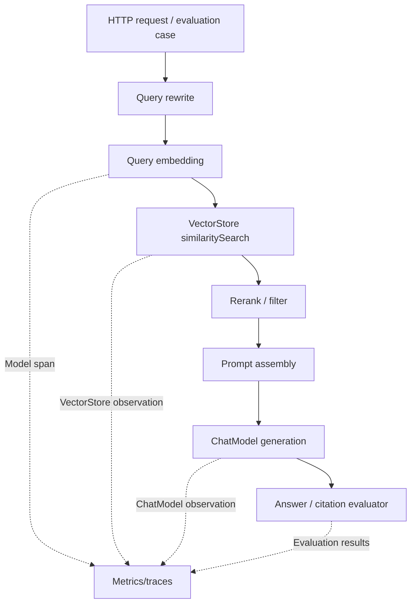

# Theo dõi thời lượng và lỗi thao tác

> **Chương:** Quan sát VectorStore  
> **Module:** `SPRING_AI_EVALUATION_OBSERVABILITY` — đánh giá chất lượng ứng dụng Spring AI bằng dataset, relevance, fact checking, kiểm thử RAG/tool calling; đồng thời đo metrics, traces, chi phí và độ trễ để giải thích sự suy giảm giữa các phiên bản prompt, model và pipeline.

## Mục tiêu học tập

Sau bài học, bạn có thể:

1. Giải thích **phạm vi đo thời lượng** của các thao tác `add`, `query` và `delete` trong `VectorStore`, phân biệt với thời lượng embedding, retrieval workflow và phản hồi RAG đầu cuối.
2. Đọc metric/timer và trace do Spring AI–Micrometer tạo ra; hiểu `count`, `sum`, `max`, active operations, histogram và p95.
3. Phân biệt **thành công kỹ thuật**, **thất bại kỹ thuật**, **trả kết quả rỗng hợp lệ** và **thất bại về chất lượng retrieval**.
4. Ghi nhận lỗi theo thao tác bằng mã có tập giá trị hữu hạn, theo dõi retry, timeout, throttling, queue và các triệu chứng backend.
5. Viết mã Java bọc workflow quanh `VectorStore`, thêm metric ứng dụng và unit test mà không nhân đôi timer mặc định của Spring AI.
6. Thiết kế dashboard, cảnh báo và quy trình điều tra liên kết thời lượng/lỗi với recall@K, groundedness, citation, token, chi phí và phiên bản pipeline.

## 1. Vì sao cần theo dõi riêng thời lượng và lỗi VectorStore?

Một trợ lý Spring AI dựa trên RAG thường phải truy xuất tài liệu trước khi gọi ChatModel. Khi người dùng phản ánh "câu trả lời chậm và sai", lỗi có thể ở nhiều tầng:

- Embedding query gọi provider bị timeout.
- Vector database chậm vì index, filter hoặc tải tăng.
- VectorStore query trả rỗng nhưng không có exception; người dùng cần tài liệu mà hệ thống không lấy được.
- Retriever trả đúng tài liệu, nhưng bước rerank hoặc cắt context loại mất nguồn quan trọng.
- ChatModel nhận đầy đủ bằng chứng nhưng vẫn suy diễn sai hoặc mất thời gian sinh câu trả lời.
- Tool gọi thêm nhiều vòng, làm tăng tổng latency dù VectorStore không chậm.

Vì vậy **độ trễ VectorStore**, **tình trạng lỗi thao tác**, **chất lượng retrieval** và **chất lượng câu trả lời cuối** là bốn tín hiệu liên quan nhưng không thay thế nhau.

| Vấn đề người dùng thấy | Điều metrics VectorStore có thể phát hiện | Điều vẫn cần kiểm tra |
|---|---|---|
| Câu trả lời lâu | `query` latency/p95 tăng, active operations tăng | Embedding, rerank, ChatModel và tool spans |
| Không có nguồn trích dẫn | Query trả rỗng hoặc ít tài liệu | Gold documents, filter, prompt assembly |
| Trích dẫn sai tài liệu | `query` vẫn có thể thành công | Document IDs thực sự cấp cho model, citation evaluator |
| Nạp tài liệu mới không tìm thấy | `add` latency/error và indexing lag | Dữ liệu thực đã index, model embedding và consistency |
| Tài liệu đã xóa vẫn xuất hiện | `delete` có thể trả success | Cache, replica, hậu kiểm theo ID, tính nhất quán |
| Lỗi xảy ra sau deploy | Count/error rate theo operation và backend | Cấu hình, index version, query filter, model version |

**Điểm chính:** Không được kết luận "RAG đạt chất lượng" chỉ vì timer của `query` thấp; cũng không thể kết luận backend hỏng nếu truy vấn trả danh sách rỗng hợp lệ.

## 2. Phạm vi một phép đo: đo đúng tầng

Giả sử một request trải qua các bước:



Trong triển khai cụ thể, việc tạo embedding query có thể được gọi *bên trong* phương thức `similaritySearch` của VectorStore, không nhất thiết là bước riêng nằm trước nó. Sơ đồ mô tả luồng logic, còn **phạm vi timer thực tế phụ thuộc implementation**. Hãy kiểm tra trace/span tree trước khi quy một đoạn thời gian cho embedding hay backend.

### 2.1. Bốn loại thời lượng thường có

| Tên do ứng dụng định nghĩa | Đầu và cuối phép đo | Phép đo trả lời câu hỏi |
|---|---|---|
| `vectorOperationDuration` | Ranh giới method/instrumentation `VectorStore` | Một lần gọi `add/query/delete` mất bao lâu? |
| `retrievalWorkflowDuration` | Từ lúc bắt đầu retrieval đến khi có tập context được chọn | Embedding, query, rerank/filter và chuẩn bị context mất bao lâu? |
| `applicationResponseDuration` | Từ lúc nhận request đến khi trả response | Người dùng phải đợi bao lâu? |
| `evaluationDuration` | Từ lúc chạy evaluator đến khi có phán quyết | Hệ thống chấm tiêu tốn bao nhiêu thời gian? |

Với thời lượng lồng nhau:

```text
Application request:    1,800 ms
  Retrieval workflow:     420 ms
    VectorStore query:     180 ms
      (Embedding/DB tùy implementation)
  ChatModel generation: 1,250 ms
  Other work:             130 ms
```

Số liệu chỉ minh họa. Không cộng `1,800 + 420 + 180` vì các khoảng thời gian đã **bao nhau**. Để chia nhỏ nguyên nhân, cần biết hierarchy của spans và sử dụng thời gian riêng của từng bước; với các nhánh chạy song song, tổng durations cũng có thể lớn hơn wall-clock của request.

### 2.2. Latency, throughput và concurrency

Một hệ thống có latency tốt khi ít tải vẫn có thể chậm dưới tải thực. Cần xem cùng lúc:

- **Latency:** thời gian một operation hoàn tất, thường dùng p50, p95, p99 trên cửa sổ mẫu rõ ràng.
- **Throughput:** số operation mỗi giây (RPS/ops/s), tính từ timer count hoặc counter thích hợp.
- **Concurrency:** số operation đang thực thi hoặc active count; có thể đi cùng queue depth/backpressure.
- **Error/timeout rate:** tỷ lệ lỗi trên số attempt cùng phạm vi.
- **Result count:** số document `query` thực sự trả về, không đồng nghĩa với `topK`.
- **End-to-end impact:** p95 application latency và coverage/chất lượng RAG.

Thời gian tăng khi throughput tăng có thể là dấu hiệu backend bị bão hòa, connection pool hạn chế, index bị tranh chấp hoặc provider embedding quá chậm. Không chẩn đoán chỉ từ một biểu đồ.

## 3. Spring AI VectorStore observation và các thuộc tính

Spring AI cung cấp Micrometer Observation cho các hoạt động VectorStore, với tên được tài liệu mô tả:

```text
db.vector.client.operation
```

Giá trị `db.operation.name` tương ứng thao tác `add`, `upsert`, `delete` hoặc `query`. Phương thức Java `similaritySearch(...)` được quan sát theo ngữ nghĩa thao tác **`query`**, không phải chuỗi `similaritySearch`.

| Key | Loại / vai trò | Ví dụ |
|---|---|---|
| `db.operation.name` | Low cardinality: loại thao tác | `query` |
| `db.system` | Low cardinality: hệ lưu trữ | `pg_vector` hoặc giá trị backend cung cấp |
| `spring.ai.kind` | Low cardinality: thành phần Spring AI | `vector_store` |
| `db.collection.name` | Thông tin collection, thường high cardinality | `support_documents` |
| `db.namespace` | Namespace nếu backend cung cấp, thường high cardinality | `support` |
| `db.vector.query.top_k` | Cấu hình truy vấn nếu được ghi trong trace | `5` |
| `db.vector.query.similarity_threshold` | Ngưỡng similarity truy vấn | `0.7` |

Một số key có thể **không xuất hiện** tùy backend, phiên bản, cách instrument, exporter hoặc chính sách redaction. Không tự khẳng định collection/namespace sai vì không thấy field trong trace.

### 3.1. Dữ liệu nào không nên thành metric tags?

Không đặt nguyên văn `query`, danh sách document, prompt, tenant ID tùy ý, user ID hoặc raw filter thành tags; những giá trị này vừa có khả năng nhạy cảm vừa gây nổ cardinality.

Nên dùng các nhãn hữu hạn đã được kiểm soát như:

- `db.operation.name`: `add`/`query`/`delete`.
- `db.system`: họ backend.
- `app.store.role`: `policy-search` hoặc `operations-search` nếu ứng dụng định nghĩa hữu hạn.
- `outcome`: `success`/`error` trên metric ứng dụng riêng.
- `error.category`: một nhóm lỗi cố định, không phải class/message tùy ý.

Nếu cần xem tài liệu, query text hoặc filter để điều tra một ca, lưu tham chiếu `runId`/`traceId` đến evidence store có ACL và retention; không biến toàn bộ payload thành metric dimensions.

## 4. Đọc timer, active operations và histogram

Với Micrometer + Prometheus, tên timer có thể được xuất thành các series tương ứng với `db.vector.client.operation`:

```text
db_vector_client_operation_seconds_count
db_vector_client_operation_seconds_sum
db_vector_client_operation_seconds_max
db_vector_client_operation_active_count
```

Đây là **dạng tên export minh họa theo convention**; cần mở `/actuator/prometheus` hoặc backend thực tế để xác minh tên và labels đã phát ra. Registry, version và các meter filters có thể làm tên khác đi.

### 4.1. Ý nghĩa đúng của từng series

| Dữ liệu | Diễn giải đúng | Điều không được suy ra |
|---|---|---|
| `_seconds_count` | Số lần timer đã ghi phép đo hoàn tất | Không mặc nhiên là số request người dùng |
| `_seconds_sum` | Tổng duration đã ghi, đơn vị giây | Không phải latency của một lượt cụ thể |
| `_seconds_max` | Giá trị tối đa trong cửa sổ của registry/timer | Không phải p95 |
| `_active_count` | Số phép quan sát đang hoạt động tại thời điểm đo nếu meter được hỗ trợ | Không bằng queue depth, không bằng throughput |
| `_seconds_bucket` | Các bucket độ trễ nếu histogram được xuất | Không tự có khi chưa bật histogram |

Để tính số operation mỗi giây cho từng loại:

```promql
sum by (db_operation_name) (
  rate(db_vector_client_operation_seconds_count[5m])
)
```

Tính **latency trung bình** theo operation (đơn vị giây):

```promql
sum by (db_operation_name) (
  rate(db_vector_client_operation_seconds_sum[5m])
)
/
sum by (db_operation_name) (
  rate(db_vector_client_operation_seconds_count[5m])
)
```

Nếu 5 phút không có operation, mẫu số bằng 0 và truy vấn có thể trả kết quả không xác định/không có dữ liệu. Không nên thay số này bằng `0 ms` rồi kết luận service cực nhanh. Cũng cần quan sát lượng mẫu khi đánh giá một thay đổi nhỏ.

### 4.2. p95 và sự khác biệt với maximum

Với n durations đã sắp xếp tăng dần, một cách định nghĩa percentile (nearest rank) là:

\[
\mathrm{p95} = x_{\lceil 0.95n\rceil}.
\]

Điều này không giống giá trị lớn nhất, trừ tình huống tập mẫu rất nhỏ hoặc phân bố đặc biệt.

Nếu bật histogram cho meter có tên `db.vector.client.operation` và exporter cung cấp `_bucket`:

```promql
histogram_quantile(
  0.95,
  sum by (le, db_operation_name) (
    rate(db_vector_client_operation_seconds_bucket[5m])
  )
)
```

Histogram tính **ước lượng phân vị**, có sai số phụ thuộc bucket và lượng mẫu. Không viết query p95 lên `_seconds_max` rồi gọi đó là p95.

Ví dụ cấu hình Spring Boot khi cần histogram trên tên meter:

```yaml
management:
  metrics:
    distribution:
      percentiles-histogram:
        "[db.vector.client.operation]": true
```

YAML thể hiện property có tên meter dạng dấu chấm trong map của Spring Boot; khi sử dụng phải kiểm tra binding/configuration đúng phiên bản Spring Boot và sự tồn tại của `_bucket` trong exporter. Bật histogram cho quá nhiều tag combinations hoặc bucket range rộng có thể tăng chi phí metrics.

### 4.3. Có cần p99 không?

p99 giúp thấy tail latency, nhưng ở số mẫu thấp nó có thể bị nhiễu hoặc thiếu ổn định. Nên theo dõi:

- p50 để biết phần lớn truy vấn có chậm không;
- p95 để theo dõi tail phổ biến;
- p99 khi lưu lượng đủ lớn và rủi ro người dùng cuối đòi hỏi;
- số mẫu, error rate và active operations cùng với các phân vị.

Đối với `add` theo batch lớn, so p95 giữa các batch khác kích thước có thể không công bằng. Cần phân nhóm batch size hoặc chuẩn hóa workload trước khi kết luận hiệu năng suy giảm.

## 5. Lỗi nào thuộc VectorStore và lỗi nào thuộc chất lượng RAG?

Một quan sát thao tác thành công chỉ xác nhận lời gọi hoàn tất theo hợp đồng của implementation. Nó không tự kết luận rằng kết quả đáp ứng câu hỏi.

| Tình huống | Trạng thái operation | Trạng thái chất lượng / dữ liệu | Vì sao |
|---|---|---|---|
| `query` ném lỗi kết nối đến vector database | ERROR | Retrieval chưa có kết quả | Lỗi kỹ thuật backend/network |
| `query` bị deadline timeout | ERROR/TIMEOUT ở tầng gọi | Chưa thể kết luận retrieval relevance | Lỗi hạ tầng hoặc quá tải |
| `query` trả `[]` hợp lệ với câu không có nguồn | SUCCESS | Có thể PASS hành vi không có nguồn | Không phải lỗi hạ tầng |
| `query` trả `[]` nhưng dataset có gold document | SUCCESS | Retrieval recall FAIL | Sai index/filter/embedding hoặc dữ liệu thiếu |
| `query` trả 5 document nhưng không tài liệu nào đúng | SUCCESS | Retrieval relevance/recall FAIL | Kết quả tìm không hữu ích |
| `add` kết thúc nhưng dữ liệu không thể tìm sau khi index ổn định | Có thể SUCCESS | Indexing/integrity FAIL | Cần hậu kiểm |
| `delete` kết thúc nhưng source còn trong cache | Có thể SUCCESS | Post-delete verification chưa đạt | Cần xem scope và consistency |
| Judge fact checking bị timeout | VectorStore có thể SUCCESS | **Evaluation ERROR**, không phải FAIL VectorStore | Hệ thống chấm không có phán quyết |
| Document trong context không hỗ trợ câu trả lời | VectorStore có thể SUCCESS | Groundedness FAIL | Lỗi ở retrieval hoặc generation cần điều tra |

### 5.1. Đừng suy lỗi từ số lượng kết quả

`topK=5` là số kết quả tối đa được yêu cầu, không phải nghĩa vụ trả đúng 5. Filter, threshold và tập dữ liệu nhỏ có thể khiến query trả 0–4 document mà hoàn toàn hợp lệ.

Số document trả về là chỉ số hữu ích để phát hiện hồi quy, nhưng cần tập dữ liệu nhãn chuẩn:

\[
\mathrm{Recall@K} = \frac{|G \cap R_K|}{|G|}, \quad |G|>0,
\]

trong đó `G` là tập tài liệu thực sự liên quan trong bộ dữ liệu chuẩn, `R_K` là top K. Với `G = ∅`, phép chia không xác định; nên chấm hành vi không bịa nguồn hoặc quy tắc khác.

### 5.2. Ba cách nhìn một lỗi `query`

**Lớp kỹ thuật:** Lời gọi có ném exception? Mất bao lâu? Có retry hoặc 429/503?

**Lớp retrieval:** Trong kết quả có đúng ID tài liệu chuẩn? Rank có giảm? Tenant filter đúng?

**Lớp sinh trả lời:** Trong tài liệu thực sự cấp cho model, có thông tin để trả lời? Model có trích dẫn đúng và giữ factual correctness?

Ví dụ `query p95=40ms` và `Recall@5=0.3` không mâu thuẫn: backend nhanh nhưng lấy sai nguồn. Ngược lại, `query p95=500ms` và `Recall@5=1.0` có thể là chất lượng retrieval tốt nhưng hiệu năng không đạt.

## 6. Thiết kế taxonomy lỗi thao tác và cách đếm

Một metric báo "error count" chỉ hữu ích khi biết **lỗi ở tầng nào** và **mẫu số là gì**.

### 6.1. Các nhóm lỗi thực tế

| Error category do ứng dụng đề xuất | Ví dụ | Có thể retry? | Cần điều tra |
|---|---|---|---|
| `NETWORK` | Kết nối/reset đến backend | Có thể | DNS, pool, load balancer, network |
| `TIMEOUT` | Backend/query vượt timeout | Có thể, giới hạn | Query plan, index, contention, client deadline |
| `RATE_LIMIT` | Backend/provider trả 429 hoặc throttling | Có, backoff+jitter | Quota, concurrency, provider |
| `AUTH` | Sai credential, 401/403 | Thường không | Permission, token, tenant routing |
| `CONFIG` | Sai collection/index name, vector dimension | Thường không | Deployment và schema manifest |
| `INVALID_REQUEST` | Filter hoặc query sai hợp đồng | Không nếu input không đổi | Validation, filter builder |
| `RESOURCE_LIMIT` | Pool/queue đầy, memory pressure | Sau khi giảm tải | Capacity và bulkhead |
| `BACKEND_UNAVAILABLE` | 503 hay service mất kết nối | Có giới hạn | Backend health và sự cố vận hành |
| `UNKNOWN` | Chưa phân loại được | Theo điều tra | Ghi exception an toàn để rà soát |

Các category này là **đề xuất của ứng dụng**, không phải danh sách exception hoặc tag chuẩn mà mọi VectorStore implementation đều phát ra. Có thể chuyển lỗi provider-specific sang taxonomy này trong adapter phù hợp. Tránh đưa tên class exception tùy ý làm metric label nếu có nguy cơ cardinality lớn; có thể ghi exception chi tiết trong trace/log có quyền.

### 6.2. Success, error, timeout và cancellation

Nên định nghĩa rõ bốn outcome nếu app có timeout riêng:

- `success`: operation hoàn tất theo hợp đồng.
- `error`: operation ném lỗi hoặc trả failure rõ ràng.
- `timeout`: request của ứng dụng hết deadline và chưa có phán quyết hoàn tất.
- `cancelled`: scheduler/người dùng chủ động hủy request.

Nếu runtime chỉ ghi một metric success/error, không tự tạo category thứ ba giả mà chưa có cơ sở đo. Khi app có deadline bên ngoài, có thể xảy ra **outer timeout** trong khi operation backend vẫn tiếp tục và sau đó thành công. Tách **request outcome** và **backend attempt outcome** để tránh đếm cùng một lượt hai lần hoặc tưởng rằng `cancel(true)` đã chắc chắn ngừng tác vụ.

### 6.3. Attempt rate khác logical request rate

Ví dụ một request RAG gọi `similaritySearch`; lần đầu timeout, lần hai thành công.

| Đơn vị thống kê | Số thành công | Số lỗi | Mẫu số |
|---|---:|---:|---:|
| **Backend attempts** | 1 | 1 | 2 calls |
| **Logical user request** | 1 | 0 | 1 request |

Hai con số đều có ích nhưng đo thứ khác nhau. Nếu dashboard dùng count của `db.vector.client.operation`, nó gần với số **operation attempts đã instrument**, không phải số request người dùng. Khi quyết định SLA của ứng dụng, phải đếm trên request IDs và trạng thái trả lời cuối, không lấy timer count làm mẫu số một cách mù quáng.

## 7. Java: quan sát lỗi/độ trễ mà không nhân đôi timer VectorStore

Một giải pháp tốt là để Spring AI instrument các lời gọi `VectorStore` của nó, còn ứng dụng bọc một **observation workflow** và ghi metric **outcome/result count** riêng. Không tạo thêm timer trùng tên `db.vector.client.operation`.

Ví dụ Java 17+ sau minh họa nguyên tắc này. Các metric `app.vectorstore...` là **metric tự định nghĩa**, không phải metric mặc định Spring AI.

### 7.1. Service quan sát ba thao tác

```java
import java.util.List;
import java.util.Objects;
import java.util.function.Supplier;

import io.micrometer.core.instrument.DistributionSummary;
import io.micrometer.core.instrument.MeterRegistry;
import io.micrometer.observation.Observation;
import io.micrometer.observation.ObservationRegistry;
import org.springframework.ai.document.Document;
import org.springframework.ai.vectorstore.SearchRequest;
import org.springframework.ai.vectorstore.VectorStore;
import org.springframework.stereotype.Service;

@Service
public final class VectorOperationHealth {
    private final VectorStore vectorStore;
    private final ObservationRegistry observations;
    private final MeterRegistry meters;
    private final DistributionSummary resultsPerQuery;

    public VectorOperationHealth(
            VectorStore vectorStore,
            ObservationRegistry observations,
            MeterRegistry meters) {
        this.vectorStore = Objects.requireNonNull(vectorStore);
        this.observations = Objects.requireNonNull(observations);
        this.meters = Objects.requireNonNull(meters);
        this.resultsPerQuery = DistributionSummary
                .builder("app.vectorstore.query.result.count")
                .description("Số tài liệu thực tế trong một query thành công")
                .register(meters);
    }

    // 'operation' chỉ nhận các literal nội bộ add/query/delete.
    // Không truyền query text, raw filter hoặc tenant ID làm tag.
    private <T> T track(String operation, Supplier<T> call) {
        return Observation.createNotStarted(
                        "app.vectorstore.workflow", observations)
                .lowCardinalityKeyValue("operation", operation)
                .observe(() -> {
                    try {
                        T result = call.get();
                        meters.counter(
                                "app.vectorstore.operation.outcomes",
                                "operation", operation,
                                "outcome", "success").increment();
                        return result;
                    }
                    catch (RuntimeException exception) {
                        meters.counter(
                                "app.vectorstore.operation.outcomes",
                                "operation", operation,
                                "outcome", "error").increment();
                        // Observation thấy exception; không nuốt lỗi.
                        throw exception;
                    }
                });
    }

    public void add(List<Document> documents) {
        Objects.requireNonNull(documents);
        track("add", () -> {
            vectorStore.add(documents);
            return null;
        });
    }

    public List<Document> query(SearchRequest request) {
        Objects.requireNonNull(request);
        List<Document> result = track("query", () ->
                Objects.requireNonNull(
                        vectorStore.similaritySearch(request),
                        "VectorStore không được trả null"));

        resultsPerQuery.record(result.size());
        if (result.isEmpty()) {
            meters.counter("app.vectorstore.query.empty").increment();
        }
        return result;
    }

    public void delete(List<String> documentIds) {
        Objects.requireNonNull(documentIds);
        track("delete", () -> {
            vectorStore.delete(documentIds);
            return null;
        });
    }
}
```

Đoạn code **không xử lý quyền xóa**: đó là trách nhiệm của API/service gọi trước khi đến `delete()`. Với ứng dụng production, đừng cho ChatModel/tool argument tự quyết danh sách ID xóa; phải xác thực quyền, scope tenant, phê duyệt và audit.

### 7.2. Ý nghĩa metric custom trong ví dụ

| Metric | Kiểu | Ý nghĩa |
|---|---|---|
| `app.vectorstore.operation.outcomes` | Counter, tag `operation/outcome` | Số lần service wrapper gọi xong/throw, **theo attempt** |
| `app.vectorstore.query.result.count` | DistributionSummary | Phân bố số document trả trong các query thành công |
| `app.vectorstore.query.empty` | Counter | Số lần query thành công với danh sách rỗng |
| `app.vectorstore.workflow` | Observation/span | Thời gian toàn phần wrapper; có thể chứa span VectorStore |
| `db.vector.client.operation` | Spring AI observation | Thao tác ở tầng VectorStore implementation |

Nếu ứng dụng trực tiếp gọi VectorStore ở vị trí khác không qua wrapper, metric custom `app.vectorstore.operation.outcomes` sẽ **không đếm** các lần gọi đó, trong khi observation Spring AI vẫn có thể ghi chúng. Dashboard cần công bố scope, không coi hai bộ đếm mặc nhiên có cùng mẫu số.

Lý do không gắn tag `error.class` hoặc `error.message` trực tiếp: chúng có thể biến thiên và chứa chi tiết nhạy cảm. Nếu muốn thống kê nguyên nhân, dùng adapter phân loại thành taxonomy hữu hạn như `TIMEOUT`/`NETWORK`/`CONFIG`; log chi tiết kèm trace ID ở hệ thống được bảo vệ.

### 7.3. Gọi service trong luồng retrieval

```java
import java.util.List;
import org.springframework.ai.document.Document;
import org.springframework.ai.vectorstore.SearchRequest;

SearchRequest request = SearchRequest.builder()
        .query("Hoàn tiền được xử lý trong bao lâu?")
        .topK(5)
        .similarityThreshold(0.70)
        .filterExpression("tenant == 'demo'")
        .build();

// 'health' là Bean VectorOperationHealth được inject ở lớp gọi.
List<Document> documents = health.query(request);
System.out.println(documents.size()); // Số kết quả thực tế, không phải topK
```

`tenant == 'demo'` là **filter cố định trong lab**. Hệ production phải lấy tenant và phạm vi nguồn từ security context đã xác thực, dùng filter builder phù hợp, không nối chuỗi filter trực tiếp từ prompt người dùng.

### 7.4. Vì sao không ghi status quality trong `track`?

`track` chỉ biết method `similaritySearch` hoàn tất hay ném exception. Nó không biết:

- Query có gold documents hay không.
- Result IDs có liên quan tới câu hỏi hay không.
- Tài liệu có đúng version hiệu lực không.
- Reranker có loại mất nguồn đúng không.
- ChatModel có dẫn nguồn đúng hay không.

Do đó metric `outcome=success` là **thành công kỹ thuật**, không phải `retrieval_quality=PASS`. Nếu dùng quality label trong wrapper, sẽ khẳng định quá mức về điều mà wrapper không đo được.

## 8. Unit test observability bằng Micrometer và stub VectorStore

Đối với việc kiểm tra wrapper, không cần gọi model hoặc vector database thật. Có thể dùng Mockito cùng `SimpleMeterRegistry` của Micrometer.

### 8.1. Unit test: query rỗng là success, lỗi backend là error

```java
import static org.junit.jupiter.api.Assertions.*;
import static org.mockito.ArgumentMatchers.any;
import static org.mockito.Mockito.*;

import java.util.List;
import io.micrometer.core.instrument.simple.SimpleMeterRegistry;
import io.micrometer.observation.ObservationRegistry;
import org.junit.jupiter.api.Test;
import org.springframework.ai.vectorstore.SearchRequest;
import org.springframework.ai.vectorstore.VectorStore;

class VectorOperationHealthTest {

    @Test
    void emptyResultIsSuccessfulOperation() {
        VectorStore store = mock(VectorStore.class);
        when(store.similaritySearch(any(SearchRequest.class)))
                .thenReturn(List.of());

        var meters = new SimpleMeterRegistry();
        var health = new VectorOperationHealth(
                store, ObservationRegistry.create(), meters);
        var request = SearchRequest.builder().query("Câu hỏi không có nguồn")
                .topK(3).build();

        assertTrue(health.query(request).isEmpty());
        assertEquals(1.0, meters.get("app.vectorstore.operation.outcomes")
                .tags("operation", "query", "outcome", "success")
                .counter().count());
        assertEquals(1.0,
                meters.get("app.vectorstore.query.empty").counter().count());
        meters.close();
    }

    @Test
    void backendExceptionIsRecordedAndRethrown() {
        VectorStore store = mock(VectorStore.class);
        when(store.similaritySearch(any(SearchRequest.class)))
                .thenThrow(new IllegalStateException("backend unavailable"));

        var meters = new SimpleMeterRegistry();
        var health = new VectorOperationHealth(
                store, ObservationRegistry.create(), meters);
        var request = SearchRequest.builder().query("Hoàn tiền")
                .topK(5).build();

        assertThrows(IllegalStateException.class, () -> health.query(request));
        assertEquals(1.0, meters.get("app.vectorstore.operation.outcomes")
                .tags("operation", "query", "outcome", "error")
                .counter().count());
        meters.close();
    }
}
```

Đây là **mã hướng dẫn**, chưa được compile/chạy theo quy trình STEP 4. Tùy phiên bản Spring AI, điều chỉnh import/phương thức nếu API thay đổi; cần xác minh integration với VectorStore thật và exporter metrics trong STEP QA sau.

### 8.2. Nên test những tình huống nào?

| Case | Kỳ vọng operation | Điều khác cần báo |
|---|---|---|
| Query trả 0 document, không exception | success; empty count +1 | Quality N/A/PASS/FAIL tùy gold data |
| Query trả 3 document khi topK=5 | success | result count=3, không tự FAIL |
| Backend timeout | error hoặc timeout theo lớp đo | Khoảng thời gian, retry và trace |
| Query filter sai cú pháp | error nếu backend từ chối | Lỗi input/config, không phải hallucination |
| Embedding provider báo 429 bên trong query | error ở lời gọi bị ảnh hưởng | Provider span và retry |
| `add` yêu cầu 100 documents, backend lỗi sau khi lưu 40 | error/partial tùy hợp đồng | Không tự nói 0 hay 100 đã ghi; hậu kiểm |
| `delete` theo ID không tồn tại, backend trả success | success | Không tự suy ID đã tồn tại |
| Retry một logical request thành 2 attempts | 1 error + 1 success ở attempts | 1 logical request hoàn tất |
| Collector tracing mất kết nối, backend query thành công | Operation success | Observability export error riêng |
| Judge relevance timeout | Operation có thể success | Evaluation ERROR, không ghi retrieval FAIL |

Đặc biệt, kiểm thử `add` và `delete` có tác động dữ liệu phải sử dụng fixture/namespace riêng; không chạy trực tiếp trên collection production.

## 9. Dashboard và PromQL cho duration, lỗi và truy vấn rỗng

### 9.1. Query RPS và average latency

Nếu time series có tên theo cách export Micrometer thông thường:

```promql
sum by (db_system, db_operation_name) (
  rate(db_vector_client_operation_seconds_count[5m])
)
```

```promql
sum by (db_system, db_operation_name) (
  rate(db_vector_client_operation_seconds_sum[5m])
)
/
sum by (db_system, db_operation_name) (
  rate(db_vector_client_operation_seconds_count[5m])
)
```

Không gộp `add`, `query`, `delete` trong cùng một latency p95 nếu workload khác nhau; `add` theo batch có thể lâu hơn query đơn lẻ một cách bình thường.

### 9.2. Error rate theo outcome của ứng dụng

Các counter từ ví dụ Java có thể được export thành series dạng `app_vectorstore_operation_outcomes_total`. Trước khi sử dụng, xác minh chính xác tên và label từ registry thực.

```promql
sum by (operation) (
  rate(app_vectorstore_operation_outcomes_total{outcome="error"}[5m])
)
/
sum by (operation) (
  rate(app_vectorstore_operation_outcomes_total[5m])
)
```

Mẫu số là **lượt gọi qua wrapper**, không phải lượt gọi VectorStore từ mọi đoạn mã hay số request end-to-end. Khi không có traffic, tỷ lệ không xác định; nên dùng điều kiện mẫu tối thiểu khi đặt cảnh báo.

### 9.3. Zero-result rate

```promql
sum(rate(app_vectorstore_query_empty_total[5m]))
/
sum(rate(
  app_vectorstore_operation_outcomes_total{
    operation="query",outcome="success"
  }[5m]
))
```

Đây là tỷ lệ query **kết thúc thành công nhưng trả rỗng**. Nó không phải "tỷ lệ lỗi VectorStore". Để diễn giải, cần phân nhóm dataset: truy vấn không có nguồn có thể trả rỗng đúng; truy vấn có gold documents trả rỗng thường là tín hiệu chất lượng.

### 9.4. P95 histogram

```promql
histogram_quantile(
  0.95,
  sum by (le, db_operation_name, db_system) (
    rate(db_vector_client_operation_seconds_bucket[5m])
  )
)
```

Chỉ dùng công thức khi exporter phát histogram bucket phù hợp. Nếu không có `_bucket`, xem cấu hình histogram và phiên bản registry; đừng lấy `_max` thế chỗ rồi gọi là p95.

### 9.5. Không quan sát được có nghĩa là thành công?

Không. Nếu metric thiếu hẳn sau deploy, có thể do:

- Tracing/metrics instrumentation chưa bật.
- Thao tác đi qua code path không dùng VectorStore đã instrument.
- Exporter/collector hoặc scrape gặp lỗi.
- Sampling trace bỏ bớt spans; metrics và traces có chính sách thu thập khác nhau.
- Một số label/span attribute bị redaction hoặc không được implementation hỗ trợ.

**Absence of telemetry không chứng minh absence of operation.** Hãy theo dõi thêm trạng thái của collector/exporter và đối chiếu application logs có phân quyền.

## 10. Từ tín hiệu chậm đến nguyên nhân gốc

Một runbook phân tích độ trễ truy vấn:

1. **Chốt phạm vi:** query ở backend nào, collection/index nào, cửa sổ thời gian nào, loại workload nào?
2. **Đánh giá số mẫu:** có đủ calls để so p95 không, traffic có biến động không?
3. **Đối chiếu error/timeout:** latency tăng cùng timeout hay chỉ tăng tail?
4. **Mở trace một số case chậm:** operation span, embedding calls, retry, connection wait, rerank và ChatModel.
5. **So cấu hình:** `topK`, threshold, filter, index version, embedding model và số chunk.
6. **Kiểm DB/backend:** CPU, memory, I/O, index plan, connection pool, resource limit, load.
7. **Kiểm chất lượng:** recall@K, số document, groundedness và citation sau khi thay config để tránh "tối ưu nhanh hơn nhưng sai hơn".
8. **Xác minh sau khắc phục:** chạy dataset cố định và kiểm lại p50/p95, error rate, chất lượng và chi phí.

### 10.1. Mẫu bảng nguyên nhân

| Hiện tượng | Giả thuyết | Tín hiệu giúp bác bỏ/xác nhận |
|---|---|---|
| p95 `query` tăng sau khi topK tăng | Truy vấn tìm/đọc nhiều kết quả hơn | So p95 theo topK và index, query plan |
| p95 `add` tăng khi tài liệu được chia chunk nhỏ | Số vector/embedding requests nhiều hơn | Batch size, token, embedding spans và write count |
| Rate limit xảy ra khi ingestion đồng thời với serving | Backend/provider quá tải | 429, active operations, queue, quotas |
| Query nhanh nhưng zero-result tăng | Filter/tenant scope sai, index rỗng, threshold cao | Filter evidence, index manifest, gold IDs |
| p95 application tăng, VectorStore p95 ổn định | Rerank/LLM/tool chậm | End-to-end trace và spans |
| Lỗi `delete` tăng | Sai scope, credential, backend | Audit sự kiện xóa, error category và hậu kiểm |
| Metric không xuất dù truy vấn chạy | Exporter/instrumentation hỏng | Actuator, collector logs, configuration |
| Retry che lỗi khỏi response người dùng | Backend nhiều attempts, logical requests thành công | Attempt counters và application success riêng |

Không nên tối ưu bằng cách tăng timeout vô hạn: nó có thể giảm lỗi báo ra nhưng tăng tail latency và làm nghẽn tài nguyên. Chọn timeout/retry dựa trên SLA, giới hạn tải và mức nhất quán của operations.

## 11. Timeout, retry, backpressure và chi phí

### 11.1. Budget thời gian theo toàn bộ request

Giả sử ứng dụng có SLA 2.5 giây ở p95. Một chính sách budget minh họa:

| Giai đoạn | Budget minh họa |
|---|---:|
| Query rewrite + embedding | 350 ms |
| VectorStore query | 300 ms |
| Rerank + prompt assembly | 250 ms |
| ChatModel generation | 1,400 ms |
| Networking/serialization dự phòng | 200 ms |
| **Tổng** | **2,500 ms** |

Đây là **ngân sách kế hoạch**, không phải đo lường thực tế hay cam kết rằng p95 từng thành phần cộng lại bằng p95 đầu cuối. Percentile không cộng tuyến tính; khi có song song và phân bố đuôi khác nhau, càng cần đo end-to-end thật.

### 11.2. Khi retry có thể làm sai chỉ số

Nếu query đầu tiên timeout ở 300 ms, lần hai thành công trong 250 ms, tổng thời gian cho workflow ít nhất xấp xỉ 550 ms cộng backoff/overhead. Backend timer có thể có hai mẫu, còn application chỉ có một response cuối.

Nên:

- Đặt giới hạn số attempt và deadline tổng.
- Dùng exponential backoff có jitter, tôn trọng rate-limit nếu có.
- Chỉ retry thao tác an toàn về mặt semantics và idempotency.
- Với `add`, cần document IDs ổn định/upsert semantics hoặc cơ chế chống nạp trùng.
- Với `delete`, cần đảm bảo quyền/scope và hiểu ảnh hưởng khi retry; không chạy lại thao tác có side effect trên mục tiêu khác.
- Ghi attempt count, retry reason và chi phí embedding/request bổ sung.
- Đo riêng response latency đầu cuối, không lấy thời gian attempt cuối làm tổng.

### 11.3. Chi phí liên hệ với VectorStore

VectorStore operation không nhất thiết có billable token trực tiếp, nhưng embedding model dùng để tạo vector và các tầng dịch vụ có thể phát sinh chi phí. Một thay đổi chia chunk từ 500 token sang 150 token có thể tăng số chunk, số embedding calls, kích thước index và thời gian nạp; topK lớn có thể tăng dữ liệu chuyển tới ChatModel.

Tách bốn nhóm chi phí:

1. **Embedding ingest:** token/calls tạo vector khi thêm dữ liệu.
2. **Embedding query:** token/calls khi mã hóa câu hỏi.
3. **Vector backend:** lưu trữ, truy vấn, I/O, dung lượng index theo chính sách nhà cung cấp.
4. **Generation/evaluation:** token ChatModel và LLM judge để đánh giá relevance/fact checking.

Không kết luận VectorStore đắt hơn chỉ vì tổng chi phí pipeline tăng sau khi thêm judge đánh giá hoặc thay ChatModel.

## 12. Kết nối operation health với chất lượng retrieval/RAG

Để biết một cấu hình mới thực sự tốt hơn, hãy cố định dataset và thu song song:

| Nhóm | Chỉ số | Nguồn |
|---|---|---|
| **Operation health** | Query p50/p95, timeout/error, throughput | Spring AI observation + backend |
| **Result set** | Returned count, zero-result rate, duplicate/old chunks | Wrapper và retrieval evidence |
| **Retrieval quality** | Recall@K, precision@K, MRR, filter correctness | Dataset gold labels |
| **RAG output** | Relevance, groundedness, citation pass rate | Evaluator của ứng dụng |
| **End-to-end** | User-visible latency, error rate, p95 | HTTP traces + application metrics |
| **Costs** | Embedding usage, backend cost, ChatModel/judge cost | Provider usage + cost model |
| **Versions** | Prompt, model, embedding, index, pipeline, dataset, judge | Run manifest/evidence |

### 12.1. Cùng query có thể nhanh hơn nhưng tệ hơn

Ví dụ A/B giả định trên 200 case cùng bộ dữ liệu:

| Chỉ số | Baseline A | Candidate B | Điều suy ra |
|---|---:|---:|---|
| VectorStore `query` p95 | 250 ms | 160 ms | B có operation nhanh hơn |
| Query error rate | 0.5% | 0.5% | Tỷ lệ lỗi tương tự |
| Zero-result trên case có gold | 3% | 13% | B bỏ lỡ nhiều nguồn hơn |
| Recall@5 | 0.93 | 0.76 | B suy giảm retrieval |
| Groundedness PASS | 96% | 88% | Chất lượng câu trả lời kém hơn |
| Application p95 | 2.2 s | 2.0 s | B phục vụ nhanh hơn |

Không thể chọn B chỉ vì giảm 90 ms ở `query` nếu ngưỡng chất lượng RAG bị vi phạm. Cần xem index, filter, similarity threshold, embedding version, rerank và context được gửi model.

### 12.2. Một ca thực tế cần lưu gì?

```json
{
  "runId": "rag-run-091",
  "caseId": "refund-091",
  "datasetVersion": "support-rag-v7",
  "promptVersion": "refund-prompt-v6",
  "modelVersion": "chat-model-b",
  "embeddingModelVersion": "embed-model-v2",
  "indexVersion": "support-index-v4",
  "operation": "query",
  "vectorOperationLatencyMs": 185,
  "returnedCount": 3,
  "retrievedDocumentIds": ["refund-v3", "faq-v2", "shipping-v1"],
  "providedDocumentIds": ["refund-v3", "faq-v2"],
  "technicalOutcome": "success",
  "retrievalRecallAt5": 1.0,
  "groundednessStatus": "PASS",
  "traceId": "example-trace-id"
}
```

Đây là **schema minh họa**, không phải output mặc định Spring AI. Document IDs, source metadata và query context có thể nhạy cảm; trong production, lưu chúng ở evidence store có ACL, không đưa thành metric tags.

### 12.3. Điều gì xảy ra khi evaluator gặp lỗi?

Một lỗi judge timeout sau query thành công phải được lưu là **evaluation ERROR**, không tự thay groundedness thành `FAIL`. Báo riêng:

- `qualityPassRate = PASS / (PASS + FAIL)` trong các ca đã được chấm.
- `evaluationCoverage = (PASS + FAIL) / (PASS + FAIL + ERROR)` cho các ca applicable.
- `vectorOperationErrorRate` trên attempts với mẫu số rõ ràng.

Nhờ vậy khi B có nhiều judge timeouts nhưng VectorStore không lỗi, nhóm không nhầm "hệ thống chấm hỏng" với "backend vector hỏng".

## 13. Dataset và bài tập thực hành

### 13.1. Dataset kiểm thử mẫu

```yaml
datasetVersion: vector-op-health-v1
indexVersion: support-index-v4
embeddingModelVersion: embed-model-v2
cases:
  - caseId: query-valid-001
    operation: query
    query: "Thời hạn hoàn tiền là bao lâu?"
    topK: 5
    goldDocumentIds: [refund-policy-v3]
    expectedTechnicalOutcome: success
    expectedMinRecallAt5: 1.0

  - caseId: query-no-evidence-002
    operation: query
    query: "Một vấn đề chưa có tài liệu"
    topK: 5
    goldDocumentIds: []
    expectedTechnicalOutcome: success
    expectedBehavior: do_not_invent_evidence

  - caseId: query-invalid-filter-003
    operation: query
    filterFixture: malformed-filter
    expectedTechnicalOutcome: error
    expectedErrorCategory: INVALID_REQUEST

  - caseId: ingest-fixture-004
    operation: add
    documentIds: [fixture-policy-v4]
    expectedTechnicalOutcome: success
    expectedBehavior: verify_after_index_ready

  - caseId: delete-fixture-005
    operation: delete
    documentIds: [fixture-policy-v4]
    expectedTechnicalOutcome: success
    expectedBehavior: verify_deleted_by_id
```

Schema trên do ứng dụng tự định nghĩa; `expectedBehavior` phải được test runner hiện thực thành assertion. Không thực hiện add/delete trên production chỉ để kiểm tra metric.

### 13.2. Yêu cầu bài tập

1. Dựng một VectorStore thử nghiệm, bật Spring Boot Actuator và registry metrics phù hợp.
2. Chạy riêng `add`, `query`, `delete` với fixture; ghi observation `db.vector.client.operation` và label `db.operation.name`.
3. Thêm `VectorOperationHealth` để ghi outcome/empty result và wrapper span.
4. Với ba tải truy vấn khác nhau, xem p50/p95, throughput, active operations và error rate; ghi số mẫu trước khi kết luận.
5. Thử lọc metadata làm query rỗng hợp lệ và một test mô phỏng lỗi backend; xác nhận hai outcome không bị đánh đồng.
6. Tạo dataset ít nhất 15 truy vấn có gold IDs, đo Recall@3 và Recall@5; so tỷ lệ zero-result với chất lượng thật.
7. Tạo A/B giữa hai cấu hình index/topK; báo kỹ thuật và chất lượng riêng, có `indexVersion`/`embeddingModelVersion`.
8. Tạo một tình huống retry và giải thích tại sao số attempts không bằng số logical requests.
9. Liên kết một case chậm với trace retrieval → model → evaluator; xác định bước nào chiếm nhiều wall-clock nhất.
10. Kiểm tra raw query, document content, filter, tenant/user ID không xuất hiện trong metric tags.

### 13.3. Câu hỏi tự kiểm tra

- `_seconds_count` và `_seconds_sum` khác gì nhau? Có thể tính latency trung bình từ hai series này không?
- Tại sao `_seconds_max` không phải p95? Khi nào histogram query không có dữ liệu?
- `query` trả kết quả rỗng nhưng không exception có phải là thao tác lỗi không?
- Nếu query có retry hai lần, tại sao số backend attempts khác số request người dùng?
- Khi `query` p95 giảm nhưng recall@K cũng giảm, có nên xem đây là cải thiện toàn diện không?
- Vì sao thời lượng embedding trong `similaritySearch` có thể khó phân biệt nếu chưa xem trace cụ thể?
- Tại sao metric `app.vectorstore.operation.outcomes` có thể không đếm đủ tất cả VectorStore calls trong hệ thống?
- Khi Judge `FactCheckingEvaluator` timeout, đó là lỗi của VectorStore hay lỗi hệ thống đánh giá?

## 14. Checklist triển khai

- [ ] Hiểu phạm vi timer VectorStore, workflow retrieval, request đầu cuối và evaluation.
- [ ] Xác nhận tên observation `db.vector.client.operation` và các nhãn thực từ exporter.
- [ ] Dashboard tách `add`/`query`/`delete`, số mẫu, p50/p95, errors và active operations.
- [ ] Không dùng `_max` thay p95 hoặc tính p95 khi chưa có histogram phù hợp.
- [ ] Phân loại lỗi theo nhóm hữu hạn, không đưa raw exception/payload làm metric tags.
- [ ] Đếm attempts và logical requests với mẫu số riêng, đặc biệt khi có retries.
- [ ] Query trả rỗng có thể SUCCESS; quality được xác minh riêng bằng dataset/gold documents.
- [ ] Ghi số documents thực trả và không mặc định bằng `topK`.
- [ ] Có hạn mức timeout/retry/backpressure và cảnh báo p95/error rate theo workload.
- [ ] Khi `add`/`delete` có side effect, có quyền và hậu kiểm trên môi trường phù hợp.
- [ ] Không nhân đôi tên timer mặc định, không cộng latency của spans lồng nhau.
- [ ] Có metrics/trace cho embedding, VectorStore, rerank, ChatModel và evaluator.
- [ ] Báo tách quality PASS/FAIL với evaluation ERROR/coverage.
- [ ] So A/B với dataset/policy và index/embedding/prompt/model version được ghi rõ.
- [ ] Bảo vệ traces, query và tài liệu, không tạo metric tags nhạy cảm/high-cardinality.

## Tổng kết

Theo dõi thời lượng và lỗi thao tác VectorStore là bước quan trọng để bảo đảm RAG không chỉ **trả lời đúng** mà còn **hoạt động ổn định**. Spring AI cung cấp observation `db.vector.client.operation` với các thao tác `add`, `query`, `delete` và `upsert`; Micrometer giúp quan sát count, duration, histogram và traces. Ứng dụng nên bổ sung chỉ số kỹ thuật như outcome, timeout, retry, returned count và indexing lag, nhưng không biến chúng thành điểm chất lượng.

Khi kết hợp dashboard VectorStore với dataset có nhãn, Recall@K, groundedness, citation, token/cost và trace đầu cuối, nhóm phát triển có thể xác định một phiên bản prompt/model/pipeline đang chậm vì backend, embedding, rerank, generation hay vì lỗi hệ thống đánh giá — từ đó sửa đúng thành phần và kiểm chứng lại trên cùng điều kiện đo.

## Tài liệu tham khảo

- [Spring AI — Observability](https://docs.spring.io/spring-ai/reference/observability/): VectorStore observation, `db.vector.client.operation`, tên operation và các thuộc tính telemetry.
- [Spring AI — Vector Databases](https://docs.spring.io/spring-ai/reference/api/vectordbs.html): `VectorStore`, `SearchRequest`, thêm/truy vấn/xóa dữ liệu vector.
- [Spring AI — Evaluation Testing](https://docs.spring.io/spring-ai/reference/api/testing.html): kiểm tra relevance/fact checking để đối chiếu sức khỏe backend với chất lượng RAG.
- [Micrometer — Observation](https://docs.micrometer.io/micrometer/reference/observation.html): lifecycle observation và liên kết metrics/traces.
- [Micrometer — Timers](https://docs.micrometer.io/micrometer/reference/concepts/timers.html): timer, count, total time, max và histograms.
- [Spring Boot — Actuator Metrics](https://docs.spring.io/spring-boot/reference/actuator/metrics.html): registry, distribution histograms và export metrics.
- [Prometheus — Query Functions](https://prometheus.io/docs/prometheus/latest/querying/functions/): `rate`, `histogram_quantile` và các lưu ý khi tính phân vị.
- [OpenTelemetry — Traces](https://opentelemetry.io/docs/concepts/signals/traces/): phân tích thời lượng theo spans và bối cảnh request.
