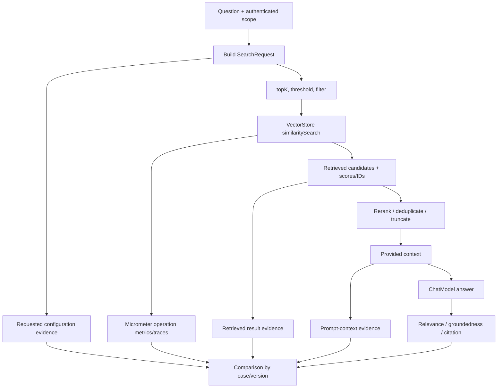

# Thu thập top-k, ngưỡng tương đồng và bộ lọc theo khả năng hỗ trợ

> **Chương:** Quan sát VectorStore  
> **Module:** `SPRING_AI_EVALUATION_OBSERVABILITY` — đánh giá chất lượng ứng dụng Spring AI bằng tập dữ liệu, relevance, fact checking và kiểm thử RAG hoặc gọi công cụ; đồng thời đo metrics, traces, chi phí và độ trễ để phát hiện nguyên nhân suy giảm giữa các phiên bản prompt, model và pipeline.

## Mục tiêu học tập

Sau bài học, bạn có thể:

1. Giải thích ý nghĩa của ba tham số truy xuất trong `SearchRequest`: `topK`, `similarityThreshold` và `filterExpression`.
2. Thu thập **giá trị được yêu cầu**, **giá trị thực sự được áp dụng (nếu kiểm chứng được)** và **kết quả thực trả** của một lượt truy vấn VectorStore.
3. Phân biệt dữ liệu Spring AI Observation cung cấp với instrumentation ứng dụng phải tự bổ sung, nhất là khi backend không hỗ trợ hoặc không xuất một thuộc tính.
4. Thiết kế nhãn metrics an toàn, đưa nội dung query/filter vào trace/evidence có kiểm soát thay vì vô tình lộ PII hoặc làm tăng cardinality.
5. Đánh giá ảnh hưởng của top-k, threshold và filter tới Recall@K, Precision@K, zero-result, latency, chi phí và chất lượng RAG.
6. Triển khai dịch vụ Java dùng `VectorStore`, `SearchRequest` và Micrometer; kiểm thử bằng stub trên một dataset có nhãn và so sánh phiên bản pipeline.

## 1. Vấn đề: biết thao tác `query` chạy thành công vẫn chưa đủ

Một ứng dụng trợ lý chính sách trả lời câu hỏi "Hoàn tiền trong bao lâu?" bằng RAG. Trace cho biết lời gọi VectorStore hoàn tất trong 48 ms. Tuy nhiên, lần chạy A tìm được chính sách hoàn tiền hiện hành; lần chạy B trả về tài liệu hướng dẫn đổi hàng, khiến mô hình trả lời sai.

Muốn giải thích sự khác biệt, nhóm phát triển cần biết **cấu hình truy xuất** ở cả hai lần chạy:

- `topK` yêu cầu bao nhiêu tài liệu?
- `similarityThreshold` đã đặt bằng bao nhiêu?
- `filterExpression` có lọc theo tenant, loại tài liệu và phiên bản hiệu lực không?
- VectorStore nào, index/embedding model/version nào được dùng?
- Backend có thực sự hỗ trợ và áp dụng các điều kiện này theo hợp đồng không?
- Truy vấn trả bao nhiêu tài liệu; chúng có đúng tài liệu liên quan không?
- Sau rerank và cắt context, model thực sự nhận những tài liệu nào?

Ba tham số `topK`, `similarityThreshold` và `filterExpression` là **ý định truy xuất** của ứng dụng. Observation giúp ghi lại một phần ý định ấy và hoạt động kỹ thuật. Nhưng để kết luận **điều gì đã xảy ra**, cần cả kết quả thực tế, cấu hình backend và evidence của pipeline.

### 1.1. Luồng dữ liệu cần quan sát



**Không được đánh đồng `SearchRequest.topK = 5` với "model đã nhìn thấy năm tài liệu".** VectorStore có thể trả dưới năm kết quả; reranker có thể chọn ba; prompt có thể chỉ đủ chỗ cho hai.

## 2. Hiểu đúng ba tham số tìm kiếm

### 2.1. `topK`: giới hạn số kết quả yêu cầu

`topK` là số document gần nhất mà ứng dụng muốn nhận từ vector search. Ví dụ:

```java
SearchRequest request = SearchRequest.builder()
        .query("Chính sách hoàn tiền hiện hành")
        .topK(5)
        .build();

List<Document> documents = vectorStore.similaritySearch(request);
```

Giả sử implementation thực hiện đúng giới hạn, số document trả về có thể từ 0 đến 5. Nó **không được bảo đảm luôn bằng 5** vì số nguồn được phép ít, ngưỡng lọc loại bớt, chỉ mục chưa đồng bộ, hoặc truy vấn không có kết quả.

Nếu một implementation trả nhiều hơn `topK` hoặc không hiểu tham số, hãy kiểm tra API/contract đúng phiên bản, instrumentation và kết quả thực tế; không âm thầm cắt kết quả rồi giả vờ rằng backend đã thực thi đúng.

| Giá trị | Lợi ích có thể có | Cái giá/rủi ro |
|---|---|---|
| `topK = 1` | Ít context, nhanh hơn ở một số backend | Bỏ lỡ bằng chứng bổ sung |
| `topK = 3` | Tập nguồn tương đối gọn | Có thể thiếu tài liệu thứ tư quan trọng |
| `topK = 5` | Cân bằng độ phủ và chi phí trong một số bộ dữ liệu | Tăng context/rerank workload |
| `topK = 20` | Nhiều cơ hội tìm thấy nguồn hiếm | Có thể tăng latency, token, nhiễu và nguy cơ lộ dữ liệu ngoài ý định nếu filter sai |

Những đánh đổi trên **không có xu hướng đơn điệu cho mọi hệ thống**. Backend có thể tối ưu top-k bằng thuật toán khác nhau; tăng K có thể cải thiện Recall@K mà vẫn làm giảm tính tập trung của prompt. Cần đo bằng dataset, không chọn K chỉ từ một ví dụ.

### 2.2. `similarityThreshold`: ngưỡng chấp nhận kết quả

`similarityThreshold` mô tả ngưỡng tối thiểu để một kết quả được coi là đủ tương đồng theo **ngữ nghĩa score/metric và cách xử lý của implementation**.

```java
SearchRequest request = SearchRequest.builder()
        .query("Thời hạn hoàn tiền")
        .topK(5)
        .similarityThreshold(0.75)
        .build();
```

Ví dụ với điểm tương đồng đã chuẩn hóa theo quy ước **điểm càng cao càng tốt**:

| Document | Score giả định | Ngưỡng 0.70 | Ngưỡng 0.85 |
|---|---:|---|---|
| `refund-policy-v3` | 0.93 | Giữ | Giữ |
| `refund-faq-v2` | 0.81 | Giữ | Loại |
| `returns-policy` | 0.76 | Giữ | Loại |
| `shipping-guide` | 0.61 | Loại | Loại |

Các score này là **fixture minh họa**, không phải giá trị do PGvector, Qdrant hay Spring AI đo thực tế. Khoảng giá trị và nghĩa của similarity score có thể khác giữa backend/cách tính và cách Spring AI adapter chuyển đổi. Không lấy `0.85` của cosine similarity làm một chuẩn có thể áp cho mọi backend hoặc embedding model.

**Quan trọng:** Một số vector store áp ngưỡng ngay trong truy vấn backend; số khác có thể lọc kết quả ở tầng client/adapter, hoặc không hỗ trợ chính xác một chức năng ở phiên bản nhất định. Điều đó ảnh hưởng số lượng kết quả, thứ hạng, latency và thời điểm đo. Cần đọc tài liệu đúng phiên bản và thử nghiệm thực tế để xác minh.

### 2.3. `filterExpression`: giới hạn tập tài liệu đủ điều kiện

Filter dùng điều kiện metadata hoặc cấu trúc tương đương để chọn **những tài liệu được phép và thích hợp** với truy vấn.

```java
SearchRequest request = SearchRequest.builder()
        .query("Hoàn tiền mất bao lâu?")
        .topK(5)
        .similarityThreshold(0.75)
        .filterExpression("tenant == 'demo' && docType == 'POLICY'")
        .build();
```

`tenant = demo` ở đây chỉ là fixture trong lab. Trong production, tenant phải đến từ **security context đã được xác thực**. Không dùng `tenant` do người dùng gõ hoặc mô hình tự suy ra để quyết định phân quyền.

Filter có thể chọn theo:

- Tenant hoặc phạm vi người dùng được phép truy cập.
- Loại tài liệu (`docType = POLICY`, `FAQ`, `ORDER_GUIDE`).
- Khu vực/ngôn ngữ (`locale = vi-VN`).
- Phiên bản hoặc khoảng thời gian hiệu lực, nếu dữ liệu và backend hỗ trợ ngữ nghĩa ấy.
- Nguồn hoặc trạng thái xuất bản (`published = true`).

Một filter ghi trong trace chưa chứng minh backend đã **enforce** nó. Quan trọng là xác minh mọi document được trả đều nằm trong phạm vi, đồng thời ranh giới ủy quyền ở service/backend ngăn được truy vấn vượt quyền.

### 2.4. Ba tham số tác động lẫn nhau

Giả sử bộ dữ liệu có 1.000 chunks:

1. **Filter** loại các tài liệu tenant khác, chỉ còn 80 chunks hợp lệ.
2. **Similarity search** xếp hạng các ứng viên theo vector.
3. **Threshold** có thể loại các tài liệu dưới ngưỡng.
4. **topK** giới hạn số kết quả trả.

Thứ tự thực tế có thể khác: backend có thể lọc trước approximate nearest-neighbor search, lọc sau khi lấy candidates hoặc kết hợp pushdown. Hai chiến lược không nhất thiết cho cùng tập kết quả khi không tăng candidate pool, nhất là với bộ lọc rất chọn lọc.

**Đừng giả định thứ tự trên là kế hoạch thực thi của mọi backend.** Đây chỉ là mô hình tư duy để hiểu tương tác. Nếu cần xác nhận, kiểm tra tài liệu của store, execution plan hoặc phép đo trên fixture đã biết.

## 3. "Thu thập theo khả năng hỗ trợ" thực sự có nghĩa gì?

Trong một hệ thống đa backend, hai khái niệm khác nhau cần được ghi riêng:

- **Khả năng backend:** store hỗ trợ tham số nào và thực thi nó theo cách nào?
- **Khả năng telemetry:** observation/tracer có xuất tham số đã yêu cầu hay không?

Một VectorStore có thể **thực thi filter đúng** nhưng không xuất chuỗi filter vào trace vì bảo vệ dữ liệu. Ngược lại, ứng dụng có thể ghi `requested.filter = ...` trong trace trong khi backend chưa chắc đã áp dụng điều kiện. Vì thế không dùng sự **có mặt của attribute** để thay kiểm thử chức năng.

### 3.1. Capability matrix theo backend/phiên bản

Nên duy trì bảng xác nhận năng lực được đo từ **implementation và version đang triển khai**, không sao chép một bảng tổng quát rồi coi là sự thật vĩnh viễn.

| Năng lực cần xác minh | Câu hỏi thử nghiệm | Kết quả nên ghi |
|---|---|---|
| `topK` | Với K=3/5, số trả có vượt K không? | `SUPPORTED` / `UNSUPPORTED` / `UNKNOWN`, bằng chứng |
| `similarityThreshold` | Thay ngưỡng có thay tập kết quả như hợp đồng? | Trạng thái, điểm/rank của fixture, version |
| Metadata filter | Filter theo tenant/loại nguồn có chặn tài liệu ngoài scope? | Test isolation và lọc đúng |
| Filter expression grammar | Hỗ trợ `==`, `&&`, `in`, nested conditions ra sao? | Đánh dấu theo capability cụ thể |
| Filter pushdown | Filter ở backend hay hậu xử lý? | `BACKEND` / `CLIENT` / `UNKNOWN` |
| Reported similarity score | Điểm có tồn tại và so sánh được không? | Score semantics, normalization và missing state |
| Telemetry `topK` | Trace có attribute top-k không? | `EXPORTED` / `REDACTED` / `NOT_SUPPORTED` |
| Telemetry threshold | Trace có similarity threshold không? | Tương tự, kèm collector version |
| Telemetry filter | Có chủ động ẩn nội dung filter không? | Privacy mode và audit evidence |

`SUPPORTED` nghĩa là **đã kiểm chứng trên một version/điều kiện**, không ngụ ý vĩnh viễn. `UNKNOWN` phù hợp khi chưa có bằng chứng, không phải mặc định PASS.

### 3.2. Ví dụ bản ghi capability

```yaml
capabilityManifestVersion: vector-query-capabilities-v2
backendFamily: pg_vector
springAiAdapterVersion: "record-actual-version"
indexVersion: support-index-v5
testedAt: "2026-11-27T10:00:00Z"

capabilities:
  topK:
    status: SUPPORTED
    evidenceCaseId: capability-topk-001
  similarityThreshold:
    status: SUPPORTED
    scoreContract: "documented-by-this-adapter-version"
    evidenceCaseId: capability-threshold-002
  metadataFilter:
    status: SUPPORTED
    enforcement: BACKEND
    evidenceCaseId: capability-filter-003
  telemetryFilterContent:
    status: REDACTED
    reason: PRIVACY_POLICY
```

Các giá trị là **ví dụ**, không phải kết quả test thực của PGvector. Chỉ ghi `enforcement: BACKEND` sau khi có tài liệu/trace/test xác minh. Nếu không rõ, đặt `UNKNOWN`. Manifest thuộc ứng dụng, không phải schema mặc định của Spring AI.

## 4. Các attribute liên quan trong Spring AI VectorStore Observation

Spring AI mô tả observation cho thao tác VectorStore dưới tên:

```text
db.vector.client.operation
```

Các key chung:

| Attribute | Vai trò | Ví dụ |
|---|---|---|
| `db.operation.name` | Thao tác được gọi | `query` |
| `db.system` | Họ backend | `pg_vector` |
| `spring.ai.kind` | Phân loại thành phần | `vector_store` |
| `db.collection.name` | Tên tập dữ liệu/index nếu có | `policy_chunks_v3` |
| `db.namespace` | Namespace nếu được hỗ trợ | `support` |

Những trường truy vấn được tài liệu Spring AI mô tả ở nhóm thuộc tính **high-cardinality** có thể bao gồm:

| Attribute | Giá trị/ý nghĩa | Lưu ý |
|---|---|---|
| `db.vector.query.top_k` | Số kết quả yêu cầu | Không phải số document đã trả |
| `db.vector.query.similarity_threshold` | Ngưỡng được yêu cầu | Không tự chứng minh backend enforce |
| `db.vector.query.filter` | Biểu thức lọc của truy vấn | Có thể chứa tenant ID, giá trị nghiệp vụ, PII |
| `db.vector.query.content` | Nội dung truy vấn | Rủi ro lộ dữ liệu người dùng |
| `db.vector.query.response.documents` | Nội dung document trả về nếu bật ghi | Có thể rất dài và nhạy cảm |

Tùy **phiên bản Spring AI, backend, việc bật observability, sampling và chính sách exporter**, một số attribute có thể không xuất hiện. Mục tiêu là đọc đúng các trường **nếu được cung cấp**, không kỳ vọng mọi store xuất y hệt.

### 4.1. Low-cardinality metric tag khác high-cardinality trace attribute

Một số tổ hợp an toàn hơn để nhóm metrics:

| Tag | Ví dụ tập hữu hạn | Ghi chú |
|---|---|---|
| `db.operation.name` | `add, query, delete, upsert` | Observation của Spring AI |
| `db.system` | `pg_vector, qdrant, redis` | Kiểm giá trị backend thực |
| `app.store.role` | `policy-search, order-search` | Do ứng dụng định nghĩa và kiểm soát |
| `app.filter.profile` | `public-policy, tenant-policy` | Nhãn chính sách, **không** phải raw filter |
| `app.retrieval.config.version` | `retrieval-v5, retrieval-v6` | Chỉ tag nếu số phiên bản trong cửa sổ đo nhỏ |

Ngược lại, không chuyển `db.vector.query.content`, toàn bộ `db.vector.query.filter` hoặc ID người dùng/tenant thành metric labels. Đưa chúng vào Prometheus có thể gây **cardinality explosion** và tạo rủi ro bảo mật.

Ngay cả `topK` hoặc threshold — trông có vẻ chỉ là số — cũng có thể có nhiều giá trị nếu API cho phép truyền tự do. Muốn tổng hợp metrics theo dải, có thể dùng **bucket hữu hạn** như `k_bucket = "1-3"/"4-8"/"9+"`, hoặc theo `retrievalConfigVersion`; không tự động tag mọi giá trị thập phân.

### 4.2. Tắt ghi tài liệu trả về trừ khi được phép

Ví dụ cấu hình Spring Boot:

```yaml
spring:
  ai:
    vectorstore:
      observations:
        log-query-response: false
```

Trong tài liệu Spring AI, `spring.ai.vectorstore.observations.log-query-response` có giá trị mặc định `false`. **Không tự bật thành true** chỉ để có dữ liệu chấm, vì nó có thể đưa nội dung tài liệu đầy đủ vào trace/log. Nếu cần evidence cho evaluation, lưu một snapshot được giảm thiểu và có ACL/retention riêng, liên kết bằng `runId` hoặc `traceId`.

Không coi thuộc tính này là "công tắc bảo mật toàn bộ telemetry"; cần rà soát cả các thuộc tính query/filter, custom logging, tracing exporter và cấu hình hệ lưu.

### 4.3. Ba mức biết điều gì đã xảy ra

| Mức | Dữ liệu | Có thể kết luận |
|---|---|---|
| **Requested** | `SearchRequest.topK`, threshold, filter profile | Ứng dụng muốn backend xử lý như thế nào |
| **Observed** | Operation span, latency, lỗi, returned count, result IDs | Lời gọi đã trả ra sao trong runtime |
| **Verified effective** | Capability test, backend query plan/contract, filter isolation assertion | Điều kiện thực sự được áp dụng đúng như cam kết trong điều kiện đã test |

Một hệ thống nên có cả ba mức khi cần kiểm toán, đặc biệt đối với filter tenant. Nếu không thể đo "effective", báo `UNKNOWN` chứ không chuyển `requested` thành `verified`.

## 5. Thiết kế evidence của một truy vấn để so sánh A/B

Một bản ghi retrieval nên liên kết dữ liệu đã yêu cầu, những tài liệu trả về và cấu hình phiên bản:

```json
{
  "runId": "rag-run-118",
  "caseId": "refund-118",
  "datasetVersion": "support-rag-v8",
  "promptVersion": "refund-prompt-v6",
  "chatModelVersion": "chat-model-b",
  "embeddingModelVersion": "embedding-model-b",
  "pipelineVersion": "rag-pipeline-v7",
  "indexVersion": "policy-index-v5",
  "backendFamily": "pg_vector",
  "retrievalConfigVersion": "retrieval-policy-v3",
  "requested": {
    "topK": 5,
    "similarityThreshold": 0.75,
    "filterProfile": "tenant-policy"
  },
  "capabilityEvidenceVersion": "vector-query-capabilities-v2",
  "retrievalCaptured": true,
  "returnedCount": 3,
  "retrievedDocumentIds": [
    "refund-policy-v3",
    "refund-faq-v2",
    "returns-policy-v2"
  ],
  "providedContextIds": [
    "refund-policy-v3",
    "refund-faq-v2"
  ],
  "vectorStoreLatencyMs": 54,
  "traceId": "example-trace-id"
}
```

Đây là **schema do ứng dụng tự thiết kế**. `filterProfile` là tên chính sách nội bộ ổn định; nếu cần phục dựng chính xác filter cho một lần chạy, lưu bản thể hiện đã kiểm soát (hoặc snapshot policy/AST) trong **kho evidence có phân quyền**, không để plain text trong metrics.

### 5.1. Khi cần lưu filter, lưu như thế nào?

Với một bộ lọc tenant:

```text
tenant == 'tenant-0732' && status == 'PUBLISHED'
```

Việc lưu nguyên văn vào metric tag có thể làm lộ định danh và tạo hàng nghìn time series. Một phương án tốt hơn:

```json
{
  "filterProfile": "tenant-published",
  "filterPolicyVersion": "tenant-filter-v4",
  "filterEvidenceRef": "evidence://runs/rag-run-118/filter",
  "filterCaptureStatus": "CAPTURED",
  "filterEnforcementStatus": "VERIFIED_BY_POLICY_TEST"
}
```

`filterEvidenceRef` phải trỏ tới artifact **đã được lưu thực sự**, có version/digest/ACL; không tự coi một đường dẫn tự tạo là bằng chứng. `VERIFIED_BY_POLICY_TEST` chỉ nên gắn khi có kết quả test xác minh scope trong điều kiện đã kiểm tra, không chỉ dựa vào tên policy.

### 5.2. Thiếu telemetry khác thiếu dữ liệu cần đánh giá

- `db.vector.query.filter` **không xuất trong trace** vì redaction, nhưng ứng dụng có policy snapshot và các nguồn đã capture đầy đủ: evaluator vẫn có thể chấm.
- Dataset cần xác minh isolation nhưng **không có event/nguồn nào** để biết filter thực tế được áp dụng: đánh giá isolation nên báo `ERROR` (thiếu bằng chứng), không tự xem PASS.
- Filter có bằng chứng thực thi, result chứa tài liệu tenant khác: `FAIL` về quyền/filter correctness, dù operation query trả success.
- Case không yêu cầu filter theo policy và không có điều kiện hạn chế nguồn: tiêu chí filter riêng có thể `NOT_APPLICABLE` nếu policy cho phép.

Điều kiện **N/A**, **FAIL** và **ERROR** phải được quy định rõ để không che mất lỗi capture hoặc sự cố backend.

## 6. Ví dụ Java 17+: thu thập tham số tìm kiếm an toàn

Ví dụ dùng `VectorStore` và Micrometer, đặt một observation workflow **riêng** quanh `similaritySearch`. Spring AI có observation ở tầng VectorStore; không tự tạo timer thứ hai cùng tên `db.vector.client.operation`.

### 6.1. Kiểu cấu hình đầu vào và kết quả

```java
import java.util.List;
import java.util.Objects;
import java.util.Set;

import org.springframework.ai.document.Document;

public final class RetrievalContracts {
    private RetrievalContracts() {}

    // filterExpression là biểu thức ĐÃ được policy xây dựng đáng tin.
    // filterProfile là nhãn từ danh mục hữu hạn để dùng cho metrics.
    public record RetrievalConfig(
            int topK,
            double similarityThreshold,
            String filterProfile,
            String filterExpression,
            String configVersion) {

        private static final Set<String> ALLOWED_PROFILES =
                Set.of("public-policy", "tenant-policy", "no-filter");

        public RetrievalConfig {
            if (topK < 1 || topK > 100) {
                throw new IllegalArgumentException("topK ngoài giới hạn lab");
            }
            if (!Double.isFinite(similarityThreshold)
                    || similarityThreshold < 0
                    || similarityThreshold > 1) {
                throw new IllegalArgumentException(
                        "similarityThreshold phải trong [0,1]");
            }
            if (!ALLOWED_PROFILES.contains(filterProfile)) {
                throw new IllegalArgumentException(
                        "filterProfile không thuộc danh mục quản trị");
            }
            Objects.requireNonNull(configVersion);
            if (configVersion.isBlank()) {
                throw new IllegalArgumentException("Thiếu configVersion");
            }
            if (!"no-filter".equals(filterProfile)
                    && (filterExpression == null
                    || filterExpression.isBlank())) {
                throw new IllegalArgumentException("Thiếu filter expression");
            }
            if ("no-filter".equals(filterProfile)
                    && filterExpression != null) {
                throw new IllegalArgumentException(
                        "no-filter không được chứa filter expression");
            }
        }
    }

    public record RetrievalResult(
            List<Document> candidates,
            int requestedTopK,
            double requestedThreshold,
            String filterProfile,
            String configVersion) {

        public RetrievalResult {
            candidates = List.copyOf(candidates);
        }

        public int returnedCount() {
            return candidates.size();
        }
    }
}
```

Mức giới hạn `topK ≤ 100` chỉ là **guardrail của ví dụ**, không phải giới hạn chuẩn cho mọi VectorStore. Trong production phải lấy từ SLA, quota và thử nghiệm backend. Giá trị threshold hợp lệ ở đây dựa trên hợp đồng `SearchRequest` đang được minh họa; trước khi triển khai phải kiểm tra điểm/threshold được adapter sử dụng có tương thích miền [0,1] và mục đích nghiệp vụ không.

### 6.2. Dịch vụ gắn observation và metric số kết quả

```java
import java.util.List;
import java.util.Objects;

import io.micrometer.core.instrument.DistributionSummary;
import io.micrometer.core.instrument.MeterRegistry;
import io.micrometer.observation.Observation;
import io.micrometer.observation.ObservationRegistry;
import org.springframework.ai.document.Document;
import org.springframework.ai.vectorstore.SearchRequest;
import org.springframework.ai.vectorstore.VectorStore;

public final class ObservableSearchService {
    private final VectorStore store;
    private final MeterRegistry meters;
    private final ObservationRegistry observations;

    public ObservableSearchService(
            VectorStore store,
            MeterRegistry meters,
            ObservationRegistry observations) {
        this.store = Objects.requireNonNull(store);
        this.meters = Objects.requireNonNull(meters);
        this.observations = Objects.requireNonNull(observations);
    }

    public RetrievalContracts.RetrievalResult search(
            String question, RetrievalContracts.RetrievalConfig config) {
        Objects.requireNonNull(question);
        Objects.requireNonNull(config);

        var builder = SearchRequest.builder()
                .query(question)
                .topK(config.topK())
                .similarityThreshold(config.similarityThreshold());

        // Không tự ghép filter từ raw input của người dùng/model.
        // Đây là filter đã được policy/auth service tạo và xác minh.
        if (config.filterExpression() != null) {
            builder.filterExpression(config.filterExpression());
        }
        SearchRequest request = builder.build();

        var observation = Observation.createNotStarted(
                        "app.rag.retrieval", observations)
                .lowCardinalityKeyValue("app.filter.profile",
                        config.filterProfile())
                .highCardinalityKeyValue("app.query.requested.top_k",
                        Integer.toString(config.topK()))
                .highCardinalityKeyValue(
                        "app.query.requested.similarity_threshold",
                        Double.toString(config.similarityThreshold()));

        observation.start();
        try {
            List<Document> documents = Objects.requireNonNull(
                    store.similaritySearch(request),
                    "VectorStore không được trả null");

            DistributionSummary.builder("app.rag.retrieval.returned.count")
                    .description("Số document trả về sau VectorStore query")
                    .tag("app.filter.profile", config.filterProfile())
                    .register(meters)
                    .record(documents.size());

            meters.counter("app.rag.retrieval.operation.outcomes",
                    "app.filter.profile", config.filterProfile(),
                    "outcome", "success").increment();

            return new RetrievalContracts.RetrievalResult(
                    documents, config.topK(),
                    config.similarityThreshold(),
                    config.filterProfile(), config.configVersion());
        }
        catch (RuntimeException error) {
            observation.error(error);
            meters.counter("app.rag.retrieval.operation.outcomes",
                    "app.filter.profile", config.filterProfile(),
                    "outcome", "error").increment();
            throw error;
        }
        finally {
            observation.stop();
        }
    }
}
```

**Lưu ý về mã:**

- `app.rag.retrieval` là observation do ứng dụng tự đặt, khác với `db.vector.client.operation` của Spring AI. Hai duration có thể **bao nhau**; không cộng chúng như những giai đoạn liên tiếp.
- `app.query.requested.top_k` và `app.query.requested.similarity_threshold` là **high-cardinality attributes của observation cha** để phục vụ trace khi exporter cho phép, không có nghĩa chúng trở thành metric tags.
- `app.filter.profile` lấy từ danh mục hữu hạn, không chứa raw tenant ID, filter hoặc query text.
- `configVersion` được trả trong result để đưa vào evidence store; không cần biến mọi version string thành metric label.
- Hàm trả danh sách documents nhưng **không tự lưu toàn bộ content vào span**; khi cần evidence phục vụ chấm, dùng kho lưu có phân quyền.
- Mã không phát hiện backend có áp filter/threshold đúng hay không. Điều này phải được xác minh bằng capability tests và backend contract.
- Đối với dịch vụ throughput cao, có thể đăng ký `DistributionSummary` và `Counter` từ constructor theo từng profile hữu hạn thay vì lookup mỗi request; ví dụ giữ mã ngắn gọn để tập trung vào ngữ nghĩa.

### 6.3. Sử dụng với filter fixture an toàn trong lab

```java
var config = new RetrievalContracts.RetrievalConfig(
        5,
        0.75,
        "tenant-policy",
        "tenant == 'demo' && docType == 'POLICY'",
        "retrieval-policy-v3");

var result = service.search(
        "Hoàn tiền được xử lý trong bao lâu?", config);

System.out.println("Requested topK = " + result.requestedTopK());
System.out.println("Returned count = " + result.returnedCount());
```

Biến `service` trong ví dụ là instance `ObservableSearchService` được inject vào lớp gọi. Chuỗi filter `tenant == 'demo'` chỉ dành cho môi trường thử nghiệm có tài liệu giả; **không** dùng filter cố định này làm cơ chế phân quyền production. Với tenant thật, tạo expression từ security context ở lớp được ủy quyền, ưu tiên API filter builder có cấu trúc nếu adapter/version hỗ trợ.

### 6.4. Vì sao không tự tag raw filter để điều tra nhanh?

Giả sử ứng dụng phục vụ 15.000 tenant, mỗi filter có giá trị tenant riêng. Nếu gắn raw filter vào một timer, số lượng time series có thể tăng theo số tenant × loại thao tác × hệ lưu × lỗi × phiên bản. Ngoài chi phí lưu trữ, tên tenant/các trường lọc có thể tiết lộ dữ liệu kinh doanh.

Thay vào đó:

1. Gắn `filterProfile` hữu hạn vào metrics.
2. Lưu `runId`/`traceId` trong kho kết quả đánh giá để truy ngược artifact.
3. Lưu filter AST hoặc giá trị đã được bảo vệ ở evidence store, kèm `filterPolicyVersion`.
4. Cho phép người có quyền điều tra chi tiết của một case, không biến toàn bộ detail thành nhãn thời gian thực.

Đặc biệt, **hash raw filter không tự bảo đảm ẩn danh**: các giá trị có thể đoán và có thể bị dò, nên cần đánh giá rủi ro tái nhận dạng trước khi lưu hoặc chia sẻ digest.

## 7. Kiểm thử wrapper và ý định cấu hình bằng JUnit 5

Unit test không cần kết nối vector database thật để xác minh mã tạo `SearchRequest` đúng và các bộ đếm của ứng dụng hoạt động. Có thể dùng Mockito và `SimpleMeterRegistry`.

### 7.1. Test: ghi đúng topK/threshold và returned count

```java
import static org.junit.jupiter.api.Assertions.*;
import static org.mockito.ArgumentMatchers.any;
import static org.mockito.Mockito.*;

import java.util.List;
import io.micrometer.core.instrument.simple.SimpleMeterRegistry;
import io.micrometer.observation.ObservationRegistry;
import org.junit.jupiter.api.Test;
import org.mockito.ArgumentCaptor;
import org.springframework.ai.document.Document;
import org.springframework.ai.vectorstore.SearchRequest;
import org.springframework.ai.vectorstore.VectorStore;

class ObservableSearchServiceTest {
    @Test
    void recordsRequestedConfigAndActualResultCount() {
        VectorStore store = mock(VectorStore.class);
        Document doc = Document.builder()
                .id("refund-policy-v3")
                .text("Hoàn tiền xử lý trong 7 ngày làm việc.")
                .build();
        when(store.similaritySearch(any(SearchRequest.class)))
                .thenReturn(List.of(doc));

        try (var meters = new SimpleMeterRegistry()) {
            var service = new ObservableSearchService(
                    store, meters, ObservationRegistry.create());
            var config = new RetrievalContracts.RetrievalConfig(
                    5, 0.75, "no-filter", null, "retrieval-v3");

            var result = service.search("Hoàn tiền bao lâu?", config);

            var captor = ArgumentCaptor.forClass(SearchRequest.class);
            verify(store).similaritySearch(captor.capture());
            assertEquals(5, captor.getValue().getTopK());
            assertEquals(0.75,
                    captor.getValue().getSimilarityThreshold(), 1e-9);
            assertEquals(1, result.returnedCount());

            var summary = meters.get("app.rag.retrieval.returned.count")
                    .tag("app.filter.profile", "no-filter")
                    .summary();
            assertEquals(1L, summary.count());
            assertEquals(1.0, summary.totalAmount(), 1e-9);
        }
    }

    @Test
    void backendFailureIsNotReportedAsZeroResult() {
        VectorStore store = mock(VectorStore.class);
        when(store.similaritySearch(any(SearchRequest.class)))
                .thenThrow(new IllegalStateException("backend unavailable"));

        try (var meters = new SimpleMeterRegistry()) {
            var service = new ObservableSearchService(
                    store, meters, ObservationRegistry.create());
            var config = new RetrievalContracts.RetrievalConfig(
                    3, 0.5, "no-filter", null, "retrieval-v3");

            assertThrows(IllegalStateException.class,
                    () -> service.search("Hoàn tiền?", config));
            assertEquals(1.0,
                    meters.get("app.rag.retrieval.operation.outcomes")
                            .tags("app.filter.profile", "no-filter",
                                  "outcome", "error")
                            .counter().count());
            assertNull(meters.find("app.rag.retrieval.returned.count")
                    .summary());
        }
    }
}
```

Các test trên chỉ xác minh **requested parameters** và metric của wrapper; stub không chứng minh PGvector/Qdrant đã áp ngưỡng hay filter đúng. Không dùng kết quả unit test này để tuyên bố `metadataFilter = SUPPORTED`. Bài học đang ở STEP 4 nên ví dụ chưa được chạy build/QA trong dự án; API và imports cần đối chiếu version thực khi tích hợp.

### 7.2. Integration test cho capability backend

Với VectorStore sandbox có dữ liệu fixture:

1. Nạp ba tài liệu có metadata tenant khác nhau và nội dung được phân biệt rõ.
2. Xác minh chúng đã sẵn sàng để truy vấn theo cơ chế nhất quán của backend.
3. Gọi `topK=1` và `topK=3`; đối chiếu số kết quả, thứ tự và ID.
4. Gọi hai ngưỡng similarity (ví dụ 0.50 và 0.85); lưu score/result IDs, ghi nhận biến động thực tế.
5. Dùng filter tenant A và xác nhận không tài liệu B nào xuất hiện, kể cả khi nội dung B gần câu hỏi hơn.
6. Dùng filter không thể khớp và kiểm tra kết quả rỗng được xử lý là **query success + empty**, không tự xem backend error.
7. Thử expression không được hỗ trợ và ghi exception/behavior; **không** coi việc silently ignored filter là PASS.
8. So query plan hoặc tài liệu provider khi muốn khẳng định filter được pushdown.
9. Ghi `adapterVersion`, `backendVersion`, `indexVersion`, `embeddingModelVersion` và `capabilityEvidenceVersion`.

Kết quả chỉ có hiệu lực cho tổ hợp phiên bản và cấu hình đã kiểm thử. Không dùng fixture chứa dữ liệu khách hàng hoặc chạy add/delete trên production để thử một filter mới.

## 8. Kết hợp top-k, threshold và filter với chất lượng retrieval

Một query có thể hoàn tất 40 ms với đúng `topK=5` nhưng trả tài liệu không liên quan. Để đo hiệu quả truy xuất, cần **dataset có nhãn tài liệu liên quan**.

### 8.1. Recall@K và Precision@K

Gọi `G` là tập ID tài liệu liên quan (gold) của một case, `R_K` là tập ID tài liệu nằm trong top K thực trả:

\[
\operatorname{Recall@K} = \frac{|G \cap R_K|}{|G|},\qquad |G|>0.
\]

\[
\operatorname{Precision@K} = \frac{|G \cap R_K|}{K}.
\]

Trong công thức Precision@K ở đây, K là **mẫu số cố định theo yêu cầu**, ngay cả khi backend trả ít hơn K; một số thư viện chọn chia cho số kết quả thực trả, nên cần ghi rõ quy ước. Với `G = ∅`, Recall@K không xác định; hãy kiểm tra hành vi từ chối đúng hoặc rubric riêng thay vì tự gán recall bằng 1.

**Ví dụ:** Gold IDs gồm `refund-policy-v3` và `refund-faq-v2`. Query topK=5 trả:

```text
refund-policy-v3
returns-policy
shipping-guide
account-faq
contact-page
```

Số gold tìm thấy = 1/2 ⇒ `Recall@5 = 0.5`; số tài liệu liên quan trong top5 = 1 ⇒ `Precision@5 = 0.2`.

Nếu tăng `topK` từ 5 lên 10 và tìm thêm `refund-faq-v2`, Recall@10 có thể tăng lên 1.0 nhưng prompt cũng có thể chứa thêm nhiễu, tốn token hoặc bị cắt đoạn nguồn khác. Cần đo quality của câu trả lời cuối, không chỉ recall.

### 8.2. Đánh giá ngưỡng trong thực nghiệm

Giả sử một tập cố định có 200 câu hỏi:

| Cấu hình | Zero-result rate | Recall@5 | Trung bình document trả | Vector query p95 |
|---|---:|---:|---:|---:|
| K=5, threshold=0.60 | 2% | 0.91 | 4.7 | 94 ms |
| K=5, threshold=0.75 | 9% | 0.84 | 3.4 | 89 ms |
| K=5, threshold=0.90 | 30% | 0.62 | 1.6 | 87 ms |

Tất cả số liệu **giả định**, không chứng minh 0.60 là ngưỡng "tốt nhất". Khi nâng threshold, ta có thể loại bớt kết quả không liên quan nhưng cũng loại mất những nguồn cần cho câu trả lời. Cần thêm Precision@K, groundedness, citation và đánh giá no-evidence/abstention theo dataset.

Các chỉ số phải được so trong cùng **index, embedding model, dataset, phiên bản filter và môi trường đo**. Nếu đồng thời thay backend hoặc embeddings, không thể gán toàn bộ chênh lệch cho threshold.

### 8.3. Filter correctness và leakage

Một bộ lọc theo tenant có hai nhiệm vụ khác nhau:

- **Đúng phạm vi quyền:** không để tài liệu tenant B được trả cho tenant A. Đây là điều kiện không thể bù trừ bằng điểm recall cao.
- **Đủ dữ liệu hợp lệ:** trong phạm vi được phép, truy vấn vẫn tìm được nguồn cần thiết. Một filter quá hẹp có thể giảm recall mà không vi phạm quyền.

Ví dụ, query tenant A trả ba tài liệu đều thuộc A nhưng thiếu tài liệu chính sách hiện hành ⇒ filter isolation PASS, retrieval recall FAIL. Query trả một tài liệu B nhưng có nhiều tài liệu A liên quan ⇒ quyền FAIL dù recall có thể cao.

**Đừng dùng việc không thấy tài liệu B trong một topK duy nhất làm bằng chứng bảo mật hoàn chỉnh.** Cần test adversarial, cấu hình credential, scope backend và kiểm tra enforce filter trên nhiều đường code, kể cả retry/fallback.

## 9. Số tài liệu thực trả không bằng số tài liệu vào prompt

Với retrieval có rerank hoặc giới hạn context, ít nhất ba tập cần tách:

| Stage | Ý nghĩa | Bằng chứng nên lưu |
|---|---|---|
| `retrievedCandidates` | Document list trả bởi VectorStore | IDs, rank, score/metadata được phép |
| `selectedAfterRerank` | Document list sau rerank/dedup/filter bổ sung | IDs, phiên bản reranker, lý do loại |
| `providedContext` | Những chunk thực sự ghép vào prompt gửi ChatModel | Nội dung/ID và thứ tự, giới hạn token |

Fact checking, citation và claim groundedness phải dựa vào **provided context** (hoặc nguồn chuẩn đúng policy), không tự coi mọi retrieved candidate là thứ model đã nhìn thấy.

Nếu một document có trong candidates nhưng bị cắt vì prompt token limit, không nên kết luận model cố tình bỏ qua document đó. Đây có thể là lỗi **context assembly**, không phải vector search.

### 9.1. Đánh giá chi phí theo ba tham số

| Thay đổi | Ảnh hưởng có thể có | Chỉ số cần xem |
|---|---|---|
| Tăng topK | Nhiều ứng viên, nhiều rerank work và context tokens | Query latency, returnedCount, rerank latency, ChatModel prompt tokens/cost |
| Tăng threshold | Ít document qua lọc, có thể tăng zero-result | Recall, Precision, abstention rate, zero-result |
| Filter chọn lọc cao | Có thể tăng/giảm latency tùy index/filter plan | Backend query plan, p95 theo store/role, result count |
| Thêm filter tenant | Giới hạn phạm vi truy cập | Filter enforcement test, denied/leakage cases |
| Thay embedding model | Thay ranking/score distribution dù cùng K và threshold | Model/index version, recall, score histogram |

Việc tăng K không nhất thiết làm backend query chậm tuyến tính; filter pushdown có thể nhanh hoặc chậm hơn tùy indexing. Các khẳng định về hiệu năng phải dựa trên measurement của cấu hình cụ thể.

## 10. Metrics, traces và truy vấn chẩn đoán

### 10.1. Metric Spring AI cho operation health

`db.vector.client.operation` có thể xuất thành các series Prometheus tương ứng theo quy ước Micrometer:

```text
db_vector_client_operation_seconds_count
db_vector_client_operation_seconds_sum
db_vector_client_operation_seconds_max
```

Theo dõi query rate:

```promql
sum by (db_system, db_operation_name) (
  rate(db_vector_client_operation_seconds_count{
    db_operation_name="query"
  }[5m])
)
```

Và latency trung bình:

```promql
sum by (db_system) (
  rate(db_vector_client_operation_seconds_sum{
    db_operation_name="query"
  }[5m])
)
/
sum by (db_system) (
  rate(db_vector_client_operation_seconds_count{
    db_operation_name="query"
  }[5m])
)
```

Các tên series và nhãn là ví dụ theo quy ước export; kiểm tên thực tế trong `/actuator/prometheus` hoặc backend metrics, nhất là khi dùng registry khác, MeterFilter hoặc phiên bản Spring AI khác. Không coi `_seconds_max` là p95.

Khi đã bật histogram và exporter phát bucket:

```promql
histogram_quantile(
  0.95,
  sum by (le, db_system) (
    rate(db_vector_client_operation_seconds_bucket{
      db_operation_name="query"
    }[5m])
  )
)
```

Nếu `_bucket` không tồn tại, truy vấn không có dữ liệu; không lấy 0 ms làm kết luận. p95 ước lượng cần đủ số mẫu, cửa sổ đo và cấu hình histogram nhất quán.

### 10.2. Metric ứng dụng cho filter profile và returned count

Ví dụ `ObservableSearchService` tạo:

| Metric ứng dụng | Loại | Nội dung |
|---|---|---|
| `app.rag.retrieval.returned.count` | DistributionSummary | Phân bố số kết quả thực trả sau query |
| `app.rag.retrieval.operation.outcomes` | Counter theo `filter.profile/outcome` | Success/error của wrapper |
| `app.rag.retrieval` | Observation | Thời gian workflow con và trace context |

Những tên này **không phải meter mặc định Spring AI**; chỉ phát từ code dùng wrapper. Nếu phần khác gọi `VectorStore` trực tiếp, metric tự định nghĩa không đếm các lời gọi đó. Đừng so số lượng wrapper operations với số operation spans mặc định như thể chúng chắc chắn bằng nhau.

### 10.3. Đọc trace của một ca cụ thể

```text
runId=rag-run-118
  app.rag.request
    app.rag.route [store.role=policy-search]
      app.rag.retrieval
        requested.topK=5
        requested.threshold=0.75
        filter.profile=tenant-policy
        db.vector.client.operation
          db.operation.name=query
          db.system=pg_vector
      app.rag.rerank
      app.rag.prompt_assembly
      ChatModel generation
    evaluation groundedness
```

Đây là sơ đồ minh họa; tên và cây spans thực tế phụ thuộc instrumentation và sampling. Không dùng traceId làm metric tag cardinality cao. Khi trace thiếu thuộc tính filter do redaction, dùng `runId` để mở evidence snapshot với đúng quyền truy cập.

### 10.4. Đặt câu hỏi chẩn đoán theo triệu chứng

| Triệu chứng | Kiểm tra cấu hình trước | Bằng chứng cần thu |
|---|---|---|
| Zero-result tăng sau deploy | Threshold, filter, index/embedding version | Golden case IDs, query config, result count |
| Recall@5 giảm, latency ổn định | TopK, filter selectivity, score semantics | Candidate IDs, gold labels, score/rank |
| Query p95 tăng mạnh khi bật filter | Index/filter pushdown, backend query plan | Spans, backend metrics, explain plan nếu có |
| Trả tài liệu tenant khác | Filter enforcement, credentials, routing | Runtime events và document metadata có ACL |
| Citation FAIL tăng | Provided context vs retrieved candidates | Citation IDs, prompt-context evidence |
| LLM cost tăng sau tăng K | Prompt token count và số rerank docs | Token usage, context lengths, model version |
| Evaluation ERROR tăng | Judge timeout hoặc thiếu evidence | Judge traces, capture completeness |

**Tương quan không tự chứng minh nguyên nhân.** Cần đối chiếu từng case và các phiên bản để xác nhận thay đổi nào đã gây ra hồi quy.

## 11. So sánh A/B mà không thay đổi thước đo giữa chừng

Giả sử muốn so hai cấu hình retrieval:

| Thuộc tính | Baseline A | Candidate B |
|---|---|---|
| `datasetVersion` | `support-rag-v8` | `support-rag-v8` |
| `indexVersion` | `policy-index-v5` | `policy-index-v5` |
| `embeddingModelVersion` | `embedding-model-b` | `embedding-model-b` |
| `topK` | 5 | 8 |
| `similarityThreshold` | 0.70 | 0.80 |
| `filterProfile` | `tenant-policy-v3` | `tenant-policy-v3` |
| `promptVersion` | `refund-prompt-v6` | `refund-prompt-v6` |
| `chatModelVersion` | `chat-model-b` | `chat-model-b` |
| `criterionVersion` | `groundedness-v2` | `groundedness-v2` |

Nếu B cải thiện recall, **không thể quy toàn bộ tác động cho topK** vì threshold cũng đổi. Muốn cô lập từng tham số, chạy thực nghiệm có kiểm soát: trước tiên giữ threshold cố định khi tăng K, rồi giữ K cố định khi đổi threshold; hoặc thiết kế lưới tham số.

### 11.1. Ma trận K × threshold

```text
                   similarityThreshold
                0.60       0.75       0.90
topK = 3        A1         A2         A3
topK = 5        B1         B2         B3
topK = 10       C1         C2         C3
```

Với mỗi ô, lưu số sample, Recall@K, Precision@K, zero-result, filter violation, latency p95, prompt tokens, groundedness và cost. Dùng cùng dataset/policy/corpus/index/model khi cần so ảnh hưởng của chính K và threshold. Nếu thay backend, mở thêm chiều version thay vì trộn vào cùng một trục.

### 11.2. Điều kiện chặn phát hành gợi ý

Một release policy **minh họa**:

```yaml
retrievalPolicyVersion: retrieval-release-v3
datasetVersion: support-rag-v8
gates:
  minimumRecallAt5: 0.90
  maximumZeroResultRateOnGoldCases: 0.08
  crossTenantLeakageAllowed: 0
  mandatoryEvaluationCoverage: 1.00
  vectorQueryP95MsAtMost: 250
  maximumAverageApplicationCostUsd: 0.01
```

Ngưỡng trên là giả định cho một sản phẩm cụ thể, **không phải ngưỡng mặc định Spring AI**. Một cấu hình có query p95 rất thấp nhưng phát hiện lọt tài liệu tenant khác vẫn phải chặn phát hành. Nếu nhiều ca thiếu evidence/ERROR, chưa được tuyên bố bản nâng cấp đạt chỉ vì những ca chấm thành công có điểm cao.

## 12. Dataset kiểm thử topK, threshold và filter

Dataset tự định nghĩa nên gồm cả ca có gold documents, không có nguồn, filter selectivity và sự cố instrumentation.

```yaml
datasetVersion: vector-query-observation-v1
indexVersion: policy-index-v5
embeddingModelVersion: embedding-model-b
retrievalConfigVersion: retrieval-policy-v3
cases:
  - caseId: refund-valid-001
    query: "Hoàn tiền được xử lý trong bao lâu?"
    topK: 5
    similarityThreshold: 0.70
    filterProfile: tenant-policy
    tenantScope: demo
    goldDocumentIds: [refund-policy-v3, refund-faq-v2]
    requiredRecallAt5: 0.50
    expectedTechnicalOutcome: success

  - caseId: no-source-002
    query: "Điều khoản không có trong kho dữ liệu"
    topK: 5
    similarityThreshold: 0.85
    filterProfile: tenant-policy
    tenantScope: demo
    goldDocumentIds: []
    expectedBehavior: abstain_without_fabricated_source

  - caseId: selective-filter-003
    query: "Quy định hoàn tiền của khách hàng"
    topK: 3
    similarityThreshold: 0.65
    filterProfile: tenant-policy
    tenantScope: tenant-A
    forbiddenDocumentIds: [private-doc-tenant-B]
    expectedBehavior: no_cross_tenant_results

  - caseId: high-threshold-004
    query: "Câu hỏi có nguồn liên quan vừa phải"
    topK: 10
    similarityThreshold: 0.95
    filterProfile: public-policy
    goldDocumentIds: [policy-faq-004]
    expectedBehavior: report_recall_and_zero_result

  - caseId: unsupported-filter-005
    query: "Kiểm tra một operator filter không được hỗ trợ"
    topK: 5
    similarityThreshold: 0.7
    filterProfile: tenant-policy
    filterFixture: unsupported-operator
    expectedBehavior: explicit_error_or_verified_rejection

  - caseId: missing-evidence-006
    query: "Kiểm tra instrumentation thiếu dữ liệu"
    topK: 5
    similarityThreshold: 0.7
    filterProfile: tenant-policy
    retrievalCaptured: false
    expectedEvaluationStatus: ERROR
```

Đây là schema thử nghiệm do bài học đề xuất; test runner phải hiện thực `expectedBehavior` thành assertion, có phân biệt output và lỗi hệ thống. Không cho evaluator tự biến một giá trị `tenantScope` trong YAML thành quyền truy cập production; sandbox dùng fixture/credential test riêng.

### 12.1. Checklist test matrix

| Trường hợp | Điều cần xác minh |
|---|---|
| `K=1`, tài liệu hợp lệ ở rank 1 | Đúng top-k, có gold ID |
| `K=5` nhưng chỉ 2 tài liệu đủ ngưỡng | Returned count=2, operation success |
| `K=5` và ngưỡng rất cao | Zero-result có thể hợp lệ; quality tùy gold |
| Cùng K/threshold, filter tenant A/B | Không có cross-tenant leakage |
| Backend không hiểu filter expression | Lỗi minh bạch hoặc test chứng minh behavior; không mặc định PASS |
| Raw filter bị redaction khỏi trace | Metrics vẫn có profile; evidence có quyền truy cập khi cần |
| Query text không được capture do policy | Không vô tình xuất trong metric tags |
| Index thay model embedding | So recall và score distribution; không lấy threshold cũ làm chuẩn tuyệt đối |
| Candidate có trong topK nhưng bị cắt context | Citation chỉ đối chiếu provided context |
| Retrieval capture hỏng | Evaluation ERROR, không gán zero-result |
| Score backend khác quy ước | Không so trực tiếp với score của backend cũ |
| Query được retry | Phân biệt backend attempts và logical request, đo latency end-to-end |

## 13. Bảo mật và lỗi thường gặp

### 13.1. Những sai lầm cần tránh

1. **Gọi `topK` là số document luôn được trả.** Nó là yêu cầu; kết quả có thể ít hơn.
2. **Coi ngưỡng 0.8 có cùng ý nghĩa ở mọi backend.** Score metric/normalization có thể khác.
3. **Tin rằng filter xuất trong trace chứng minh đã enforce.** Cần capability và isolation tests.
4. **Tin rằng filter không xuất trong trace nghĩa là backend không áp filter.** Có thể do redaction hoặc instrumentation.
5. **Đưa raw filter vào metric labels.** Dễ rò thông tin tenant và nổ cardinality.
6. **Lưu raw query/response documents cho mọi request.** Tăng rủi ro PII và chi phí telemetry.
7. **Đo chỉ p95 query mà bỏ qua returned count và Recall@K.** Query nhanh có thể trả sai nguồn.
8. **Dùng tập retrieved candidates làm tập citation hợp lệ.** Model có thể chỉ thấy provided context nhỏ hơn.
9. **So score khi đổi embedding model/index mà không hiệu chuẩn lại.** Ngưỡng cũ có thể không còn phù hợp.
10. **Thêm topK vào metric tags không giới hạn.** Với K tự do theo người dùng có thể tạo nhiều series.
11. **Coi query trả rỗng là backend ERROR.** Operation có thể thành công, chất lượng tùy dataset.
12. **Coi missing evidence là N/A hoặc FAIL của model.** Khi cần chấm nhưng không có dữ liệu, thường là ERROR.
13. **Tự dựng filter bằng nối chuỗi từ prompt.** Gây sai phạm vi và rủi ro injection.
14. **Đánh giá filter bằng một test không thấy tài liệu cấm trong topK.** Không đủ bảo đảm cô lập tenant toàn diện.
15. **Thay K và threshold cùng lúc rồi gán nguyên nhân cho một tham số.** Cần thí nghiệm kiểm soát.

### 13.2. Nguyên tắc dữ liệu quan sát

- Chỉ thu thập bằng chứng cần cho mục tiêu đánh giá; lưu thời gian và policy version.
- Raw query/filter/document IDs có thể nhạy cảm: bảo vệ bằng ACL, mã hóa, retention và audit.
- Dùng `filterProfile` với tập giá trị đã kiểm duyệt cho metrics; dùng reference đến evidence riêng khi điều tra.
- Nếu bật log query response, cần đánh giá rủi ro dữ liệu và chi phí trước khi triển khai.
- Không để trạng thái instrumentation ảnh hưởng việc **thực thi phân quyền** của hệ thống.
- Không tự tuyên bố dữ liệu đã được filter hiệu quả chỉ vì có trường `requestedFilter` trong receipt.

## 14. Bài thực hành tự luyện

**Bối cảnh:** Một ứng dụng Spring AI có VectorStore lưu chính sách hoàn tiền và hướng dẫn vận hành cho nhiều tenant. Nhóm muốn thay `topK=5` bằng `topK=8` và tăng ngưỡng similarity từ 0.70 lên 0.80, đồng thời phải bảo đảm không có tài liệu ngoài tenant.

Yêu cầu:

1. Thiết kế `RetrievalConfig` gồm K, threshold, filter profile, policy version và identity/index version; chặn input ngoài giới hạn hợp đồng.
2. Tạo ít nhất 12 case: có/không có nguồn, nhiều gold documents, filter tenant A/B, ngưỡng cao, filter không hỗ trợ, backend timeout và thiếu retrieval evidence.
3. Dùng `SearchRequest.builder()` với `topK`, `similarityThreshold` và `filterExpression` từ nguồn đáng tin.
4. Dùng Micrometer để ghi observation `app.rag.retrieval` và metric returned count, không nhân đôi `db.vector.client.operation`.
5. Đọc trace backend/VectorStore để xem `db.vector.query.top_k`, `db.vector.query.similarity_threshold` và filter **nếu có**; ghi lý do khi attribute bị redaction/không được hỗ trợ.
6. Tạo capability matrix theo phiên bản backend/adapter. Không đánh dấu `SUPPORTED` nếu chưa có test.
7. Đo Recall@3, Recall@5, Precision@5, zero-result, p95 query và prompt tokens cho ít nhất ba cấu hình.
8. Chạy ma trận K×threshold trên cùng dataset/index/model; chỉ thay một tham số mỗi lượt khi muốn xác định tác động riêng.
9. Xác minh filter tenant bằng kiểm thử quyền và nhiều truy vấn adversarial; không coi việc vắng một ID ngoài quyền trong topK là bằng chứng đầy đủ.
10. Đối chiếu `retrievedCandidates` và `providedContext` để chấm citation/fact checking đúng nguồn.
11. Báo quality pass rate, evaluation coverage, ERROR riêng và giải thích candidate có được phát hành không.
12. Kiểm tra không có tenant ID, raw filter, query text, document content và traceId trong metric labels.

**Câu hỏi tự kiểm tra:**

- Tại sao topK được yêu cầu là 5 nhưng thực trả có thể bằng 2?
- Điểm tương đồng 0.82 ở hai embedding model/backend có bắt buộc mang cùng ý nghĩa không?
- Làm sao biết filter được backend áp dụng chứ không chỉ được ứng dụng ghi trong span?
- Vì sao không nên đưa raw filter vào Prometheus label?
- Khi query hoàn tất và trả `[]`, nên chấm health và retrieval quality ra sao?
- Khi tăng K làm Recall@K cao hơn nhưng prompt token cost cũng tăng, cần xem chỉ số nào trước release?
- Nếu trace không có `db.vector.query.filter` vì chính sách redaction, evaluation nhất thiết ERROR không?
- Khi rerank cắt bớt documents, tập nào nên được dùng để xác minh citation?

## 15. Checklist triển khai

- [ ] Ghi rõ ý nghĩa, giới hạn và thang điểm của topK, similarity threshold và filter cho backend/adapter đang dùng.
- [ ] Phân biệt cấu hình **requested**, kết quả **observed** và trạng thái **verified effective**.
- [ ] Có capability matrix theo version cho topK, threshold, filter grammar và filter enforcement.
- [ ] Ghi `db.vector.client.operation`, xem các high-cardinality attributes khi được phép và có hỗ trợ.
- [ ] Không mặc định `db.vector.query.top_k` hay filter luôn có mặt trong mọi trace.
- [ ] Metric tags chỉ dùng tập giá trị hữu hạn; query/filter/tenant/document contents ở evidence store bảo vệ.
- [ ] Capture số lượng tài liệu thực trả và retrieved IDs, tách khỏi `topK`.
- [ ] Capture `providedContext` sau rerank/truncate trước khi chấm citation và groundedness.
- [ ] Tách operation success/error với retrieval quality và evaluation error.
- [ ] Test khả năng cô lập tenant/filter bằng nhiều trường hợp, không chỉ một topK.
- [ ] Giữ version dataset, prompt, ChatModel, embedding model, index, filter policy và evaluator.
- [ ] Có metrics cho query duration/p95, returned count, zero-result và chất lượng Recall@K.
- [ ] Xem token/cost ChatModel và độ trễ toàn pipeline khi tăng K hoặc đổi ngưỡng.
- [ ] Không cho người dùng/model tự quyết quyền truy cập bằng raw filter.
- [ ] Ghi nhận thiếu evidence là trạng thái có lý do, không âm thầm xem là N/A hoặc PASS.

## Tổng kết

Thu thập `topK`, `similarityThreshold` và `filterExpression` giúp hệ thống Spring AI trả lời **"retriever đã được yêu cầu tìm như thế nào?"**. Nhưng yêu cầu truy xuất, dữ liệu observation và hành vi backend thực tế là **ba tầng khác nhau**. Hãy lưu rõ các tham số được yêu cầu và phiên bản chính sách; kiểm tra khả năng thực thi bằng capability tests; thu returned count, tài liệu thực trả và provided context; đồng thời dùng metrics/traces với nhãn an toàn.

Khi kết hợp các bằng chứng này với dataset có gold documents, Recall@K/Precision@K, evaluation relevance/fact checking, citation, metrics latency và chi phí, nhóm phát triển có thể tìm ra vì sao một bản thay đổi prompt, model, embedding hay pipeline làm chất lượng RAG tăng hoặc giảm — thay vì chỉ nhìn query time hoặc một điểm similarity không được hiệu chuẩn.

## Tài liệu tham khảo

- [Spring AI — Observability](https://docs.spring.io/spring-ai/reference/observability/): `db.vector.client.operation` và các thuộc tính query/response, cardinality, cấu hình log.
- [Spring AI — Vector Databases](https://docs.spring.io/spring-ai/reference/api/vectordbs.html): `VectorStore`, `SearchRequest`, `topK`, `similarityThreshold` và metadata filtering.
- [Spring AI — Retrieval-Augmented Generation](https://docs.spring.io/spring-ai/reference/api/retrieval-augmented-generation.html): retrieval, advisors, xây context cho ChatModel.
- [Spring AI — Evaluation Testing](https://docs.spring.io/spring-ai/reference/api/testing.html): relevance/fact checking và cách kiểm thử chất lượng RAG.
- [Micrometer — Observation](https://docs.micrometer.io/micrometer/reference/observation.html): low/high-cardinality key values, metrics/traces.
- [Micrometer — Distribution Summaries](https://docs.micrometer.io/micrometer/reference/concepts/distribution-summaries.html): phân bố số tài liệu trả về.
- [Spring Boot — Metrics](https://docs.spring.io/spring-boot/reference/actuator/metrics.html): registry/export và histograms.
- [OpenTelemetry — Semantic Conventions](https://opentelemetry.io/docs/specs/semconv/): ngữ nghĩa attributes, tracing và bảo vệ dữ liệu.
