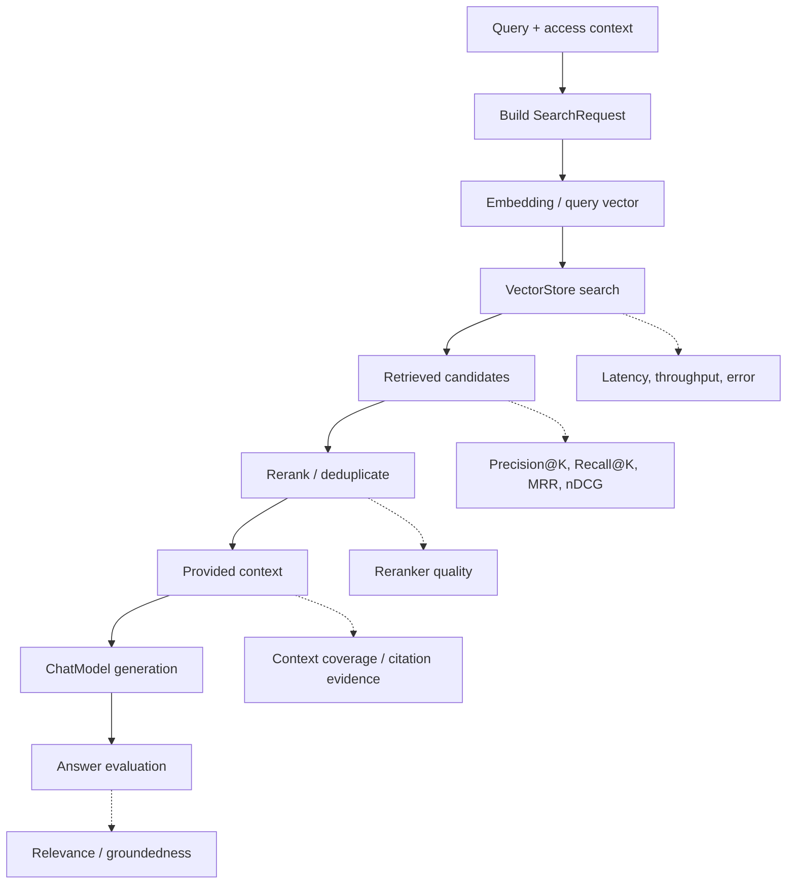

# Phân biệt độ trễ truy xuất với chất lượng tài liệu trả về

> **Chương:** Quan sát VectorStore  
> **Module:** `SPRING_AI_EVALUATION_OBSERVABILITY` — đánh giá chất lượng ứng dụng Spring AI bằng tập dữ liệu, tiêu chí relevance, fact checking và kiểm thử luồng RAG hoặc gọi công cụ; đồng thời đo metrics, traces, chi phí và độ trễ để phát hiện nguyên nhân suy giảm qua từng phiên bản prompt, model và pipeline.

## Mục tiêu học tập

Sau bài học, bạn có thể:

1. Phân biệt **hiệu năng truy xuất** (latency, throughput, timeout, availability) với **chất lượng tập tài liệu trả về** (relevance, recall, precision, ranking).
2. Đọc p50/p95/p99, throughput và error rate theo workload; hiểu vì sao query nhanh vẫn có thể trả tài liệu không hữu ích.
3. Đánh giá tài liệu bằng dataset có nhãn với Precision@K, Recall@K, MRR và nDCG@K; biết giới hạn của từng chỉ số.
4. Phân tích tác động của topK, similarity threshold, metadata filter, approximate nearest-neighbor search, hybrid retrieval và reranking.
5. Dùng Spring AI VectorStore và Micrometer để ghi nhận thời lượng truy xuất cùng số kết quả thực tế, rồi liên kết với evaluator offline.
6. Thiết kế dashboard và thí nghiệm A/B để tìm điểm cân bằng giữa tốc độ, chất lượng, chi phí và yêu cầu bảo mật.

## 1. Hai câu hỏi khác nhau trong một lần truy xuất

Khi người dùng hỏi "Chính sách hoàn tiền hiện hành cho phép xử lý trong bao lâu?", hệ thống RAG phải tìm các tài liệu có thể trả lời câu hỏi. Một phép đo vận hành trả lời:

**"Lời gọi tìm kiếm mất bao lâu và có hoàn tất không?"**

Một phép đánh giá chất lượng trả lời:

**"Những tài liệu được trả về có liên quan, đủ bằng chứng và được xếp hạng hợp lý không?"**

Hai câu hỏi này có thể cho kết quả trái chiều:

- VectorStore trả 5 tài liệu trong 25 ms, nhưng cả 5 đều nói về chính sách vận chuyển. Hiệu năng tốt, chất lượng retrieval kém.
- VectorStore mất 450 ms nhưng trả đúng chính sách hoàn tiền và FAQ liên quan. Chất lượng tốt, hiệu năng có thể không đạt SLA.
- VectorStore mất 60 ms, trả đúng nguồn nhưng tài liệu quan trọng bị loại ở bước rerank hoặc cắt khỏi prompt. Retrieval tốt, context cuối không đủ.
- VectorStore timeout sau 2 giây. Chưa có tập kết quả để chấm relevance; đây là lỗi kỹ thuật của lần truy xuất, không phải một tập tài liệu có relevance bằng 0.

### 1.1. Bốn trạng thái cần báo cáo riêng

| Kết quả kỹ thuật | Chất lượng tập tài liệu | Diễn giải |
|---|---|---|
| SUCCESS | Tốt | Query hoàn tất và tìm được nguồn hữu ích |
| SUCCESS | Kém | Query hoàn tất nhưng tài liệu không liên quan hoặc thiếu nguồn |
| SUCCESS | Không xác định/N/A | Không có gold labels hoặc tiêu chí không áp dụng |
| ERROR/TIMEOUT | Chưa chấm được | Không có kết quả hợp lệ để đánh giá retrieval quality |

Không chuyển timeout thành Precision@K = 0 hoặc Recall@K = 0. Cũng không coi query trả danh sách rỗng là lỗi kỹ thuật nếu API hoàn tất theo hợp đồng: kết quả rỗng có thể là hành vi đúng với câu hỏi không có tài liệu.

### 1.2. Sơ đồ pipeline và ranh giới đánh giá



**Ranh giới quan trọng:** Precision/Recall của retriever phải dùng tập tài liệu trả về ngay sau VectorStore search. Nếu muốn đánh giá reranker, tính lại trên tập sau rerank. Khi chấm groundedness/citation của câu trả lời, dùng tài liệu thực sự được đưa vào prompt.

## 2. Đo độ trễ truy xuất đúng cách

Trong Spring AI, thao tác tìm kiếm thường đi qua `VectorStore.similaritySearch(SearchRequest)`. Spring AI cung cấp Micrometer Observation cho hoạt động VectorStore với tên `db.vector.client.operation`; giá trị `db.operation.name` thường là `query` cho phép truy vấn.

### 2.1. Latency cần được đo ở những ranh giới nào?

| Phạm vi | Đo từ đâu đến đâu | Ý nghĩa |
|---|---|---|
| Query embedding | Gửi câu hỏi tới EmbeddingModel đến khi nhận vector | Độ trễ tạo query vector |
| VectorStore operation | Gọi method VectorStore đến khi nhận kết quả | Thời gian tại ranh giới adapter |
| Backend execution | Thời gian thực thi truy vấn trong database/vector engine | Hiệu năng engine nếu backend cung cấp |
| Retrieval workflow | Query rewrite/embedding/search/rerank đến khi chọn xong context | Thời gian hoàn thành bước retrieval |
| End-to-end request | Nhận câu hỏi đến khi trả câu trả lời | Trải nghiệm thực tế của người dùng |

Một implementation VectorStore có thể tự gọi EmbeddingModel bên trong `similaritySearch`. Khi đó timer ở ranh giới VectorStore có thể bao gồm embedding, network và xử lý adapter; backend execution time có thể chỉ là một phần. Không mặc định hai số đo bằng nhau.

Không gọi `EmbeddingModel.embed(question)` thêm lần nữa chỉ để lấy latency nếu adapter đã tự embed query. Hành động đó có thể tạo thêm request, token và chi phí mà không đo đúng pipeline thật.

### 2.2. p50, p95 và p99

Latency của query thay đổi theo kích thước index, filter, topK, cache, tải, network và loại câu hỏi. Một giá trị trung bình có thể che mất những truy vấn rất chậm.

| Chỉ số | Diễn giải | Dùng khi |
|---|---|---|
| p50 | 50% request có thời gian không vượt mức này | Đo trải nghiệm phổ biến |
| p95 | 95% request không vượt mức này | Theo dõi tail latency cho phần lớn người dùng |
| p99 | 99% request không vượt mức này | Phát hiện các trường hợp rất chậm khi có đủ mẫu |
| Mean | Tổng duration chia số phép đo | Theo dõi xu hướng tổng quát, dễ bị outlier ảnh hưởng |
| Max | Giá trị lớn nhất trong cửa sổ | Điều tra spike, không thay p95/p99 |

Ví dụ giả định:

| Workload | p50 | p95 | p99 | Số query |
|---|---:|---:|---:|---:|
| Filter đơn giản, topK=3 | 28 ms | 65 ms | 110 ms | 20.000 |
| Filter theo nhiều metadata, topK=5 | 55 ms | 240 ms | 510 ms | 8.000 |
| Corpus lớn, topK=20 | 90 ms | 430 ms | 900 ms | 4.000 |

Các số liệu chỉ minh họa cách đọc. Không dùng chúng làm SLA cho hệ thống thực. Khi so sánh, phải giữ cùng backend, index, embedding model, filter profile, K, threshold, tải và cửa sổ đo hoặc ghi rõ biến nào thay đổi.

### 2.3. Throughput, concurrency và lỗi

Latency thấp ở tải nhỏ không bảo đảm hệ thống chịu được lưu lượng thực. Theo dõi cùng lúc:

- **Throughput:** số operation query mỗi giây.
- **Active operations:** số phép quan sát đang thực thi.
- **Queue depth / connection pool wait:** thời gian chờ tài nguyên trước khi query thực sự chạy, nếu hệ thống cung cấp.
- **Error rate:** tỷ lệ exception/timeout trên số attempt.
- **Timeout rate:** số lượt vượt deadline.
- **Returned count:** số document thực trả.
- **Resource saturation:** CPU, memory, I/O, network và connection pool của backend.

Khi throughput tăng, p95 tăng và active operations tích lũy, có thể backend đang bão hòa. Nếu VectorStore span ổn định nhưng retrieval workflow chậm, nguyên nhân có thể nằm ở query rewrite, embedding hoặc reranker.

### 2.4. Đo đúng workload

Không nên gộp tất cả truy vấn vào một histogram duy nhất khi chúng khác nhau rõ rệt. Nên phân nhóm bằng nhãn hữu hạn, ví dụ:

- `store.role`: `policy-search` hoặc `operations-search`.
- `db.system`: backend family.
- `db.operation.name`: `query`.
- `retrieval.profile`: `small-k`, `medium-k`, `large-k`.
- `filter.profile`: `public-policy`, `tenant-policy`.

Không gắn query text, document ID, user ID, tenant ID tùy ý hoặc raw filter vào metric labels. Các giá trị đó vừa có thể nhạy cảm vừa tạo cardinality lớn; nếu cần điều tra từng ca, dùng trace/evidence store có quyền truy cập.

## 3. Đánh giá chất lượng tài liệu trả về

Latency đo thời gian; chất lượng retrieval cần một tập dữ liệu có nhãn để biết tài liệu nào thực sự liên quan tới từng câu hỏi.

### 3.1. Xây dựng gold set

Mỗi case nên có:

- `caseId`: định danh ổn định của câu hỏi.
- `query`: câu hỏi đã được kiểm duyệt.
- `goldRelevantDocumentIds`: tập ID tài liệu liên quan do người có chuyên môn gán nhãn.
- `relevanceGrades`: mức độ liên quan nếu dùng graded relevance.
- `tenantScope`/`sourceScope`: phạm vi dữ liệu được phép trong test.
- `datasetVersion`: phiên bản dataset.
- `expectedNoEvidence`: có nên trả rỗng/từ chối nếu không có nguồn hay không.

Ví dụ:

```yaml
datasetVersion: support-retrieval-v4
cases:
  - caseId: refund-001
    query: "Hoàn tiền được xử lý trong bao lâu?"
    goldRelevantDocumentIds:
      - refund-policy-v3
      - refund-faq-v2
    relevanceGrades:
      refund-policy-v3: 3
      refund-faq-v2: 2
      returns-policy-v2: 1
    expectedNoEvidence: false

  - caseId: no-source-002
    query: "Một điều khoản không tồn tại trong kho"
    goldRelevantDocumentIds: []
    expectedNoEvidence: true
```

Schema trên là ví dụ do ứng dụng định nghĩa, không phải định dạng dataset mặc định của Spring AI. Nhãn cần được xác nhận và version hóa; nếu nhiều người gán nhãn, nên có hướng dẫn relevance và quy trình giải quyết bất đồng.

### 3.2. Chất lượng nhãn quan trọng như thuật toán

Gold set sai có thể khiến nhóm tối ưu retriever theo một mục tiêu không phù hợp. Ví dụ:

- Hai chunk khác nhau chứa cùng một quy định có thể đều hợp lệ.
- Một tài liệu cũ có từ khóa giống câu hỏi nhưng không còn hiệu lực.
- Một câu hỏi cần hai nguồn cùng lúc, nhưng gold set chỉ ghi một nguồn.
- Tài liệu có nội dung đúng nhưng thuộc tenant khác hoặc người dùng không có quyền đọc.
- Tài liệu tổng quan có liên quan một phần, trong khi chính sách cụ thể mới là bằng chứng đủ.

Nên có hướng dẫn gán nhãn theo nghiệp vụ: relevance, mức độ đủ căn cứ, hiệu lực, quyền truy cập và vai trò tài liệu. Đừng xem lexical overlap hoặc similarity score là ground truth.

## 4. Các chỉ số retrieval phổ biến

Gọi `G` là tập document ID được gán nhãn liên quan cho một case, `R_K` là tập K kết quả thực tế trả về theo thứ hạng, và `rel(d)` là relevance grade của tài liệu d (ví dụ 0–3).

### 4.1. Precision@K

Precision@K đo tỷ lệ kết quả trong top K được gán nhãn liên quan:

\[
\mathrm{Precision@K}=\frac{|G\cap R_K|}{K}.
\]

Trong bài này, mẫu số là K cố định theo quy ước đánh giá. Nếu backend trả ít hơn K, phần vị trí còn thiếu được tính là không tìm thấy tài liệu liên quan. Một số thư viện dùng số kết quả thực trả làm mẫu số; khi dùng thư viện đó phải ghi rõ quy ước để so sánh không sai lệch.

Ví dụ: gold set có `{refund-policy-v3, refund-faq-v2}`; top5 trả 1 tài liệu liên quan. Precision@5 = 1/5 = 0.20.

Precision thấp thường cho thấy topK có nhiều tài liệu không liên quan, nhưng không nói rõ có bỏ lỡ nguồn quan trọng ngoài topK hay không.

### 4.2. Recall@K

Recall@K đo tỷ lệ tài liệu liên quan trong gold set được tìm thấy ở top K:

\[
\mathrm{Recall@K}=\frac{|G\cap R_K|}{|G|},\qquad |G|>0.
\]

Nếu gold set có hai tài liệu cần thiết và top5 tìm được một, Recall@5 = 1/2 = 0.50. Recall thấp nghĩa là retriever bỏ lỡ một phần nguồn đã gán nhãn.

Nếu `G=∅`, công thức không xác định. Với case không có nguồn, đánh giá hành vi abstention/no unsupported claim riêng; không tự gán Recall@K = 1 hoặc 0.

### 4.3. Mean Reciprocal Rank (MRR)

MRR quan tâm vị trí của **kết quả liên quan đầu tiên**:

\[
\mathrm{RR@K}=
\begin{cases}
1/r & \text{nếu kết quả liên quan đầu tiên ở hạng }r\leq K\\
0 & \text{nếu không có kết quả liên quan trong top K}
\end{cases}
\]

\[
\mathrm{MRR@K}=\frac{1}{N}\sum_{i=1}^{N}\mathrm{RR@K}_i.
\]

Ví dụ:

- Case A: kết quả liên quan đầu tiên ở rank 1 ⇒ RR = 1.
- Case B: ở rank 2 ⇒ RR = 0.5.
- Case C: không có kết quả liên quan trong topK ⇒ RR = 0.

MRR hữu ích khi người dùng chủ yếu cần một nguồn tốt đầu tiên. Nó không phản ánh đầy đủ chất lượng của nhiều tài liệu liên quan phía sau.

### 4.4. nDCG@K

nDCG@K xét **mức độ liên quan theo thứ hạng**. Nó hữu ích khi tài liệu có nhiều mức relevance, chẳng hạn:

- Grade 3: nguồn chính xác, trực tiếp trả lời.
- Grade 2: nguồn hỗ trợ tốt.
- Grade 1: liên quan một phần.
- Grade 0: không liên quan.

Discounted Cumulative Gain:

\[
\mathrm{DCG@K}=\sum_{i=1}^{K}
\frac{2^{rel_i}-1}{\log_2(i+1)}.
\]

\[
\mathrm{nDCG@K}=\frac{\mathrm{DCG@K}}{\mathrm{IDCG@K}},
\]

trong đó `IDCG@K` là DCG của thứ tự lý tưởng với các grade được sắp xếp giảm dần. Nếu `IDCG@K=0` (không có tài liệu liên quan được gán nhãn), nDCG không xác định; xử lý case đó theo policy riêng.

MRR và nDCG có thể cho góc nhìn khác nhau: MRR chỉ nhìn kết quả liên quan đầu tiên, còn nDCG đánh giá nhiều kết quả và mức độ relevance theo rank.

### 4.5. Ví dụ tính các chỉ số

Gold:

```text
refund-policy-v3   grade 3
refund-faq-v2      grade 2
returns-policy-v2 grade 1
```

Kết quả top5:

```text
1. shipping-guide-v1     grade 0
2. refund-policy-v3      grade 3
3. contact-page-v2       grade 0
4. refund-faq-v2         grade 2
5. returns-policy-v2     grade 1
```

Ta có:

- Precision@5 = 3/5 = 0.60.
- Recall@5 = 3/3 = 1.00.
- RR@5 = 1/2 = 0.50.
- nDCG@5 thấp hơn 1 vì tài liệu grade 3 đứng ở rank 2 thay vì rank 1, còn các tài liệu liên quan khác đứng ở rank 4 và 5.

Ví dụ này cho thấy **Recall@5 hoàn hảo không có nghĩa thứ hạng tốt**. Nếu context budget chỉ cho phép lấy hai tài liệu đầu, nguồn grade 3 lại đứng thứ hai sau một tài liệu không liên quan.

## 5. Kết hợp latency với retrieval quality

Không nên tạo một điểm tổng duy nhất rồi làm mất ý nghĩa của hai trục. Một cách hữu ích là vẽ hoặc lập bảng **latency–quality frontier**:

| Cấu hình | Query p95 | Recall@5 | Precision@5 | Mô tả |
|---|---:|---:|---:|---|
| A | 45 ms | 0.78 | 0.70 | Nhanh, bỏ lỡ nhiều nguồn |
| B | 85 ms | 0.92 | 0.76 | Chậm hơn, độ phủ tốt |
| C | 150 ms | 0.94 | 0.61 | Recall nhỉnh hơn, thêm nhiều nhiễu |
| D | 70 ms | 0.91 | 0.82 | Cân bằng tốt trên dataset này |

Số liệu giả định. Cấu hình D có vẻ cân bằng trong ví dụ, nhưng quyết định thực tế còn phụ thuộc độ ổn định theo nhóm câu hỏi, chi phí, bảo mật, chất lượng câu trả lời và SLA.

### 5.1. Pareto frontier

Một cấu hình bị **dominated** nếu tồn tại cấu hình khác vừa nhanh hơn hoặc bằng, vừa có chất lượng tốt hơn hoặc bằng, và ít nhất một mặt tốt hơn rõ rệt. Các cấu hình không bị dominated tạo thành Pareto frontier.

Ví dụ:

- Nếu B có latency 85 ms và Recall 0.92, còn A có 45 ms và Recall 0.78, không cấu hình nào thắng cả hai trục.
- Nếu D có 70 ms và Recall 0.91, còn E có 100 ms và Recall 0.89, D tốt hơn cả hai trục; E bị dominated trên hai chỉ số này.

Đừng tối ưu một trục rồi bỏ qua ràng buộc còn lại. Đặt release gates rõ ràng, ví dụ p95 dưới SLA **và** Recall@5 trên ngưỡng, Precision@5 tối thiểu, leakage bằng 0.

### 5.2. Không cộng latency và quality thành điểm tùy tiện

Latency đo thời gian; Recall đo tỷ lệ tài liệu tìm thấy. Hai đại lượng khác đơn vị và khác ý nghĩa. Một điểm như `score = 0.5 × Recall - 0.01 × latency` chỉ có ý nghĩa nếu tổ chức đã định nghĩa utility function, đơn vị chuẩn hóa và trọng số theo yêu cầu nghiệp vụ. Nếu chưa có, hãy báo hai trục riêng và dùng gate/constraint để quyết định.

## 6. Các tham số ảnh hưởng đồng thời đến tốc độ và chất lượng

### 6.1. topK

Tăng `topK` thường tạo cơ hội lấy thêm tài liệu liên quan và tăng Recall@K, nhưng có thể:

- Tăng số candidates phải đọc/rerank.
- Tăng payload truyền từ backend.
- Tăng prompt tokens nếu nhiều tài liệu được đưa vào context.
- Tăng nhiễu nếu các kết quả phía sau ít liên quan.

Tác động latency không nhất thiết tăng tuyến tính; còn tùy backend, ANN algorithm, cache và cách adapter thực hiện. Đo returned count và context count riêng.

### 6.2. similarity threshold

Ngưỡng cao hơn có thể giảm tài liệu yếu, tăng Precision ở một số dataset, nhưng cũng có thể bỏ lỡ nguồn cần thiết và làm tăng zero-result. Score semantics có thể khác theo distance/similarity metric và adapter. Không dùng một threshold mặc định cho mọi embedding model/index.

### 6.3. Metadata filter

Filter đúng giúp loại dữ liệu không thuộc phạm vi, hỗ trợ tenant isolation và giảm tập ứng viên. Nhưng filter quá chọn lọc có thể làm Recall giảm; filter phức tạp có thể làm query chậm nếu backend không có index phù hợp.

Phải phân biệt:

- Filter có được yêu cầu trong `SearchRequest` không?
- Backend có thực sự áp dụng filter theo hợp đồng không?
- Các document trả về có thỏa điều kiện không?
- Trong tập được phép, retriever có tìm đủ tài liệu liên quan không?

### 6.4. Approximate nearest-neighbor search

ANN giảm chi phí tìm kiếm trên tập vector lớn bằng cách không nhất thiết kiểm tra chính xác toàn bộ vector. Điều này tạo trade-off giữa recall so với exact search, độ trễ, bộ nhớ và chi phí xây index.

Khi thay ANN index/config:

- So sánh với exact/brute-force baseline trên tập con có thể kiểm soát.
- Đo Recall@K của ANN so với gold labels hoặc kết quả exact reference.
- Ghi index parameters, index version, corpus size và filter strategy.
- Đo p95 ở nhiều mức tải.
- Không nhầm Recall@K của ANN so với exact neighbors với relevance theo nghiệp vụ; đó là hai loại ground truth khác nhau.

### 6.5. Hybrid search và reranking

Hybrid retrieval có thể kết hợp vector similarity với lexical/BM25 search để cải thiện truy vấn có tên riêng, mã sản phẩm hoặc từ khóa chính xác. Reranker dùng model/logic khác để sắp xếp lại candidates.

Đo riêng:

1. Vector candidate recall và latency.
2. Lexical candidate recall và latency.
3. Hợp nhất candidates (fusion) và overlap.
4. Reranker latency và nDCG/MRR sau rerank.
5. Prompt context sau truncation và groundedness.

Nếu chỉ đo latency của VectorStore, không thể biết hybrid fusion hoặc reranker đang làm chậm workflow. Nếu chỉ chấm kết quả cuối, không biết retriever hay reranker gây hồi quy.

## 7. Java: ghi latency và returned count với Spring AI

Ví dụ dưới đây dùng `VectorStore`, `SearchRequest` và Micrometer. Spring AI đã có observation cho operation VectorStore theo cấu hình; metric custom trong ví dụ ghi **returned count** và outcome ở tầng service, không tạo timer thứ hai cùng tên `db.vector.client.operation`.

### 7.1. Service tìm kiếm

```java
import java.util.List;
import java.util.Objects;

import io.micrometer.core.instrument.Counter;
import io.micrometer.core.instrument.DistributionSummary;
import io.micrometer.core.instrument.MeterRegistry;
import io.micrometer.core.instrument.Timer;
import org.springframework.ai.document.Document;
import org.springframework.ai.vectorstore.SearchRequest;
import org.springframework.ai.vectorstore.VectorStore;
import org.springframework.stereotype.Service;

@Service
public final class RetrievalTelemetryService {
    private final VectorStore vectorStore;
    private final MeterRegistry registry;
    private final Timer retrievalTimer;
    private final DistributionSummary returnedCount;
    private final Counter querySuccess;
    private final Counter queryError;
    private final Counter queryEmpty;

    public RetrievalTelemetryService(
            VectorStore vectorStore,
            MeterRegistry registry) {
        this.vectorStore = Objects.requireNonNull(vectorStore);
        this.registry = Objects.requireNonNull(registry);

        this.retrievalTimer = Timer.builder("app.rag.retrieval.duration")
                .description("Thời gian gọi VectorStore từ tầng service")
                .tag("store.role", "policy-search")
                .register(registry);

        this.returnedCount = DistributionSummary
                .builder("app.rag.retrieval.returned.documents")
                .description("Số document thực tế trả về")
                .tag("store.role", "policy-search")
                .register(registry);

        this.querySuccess = Counter.builder("app.rag.retrieval.outcomes")
                .tag("store.role", "policy-search")
                .tag("outcome", "success")
                .register(registry);
        this.queryError = Counter.builder("app.rag.retrieval.outcomes")
                .tag("store.role", "policy-search")
                .tag("outcome", "error")
                .register(registry);
        this.queryEmpty = Counter.builder("app.rag.retrieval.empty")
                .tag("store.role", "policy-search")
                .register(registry);
    }

    public List<Document> search(
            String query,
            int topK,
            double similarityThreshold,
            String trustedFilterExpression) {

        if (query == null || query.isBlank()) {
            throw new IllegalArgumentException("Query không được rỗng");
        }
        if (topK < 1 || topK > 50) {
            throw new IllegalArgumentException("topK ngoài giới hạn ứng dụng");
        }
        if (!Double.isFinite(similarityThreshold)
                || similarityThreshold < 0
                || similarityThreshold > 1) {
            throw new IllegalArgumentException("Threshold không hợp lệ");
        }

        SearchRequest.Builder builder = SearchRequest.builder()
                .query(query)
                .topK(topK)
                .similarityThreshold(similarityThreshold);
        if (trustedFilterExpression != null
                && !trustedFilterExpression.isBlank()) {
            builder.filterExpression(trustedFilterExpression);
        }

        Timer.Sample sample = Timer.start(registry);
        try {
            List<Document> results = Objects.requireNonNull(
                    vectorStore.similaritySearch(builder.build()),
                    "VectorStore trả về null");

            sample.stop(retrievalTimer);
            querySuccess.increment();
            returnedCount.record(results.size());
            if (results.isEmpty()) {
                queryEmpty.increment();
            }
            return results;
        }
        catch (RuntimeException error) {
            sample.stop(retrievalTimer);
            queryError.increment();
            throw error;
        }
    }
}
```

**Phạm vi timer:** `app.rag.retrieval.duration` đo lời gọi ở tầng service trong ví dụ. Nó có thể bao gồm embedding nội bộ, network và adapter processing tùy implementation. Spring AI observation `db.vector.client.operation` có thể đo cùng một vùng ở tầng framework; hai timer có thể bao nhau, không được cộng chúng.

**Filter:** tham số `trustedFilterExpression` chỉ được truyền từ service đã xác thực quyền. Ví dụ này không đủ để triển khai multi-tenant nếu caller có thể đưa raw string tùy ý. Production cần tạo filter từ security context và API builder có cấu trúc phù hợp phiên bản adapter.

**Threshold:** kiểm tra [0,1] là guardrail minh họa cho hợp đồng được giả định. Phải xác minh miền điểm/threshold của backend và adapter thực tế; không coi mọi similarity score đều cùng quy ước.

### 7.2. Vì sao ghi returned count?

`topK=5` không bảo đảm backend trả năm tài liệu. `returnedCount` cho biết số kết quả thực tế để đối chiếu với zero-result và gold set. Tuy nhiên, chỉ số này chưa biết kết quả có liên quan hay không; phải nối nó với evaluator offline.

### 7.3. Đánh giá quality ngoài đường phục vụ

Không nên tải toàn bộ gold labels vào service production rồi tính Recall@K cho mọi request. Một evaluation runner có thể lấy:

- Query fixture.
- Gold document IDs/grades.
- Retrieved candidate IDs từ evidence đã capture.
- Dataset/index/embedding version.

Sau đó tính các metric retrieval trên pipeline test/canary. Điều này tránh lộ gold labels vào runtime và tránh biến dữ liệu người dùng thành benchmark không được kiểm soát.

## 8. Prometheus/Micrometer: theo dõi latency tách với quality

### 8.1. Metric duration của Spring AI

Observation VectorStore `db.vector.client.operation` có thể được export qua Micrometer registry. Với Prometheus naming convention, timer có thể xuất các series:

```text
db_vector_client_operation_seconds_count
db_vector_client_operation_seconds_sum
db_vector_client_operation_seconds_max
```

Tên thực tế cần được xác minh tại endpoint exporter. Để tính query throughput:

```promql
sum by (db_system) (
  rate(db_vector_client_operation_seconds_count{
    db_operation_name="query"
  }[5m])
)
```

Latency trung bình theo backend:

```promql
sum by (db_system) (
  rate(db_vector_client_operation_seconds_sum{
    db_operation_name="query"
  }[5m])
)
/
sum by (db_system) (
  rate(db_vector_client_operation_seconds_count{
    db_operation_name="query"
  }[5m])
)
```

Đây là latency trung bình, không phải p95. Khi không có mẫu, không diễn giải mẫu số bằng 0 như query có latency bằng 0.

### 8.2. p95 khi bật histogram

Nếu registry/exporter phát `_bucket`:

```promql
histogram_quantile(
  0.95,
  sum by (le, db_system) (
    rate(db_vector_client_operation_seconds_bucket{
      db_operation_name="query"
    }[5m])
  )
)
```

Nếu không có bucket, công thức không có dữ liệu. Cần cấu hình histogram phù hợp, xem số mẫu và bucket boundaries; `_max` không phải phương án thay thế p95.

### 8.3. Metric chất lượng retrieval là metric khác

Precision@K/Recall@K thường được tính từ labeled evaluation dataset, không tự phát sinh từ timer VectorStore. Có thể xuất metric tổng hợp của evaluation runner:

```text
app_rag_retrieval_recall_at_k
app_rag_retrieval_precision_at_k
app_rag_retrieval_mrr
app_rag_retrieval_ndcg_at_k
```

Đây là tên metric **gợi ý do ứng dụng định nghĩa**, không phải metric mặc định Spring AI. Nên gắn nhãn hữu hạn như dataset version, store role, config cohort và K đã quản trị. Không gắn caseId, document ID hoặc query text vào metric labels.

### 8.4. Dashboard hai trục

| Bảng điều khiển | Chỉ số | Câu hỏi |
|---|---|---|
| Retrieval performance | p50/p95/p99, throughput, timeout/error, active operations | Tìm kiếm nhanh và ổn định không? |
| Retrieval output | returned count, zero-result rate, duplicate/stale rate | Tập kết quả có bất thường không? |
| Retrieval relevance | Precision@K, Recall@K, MRR, nDCG@K | Tài liệu có liên quan và xếp hạng tốt không? |
| RAG context | selected count, provided count, context tokens | Nguồn quan trọng có tới model không? |
| Answer quality | Relevance, groundedness, citation pass | Câu trả lời có dựa vào nguồn không? |
| Cost | Embedding/query, rerank, prompt/completion tokens | Đổi cấu hình có tăng chi phí không? |
| Lineage | Index, embedding, prompt, model, pipeline, dataset version | Phiên bản nào gây thay đổi? |

Không trộn operation ERROR vào quality FAIL; báo evaluation coverage riêng để tránh pass rate đẹp giả tạo khi nhiều case chưa chấm được.

## 9. Thiết kế thí nghiệm A/B và tìm điểm cân bằng

Muốn biết vì sao cấu hình mới nhanh hơn hoặc chất lượng hơn, cần cố định các yếu tố không phải mục tiêu thí nghiệm.

### 9.1. Ma trận thí nghiệm

Ví dụ muốn kiểm tra topK và threshold:

```text
                     threshold
                  0.60   0.75   0.90
topK = 3            A1     A2     A3
topK = 5            B1     B2     B3
topK = 10           C1     C2     C3
```

Mỗi cấu hình chạy cùng:

- Dataset và gold labels.
- Corpus snapshot/index version.
- Embedding model và query rewrite.
- Filter/tenant policy.
- Backend version và tải thử nghiệm.
- Reranker, context budget và generation model nếu đang đo end-to-end.

Nếu thay embedding model hoặc index cùng lúc, hãy ghi rõ và coi đó là một thí nghiệm nhiều biến; không gán toàn bộ kết quả cho topK.

### 9.2. Ví dụ kết quả giả định

| Config | Query p95 | Recall@5 | Precision@5 | nDCG@5 | Context tokens trung bình |
|---|---:|---:|---:|---:|---:|
| A1 | 42 ms | 0.76 | 0.82 | 0.79 | 1,050 |
| B2 | 68 ms | 0.91 | 0.84 | 0.90 | 1,520 |
| C3 | 125 ms | 0.96 | 0.61 | 0.78 | 2,900 |

Nhận xét:

- A1 nhanh và precision khá, nhưng bỏ lỡ một phần nguồn.
- B2 chậm hơn nhưng cải thiện recall/ranking với lượng context vừa phải.
- C3 tìm được gần đủ nguồn nhưng thêm nhiều tài liệu nhiễu, tăng context tokens.

Không có cấu hình tốt nhất cho mọi workload. Một câu hỏi tra mã sản phẩm cần precision cao; câu hỏi tổng hợp chính sách có thể cần recall cao hơn. Có thể phân loại query profile, nhưng phải kiểm soát cardinality và tránh để model tự chọn phạm vi truy cập.

### 9.3. Pareto và release gates

Một cấu hình bị dominated nếu có cấu hình khác vừa nhanh hơn/bằng, vừa có chất lượng tốt hơn/bằng, và tốt hơn ở ít nhất một chiều. Những cấu hình còn lại tạo Pareto frontier.

Ví dụ release gate minh họa:

```yaml
retrievalReleasePolicy: retrieval-v3
gates:
  queryP95MsAtMost: 250
  minimumRecallAt5: 0.90
  minimumPrecisionAt5: 0.70
  minimumNdcgAt5: 0.85
  crossTenantLeakageAllowed: 0
  mandatoryEvaluationCoverage: 1.0
```

Đây là ngưỡng giả định của một sản phẩm; không phải mặc định Spring AI. Rủi ro rò dữ liệu không thể được bù bằng latency hoặc recall tốt. Các case ERROR bắt buộc cần được đánh giá lại trước khi tuyên bố coverage đạt.

## 10. Những nguyên nhân khiến hai trục thay đổi

### 10.1. Latency tăng nhưng chất lượng không đổi

Nguyên nhân có thể:

- Backend quá tải hoặc connection pool chờ lâu.
- Filter mới không có index phù hợp.
- Index lớn hơn hoặc query plan thay đổi.
- topK tăng nhưng tập kết quả vẫn có relevance tương tự.
- Embedding provider chậm hơn trong khi ranking không đổi.
- Retry/backoff tăng số attempt.

Kiểm tra query spans, DB metrics, active operations, connection pool, provider spans và attempt count.

### 10.2. Chất lượng giảm nhưng latency không đổi

Nguyên nhân có thể:

- Embedding model query khác với model tạo document vectors.
- Corpus hoặc index alias chuyển sang dữ liệu cũ/thiếu.
- Filter quá hẹp hoặc sai metadata.
- Similarity threshold quá cao.
- ANN parameters thay đổi khiến ranking kém hơn.
- Query rewrite làm sai ý định.
- Gold labels hoặc nguồn nghiệp vụ đã đổi nhưng dataset chưa cập nhật.

Kiểm tra index manifest, embedding version, filter evidence, topK/threshold, result IDs/ranks và gold labels.

### 10.3. Latency giảm và chất lượng cũng giảm

Đây có thể là dấu hiệu hệ thống bỏ bớt công việc:

- topK giảm mạnh.
- threshold tăng khiến ít ứng viên hơn.
- Filter vô tình loại tài liệu đúng.
- ANN search giảm độ chính xác để đổi tốc độ.
- Rerank bị tắt hoặc candidate pool nhỏ hơn.
- Query rewrite/embedding bị bypass do fallback.

Một pipeline nhanh hơn không nhất thiết là một pipeline tốt hơn. Cần so với quality gates trước khi phát hành.

### 10.4. Latency tăng và chất lượng tăng

Có thể do:

- Tăng topK để tăng recall.
- Thêm hybrid retrieval.
- Reranker bổ sung bước sắp xếp.
- Query expansion hoặc multi-query retrieval.
- Tăng độ sâu ANN/candidate pool.

Đánh giá mức tăng quality có xứng đáng với latency/cost hay không, và có thể tối ưu bằng caching, index/filter strategy hoặc reranker nhẹ hơn không.

## 11. Lỗi triển khai và trạng thái đánh giá

| Tình huống | Technical status | Quality status |
|---|---|---|
| Backend query timeout | ERROR/TIMEOUT | Chưa có kết quả để chấm |
| Backend trả 0 docs hợp lệ | SUCCESS | PASS/FAIL/N/A theo gold set và policy |
| Backend trả docs sai nhưng không exception | SUCCESS | Retrieval FAIL nếu gold labels chứng minh |
| Retrieval evidence bị mất | Có thể SUCCESS | Evaluation ERROR nếu thiếu dữ liệu bắt buộc |
| Query đúng nhưng reranker loại mất gold doc | SUCCESS | Reranker quality FAIL |
| Query và context đúng, ChatModel hallucinate | SUCCESS | Groundedness FAIL |
| Judge timeout | Retrieval có thể SUCCESS | Evaluation ERROR |

Đối với mỗi lượt, lưu `technicalOutcome`, `retrievalQualityStatus`, `evaluationStatus` riêng. Tránh một field `success=false` đại diện mọi loại lỗi.

### 11.1. Evaluation coverage

Giả sử có 100 case áp dụng:

| Trạng thái retrieval evaluation | Số case |
|---|---:|
| PASS | 72 |
| FAIL | 18 |
| ERROR | 7 |
| NOT_RUN | 3 |

Quality pass rate trên ca có phán quyết:

\[
\mathrm{QualityPassRate}=\frac{72}{72+18}=80\%.
\]

Coverage trên case đã có phán quyết:

\[
\mathrm{Coverage}=\frac{72+18}{72+18+7}=92.78\%.
\]

Ba case NOT_RUN vẫn là công việc chưa hoàn tất; cần báo riêng, không âm thầm loại khỏi báo cáo. N/A chỉ dùng khi tiêu chí thực sự không áp dụng theo policy và không được dùng thay ERROR.

## 12. Runbook điều tra khi retrieval latency hoặc quality thay đổi

1. **Chọn đúng cohort:** backend, store role, operation, môi trường và khoảng thời gian.
2. **Xác minh traffic/mẫu:** throughput, sample count, concurrency, retries và timeout.
3. **Tách latency:** query embedding, VectorStore operation, retrieval workflow, rerank và end-to-end.
4. **Kiểm tra technical errors:** network, 429/503, timeout, connection pool và backend resource.
5. **Kiểm tra query configuration:** topK, threshold, filter profile, query rewrite, ANN/index parameters.
6. **Đối chiếu version:** corpus snapshot, index, embedding model, adapter/backend, reranker và pipeline.
7. **Tính lại retrieval quality:** Precision@K, Recall@K, MRR, nDCG trên cùng gold dataset.
8. **Kiểm tra context:** retrieved candidates, selected results và provided context.
9. **Đánh giá end-to-end:** relevance, groundedness, citation, token, cost và application latency.
10. **Xác minh sau sửa:** chạy lại cùng dataset và cùng điều kiện; ghi root cause và kết quả.

### 12.1. Bảng chẩn đoán nhanh

| Triệu chứng | Kiểm tra đầu tiên | Không kết luận vội |
|---|---|---|
| p95 query tăng | Timer, DB load, filter/index, connection pool | Không đổ lỗi embedding nếu chưa có span riêng |
| Recall@K giảm | Gold IDs, embedding/index/filter/topK | Không đổ lỗi ChatModel |
| Precision@K giảm | Rank, candidate pool, threshold, hybrid fusion | Không kết luận latency là nguyên nhân |
| MRR giảm | Vị trí tài liệu liên quan đầu tiên | Không chỉ nhìn số kết quả |
| nDCG giảm | Relevance grades theo rank | Không bỏ qua chất lượng từng cấp |
| Zero-result tăng | Threshold/filter/index/corpus | Không coi mọi zero-result là backend error |
| Latency giảm, recall giảm | topK/ANN/filter/fallback | Không gọi là tối ưu thành công |
| Query tốt, answer kém | Rerank, provided context, prompt/model | Không quy lỗi cho VectorStore ngay |
| Judge ERROR tăng | Judge provider và evidence capture | Không chuyển thành retrieval FAIL |

## 13. Bài thực hành tự luyện

**Bối cảnh:** Một ứng dụng Spring AI trả lời chính sách hoàn tiền bằng RAG. Nhóm muốn so sánh cấu hình hiện tại (topK=5, threshold=0.70) với cấu hình mới (topK=10, threshold=0.75). Cùng lúc, p95 query đang tăng và người dùng phản ánh câu trả lời có nguồn kém liên quan.

Yêu cầu:

1. Tạo dataset ít nhất 30 query có gold document IDs và relevance grades 0–3; có case không có nguồn.
2. Gọi `VectorStore.similaritySearch(SearchRequest)` và ghi latency, error, returned count, result IDs/ranks.
3. Tính Precision@5, Recall@5, MRR@5 và nDCG@5 theo quy ước được công bố.
4. Chạy baseline/candidate trên cùng corpus, index, embedding model, filter policy và backend version.
5. Bật histogram để theo dõi p50/p95/p99; ghi số mẫu, throughput và active operations.
6. Đối chiếu query embedding span với VectorStore span để xác định thời lượng có bị bao gồm hay không.
7. Thử tăng topK riêng, rồi thay threshold riêng; không đổi cả hai nếu mục tiêu là cô lập nguyên nhân.
8. Kiểm tra filter tenant bằng fixture cross-tenant và xác nhận không có leakage.
9. Lưu retrieved candidates, reranked results và provided context để so sánh với citation/groundedness.
10. Tạo dashboard latency–quality, tìm cấu hình Pareto và áp release gates.
11. Phân loại một trường hợp timeout, một trường hợp zero-result hợp lệ và một trường hợp query thành công nhưng retrieval FAIL.
12. Viết runbook chỉ rõ evidence cần xem khi p95 tăng nhưng Recall không đổi.

**Câu hỏi tự kiểm tra:**

- Vì sao query 20 ms vẫn có thể có chất lượng retrieval kém?
- Precision@K và Recall@K trả lời hai câu hỏi gì?
- Khi gold set rỗng, vì sao Recall@K không thể tự tính bằng 1?
- MRR khác nDCG ở điểm nào?
- Vì sao p95 không thể thay bằng max?
- Tăng topK có thể tăng Recall nhưng làm prompt kém tập trung ra sao?
- ANN recall so với exact nearest neighbors khác relevance theo nghiệp vụ thế nào?
- Khi query timeout, vì sao không nên gán Recall@K bằng 0?
- Tại sao phải chấm riêng retrieved candidates và provided context?
- Khi hai cấu hình không thể thắng đồng thời về latency và quality, dùng Pareto frontier thế nào?

## 14. Checklist triển khai

- [ ] Đo riêng VectorStore operation latency, retrieval workflow latency và end-to-end latency.
- [ ] Ghi p50/p95/p99, throughput, active operations, error/timeout và số mẫu.
- [ ] Xác minh query embedding nằm trong hay ngoài timer VectorStore theo implementation.
- [ ] Không gọi embedding thêm lần nữa chỉ để đo latency.
- [ ] Có dataset gold labels và phiên bản rõ ràng cho truy vấn retrieval.
- [ ] Tính Precision@K, Recall@K, MRR và nDCG@K theo quy ước nhất quán.
- [ ] Xử lý riêng case không có gold documents; không chia cho 0 hoặc tự gán score.
- [ ] Ghi topK, threshold, filter profile, backend/index và embedding version.
- [ ] Phân biệt operation SUCCESS/ERROR với retrieval quality PASS/FAIL/N/A.
- [ ] Đo returned count; không xem nó là relevance hoặc bằng topK.
- [ ] Kiểm tra tác động của ANN, hybrid retrieval và reranking ở từng stage.
- [ ] Capture retrieved candidates, reranked results và provided context riêng.
- [ ] Metrics labels chỉ dùng giá trị hữu hạn; không đưa query, document ID hay tenant ID vào tags.
- [ ] So sánh A/B trên cùng dataset/corpus và ghi rõ biến thay đổi.
- [ ] Dùng latency–quality Pareto frontier hoặc release gates thay vì điểm tổng tùy tiện.
- [ ] Báo evaluation ERROR/coverage và NOT_RUN riêng, không làm đẹp quality pass rate.
- [ ] Kết hợp relevance, groundedness, citation, token, cost và SLA trước khi release.

## Tổng kết

Độ trễ truy xuất và chất lượng tài liệu trả về là hai trục khác nhau. Micrometer/Spring AI giúp quan sát thời gian, throughput và lỗi của VectorStore; dataset có nhãn mới cho phép đánh giá tài liệu tìm được có liên quan, đủ độ phủ và xếp hạng hợp lý qua Precision@K, Recall@K, MRR và nDCG@K. Một truy vấn nhanh có thể trả sai nguồn; một truy vấn chậm có thể trả tài liệu tốt; một query timeout thì chưa có tập kết quả để chấm.

Để đánh giá một pipeline RAG đáng tin cậy, hãy giữ riêng technical outcome và quality verdict, ghi rõ topK/threshold/filter/index/embedding version, kiểm tra từng stage của ANN/hybrid/reranking/context assembly, và so sánh latency với retrieval quality trên cùng dataset. Khi nối được traces với provided context, answer evaluation, token và cost, nhóm phát triển có thể chọn cấu hình cân bằng tốc độ, độ chính xác và ngân sách thay vì tối ưu một chỉ số riêng lẻ.

## Tài liệu tham khảo

- [Spring AI — Observability](https://docs.spring.io/spring-ai/reference/observability/): observation và metrics cho VectorStore, ChatModel và EmbeddingModel.
- [Spring AI — Vector Databases](https://docs.spring.io/spring-ai/reference/api/vectordbs.html): `VectorStore`, `SearchRequest`, `similaritySearch`, topK và metadata filtering.
- [Spring AI — Evaluation Testing](https://docs.spring.io/spring-ai/reference/api/testing.html): đánh giá relevance/fact checking trong ứng dụng AI.
- [Micrometer — Timers](https://docs.micrometer.io/micrometer/reference/concepts/timers.html): count, total time, max và histogram.
- [Prometheus — Query Functions](https://prometheus.io/docs/prometheus/latest/querying/functions/): `rate` và `histogram_quantile`.
- [OpenTelemetry — Traces](https://opentelemetry.io/docs/concepts/signals/traces/): span, trace context và phân tích thời lượng.
- [Stanford IR Book — Evaluation in Information Retrieval](https://nlp.stanford.edu/IR-book/): precision, recall, ranking và đánh giá hệ thống truy xuất thông tin.
