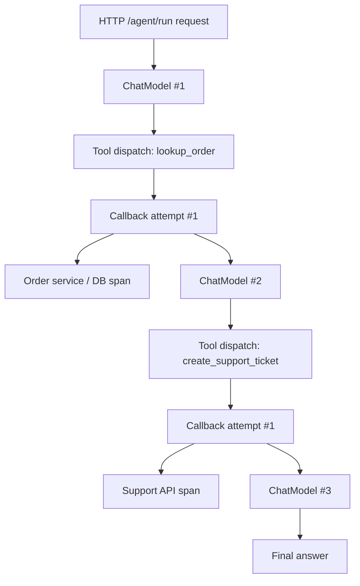

# Phép quan sát cho mỗi lần thực thi tool callback

Trong ứng dụng Spring AI, mô hình không chỉ tạo văn bản. Nó có thể yêu cầu **gọi công cụ (tool calling)** để tra cứu đơn hàng, truy vấn tài liệu, tính toán hoặc tạo một tác vụ hỗ trợ. Khi câu trả lời cuối bị sai hoặc chậm, câu hỏi không chỉ là “model đã nghĩ gì?”, mà còn là: **công cụ nào thực sự được thực thi, chạy trong bao lâu, nhận kết quả gì, có lỗi hay bị gọi lại không?**

Một câu trả lời “Đã tạo phiếu hỗ trợ” không chứng minh việc tạo phiếu đã thành công. Ngược lại, một lượt gọi tool thất bại vì timeout không nhất thiết có nghĩa model đã chọn sai công cụ. Để điều tra, cần **một phép quan sát (observation) cho mỗi lần thực thi tool callback**, nối các lần đó với lượt gọi model, trace nghiệp vụ, metrics, chi phí và độ trễ.

Bài thuộc chương **Quan sát công cụ** của mô-đun **SPRING_AI_EVALUATION_OBSERVABILITY**. Mô-đun học cách đánh giá chất lượng ứng dụng Spring AI bằng tập dữ liệu, relevance, fact checking và kiểm thử RAG/tool calling; đồng thời đo metrics, traces, chi phí và độ trễ để phát hiện nguyên nhân suy giảm qua phiên bản prompt, model và pipeline. Bài này tập trung vào **ranh giới thực thi công cụ** — lớp quan sát nằm giữa ý định gọi tool của model và kết quả callback thực tế.

> **Điểm then chốt:** một *tool call được model yêu cầu* không đồng nghĩa với một *callback đã chạy thành công*. Quan sát theo từng lần thực thi giúp phân biệt lựa chọn tool, lỗi tham số, lỗi hệ thống phụ thuộc, kết quả nghiệp vụ và ảnh hưởng tới chất lượng câu trả lời.

## 1. Kết quả học tập

Sau bài học, bạn có thể:

1. Giải thích **tool request**, **tool callback invocation**, **tool attempt**, **logical operation** và **trace/span/observation** khác nhau ra sao.
2. Chọn ranh giới start/stop cho mỗi callback và ghi **tool name, outcome, duration, error category, retry/attempt, correlation ID** mà không làm lộ dữ liệu nhạy cảm.
3. Phân biệt **metric có cardinality thấp** với thông tin truy nguyên chỉ nên lưu trong log/trace có kiểm soát.
4. Thiết kế phân cấp span từ yêu cầu người dùng, model request, tool callback đến hệ thống phụ thuộc.
5. Dùng Micrometer Observation API và một công cụ `@Tool` trong Spring AI để minh họa ghi observation và đóng nó đúng cách khi thành công hoặc gặp exception.
6. Tính tỷ lệ thành công, lỗi nghiệp vụ, lỗi kỹ thuật, retry và các percentiles của latency với **mẫu số đúng**.
7. Kiểm thử observation khi callback trả lỗi, timeout, chạy song song, bị hủy, bị gọi lặp hoặc không được thực thi.
8. Nối số liệu tool callback với đánh giá đúng/sai của agent, RAG, prompt và chi phí toàn pipeline.

## 2. Tool callback là ranh giới nào trong Spring AI?

Ứng dụng có thể cung cấp cho model những công cụ với mô tả và schema tham số. Khi model yêu cầu một tool call, framework và ứng dụng xử lý việc xác định công cụ, ràng buộc dữ liệu và gọi phần triển khai tương ứng.

Ví dụ minh họa:

```text
User: "Đơn DH-204 đã giao thất bại chưa? Nếu có thì mở phiếu hỗ trợ."

Model tool request:
  tool = lookup_order
  arguments = {"orderId":"DH-204"}

Tool callback execution:
  lookupOrder("DH-204")
  -> OrderStatus(orderId="DH-204", deliveryStatus="DELIVERED")

Model tiếp tục:
  "Đơn này đã giao thành công nên không tạo phiếu hỗ trợ."
```

Cần tách ba mốc:

| Mốc | Đã xảy ra gì? | Có nên tính một lần callback thực thi? |
|---|---|---|
| Model **đề xuất** `lookup_order` | Đầu ra model chứa tên tool và arguments | **Chưa**, nếu callback chưa được gọi |
| Phần mềm **chấp nhận và bắt đầu** callback | Lời gọi đi vào triển khai tool đã chọn | **Có** |
| Callback **kết thúc** | Trả kết quả hoặc ném lỗi; có duration/outcome | Kết thúc đúng observation của attempt đó |

Nếu model gọi tên một tool không tồn tại và lớp điều phối từ chối **trước khi callback chạy**, đó là một sự kiện lỗi **tool resolution/dispatch**, không phải thành công hay lỗi bên trong callback. Nên quan trắc cả hai lớp, nhưng **không gộp** chúng thành cùng một số đếm “callback executed”.

### 2.1. Bốn đơn vị đếm quan trọng

- **Request người dùng:** một yêu cầu tới ứng dụng, có thể có nhiều vòng model ↔ tool.
- **Model-suggested tool call:** một yêu cầu gọi công cụ mà model tạo ra, có thể bị từ chối trước thực thi.
- **Callback attempt:** một lần mã triển khai tool thực sự bắt đầu. Retry làm tăng số attempts.
- **Logical operation:** một mục tiêu nghiệp vụ như “tra trạng thái đơn DH-204”. Có thể gồm nhiều attempts do retry, nhưng thường chỉ nên tạo một kết quả nghiệp vụ cuối theo chính sách.

Đừng gọi cả bốn là `tool_calls` rồi cộng chung. Một request người dùng có thể tạo **hai lần model đề xuất**, **ba attempts** vì retry, nhưng chỉ **hai logical operations**. Sự khác biệt này ảnh hưởng trực tiếp đến tỷ lệ lỗi và chi phí.

## 3. Tại sao cần quan sát trên từng lần thực thi?

Giả sử agent trả lời sai: “Đã mở phiếu cho đơn DH-204.” Điều tra chỉ từ câu trả lời cuối không cho biết:

1. Model **chọn sai tool**?
2. Model chọn đúng tool nhưng truyền **sai `orderId`**?
3. `lookup_order` trả **DELIVERED**, song agent **vẫn** gọi `create_support_ticket`?
4. Callback gọi dịch vụ ngoài nhưng **timeout**, agent vẫn nói “thành công”?
5. Tool đã tạo phiếu, nhưng retry do lỗi mạng tạo **hai phiếu trùng**?
6. Tool chạy thành công nhưng phản hồi model bị **cắt vì token limit**?
7. Lỗi chỉ xuất hiện sau khi thay **tool schema, prompt hoặc phiên bản dịch vụ phụ thuộc**?

Một observation quanh callback giúp xác định **attempt nào bắt đầu, attempt nào kết thúc, thời gian và outcome**. Để biết **quyết định gọi tool có đúng về nghiệp vụ**, cần kết hợp trace với **rule xác định** hoặc tập dữ liệu có nhãn người. Observability và evaluation bổ trợ nhau, không thay thế nhau.

### 3.1. Các mục tiêu khác nhau

| Mục tiêu | Câu hỏi | Loại dữ liệu cần |
|---|---|---|
| **Availability** | Callback có trả kết quả dùng được không? | Số attempt thành công, lỗi, timeout |
| **Latency** | Chậm ở callback, hàng đợi hay dịch vụ ngoài? | Duration và các span con |
| **Correctness** | Tool có được gọi đúng điều kiện và tham số? | User intent, arguments/outputs an toàn, tool trace, nhãn chuẩn |
| **Reliability** | Retry có gây gọi lặp hoặc side effect không? | Logical operation ID, attempt index, idempotency outcome |
| **Cost** | Đợt tool calling làm tăng token hoặc dịch vụ trả phí bao nhiêu? | Model usage, số lần gọi tool, giá từng hệ thống |
| **Regression** | Prompt/model/tool mới làm tỷ lệ lỗi tăng? | Phiên bản, dataset và cùng điều kiện benchmark |

## 4. Một phép quan sát phải bắt đầu và kết thúc ở đâu?

Một nguyên tắc thực hành:

> **Start ngay trước phần mã thực thi callback cần quan sát; stop trong `finally` sau khi nó trả kết quả hoặc phát lỗi.** Mỗi attempt có một khoảng thời gian rõ ràng.

Sơ đồ luồng:

```mermaid
sequenceDiagram
    participant U as Người dùng
    participant A as Spring AI / agent
    participant M as ChatModel
    participant W as Tool callback wrapper
    participant T as Tool implementation
    participant X as Hệ thống đơn hàng
    U->>A: "Tra DH-204"
    A->>M: Prompt + tool definitions
    M-->>A: Request lookup_order(DH-204)
    A->>W: Dispatch callback
    Note over W: Start observation attempt=1
    W->>T: call(...)
    T->>X: GET order snapshot
    X-->>T: DELIVERED
    T-->>W: OrderSnapshot
    Note over W: Outcome=success; Stop observation
    W-->>A: Tool result
    A->>M: Tool result / tiếp tục hội thoại
    M-->>A: Final answer
    A-->>U: "Đơn đã giao thành công"
```

### 4.1. Ranh giới đo khác nhau cho các mục tiêu khác nhau

- **Callback duration:** thời gian bắt đầu vào callback tới khi nó trả hoặc ném lỗi. Bao gồm phần xử lý bên trong callback và các phụ thuộc được gọi đồng bộ.
- **Tool dispatch duration:** gồm chọn callback và có thể gồm parse/convert/validate arguments trước khi callback. Nếu cần đo, dùng một observation **khác** ở lớp dispatch.
- **Downstream HTTP/DB duration:** thời gian gọi dịch vụ phụ thuộc trong callback; thường là các span con.
- **Model round-trip duration:** thời gian gửi lời gọi model và nhận tool request/final response; **không** đồng nghĩa callback duration.
- **Full agent duration:** tổng thời gian người dùng chờ, gồm các vòng model/tool, queue, retry và phần tổng hợp.

**Không cộng duration của các span lồng nhau** để suy ra latency end-to-end: callback duration có thể đã bao gồm HTTP/DB duration. Với các tool chạy song song, tổng các duration cũng có thể lớn hơn **wall-clock latency** của request.

### 4.2. Lưu ý khi callback chạy bất đồng bộ

Nếu callback tạo một tác vụ nền rồi **trả ngay**, observation quanh callback chỉ đo thời gian **lên lịch**, không đo thời gian tác vụ nền hoàn tất. Cần span hoặc event riêng cho tác vụ bất đồng bộ và liên kết bằng correlation ID; không trình bày duration của callback là thời gian xử lý toàn bộ.

Khi chuyển thread hoặc qua hàng đợi, trace context có thể cần **context propagation** theo cấu hình Micrometer/OpenTelemetry. Không giả định span cha sẽ tự được bảo toàn trong mọi executor hoặc message broker.

## 5. Dữ liệu nào cần lưu trong một observation?

Một schema tác nghiệp **do ứng dụng thiết kế** có thể có:

```json
{
  "traceId": "trace-example-204",
  "spanId": "span-tool-001",
  "invocationId": "tool-exec-204-1",
  "logicalOperationId": "order-lookup-204",
  "modelToolCallId": "model-call-abc",
  "toolName": "lookup_order",
  "toolVersion": "v2",
  "toolKind": "read",
  "attemptIndex": 1,
  "executionStatus": "COMPLETED",
  "outcome": "success",
  "durationMs": 86,
  "errorType": null,
  "outputKind": "order_snapshot",
  "resultStatus": "DELIVERED",
  "retry": false,
  "inputPayloadLogged": false,
  "responsePayloadLogged": false
}
```

Các ID và con số trong ví dụ là **giả định**, không phải trường tự động Spring AI tạo. `modelToolCallId` có thể **không hiện diện** ở một số provider/cấu hình. Khi không có, ứng dụng phải dùng ID correlation riêng mà nó thực sự kiểm soát, không tự gán giá trị giả rồi coi là từ provider.

### 5.1. Các trường cần phân biệt

| Trường | Dùng để làm gì? | Nguồn ghi nhận phù hợp |
|---|---|---|
| `toolName`, `toolVersion` | Phân nhóm theo chức năng và thay đổi schema | Registry/cấu hình của ứng dụng |
| `invocationId` | Tìm một attempt cụ thể | Sinh tại ranh giới thực thi, không lấy từ dữ liệu ngoài |
| `logicalOperationId` | Gộp retries thuộc cùng mục tiêu nghiệp vụ | Bộ điều phối/idempotency layer |
| `attemptIndex` | Phân biệt thử lần 1, lần 2 | Retry manager |
| `modelToolCallId` | Nối yêu cầu model với callback | Tool-call metadata nếu có |
| `durationMs` | Tính latency của callback | Đồng hồ đo thực tế, ưu tiên monotonic clock khi tự đo |
| `outcome` | Phân loại kết quả được trả | Callback wrapper/exception handling |
| `errorType` | Phân loại nguyên nhân lỗi | Exception/response contract đã chuẩn hóa |
| `resultStatus` | Diễn giải kết quả nghiệp vụ | Giá trị của tool được cho phép ghi tổng hợp |
| `traceId`/`spanId` | Liên kết parent/child spans | Hệ thống tracing |
| `promptVersion`/`modelVersion` | Điều tra hồi quy trước/sau thay model | Metadata của lượt đánh giá/agent |

Không cần **nhét tất cả vào metric tags**. Một trường có ích để điều tra theo mẫu không đồng nghĩa nên xuất thành nhãn cho từng time series.

## 6. Cardinality: phân biệt metrics và traces

Trong hệ sinh thái Micrometer/Prometheus, mỗi tổ hợp metric name + tags có thể tạo một chuỗi thời gian riêng. Những tag có giá trị gần như duy nhất trên mỗi request sẽ làm **bùng nổ cardinality**, tăng chi phí và gây quá tải hệ thống quan trắc.

| Thông tin | Metrics tag? | Log/trace? | Lý do |
|---|---|---|---|
| `tool.name=lookup_order` từ danh sách hữu hạn | **Có**, nếu registry được kiểm soát | Có | Cardinality thấp |
| `outcome=success/error` | **Có** | Có | Tập giá trị nhỏ |
| `error.category=dependency/validation/...` | **Có**, với danh mục chuẩn | Có | Nhóm lỗi hữu ích |
| `tool.version=v2` | Có, nếu số phiên bản đang hoạt động hữu hạn | Có | So hồi quy |
| `orderId=DH-204` | **Không** | Chỉ nếu chính sách dữ liệu cho phép, thường nên hash/loại bỏ | Định danh cá nhân/nghiệp vụ; cardinality cao |
| `invocationId`, `traceId` | **Không** | **Có** | Gần như duy nhất mỗi lượt |
| Raw tool arguments hoặc response | **Không** | Hạn chế, che dữ liệu, phân quyền | Có thể chứa tên, email, số tiền, bí mật |
| Toàn bộ exception message | **Không** | Chỉ sau redaction | Có thể chứa tham số/URL/token |

**Low-cardinality key values** phù hợp với metrics; **high-cardinality key values** có thể hữu ích trong tracing nhưng vẫn phải qua đánh giá quyền riêng tư. Không biến `exception.getMessage()` hoặc URL gồm query string thành metric tag.

### 6.1. Danh sách outcome nên chuẩn hóa

Ví dụ một phân loại thực hành:

| Outcome | Ý nghĩa | Đếm như callback success? |
|---|---|---|
| `success` | Callback trả kết quả theo hợp đồng và hoàn tất | Có |
| `business_rejected` | Công cụ chạy đúng nhưng yêu cầu không đủ điều kiện nghiệp vụ | **Tùy KPI**; là kết quả nghiệp vụ hợp lệ, không nhất thiết lỗi hệ thống |
| `validation_error` | Arguments sai schema hoặc thiếu trường sau khi đã vào ranh giới callback | Không |
| `dependency_error` | DB/API phụ thuộc báo lỗi | Không |
| `timeout` | Quá thời hạn được cấu hình | Không |
| `cancelled` | Tác vụ bị hủy do request/disconnect/chính sách | Không; xem riêng |
| `unexpected_error` | Exception không được phân loại | Không |

Nếu `validation_error` xảy ra **trước callback**, hãy đếm nó ở lớp dispatch, không ghi nhận một callback attempt giả. Nếu `business_rejected` được trả dưới dạng một đối tượng bình thường và hợp đồng tool cho phép, số lần **callback chạy kỹ thuật thành công** có thể cao hơn số lần **nghiệp vụ chấp nhận yêu cầu**.

### 6.2. Không đặt tên tag theo dữ liệu tự do của model

Model có thể tạo các tool name không hợp lệ hoặc lệnh giả trong arguments. Nếu ứng dụng ghi tên tùy ý đó vào metric tag, một người dùng có thể gây tăng cardinality. Chỉ dùng **tên tool canonical từ registry**, hoặc ánh xạ tên lạ thành `unknown_tool` tại lớp dispatch.

## 7. Spring AI và Micrometer Observation: phần nào tự động, phần nào tự thiết kế?

Spring AI hỗ trợ quan trắc qua hệ sinh thái **Spring/Micrometer Observation** cho những thành phần được tích hợp và bật observability, như chat model/client, advisor, vector store hoặc thao tác tool tùy **phiên bản và cấu hình**. Các thư viện và bản phát hành có thể thay đổi tên observation, tên tag, điều kiện bật tracing và cách biểu diễn tool callback.

**Nguyên tắc triển khai an toàn:**

1. Kiểm tra **tài liệu đúng phiên bản Spring AI** mà dự án đang dùng.
2. Chạy một callback nhỏ và xác nhận trong backend tracing/metrics xem **đã có span/observation cho tool callback chưa**.
3. Chỉ thêm observation ứng dụng khi muốn đo **phần chưa có** hoặc cần phân loại nghiệp vụ bổ sung.
4. Tránh bọc lại cùng một ranh giới bằng hai instrumentation giống nhau rồi vô tình đếm **mỗi callback hai lần**.
5. Đảm bảo Spring Boot/Actuator, Micrometer và tracing exporter được cấu hình để **thực sự thu và xuất dữ liệu**; chỉ thêm dependency hoặc gọi API không bảo đảm dashboard đã có dữ liệu.

Trong bài này, `app.ai.tool.callback` là **tên observation tùy chỉnh minh họa**, không phải lời khẳng định rằng đó là tên mặc định của Spring AI.

## 8. Mã Java: tạo observation quanh một callback có thể quan sát

Ví dụ Java 17+ dùng một công cụ chỉ đọc trạng thái đơn hàng. `@Tool` đánh dấu phương thức cho Spring AI; `ObservationRegistry` đến từ Micrometer. Phần đo đặt quanh **mỗi lần phương thức được thực thi** — tức phần thân nghiệp vụ mà callback gọi vào.

```java
import io.micrometer.observation.Observation;
import io.micrometer.observation.ObservationRegistry;
import org.springframework.ai.tool.annotation.Tool;

import java.util.Objects;

public final class OrderLookupTools {

    // Ví dụ domain tối giản.
    public record OrderSnapshot(String orderId, String deliveryStatus) {}

    public interface OrderRepository {
        OrderSnapshot find(String orderId);
    }

    private final OrderRepository repository;
    private final ObservationRegistry observationRegistry;

    public OrderLookupTools(
            OrderRepository repository,
            ObservationRegistry observationRegistry) {
        this.repository = Objects.requireNonNull(repository);
        this.observationRegistry = Objects.requireNonNull(observationRegistry);
    }

    @Tool(description = "Tra cứu trạng thái giao hàng theo mã đơn hàng")
    public OrderSnapshot lookupOrder(String orderId) {
        Observation observation = Observation
                .createNotStarted("app.ai.tool.callback",
                        observationRegistry)
                .lowCardinalityKeyValue("tool.name", "lookup_order")
                .lowCardinalityKeyValue("tool.version", "v1")
                .lowCardinalityKeyValue("tool.kind", "read");

        String outcome = "unexpected_error";
        observation.start();

        try {
            // Dùng quy tắc thực tế của ứng dụng, đây chỉ là ví dụ.
            if (orderId == null || !orderId.matches("DH-[0-9]{3,8}")) {
                outcome = "validation_error";
                throw new IllegalArgumentException("Invalid order id");
            }

            OrderSnapshot result = repository.find(orderId);

            if (result == null) {
                // Không tìm thấy là kết quả nghiệp vụ được định nghĩa rõ.
                outcome = "business_rejected";
                return new OrderSnapshot(orderId, "NOT_FOUND");
            }

            outcome = "success";
            return result;

        } catch (IllegalArgumentException error) {
            // Không ghi raw orderId/arguments vào metric tags.
            observation.error(error);
            throw error;

        } catch (RuntimeException error) {
            // Trong ví dụ, các lỗi phụ thuộc được gom theo nhóm.
            // Production nên phân loại cụ thể các lỗi timeout/HTTP/DB.
            if (!"validation_error".equals(outcome)) {
                outcome = "dependency_error";
            }
            observation.error(error);
            throw error;

        } finally {
            observation.lowCardinalityKeyValue("tool.outcome", outcome);
            observation.stop();
        }
    }
}
```

### 8.1. Những điểm mã minh họa cố ý làm rõ

- `Observation.createNotStarted(...)` tạo đối tượng quan sát; `start()` và `stop()` thiết lập **ranh giới đo**.
- `finally` bảo đảm observation được dừng cả khi thành công, return sớm hoặc exception.
- `observation.error(error)` ghi nhận lỗi để hệ thống handler/tracer có thể gắn thông tin lỗi.
- `tool.name` và `tool.outcome` là các tag **low-cardinality**, không bao gồm `orderId`.
- `NOT_FOUND` được biểu diễn bằng một **kết quả bình thường** nhưng có `business_rejected`, tách khỏi lỗi kỹ thuật.
- Mã **không gọi lại repository** trong `catch`: không tạo side effect hay retry ẩn.
- `@Tool` cho phép khai báo phương thức công cụ; cách nó được đăng ký và được gọi qua `ChatClient` phụ thuộc cấu hình tool calling của ứng dụng.

**Giới hạn:** trong một tích hợp tool cụ thể, quá trình chuyển JSON arguments thành tham số Java hoặc từ chối tool name có thể diễn ra **trước khi vào phương thức `lookupOrder`**. Khi đó observation trong phương thức không bao quát parse/dispatch, và hệ thống cần đo riêng ở ranh giới thực thi `ToolCallback` nếu muốn bao gồm phần đó. Đoạn mã cũng chưa có context propagation cho tác vụ async và chưa kiểm tra trùng instrumentation với tính năng tự động của framework.

### 8.2. Không đánh đồng “không tìm thấy” và lỗi hệ thống

Một hệ thống có thể định nghĩa lookup trả `NOT_FOUND` như một **phản hồi bình thường**. Việc có nên tính nó là **business_rejected** hay `success` là quyết định KPI; quan trọng nhất là định nghĩa nhất quán.

Ví dụ:

- **Technical success:** callback hoàn tất và trả response đúng hợp đồng, kể cả `NOT_FOUND`.
- **Business acceptance:** đơn tồn tại và đủ điều kiện để làm thao tác tiếp.
- **Agent correctness:** model có quyết định đúng dựa trên `NOT_FOUND` không?

Ba chỉ số này không cùng mẫu số và không nên gộp thành một phần trăm “tool thành công”.

## 9. Instrumentation ở ranh giới callback và trong business code

Mẫu `@Tool` ở mục 8 đo phần **thực thi phương thức**. Nếu mục tiêu là một phép quan sát cho **mỗi lần callback** bất kể triển khai là phương thức `@Tool`, function callback hoặc adapter khác, vị trí quan trắc tốt nhất là **wrapper quanh lời gọi callback** trong lớp điều phối.

Luồng khái niệm:

```text
Tool request từ model
    ↓
Resolve tool + parse arguments (dispatch observation, nếu có)
    ↓
BEGIN callback attempt observation
    ↓
delegate.call(toolInput, toolContext)
    ↓
ghi success hoặc error, duration, tool canonical name
    ↓
END callback attempt observation
    ↓
tool result gửi về vòng model tiếp theo
```

Trong Spring AI, các API callback và context có thể khác theo phiên bản. Không nên sao chép một wrapper từ phiên bản khác rồi vô tình:

- Làm mất `ToolDefinition` hoặc metadata quan trọng;
- Bỏ qua `ToolContext` khi delegate;
- Biến exception thành một chuỗi “thành công” không có tín hiệu lỗi;
- Bọc lại nhiều lần khiến observation bị nhân đôi;
- Ghi raw toolInput và toolOutput vào span mặc dù chứa dữ liệu nhạy cảm.

Khi framework **đã có observation callback**, ưu tiên dùng hoặc tùy biến **convention/handler phù hợp với phiên bản đó** để thêm các tag được phép, thay vì tạo thêm một observation trùng ranh giới. Các event nghiệp vụ `not_found`, `insufficient_permission` hoặc `delivery_status` có thể được ghi ở tầng business tool như span event/log tổng hợp nếu có quyền và cần thiết.

## 10. Phân cấp trace cho chuỗi model → tool → model

Một yêu cầu agent thực tế thường có nhiều vòng:



Trong tracing thực tế, parent–child hierarchy tùy cách instrumentation và vòng model được tổ chức; sơ đồ thể hiện **quan hệ nghiệp vụ mong muốn**, không khẳng định luôn có đúng một cây span như hình. Nếu callback chạy song song hoặc bất đồng bộ, có thể cần **trace links** hoặc correlation IDs thay cho mối quan hệ cha–con trực tiếp.

### 10.1. Khi mở trace, nên trả lời được

- Có bao nhiêu **model requests** và **tool requests**?
- Từng request tool đã **được thực thi** hay bị từ chối trước callback?
- Tên công cụ canonical nào được thực thi, ở phiên bản/schema nào?
- Callback chạy bao lâu? Thành phần phụ thuộc **HTTP/DB nào** chiếm phần lớn?
- Có retry? Các attempts thuộc cùng logical operation nào?
- Callback trả `DELIVERED` nhưng agent vẫn tạo phiếu?
- Lỗi xảy ra ở callback hay trong model tổng hợp câu trả lời?
- Prompt/model/retriever/tool schema phiên bản mới có liên quan đến ca lỗi không?

Một trace đầy đủ giúp định vị giai đoạn, nhưng **không tự khẳng định hành vi đúng về nghiệp vụ**. Cần kết hợp với test oracle hoặc nhãn người để chấm tool correctness.

## 11. Một ví dụ tính số liệu: 100 operations, 110 attempts

Giả sử hệ thống có **100 logical operations** tra đơn hàng. Mỗi operation có tối đa một lần retry theo chính sách; dữ liệu minh họa:

**Lượt đầu tiên (100 attempts):**

- 82 thành công;
- 8 bị từ chối theo quy tắc nghiệp vụ, ví dụ đơn không tìm thấy;
- 6 lỗi dependency;
- 4 timeout.

**Mười operations bị lỗi dependency/timeout được retry đúng một lần (10 attempts bổ sung):**

- 7 lần retry thành công;
- 2 lần retry vẫn dependency_error;
- 1 lần retry vẫn timeout.

Tổng:

| Outcome trên từng attempt | Lượt đầu | Retry | Tổng attempts |
|---|---:|---:|---:|
| `success` | 82 | 7 | **89** |
| `business_rejected` | 8 | 0 | **8** |
| `dependency_error` | 6 | 2 | **8** |
| `timeout` | 4 | 1 | **5** |
| **Tổng** | **100** | **10** | **110** |

### 11.1. Tính theo attempts

- **Attempt success rate** = `89 / 110 ≈ 80,9%`.
- **Attempt dependency/timeout error rate** = `(8 + 5) / 110 ≈ 11,8%`.
- **Retry attempts / total attempts** = `10 / 110 ≈ 9,1%`.
- **Business rejection attempts** = `8 / 110 ≈ 7,3%`.

### 11.2. Tính theo logical operations

Sau retry, có:

- 89 logical operations kết thúc **success**;
- 8 logical operations kết thúc **business_rejected**;
- 3 logical operations **vẫn lỗi kỹ thuật** (2 dependency, 1 timeout).

Do đó:

- **Final technical completion rate theo operations**, tính success và business_rejected là kết quả hợp đồng hợp lệ: `(89 + 8) / 100 = 97%`.
- **Final business success rate** = `89 / 100 = 89%`, nếu định nghĩa chỉ `success` là đạt yêu cầu nghiệp vụ.
- **Final technical failure rate** = `3 / 100 = 3%`.
- **Operations có retry** = `10 / 100 = 10%`.

**Không được dùng 89/110 như tỷ lệ thành công của 100 operations.** Hai mẫu số trả lời hai câu hỏi khác nhau. Nếu callback có side effect, việc đo retries phải đi kèm **idempotency và xác nhận trạng thái**: một timeout có thể xảy ra **sau khi thao tác ngoài đã hoàn thành**, nên retry mù có thể tạo giao dịch trùng.

### 11.3. Tính chi phí và độ trễ

Giả sử mỗi invocation của `lookup_order` tiêu tốn **0,002 USD phí hệ thống ngoài** (giá giả định) và không phụ thuộc outcome:

\[
C_{\mathrm{tool}} = 110 \times 0{,}002
= 0{,}22\ \mathrm{USD}.
\]

Nếu chỉ đếm 100 logical operations, hệ thống sẽ **ước tính thiếu 10% phí invocation** trong ví dụ. Ngược lại, **token model** được tính theo các lời gọi model riêng, không tự động bằng số callback attempts. Cần cộng chi phí theo đúng từng loại tài nguyên.

Với latency, duration mỗi attempt cần đo thực tế. Tổng thời gian một operation được retry có thể gồm **lần đầu + backoff + lần hai**, nhưng các bước có thể đồng thời với tác vụ khác, nên **p95 operation latency phải tính từ thời gian end-to-end của từng operation**, không suy từ p95 attempt.

## 12. Công thức metric và cách đặt tên

Các metric nên thể hiện rõ **đơn vị**, **đối tượng đếm** và **mẫu số**. Ví dụ nhóm metric **ứng dụng tự thiết kế**:

| Metric (minh họa) | Đơn vị | Các tag low-cardinality nên có | Câu hỏi |
|---|---|---|---|
| `app.ai.tool.attempts` | Count | tool.name, outcome, version | Bao nhiêu callback attempts? |
| `app.ai.tool.duration` | Duration timer | tool.name, outcome, version | Mỗi attempt mất bao lâu? |
| `app.ai.tool.operations` | Count | tool.name, final.outcome | Bao nhiêu logical operations? |
| `app.ai.tool.retry.operations` | Count | tool.name, retry.reason.group | Bao nhiêu operations cần retry? |
| `app.ai.tool.business.rejections` | Count | tool.name, rejection.category | Kết quả nghiệp vụ bị từ chối loại nào? |
| `app.ai.tool.dispatch.errors` | Count | tool.name=unknown/known, error.category | Bao nhiêu lỗi trước callback? |

Tên chỉ mang tính gợi ý và **không bảo đảm trùng tên metric gốc do Spring AI hoặc Micrometer xuất**. Nếu đã bật observation tự động, một `Timer` có thể đã cung cấp `count` cùng duration; tránh tạo thêm counter với cùng ý nghĩa rồi cộng cả hai.

### 12.1. Những phép chia thường dùng

\[
\mathrm{AttemptErrorRate}
=\frac{\#\mathrm{attempts\ lỗi\ kỹ\ thuật}}
      {\#\mathrm{all\ callback\ attempts}},
\]

\[
\mathrm{OperationFinalErrorRate}
=\frac{\#\mathrm{operations\ kết\ thúc\ lỗi}}
      {\#\mathrm{all\ logical\ operations}},
\]

\[
\mathrm{RetryOperationRate}
=\frac{\#\mathrm{operations\ có\ retry}}
      {\#\mathrm{all\ logical\ operations}}.
\]

Các mẫu số **không thay thế nhau**. Muốn đo “tool được model chọn đúng không?”, còn cần một metric **evaluation** so với expected tool/action trace, không thể suy ra từ `attemptErrorRate`.

### 12.2. Đo phần đuôi latency

- **p50** là latency trung vị.
- **p95** cho thấy phần lớn attempts hoàn tất trong bao lâu, nhấn mạnh đuôi chậm.
- **p99** giúp tìm các trường hợp rất chậm hoặc timeout gần ngưỡng.

Phải quy định cách đo **timeout/cancelled**: nếu chỉ tính các attempt thành công, p95 sẽ đẹp hơn thực tế người dùng trải nghiệm. Báo thêm tỷ lệ timeout và operation end-to-end latency; xem liệu Timer có ghi cả các attempts bị hủy/lỗi theo chính sách instrumentation.

Đừng **trung bình p95** của hai tool hoặc các nhánh cascade để suy ra p95 của toàn pipeline. Percentile của tổng thời gian phải đo từ dữ liệu end-to-end.

## 13. Điều gì xảy ra khi gọi đồng thời nhiều callback?

Một model có thể yêu cầu nhiều công cụ không phụ thuộc:

```text
ChatModel -> lookup_order(DH-204)
          -> get_shipping_policy(region=VN)
Hai callback có thể chạy song song.
```

Nếu mỗi callback mất 400 ms và 500 ms, tổng thời gian chờ của bước parallel có thể gần **max(400, 500)** cộng overhead, **không nhất thiết 900 ms**. Cần một observation riêng cho từng callback và một span/measurement cho **toàn pha parallel**.

### 13.1. Các lỗi concurrency thường gặp

- **Context bị rơi khi đổi thread:** callback span không nối được với request trace.
- **Dùng cùng invocationId cho hai lần thực thi:** log không phân biệt attempts.
- **Ghi duration bằng timestamp wall-clock không chuẩn:** đồng hồ thay đổi có thể gây duration âm hoặc sai; Timer/Observation xử lý đo duration tốt hơn.
- **Trộn kết quả hai tool:** tên và arguments bị ghép sai khi response đến khác thứ tự.
- **Retry không có idempotency:** các callback ghi dữ liệu có thể thực thi nhiều lần.
- **Dừng observation ngay sau khi schedule async:** đánh giá thấp thời gian của tác vụ thật.

Để debug, ghi một correlation ID có kiểm soát cho **mỗi attempt** và một ID chung cho **logical operation**. Không đưa các ID duy nhất này vào metric tags.

## 14. Nên ghi lỗi thế nào để hữu ích nhưng an toàn?

Exception message có thể chứa đường dẫn, tham số, dữ liệu khách hàng hoặc khóa bí mật. Không ghi nguyên văn message vào metrics hoặc span tags mặc định. Thay vào đó:

1. Ghi **`outcome` chuẩn hóa**: timeout, dependency_error, validation_error, cancelled...
2. Nếu cần, phân loại **`error.category`** thành danh sách hữu hạn: http_5xx, connection, schema, authorization, business_rule...
3. Ghi stack trace trong log có phân quyền khi chính sách cho phép; che token, địa chỉ email, ID tài khoản và payload nhạy cảm.
4. Dùng trace ID/correlation ID để nối từ metric tăng đột biến đến lỗi cụ thể.
5. Chỉ ghi **khối lượng**, loại/độ dài đầu vào hoặc số ID nguồn (nếu được phép), không log toàn bộ raw prompt/toolInput.
6. Kiểm tra exporter sampling và quyền truy cập: một span được ghi ở ứng dụng nhưng không xuất hiện ở backend có thể do sampling hoặc cấu hình exporter.

### 14.1. Business error có thể là kết quả đúng của công cụ

Người dùng hỏi “Đơn DH-999 có tồn tại không?”. `lookup_order` trả `NOT_FOUND` là **câu trả lời hợp lệ**. Agent nên nói “Không tìm thấy đơn” thay vì “Hệ thống lỗi”.

Vì vậy:

- **Callback technical outcome:** completed, output hợp đồng.
- **Business result:** order_not_found.
- **Agent quality:** có diễn giải chính xác và không tự bịa trạng thái không?

Đừng chỉ nhìn `business_rejected` rồi kết luận “tool bị lỗi hệ thống”. Chất lượng ứng dụng phụ thuộc cách model **xử lý** kết quả đó.

## 15. Quan sát side effect và retry an toàn

Các tool **đọc** như `lookup_order` khác tool **ghi** như `create_support_ticket`. Cần thêm dữ liệu quan trắc cho thao tác có side effect:

| Khía cạnh | Tool đọc | Tool ghi |
|---|---|---|
| Retry khi timeout | Thường dễ hơn nếu truy vấn idempotent | Cần idempotency key hoặc xác minh trạng thái |
| Số lượt thực thi | Dùng để đo tải và latency | Còn liên quan số tác động thật |
| Kết quả trả về | Có thể chạy lại để xem cùng snapshot | Có thể đã tạo/cập nhật đối tượng |
| Thông tin cần lưu | Snapshot version, status | Operation ID, idempotency status, commit/result |
| Evaluation | Đúng arguments/kết quả | Đúng precondition, thứ tự và **không tạo trùng** |

Ví dụ workflow:

> “Nếu `lookup_order` trả `DELIVERY_FAILED` cho DH-204, hãy tạo **một** phiếu hỗ trợ.”

Nếu `lookup_order` trả `DELIVERED` mà agent vẫn gọi `create_support_ticket`:

- Quan sát callback của `lookup_order` có thể hoàn toàn **success**.
- Quan sát callback của `create_support_ticket` cũng có thể **success về kỹ thuật**.
- **Chất lượng toàn workflow là FAIL**, vì agent vi phạm điều kiện tạo phiếu.

Đây là ví dụ điển hình cho việc **tool observability không tự chấm tool correctness**. Traces cung cấp dữ kiện; rule/state machine hoặc đánh giá có nhãn cung cấp phán quyết đúng/sai.

### 15.1. Timeout không đồng nghĩa thao tác chưa xảy ra

Nếu callback tạo phiếu bị timeout sau khi API ngoài đã ghi thành công, retry không kiểm tra có thể tạo phiếu thứ hai. Nên:

- Sinh hoặc truyền **idempotency key** theo logical operation;
- Ghi attempt index và trạng thái commit nếu API cung cấp;
- Query kết quả bằng ID đáng tin trước khi retry nếu hợp đồng cho phép;
- Áp dụng giới hạn retry và backoff có kiểm soát;
- Không dựa vào nhận định của LLM “hình như chưa tạo” để quyết định retry một thao tác ghi.

Chỉ ghi các định danh này trong hệ thống có quyền truy cập phù hợp, tránh phát tán idempotency token dưới dạng metric tags.

## 16. Kết nối quan sát callback với đánh giá chất lượng

Một pipeline đánh giá offline có thể lưu:

```json
{
  "runId": "eval-tools-2026-11-27",
  "sampleId": "support-ticket-case-204",
  "datasetVersion": "tool-eval-v3",
  "generatorPromptVersion": "agent-prompt-v5",
  "generatorModelVersion": "generator-v3",
  "toolSchemaVersion": "support-tools-v2",
  "observedToolSequence": ["lookup_order", "create_support_ticket"],
  "orderStatusSnapshot": "DELIVERED",
  "expectedToolSequence": ["lookup_order"],
  "humanOrRuleLabel": "FAIL",
  "failureCategory": "INVALID_PRECONDITION",
  "traceId": "trace-case-204",
  "callbackAttemptIds": ["attempt-lookup-1", "attempt-create-1"]
}
```

Đây là schema benchmark **minh họa**, không phải tên field mặc định Spring AI. Đừng nhầm **thứ tự mong đợi** của một mẫu kiểm thử với **thứ tự model thực thi**; cả hai phải được lưu độc lập để tính sai lệch.

### 16.1. Hai câu hỏi cần kiểm song song

| Câu hỏi | Tín hiệu quan sát | Phép kiểm đánh giá |
|---|---|---|
| Tool có chạy thành công? | Callback outcome và duration | Contract test/technical KPI |
| Model có chọn đúng tool? | Model tool request và callback name | Expected tool selection trên gold set |
| Model có truyền đúng arguments? | Arguments đã chuẩn hóa trong môi trường an toàn | Schema và semantic assertions |
| Model có làm đúng thứ tự? | Tool trace với event index | Workflow/state-machine oracle |
| Kết quả có được hiểu đúng? | Tool output và final answer | Fact checking/faithfulness hoặc nhãn người |
| Tool chậm có làm toàn request chậm? | Child spans + parent request duration | Bottleneck analysis theo trace |
| Prompt mới làm chất lượng giảm? | Prompt/model/tool schema versions | So trên cùng dataset với thước đo cố định |

**Không coi response của model là nguồn sự thật** về tool execution. Nếu model nói “tôi đã tra cứu đơn” nhưng trace không có callback, đây là lỗi cần điều tra. Nếu model nói “đã tạo phiếu” nhưng callback thất bại, không thể gán outcome tool là success chỉ từ lời kể đó.

## 17. Thiết kế kiểm thử observation cho từng callback

Muốn biết instrumentation đáng tin, cần kiểm các tình huống tối thiểu:

| Test case | Kỳ vọng observation | Điều dễ làm sai |
|---|---|---|
| **TC01 — Success** | 1 observation start/stop, outcome success | Không ghi duration |
| **TC02 — Business rejection** | 1 observation, outcome theo contract | Gộp NOT_FOUND vào lỗi dependency |
| **TC03 — Validation trong callback** | 1 observation, validation_error, lỗi được ghi | Quên `stop()` khi throw |
| **TC04 — Validation trước callback** | Dispatch error, **0 callback attempts** | Đếm callback chưa chạy |
| **TC05 — Dependency exception** | 1 observation error, normalized category | Dùng raw exception message làm tag |
| **TC06 — Timeout** | 1 observation kết thúc/hủy theo đường thực thi có kiểm soát | Dừng observation khi task vẫn chạy |
| **TC07 — Retry một lần** | 2 attempt observations + 1 logical operation | Cộng retry thành 2 business operations |
| **TC08 — Hai tool chạy song song** | 2 callback observations, trace context phù hợp | Lấy tổng duration làm wall-clock |
| **TC09 — Side-effect timeout** | Có attempt + idempotency correlation | Retry mù tạo tác động trùng |
| **TC10 — Unknown tool** | Dispatch rejection, 0 callback spans | Metric tag chứa raw tên model bịa |
| **TC11 — JSON output lỗi** | Observation phản ánh kết quả thực thi; validation/output layer có lỗi | Ghi success cuối dù output unusable |
| **TC12 — Instrumentation kép** | Số span/counter phù hợp số callback thực tế | Cùng attempt bị ghi hai lần |

### 17.1. Cách kiểm trong môi trường thử nghiệm

- Dùng một fake repository hoặc mock downstream service, không tạo dữ liệu thật.
- Đặt bộ đếm số lần phương thức thực sự được gọi.
- Kiểm số observation/callback attempts bằng registry/handler thử nghiệm phù hợp phiên bản Micrometer.
- Với exception, xác nhận observation dừng và kết quả cuối giữ nguyên exception theo hợp đồng.
- Với retry, so `attemptIndex` và `logicalOperationId`; không để idempotency rơi mất.
- Với context propagation, xác nhận trace IDs tương quan trên các thread/executors thực tế.
- Khi đã bật instrumentation của Spring AI, kiểm việc thêm observation ứng dụng **không gây double-count**.

Bài chỉ trình bày **phương pháp kiểm thử**, chưa chạy test trên một dự án Spring AI cụ thể. Các class API/handler kiểm thử có thể khác theo phiên bản thư viện được dùng.

## 18. Chẩn đoán độ trễ và lỗi từ trace

### 18.1. Ví dụ bottleneck

Giả sử một agent có:

| Giai đoạn | Wall-clock đo được |
|---|---:|
| ChatModel vòng 1 | 620 ms |
| Callback `lookup_order` | 1.400 ms |
| Trong callback: HTTP order API | 1.290 ms |
| ChatModel vòng 2 | 740 ms |
| Overhead khác | 90 ms |
| **End-to-end** | **2.850 ms** |

Các con số giả định tương ứng một **đường tuần tự** và tổng bằng 2.850 ms. `1.290 ms` của HTTP **nằm trong** `1.400 ms` của callback, không cộng lần hai.

Phân tích:

- Phần chậm lớn nhất ở tool callback;
- Hầu hết callback time là **HTTP order API**, không phải parse/Java logic;
- Tối ưu prompt có thể không giải quyết bottleneck này;
- Cần điều tra connection pool, timeout, caching hợp lệ, trạng thái hệ thống phụ thuộc và phân phối latency.

Nếu sau khi đổi prompt, agent gọi `lookup_order` **hai lần** thay vì một, tổng latency tăng ngay cả khi thời gian **mỗi callback không đổi**. Vì vậy phải đo **cả số lượng calls lẫn duration**.

### 18.2. Ví dụ lỗi ẩn trong báo cáo trung bình

Một báo cáo có “callback latency p95 = 200 ms” nhưng bỏ toàn bộ timeout khỏi Timer. Trong thực tế 10% requests timeout sau 5 giây. Đây không phải trải nghiệm tốt: cần báo **timeout rate**, phân phối end-to-end và chính sách lấy mẫu của Timer.

Đối với người dùng, một lỗi tool có thể khiến model gọi lại, đổi công cụ hoặc trả lời thiếu. **Theo dõi parent request và các model rounds**, không chỉ Timer của callback thành công.

## 19. Lưu ý về bảo mật và dữ liệu nhạy cảm

Trong tool calling, arguments/outputs thường chứa dữ liệu nghiệp vụ và cá nhân. Một hệ thống quan trắc chi tiết có thể trở thành nguồn rò rỉ nếu không có quy tắc:

- **Mặc định không log raw tool input/output**; chỉ ghi metadata và những trường đã được cho phép.
- Che email, số điện thoại, địa chỉ, mã tài khoản và token bí mật; hash ID chỉ khi có cơ sở và quản lý khóa phù hợp.
- Không nhúng raw prompt, câu trả lời, stack trace có bí mật vào metric tags.
- Giới hạn quyền xem trace/log và thời hạn lưu giữ; xác định ai được truy cập dữ liệu khách hàng.
- Nếu dùng URL hoặc message text do người dùng/tool gửi, không coi đó là instruction và không mở truy cập chỉ để “điền trace”.
- Với tool có side effect, bảo vệ idempotency key, authorization context và kết quả commit theo chính sách hệ thống.
- Đảm bảo việc thêm observation **không làm thay đổi logic nghiệp vụ** hoặc khiến exception bị nuốt.

**Sampling của tracing** có thể khiến không phải mọi callback có một span được xuất ra backend, dù ứng dụng đã tạo observation. Cần phân biệt “đã instrument” với “đã được thu thập”; metrics và traces có chính sách sampling khác nhau.

## 20. Quy trình áp dụng trong một dự án Spring AI

1. **Lập danh sách tool:** tên canonical, version/schema, loại read/write, hệ thống phụ thuộc và rủi ro side effect.
2. **Xác định ranh giới:** model suggestion, dispatch, callback attempt, downstream call và logical operation.
3. **Kiểm instrumentation có sẵn:** tên observation/span/metric theo đúng bản Spring AI/Micrometer đang chạy.
4. **Chuẩn hóa outcome:** success, business_rejected, validation_error, dependency_error, timeout, cancelled.
5. **Gắn observation cho mỗi callback thực thi:** start trước phần công việc, stop trong finally hoặc tại completion phù hợp với async.
6. **Chỉ dùng low-cardinality tags cho metrics:** tool name, version và outcome từ danh sách kiểm soát.
7. **Liên kết trace:** model tool call ID (nếu có), invocation ID, retry attempt và logical operation ID trong metadata được bảo vệ.
8. **Bảo vệ dữ liệu:** che arguments/results/exception text, kiểm quyền truy cập và retention.
9. **Đo theo attempts và operations:** số lần gọi, retry, kết quả cuối, p50/p95/p99 và error/timeout rate.
10. **Chấm correctness riêng:** expected tool sequence, arguments, precondition, output và câu trả lời cuối trên tập có nhãn.
11. **So phiên bản:** giữ dataset và rubric, nối generator prompt/model, tool schema và dependency version.
12. **Kiểm tải và sự cố:** retry, timeout, rate limit, đồng thời, mất trace context và instrumentation kép.
13. **Quan trắc vận hành:** dashboard nhóm theo tool/outcome/version; mở trace khi một nhóm lỗi tăng.
14. **Hiệu chỉnh quy trình:** giảm tool calls dư thừa, cải thiện dependency và rule; xác minh chất lượng không giảm.

### Checklist trước khi công bố dashboard tool observability

- [ ] Tool request và callback execution được đếm **riêng**.
- [ ] Mỗi attempt có ranh giới start/stop, outcome và duration.
- [ ] Callback success, business rejection và lỗi kỹ thuật được phân biệt.
- [ ] Retry attempts và logical operations có ID/tỷ lệ riêng.
- [ ] Tool name canonical, tag cardinality thấp, không ghi raw orderId/arguments.
- [ ] Có trace correlation với model rounds và downstream spans khi instrumentation hỗ trợ.
- [ ] Đã thử exception, timeout, cancellation, concurrency và side effect.
- [ ] Không bị double-count khi Spring AI đã có observation tự động.
- [ ] p95 được đo trên phân phối đúng; timeout/coverage được báo kèm.
- [ ] Có phiên bản prompt, model, tool schema, dataset và rubric cho phân tích hồi quy.
- [ ] Có phép kiểm **tool correctness** riêng, không suy từ callback success.
- [ ] Có chính sách bảo mật, sampling, truy cập log/trace và retention.

## 21. Bài luyện tập

### Bài 1 — Đếm theo đúng đơn vị

Một người dùng yêu cầu “kiểm tra ba đơn hàng”. Model đề xuất ba tool calls. Hai callback thành công ngay; callback thứ ba timeout rồi được retry thành công.

Hãy xác định **số user requests, model tool requests, callback attempts và logical operations**. Tỷ lệ callback attempt success là bao nhiêu nếu tất cả attempt đều được ghi?

### Bài 2 — Callback success nhưng workflow sai

`lookup_order("DH-204")` trả `DELIVERED`. Agent vẫn gọi `create_support_ticket("DH-204")` và API tạo phiếu thành công.

1. Outcome kỹ thuật của hai callback có thể là gì?
2. Tool-calling correctness của toàn workflow phải được đánh giá ra sao?
3. Vì sao không được dùng “100% callback success” để kết luận agent đúng?

### Bài 3 — Tính retry và error rate

Dựa trên bảng 100 operations / 110 attempts ở mục 11, tính:

- Technical error rate theo attempts;
- Technical failure rate cuối theo operations;
- Tỷ lệ operations có retry;
- Chi phí nếu mỗi attempt là 0,003 USD, không tính phí khác.

### Bài 4 — Cardinality và bảo mật

Nhóm muốn thêm `orderId`, `traceId`, `toolName` và `exceptionMessage` làm tag của một Timer.

Hãy chọn tag nào có thể dùng, tag nào cần tránh; nêu nơi phù hợp để lưu correlation ID khi cần điều tra.

### Bài 5 — Timeout và side effect

Callback tạo phiếu hỗ trợ gọi API ngoài, phía client timeout nhưng API có thể đã ghi thành công. Vì sao retry ngay có nguy cơ? Nêu ít nhất hai biện pháp kỹ thuật/quan trắc.

### Bài 6 — Async callback

Tool callback chỉ schedule công việc nền trong 20 ms, còn công việc thực chạy 3 giây. Một dashboard báo “tool latency = 20 ms”.

Số đo đó đúng ở ranh giới nào và thiếu số đo gì để mô tả toàn tác vụ?

### Bài 7 — Trace khi thay prompt

Sau khi thay prompt agent, p95 end-to-end tăng 35% nhưng p95 của `lookup_order` gần như giữ nguyên. Traces cho thấy số lượt gọi `lookup_order` trung bình mỗi request tăng từ 1,0 lên 1,8.

Hãy đề xuất nguyên nhân khả dĩ và một phép đánh giá để xác nhận.

### Gợi ý đáp án

1. **1 user request**, **3 model tool requests**, **4 callback attempts** (2 success ngay, 1 timeout, 1 retry success), **3 logical operations**. Attempt success rate = **3/4 = 75%**.
2. Cả hai callback có thể `success` về kỹ thuật. Workflow phải **FAIL** vì đã tạo phiếu khi trạng thái là `DELIVERED`, trái điều kiện nghiệp vụ. Callback success chỉ cho biết phần mã chạy được.
3. Attempt technical error rate = `13/110 ≈ 11,8%`; operation final technical failure = `3/100 = 3%`; retry operation rate = `10/100 = 10%`; chi phí `110 × 0,003 = 0,33 USD`.
4. `toolName` từ danh sách cố định phù hợp. `orderId`, `traceId` và `exceptionMessage` không phù hợp metric tag do cardinality và rủi ro dữ liệu; lưu correlation ID trong trace/log có phân quyền, không log raw message chưa che.
5. Retry có thể tạo phiếu trùng nếu API đã commit. Dùng **idempotency key**, kiểm trạng thái theo operation ID trước retry và ghi attempts/correlation/commit status.
6. **20 ms** đo thời gian callback **schedule**; cần span/metric đo **tác vụ nền tới khi hoàn tất**, có correlation/context propagation.
7. Prompt mới có thể khiến agent gọi tool lặp dư thừa: mỗi callback không chậm hơn nhưng **số calls tăng** khiến end-to-end tăng. Kiểm tool sequence/expected count trên cùng dataset, so nhãn người và prompt versions trong traces.

## Tài liệu tham khảo

- [Spring AI Reference — Observability](https://docs.spring.io/spring-ai/reference/observability/): quan trắc các thành phần Spring AI, đọc đúng phiên bản dự án để xác định tool observations/conventions.
- [Spring AI Reference — Tool Calling](https://docs.spring.io/spring-ai/reference/api/tools.html): tool callbacks, khai báo tool và tích hợp vòng model/công cụ.
- [Micrometer Observation Reference](https://docs.micrometer.io/micrometer/reference/observation.html): cách tạo, khởi động, dừng observation và phân loại key values.
- [Micrometer Tracing Reference](https://docs.micrometer.io/tracing/reference/): liên kết tracing/span qua hệ sinh thái Micrometer.
- [OpenTelemetry Documentation — Traces](https://opentelemetry.io/docs/concepts/signals/traces/): traces, spans, attributes và quan hệ giữa các tác vụ.
- [Spring Boot Actuator](https://docs.spring.io/spring-boot/reference/actuator/index.html): cấu hình quan trắc, metrics và tracing trong ứng dụng Spring Boot.

**Kết luận:** muốn quan sát công cụ trong Spring AI đúng nghĩa, hãy **ghi một observation cho mỗi callback attempt thực sự chạy, với ranh giới thời gian, outcome và correlation rõ ràng**, đồng thời đếm logical operations và retries riêng. Dữ liệu này giúp tìm bottleneck, lỗi dependency và hành vi gọi lặp; còn **tool correctness** phải được kiểm bằng rule hoặc nhãn người dựa trên toàn bộ trace. Khi giữ metrics/traces an toàn cùng phiên bản prompt, model, tool và pipeline, ta mới xác định được vì sao chất lượng, chi phí hoặc độ trễ của ứng dụng thay đổi.
