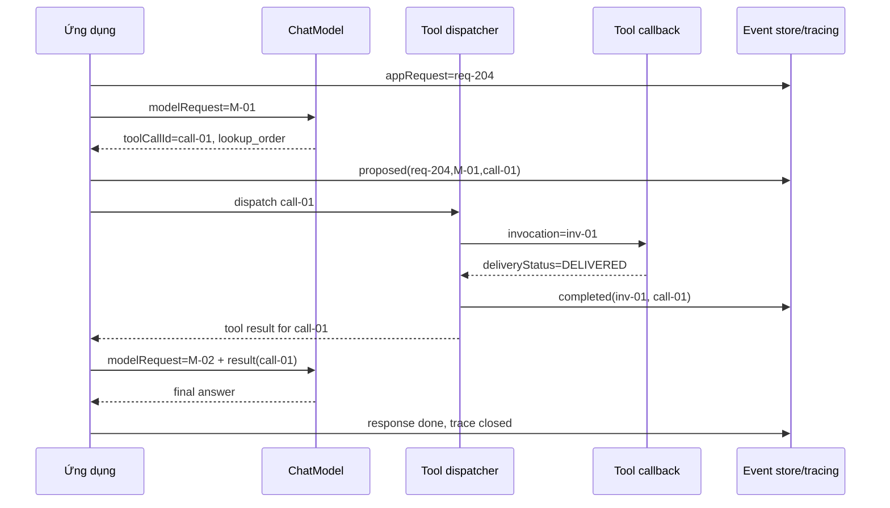
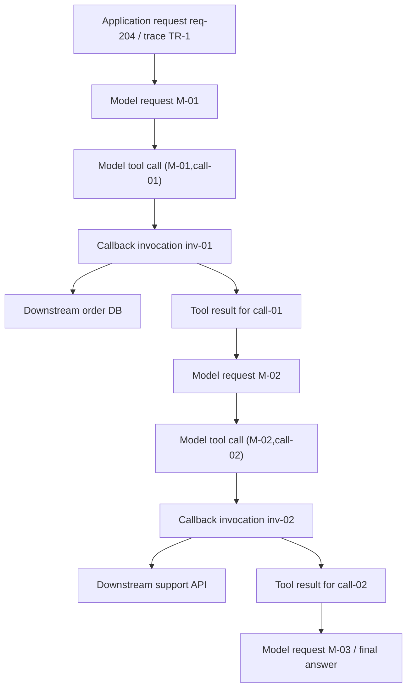

# Liên kết tool call ID với lượt gọi mô hình và yêu cầu ứng dụng

Một người dùng hỏi trợ lý Spring AI: **“Đơn DH-204 giao thất bại chưa? Nếu thất bại, hãy tạo một phiếu hỗ trợ.”** Model gọi `lookup_order`, nhận trạng thái `DELIVERED`, nhưng sau đó vẫn có một lệnh `create_support_ticket`. Trong log có hai dòng “tool completed” và ba lần gọi model. Nếu thiếu định danh nối các sự kiện, ta rất khó trả lời: **lần gọi model nào yêu cầu công cụ nào, callback nào thực thi yêu cầu ấy, kết quả nào đã được đưa trở lại model, và toàn bộ luồng thuộc yêu cầu người dùng nào?**

Đây là vấn đề **correlation (liên kết sự kiện)**. Một `tool call ID` do model/provider trả về không phải lúc nào cũng là ID của callback thực thi, càng không phải ID yêu cầu HTTP hoặc trace ID. Hiểu các lớp định danh này giúp xây một chuỗi sự kiện có thể kiểm chứng, phân tích lỗi công cụ, độ trễ, chi phí, và dùng trace để đánh giá **tool-calling correctness** thay vì chỉ nhìn câu trả lời cuối.

Bài học thuộc chương **Quan sát công cụ** trong mô-đun **SPRING_AI_EVALUATION_OBSERVABILITY**. Mô-đun tập trung đánh giá chất lượng ứng dụng Spring AI bằng tập dữ liệu, relevance, fact checking, RAG và tool calling; đồng thời đo metrics, traces, chi phí, độ trễ để phát hiện suy giảm chất lượng theo phiên bản prompt, model, công cụ và pipeline. Trọng tâm của bài này là **liên kết tool call ID với đúng lượt gọi mô hình và yêu cầu ứng dụng**, kể cả khi có nhiều công cụ, retry, thực thi song song hoặc lỗi giữa chừng.

> **Nguyên tắc:** dùng **ID để chỉ ra quan hệ**, không suy quan hệ chỉ từ tên tool, thời gian gần nhau hay thứ tự dòng log. Định danh cần có **phạm vi duy nhất** rõ ràng và được tạo ở đúng ranh giới sở hữu.

## 1. Kết quả học tập

Sau bài học, bạn có thể:

1. Phân biệt **application request ID**, **trace/span ID**, **model request/turn ID**, **provider tool call ID**, **callback invocation/attempt ID** và **logical operation ID**.
2. Mô tả cách một tool request trong đầu ra model đi qua dispatch, callback, tool result message và lượt gọi model kế tiếp.
3. Thiết kế **khóa liên kết có phạm vi**, tránh ghép sai khi nhà cung cấp không xuất ID hoặc dùng lại một giá trị ID ở lượt khác.
4. Ghi nhận **một–nhiều** giữa yêu cầu ứng dụng, model rounds, tool requests và callback attempts; xử lý **fan-out, retry, song song, timeout**.
5. Tạo bản ghi sự kiện có cấu trúc, phục hồi chuỗi thực thi từ log/traces và kiểm các quan hệ thiếu/đúp.
6. Kết hợp Spring AI `ChatClient`, phương thức `@Tool` và Micrometer Observation/Tracing ở mức phù hợp với phiên bản dự án.
7. Giữ **ID cá thể** trong log/trace có phân quyền, chỉ sử dụng **tag cardinality thấp** cho metrics.
8. Nối trace công cụ với nhãn người/rule để phân biệt **công cụ chạy thành công** và **agent làm đúng nghiệp vụ**.

## 2. Từ một câu hỏi tới nhiều lượt model và tool

Một workflow đơn giản có thể cần nhiều lần gửi thông điệp cho model:

```text
USER REQUEST R-204:
"Nếu DH-204 giao thất bại, hãy mở phiếu hỗ trợ."

  MODEL REQUEST M-01:
    Model đề xuất tool call TC-01:
      name = lookup_order
      arguments = {"orderId":"DH-204"}

  TOOL CALLBACK INVOCATION I-01:
    Thực thi lookup_order("DH-204")
    result = {"deliveryStatus":"DELIVERED"}

  TOOL RESULT MESSAGE:
    Gắn với TC-01, mang nội dung DELIVERED

  MODEL REQUEST M-02:
    Nhận kết quả của TC-01
    Model đề xuất tool call TC-02:
      name = create_support_ticket
      arguments = {"orderId":"DH-204"}

  TOOL CALLBACK INVOCATION I-02:
    Thực thi create_support_ticket(...)
    result = {"ticketId":"SUP-51"}

  TOOL RESULT MESSAGE:
    Gắn với TC-02, mang ticketId SUP-51

  MODEL REQUEST M-03:
    Nhận kết quả của TC-02
    Trả lời cuối: "Tôi đã tạo phiếu SUP-51."
```

Một **request ứng dụng** chứa ba **lượt model** và hai **đề xuất tool call**. Mỗi tool request được gắn với **callback invocation** tương ứng và một kết quả để model tiếp tục. Cả hai callback có thể trả thành công về mặt kỹ thuật, nhưng **workflow sai** vì model đã tạo phiếu khi trạng thái là `DELIVERED`, không phải giao thất bại.

Không thể suy ra lỗi này từ hai dòng độc lập “callback success”. Cần ghép **user intent → model tool request → callback execution → tool result → next model decision** thành một đường nhân quả.

### 2.1. Phân biệt yêu cầu và thực thi

| Khái niệm | Điều đã xảy ra | Có chắc callback đã chạy? |
|---|---|---|
| **Model-suggested tool call** | Đầu ra model yêu cầu dùng một tool và arguments | **Không** |
| **Tool dispatch** | Hệ thống resolve tên tool, parse/kiểm arguments | **Chưa chắc** |
| **Callback invocation** | Mã tool đã thực sự được gọi | **Có** |
| **Callback attempt** | Một lần thử thực thi; retry tạo attempt mới | **Có** |
| **Tool result message** | Kết quả được đưa về vòng hội thoại của model | Có thể đại diện success, lỗi có kiểm soát hoặc bị thiếu |
| **Logical operation** | Một mục đích nghiệp vụ, có thể qua nhiều attempts | Không nhất thiết đồng nhất với một lượt model yêu cầu |

Nếu tool name không tồn tại hoặc arguments bị từ chối **trước khi vào callback**, phải ghi lỗi ở lớp dispatch. Đừng tạo một “callback success” chỉ vì model đã xuất tool request. Ngược lại, nếu callback timeout, phải biết **attempt nào đã được bắt đầu** ngay cả khi không có tool result hoàn chỉnh.

## 3. Bảy loại định danh và phạm vi của chúng

Để dễ phân biệt, dùng bộ ID minh họa:

| ID | Ví dụ | Đơn vị nhận diện | Ai thường cấp? |
|---|---|---|---|
| **`applicationRequestId`** | `req-204` | Một yêu cầu nghiệp vụ/HTTP hoặc tác vụ agent | Ứng dụng/gateway |
| **`traceId`** | `tr-8f...` | Một distributed trace | Tracing runtime, theo định dạng của hệ thống |
| **`spanId`** | `sp-a1...` | Một span cụ thể trong trace | Tracing runtime |
| **`modelRequestId`** | `model-turn-01` | Một lần ứng dụng gọi model | Ứng dụng hoặc metadata model nếu có |
| **`providerToolCallId`** | `call_v7` | Một tool request do đầu ra model định danh | Model/provider khi API hỗ trợ |
| **`callbackInvocationId`** | `invoke-01` | Một lần callback attempt thực sự chạy | Ứng dụng/instrumentation |
| **`logicalOperationId`** | `support-op-204` | Một mục tiêu nghiệp vụ dùng để gộp retry/kiểm idempotency | Bộ điều phối nghiệp vụ |

Có thể cần thêm:

- **`modelResponseId`:** định danh của response từ provider, khi có.
- **`toolCallOrdinal`:** thứ tự tool call bên trong cùng một response khi không có provider tool call ID.
- **`toolResultMessageId`:** ID một thông điệp kết quả do ứng dụng quản lý.
- **`attemptIndex`:** thứ tự retry trong một logical operation hoặc một tool request, tùy quy ước.
- **`agentRunId`/`conversationId`:** phiên agent hoặc hội thoại; một hội thoại có thể bao gồm nhiều `applicationRequestId`.
- **`parentSpanId`/`span links`:** quan hệ tracing, không thay thế hoàn toàn quan hệ nghiệp vụ giữa tool request/result.

**Không coi các ID này đồng nghĩa.** `traceId` có thể bao cả ba model requests và hai callbacks; một `providerToolCallId` chỉ trỏ một đề xuất cụ thể trong output model, còn retry có thể tạo **nhiều callbackInvocationId** cho một đề xuất.

### 3.1. Ai sở hữu quyền đặt ID?

Nguyên tắc:

- **Application request ID:** do cổng ứng dụng/đơn vị chạy agent cấp hoặc tin cậy sau khi kiểm soát; không nhận giá trị tùy ý từ chuỗi câu trả lời của LLM.
- **Trace/span IDs:** do hệ thống tracing cấp và lan truyền theo giao thức; có thể nhận context từ upstream qua cơ chế tin cậy, nhưng vẫn cần chính sách chống dữ liệu giả mạo ở ranh giới public.
- **Provider tool call ID:** đọc từ metadata cấu trúc của **model response**, không trích từ câu trả lời văn bản có vẻ giống JSON.
- **Invocation ID:** sinh **mới cho mỗi callback attempt**. Không dùng mỗi `tool.name` hay `orderId` làm ID vì nhiều lần gọi có thể chung hai giá trị này.
- **Logical operation ID:** do ứng dụng xác định để nhận diện thao tác cần idempotency; có thể tồn tại qua retry, nhưng không dùng bừa một ID chung cho hai thao tác khác nhau.

Một mã đơn hàng như `DH-204` là **dữ liệu nghiệp vụ**, không phải `providerToolCallId` hoặc `traceId`. Hai người có thể hỏi cùng mã đơn, nhưng hai lượt agent của họ **không được gộp** thành một tool call.

## 4. Khóa liên kết an toàn: scope trước, ID sau

Một giả định nguy hiểm là **`providerToolCallId` luôn duy nhất trong mọi request và mọi thời điểm**. Thực tế mức bảo đảm khác nhau giữa provider, phiên API và trường hợp response. Một ứng dụng đáng tin cần **ghi rõ phạm vi** thay vì dựa vào tính duy nhất toàn cục không được hứa hẹn.

### 4.1. Khóa đề nghị

Với tool call đã có ID provider:

```text
ToolCallKey =
(
  applicationRequestId,
  modelRequestId,
  providerToolCallId
)
```

Khi provider **không cấp ID tool call ổn định**, dùng một **khóa nội bộ do ứng dụng tạo**:

```text
ToolCallKey =
(
  applicationRequestId,
  modelRequestId,
  appToolCallKey
)

appToolCallKey có thể được tạo từ:
  responseIndex + toolCallOrdinal
hoặc một ID duy nhất do ứng dụng cấp tại lúc đọc model response.
```

**Phải phân biệt `appToolCallKey` với `providerToolCallId` trong dữ liệu lưu.** Nếu API không có ID gốc, không tự chế một giá trị rồi báo đó là ID do provider cung cấp.

Đối với một ứng dụng có nhiều node/worker, `modelRequestId` cần có tính duy nhất trong phạm vi đã quy định; có thể dùng ID ngẫu nhiên/ULID do ứng dụng cấp. Nếu muốn dùng chỉ số lượt `1,2,3` thì khóa cần thêm `applicationRequestId` và trạng thái session tương ứng.

### 4.2. Hai lượt model có thể dùng cùng chuỗi ID

```text
Request req-204
  Model turn M-01 -> providerToolCallId = "call_1"
  Model turn M-02 -> providerToolCallId = "call_1"
```

Nếu lưu bảng với khóa duy nhất chỉ là `call_1`, lượt sau có thể **ghi đè hoặc ghép nhầm kết quả của lượt trước**. Hai khóa đúng là:

- `(req-204, M-01, call_1)`
- `(req-204, M-02, call_1)`

Nếu hệ thống vận hành lâu dài, còn cần chính sách bảo đảm tránh va chạm ID ứng dụng giữa các instance/deployment. Điều quan trọng không phải dùng một cú pháp UUID cụ thể, mà là có **hợp đồng uniqueness và storage constraint** thực sự.

### 4.3. Không ghép bằng thời gian gần nhau

Một heuristic sai:

> “Lấy tool result xuất hiện ngay sau tool call có cùng tên.”

Nó thất bại khi model đề xuất **hai tool calls cùng tên nhưng khác arguments**, hoặc khi các callbacks hoàn tất khác thứ tự yêu cầu. Ghép đúng bằng **key, invocation metadata, result linkage**. Thời gian và tên tool chỉ là tín hiệu điều tra, **không phải khóa danh tính đáng tin**.

## 5. Luồng liên kết từ model response đến tool result message

Một chuỗi thông thường (được điều phối tự động hoặc thủ công) gồm:

1. **Tạo application request/run ID**, mở trace/span cha theo cơ chế đã cấu hình.
2. **Trước lời gọi model**, cấp `modelRequestId`, ghi phiên bản model/prompt và trace context.
3. **Nhận model response**. Nếu có tool requests, đọc danh sách theo API có cấu trúc, lấy tên tool, arguments và **provider tool call ID nếu hiện diện**.
4. **Đăng ký từng tool request** cùng `ToolCallKey` và `toolCallOrdinal`. Một response có thể có nhiều tool requests.
5. **Dispatch** bằng registry công cụ. Nếu bị từ chối trước callback, ghi `DISPATCH_REJECTED` và nguyên nhân; không dựng một invocation giả.
6. **Ngay trước mỗi callback attempt**, cấp `callbackInvocationId` mới; lưu liên kết `ToolCallKey` → invocation.
7. **Khi callback kết thúc**, ghi outcome, duration, error category, kết quả/tóm tắt kết quả được phép lưu. Retry tạo attempt mới, vẫn nối cùng logical operation/call theo quy ước.
8. **Tạo tool result message** tương ứng với tool call trong model response. Nếu giao thức provider yêu cầu ID của lời gọi gốc, dùng **chính ID đó**, không dùng callbackInvocationId thay thế.
9. **Gửi tool results vào model request tiếp theo** theo thứ tự và định dạng mà API/provider yêu cầu. Ghi `modelRequestId` kế tiếp và những tool call keys mà nó đã được cấp kết quả.
10. **Tổng hợp trace và evaluation**: đối chiếu tool sequence/arguments/results với rule hoặc nhãn người.

### 5.1. Sơ đồ tuần tự



Sơ đồ chỉ thể hiện **quan hệ nghiệp vụ**; parent-child spans trong tracing có thể khác tùy Spring AI/tool execution mode và context propagation.

### 5.2. Phải giữ `tool call ID` khi tạo thông điệp kết quả

Nhiều giao thức tool calling dùng một trường tương đương `tool_call_id` để nối **tool result message** với **request** của assistant. Nếu framework tự tạo tool result messages, nó thường có trách nhiệm gắn liên kết này theo giao thức provider. Khi xây vòng tool thủ công, lập trình viên phải thực hiện chính xác theo API tương ứng.

Nếu đưa callbackInvocationId `inv-01` vào chỗ provider mong `call-01`, model request kế tiếp có thể bị từ chối hoặc không ghép được response. Một ứng dụng cần lưu cả hai:

```text
providerToolCallId = "call-01"       // giao thức model
callbackInvocationId = "inv-01"      // logging và vận hành ứng dụng
```

**Không biến log correlation ID thành ID giao thức model** chỉ vì chúng đều là chuỗi.

## 6. Dữ liệu sự kiện có cấu trúc để khôi phục luồng

Một bản ghi theo sự kiện là cách đơn giản để truy vấn và kiểm chất lượng liên kết. Ví dụ schema **do ứng dụng thiết kế**, không phải format mặc định của Spring AI:

```json
{
  "eventType": "TOOL_CALLBACK_COMPLETED",
  "eventId": "event-204-05",
  "occurredAt": "2026-11-27T10:00:00Z",
  "applicationRequestId": "req-204",
  "agentRunId": "agent-run-204",
  "traceId": "example-trace-id",
  "parentSpanId": "example-parent-span",
  "spanId": "example-callback-span",
  "modelRequestId": "model-turn-01",
  "modelResponseId": "provider-response-01",
  "providerToolCallId": "call-01",
  "appToolCallKey": "model-turn-01:0",
  "toolCallOrdinal": 0,
  "callbackInvocationId": "inv-01",
  "logicalOperationId": "op-lookup-DH-204",
  "attemptIndex": 1,
  "canonicalToolName": "lookup_order",
  "toolSchemaVersion": "orders-v2",
  "executionStatus": "COMPLETED",
  "outcome": "success",
  "durationMs": 82,
  "resultCategory": "DELIVERED",
  "inputPayloadLogged": false,
  "outputPayloadLogged": false
}
```

Các ID trong ví dụ là **giá trị minh họa**, không phải trace ID đúng định dạng kỹ thuật của OpenTelemetry. Hệ thống thật phải dùng giá trị do tracing runtime tạo nếu cần tích hợp exporter/collector, và dùng thời điểm/duration đo được thay vì thời gian giả.

### 6.1. Nên có những loại event nào?

| Event | Khi nào ghi? | ID bắt buộc ở mức ứng dụng |
|---|---|---|
| `APP_REQUEST_STARTED` | Bắt đầu tác vụ người dùng | `applicationRequestId` |
| `MODEL_REQUEST_STARTED` | Gửi một lượt model | `applicationRequestId`, `modelRequestId` |
| `MODEL_TOOL_CALL_PROPOSED` | Model trả một yêu cầu gọi tool | `modelRequestId`, scoped tool call key |
| `TOOL_DISPATCH_REJECTED` | Không resolve/không hợp lệ trước callback | scoped tool call key, reason category |
| `TOOL_CALLBACK_STARTED` | Callback attempt bắt đầu | scoped key, `callbackInvocationId` |
| `TOOL_CALLBACK_COMPLETED` | Callback attempt kết thúc | `callbackInvocationId`, outcome/duration |
| `TOOL_RESULT_EMITTED` | Kết quả được tạo để gửi lại model | scoped key, `toolResultMessageId` |
| `MODEL_REQUEST_CONSUMED_TOOL_RESULTS` | Model request kế nhận các kết quả | `modelRequestId` mới, danh sách các scoped keys |
| `APP_REQUEST_FINISHED` | Hoàn thành hoặc lỗi yêu cầu | `applicationRequestId`, final status |

Không nhất thiết ứng dụng phải lưu **tất cả sự kiện thô** mãi mãi. Có thể kết hợp structured logs, traces được sampling và một kho event/counter có thời hạn phù hợp. Nhưng nếu một tỷ lệ linkage cần **đếm đầy đủ**, không được tính bằng cách giả định backend traces có sampling chứa 100% mọi lời gọi.

### 6.2. Quan hệ một–nhiều cần thể hiện được

```text
Application Request 1
 ├── Model Request 1
 │    ├── Tool Call A
 │    │    ├── Callback Attempt A.1
 │    │    └── Callback Attempt A.2 (retry)
 │    └── Tool Call B
 │         └── Callback Attempt B.1
 ├── Model Request 2 (nhận kết quả A và B)
 │    └── Tool Call C
 │         └── Callback Attempt C.1
 └── Model Request 3 (trả lời cuối)
```

Kết luận từ sơ đồ:

- `modelToolCallId` không đồng nghĩa `callbackInvocationId`;
- Retry **không mặc định tạo tool request mới** từ model;
- Hai tool requests trong một model response có thể chạy song song;
- Một model request tiếp theo có thể **nhận nhiều kết quả** từ các tool calls khác nhau.

## 7. Số ID nào cần xuất ra metrics, logs và traces?

`traceId`, `applicationRequestId`, `callbackInvocationId` là các giá trị gần như duy nhất. Đưa chúng vào **metric tags** có thể tạo rất nhiều chuỗi thời gian, làm tăng chi phí và gây quá tải hệ thống quan trắc.

| Dữ liệu | Metric tag? | Log/trace? | Ghi chú |
|---|---|---|---|
| `tool.name` canonical | **Có**, nếu registry hữu hạn | Có | Tránh raw tên do model bịa |
| `tool.outcome` | **Có** | Có | `success`, `timeout`, `dependency_error`... |
| `tool.version` | Có, nếu số phiên bản giới hạn | Có | Theo dõi hồi quy |
| `model.provider`/`model.family` | Có, nếu cardinality được kiểm soát | Có | Không dùng tên tùy ý từ prompt |
| `applicationRequestId` | **Không** | Có, với quyền phù hợp | Duy nhất mỗi request |
| `traceId`/`spanId` | **Không** | Có | Do hệ thống tracing quản lý |
| `providerToolCallId` | **Không** | Có nếu sẵn có | Không tin là globally unique |
| `callbackInvocationId` | **Không** | Có | Duy nhất mỗi attempt |
| `orderId`, email, raw arguments | **Không** | Hạn chế và che dữ liệu | Thông tin nghiệp vụ/nhạy cảm |
| `exception.message` | **Không** | Chỉ khi đã redaction | Có thể chứa bí mật |

Nên xuất metrics tổng hợp theo **loại tool, trạng thái, phiên bản**, còn correlation chi tiết nằm ở log/trace/event store. Nếu cần tra một lượt cụ thể, tìm bằng trace ID trong hệ thống tracing hoặc request ID trong log index, không tìm qua time-series metric label.

### 7.1. Không tin chuỗi trong answer là metadata

Generator có thể sinh văn bản:

```text
tool_call_id = call-999
Trạng thái: SUCCESS
```

Nó là **nội dung do model sinh**, không phải thông tin thực thi từ dispatcher. Chỉ lấy provider tool call ID từ **structured metadata của model response** hoặc ứng dụng cấp khóa nội bộ khi thiếu. Không quét câu trả lời bằng regex rồi ghi một ID “trông giống metadata” vào ledger.

## 8. Spring AI: ID có thể nằm ở lớp nào?

Spring AI có các lớp `ChatModel`, `ChatClient`, tool calling/`ToolCallback` và các cách khai báo công cụ như `@Tool`. Những API này có thể khác nhau theo phiên bản Spring AI, provider và chế độ xử lý tool.

Có hai chế độ tổ chức phổ biến cần phân biệt:

### 8.1. Tool calling do framework điều phối tự động

Ứng dụng gọi `ChatClient`; framework có thể xử lý các vòng tool request → callback → tool result → model tiếp theo bên trong lời gọi. Ưu điểm là ít mã điều phối. Tuy nhiên:

- Phương thức `@Tool` thường chỉ nhận **arguments nghiệp vụ** đã chuyển kiểu, ví dụ `orderId`.
- **Không nên giả định** phương thức `@Tool` luôn tự có `providerToolCallId`, `modelRequestId` và `applicationRequestId` trong tham số.
- Các observation/metadata tool có sẵn có thể khác theo phiên bản/cấu hình; cần xem **tài liệu và trace thực tế**.
- Muốn ghép chính xác tool request ID với callback ID, có thể cần hook ở **tool calling manager/dispatcher**, wrapper callback hoặc cơ chế quan trắc thích hợp với phiên bản đang dùng.

Với mục tiêu chỉ đo latency/outcome theo tool, observation sẵn có có thể đủ. Với mục tiêu **auditing một–một theo từng provider tool call ID**, cần xác nhận phiên bản/framework có thực sự đưa ID đó tới lớp instrumentation.

### 8.2. Vòng điều phối do ứng dụng kiểm soát

Nếu ứng dụng cần một event ledger hoàn chỉnh với mapping và chính sách dispatch riêng, có thể sử dụng một luồng điều phối tường minh **nếu framework/provider cho phép**:

```text
1. Cấp modelRequestId trước khi gọi model.
2. Gọi model với cấu hình không tự thực thi tool ở phần cần kiểm soát.
3. Đọc structured tool requests từ model response.
4. Sinh key và ghi MODEL_TOOL_CALL_PROPOSED.
5. Resolve tool, cấp callbackInvocationId cho mỗi attempt.
6. Thực thi tool và ghi outcome, duration.
7. Tạo tool result message với tool call ID đúng giao thức.
8. Gọi model tiếp với các tool result messages.
9. Lặp tới final answer hoặc giới hạn vòng/timeout.
```

Đây là **pseudocode kiến trúc**, không phải một API cụ thể được bảo đảm có cùng tên trên mọi phiên bản Spring AI. Nếu chọn cách này, phải kiểm tra khả năng tool calling, tool result role, cấu hình internal execution và việc chuyển context của phiên bản thư viện. **Không chạy tool có side effect hai lần** do vừa bật auto-execution vừa tự dispatch.

### 8.3. Cách xác minh tích hợp

Trước khi viết thêm instrumentation:

1. Dùng một công cụ chỉ đọc `lookup_order` trên môi trường thử.
2. Bật observability phù hợp với phiên bản Spring AI/Spring Boot/Micrometer.
3. Xem một model response có hai tool requests; xác nhận **tool call ID có hiện diện trong cấu trúc API/trace được cung cấp** không.
4. Xem callback spans, tool outcome, quan hệ parent/child, và liệu các lượt model sau có thể truy nguyên về tool result messages không.
5. Nếu ID thiếu ở một boundary, bổ sung **ứng dụng cấp ID** tại đó, nhưng không giả mạo rằng đó là ID provider.
6. Kiểm tra không tạo instrumentation trùng ranh giới khiến mỗi callback bị đếm hai lần.
7. Ghi cụ thể **Spring AI version, model/provider, tool execution mode, observation convention** trong tài liệu triển khai của dự án.

## 9. Ví dụ Java: một ledger liên kết tool request với callback attempts

Mã Java 17+ dưới đây mô tả **logic xác định do ứng dụng sở hữu**. Nó không phụ thuộc provider và không truy cập mạng. Ledger minh họa cho **một quy trình tổng hợp tuần tự các event đã thu thập**; trong ứng dụng có nhiều thread, cần event store/transaction hoặc đồng bộ phù hợp thay vì chia sẻ trực tiếp `HashMap` này cho nhiều callback song song.

**Khóa `ToolCallKey` phải được tạo ngay lúc đọc structured model response**. Khi provider không cấp ID, tạo `appToolCallKey` riêng và ghi nguồn gốc. Ví dụ giả định trường `callKey` đã là một khóa nội bộ duy nhất **trong phạm vi modelRequestId**, dù nó có nguồn gốc provider hay ứng dụng.

```java
import java.util.ArrayList;
import java.util.HashMap;
import java.util.HashSet;
import java.util.List;
import java.util.Map;
import java.util.Set;

public final class ToolCallLinkLedger {

    public record ToolCallKey(
            String appRequestId,
            String modelRequestId,
            String callKey) {
    }

    public record Proposed(
            ToolCallKey key,
            String canonicalToolName,
            int toolCallOrdinal,
            String providerToolCallId) {
    }

    public record Attempt(
            String invocationId,
            ToolCallKey key,
            int attemptIndex,
            String outcome) {
    }

    public record ResultLink(
            ToolCallKey key,
            String resultMessageId,
            String consumingModelRequestId) {
    }

    private final Map<ToolCallKey, Proposed> proposals =
            new HashMap<>();
    private final Map<String, Attempt> attemptsByInvocation =
            new HashMap<>();
    private final Map<ToolCallKey, List<Attempt>> attemptsByCall =
            new HashMap<>();
    private final Map<ToolCallKey, ResultLink> results =
            new HashMap<>();

    public void recordProposed(Proposed p) {
        if (p == null || p.key() == null
                || blank(p.key().appRequestId())
                || blank(p.key().modelRequestId())
                || blank(p.key().callKey())
                || blank(p.canonicalToolName())
                || p.toolCallOrdinal() < 0
                || proposals.putIfAbsent(p.key(), p) != null) {
            throw new IllegalArgumentException(
                    "Invalid or duplicate proposed tool call");
        }
    }

    public void recordAttempt(Attempt a) {
        if (a == null || blank(a.invocationId())
                || a.key() == null
                || !proposals.containsKey(a.key())
                || a.attemptIndex() < 1
                || blank(a.outcome())
                || attemptsByInvocation.containsKey(a.invocationId())) {
            throw new IllegalArgumentException(
                    "Invalid attempt or missing proposal");
        }

        List<Attempt> previous = attemptsByCall
                .computeIfAbsent(a.key(), ignored -> new ArrayList<>());

        boolean duplicateIndex = previous.stream()
                .anyMatch(x -> x.attemptIndex() == a.attemptIndex());

        if (duplicateIndex) {
            throw new IllegalArgumentException(
                    "Duplicate attempt index for one tool call");
        }

        attemptsByInvocation.put(a.invocationId(), a);
        previous.add(a);
    }

    public void recordToolResult(ResultLink r) {
        if (r == null || r.key() == null
                || !proposals.containsKey(r.key())
                || blank(r.resultMessageId())
                || blank(r.consumingModelRequestId())
                || results.putIfAbsent(r.key(), r) != null) {
            throw new IllegalArgumentException(
                    "Invalid or duplicate tool result link");
        }
    }

    public List<ToolCallKey> withoutCallbackAttempt() {
        List<ToolCallKey> missing = new ArrayList<>();
        for (ToolCallKey key : proposals.keySet()) {
            if (!attemptsByCall.containsKey(key)) missing.add(key);
        }
        return missing;
    }

    public List<ToolCallKey> withoutToolResult() {
        List<ToolCallKey> missing = new ArrayList<>();
        for (ToolCallKey key : proposals.keySet()) {
            if (!results.containsKey(key)) missing.add(key);
        }
        return missing;
    }

    public int proposedCount() { return proposals.size(); }

    public int attemptCount() {
        return attemptsByInvocation.size();
    }

    public int emittedResultCount() {
        return results.size();
    }

    private static boolean blank(String value) {
        return value == null || value.isBlank();
    }
}
```

Ví dụ cách ghi các mối liên hệ:

```java
var ledger = new ToolCallLinkLedger();

var key = new ToolCallLinkLedger.ToolCallKey(
        "req-204", "model-turn-01", "call-01");

ledger.recordProposed(
        new ToolCallLinkLedger.Proposed(
                key, "lookup_order", 0, "call-01"));

ledger.recordAttempt(
        new ToolCallLinkLedger.Attempt(
                "inv-01", key, 1, "success"));

ledger.recordToolResult(
        new ToolCallLinkLedger.ResultLink(
                key, "tool-result-message-01", "model-turn-02"));

// proposedCount = 1
// attemptCount = 1
// emittedResultCount = 1
// withoutCallbackAttempt = []
// withoutToolResult = []
```

### 9.1. Đọc đúng giới hạn của ví dụ

- Mã chứng minh **cách mô hình hóa quan hệ** và phát hiện link thiếu/đúp; **chưa bảo đảm luồng event đến đúng thứ tự, thread safety hoặc tính bền khi process crash**.
- `recordAttempt` trong ví dụ nhận kết quả attempt đã hoàn tất; ở production nên có **STARTED** và **COMPLETED/FAILED** riêng để phát hiện callback chạy rồi mất liên lạc.
- `ResultLink` chỉ ghi **một thông điệp kết quả cuối** theo tool call. Với luồng có nhiều đoạn stream hoặc status trung gian, thiết kế event cần hỗ trợ nhiều event nhưng giữ rõ **một final result theo giao thức** khi thích hợp.
- `withoutToolResult` không mặc nhiên là lỗi: dispatch có thể đã từ chối, request có thể bị hủy, hoặc provider/ứng dụng chủ đích kết thúc vòng với lỗi. Phải **gắn nguyên nhân** chứ không tự cộng tất cả thành “mất kết quả”.
- Trước khi lưu `ResultLink` thực tế, kiểm nó thuộc **đúng tool call key** và lượt model tiêu thụ kết quả đi sau lượt đã tạo lời gọi. Đoạn mã không kiểm thứ tự thời gian.
- Nếu app dùng cùng `providerToolCallId` hai lần trong một response, cần dựa vào hợp đồng provider để nhận diện lỗi protocol hoặc tạo một key nội bộ phân biệt, **không âm thầm ghi đè**.
- Ở hệ thống nhiều worker, dùng database/queue và **unique constraints** trên `ToolCallKey`, `callbackInvocationId`, `resultMessageId`; coi việc xử lý cùng một event được giao lại là **idempotent** thay vì tạo liên kết mới.

### 9.2. Không được đánh đồng callback retry với tool request mới

Giả sử callback `inv-01` timeout và retry bằng `inv-02`:

```text
ToolCallKey=(req-204,model-turn-01,call-01)
  Callback attempt 1: inv-01 -> timeout
  Callback attempt 2: inv-02 -> success
  Tool result message: tool-result-message-01
```

Đây là **một model tool request, hai callback attempts, một final tool result**. Nếu model **tự đề xuất thêm** một tool request ở lượt tiếp theo, phải tạo một `ToolCallKey` mới dù arguments giống hệt.

Với công cụ có side effect, retry không được chỉ dựa trên việc callback timeout: thao tác ngoài có thể đã hoàn tất. Cần **idempotency key**, trạng thái commit và cơ chế xác minh kết quả theo logic nghiệp vụ.

## 10. Ví dụ Spring AI: tạo span cha cho yêu cầu và cho business tool

Đoạn minh họa Java sau dùng `ChatClient` và `@Tool`. Nó cho thấy cách tạo observation ở ranh giới **yêu cầu ứng dụng** và **phần thân tool**, qua Micrometer Observation. Đây là hai loại observation do ứng dụng đặt tên; chúng **không tự tạo ra ánh xạ provider tool call ID ↔ invocation ID**. Muốn có ánh xạ ấy, cần hook ở lớp dispatcher/tool execution như mục 8.

```java
import io.micrometer.observation.Observation;
import io.micrometer.observation.ObservationRegistry;
import org.springframework.ai.chat.client.ChatClient;
import org.springframework.ai.chat.model.ChatModel;
import org.springframework.ai.tool.annotation.Tool;

import java.util.Objects;

public final class ObservableSupportAgent {

    public record OrderSnapshot(
            String orderId, String deliveryStatus) {
    }

    public interface OrderService {
        OrderSnapshot lookup(String orderId);
    }

    public static final class OrderTools {
        private final OrderService service;
        private final ObservationRegistry registry;

        public OrderTools(OrderService service, ObservationRegistry registry) {
            this.service = Objects.requireNonNull(service);
            this.registry = Objects.requireNonNull(registry);
        }

        @Tool(description = "Tra trạng thái giao hàng theo mã đơn")
        public OrderSnapshot lookupOrder(String orderId) {
            Observation obs = Observation
                    .createNotStarted("app.ai.tool.business.lookup", registry)
                    .lowCardinalityKeyValue("tool.name", "lookup_order");

            String outcome = "error";
            obs.start();

            try (Observation.Scope scope = obs.openScope()) {
                OrderSnapshot result = service.lookup(orderId);
                outcome = "success";
                return result;

            } catch (RuntimeException ex) {
                obs.error(ex);
                throw ex;

            } finally {
                obs.lowCardinalityKeyValue("tool.outcome", outcome);
                obs.stop();
            }
        }
    }

    private final ChatClient agentClient;
    private final OrderTools tools;
    private final ObservationRegistry registry;

    public ObservableSupportAgent(
            ChatModel generatorModel,
            OrderTools tools,
            ObservationRegistry registry) {

        this.agentClient = ChatClient.builder(generatorModel).build();
        this.tools = Objects.requireNonNull(tools);
        this.registry = Objects.requireNonNull(registry);
    }

    public String answer(String question) {
        Observation root = Observation
                .createNotStarted("app.ai.agent.request", registry)
                .lowCardinalityKeyValue("agent.flow", "support");

        root.start();

        try (Observation.Scope scope = root.openScope()) {
            // Framework có thể điều phối các tool calls nội bộ.
            return agentClient.prompt()
                    .user(question)
                    .tools(tools)
                    .call()
                    .content();

        } catch (RuntimeException ex) {
            root.error(ex);
            throw ex;

        } finally {
            root.stop();
        }
    }
}
```

### 10.1. Điều code đo được và chưa đo được

**Đo được khi observability được cấu hình đúng:**

- Thời gian yêu cầu ở `app.ai.agent.request`;
- Thời gian thực thi phần thân công cụ ở `app.ai.tool.business.lookup`;
- Outcome thành công/lỗi của phần thân tool;
- Quan hệ span cha–con trong những lời gọi đồng bộ khi observation scope/context được truyền chính xác.

**Chưa tự có bằng đoạn code này:**

- Provider `tool_call_id` của mỗi lần model đề xuất;
- `modelRequestId` cho các vòng model do framework chạy nội bộ;
- Ánh xạ một–một giữa tool request và callback invocation, đặc biệt nhiều requests/parallel;
- Retry policy/`logicalOperationId`/idempotency key;
- Phân loại lỗi parse/dispatch **trước khi vào phương thức `@Tool`**;
- Xác minh tool trace đúng nghiệp vụ.

Nếu Spring AI đã có tool callback observation ở cùng ranh giới, phần observation trong `@Tool` nên được hiểu là **business span bổ sung**, không được tính lẫn với callback span framework để báo số callback attempts. Đối chiếu tài liệu phiên bản và kiểm traces thực tế trước khi chọn ranh giới.

### 10.2. Đưa correlation ID vào đúng lớp

Để tạo sự kiện `MODEL_TOOL_CALL_PROPOSED` có provider ID và sự kiện `TOOL_CALLBACK_STARTED` có invocation ID, cần một lớp thực sự thấy **cả model tool request metadata và lời gọi callback**. Có thể là:

- Lớp ứng dụng tự điều phối tool requests;
- Một wrapper/hook được phiên bản Spring AI cụ thể hỗ trợ tại tool dispatch;
- Một adapter do nhóm phát triển quản lý trước khi gọi implementation;
- Một observation convention/tracing integration nếu framework đã cung cấp đầy đủ metadata.

**Không nên sửa chữ ký `@Tool lookupOrder(String orderId)` thành tham số `providerToolCallId` rồi giả định framework sẽ tự điền.** Tham số đó có thể bị model xem là **tham số nghiệp vụ phải sinh**, vừa thiếu tin cậy vừa làm schema tool sai. Context ID phải đi theo **metadata kênh điều phối**, không phải payload do model quyết định.

## 11. Quan hệ trace, observation và business correlation không giống nhau

Trong distributed tracing:

- **Trace** là tập các span liên quan trong một yêu cầu/luồng phân tán.
- **Span** đo một đoạn công việc: HTTP request, model request, callback, downstream API call.
- **Parent/child** biểu diễn một dạng quan hệ nhân quả trong execution context.
- **Span link** có thể nối các tác vụ có quan hệ nhưng không phù hợp mô hình một cha–một con, ví dụ qua hàng đợi hoặc batching.
- **Application correlation IDs** mô tả quan hệ nghiệp vụ mà tracing tự động không phải lúc nào cũng biết, như một tool request dẫn đến hai retry attempts.

### 11.1. Một trace ID có thể bao nhiều model turns



Sơ đồ là **DAG logic để tái dựng**, không có nghĩa mỗi mũi tên bắt buộc tương ứng với quan hệ parent-child thực tế của OpenTelemetry. Thường nhiều spans chia sẻ cùng trace ID, còn liên kết provider tool call ID cần lưu riêng ở event attributes.

### 11.2. Vì sao cần giữ cả trace ID và tool call key?

Hai đoạn `lookup_order` và `create_support_ticket` có thể thuộc **cùng trace**, nhưng chỉ có trace ID không đủ biết:

- Tool call nào do **model round** nào đề xuất?
- Kết quả của tool call A có thực sự được cấp cho lượt model thứ hai không?
- Tool call A đã retry bao nhiêu lần?
- Kết quả nào đang được model dùng khi nó quyết định gọi tool B?

**Trace ID giúp tìm toàn bộ luồng; tool call key giúp dựng liên kết một–một/một–nhiều đúng nghĩa.** Không thay cái này bằng cái kia.

## 12. Truyền correlation qua thread, async và hệ thống khác

Trong hệ thống đồng bộ, scope của observation có thể được truyền theo call stack hiện tại. Nhưng khi callback được đẩy sang executor, message queue, Reactor hoặc remote service, context **có thể bị mất** nếu không cấu hình propagation đúng.

### 12.1. Ba lớp thông tin cần truyền

1. **Trace context:** trace/span theo chuẩn và cơ chế propagation được dùng; cho phép downstream spans nối vào trace.
2. **Application correlation:** `applicationRequestId`, `logicalOperationId` hoặc định danh tác vụ; nên ở metadata có quyền phù hợp.
3. **Tool call linkage:** scoped `ToolCallKey`, `callbackInvocationId`; chỉ cần ở những thành phần thực sự quản lý dispatch/result, không cần đưa hết vào mọi tool argument.

**Không đưa ID vào prompt cho model chỉ để chuyển nó sang callback** nếu có thể truyền qua orchestration context. Model có thể thay đổi ID, bịa ID khác hoặc làm lộ nội dung trong câu trả lời cuối.

### 12.2. Trường hợp callback bất đồng bộ

Giả sử `create_report` chỉ **đưa job vào hàng đợi rồi trả `jobId`**. Callback invocation có thể hoàn tất trong 25 ms, còn job thực chạy 5 phút.

- Callback observation: đo **thời gian xếp lịch**.
- Job-processing span: đo **thời gian job chạy**.
- `logicalOperationId`/`jobId`: nối hai pha nghiệp vụ.
- `providerToolCallId`: nối model request với **lệnh đặt job**, không tự đồng nghĩa với completion của job.
- Final answer chỉ được báo “đã tạo báo cáo hoàn tất” nếu có **tín hiệu completion thật**, không chỉ vì tool submit job thành công.

Trong mô hình message broker, có thể dùng trace context propagation và span links; phải kiểm exporter/sampling và chính sách bảo mật trước khi đưa ID vào message metadata.

### 12.3. Hai tool chạy song song, trả ngược thứ tự

```text
Model response M-01 đề xuất:
  call-A -> lookup_order(DH-204)
  call-B -> get_refund_policy("VN")

Callback thực thi:
  inv-A -> chờ 800 ms
  inv-B -> xong sau 120 ms

Result đến:
  call-B trước, call-A sau
```

Nếu ghép theo **thứ tự đến**, kết quả policy có thể bị nhầm là kết quả tra đơn. Đúng là:

- `result-B` phải liên kết `call-B`;
- `result-A` phải liên kết `call-A`;
- Model request kế tiếp nhận kết quả theo **định dạng/giao thức đúng** của provider, không tự suy mapping bằng thời gian.

Mỗi callback có invocation ID và span riêng, dù cùng request/trace.

## 13. Retry, timeout và giới hạn của correlation

### 13.1. Một đề xuất có thể gây nhiều callback attempts

```text
Application request = req-204
Model request = M-01
Tool call ID = call-01
Logical operation = op-lookup-204

  Attempt inv-01: dependency timeout
  Attempt inv-02: success
  Tool result: tool-result-01
```

Nếu báo “tool calls = 2” mà không giải thích, người đọc có thể tưởng model **yêu cầu hai lần**. Thực tế model đề xuất **một** lần và ứng dụng thử callback **hai** lần. Dashboard nên có ít nhất:

- Model-proposed tool calls;
- Dispatch-resolved tool calls;
- Callback attempts;
- Logical operations có retry;
- Final tool result messages.

### 13.2. Timeout là trạng thái cần truy nguyên

Một timeout có thể xảy ra:

- Trước dispatch: callback **chưa chạy**;
- Trong callback: có callback attempt nhưng không hoàn thành bình thường;
- Sau khi downstream đã commit: callback timeout **không chứng minh thao tác chưa xảy ra**;
- Khi đang gửi tool result về model: callback có thể thành công nhưng **model chưa nhận được kết quả**.

Do đó mỗi pha cần status riêng, không gộp tất cả thành “tool failed”. Với tool ghi dữ liệu, dùng **idempotency key** và kiểm trạng thái trước khi retry; không dựa vào câu trả lời của model để quyết định có thao tác lại hay không.

### 13.3. Tool request được đề xuất nhưng không có callback

Một `ToolCallKey` không thấy callback có thể do:

1. Tên tool không tồn tại;
2. Arguments sai schema, bị từ chối trước callback;
3. Lỗi authorization/precondition tại dispatch;
4. Request bị hủy trước khi chạy;
5. Event bị mất do lỗi logging/exporter;
6. Trace bị sampling nên callback span không xuất hiện, dù callback thực tế đã chạy.

Chỉ khi phân loại theo **dispatch outcome và nguồn event đáng tin** mới biết có phải “mất liên kết” hay **không thực thi có chủ đích**. Không lấy absence của một sampled span làm bằng chứng tool không chạy.

## 14. Ví dụ tính toán: bao nhiêu tool requests thực sự được nối kết?

Giả sử một đợt đánh giá offline có:

- **100 application requests**;
- **170 model requests** (gồm các lần model tiếp tục sau tool results);
- **120 model-proposed tool calls**;
- **4 tool calls bị dispatcher từ chối** trước callback vì tên tool không được đăng ký;
- **116 tool calls được dispatch** vào callback;
- Trong 116 logical tool executions, có **14 operations được retry một lần**;
- Tổng **130 callback attempts** = 116 lượt đầu + 14 lượt retry.

Sau khi hoàn tất toàn bộ flow:

- **108 operations** trả kết quả `success`;
- **5 operations** trả `business_rejected` hợp lệ;
- **3 operations** kết thúc bằng lỗi kỹ thuật;
- **113 tool result messages hợp lệ** được trả về model cho 108 + 5 operations thành công về giao thức;
- 4 dispatch rejections và 3 technical failures **không tạo tool result messages** trong chính sách minh họa này; các yêu cầu liên quan được kết thúc hoặc báo lỗi tại lớp điều phối.

### 14.1. Các tỷ lệ từ đúng mẫu số

| Chỉ số | Công thức | Kết quả |
|---|---|---:|
| Tỷ lệ đề xuất được dispatch | 116/120 | **96,7%** |
| Attempts trên mỗi call đã dispatch | 130/116 | **≈ 1,12** |
| Tỷ lệ operations có retry | 14/116 | **≈ 12,1%** |
| Tỷ lệ hoàn tất kỹ thuật theo operations, kể cả business_rejected | (108+5)/116 | **≈ 97,4%** |
| Tỷ lệ kết thúc lỗi kỹ thuật theo operations | 3/116 | **≈ 2,6%** |
| Kết quả model nhận so với mọi proposed calls | 113/120 | **≈ 94,2%** |
| Đề xuất không có tool result do đã ghi nguyên nhân | (4+3)/120 | **≈ 5,8%** |

Các số **giả định** và nhất quán trong ví dụ này. Tỷ lệ 94,2% **không phải** “linkage bị mất 5,8%” vì cả bảy trường hợp không có kết quả đều đã có **lý do vận hành rõ ràng**. Một metric riêng về **unexplained linkage gaps** mới đo số trường hợp thiếu liên kết mà không có trạng thái hợp lệ.

### 14.2. Không nhầm mẫu số callback attempt và logical operation

Tổng 130 attempts có thể gồm nhiều timeout hoặc dependency failures đã được retry thành công. Muốn tính **attempt technical error rate** cần kết quả **của từng attempt** — các số final outcomes 108/5/3 chưa đủ để suy ra bao nhiêu attempt đầu tiên thất bại. Không được lấy `3/130` rồi gọi là tỷ lệ lỗi attempt chỉ vì có ba operations kết thúc lỗi.

Tương tự, 170 model requests khác 120 proposed calls. Muốn biết “model gọi tool bình quân bao nhiêu lần một lượt”, có thể báo `120/170 ≈ 0,71 đề xuất trên model request`, nhưng phân phối có thể rất lệch: có lượt không gọi tool, có lượt yêu cầu nhiều tool cùng lúc.

### 14.3. Bộ kiểm tra tính đầy đủ

Một hệ thống event ledger nên phân loại tất cả 120 proposed calls vào các trạng thái cuối:

```text
120 proposed
  ├── 4 dispatch_rejected
  └── 116 dispatched
        ├── 113 terminal_result_emitted
        └── 3 callback_terminal_error
```

Nếu dashboard đếm được 120 proposed nhưng chỉ **118** trạng thái cuối và không ghi cancellation/timeout còn chạy, có **hai trường hợp thiếu trạng thái phải điều tra**. Đó mới là chỉ số **unresolved tool call linkage** có ích.

## 15. Metrics và truy vấn phục hồi sự kiện

Những metric tùy chỉnh **minh họa**:

| Metric | Đơn vị | Tag low-cardinality gợi ý | Ý nghĩa |
|---|---|---|---|
| `app.ai.tool.proposed` | Counter | tool.name, model.family | Model đề xuất bao nhiêu tool calls |
| `app.ai.tool.dispatched` | Counter | tool.name, dispatch.outcome | Bao nhiêu lời gọi được resolve/đẩy vào callback |
| `app.ai.tool.callback.duration` | Timer | tool.name, tool.outcome | Latency callback attempts |
| `app.ai.tool.callback.errors` | Counter | tool.name, error.category | Lỗi callback đã chạy |
| `app.ai.tool.retries` | Counter | tool.name, retry.reason | Retry attempts |
| `app.ai.tool.results.emitted` | Counter | tool.name, result.kind | Bao nhiêu tool result messages |
| `app.ai.tool.linkage.unresolved` | Counter/gauge theo đợt | reason.category, workflow | Lời gọi chưa có trạng thái cuối được giải thích |
| `app.ai.agent.model.rounds` | Distribution | workflow, model.family | Số vòng model trên request ứng dụng |

Đây **không phải tên metric mặc định được bảo đảm** của Spring AI. Nếu framework/Micrometer đã xuất count từ Timer/Observation, tránh tạo double-count. Chọn tên/schema theo bản thư viện, dashboard và hệ thống metric hiện có.

### 15.1. Một truy vấn logic để tìm mismatch

Trong kho event quan hệ, có thể diễn đạt kiểm tra ở mức ý tưởng:

```text
Cho mỗi MODEL_TOOL_CALL_PROPOSED:
  key = (applicationRequestId, modelRequestId, callKey)

  Tìm trạng thái cuối tương ứng:
    - DISPATCH_REJECTED, hoặc
    - CALLBACK_TERMINAL_ERROR, hoặc
    - TOOL_RESULT_EMITTED, hoặc
    - CANCELLED, hoặc
    - IN_PROGRESS trong giới hạn thời gian.

  Nếu không có trạng thái phù hợp sau timeout quan trắc:
    gắn UNEXPLAINED_LINK_GAP để điều tra.

  Nếu >1 TOOL_RESULT_EMITTED cuối cho cùng key
  mà giao thức chỉ cho phép một:
    gắn DUPLICATE_TOOL_RESULT.

  Nếu một TOOL_RESULT_EMITTED trỏ key không có PROPOSED:
    gắn ORPHAN_TOOL_RESULT.
```

Nên dùng unique index và ràng buộc **theo scope** trong event store để chặn duplicates, đồng thời có cơ chế replay/idempotency khi hệ thống giao nhận sự kiện ít nhất một lần (*at-least-once*). Truy vấn phải quy định rõ **độ trễ cho phép** trước khi gắn nhãn orphan: sự kiện async có thể đến không theo thứ tự.

### 15.2. Đừng đo “linkage correctness” bằng việc parse văn bản

Nếu model kể “Tôi đã gọi lookup_order” nhưng không có `MODEL_TOOL_CALL_PROPOSED` trong metadata cấu trúc, lời kể đó **không chứng minh lời gọi diễn ra**. Ngược lại, nếu callback tồn tại nhưng câu trả lời cuối không nhắc tới nó, callback vẫn đã chạy. **Nguồn sự thật về thực thi** là dispatcher/observability/event store, không phải văn bản do generator sinh.

## 16. Đo latency và chi phí theo đúng quan hệ

Một application request có thể trải qua:

```text
App request req-204
  Model M-01: 520 ms
  Tool call TC-01:
     callback attempt inv-01: 90 ms
  Model M-02: 610 ms
  Tool call TC-02:
     callback attempt inv-02: 340 ms
  Model M-03: 440 ms
  Other sequential overhead: 70 ms

End-to-end (ví dụ thuần tuần tự):
  520 + 90 + 610 + 340 + 440 + 70 = 2.070 ms
```

Tổng này chỉ đúng với **đường chạy tuần tự minh họa không chồng lấn**. Nếu callbacks chạy song song, dùng **thời gian thực của request cha**; không cộng duration hai spans song song để suy wall-clock. Nếu HTTP/DB span nằm trong callback, không cộng nó lần nữa vào callback duration.

### 16.1. Chi phí model và công cụ

- **Model tokens:** lấy usage của **từng model request**, tổng theo `applicationRequestId` và phiên bản model. Không dùng số callback để thay số model calls.
- **Tool/API charges:** tính theo invocation/transaction thật của dịch vụ phụ thuộc nếu có phí, phân biệt retry và cached call.
- **Latency:** đo p50/p95/p99 của **model requests**, **callback attempts**, **logical operations** và **end-to-end application requests** riêng.
- **RAG context:** thêm nguồn dài có thể tăng input tokens và độ trễ model nhưng không nhất thiết tăng callback duration.
- **Traces/metrics cost:** số span và log event cũng có chi phí vận hành; dùng sampling/retention có ý thức, không đánh đổi mất sự kiện cần phục hồi giao dịch.

Ví dụ đơn giản: model M-01 và M-02 đều tính phí token, dù người dùng chỉ gửi **một request**. Nếu báo “chi phí model một lần gọi” thay vì tổng theo `applicationRequestId`, số liệu sẽ đánh giá thấp tác động của tool calling nhiều vòng.

### 16.2. Thay prompt có thể làm tăng độ trễ mà callback vẫn nhanh

Sau khi đổi prompt agent:

- Latency mỗi `lookup_order` giữ ~100 ms;
- Số tool calls trên request tăng từ 1,0 lên 1,8;
- Số model rounds tăng vì model hỏi lại công cụ không cần thiết.

**p95 end-to-end tăng** dù callback p95 không đổi. Khi đó vấn đề có thể ở **chính sách gọi tool của model/prompt**, không phải hiệu năng API tra đơn. Liên kết `modelRequestId` ↔ `ToolCallKey` cho phép xác định vòng nào đang gọi dư thừa.

## 17. Liên kết observability với đánh giá tool correctness

Có thể tạo một gold set với dữ liệu người đánh giá hoặc rule nghiệp vụ:

```json
{
  "sampleId": "support-case-204",
  "datasetVersion": "tool-eval-v2",
  "userIntent": "Chỉ tạo phiếu nếu DH-204 giao thất bại",
  "orderSnapshot": {
    "orderId": "DH-204",
    "deliveryStatus": "DELIVERED"
  },
  "expectedToolSequence": [
    {"tool": "lookup_order", "orderId": "DH-204"}
  ],
  "observedToolSequence": [
    {"tool": "lookup_order", "orderId": "DH-204"},
    {"tool": "create_support_ticket", "orderId": "DH-204"}
  ],
  "humanOrRuleVerdict": "FAIL",
  "failureCategory": "INVALID_PRECONDITION",
  "applicationRequestId": "req-204",
  "modelRequestIds": ["M-01", "M-02", "M-03"],
  "traceId": "example-trace-id"
}
```

Bản ghi là **schema minh họa**. Khi chấm thật, nên dùng bản ghi chuẩn có `ToolCallKey` và invocation references thay vì chỉ danh sách tên tool: danh sách này là cách **tóm tắt dễ đọc**, chưa đủ cho nhiều tool calls đồng tên hoặc retry.

### 17.1. Chất lượng workflow được đo bằng điều gì?

| Điều muốn biết | Dữ liệu liên kết cần | Phép kiểm |
|---|---|---|
| Model chọn đúng tool? | User intent, model tool request, tool name | Expected tool selection theo gold set |
| Arguments đúng? | Tool request/validated arguments, user request | Schema và assertion theo ngữ nghĩa |
| Thứ tự đúng? | ModelRequestId, ToolCallKey, invocation/event index | Rule/state machine |
| Precondition đúng? | Kết quả `lookup_order` được đưa về model nào trước `create_support_ticket` | Kiểm trạng thái đơn và quan hệ nhân quả |
| Callback thực sự thành công? | Invocation outcome, response/commit status | Technical/business outcome |
| Model dùng kết quả đúng? | Tool result message và model continuation | Fact checking/faithfulness với tool output |
| Bị gọi lại nguy hiểm? | Logical operation ID, attempt index, idempotency status | Kiểm không tạo phiếu trùng |
| Hồi quy do model hay tool? | Prompt/model/tool schema/dependency versions | So trên tập khóa với trace và nhãn người |

**Callback success ≠ agent correctness.** Một API tạo phiếu hoàn tất có thể là **lỗi nghiêm trọng của agent** nếu việc gọi API vốn không được phép khi `DELIVERED`.

### 17.2. Tool result có thật nhưng model không nhận được?

Nếu có `TOOL_CALLBACK_COMPLETED` cho `call-01` nhưng không có `TOOL_RESULT_EMITTED` hoặc model continuation nhận kết quả, cần phân biệt:

- Callback đã xong nhưng lớp serialize result bị lỗi;
- Tool result bị mất do request bị hủy;
- Model request kế tiếp chưa được tạo vì timeout;
- Event/trace logging bị thiếu do sampling hoặc exporter;
- Tool result đã chuyển đi nhưng model vẫn bỏ qua nội dung.

Chỉ khi ghép **đầy đủ các điểm** mới biết lỗi ở đâu. Nếu bỏ mất `modelRequestId` của lượt sau, dễ quy lỗi cho model không dùng tool output trong khi thực tế nó **chưa bao giờ nhận được**.

## 18. Các tình huống kiểm thử correlation không nên bỏ sót

| Test | Tình huống | Kỳ vọng |
|---|---|---|
| **TC01** | Một model call, một tool, một callback success | Đúng một proposed, một invocation, một result |
| **TC02** | Một model response đề xuất hai tool cùng tên | Hai `ToolCallKey` khác nhau, không ghép bằng tên |
| **TC03** | Hai tool chạy song song, kết quả trả ngược thứ tự | Mỗi result gắn đúng scoped key |
| **TC04** | Callback timeout rồi retry thành công | Một tool request, hai invocation IDs, một final result |
| **TC05** | Model ở lượt kế tiếp lại đề xuất cùng tool | **ToolCallKey mới**; không trộn với retry cũ |
| **TC06** | Provider không cung cấp tool call ID | Dùng `appToolCallKey`, đánh dấu ID source=APPLICATION |
| **TC07** | Hai model rounds dùng lại chuỗi provider ID | Scope bằng `modelRequestId` ngăn va chạm |
| **TC08** | Tên tool không tồn tại | Dispatch rejected, **không** có callback attempt giả |
| **TC09** | Tool result trỏ key không có proposed | Phát hiện orphan, không đoán mapping bằng timestamp |
| **TC10** | Hai final tool results cho một call | Phát hiện duplicate hoặc xác định cơ chế stream hợp lệ |
| **TC11** | Async job được schedule nhưng chưa xong | Phân biệt callback completed và job completed |
| **TC12** | Mất trace context khi đổi thread | Correlation app IDs vẫn rõ; kiểm propagation để nối spans |
| **TC13** | Side-effect callback timeout sau commit | Có idempotency/status; không retry mù |
| **TC14** | Tracing sampling bỏ một callback span | Không kết luận callback chưa chạy chỉ từ absence span |
| **TC15** | Người dùng chèn chuỗi `tool_call_id=foo` vào prompt | Không lấy chuỗi đó làm structured provider ID |
| **TC16** | Bật hai bộ instrumentation cùng ranh giới | Không double-count callbacks hoặc nhân đôi span/counter |
| **TC17** | Model/tool lỗi làm hủy vòng tiếp theo | Các calls chưa kết thúc có final failure/cancel reason |
| **TC18** | Nhiều người dùng hỏi cùng một mã đơn | Không gộp calls theo business key `orderId` |
| **TC19** | Model response trả final answer, không gọi tool | Không tạo proposed tool events giả |
| **TC20** | Một callback bị gọi song song hai attempts do race | Phát hiện hai invocation IDs, kiểm idempotency và chặn side effect trùng |

Trong bộ kiểm thử tự động, dùng **fake tool/repository**, không thực thi tác vụ tạo phiếu hoặc giao dịch thật. Kiểm số lượng events bằng event sink hoặc ObservationRegistry thử nghiệm phù hợp với bản Micrometer đang sử dụng; không phụ thuộc duy nhất vào một giao diện tracing có sampling.

## 19. Những sai lầm thường gặp

| Sai lầm | Hậu quả | Cách khắc phục |
|---|---|---|
| Dùng mỗi `tool.name` làm correlation key | Ghép nhầm hai lời gọi cùng công cụ | Scoped `ToolCallKey` |
| Coi provider tool call ID là globally unique | Va chạm qua model turns/request | Thêm scope request/turn |
| Lấy callbackInvocationId làm tool_call_id gửi cho model | Sai giao thức, không khớp tool result | Giữ provider ID và invocation ID riêng |
| Tạo một invocation cho mỗi đề xuất dù tool chưa chạy | Đếm phantom callback | Chỉ cấp invocation khi callback bắt đầu |
| Coi retry là một model đề xuất tool mới | Đếm sai số lần model quyết định | Tách attempt và logical operation |
| Ghép results theo thứ tự hoàn thành | Sai khi parallel/out-of-order | Ghép theo ID được xác thực |
| Dùng `orderId` để gộp mọi tool calls | Trộn người dùng/phiên khác nhau | Correlation theo application request |
| Dùng chuỗi trong model final answer làm nguồn thực thi | Model có thể kể sai hoặc bịa | Lấy structured tool/dispatcher events |
| Ghi raw provider ID/request ID vào metric tag | Cardinality và chi phí tăng mạnh | Đưa vào log/trace có phân quyền |
| Coi trace ID đủ để biết tool call nào tạo result nào | Thiếu quan hệ model round ↔ call | Lưu scoped key và result link |
| Coi sampled span thiếu là callback không chạy | Kết luận sai do sampling | Dùng event/counter đáng tin, kiểm sampling |
| Quên context propagation qua executor/queue | Span rời rạc, khó điều tra | Propagate context và correlation metadata |
| Ghi kết quả callback là model đã nhận được | Có thể lỗi serialize/tool result transfer | Theo dõi `TOOL_RESULT_EMITTED` và consumed |
| Đếm callback success để tuyên bố agent đúng | Agent có thể gọi sai điều kiện | Gold set, rule/state-machine evaluation |
| Chạy lại tool có side effect để “xác minh” trace | Tạo phiếu/giao dịch trùng | Snapshot/mock/idempotency |
| Bật auto tool execution và tự gọi callback lần nữa | Side effect và trace bị nhân đôi | Chọn một chế độ điều phối, kiểm version |
| Không version hóa prompt/model/tool schema | Không xác định nguyên nhân hồi quy | Ghi metadata theo run và sample |

## 20. Quy trình triển khai trong dự án Spring AI

1. **Định nghĩa đơn vị đếm:** app requests, model requests, proposed tool calls, dispatch outcomes, callback attempts, logical operations, result messages.
2. **Chọn chính sách ID:** scope của mỗi ID, cơ chế cấp ID, nguồn provider/application và chính sách unique keys.
3. **Xác định tool mode:** framework auto-execution hay ứng dụng điều phối; kiểm xem metadata tool call ID thực sự hiện diện ở đâu trong bản Spring AI được sử dụng.
4. **Bật observability phù hợp:** Spring Boot/Micrometer/tracing; xác minh thực tế parent-child spans và các observations đã có.
5. **Instrument các ranh giới còn thiếu:** model request, proposed calls, dispatch, callback invocation, result emission/consumption; tránh ghi trùng.
6. **Lưu structured events:** `ToolCallKey`, invocation/attempt, result link, status, time, tool version, trace ID; bảo vệ dữ liệu nhạy cảm.
7. **Giữ ID nghiệp vụ riêng:** order ID, logical operation và idempotency key không thay cho model tool call ID.
8. **Kiểm concurrency/retry:** two tools same name, out-of-order results, timeout, cancellations, duplicate final responses.
9. **Phân loại kết quả cuối:** result emitted, dispatch rejected, callback terminal error, cancelled; đặt cảnh báo cho unexplained linkage gaps.
10. **Tổng hợp metrics đúng mẫu số:** proposed/dispatch/callback attempts/operations/result messages, timeout và end-to-end latency.
11. **Nối tool traces với gold set:** đánh giá chọn tool, args, precondition, sequence và model xử lý result.
12. **So phiên bản:** cố định dataset và rubric, theo dõi generator prompt/model, tool schema, downstream services, chi phí và latency.
13. **Giám sát production:** theo dõi retry, orphan/duplicate, missing propagation, p95, token và chi phí; điều tra trace có vấn đề.
14. **Bảo trì:** thay tool/provider/model cần chạy lại test correlation và giới hạn rủi ro side effects.

### Checklist trước khi coi kết quả truy vết là đầy đủ

- [ ] Có `applicationRequestId` đáng tin cho yêu cầu ứng dụng.
- [ ] Có `modelRequestId` riêng cho mỗi lượt gọi model.
- [ ] `providerToolCallId` được lưu riêng, có ghi rõ khi không có.
- [ ] Có khóa `ToolCallKey` theo đúng scope, không chỉ tên tool.
- [ ] Có `callbackInvocationId` mới cho **từng** attempt thực thi thật.
- [ ] Retry và logical operation được nối mà không gộp nhầm.
- [ ] Tool result được liên kết với **đúng** call ID theo giao thức model.
- [ ] Có sự kiện dispatch rejection, error, timeout và cancellation.
- [ ] Có bài thử parallel/out-of-order và duplicate calls.
- [ ] Trace ID, span ID và application IDs không bị dùng lẫn.
- [ ] Không ghi ID/request payload cardinality cao vào metric tags.
- [ ] Có thời gian và số lượt model/tool riêng để tính chi phí/độ trễ.
- [ ] Có nhãn/rule kiểm **tool-calling correctness**, không chỉ callback success.
- [ ] Đã kiểm instrumentation của framework theo **phiên bản** để tránh double-count.

## 21. Bài luyện tập

### Bài 1 — Phân loại các ID

Một yêu cầu HTTP có `applicationRequestId=req-01`, `traceId=tr-01`. Model request `M-01` đề xuất hai tool calls `call-A` và `call-B`. Các callbacks chạy với `inv-A-1` và `inv-B-1`. Chỉ `call-A` bị timeout rồi retry với `inv-A-2`.

Hãy xác định:

1. Số application requests, model requests, proposed calls và callback attempts.
2. Có nên dùng `inv-A-2` làm ID tool result gửi model thay cho `call-A` không?
3. Những attempts nào phải cùng `ToolCallKey`?

### Bài 2 — Model turns trùng ID gốc

Trong `req-01`, model `M-01` xuất ID `call_1` cho `lookup_order`. Lượt `M-02` lại xuất ID `call_1` cho `get_refund_policy`.

Thiết kế khóa nào tránh ghép nhầm? Điều gì xảy ra nếu database chỉ có khóa `providerToolCallId`?

### Bài 3 — Kết quả hoàn tất ngược thứ tự

Model trả `call-A -> lookup_order` và `call-B -> get_refund_policy`. Callback của B hoàn tất trước A. Một đoạn mã lấy “kết quả tiếp theo” rồi gắn nó với tool call đầu tiên.

Lỗi gì xảy ra? Cần thêm dữ liệu liên kết nào?

### Bài 4 — Tính số lượt theo đúng mẫu số

Dựa vào ví dụ mục 14: 120 proposed calls, 4 dispatch rejects, 116 dispatched calls, 14 calls retry một lần, tổng 130 attempts, có 113 final tool result messages.

Tính tỷ lệ dispatch, retry operations, final technical completion của dispatched calls và tỷ lệ proposed có final tool result. Vì sao 7 calls không có tool result trong ví dụ **chưa phải lỗi correlation**?

### Bài 5 — Tool success nhưng agent sai

`lookup_order("DH-204")` trả `DELIVERED`. Model vẫn đề xuất `create_support_ticket("DH-204")` và callback trả `SUP-51`.

Các correlation IDs giúp ta chứng minh điều gì? Phép đánh giá nào vẫn cần để kết luận workflow FAIL?

### Bài 6 — Timeout sau commit

Tool tạo phiếu bị timeout ở `inv-01`, nhưng API ngoài có thể đã tạo thành công. Scheduler định thử lại `inv-02`, giữ cùng logical operation.

Nêu hai yêu cầu về **idempotency/trạng thái** và hai thông tin correlation cần lưu để điều tra không tạo phiếu trùng.

### Bài 7 — Tracing sampling

Backend tracing không có span callback `inv-05` nhưng event store ghi đủ `TOOL_CALLBACK_STARTED/COMPLETED` cùng key và duration.

Có được kết luận callback chưa chạy không? Cần kiểm hệ thống quan trắc như thế nào?

### Bài 8 — Đổi prompt, chi phí tăng

Phiên bản prompt mới tạo nhiều tool calls hơn và số model rounds tăng; latency riêng từng callback gần như không đổi, nhưng tổng token và p95 request tăng.

Dựa vào những trường ID, metrics và trace nào để xác minh nguyên nhân?

### Gợi ý đáp án

1. **1 app request**, **1 model request**, **2 proposed calls**, **3 callback attempts**. Không dùng `inv-A-2` thay `call-A` trong tool result theo giao thức provider. `inv-A-1` và `inv-A-2` cùng `ToolCallKey=(req-01,M-01,call-A)`.
2. Dùng khóa có scope `(applicationRequestId,modelRequestId,providerToolCallId)`. Khóa chỉ `call_1` gây **va chạm và gán nhầm** tool result giữa hai lượt.
3. Dữ liệu của B có thể bị coi là kết quả A. Cần `ToolCallKey` và kết quả callback liên kết đúng key, không ghép theo thứ tự hoàn tất.
4. Dispatch = `116/120 ≈ 96,7%`; operations có retry = `14/116 ≈ 12,1%`; final technical completion = `113/116 ≈ 97,4%`; result coverage trên proposed = `113/120 ≈ 94,2%`. Bảy trường hợp đã có kết cục **4 dispatch rejects + 3 terminal callback errors**, nên không phải thiếu trạng thái không giải thích được.
5. ID chứng minh `M-01` sinh call tra đơn, kết quả `DELIVERED` được đưa vào model request tiếp theo, rồi model vẫn yêu cầu tạo phiếu. Rule nghiệp vụ “chỉ tạo nếu `DELIVERY_FAILED`” hoặc nhãn người xác nhận **tool workflow FAIL**.
6. Dùng idempotency key cố định theo logical operation và xác minh trạng thái commit trước retry; lưu cả `callbackInvocationId` từng attempt, `ToolCallKey`/logicalOperationId và kết quả commit nếu có.
7. **Không.** Span có thể bị sampling/exporter/context propagation; đối chiếu sự kiện đáng tin, cấu hình exporter, sampling và tương quan trace IDs.
8. Theo `applicationRequestId`, `modelRequestId`, `ToolCallKey`, `callbackInvocationId`, prompt/model/tool version, số proposed calls và model rounds, token usage theo lượt, request end-to-end p95, retry và cost. Nếu mỗi callback giữ latency mà số vòng tăng, vấn đề có thể nằm ở **hành vi gọi công cụ dư thừa của model/prompt**.

## Tài liệu tham khảo

- [Spring AI Reference — Tool Calling](https://docs.spring.io/spring-ai/reference/api/tools.html): công cụ, callback và tổ chức vòng model–tool; kiểm tra đúng phiên bản dự án.
- [Spring AI Reference — Chat Client API](https://docs.spring.io/spring-ai/reference/api/chatclient.html): sử dụng `ChatClient`, tool specification và kết quả model.
- [Spring AI Reference — Observability](https://docs.spring.io/spring-ai/reference/observability/): phạm vi quan trắc các thành phần Spring AI tùy phiên bản/cấu hình.
- [Micrometer Observation](https://docs.micrometer.io/micrometer/reference/observation.html): cách dùng Observation, scope, low/high-cardinality key values.
- [Micrometer Tracing](https://docs.micrometer.io/tracing/reference/): context propagation và span correlation.
- [OpenTelemetry — Traces](https://opentelemetry.io/docs/concepts/signals/traces/): trace/span, attributes, links và quan hệ nghiệp vụ phân tán.
- [W3C Trace Context](https://www.w3.org/TR/trace-context/): tiêu chuẩn lan truyền định danh trace giữa các hệ thống.

**Kết luận:** một tool call ID chỉ thực sự hữu ích khi ta biết **nó thuộc model request nào, ứng dụng nào, được callback invocation nào thực thi và kết quả nào được gửi trở lại model**. Hãy dùng scoped keys, tách provider ID khỏi app invocation ID, ghi rõ retry/parallel/cancellation và giữ metric tags cardinality thấp. Khi liên kết được toàn bộ chuỗi, bạn mới phân biệt được lỗi gọi tool, lỗi dịch vụ phụ thuộc, tool result bị mất và **quyết định nghiệp vụ sai của agent**, qua đó đo chính xác chất lượng, chi phí và độ trễ của ứng dụng Spring AI.
